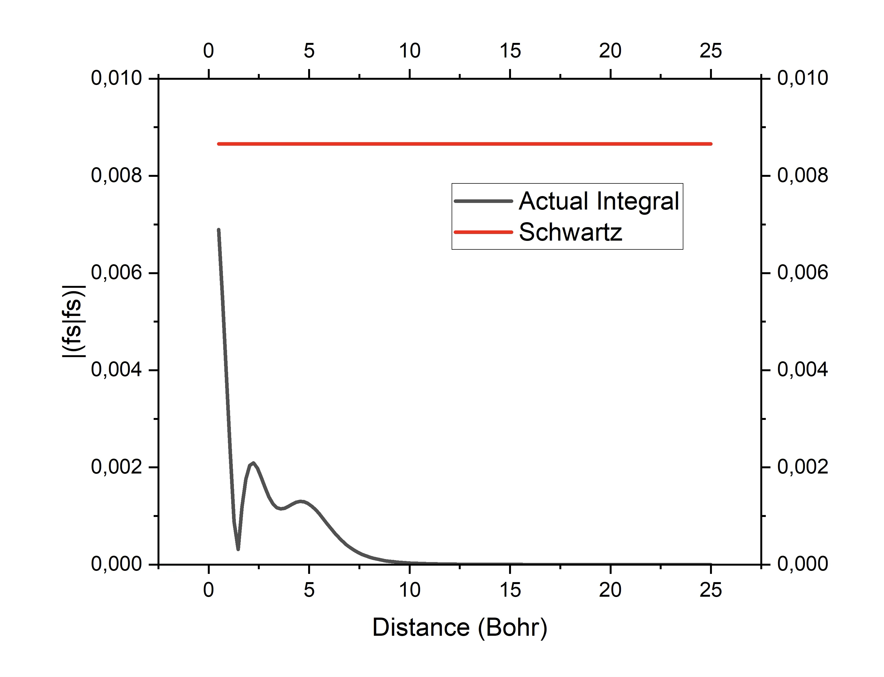
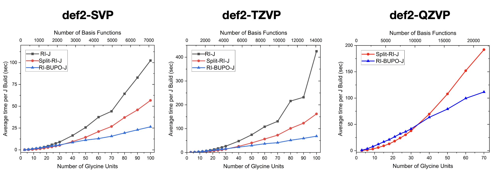

<a id="sec:essentialelements.integralhandling"></a>
# Integral Handling

As the number of nonzero integrals grows very rapidly and reaches easily
hundreds of millions even with medium sized basis sets in medium sized
molecules, storage of all integrals is not generally feasible. This
desperate situation prevented SCF calculations on larger molecules for
quite some time, so that Almlöf
[almloef1982comp,almloef1984advanced,almloef1995modern](../../bibliography.md) made the
insightful suggestion to repeat the integral calculation, which was
already the dominant step, in *every SCF cycle* to solve the storage
problem. Naively, one would think that this raises the effort for the
calculation to $n_{\text{iter} }t_{\text{integrals} }$ (where
$n_{\text{iter} }$ is the number of iterations and
$t_{\text{integrals} }$ is the time needed to generate the nonzero
integrals). However, this is not the case because only the change in the
Fock matrix is required from one iteration to the next, but not the Fock
matrix itself. As the calculations starts to converge, more and more
integrals can be skipped. The integral calculation time will still
dominate the calculation quite strongly, so that ways to reduce this
burden are clearly called for. As integrals are calculated in
*batches*[^1] the cost of evaluating the given batch of shells
$p, q, r, s$ may be estimated as:

$$

\text{cost}\approx n_{p} n_{q} n_{r} n_{s} \left({ 2l_{p} +1} \right)\left({ 2l_{q}
+1} \right)\left({ 2l_{r} +1} \right)\left({ 2l_{s} +1} \right)\qquad \text{(eqn:51)}

$$

Here, $n_{p}$ is the number of primitives involved in shell $p$, and
$l_{p}$ is the angular momentum for this shell. *Large* integrals are
also good candidates for storage, because small changes in the density
that multiply large integrals are likely to give a nonzero contribution
to the changes in the Fock matrix.

ORCA thus features two possibilities for integral handling, which are
controlled by the variable `SCFMode`. In the mode `Conventional`, all
integrals above a given threshold are stored on disk (in a compressed
format that saves much disk space). In the mode `Direct`, all
two-electron integrals are recomputed in each iteration.

Two further variables are of importance: In the `Conventional` mode the
program may write enormous amounts of data to disk. To ensure this stays
within bounds, the program first performs a so-called "statistics run"
that gives a pessimistic estimate of how large the integral files will
be. Oftentimes, the program will overestimate the amount of disk space
required by a factor of two or more. The maximum amount of disk space
that is allowed for the integral files is given by `MaxDisk` (in
Megabytes).

On the other hand, if the integral files in `Conventional` run are small
enough to fit into the central memory, it is faster to do this since it
avoids I/O bottlenecks. The maximum amount of memory allocated for
integrals in this way is specified by `MaxIntMem` (in Megabytes). If the
integral files are larger than `MaxIntMem`, no integrals will be read
into memory.

```orca
%scf
  MaxIter   100    # Max. no. of SCF iterations
  SCFMode Direct   # default, other choice: Conventional
  Thresh  1e-8     # Threshold for neglecting integrals / Fock matrix contributions
                   # Depends on the chosen convergence tolerance (in Eh).
  TCut    1e-10    # Threshold for neglecting primitive batches. If the prefactor
                   # in the integral is smaller than TCut, the contribution of the
                   # primitive batch to the total batch is neglected.
  DirectResetFreq 20   # default: 15
  MaxDisk  2500        # Max. amount of disk for 2 el. ints. (MB)
  MaxIntMem 400        # Max. amount of RAM for 2 el. ints. (MB)
end
```

The value of `DirectResetFreq` sets the number of incremental Fock
matrix builds after which the program should perform a full Fock matrix
build in a `Direct` SCF calculation. To prevent numerical instabilities
that arise from accumulated errors in the recursively build Fock matrix,
the value should not be too large, since this will adversely affect the
SCF convergence. If the value is too small, the program will update more
frequently, but the calculation will take considerably longer, since a
full Fock matrix build is more expensive than a recursive one.

The thresholds `TCut` and `Thresh` also deserve a closer explanation.
`Thresh` is a threshold that determines when to neglect two-electron
integrals. If a given integral is smaller than `Thresh` Eh, it will not
be stored or used in Fock matrix construction. Additionally,
contributions to the Fock matrix that are smaller than `Thresh` Eh will
not be calculated in a `Direct` SCF.

Clearly, it would be wasteful to calculate an integral, then find out it
is good for nothing and thus discard it. A useful feature would be an
efficient way to estimate the size of the integral *before it is even
calculated*, or even have an estimate that is a *rigorous upper bound*
on the value of the integral. Häser and Ahlrichs [haeser1989comp](../../bibliography.md) were
the first to recognize that such an upper bound is actually rather easy
to calculate. They showed that:

$$

\left|{ \left\langle { ij\left|{ kl} \right.} \right\rangle}
\right|\leqslant \sqrt{ \left\langle { ij\left|{ ij} \right.} \right\rangle}
\sqrt{ \left\langle { kl\left|{ kl} \right.} \right\rangle}\qquad \text{(eqn:52)}

$$

where:

$$

\left\langle { ij\left|{ kl} \right.} \right\rangle=\int{ \int{ \phi_{i}
\left({ \vec{{r} }_{1} } \right)\phi_{j} \left({ \vec{{r} }_{1} }
\right)r_{12}^{-1} \phi_{k} \left({ \vec{{r} }_{2} } \right)\phi_{l} \left({\vec{{r} }_{2} } \right)d\vec{{r} }_{1} d\vec{{r} }_{2} } }\qquad \text{(eqn:53)}

$$

Thus, in order to compute an upper bound for the integral only the right
hand side of this equation must be known. This involves only two index
quantities, namely the matrix of two center exchange integrals
$\left\langle { ij\left|{ ij} \right.} \right\rangle$. These integrals
are easy and quick to calculate and they are all
$\geqslant$0 so that there is no trouble with the
square root. Thus, one has a powerful device to avoid computation of
small integrals. In an actual calculation, the Schwartz prescreening is
not used on the level of individual basis functions but on the level of
shell batches because integrals are always calculated in batches. To
realize this, the largest exchange integral of a given exchange integral
block is looked for and its square root is stored in the so called
*pre-screening* matrix **K** (that is stored on disk in ORCA). In a
`Direct` SCF this matrix is not recalculated in every cycle, but simply
read from disk whenever it is needed. The matrix of exchange integrals
on the level of individual basis function is used in `Conventional`
calculations to estimate the disk requirements (the "statistics" run).

Once it has been determined that a given integral batch survives it may
be calculated as:

$$

\left\langle { ij\left|{ kl} \right.} \right\rangle=\sum\limits_p { d_{pi}
\sum\limits_q { d_{qj} \sum\limits_r { d_{kr} \sum\limits_s { d_{sl}
\left\langle { i_{p} j_{q} \left|{ k_{r} l_{s} } \right.} \right\rangle} } }
}\qquad \text{(eqn:54)}

$$

where the sums $p,q,r,s$ run over the primitive Gaussians in each basis
function $i,j,k,l$ and the $d$'s are the contraction coefficients. There
are more powerful algorithms than this one and they are also used in
ORCA. However, if many terms in the sum can be skipped and the total
angular momentum is low, it is still worthwhile to compute contracted
integrals in this straightforward way. In equation
[Eq](#eqn:54), each
primitive integral batch
$\left\langle { i_{p} j_{q} \left|{ k_{r} l_{s} } \right.} \right\rangle$
contains a prefactor $I_{Gaussians}$ that depends on the position of the
four Gaussians and their orbital exponents. Since a contracted Gaussian
usually has orbital exponents over a rather wide range, it is clear that
many of these primitive integral batches will contribute negligibly to
the final integral values. In order to reduce the overhead, the
parameter `TCut` is introduced. If the common prefactor $I_{pqrs}$ is
smaller than `TCut`, the primitive integral batch is skipped. However,
$I_{pqrs}$ is *not* a rigorous upper bound to the true value of the
primitive integral. Thus, one has to be more conservative with `TCut`
than with `Thresh`. In practice it appears that choosing
`TCut=0.01*Thresh` provides sufficient accuracy, but the user is
encouraged to determine the influence of `TCut` if it is suspected that
the accuracy reached in the integrals is not sufficient.

!!! note

    -   If the direct SCF calculation is close to convergence but fails to
        finally converge, this maybe related to a numerical problem with the
        Fock matrix update procedure -- the accumulated numerical noise from
        the update procedure prevents sharp convergence. In this case, set
        `Thresh` and `TCut` lower and/or let the calculation more frequently
        reset the Fock matrix (`DirectResetFreq`).

!!! note

    -   For a `Direct` calculation, there is no way to have `Thresh` larger
        than `TolE`. If the errors in the Fock matrix are larger than the
        requested convergence of the energy, the change in energy can never
        reach `TolE`. The program checks for that.

    -   The actual disk space used for *all* temporary files may easily be
        larger than `MaxDisk`. `MaxDisk` only pertains to the two-electron
        integral files. Other disk requirements are not currently checked by
        the program and appear to be uncritical.

[^1]: A *batch* is a set of integrals that arises from all components of
    the shells involved in the integral. For example a
    $\left\langle pp|pp \right\rangle$ batch gives rise to
    $3 \times 3\times 3 \times 3 = 81$ integrals due to all possible
    combinations of $p_{x}$, $p_{y}$ and $p_{z}$ functions in the four
    shells. Computations based on batches lead to great computational
    advantages because the 81 integrals involved in the
    $\left\langle pp|pp \right\rangle$ batch share many common
    intermediate quantities.

<a id="sec:essentialelements.integralhandling.compression"></a>
## Compression and Storage

The data compression and storage options
deserve some comment: in a number of modules including RI-MP2, MDCI,
CIS, (D) correction to CIS, etc. the program uses so called "Matrix
Containers". This means that the data to be processed is stored in terms
of matrices in files and is accessed by a double label. A typical
example is the exchange operator **K$^{\textbf{ij} }$** with matrix
elements $K^{ij}(a,b)=(ia|jb)$. Here the indices $i$ and $j$ refer to
occupied orbitals of the reference state and $a$ and $b$ are empty
orbitals of the reference state. Data of this kind may become quite
large (formally $N^4$ scaling). To store the numbers in single precision
cuts down the memory requirements by a factor of two with (usually very)
slight loss in precision. For larger systems one may also gain
advantages by also compressing the data (e.g. use a "packed" storage
format on disk). This option leads to additional packing/unpacking work
and adds some overhead. 
The simple keywords to control this behavior are given in 
[tab:essentialelements.integralhandling.keywords.simple](#tab:essentialelements.integralhandling.keywords.simple).
For small molecules `UCDOUBLE` is probably the
best option, while for larger molecules `UCFLOAT` or particularly `CFLOAT`
may be the best choice. Compression does not necessarily slow the
calculation down for larger systems since the total I/O load may be
substantially reduced and thus (since CPU is much faster than disk) the
work of packing and unpacking takes less time than to read much larger
files (the packing may reduce disk requirements for larger systems by
approximately a factor of 4 but it has not been extensively tested so
far). There are many factors contributing to the overall wall clock time
in such cases including the total system load. It may thus require some
experimentation to find out with which set of options the program runs
fastest with.

!!! warning
    - It is possible that `FLOAT` may lead to unacceptable errors. Thus
      it is not the recommended option when MP2 or RI-MP2 gradients or
      relaxed densities are computed. For this reason the default is
      DOUBLE.
    - If you have convinced yourself that `FLOAT` is OK, it may save you
      a factor of two in both storage and CPU.

<a id="sec:essentialelements.integralhandling.prescreening"></a>
## Distance Dependent Pre-Screening

The "Direct" SCF procedure consists of re-calculating the
electron-electron repulsion integrals in every SCF iteration. Avoiding
to store these integrals is what made SCF calculations on large
molecules feasible and therefore is a cornerstone of modern quantum
chemistry. The recalculation is only feasible in reasonable turnaround
times of the calculation of negligibly small integrals is avoided before
calculation. Thus, there needs to be a reasonably cheap to compute
estimate for these integrals that programs rely on for avoiding the
actual integral calculation. This is the important subject of
pre-screening. Pre-screening reduces the number of integrals to be
calculated from O(N$^4$) (exact integrals) or O(N$^3$) (RI integrals) to
O(N$^2$) because in a large molecule, there are only O(N) significant
charge distributions. Of course, it is beneficial if the integral
estimate provides a rigorous upper bound to the actual integral because
in this case it is guaranteed that no contribution to the Fock or
Kohn-Sham matrix that exceeds a pre-defined accuracy threshold is being
missed.

The by far most popular integral estimate is the Schwartz estimator
introduced by Häser and Ahlrichs:

$$

\left| (\mu\nu|\kappa\tau) \right|_{Schwartz} \leq \sqrt{\left( \mu\nu|\mu\nu \right)}\sqrt{\left( \kappa\tau|\kappa\tau \right)}

$$

Thus, all that is required in order to compute this estimate is the
pre-screening matrix

$$

Q_{\mu\nu} = \sqrt{\left( \mu\nu|\mu\nu \right)}

$$

Which is cheap and not memory consuming. We note in passing that, since
integrals are calculated in batches involving four shells, the
pre-screening matrix is also shell contracted, meaning the maximum
element over the members of both shells is taken as actual pre-screening
element. The extension to RI integrals is trivial and will therefore not
be written our here.

The Schwartz estimate is used in practically every quantum chemistry
program. Despite it's success, it also has shortcomings. These
shortcomings are best understood by considering that a given charge
distribution $\mu\nu$ has a multipole structure. At sufficient distance,
the interaction of the distributions $\mu\nu$ and $\kappa\tau$ therefore
have a distance dependence that depends on the multipolar structure of
the two distributions. For example, the monopole-monopole interaction
goes as R${-1}$ (R being the distance between the centers of the two
distributions), dipole-dipole interaction fall off as R$^{-3}$ etc.
Evidently, there is no distance dependence in the Schwartz estimate and
consequently, it will have a tendency to strongly overestimate integrals
that involve non-negligible but distant charge distributions.

<a id="fig:integralhandling.distdepprescrI1"></a>


*Demonstration how the Schwartz-estimate can drastically
overestimate integrals. The red trace Is the Schwartz-estimate while the
black trace is the actual interaction of two one-center fs charge
distributions as a function of distance.*

Historically, a different, related estimator has been popular in the
early days of direct SCF. This is the overlap estimator (OVLR-estimate).
Consider the two-electron integral:

$$

\left( \mu\nu \middle| \kappa\tau \right) = \int_{}^{}{\int_{}^{}{\frac{\mu(\mathbf{r}_{1})\nu(\mathbf{r}_{1})\kappa(\mathbf{r}_{2})\tau(\mathbf{r}_{2})}{\left| \mathbf{r}_{1} - \mathbf{r}_{2} \right|}d\mathbf{r}_{1}d\mathbf{r}_{2}}}

$$

And pretend that we can replace the inverse electronic distance by an
effective distance between the two charge distributions:

$$

\left| \mathbf{r}_{1} - \mathbf{r}_{2} \right| \rightarrow R_{eff}

$$

In this case, the integral simply becomes:

$$

\left( \mu\nu \middle| \kappa\tau \right) = \frac{S_{\mu\nu}S_{\kappa\tau}}{R_{eff}}

$$

With S being the overlap integral. The estimator is then obtained by
taking the maximum absolute element of the overlap matrix elements over
the members of the involved shells.

$$

\left| (\mu\nu|\kappa\tau) \right|_{OVLR} = \frac{{\widetilde{S}}_{\mu\nu}{\widetilde{S}}_{\kappa\tau}}{R_{eff}}

$$

The effective distance is:

$$

R_{eff} = R_{\mu\nu,\kappa\tau} - {ext}_{\mu\nu} - {ext}_{\mu\nu,\kappa\tau}

$$

The estimator is applied if

$$

R_{eff} > 1

$$

And defaults back to the Schwartz estimate otherwise. In this equation
$R_{\mu\nu,\kappa\tau} = \left| R_{\mu\nu} - R_{\kappa\tau} \right|$ is
the distance between the centers of the two charge distributions
($R_{\mu\nu} = \left\langle \mu \vee r \vee \nu \right\rangle$) and
${ext}_{\mu\nu}$ is the extent of a charge distribution which is
discussed in detail in the section on multipole approximations. In a
nutshell ${ext}_{\mu\nu}$ defines a radius outside of which the product
$\mu(r)\nu(r)$ is zero. Thus, the condition $R_{eff} > 1$ is the
multipole permissible criterion. If it is met, the charge distributions
are non-overlapping and the multipole estimate is convergent.

Based on this realization, Ochsenfeld and co-workers have developed a
series of integral estimators that are designed to take this distance
dependence into account. In their initial work, Lambrecht and Ochsenfeld
provided a concise analysis of the multipolar structure of the charge
distribution. After some experimentation, they settled on proposing
**the QQR-estimator** which is a good compromise in terms of
computational cost and efficiency in eliminating small contributions:

$$

\left| (\mu\nu|\kappa\tau) \right|_{QQR} = \frac{Q_{\mu\nu}Q_{\kappa\tau}}{R_{eff}}

$$

Which is applied if $R_{eff} > 1$, as above. This estimate is not
completely rigorous, but still very safe because it assumes monopole
moments on the two charge distributions. The Schwartz-integral instead
of the overlap integral is assumed to mimic the multipole structure of
the charge distributions.

Since experience indicates that the QQR estimator is not eliminating
significantly more integrals than the Schwartz-estimate, Thomson and
Ochenseld proposed a refined estimator that they refer to as "CSAM". It
is given by:

$$

\left| (\mu\nu|\kappa\tau) \right|_{CSAM} = Q_{\mu\nu}Q_{\kappa\tau}\max\left( T_{\mu\kappa}T_{\nu\tau},T_{\mu\tau}T_{\nu\kappa} \right)

$$

Where the T-matrix elements are shell maxima of the two-center Coulomb
pre-screening integrals:

$$

T_{\mu\kappa} = \frac{\sqrt{(\mu\mu|\kappa\kappa)}}{\sqrt{Q_{\mu\mu}Q_{\kappa\kappa}}}

$$

The T-factors bring in the distance dependence of the estimated
integral.

Finally, there is a multipole estimator that takes the lowest multipole
moment of each charge distribution into account.

$$

\left| (\mu\nu|\kappa\tau) \right|_{multipole} = max\left( \frac{M_{Lmin,m}^{\mu\nu}M_{Lmin',m'}^{\kappa\tau}}{R^{Lmin + Lmin^{'} + 1}} \right)

$$

Some idea about the tightness of the estimators can be seen from the
following plot:

<a id="fig:integralhandling.distdepprescrI2"></a>


*Tightness of various integral estimators for the model system
(glycine)$_3$ with the def2-SVP basis set.*

One can see that the Schwartz-estimator is rigorous and the QQR
estimator is nearly rigorous but not very much tighter. The OVLR
estimator appears to be the by far tightest estimate but is scattering
evenly above and below the correct value. CSAM leads to some
underestimation of the integral values and appears to be slightly
tighter than QQR. The lowest multipole estimate is ridiculous and of
unusable quality.

Whether the revised estimators leads to actual computational savings can
be seen in a model calculation on (glycine)$_{15}$/def2-SVP :

<a id="fig:integralhandling.distdepprescrI3"></a>
```{subfigure} AB
:subcaptions: below
:class-grid: outline


actual computation times and total Hartree-Fock energies for
(glycine)$_{15}$ under the influence of different integral estimators.
```

The results show that only CSAM leads to savings on the order of 10%,
although at the loss of some accuracy which in this example amounts to
about 0.01 micro-Eh. The origin of the limited savings are certainly
related to the fact that the lowest multipole of a two-center charge
distribution is equal to the overlap integral between the two
distributions. Thus, as soon as two basis functions have an overlap,
they will have a monopole moment and the decay of the interaction
between two such charge distributions is only R^-1^ which falls off so
slowly that it is not of practical relevance in the elimination of small
integrals.

The following input triggers the different estimates:

```orca
%shark Prescreening Schwartz
 OVLR
 QQR
 CSAM
 Multipole
End
```

!!! note
    -   In practice OVLR and Multipole are highly unstable and are not
        recommended
    -   The integral estimates are NOT yet available for RI integrals.

**Relevant Papers:**

```{bibliography} ../../bibliography.bib
:list: enumerated
:filter: False

haeserahlrichsJCompChem1989
LambrechtOchsenfeldJCP2005
ThompsonOchsenfeldJCP2017
```

<a id="sec:essentialelements.integralhandling.bubblepole"></a>
## The "BubblePole" Approximation

The algorithms for Fock matrix construction in ORCA have been optimized
to the point where the COSX approximation scales linearly with system
size and so does the XC integration. Thus, asymptotically the quadratic
scaling of the Coulomb term is dominating the Fock matrix construction
time in very large systems. It is well-known that the introduction of
hierarchical multipole approximations to the integrals can bring down
the scaling of the Coulomb term to linear or near linear. This is the
subject of the fast multipole method (FMM) approximation. The FMM
approximation has been introduced in ORCA for the calculation of the
point charge contribution to embedding calculations and significantly
brings down the execution time.

While it may seem tempting to also introduce the FMM approximation in
the quantum-quantum charge interactions, the ORCA developers have taken
a different route. In FMM algorithms, real space is divided into
hierarchical boxes followed by the calculation of the multipole
interaction between boxes provided that a multipole allowedness
criterion is met.

While it has been proven to work by several authors, it appeared to us
that the boxing algorithm is not very natural to chemistry and leads to
a number of problems that we intended to avoid in our alternative
development.

The Bubblepole (BUPO) approximation is based on a different partitioning
that is based on spheres ("Bubbles"). These bubbles fully enclose
collections of "quantum objects". These quantum objects may be
shell-pairs, auxiliary basis function shells or also point charges. The
criterion for grouping a number of such objects together is spatial
proximity. Since shell pairs and auxiliary shells are charge
distributions, they have a spatial extent which must be taken into
account in the group assembly algorithm. Taking the example of shell
pairs, each surviving shell is assigned a shell pair center $R_{\mu\nu}$
and an extent ${ext}_{\mu\nu}$. The precise definition of these
quantities is unique to ORCA and are fully discussed in the literature.

The BUPO algorithm then uses a variant of the Kmeans algorithm to group
a predefined number of objects (e.g. 150) into each "bottom level"
bubble. The bubble center is the arithmetic mean of all enclosed objects
and the bubble radius is adjusted such that all objects are fully
enclosed together with their extents. This ensures that there is no
"leakage" of probability density outside of each bubble.

After setting up the bottom level bubbles, a bubble hierarchy is created
in which multipoles are translated from the one bubble layer to the
next. Super-bubbles contain lower-level bubbles (typically around
three), until at the top layer, there only is a single bubble that
encloses the entire molecule. This only happens one initially during
system setup).

In the present ORCA implementation, the BUPO algorithm has been combined
with ORCA's most efficient Coulomb-construction algorithm -- the
Split-RI-J algorithm. In the resulting RI-BUPO-J algorithm, the
near-field is treated with the Split-RI-J method and the far-field by
the hierarchical construction. The RI-J method generally contains three
significant steps

"Projection" of the density on the auxiliary basis set:

$$

g_{K} = \sum_{\mu\nu}^{}{P_{\mu\nu}\left( \mu\nu|K \right)}

$$

Solution of linear equations to get the aux-basis density:

$$

P_{K} = \sum_{L}^{}{\left( V^{- 1} \right)_{KL}g_{L}}

$$

Assembly of the Coulomb matrix:

$$

J_{\mu\nu} = \sum_{K}^{}{P_{K}\left( \mu\nu|K \right)}

$$

The second step is computationally negligible and proceeds very
efficienctly via the Cholesky decomposition. It is not linear scaling
but about three to four orders of magnitude cheaper than the other steps
such that for all treatable system sizes, it is insignificant. In the
first step, the multipole approximation is applied to the density in the
orbital basis and therefore the bubbles contain shell-pairs from the
basis sets and multipoles derived from the molecular density expanded in
the basis set. In the third step, the bubbles contain auxiliary basis
shell pairs and multipoles derived from the aux-basis density. The
subtleties that derive from this construction are discussed in detail in
the original publication.

The numerical results indicate that RI-BUPO-J is asymptotically linear
scaling with system size. On linear chains, the crossover with the
Split-RI-J algorithm occurs at around 30-40 glycine units. In three
dimensional systems, it will be significantly later. Hence, a real
advantage of the RI-BUPO/J algorithm over Split-RI-J will only occur for
very large systems. This is not due to shortcomings of the BUPO
construction but is testimony of the exceptional efficiency of
Split-RI-J.

<a id="fig:integralhandling.distdepprescrI5"></a>


*Numerical results for the regular RI-J algorithm, Split-RI-J
and RI-BUPO-J on linear glycine chains with basis sets of increasing
quality.*

There is a significant number of options for BUPO. However, we do NOT
recommend to change the defaults. This is expert territory.

```orca
Simple Keyword line:

! RI-BUPO/J

Detailed parameter definitions: 

%shark ExtentOpt Ext_SemiNumeric. # default: how to calculate the extents
Ext_analytic
Ext_Numeric
TSphere 1e-15     # shell pair extent cut-off
MP_LAbsMax_BAS 32 # Max L allowed in BAS multipoles
MP_LAbsMin_BAS 0  # Min L allowed in BAS multipoles
MP_Lmax_BAS 10    # Bottom level expansion length
MP_Lincr_BAS 4    # Expansion length increase for
                  # subsequent bubble levels
MP_Rallow_BAS 1.0 # Far field met if effective bubble
                  # distance larger than this (Bohrs)
MP_TScreen_BAS 1e-10  # Multipole elimination threshold
MP_ClusterDim_BAS 150 # Number of objects bottom level bubble
MP_ClusterDim2_BAS 3  # Number of bubbles in super-bubble
                      # in higher level of the hierarchy
MP_NLevels_BAS 15     # Max number of bubble levels in the
                      # hierarchy
# these parameters apply to the first step of RI-BUPO-J
# the same variables exist w.r.t. the auxbasis using the
# postfix \_AUX and apply to the second step of RI-BUPO-J
End
```

**Relevant Papers:**

```{bibliography} ../../bibliography.bib
:list: enumerated
:filter: False

WHITE19948
colinet2025fmm
neese2025bupo
```

<a id="sec:essentialelements.integralhandling.angmomlimits"></a>
## Angular Momentum Limits 

Energies and gradients in ORCA can now (starting from ORCA 6.1) be performed up to L=10 in
the orbital and aux basis sets. Note that the nomenclature changed to the
accepted spectroscopic notation:

| L=0  |  1  |  2  |  3  |  4  |  5  |  6  |  7  |  8  |  9  |  10 |
|------|-----|-----|-----|-----|-----|-----|-----|-----|-----|-----|
| S    |  P  |  D  |  F  |  G  |  H  |  I  |  K  |  L  |  M  |  N  |

!!! note
    -   no j-functions! The program will reject it.
    -   L is reserved for combined s,p shells for historical reasons.
        If you want to input L=8 functions, simply use the symbol "8"
        instead of "L"

Here is an example of how to use the angular momentum definition
in an example of a user-specified basis set: 

```orca
! RHF cc-pV6Z VeryTightSCF PrintBasis PModel
%basis

# Basis set for element : Ne
NewGTO Ne
S 11
  1 902400.0000000000 0.0000064569
  2 135100.0000000000 0.0000501790
  3 30750.0000000000 0.0002638325
  4 8710.0000000000 0.0011134543
  5 2842.0000000000 0.0040396234
  6 1026.0000000000 0.0130374676
  7 400.1000000000 0.0377405416
  8 165.9000000000 0.0967943419
  9 72.2100000000 0.2108241400
 10 32.6600000000 0.3586501519
 11 15.2200000000 0.3985795167
S 11
  1 902400.0000000000 -0.0000045125
  2 135100.0000000000 -0.0000351554
  3 30750.0000000000 -0.0001851517
  4 8710.0000000000 -0.0007804845
  5 2842.0000000000 -0.0028452422
  6 1026.0000000000 -0.0092079116
  7 400.1000000000 -0.0271417038
  8 165.9000000000 -0.0715447701
  9 72.2100000000 -0.1678190251
 10 32.6600000000 -0.3267206864
 11 15.2200000000 -0.4994236511
S 1
  1 7.1490000000 1.0000000000
S 1
  1 2.9570000000 1.0000000000
S 1
  1 1.3350000000 1.0000000000
S 1
  1 0.5816000000 1.0000000000
S 1
  1 0.2463000000 1.0000000000
P 5
  1 815.6000000000 0.0014608751
  2 193.3000000000 0.0126013201
  3 62.6000000000 0.0668956161
  4 23.6100000000 0.2559896696
  5 9.7620000000 0.7470043852
P 1
  1 4.2810000000 1.0000000000
P 1
  1 1.9150000000 1.0000000000
P 1
  1 0.8476000000 1.0000000000
P 1
  1 0.3660000000 1.0000000000
P 1
  1 0.1510000000 1.0000000000
D 1
  1 13.3170000000 1.0000000000
D 1
  1 5.8030000000 1.0000000000
D 1
  1 2.5290000000 1.0000000000
D 1
  1 1.1020000000 1.0000000000
D 1
  1 0.4800000000 1.0000000000
F 1
  1 10.3560000000 1.0000000000
F 1
  1 4.5380000000 1.0000000000
F 1
  1 1.9890000000 1.0000000000
F 1
  1 0.8710000000 1.0000000000
G 1
  1 8.3450000000 1.0000000000
G 1
  1 3.4170000000 1.0000000000
G 1
  1 1.3990000000 1.0000000000
H 1
  1 6.5190000000 1.0000000000
H 1
  1 2.4470000000 1.0000000000
I 1
  1 4.4890000000 1.0000000000
K 1
  1 3.0000000000 1.0000000000
# This would be L, but we cannot use the letter L
# because this is used for combined S-P shells
  8 1
  1 3.5000000000 1.0000000000
  M 1
1 2.0000000000 1.0000000000
  N 1
1 1.0000000000 1.0000000000
 end;
end

%shark FockFlag Force_SHARK
       end

* xyz 0 1
Ne 0 0 0
*
```

<a id="sec:essentialelements.integralhandling.keywords"></a>
## Keywords

<a id="tab:essentialelements.integralhandling.keywords.simple"></a>
!!! note "Simple input keywords related to integral handling"
    :header-rows: 1
    :class: footnotesize

| Item | Value |
| --- | --- |
| **Keyword** | — |

      - Description

| Item | Value |
| --- | --- |
| **`Direct`** | — |

      - Selects an integral direct calculation

| Item | Value |
| --- | --- |
| **`Conv`** | — |

      - Selects an integral conventional calculation

| Item | Value |
| --- | --- |
| **`CheapInts`** | — |

      - Use the cheap integral feature in direct SCF calculations

| Item | Value |
| --- | --- |
| **`NoCheapInts`** | — |

      - Turn that feature off

| Item | Value |
| --- | --- |
| **`KeepInts`** | — |

      - Do not delete the integrals from disk after a calculation in conventional mode

| Item | Value |
| --- | --- |
| **`ReadInts`** | — |

      - Read the existing integrals from a previous calculation in conventional mode

| Item | Value |
| --- | --- |
| **`Float`** | — |

      - Set storage format for numbers to single precision (SCF, RI-MP2, CIS, CIS(D), MDCI)

| Item | Value |
| --- | --- |
| **`Double`** | — |

      - Set storage format for numbers to double precision (default)

| Item | Value |
| --- | --- |
| **`UCFloat`** | — |

      - Use float storage in the matrix containers without data compression

| Item | Value |
| --- | --- |
| **`CFloat`** | — |

      - Use float storage in the matrix containers with data compression

| Item | Value |
| --- | --- |
| **`UCDouble`** | — |

      - Use double storage in the matrix containers without data compression

| Item | Value |
| --- | --- |
| **`CDouble`** | — |

      - Use double storage in the matrix containers with data compression

