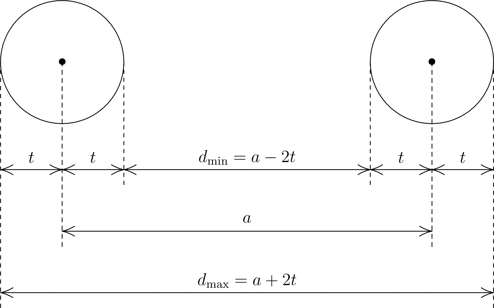

<a id="sec:essentialelements.symmetry"></a>
# ORCA and Symmetry

For most of its life, ORCA did not take advantage of molecular symmetry.
Starting from version 2.8 (released in September 2010), there has been
at least limited use. On request (using the simple keyword `! UseSym`
for instance, see below), the program detects the point group, orients
the molecule, cleans up the coordinates and produces symmetry-adapted
molecular orbitals.

For geometry and gradient cleanup, the full point group is taken into
account. For the diagonalization of the geometric Hessian, all finite
point groups that have real characters only are supported, namely
$C_i$, $C_s$, $C_2$, $C_{2h}$, $C_{nv}$, $D_n$, $D_{nh}$, $D_{nd}$,
$T$, $T_d$, $O$, $O_h$, $I$, and $I_h$ where $n\ge 2$. For all other
purposes such as the construction of symmetry-adapted molecular
orbitals or to describe electronic states, only $D_{2h}$ and
subgroups are currently supported. Here the appropriate subgroup of
$D_{2h}$ (referred to as the reduced point group) is chosen automatically
depending on the auto-detected or user-specified point group, and the use
of symmetry helps to control the calculation and the interpretation of the
results. Please note that at this point, the angular momentum quantum number
$\ell$ is still limited to $\ell\le 8$ if symmetry is in use.

## Getting started

Utilization of symmetry is turned on by the simple keyword `UseSymmetry`
(which may be abbreviated by `UseSym`), or if a `%Symmetry` (or `%Sym`)
input block is present in the input. ORCA will then automatically
determine the point group, reorient and center the molecule to align its
symmetry elements with the coordinate system, and replace the input
structure by a geometry that corresponds exactly to this point group and
which minimizes the sum of square distances between the atoms of both
structures.

Any program that attempts to find the point group of an arbitrary atom
cluster must be prepared to cope with some amount of numerical noise
in the atom coordinates. ORCA by default allows each atom to deviate
at most $10^{-4}$ atomic units from the ideal position that is consistent
with the point group being examined. The rationale behind this value is
the rounding error that occurs when the user feeds Cartesian coordinates
with five significant digits after the decimal point into the program
which otherwise represent an exact (symmetry-adapted) geometry.
A threshold that is about one order of magnitude higher than the
numerical noise in the coordinates is usually very safe.

If the maximum error in the Cartesian coordinates exceeds these $10^{-4}$
atomic units, the symmetry module in ORCA will fail to recognize the
expected point group. The user is strongly advised to always make sure
that the detected point group meets their expectations. If the point
group reported by the symmetry module appears to be too low, the user
may try to increase the detection threshold to $10^{-3}$ or $10^{-2}$
Bohr radii using option `SymThresh` in the `%Symmetry` input block:

```orca
%Sym SymThresh 0.01 End
```

A great method to obtain a structure with perfect symmetry avoiding any
expensive calculation is to use the simple keywords `! NoIter XYZFile`
with an appropriate threshold. The structure in the resulting file with
the extension `.xyz` may then be used as input for the actual calculation.

To give an illustrative example, coordinates for staggered ethane have
been obtained by geometry optimization *without* using symmetry. If
symmetry is turned on, point group $C_i$ is recognized instead of the
expected point group $D_{3d}$ due to the remaining numerical noise. To
counter this, the detection threshold is increased to $10^{-2}$ a. u.
and a coordinate file with perfect symmetry is produced by the following
input:

```orca
%Sym SymThresh 0.01 End
```

If ORCA fails to find the expected point group even though a value of
$10^{-2}$ atomic units has been selected for `SymThresh`, the user is
strongly advised to take a careful look at the structure by means of
their favorite visualization tool before increasing this value any further.
Look for any obvious distortions or even missing atoms. An especially
tricky point may be the orientation of methyl groups or the conformation
of floppy side chains. A small rotation about a single bond may be enough
to push some atom positions above the limit. If the conformational
deviations cannot be fixed using a molecular editor or modelling program,
a possible alternative may be to pre-optimize the structure without
symmetry using a less expensive method like `PB86` and a small basis set
like `def2-SVP`. Even several passes of pre-optimization and structure
editing may be considered until all symmetry-equivalent side chains
are locked in the same conformation so that ORCA finally detects the
correct point group.

It is not recommended to run calculations using a value of `SymThresh`
which is much too high or much too small since this may result in some
really strange behavior of the symmetry module. Consider for instance
the following input file which contains a perfectly octahedral geometry
of a sulfur hexafluoride molecule. Its coordinates may be easily created
by hand by placing the sulfur atom into the origin and two fluorine atoms
on each coordinate axis at equal distances $r$ from the origin ($r=1.56$
&#x212B; or approximately $2.95$ atomic units). Using a value for `SymThresh`
as large as $0.1$ Bohr radii works fine in this case, resulting in the correct
point group O$_h$.

```orca
! RHF SVP NoIter XYZfile
%sym SymThresh 1.0e-2 end
*xyz 0 1
  C    -0.002822   -0.005082   -0.001782
  C    -0.723141   -1.252323   -0.511551
  H     0.017157    0.029421    1.100049
  H     1.042121    0.030085   -0.350586
  H    -0.495109    0.917401   -0.350838
  H    -0.743120   -1.286826   -1.613382
  H    -0.230855   -2.174806   -0.162495
  H    -1.768085   -1.287489   -0.162747
*
```

However, if `SymThresh` is increased further to $t=0.5$ atomic units, the
point group detection algorithm breaks down (strange warnings are printed
as a consequence) and the reported point group decreases to C$_i$ (in which
the center of inversion is the only non-trivial symmetry element). This is
because the center of inversion is easy to detect and this is done by one
of the early checks. The breakdown of the point group recognition may be
explained as follows. During the process of point group detection the
symmetry module is of course unaware that the given input geometry is exact.
Hence it will be treated as any other input structure. A value of $t=0.5$
Bohr radii for `SymThresh` means that the unknown exact atom position is
located within a sphere of radius $t=0.5$ atomic units around the input atom
position. The input distance $a=\sqrt{2}\,r$ between two adjacent fluorine
atoms is approximately $a\approx 2.21$ &#x212B; $\approx 4.17$ a. u., so
their unknown exact distance $d$ may vary in the following interval
(see the diagram in [fig:symthresh](#fig:symthresh)):

$$

d_{\rm min}=a-2t=3.17\:{\rm a. u.}\leq d\leq d_{\rm max}=a+2t=5.17\:{\rm a. u.}

$$

Analogously, the unknown exact distance $d'$ between two opposite fluorine
atoms with the input distance $a'=2r=5.90$ a. u. is:

$$

d'_{\rm min}=a'-2t=4.90\:{\rm a. u.}\leq d'\leq d'_{\rm max}=a'+2t=6.90\:{\rm a. u.}

$$

Since the possible intervals of $d$ and $d'$ overlap (due to
$d_{\rm max}>d'_{\rm min}$), *all* fifteen F--F distances are considered
equal. Since there is no solid with six vertices and fifteen equal
inter-vertex distances in three dimensions, the point group detection
algorithm fails.

<a id="fig:symthresh"></a>


*The relation between the value $t$ of `SymThresh`, the distance $a$ of some
input atom pair, and the allowed interval $[d_{\rm min},d_{\rm max}]$ for the
distance $d$ between the exact atom positions. This interval has the width
$d_{\rm max}-d_{\rm min}=4t$.*

<a id="sec:essentialelements.symmetry.geomopt_using_sym"></a>
## Geometry optimizations using symmetry

If a geometry optimization is performed with symmetry turned on, ORCA
will first determine the point group of the starting structure and
replace the geometry that is presumed to contain numerical noise with one
that has perfect symmetry. Starting with ORCA 6, the optimizer will clean
up the gradient at every step of the optimization if requested by setting
option `CleanUpGradient true` in the `%Symmetry` input block. The gradient
cleanup is done by projecting out all components that are not totally
symmetric. This way the symmetry of the molecule cannot decrease during
the optimization.

Since ORCA 6.1.1, the settings `SymRelaxOpt false` and `CleanUpGradient true`
represent the default. The reason is that during a geometry optimization,
ORCA by its design cannot handle a rotation of the molecule during the
optimization which would be needed to align the changed symmetry elements
with the coordinate axes. Option `SymRelaxOpt` will be removed for good
in the next major or minor release.

The following table summarizes the behaviour of the optimizer depending
on the options `SymRelaxOpt` and `CleanUpGradient`:

| `SymRelaxOpt` | `CleanUpGradient` | Behaviour |
| :-----------: | :---------------: | :-------- |
| `false`       | `true`            | Symmetry will be frozen (the new default). |
| `false`       | `false`           | Setting is not recommended. |
| `true`        | `true`            | Symmetry may increase but not decrease (may not work). |
| `true`        | `false`           | Symmetry may change freely (may not work). |

Setting both switches `false` would allow the symmetry of the molecule
to change when the geometry is updated in each step of the optimization,
but this change would be immediately undone when symmetrizing the
coordinates because the point group is not allowed to change.
Therefore this setting is not recommended.

<a id="sec:essentialelements.symmetry.geometric_hessian"></a>
## Diagonalization of the geometric Hessian using symmetry

Since version 6.0, ORCA is able to diagonalize the geometric Hessian
with symmetry if both frequencies and symmetry have been requested
by the user and the auto-detected or user-specified point group is
finite and has real characters only. These are the point groups
$C_i$, $C_s$, $C_2$, $C_{2h}$, $C_{nv}$, $D_n$, $D_{nh}$, $D_{nd}$,
$T$, $T_d$, $O$, $O_h$, $I$, and $I_h$ where $n\ge 2$.

For this purpose, the Hessian in mass-weighted Cartesians is transformed
block-wise into the symmetry-adapted displacement basis. Since all
components of a degenerate irreducible representation give rise to
identical blocks except for numerical noise, the block is averaged
over the components and only one diagonalization per irrep is performed.
Thus the vibrational frequencies for a degenerate level are exactly
identical. The components of a degenerate level are indexed starting
with 0, and the index is given in parentheses after the Mulliken symbol
specifying the irreducible representation.

<a id="sec:essentialelements.symmetry.default_alignment"></a>
## Default alignment of the symmetry elements with the coordinate system

If ORCA determines the point group of a molecule and the user has not
selected any special options, the following principles apply to the
manner in which the symmetry elements of the full point group are
aligned with the coordinate system:

1.  The center of mass of the molecule will be shifted into the origin
    by default.[^zmatnoatoms] If the point group leaves one *unique* vertex
    invariant to all symmetry operations, the center of mass agrees with
    this vertex. This is the case for all point groups except $C_s$,
    $C_n$ $(n\ge 1)$, $C_{nv}$ $(n\ge 2)$, and $C_{\infty v}$.

2.  If the molecule exhibits a unique axis of symmetry with the highest
    number of positions, this axis will become the $z$ axis. This
    applies to all point groups except $C_1$, $C_i$, $C_s$, $D_2$,
    $D_{2h}$, the cubic point groups, and $K_h$.

3.  For point group $C_s$, the mirror plane will become the $xy$ plane.

4.  For point groups $C_{nv}$ $(n\ge 2)$, one of the vertical mirror
    planes will become the $xz$ plane.

5.  For point groups $D_n$ $(n\ge 3)$, $D_{nh}$ $(n\ge 3)$, and $D_{nd}$
    $(n\ge 2)$, one of the two-fold rotation axes perpendicular to the
    axis with the highest number of positions will become the $x$ axis.

6.  For point groups $D_2$, $D_{2h}$, $T$, and $T_h$, the three mutually
    orthogonal $C_2$ axes will become the coordinate axes.

7.  For point groups $T_d$, $O$, and $O_h$, the three mutually
    orthogonal four-fold rotation or rotation-reflection axes will
    become the coordinate axes.

8.  Finally, for point groups $I$ and $I_h$, one of the five sets of
    three mutually orthogonal $C_2$ axes will become the coordinate axes.
    The pair of $C_5$ or $S_{10}$ axes closest to the $z$ axis will be
    located in the $yz$ plane.

9.  In general the orientation of the molecule will be changed as little
    as possible to meet the criteria above. If the input geometry meets
    these criteria already, the molecule will not be moved or rotated at
    all.

If the point group of the system is $D_{nd}$ with $n\ge 2$ or $T_d$ and
the user has selected subgroup $C_{2v}$ using option `PreferC2v`, the
following rules apply instead:

-   For point group $D_{nd}$ with $n\ge 2$, one of the diagonal mirror
    planes will become the $xz$ plane.

-   For point group $T_d$, one of the diagonal mirror planes containing
    the $z$ axis will become the $xz$ plane, i. e. the molecule will be
    rotated by 45 degrees about the $z$ axis compared to the default
    orientation.

[table:subgroups](#table:subgroups) gives an overview over all point groups and the
way in which the symmetry elements of the reduced point group (the largest
common subgroup of $D_{2h}$) are aligned with the coordinate system.

<a id="table:subgroups"></a>
!!! note "Point groups and corresponding subgroups suitable for electronic-structure calculations."
    :header-rows: 3

| Item | Value |
| --- | --- |
| **Full** | — |

      - Index
      - Unique
      - Consistent
      - Chosen
      - Alignment

| Item | Value |
| --- | --- |
| **point** | — |

      - $n$
      - center[^inversioncenter]
      - with planar
      - subgroup
      - of the

| Item | Value |
| --- | --- |
| **group** | — |

      - molecule[^column]
      -
      - subgroup[^nextcolumn]

| Item | Value |
| --- | --- |
| **$C_1$** | — |

      - no
      - no
      - $C_1$
      -

| Item | Value |
| --- | --- |
| **$C_i$** | — |

      - $i$
      - no
      - $C_i$
      -

| Item | Value |
| --- | --- |
| **$C_s$** | — |

      - no
      - yes
      - $C_s$
      -

| Item | Value |
| --- | --- |
| **$C_n$** | — |

      - odd
      - no
      - no
      - $C_1$
      -
    * -
      - even
      - no
      - no
      - $C_2$
      - $z$ axis

| Item | Value |
| --- | --- |
| **$C_{nv}$** | — |

      - odd
      - no
      - no
      - $C_s$
      - $xz$ plane
    * -
      - even
      - no
      - for $n=2$
      - $C_{2v}$
      - $z$, $xz$, $yz$

| Item | Value |
| --- | --- |
| **$C_{nh}$** | — |

      - odd
      - yes
      - yes
      - $C_s$
      - $xy$ plane
    * -
      - even
      - $i$
      - yes
      - $C_{2h}$
      - $z$, $xy$

| Item | Value |
| --- | --- |
| **$D_n$** | — |

      - odd
      - yes
      - no
      - $C_2$
      - $x$ axis
    * -
      - even
      - yes
      - no
      - $D_2$
      -

| Item | Value |
| --- | --- |
| **$D_{nh}$** | — |

      - odd
      - yes
      - yes
      - $C_{2v}$
      - $x$, $xy$, $xz$
    * -
      - even
      - $i$
      - yes
      - $D_{2h}$
      -

| Item | Value |
| --- | --- |
| **$D_{nd}$** | — |

      - odd
      - $i$
      - no
      - $C_{2h}$
      - $x$, $yz$
    * -
      - even
      - yes
      - no
      - $D_2$
      -
    * -
      -
      -
      -
      - $C_{2v}$
      - $z$, $xz$, $yz$

| Item | Value |
| --- | --- |
| **$S_{2n}$** | — |

      - odd
      - $i$
      - no
      - $C_i$
      -
    * -
      - even
      - yes
      - no
      - $C_2$
      - $z$ axis

| Item | Value |
| --- | --- |
| **$T$** | — |

      - yes
      - no
      - $D_2$
      -

| Item | Value |
| --- | --- |
| **$T_h$** | — |

      - $i$
      - no
      - $D_{2h}$
      -

| Item | Value |
| --- | --- |
| **$T_d$** | — |

      - yes
      - no
      - $D_2$
      -
    * -
      -
      -
      -
      - $C_{2v}$
      - $z$, $xz$, $yz$

| Item | Value |
| --- | --- |
| **$O$** | — |

      - yes
      - no
      - $D_2$
      -

| Item | Value |
| --- | --- |
| **$O_h$** | — |

      - $i$
      - no
      - $D_{2h}$
      -

| Item | Value |
| --- | --- |
| **$I$** | — |

      - yes
      - no
      - $D_2$
      -

| Item | Value |
| --- | --- |
| **$I_h$** | — |

      - $i$
      - no
      - $D_{2h}$
      -

| Item | Value |
| --- | --- |
| **$C_{\infty v}$** | — |

      - no
      - no
      - $C_{2v}$
      - $z$, $xz$, $yz$

| Item | Value |
| --- | --- |
| **$D_{\infty h}$** | — |

      - $i$
      - no
      - $D_{2h}$
      -

| Item | Value |
| --- | --- |
| **$K_h$** | — |

      - $i$
      - no
      - $D_{2h}$
      -

## Irreducible representations of $D_{2h}$ and subgroups

[table:species_table_c2v](#table:species_table_c2v), [table:species_table_d2](#table:species_table_d2),
and [table:species_table_d2h](#table:species_table_d2h) contain lists of the irreducible
representations (also called species) and the corresponding characters of
the point groups supported for electronic structure calculations in ORCA,
and the product tables of these irreducible representations. Where the
data depends on the alignment of the symmetry elements with the
coordinate system, Mulliken's recommendations [mulliken1955sym](../../bibliography.md) are
followed. This approach is in line with the recommendations by the IUPAC
[schutte1997sym](../../bibliography.md).

<a id="table:species_table_c2v"></a>
!!! note "Species and species product table of point group $C_{2v}$. The species table for $C_{2v}$ corresponds to Table III in [mulliken1955sym](../../bibliography.md). The directions of the two-fold axis and the mirror planes in each column are related to each other by cyclic permutations."

| Item | Value |
| --- | --- |
| **$\begin{array}{@{}c@{\hspace{10mm}}c@{}}** | — |

           \begin{array}[b]{|c|cccc|}\hline
                    &      & C_2(z) & \sigma_v(xz) & \sigma_v(yz) \\
             C_{2v} &   E  & C_2(x) & \sigma_v(xy) & \sigma_v(xz) \\
                    &      & C_2(y) & \sigma_v(yz) & \sigma_v(xy) \\\hline
              A_1   &  +1  &   +1   &      +1      &      +1      \\
              A_2   &  +1  &   +1   &      -1      &      -1      \\
              B_1   &  +1  &   -1   &      +1      &      -1      \\
              B_2   &  +1  &   -1   &      -1      &      +1      \\\hline
           \end{array} &
           \begin{array}[b]{|c|cccc|}\hline
             \times &  A_1  &  A_2  &  B_1  &  B_2  \\\hline
              A_1   &  A_1  &  A_2  &  B_1  &  B_2  \\
              A_2   &  A_2  &  A_1  &  B_2  &  B_1  \\
              B_1   &  B_1  &  B_2  &  A_1  &  A_2  \\
              B_2   &  B_2  &  B_1  &  A_2  &  A_1  \\\hline
           \end{array}
         \end{array}$

<a id="table:species_table_d2"></a>
!!! note "Species and species product table of point group $D_2$. The species table for $D_2$ has been obtained by dropping the center of inversion and the mirror planes from the species table for $D_{2h}$ (see [table:species_table_d2h](#table:species_table_d2h))."

| Item | Value |
| --- | --- |
| **$\begin{array}{@{}c@{\hspace{10mm}}c@{}}** | — |

           \begin{array}{|l|cccc|}\hline
             D_2    &   E  & C_2(z) & C_2(y) & C_2(x) \\\hline
             A      &  +1  &   +1   &   +1   &   +1   \\
             B_1    &  +1  &   +1   &   -1   &   -1   \\
             B_2    &  +1  &   -1   &   +1   &   -1   \\
             B_3    &  +1  &   -1   &   -1   &   +1   \\\hline
           \end{array} &
           \begin{array}{|c|cccc|}\hline
             \times & A    &   B_1  &   B_2  &   B_3  \\\hline
             A      & A    &   B_1  &   B_2  &   B_3  \\
             B_1    & B_1  &   A    &   B_3  &   B_2  \\
             B_2    & B_2  &   B_3  &   A    &   B_1  \\
             B_3    & B_3  &   B_2  &   B_1  &   A    \\\hline
           \end{array}
         \end{array}$

<a id="table:species_table_d2h"></a>
!!! note "Species and species product table of point group $D_{2h}$. The species table for $D_{2h}$ corresponds to Table IV in [mulliken1955sym](../../bibliography.md)."

| Item | Value |
| --- | --- |
| **$\begin{array}{@{}c@{}}** | — |

          \begin{array}{|l|cccccccc|}\hline
            D_{2h} &   E  & C_2(z) & C_2(y) & C_2(x) &  i & \sigma(xy) & \sigma(xz) & \sigma(yz) \\\hline
            A_g    &  +1  &   +1   &   +1   &   +1   & +1 &     +1     &     +1     &     +1     \\
            B_{1g} &  +1  &   +1   &   -1   &   -1   & +1 &     +1     &     -1     &     -1     \\
            B_{2g} &  +1  &   -1   &   +1   &   -1   & +1 &     -1     &     +1     &     -1     \\
            B_{3g} &  +1  &   -1   &   -1   &   +1   & +1 &     -1     &     -1     &     +1     \\
            A_u    &  +1  &   +1   &   +1   &   +1   & -1 &     -1     &     -1     &     -1     \\
            B_{1u} &  +1  &   +1   &   -1   &   -1   & -1 &     -1     &     +1     &     +1     \\
            B_{2u} &  +1  &   -1   &   +1   &   -1   & -1 &     +1     &     -1     &     +1     \\
            B_{3u} &  +1  &   -1   &   -1   &   +1   & -1 &     +1     &     +1     &     -1     \\\hline
          \end{array} \\[3mm]
          \begin{array}{|c|cccccccc|}\hline
            \times & A_g    & B_{1g} & B_{2g} & B_{3g} & A_u    & B_{1u} & B_{2u} & B_{3u} \\\hline
            A_g    & A_g    & B_{1g} & B_{2g} & B_{3g} & A_u    & B_{1u} & B_{2u} & B_{3u} \\
            B_{1g} & B_{1g} & A_g    & B_{3g} & B_{2g} & B_{1u} & A_u    & B_{3u} & B_{2u} \\
            B_{2g} & B_{2g} & B_{3g} & A_g    & B_{1g} & B_{2u} & B_{3u} & A_u    & B_{1u} \\
            B_{3g} & B_{3g} & B_{2g} & B_{1g} & A_g    & B_{3u} & B_{2u} & B_{1u} & A_u    \\
            A_u    & A_u    & B_{1u} & B_{2u} & B_{3u} & A_g    & B_{1g} & B_{2g} & B_{3g} \\
            B_{1u} & B_{1u} & A_u    & B_{3u} & B_{2u} & B_{1g} & A_g    & B_{3g} & B_{2u} \\
            B_{2u} & B_{2u} & B_{3u} & A_u    & B_{1u} & B_{2g} & B_{3g} & A_g    & B_{1u} \\
            B_{3u} & B_{3u} & B_{2u} & B_{1u} & A_u    & B_{3g} & B_{2g} & B_{1g} & A_g    \\\hline
          \end{array}
        \end{array}$

## Options available in the `%Symmetry` input block

[table:symmetry_block_options](#table:symmetry_block_options) contains a list of the options
available in the `%Symmetry` (or `%Sym`) input block. Options
`SymThresh` and `SymRelax` (same as `SymRelaxSCF` below) can also be
accessed in the `%Method` input block for backward compatibility. This
use is deprecated and not recommended in new input files, however.

<a id="table:symmetry_block_options"></a>
!!! note "List of options in the `%Symmetry` (`%Sym`) input block"
    :header-rows: 1
    :class: longtable

| Item | Value |
| --- | --- |
| **Option** | — |

      - Type
      - Default
      - Description

| Item | Value |
| --- | --- |
| **`UseSymmetry`** | — |

      - Boolean
      - `True`
      - By setting this option to `False`,
    symmetry may be switched off even though the `%Symmetry` block is
    present in the input file.

| Item | Value |
| --- | --- |
| **`UseSym`** | — |

      - Boolean
      - `True`
      - Same as `UseSymmetry`.

| Item | Value |
| --- | --- |
| **`SymThresh`** | — |

      - Real
      - $10^{-4}$
      - Two vertices with a distance shorter
    than this threshold (in atomic units) are considered identical during
    point group recognition.

| Item | Value |
| --- | --- |
| **`PreferC2v`** | — |

      - Boolean
      - `False`
      - Indicates whether to prefer subgroup
    $C_{2v}$ over $D_2$ for electronic-structure calculations where both
    choices are appropriate (point groups $D_{nd}$ with odd $n$ and $T_d$).

| Item | Value |
| --- | --- |
| **`PointGroup`** | — |

      - String
      - Empty string
      - If the user specifies a point
    group using this option, point group recognition will be skipped and the
    user must make sure that the molecule is oriented in the coordinate
    system in agreement with the conventions in [sec:essentialelements.symmetry.default_alignment](#sec:essentialelements.symmetry.default_alignment).
    Note that the point group label must be enclosed in double quotes.
    Otherwise ORCA will complain about an invalid assignment.

| Item | Value |
| --- | --- |
| **`SymRelaxSCF`** | — |

      - Boolean
      - `False`
      - Indicates whether orbital occupation
    numbers of each irreducible representation are allowed to change during
    SCF.

| Item | Value |
| --- | --- |
| **`SymRelaxOpt`** | — |

      - Boolean
      - `False`
      - Indicates whether the point group
    will be determined from scratch in every step of a geometry optimization.
    Using the new default value of `False`, the initial point group will be
    imposed at every step no matter how far the distances between the current
    and the ideal structure exceed `SymThresh`.
    A value of `True` will allow the point group to change in an arbitrary
    manner, but ORCA by its design cannot handle a rotation of the molecule
    under these circumstances which would be needed to align the changed
    symmetry elements with the coordinate axes, so this setting may not work.
    This option will be removed for good in the next major or minor release.

| Item | Value |
| --- | --- |
| **`CleanUpCoords`** | — |

      - Boolean
      - `True`
      - Determines whether the molecular
    geometry will be cleaned up using the automatically detected or
    user-specified point group. Even if `CleanUpCoords` is `False`,
    symmetrized coordinates will still be computed temporarily and a warning
    will be printed if the largest deviation from the original geometry
    exceeds `SymThresh`.

| Item | Value |
| --- | --- |
| **`CleanUpGeom`** | — |

      - Boolean
      - `True`
      - Same as `CleanUpCoords`.

| Item | Value |
| --- | --- |
| **`CleanUpGrad`** | — |

      - Boolean
      - `True`
      - Indicates whether the full point
    group of the molecule shall be used to remove all non-totally symmetric
    components from the gradient. This ensures that the point group will not
    decrease throughout the optimization.

| Item | Value |
| --- | --- |
| **`CleanUpGradient`** | — |

      - Boolean
      - `True`
      - Same as `CleanUpGrad`.

| Item | Value |
| --- | --- |
| **`Print`** | — |

      - Integer
      - 1
      - Determines the output size for symmetry handling in general and point group detection in particular;
        0 -- No output during point group detection;
        1 -- Normal output;
        2 -- Detailed information;
        3 -- Debug print.

| Item | Value |
| --- | --- |
| **`PrtSALC`** | — |

      - Integer
      - 0
      - Specifies the output size for the construction
        of symmetry-adapted linear combinations (SALCs) of atomic orbitals;
        0 -- No output for symmetry-adapted orbitals;
        1 -- Normal output;
        2 -- Detailed information (e. g. the SALCs themselves);
        3 -- Debug print.

[^zmatnoatoms]: In the very special case that the Z matrix contains no atoms with
    mass, the geometric center will be used instead.

[^inversioncenter]: A center of inversion is denoted $i$. "yes" indicates the existence
    of a *unique* vertex that remains invariant to all symmetry operations
    of the point group.

[^column]: This column indicates whether the given point group may be the *full*
    point group of a planar molecule.

[^nextcolumn]: This column contains the elements (axes or planes) of the coordinate
    system that coincide with the symmetry elements of the reduced point
    group (the largest common subgroup of the full point group and $D_{2h}$)
    by *default*. If the full point group contains a unique principle axis of
    symmetry (with the highest number of positions), this axis is presumed to
    coincide with the $z$ axis.
