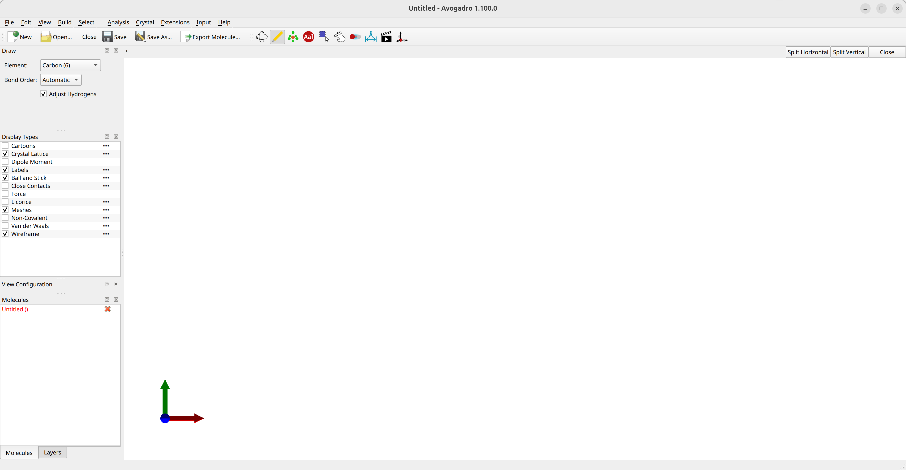
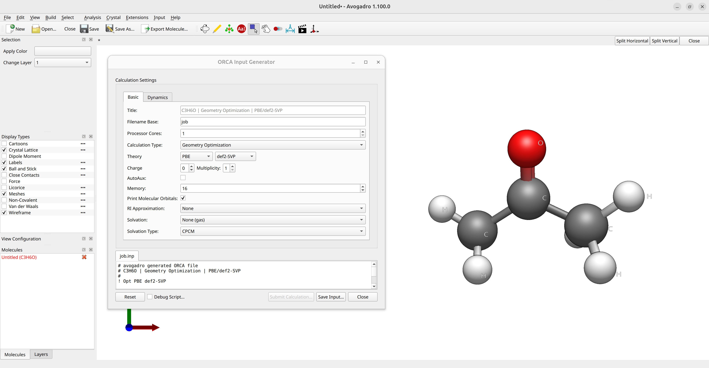
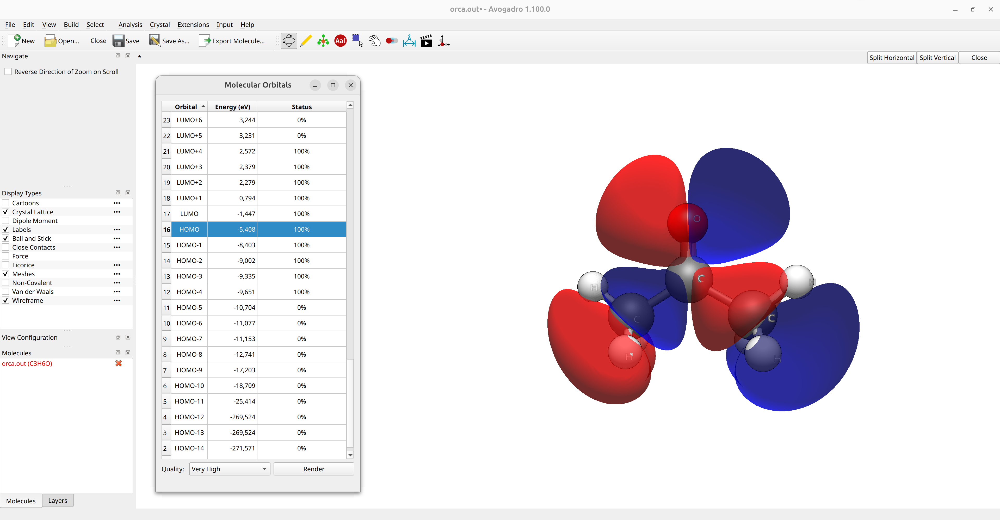

# Graphical User Interfaces (GUI)

Various programs are available that can read ORCA output files. Some programs that have proven specifically useful for ORCA output visualization are:

- [Avogadro 2](https://two.avogadro.cc/install/index.html)

> **Warning**
> This tutorial was created using the Linux AppImage of Avogadro 2 Version 1.100.0! Please make sure, you are using the most recent version of Avogadro 2 to ensure compatibility!

- [ChimeraX](https://www.rbvi.ucsf.edu/chimerax/) (For ChimeraX, the [SEQCROW plugin](https://github.com/QChASM/SEQCROW) is very useful. It can be downloaded from the `Tools/More Tools` menu.)
- [Avogadro](https://avogadro.cc) (ORCA enhanced version)
- [Chemcraft](https://www.chemcraftprog.com/)
- [Gabedit](https://sites.google.com/site/allouchear/Home/gabedit/download)

With these you can visualize your geometry, the charges, plot orbitals, spectra, etc.

> **Important**
> It might be necessary to include some extra printing for these programs (e.g., to generate orbital plots). In that case, the one way is to use the `PRINTMOS` and `PRINTBASIS` keywords on the simple input line:
>
>
> ```text
> !HF DEF2-SVP PRINTMOS PRINTBASIS
> ```
>
>
>
> The corresponding print settings can also be controlled via the `%output` block:
>
>
> ```text
> %output 
>    print[p_mos] 1
>    print[p_basis] 2
> end
> ```

As Avogadro is the most commonly used and generally freely available option, we will further focus on the usage of Avogadro 2 as a GUI to ORCA. It can be used to set up your geometries and even analyze ORCA outputs, and the ORCA team has developed their own version that can be downloaded from the [ORCA forum](https://orcaforum.kofo.mpg.de/app.php/portal) (may be used under Windows via [Wine](https://www.winehq.org/)). However, that version is partly deprecated with ORCA 6!

> **Warning**
> Different versions of Avogadro may have partly limited compatibility to each other!

## Avogadro 2 as a GUI

### Drawing molecules

After opening Avogadro 2, you will see its main screen:



*Figure: Avogadro 2's main screen.*

- Using the `Draw` tool (yellow pencil symbol), you can draw you molecule using the left click to create and right click to delete atoms.
- The atom type is selected under `Element` and the `Adjust hydrogens` tick-option can automatically fix the valence of you molecule.
- The `Navigation Tool` can be used to rotate the molecule and the `Manipulation Tool` (white hand symbol) eto move atoms.
- After drawing you guess structure, click on choose the `Extensions`$\rightarrow$`Open Babel`$\rightarrow$`Optimize Geometry` drop-down tool to run a simple molecular mechanics optimization.

> **Warning**
> The other optimization option in Avogadro 2 via `Extensions`$\rightarrow$`Optimize Geometry` is not functional at the moment! Please use the optimization via Open Babel as described above!

You can save you geometry as a `.xyz` via the `Export Molecule...` tool.

### Creating inputs

After drawing a molecule, you can use Avogadro 2 to make simple ORCA inputs. Click on `Input`$\rightarrow$`ORCA...` and it will open
the ORCA Input Generator window:



*Figure: Creating ORCA inputs in Avogadro 2.*

where you can choose the options you need and `Save Input...` the input. If you want to generate orbital plots, you should add check the `Print Molecular Orbitals` box.

### Visualizing the Output

#### Orbital Plots

If you run a calculation using `!PRINTMOS` and `!PRINTBASIS` or the orbital printout options set by the ORCA input generator and [saved your output into a file](../first_steps/first_calc.md#output-to-file), you can visualize the orbitals by opening the `basename.out` file in Avogadro. Then select the orbital you want on the Molecular Orbitals panel to render, e.g. the HOMO of acetone:



*Figure: Molecular orbital plot in Avogadro 2.*

Higher quality images can be generated by changing the `Quality` option at the bottom of the panel.

> **Hint**
> If the orbital image is not immediately available, click on `Render` to produce the image.

#### Density Plots

After loading an output file, you can also go to `Analysis`$\rightarrow$`Create Surfaces...`. A new panel will appear were you can select the `Surface` and `Color by` options to render the electrostatic potential (ESP) onto the electron density surface:


*Figure: ESP plot in Avogadro 2.*

Here blue means positive charge and red negative charge. You can also change the resolution of these surfaces at will.

#### Vibrational Modes and IR

In case your output has a frequency calculation on it (see [Vibrational frequencies](../prop/freq.md#vibfreq)), e.g. by choosing the `Calculation Type: Frequencies` in the ORCA input generator of Avogadro 2 or by simply adding the `FREQ` keyword to the simple input line, the vibrational modes can be animated after loading the output file and the vibrational spectra can be plotted by selecting `Analysis`$\rightarrow$`Vibrational Modes...`:


*Animation: Vibrational modes of formaldehyde.*

> **Note**
> Similar functionalities are available with the [Chemcraft](https://chemcraftprog.com), [ChimeraX](https://www.rbvi.ucsf.edu/chimerax/) (using the SEQCROW plugin), and [Gabedit](https://sites.google.com/site/allouchear/Home/gabedit/download) softwares as well.
