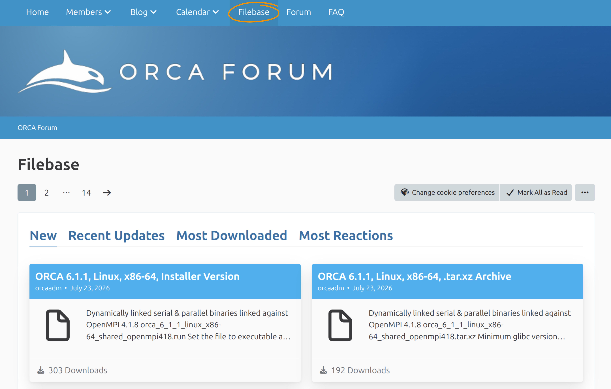

# Installing ORCA

ORCA is distributed as precompiled packages for Linux, macOS, and Windows.
This tutorial shows how to choose the correct ORCA 6.1 package, install it,
make the `orca` command available, and verify the installation with a small
calculation.

> **Important**
> We generally recommend using the latest available version of ORCA. Please check regularly for bug-fix releases and update your ORCA installation accordingly.

## Before you Start

You need:

- a supported Linux, macOS, or Windows system;
- permission to install software in your user account or the selected installation directory;
- a terminal on Linux or macOS, or PowerShell/Command Prompt on Windows.

A separate graphical user interface is not required. ORCA itself is a command-line program.

## Register for Download

ORCA can be downloaded either from the [ORCA Forum](https://orcaforum.kofo.mpg.de/) (academic) or from the [FACCTs downloads area](https://www.faccts.de/customer) (academic and commercial). For both, you have to create an account and agree to the respective license agreements. In the following we will describe the installation process based on the [ORCA Forum](https://orcaforum.kofo.mpg.de/).


*ORCA Forum registration.*

## Download ORCA

After registration and login at the [ORCA Forum](https://orcaforum.kofo.mpg.de/). Open the [Filebase](https://orcaforum.kofo.mpg.de/filebase/) and select the newest ORCA version release version matching your infrastructure requirements.



*ORCA Forum Filebase (Download section).*

On Linux and macOS, the installer is normally a `.run` file. On Windows, the installer is provided inside a `.zip` archive.

> **Note**
> If you only want to test ORCA or run serial calculations, begin with the standard installation. Parallel calculations require additional components
> and are covered in [Running a Calculation in Parallel](../first_steps/parallel.md).

## Install ORCA

Choose the instructions for your operating system.

### Linux

1. Open a terminal and change to the directory containing the downloaded installer, for example:

```console
cd ~/Downloads
```
2. Replace `ORCA_INSTALLER.run` below with the actual filename and make it executable:

```console
chmod u+x ORCA_INSTALLER.run
```
3. Run the installer:

```console
./ORCA_INSTALLER.run
```
4. Follow the installer instructions.
5. Close the terminal and open a new one so that updated environment variables are loaded.

The command-line installer also supports these optional modes:

```text
-i        Set the installation path interactively
-p PATH   Install into PATH
-x        Extract the package without installing it
```

The options are passed after `--`. For example:

```console
./ORCA_INSTALLER.run -- -p "$HOME/software/orca-6.1"
```

> **Note**
> Use `-x` mainly for managed systems, clusters, containers, or other cases in which you must configure the environment manually.

### macOS

1. Open Terminal and change to the directory containing the downloaded installer:

```console
cd ~/Downloads
```
2. Replace `ORCA_INSTALLER.run` with the actual filename and make it executable:

```console
chmod u+x ORCA_INSTALLER.run
```
3. Run the installer:

```console
./ORCA_INSTALLER.run
```
4. Follow the installer instructions, then close Terminal and open a new window.

Before downloading, you can check the processor architecture with:

```console
uname -m
```

Select the matching ORCA package when more than one macOS architecture is offered.

### Windows

1. Extract the downloaded ORCA `.zip` archive.
2. Open the extracted directory and start the ORCA `.exe` installer.
3. Follow the installation wizard.
4. Choose the installation type according to your intended use:

  - **Typical** installs the serial components.
  - **Custom** or **Full** also allows the parallel components to be selected.
5. Finish the installation and open a **new** PowerShell or Command Prompt window.

The installer configures the required environment variables, including the ORCA installation directory in `PATH`.

> **Note**
> Some specialized AUTOCI executables are distributed as separate archives. Extract them into the ORCA installation directory only if your calculations
> require these modules. Match the serial or parallel archive to the ORCA installation you selected.

## Check that ORCA is on `PATH`

On Linux or macOS, run:

```console
command -v orca
```

On Windows, run:

```powershell
where.exe orca
```

The command should print the full path to the ORCA executable.

If no path is printed, first close the terminal and open a new one. Environment changes made by the installer are only visible to newly started terminal sessions.

### Manual `PATH` Setup

This section is only needed when you used an extract-only package or the installer did not update `PATH`.

On Linux or macOS, temporarily add the ORCA directory with:

```console
export PATH="/full/path/to/orca:$PATH"
```

To make the change permanent, add the same line to the startup file used by your shell, commonly `~/.bashrc` for Bash or `~/.zshrc` for Zsh, and then open a new terminal.

On Windows, add the ORCA installation directory to the user or system `Path` through **Environment Variables**, then open a new PowerShell or Command Prompt window.

> **Important**
> Do not mix executables and libraries from different ORCA or MPI installations. For parallel calculations, the MPI runtime must match the version required by the selected ORCA package.

## Run an Installation Test

Run calculations in a separate working directory, not inside the ORCA installation directory.

Create a test directory and enter it.

Linux or macOS:

```console
mkdir -p ~/orca_install_test
cd ~/orca_install_test
```

Windows PowerShell:

```powershell
New-Item -ItemType Directory -Force "$HOME\orca_install_test"
Set-Location "$HOME\orca_install_test"
```

Create a text file named `water.inp` with the following content:

```mol
title: install #2
theme: chem311
height: 360px
representation: ball-stick
--- xyz ---
3
structure
O   0.0000   0.0000   0.0626
H  -0.7920   0.0000  -0.4973
H   0.7920   0.0000  -0.4973
--- input ---
! HF DEF2-SVP SP

* xyz 0 1
O   0.0000   0.0000   0.0626
H  -0.7920   0.0000  -0.4973
H   0.7920   0.0000  -0.4973
*
```

Run ORCA and redirect the output to `water.out`:

```console
orca water.inp > water.out
```

On Linux or macOS, check the termination message with:

```console
grep "ORCA TERMINATED NORMALLY" water.out
```

On Windows, use:

```powershell
Select-String "ORCA TERMINATED NORMALLY" water.out
```

A successful calculation contains:

```text
ORCA TERMINATED NORMALLY
```

You can now continue with [Hello water! Your first ORCA calculation](../first_steps/first_calc.md), which explains the input and output in more detail.

## Optional: Prepare Parallel Calculations

A working serial calculation does not prove that the parallel environment is configured correctly.

Before running ORCA in parallel:

1. identify the MPI implementation and version required by the downloaded ORCA package;
2. install or load that matching MPI runtime;
3. verify that the expected `mpirun` or equivalent runtime is found first on `PATH`;
4. follow [Running a Calculation in Parallel](../first_steps/parallel.md).

> **Important**
> Do not start ORCA with a manually constructed command such as `mpirun -np 4 orca ...`. ORCA starts the required worker processes from the
> parallel settings in the input.

## Optional: `xtb` Support

Many ORCA workflows can call an external `xtb` executable. Most users should use the `xtb` component supplied with their ORCA package, when present.

Install or replace `xtb` separately only when a workflow requires a specific `xtb` version. In that case, follow the instructions in the
[ORCA installation chapter](https://www.faccts.de/docs/orca/6.1/manual/contents/quickstartguide/installation.html) and the [xTB documentation](https://xtb-docs.readthedocs.io/).

## Troubleshooting

### `orca: command not found` or `orca is not recognized`

Open a new terminal and repeat the `command -v orca` or `where.exe orca` check. If ORCA is still not found, add the installation directory to `PATH`.

### `Permission denied` when starting the installer

On Linux or macOS, make the installer executable:

```console
chmod u+x ORCA_INSTALLER.run
```

### `Exec format error` or an application that cannot be opened

The package may not match the operating system or processor architecture. Download the correct package and reinstall it.

### Missing libraries or MPI startup errors

Confirm that the ORCA package and MPI runtime match. Remove older ORCA or MPI directories from the front of `PATH`, open a new terminal, and test again. See [Running a Calculation in Parallel](../first_steps/parallel.md) and [Solving common issues](../first_steps/trouble_install.md).

### The test calculation does not terminate normally

Inspect the end of `water.out` for the first error message. Also confirm that:

- the input file is named `water.inp`, not `water.inp.txt`;
- the calculation is run from a writable working directory;
- the complete ORCA package was installed or extracted;
- no files from an older ORCA installation were copied into the new one.

## Updating or Removing ORCA

For an update within the ORCA 6.1 series, install the new bug-fix release in a separate, versioned directory. Test it before removing the previous
installation, then update `PATH` so that it points to the preferred version.

On Linux or macOS, remove an installation by deleting its directory and any corresponding `PATH` entry.

On Windows, remove the main installation through **Apps & features**. Optional modules that were manually extracted into the installation directory may also need to be removed manually.

## Next steps

- [Hello water! Your first ORCA calculation](../first_steps/first_calc.md)
- [Input and Output](../first_steps/input_output.md)
- [Running a Calculation in Parallel](../first_steps/parallel.md)
- [Solving common issues](../first_steps/trouble_install.md)
