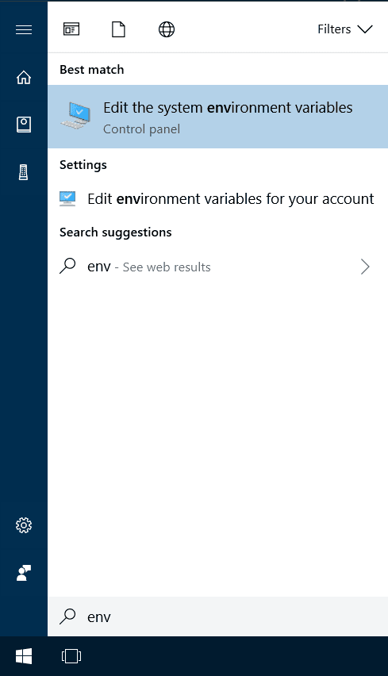
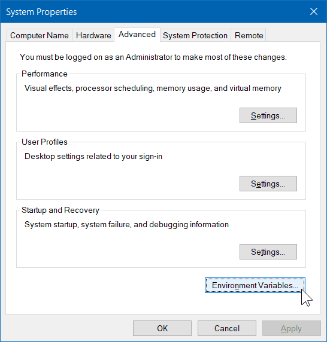
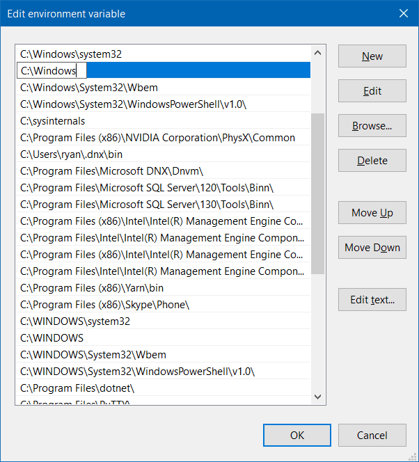

# Solving common issues

## Fixing file names

If you get errors like:

```text
[file orca_main/run.cpp, line 9905]: Cannot open input file:
```

please check your file type, maybe you are calling `input.inp`, but it was saved as `input.inp.txt` or something else.

When using windows, we recommend using [Notepad++](https://notepad-plus-plus.org) instead of the regular Notepad to avoid problems when writing and reading.

## Assigning PATH variables

A quite common initial source of error when trying to run ORCA is that your PATH variables are not set. The PATH and LD_LIBRARY_PATH are variables that your OS use to find where the programs and libraries are. Here some quick info on how to set them correctly:

### Linux and MAC

Type the commands bellow to add the correct variables to the .bash_profile file and source it. Nothing will happen, but if everything is right, "orca" can now be called as a simple command.

- **ORCA:**

```text
echo 'export PATH=path-to-ORCA:$PATH; export LD_LIBRARY_PATH=path-to-ORCA:$LD_LIBRARY_PATH'  >> ~/.bash_profile
source ~/.bash_profile
```

replacing path-to-ORCA to where the orca folder is on your system, e.g, /home/username/orca.

- **OpenMPI:**

```text
echo 'export PATH=path-to-MPI/bin:$PATH; export LD_LIBRARY_PATH=/path-to-MPI/lib:$LD_LIBRARY_PATH'  >> ~/.bash_profile
source ~/.bash_profile
```

replacing path-to-MPI to where the OpenMPI folder is on your system, e.g, /home/username/openmpi.

> **Note**
> The MAC installer installs ORCA by default in `/Users/<username>/Library/Orca/`.

### Windows 10

- **ORCA:** > The windows installer will put the ORCA folder in C:\orca, and you need to set the PATH there to find it. To do that, follow the steps bellow: > > > 1. Click on the search button or hit the Windows/Super key and type "PATH": [](../images/path_1.png) > 2. Click on the "Environment Variables..." button: [](../images/path_2.png) > 3. Find the row where "Path" is and click on edit: [](../images/path_3.png) > 4. A new windows will open, there click on "New" and add "C:\orca": [](../images/path_4.png) > 5. Click OK and the changes are saved. Now type "orca" on the prompt to see if the program is called (will return an error message if there is no input).
- **OpenMPI:** > You can install following instructions from the [ORCA manual](https://www.faccts.de/docs/orca/6.0/manual) or the [OpenMPI](https://www.open-mpi.org/). Probably the best solution is to use [Cygwin](https://cygwin.com) to simulate a Linux environment and run it from there. > > > > **Important** > > Do not forget to set the PATH and the LD_LIBRARY_PATH using the same instructions as above.

## Using OpenMPI

Don't try to run:

```text
mpirun -np 4 orca
```

like with other software, ORCA will take care of it if your have the [!PAL](../first_steps/parallel.md) keyword set.

## Error from older files

Sometimes calculations fail because there are files from a previous orca run in the folder and then orca tries to read from them, but actually you just want to start a totally new calulation, so those files have to be deleted manually beforehand!

## Still having trouble?

- Check that the PATH variables are set correctly.
- Check if file names are correct.
- Go to the [ORCA forum](https://orcaforum.kofo.mpg.de), take a look at the previous topics and ask your questions 😉!
