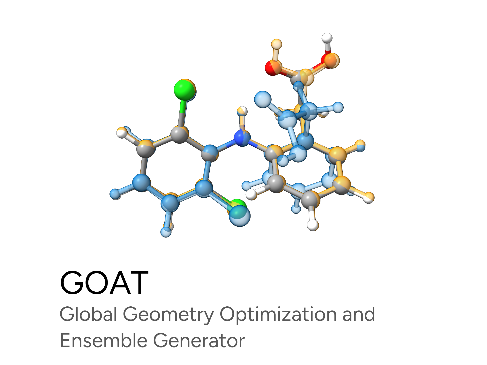
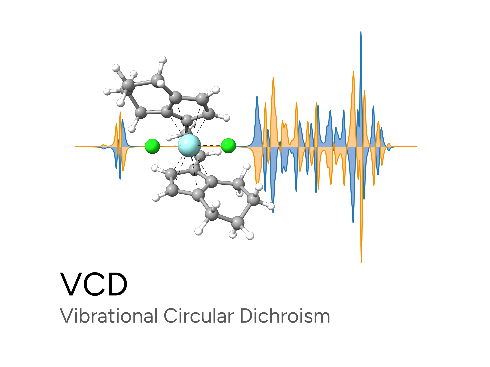

# ORCA 6.1 TUTORIALS

Here you will find tutorials on how to perform calculations using ORCA. These are aimed for new users and people who want to get introduced into basic molecular modeling.

For more detailed documentation, please refer to the [ORCA manual](https://www.faccts.de/docs/orca/6.1/manual). We also recommend to join the [ORCA forum](https://orcaforum.kofo.mpg.de/app.php/portal),
where you can get some help regarding individual and known issues.

## Highlights

## First steps

Some very basic information. If you never used ORCA before, maybe it is best to start here, otherwise you can just skip and go to the next sections.

- **How to start?** [Installing ORCA](first_steps/install.md) | [Hello water! Your first ORCA calculation](first_steps/first_calc.md)
- **Dealing with files?** [Input and Output](first_steps/input_output.md)
- **Want to go faster?** [Running a Calculation in Parallel](first_steps/parallel.md)
- **Help with visualizing?** [Graphical User Interfaces (GUI)](first_steps/GUI.md)
- **Problems?** [Solving common issues](first_steps/trouble_install.md)

PROPERTIES

- [Single point energies](prop/single_point.md)
- [Geometry optimization](prop/geoopt.md)
- [Vibrational frequencies](prop/freq.md)
- [Thermodynamics](prop/thermo.md)
- [Implicit Solvation Models](prop/cpcm.md)
- [Explicit Solvation (SOLVATOR)](prop/solvator.md)
- [Conformer Search (GOAT)](prop/goat.md)
- [Relativistic corrections](prop/relativistic.md)
- [Dispersion corrections](prop/disp.md)
- [Bond Analysis](prop/bonds.md)
- [Local Energy Decomposition (LED)](prop/led.md)
- [Fractional occupation density (FOD)](prop/fod.md)
- [Charge Models](prop/charges.md)
- [Electrostatic Potentials (ESP)](prop/esp.md)

Reactivity

- [Finding Transition States with NEB-TS](react/nebts.md)
- [Transition State Optimization](react/tsopt.md)
- [Transition State Conformers](react/tsconf.md)
- [Intrinsic Reaction Coordinate (IRC)](react/irc.md)
- [Calculating accurate energy barriers](react/actibar.md)
- [Kinectic Isotope Effects (KIE)](react/KIE.md)
- [Plotting Fukui functions](react/FUKUI.md)
- [Automated docking (DOCKER)](react/docker.md)

Spectroscopy

- [Infrared and Raman](spec/IR.md)
- [UVVis Spectroscopy (UV/Vis)](spec/UVVis.md)
- [Electronic Circular Dichroism (ECD)](spec/ECD.md)
- [Vibrational Circular Dichroism (VCD)](spec/vcd.md)
- [Nuclear Magnetic Resonance (NMR)](spec/NMR.md)
- [Electron Paramagnetic Resonance (EPR)](spec/EPR.md)
- [Spin-Orbit Coupling](spec/SOC.md)

Multiscale methods

- [Starting with Multiscale models - QM/XTB ONIOM](multi/basics.md)
- [ONIOM methods beyond QM/XTB](multi/basics-otheroniom.md)
- [Multiscale NEB-TS for transition states](multi/oniom-nebts.md)
- [Ionic-Crystal-QM/MM](multi/ionic_crystal.md)
- [Automated Fragmentation](multi/fragmentator.md)

Appendix

- [Index](genindex.md)
