<a id="sec:modelchemistries.casscf"></a>
# Complete and Incomplete Active Space Self-Consistent Field (CASSCF and RAS/ORMAS)

<a id="sec:modelchemistries.casscf.intro"></a>
## Introduction

The complete active space self-consistent field (CASSCF) method is a special form of a multiconfigurational SCF method and 
can be thought of as an extension of the Hartree-Fock method. It is a very powerful method to study static correlation effects 
and a solid basis for MR-CI and MR-PT treatments. It can be applied to the ground state and excited states or averages thereof. 
The implementation in ORCA is fairly general and also allows incomplete active spaces omitting active-active rotations. 
Example for such [incomplete model spaces](casscf.modelspace) include arbitrary references configurations, restricted active space (RAS) and occupation restricted multiple active spaces (ORMAS).
In the following section, the primary focus is on the complete active spaces. 

The subject is fairly complex and ultimately  require a lot of insight from the user in order to be successful. 
Thus, in addition to the material in the manual, we have created a [CASSCF tutorial](https://orcaforum.kofo.mpg.de/app.php/dlext/?cat=4&sid=9d58efcf2208abe23b1af87a601b42f6),
that covers many practical tips on the calculation design and usage of the program. 

There are several situations where a  CASSCF treatment is a good idea:

-   Wave functions with significant multireference character arising from
    several nearly degenerate configurations (static correlation)

-   Wave functions which require a multideterminantal treatment (for
    example multiplets of atoms, ions, transition metal complexes, )

-   Situations in which bonds are broken or partially broken.

-   Generation of orbitals which are a compromise between the
    requirements for several states.

-   Starting point for multireference methods covering
    dynamic correlation (NEVPT2, MRCI, MREOM, \...)

-   Generation of genuine spin eigenfunctions for
    multideterminantal/multireference wave functions.
    
In all of these cases, the single-determinantal Hartree-Fock/DFT methods fail badly, whereas CASSCF remains a good choice.
In the latter, the orbitals are divided into three-subspaces: (a) the internal (inactive) orbitals which are doubly occupied 
in all configuration state functions (CSFs) (b) partially occupied (active) orbitals (c) 
virtual (external) orbitals which are empty in all CSFs. 

A fixed number of electrons is assigned to the internal subspace and the active
subspace. If$N$ electrons are "active" in$M$ orbitals, one speaks of a
CASSCF($N$,$M$) wave functions. All spin-eigenfunctions for$N$ electrons in$M$
orbitals are included in the configuration interaction step (CAS-CI) and the
energy is made stationary with respect to variations in the MO and the
CI coefficients. Any number of roots of any number of different
multiplicities can be calculated and the CASSCF energy may be optimized
with respect to a user defined average of these states.

The CASSCF method has the nice advantage that it is fully variational
which renders the calculation of analytical gradients relatively easy.
Thus, the CASSCF method may be used for geometry optimizations and
numerical frequency calculations. It should be noted that state-averaged 
CASSCF calculations are not fully variational in general. 
The orbitals must be optimized for the state of interest.

A number of properties are available in ORCA (g-tensor, ZFS splitting,
CD, MCD, susceptibility, dipoles, \...). The majority of CASSCF
properties such as EPR parameters are computed in the framework of the
[quasi-degenerate perturbation theory](../spectroscopyproperties/qdpt_magnetic_properties.md#sec:spectroscopyproperties.qdpt_magnetic_properties). 
In addition, some properties such as ZFS splittings can also be computed 
via perturbation theory or rigorously extracted from an effective Hamiltonian. 
For a detailed description of the available properties and options see section
[casscf.properties](#sec:modelchemistries.casscf.properties). All the aforementioned
properties are computed within the CASSCF module. 
An exception are [Mössbauer parameters](../spectroscopyproperties/moessbauer.md#sec:spectroscopyproperties.moessbauer), which are computed with the usual keywords  in the `%EPRNMR` block, when the density (in the density container) is available. In general, properties within the  `%EPRNMR` block are derived using linear reponse theory. An extension of the latter for a CASSCF wave function is reported in section [spectroscopyproperties.casscfresp](../spectroscopyproperties/CASSCFresp.md#sec:spectroscopyproperties.casscfresp) for a few selected properties.

!!! note
    The CASSCF module hosts the [CASPT2](caspt2.md#sec:modelchemistries.caspt2) and [NEVPT2](NEVPT2.md#sec:modelchemistries.nevpt2) methods and their variants. Higher order of multi-reference theories (e.g. [FIC-NEVPT4(sd)](autoci.md#sec:modelchemistries.autoci.ficnevpt.nevpt4)) can be found in the [AutoCI module](autoci.md#sec:modelchemistries.autoci) and the [MRCI module](mrci.md#sec:modelchemistries.mrci).

## Theory

Denoting the state with$I$ and its spin with$S$, the CASSCF wave function is written as

$$
\left| \Psi_I^S \right\rangle= \sum_{k} { C_{kI} \left| \Phi_k^S \right\rangle}.
$$

Here, the wave function is expanded in a set of configuration state functions (CSFs), 
that are a linear combination of determinants adapted to the total spin$S$. 

To define the actual set of CSFs ($\Phi_{I}^{S}$), the molecular orbital space is devided into three user defined subspaces:

 * The “inactive orbitals” are the orbitals which are doubly occupied in all CSFs.
 * The “active orbitals” are the orbitals with variable occupation numbers in the CSFs.
 * The “external orbitals” are empty in all CSFs.
 
A complete model space, CAS($N$,$M$), includes all CSFs, that arise from a full configuration interaction (FCI), 
where$N$ active electron are distributed among the$M$ active orbitals, while the remaining electrons of the 
system reside in the doubly occupied inactive orbitals. **The active orbitals are central to ansatz and must be chosen by the user
with care.** The list of CSFs grows extremely quickly with the number 
of active electrons and orbitals (basically factorially). Depending on the actual system, the limit of feasibility 
is roughly around$\sim$14 active orbitals or about one million CSFs in the active space. Larger active spaces are 
tractable with approximate FCI solver such as the [Iterative-Configuration-ExpansionCI (ICE-CI)](iceci.md#sec:modelchemistries.iceci) 
or the [Density Matrix Renormalization Group (DMRG) approach](dmrg.md#sec:modelchemistries.dmrg).[^approxfci] In certain situation, [incomplete 
model spaces such as the RAS or ORMAS](casscf.modelspace) are viable alternatives.

The expansion coefficients$C_{kI}$
represent the first set of variational parameters. Each CSF is
constructed from a common set of orthonormal molecular orbitals
$\psi_{i} \left({ \mathrm{r }} \right)$ which are in turn
expanded in basis functions
$\psi_{i} \left({ \mathrm{r }} \right)=\sum\nolimits_\mu{c_{\mu i} \phi_{\mu } \left({ \mathrm{r }} \right)}$.
The MO coefficients$c_{\mu i}$ form the second set of variational
parameters.

The energy of the CASSCF wave function is given by the
Rayleigh quotient

$$
E\left({ \mathrm{c },\mathrm{C }} \right)=\frac{\left\langle { \Psi
_{I}^{S} \left|{ \hat{{H} }_{\text{BO} } } \right|\Psi_{I}^{S} } \right\rangle}{\left\langle { \Psi_{I}^{S} \left|{ \Psi_{I}^{S} } \right.} \right\rangle},
$$

and represents an upper bound to the true total energy. However, CASSCF
calculations are *not* designed to provide values for total energy which
are close to the exact energy. The purpose of a CASSCF calculation is to
provide a qualitatively correct wave function, which forms a good
starting point for a treatment of dynamic electron correlation.

The CASSCF method is fully variational in the sense that the energy is
made stationary with respect to variations in both sets of MO and CI
coefficients. At convergence, the gradient of the energy with respect to
the MO and CI coefficients vanishes

$$
\frac{\partial E\left({ \mathrm{c },\mathrm{C }} \right)}{\partial
c_{\mu i} }=0,
$$

$$
\frac{\partial E\left({ \mathrm{c },\mathrm{C }} \right)}{\partial
C_{kI} }=0.
$$

For a complete model space, the wave function and energy are invariant with respect to unitary
transformations within the three subspaces. Hence, the orbitals within the subspaces are only defined up to a unitary
transformation, and the program needs to make some canonicalization choice. In ORCA, the [final orbitals](#sec:modelchemistries.casscf.actorbs) by default are:

 *  natural orbitals in the active space,

 *  orbitals which diagonalize the CASSCF Fock matrix in the internal
    space and

 *  orbitals which diagonalize the CASSCF Fock matrix in the external
    space.

### Optimization of CASSCF wave functions

In general, except for trivial cases, CASSCF wave functions are considerably more difficult to optimize
than RHF (or UHF) wave functions. The underlying reason is that
variations in **c** and **C** maybe strongly coupled and the energy
functional may have many local minima in (**c**,**C**) space.
Consequently, the choice of starting orbitals is of really high
importance and the choice which orbitals and electrons are included in
the active space has decisive influence on the success of a CASSCF
study. 

In general, after transformation to natural orbitals, one can
classify the active space orbitals by their occupation numbers which
vary between 0.0 and 2.0. In general, convergence problems are almost
guaranteed if orbitals with occupation numbers close to zero or close to
2.0 are included in the active space. Occupation numbers between 0.02
and 1.98 are typically very reasonable and should not lead to large
convergence problems. The reason for the occurrence of convergence
problems is that the energy is only very weakly dependent on rotations
between internal and active orbitals if the active orbital is almost
doubly occupied and similarly for the rotations between external and
weakly occupied active orbitals. However, in some cases (for example in
the study of potential energy surfaces) it may not be avoidable to
include weakly or almost inactive orbitals in the active space and in
these cases the use of the most powerful convergence aids is necessary
(*vide infra*). 

With the exception, of the [TRAH-CASSCF](#sec:modelchemistries.casscf.trah) solver,[Helmich-Paris2022](../../bibliography.md) 
the ORCA implementation follows a [two-step procedure](#sec:modelchemistries.casscf.2step), where in every cycle (Macro-Iteration) the CAS-CI problem is solved 
in the present set of molecular orbitals. The orbital coefficients are then updated with a unitary matrix U 

$$
\mathrm{c }^{\text{new} }=\mathrm{c }^{\text{old} }\mathrm{U }
$$

and a new cylce begins. The process is repeated until convergence is reached, i.e., the energy
does not change (default `ETol 1e-8`) or the orbital gradient is near zero (default `GTol 1e-3`). In contrast to that, a [one-step ansatz](#sec:modelchemistries.casscf.trah) updates the orbital coefficients and CI coefficients simultaneously.

In both cases, the unitary transformation is parametrized using an antisymmetric matrix ($X_{pq} =-X_{qp}$)

$$
\mathrm{U }=\exp \left({\mathrm{X }} \right),
$$

where$X_{pq}$ consists of the non-redundant orbital rotations (inter-subspace). 

As in the case of single-determinant wave functions (RHF, UHF, RKS, UKS) there are first-order converging methods, 
such as the present default, the perturbative SuperCI (`SuperCI_PT`),[kollmarSXPT2019](../../bibliography.md) that only require the orbital gradients

$$
\frac{\partial E\left({ \mathrm{X },\mathrm{C }} \right)}{\partial
X_{pq} }.
$$

The necesarry transformed integrals$(tu|vx)$, with$tuv$ active and$x$ belonging to any subspace, are a very small and readily
held in central storage even for larger calculations. 

On the other hand, second-order CASSCF methods, compute the Hessian and require the integrals$(pq|xy)$ and$(px|qy)$ ($p,q=$ internal, active;$x,y=$ any orbital). This is a fairly large set of integrals and their generation is laborious in terms
of CPU time and disk storage. Standard second-order methods such as the augmented Hessian (`NR`) are more limited in the size of the 
molecules which can be well treated. While the `NR` is highly efficient near the minimum, it is less robust when the initial orbital are too far away. 
The [restricted-step augmented Hessian (`TRAH`)](#sec:modelchemistries.casscf.trah) mitigates many of the disadvantages and offers a more robust second-order ansatz, which can also tackle larger systems.[helmich_trahcasscf_2022](../../bibliography.md)
Here, most of the integrals are processed using the [RI approximation](#sec:modelchemistries.casscf.ri) in an AO direct strategy. For more details, we refer to original publication.

### State-averaging
In many situations, it is desirable to optimize
the orbitals not for a single state but for the average of several
states. In order to see what is done, the energy for state$I$ is
re-written as:

$$
E_{I} \left({ \mathrm{c },\mathrm{C }} \right)=\sum\limits_{pq} { \Gamma
_{q}^{p\left( I \right)} h_{pq} } +\sum\limits_{pqrs} { \Gamma
_{qs}^{pr\left( I \right)} \left({ pq\left|{ rs} \right.} \right)}
$$

Here,$\Gamma_{q}^{p\left( I \right)}$ and$\Gamma_{qs}^{pr\left( I \right)}$ are the one-and two-particle reduced
electron density matrices for this state (labels$p, q, r, s$ span the
inactive and active subspaces):

$$
\Gamma_{q}^{p\left( I \right)} =\left\langle { \Psi_{I}^{S} \left|{E_{q}^{p} } \right|\Psi_{I}^{S} } \right\rangle
$$

$$
\Gamma_{qs}^{pr\left( I \right)} =\frac{1}{2}\left\langle { \Psi_{I}^{S}
\left|{ E_{q}^{p} E_{s}^{r} -\delta_{qr} E_{s}^{p} } \right|\Psi_{I}^{S} }
\right\rangle
$$

The average energy is simply obtained from averaging the density
matrices using arbitrary weights$w_{I}$ that are user defined but are
constrained to sum to unity.

$$
\Gamma_{q}^{p\left({ av} \right)} =\sum\limits_I { w_{I} \Gamma _{q}^{p\left( I \right)} }
$$

$$
\Gamma_{qs}^{pr\left({ av} \right)} =\sum\limits_I { w_{I} \Gamma_{qs}^{pr\left( I \right)} }
$$

$$
\sum\limits_I { w_{I} } =1
$$

## Basic Usage

The most elementary input information which is always required for
CASSCF calculations is the specification of the number of active
electrons and orbitals.

```orca
%casscf 
        nel  4  # number of active space electrons
        norb 6  # number of active orbitals
end
```

The CASSCF program in ORCA can average states of several multiplicities.
The multiplicities are given as a list. For each multiplicity the number
of roots should be specified:

```orca
%casscf mult   1,3 # here: multiplicities singlet and triplet

        nroots 4,2 # four singlets, two triplets
        end
```

If the symmetry handling in ORCA is enabled (`! UseSym`) each
multiplicity block must have an irreducible representation assigned.
Numbers corresponding to the "irrep\" within a given symmetry are
printed in the output of ORCA.

```orca
%casscf mult   1,3 # here: multiplicities singlet and triplet
        irrep  0,1 # here: irrep for each mult. block (mandatory!)
        nroots 4,2 # four singlets, two triplets
```

Several roots and multiplicities usually imply a state average CASSCF
(SA-CASSCF) calculation. Note that the program by default chooses equal
weights for the multiplicity blocks. Roots within a given block have
equal weight. Users can define a custom weighting scheme for the
multiplicity blocks and roots:

```orca
%casscf mult 1,3   # here: multiplicities singlet and triplet
        nroots 4,2  # four singlets, two triplets
        bweight 2,1 # singlets and triplets weighted 2:1
        weights[0] = 0.5,0.2,0.2,0.2 # singlet weights
        weights[1] = 0.7,0.3         # triplet weights
        end
```

The program automatically normalizes these weights such that the sum
over all weights is unity. If convergence on an excited state is desired
then the `weights[0]` array may look like `0.0,0.0,1.0 `(this would
optimize the orbitals for the third excited state. If several states
cross during the orbital optimization this will ultimately cause
convergence problems.

We note passing that the converged orbitals of the state averaged
procedure are a compromise for the set of states. ORCA by default only
prints the SA-CASSCF gradient norm. State-specific gradients are
summarized at the end of the calculation with the keyword `PrintGState`.

```orca
%casscf
  ...
  printgstate true # optional printing of the state-specific orbital gradients
end
```
<a id="sec:modelchemistries.casscf.2step"></a>
### Orbital Optimization (2-step approach)

In the following we discuss the available options for the two-step ansatz, where orbital update and the CI problem are solved in sequence. A more powerful and slightly more expensive 1-step ansatz is described in section [casscf.trah](#sec:modelchemistries.casscf.trah).  We remark that a number of convergence problems can already be resolved changing the guess orbitals. 

!!! warning
    The following keywords are optional and should only be used facing severe convergence difficulties. Ideally, the default or `!TRAH` should be enough.

Aside from the perturbative SuperCI (`SuperCI_PT` - default),[kollmarSXPT2019](../../bibliography.md) several orbital optimization methods are implemented. 

```orca
# Keywords to be used as Orbstep/Switchstep
SuperCI_PT  # perturbative SuperCI (first-order) - default
TRAH        # restricted-step augmented Hessian (second-order 1-step)
#
SuperCI     # SuperCI (first-order)
DIIS        # DIIS (first-order)
KDIIS       # KDIIS (first-order)
SOSCF       # approx. Newton-Raphson (first-order)
NR          # augmented Hessian Newton-Raphson
            # unfolded two-step procedure
            # - still not true second-order
```

The different convergers have different strengths. First-order method
are cheap but typically require more iterations compared to second-order
methods. When the gradient is far off from convergence the program uses
the converger defined as `orbstep` while close to convergence the
`switchstep` is used. The actual criteria for switchstep are defined
with the keywords `SwitchConv` and `SwitchIter`.

```orca
%casscf 
  OrbStep    SuperCI # or any other from the list above
  SwitchStep DIIS    # or any other from the list above

  SwitchConv 0.03 # gradient at which to switch
  SwitchIter 15   # iteration at which the switch takes place
                  # irrespective of the gradient

  MaxIter     75  # Maximum number of macro-iterations
end
```

Picking a convergence strategy, the program has to balance speed and
robustness. The default strategy uses the `SuperCI_PT` as converger for
`orbstep` and `switchstep`.[kollmarSXPT2019](../../bibliography.md) It is robust with respect 
to orbitals that are exactly doubly occupied or empty. Rotations with orbital close to this critical
occupations can further be eliminated with the keyword `DThresh`
(default=1e-6). However, the method is quite aggressive in the orbital
optimization. In some cases, such as basis set projection or `PATOM`
guess (intrinsic basis set projection), the program might pick a
step-size that is too big. Then restricting the step-size via the
keyword `MaxRot` (default=0.2) might be useful. The keywords `DThresh`
and `MaxRot` described below are specific to `SuperCI_PT`. For many
users, `MaxRot` is less palpable than level shifting. Therefore, the
present version allows level shifts as well. **In contrast to other
convergers, level shifts are not needed and highly discouraged.** With
the exception of `GradScaling` (*vide infra*), other damping techniques
described further below do not apply to the `SuperCI_PT`.

```orca
# SuperCI_PT specific settings
MaxRot 0.05  # cap stepsize 
DThresh 1e-6 # thresh for critical occupation
```

**In case of convergence problems with the default settings, it is
recommended to try the `!TRAH` option.** Alternatively, the combination of 
`orbstep SuperCI` and `switchstep DIIS` in conjuction with a large level shift (2 Eh) 
often lead to immediate success. The proposed scheme typically
requires more iterations. Moreoever, in contrast to the SuperCI(PT), the
`SuperCI`, `DIIS` and `KDIIS` can struggle with active orbitals, that have an occupation of exactly 2.0 or 0.0! 
The `KDIIS` [kollmar1996chem,kollmar1997int](../../bibliography.md) --- based
on perturbation theory --- is an approximation to the regular `DIIS`
procedure avoiding redundant rotations. Both DIIS schemes avoid linear
dependencies in the expansion space.

```orca
MaxDIIS    15    # max. no of DIIS vectors to keep
DIISThresh 1e-7  # overlap criteria for linear dependency
```

The combination of `SuperCI` and `DIIS` (switchstep) is particularly
suited to protect the active space composition. Adjusting the level
shift will do the job. **Here, level shift is the single most important
lever to control convergence**.

```orca
# default = dynamic level-shifting based on Ext-Act, Int-Act
ShiftUp      2.0   # static up-shift the virtual orbitals
ShiftDn      2.0   # static down-shift the internal orbitals
MinShift     0.6   # minimum separation subspaces 
```

Level-shift is particularly important if the active, inactive and
virtual orbitals overlap in their orbital energies. The energy
separation of the subspaces is printed in the output. Ideally, the
entries `Ext-Act` and `Act-Int` should be positive and larger than 0.2
Eh. This will help the program to preserve your active space composition
throughout the iterations. If no shift is specified in the input, ORCA
will choose a level-shift to guarantee an energy separation between the
subspaces (`MinShift`).

```orca
E(CAS)=  -230.590325053 Eh DE=    -0.000798832
  --- Energy gap subspaces: Ext-Act = -0.244   Act-Int = -0.002
  --- current l-shift: Up(Ext-Act) = 0.54   Dn(Act-Int) = 0.30
```

In all of the implemented orbital optimization schemes the step-size
correlates with the gradient-norm. A constant damping factor can be set
with the keyword `GradScaling`. Note, damping and level shifting
techniques are not recommended for the default converger (`SuperCI_PT`).

```orca
GradScaling  0.5   # constant damping in all steps
```

There are situations when the active space has been chosen carefully,
but the initial gradient is still far off. To keep the "good\" active
space, we can suppress all rotation but the inactive-external ones until
the gradient-norm is small enough to continue safely. The threshold can
be set with `FreezeIE` keyword. Once the components of the gradient in
the inactive-external direction have a weight of less than `FreezeIE`,
all constraints are lifted. ORCA by default freezes active rotations if
the total gradient norm is larger than 1.0 and the active rotations have
a weight of less than 5%. The feature can be turned off setting the
threshold to zero.

Similarly, rotations of the almost doubly occupied orbitals with the
inactive orbitals can be damped using the threshold `FreezeActive`.
Rotations of this type are damped as long as all their weight is smaller
than `FreezeActive`. In contrast to the `ShiftDn`, it damps just the
"troublesome\" parts of internal-active rotations. This option applies
to all of the orbital optimization schemes but the `SuperCI_PT`.

```orca
FreezeIE 0.4       # keep active space until int-ext rotation have
# a contribution of less than 40% to the ||g||
FreezeActive 0.03  # keep almost doubly occupied orbitals as long as
# their contribution is less than 3%  to the ||g||
```

If the calculation starts from a converged Hartree-Fock orbitals, the
core orbitals should not change dramatically by the CASSCF optimization.
Often trailing convergence is associated to rotations with low lying
orbitals. Their contribution to the total energy is fairly small. With
the keyword `FreezeGrad` these rotations can be omitted from the orbital
optimization procedure.

```orca
FreezeGrad   0.2  # omit  hitting a gradient norm ||g|| <0.2
```

The affected orbitals are printed at the startup of CASSCF.

```orca
FreezeGrad                         ... enabled if ||g|| is below 0.02
  Note Convergence can be signaled if the reduced gradient reaches GTol

  Last  frozen  orbital             ... 9
  First deleted orbital             ... 320
  Once rotations with core and deleted orbitals are stabilized they will be damped.
```

By default rotations with frozencore (or deleted virtuals) are not
omitted. If the option FreezeGrad is active, the ratio with respect to
the total gradient is printed.

```orca
||g|| =      0.001240414 Max(G)=    -0.000431747 Rot=319,1
  --- Option=FreezeGrad: ||g|| =      0.001081707
  = 87.21%
  Omitting frozencore elements
```

The DIIS based algorithms may sometimes converge slowly or “trail” towards the end. 
This is typically the region, where the augmented Hessian method (`NR`) and the cheaper 
quasi-Newton (`SOSCF`) perform better. Keep in mind that the Newton-Raphson 
is designed for optimization on a **convex surface** (Hessian is semidefinite). 
If the NR is switched on too early, there is a good chance that this condition is not fulfilled.
In this case the program will complain about negative eigenvalues or
diagonal elements of the Hessian as can be seen in the snippet below.
The next optimization step is large and unpredictable. It is a wildcard
that can get you closer to convergence or immediate divergence of the
CASSCF procedure.

```orca
||g|| =      0.771376945 Max(G)=     0.216712933 Rot=140,53
  --- Orbital Update [        NR]
  Warning:  NEGATIVE diagonal element D(81,53)=    -4.733590
  Warning:  NEGATIVE diagonal element D(82,53)=    -4.737955
  ...
```

For larger system, the augmented Hessian equations are solved
iteratively (NR iterations). The augmented Hessian is considered solved
when the residual norm,$<r|r>$, is small enough. Aside from the overall
CASSCF convergence, negative eigenvalues affect these NR iterations.

```orca
--- Orbital Update [        NR]
  AugHess Tolerance (auto): Tol= 1.00e-07
  AUGHESS-ITER   0: E=    -0.174480747 <r|r>=      0.558679452
  AUGHESS-ITER   1: E=    -0.308672359 <r|r>=      0.468254671
  AUGHESS-ITER   2: E=    -0.434272813 <r|r>=      0.286305469
  AUGHESS-ITER   3: E=    -0.439149451 <r|r>=      0.286514628
  AUGHESS-ITER   4: E=    -0.605787445 <r|r>=      0.191691955
  AUGHESS-ITER   5: E=    -0.607766529 <r|r>=      0.310450670
  AUGHESS-ITER   6: E=    -0.611674930 <r|r>=      0.141402593
  AUGHESS-ITER   7: E=    -0.623145299 <r|r>=      0.394505306
  AUGHESS-ITER   8: E=    -0.658410333 <r|r>=      0.166915094
  AUGHESS-ITER   9: E=    -0.790571374 <r|r>=      4.722929453
  AUGHESS-ITER  10: E=    -0.790590554 <r|r>=      4.716012014
  AugHess: No convergence in the Davidson procedure	
  ...
```

There are a number of refined NR settings that influence the convergence
behavior on a non-convex energy surface. We mention the keywords for
completeness and disencourage from changing the default settings. If
overall convergence cannot be changed due to negative eigenvalues, it is
recommended to delay the NR switchstep (`switchconv, switchiter`). This
will require some trial and error, since the curvature of the surface is
*a priori* not know.

```orca
%casscf 
  ...
  # NR specific settings:
  aughess
    Solver   0             # Davidson (default)
             1             # Pople (pure NR steps)
             2             # DIIS
             
    MaxIter 35             # max. no. of CI iters.
    MaxDim  35             # Davidson expansion space
    MaxDIIS  12            # max. number of DIIS vectors
    
    UseSubMatrixGuess true # diag a submatrix of the Hessian
                           # as an initial guess
                           
    NGuessMat 512          # size of initial guess matrix (part of
                           # the Hessian exactly diagonalized)
                           
    ExactDiagSwitch 512    # up to this dimension the Hessian
                           # is exactly diagonalized (small problems)
                           
    PrintLevel 1           # amount of output during AH iterations
    Tol    1e-6            # convergence tolerance
    Compress true          # use compressed storage
    DiagShift 0.0          # shift of the diagonal elements of the
                           # Hessian
                           
    UseDiagPrec true       # use the diagonal in updating
    SecShift 1e-4          # shift the higher roots in the Davidson
                           # secular equations
                           
    UpdateShift 0.5        # shift of the denominator in the
                           # update of the AH coefficients
  end
end
```

!!! note

    -   Let us stress again: it is strongly recommended to first LOOK at
        your orbitals and make sure that the ones that will enter the active
        space are really the ones that you want to be in the active space!
        Many problems can be solved by thinking about the desired physical
        contents of the reference space before starting a CASSCF. A poor
        choice of orbitals results in poor convergence or poor accuracy of
        the results! Choosing the active orbitals always requires chemical
        and physical insight into the molecules that you are studying!

    -   Please try the program with default settings before playing with the
        more advanced options. If you encounter convergence problems, have a
        look into your output, read the warning and see how the gradient and
        energy evolves. Try `!TRAH`. Increasing `MaxIter` will not help in many cases.

    -   Be careful with keywords such as `!tightscf`, `!verytightscf` and so
        on. These keywords set higher integral thresholds, which is a good
        idea, but also tighten the CASSCF convergence thresholds. If you do
        not need a tighter energy convergence, reset the criteria in the
        casscf block using `ETol`. For many applications an energy
        convergence beyond$10^{-8}$ is unnecessary.

<a id="incremental"></a>
#### Incremental Fock

In general, convergence is strongly influenced by numerical noise,
especially in the final iterations. One source of numerical noise is the
incremental Fock build. Thus, it can help to enforce more frequent full
Fock matrix formation.

```orca
ResetFreq 1 # reset frequency for direct SCF
```

If the orbital change in the active space is small, the active Fock
matrix in ORCA is approximated using the density matrix from the
previous cycle saving a second Fock matrix build. However, this
approximation might also be a source of numerical instability. The
threshold "SwitchDens" can be set to zero to enable the exact build. The
program default starts with a rather large value (1e-2) and will reduce
this parameter automatically when necessary.

```orca
switchdens  0.0001 # ~gtol * 0.1
```

<a id="actconstraints"></a>
#### Monitoring the active space

During the iterations, the **active orbitals are chosen to maximize the overlap** with active
orbitals from the previous iterations. Maximizing the overlap does not
make any restrictions on the nature of the orbitals. Thus initially
localized orbitals will stay localized and ordered, which is sometimes a
desired feature, e.g., in the density matrix renormalization group
approach (DMRG). This feature is set with the keyword `ActConstraints`
and is enabled by default (after the first 3 macro-iterations). For some
orbital optimization procedures, such as the SuperCI, natural orbitals
are more advantageous. Therefore, the `ActConstraints` can be turned off
in favor of natural orbital construction (see below). If the keyword is
not set by the user, ORCA picks the best choice for the given orbital
optimization step.

```orca
ActConstraints  0 # no checks and no changes
                1 # maximize overlap of active orbitals and check sanity (default for DIIS)
                2 # make natural orbitals in every iteration (default SuperCI)
                3 # make canonical orbitals in every iteration
                4 # localize orbitals
```

In addition to maximizing the overlap, **`"ActConstraints 1"` checks if
the composition of the active space has changed**, i.e., an orbital has
been rotated out of the active space. In this case, ORCA aborts and
stores the last valid set of orbitals. Below is an example error
message.

```orca
--- Orbital Update [      DIIS]
  --- Failed to constrain active orbitals due to rotations:
  Rot( 37, 35) with OVL=0.960986
  Rot( 38, 34) with OVL=0.842114
  Rot( 43,104) with OVL=0.031938
```

In the snippet above, the active space ranges from 37-43. The program
reports that orbitals 37,38 and 43 have changed their character. The
overlap of orbital 43 (active) with the previous set of active orbitals
is just 3% and the program aborts. There are a number of reasons, why
this happens in the calculation. If this error occurs constantly with
the same orbitals, it is worthwhile to inspect the rotating partner
orbitals (visualize). It might be sign that the active space is not
balanced and should be extended. In many instances changing the
level-shift or lowering switchconv is sufficient to protect the active
space. In some cases, turning off the sanity check
(`"ActConstraints 0"`) and re-rotating orbitals will bring CASSCF closer
to convergence. Some problems can be avoided by a better design of the
calculation. The [CASSCF tutorial](https://orcaforum.kofo.mpg.de/app.php/dlext/?cat=4&sid=9d58efcf2208abe23b1af87a601b42f6) elaborates on the subject in more
detail.

There are situations such as parameter scans, where \"actconstraints\"
is counter-productive and should be disabled. In other words, we want to
allow changes in the active space composition. As an example, consider
the rotation of ethylene around its double-bond represented by a
CAS(2,2). Although the active space consists of the bonding and
anti-bonding orbitals$\pi$-orbitals, their composition in terms of
atomic orbitals changes from the eclipsed to the staggered conformation.
Depending on the actual input settings (orbstep and number of scan
points), this might trigger an abort.

<a id="sec:modelchemistries.casscf.trah"></a>
### Orbital Optimization (1-step approach): Robust Convergence with TRAH-CASSCF

The restricted-step second-order converger
TRAH is now also available for both state-specific and state-averaged CASSCF
calculations.[Helmich-Paris2022](../../bibliography.md) To activate TRAH for your CASSCF
calculation, you just need to add `!TRAH` in one of the simple input
lines and add an auxiliary basis.

```mol
title: structure 1
theme: chem311
height: 320px
representation: ball-stick
--- xyz ---
2
structure (0 1)
N           0.0          0.0          0.0
N           0.0          0.0          1.1
--- input ---
# Auxiliary basis of type /C needed for !TRAH
! TRAH Def2-SVP Def2-SVP/C TightSCF

%casscf
  # define CAS(6,6) 
  nel 6
  norb 6
  
  # two lowest singlets states
  mult 1
  nroots 2
end

*xyz 0 1
  N   0.0   0.0   0.0
  N   0.0   0.0   1.1
end
```

In most cases, there is no need to play with any input parameters. The
only exception is the choice of active molecular orbital representations
that can have a significant impact on the convergence rate for spin-coupled systems. 
As can be seen from Fig. [fig:trah-cas-spin](#fig:trah-cas-spin),
for such calculations localized active orbitals perform best.
In any other case, the natural orbitals (default) should be employed.

<a id="fig:trah-cas-spin"></a>
*SXPT and TRAH error convergence using different choices for the active-orbital basis.*

Possible input options for the [active-orbital basis](actconstraints) are
```orca
%casscf
 ActConstraints Natural   # default
end
```

| Active Orbitals | Meaning    |
|:----------------|:-------------------|
| NatOrbs    | Keeps the one-electron density matrix (1-RDM) diagonal. **Default**             |
| LocOrbs    | A Foster-Boys localization of active MOs is performed in every macro iteration. |
|            | This is recommended for **spin-coupled systems**.                               |
| Unchanged  | The active MO basis is not changed. Primarily debug option.                     |
| CanonOrbs  | Keeps the total active-MO Fock matrix diagonal. Experimental option.            |

Note that, in contrast to the SCF program, there is **no** `AutoTRAH` feature for CASSCF yet.
The TRAH feature has to be requested explicitly in the input.

<a id="sec:modelchemistries.casscf.ri"></a>
### Using the RI Approximation

A significant speedup of CASSCF calculations on larger molecules can be
achieved with the RI, RI-JK and RIJCOSX
approximations. [kollmarSXPT2019](../../bibliography.md) There are two independent integral
generation and transformation steps in a CASSCF procedure. In addition
to the usual Fock matrix construction, that is central to HF and DFT
approaches, more integrals appear in the construction of the orbital
gradient and Hessian. The latter are approximated using the keyword
`trafostep RI`, where an auxiliary basis (/C or the more accurate /JK
auxiliary basis) is required. Note that auxiliary basis sets of the type
/J are not sufficient to fit these integrals. If no suitable auxiliary
basis set is available, the `AutoAux` feature might be useful.[autoaux](../../bibliography.md) 
We note passing, that there are in principle three distinguished auxiliary basis slots, that 
can be individually assigned in the `%basis` block (section [essentialelements.basisset](../essentialelements/basisset.md#sec:essentialelements.basisset)). As an example, we recompute the benzene ground state example from section [casscf.orbitals](#sec:modelchemistries.casscf.orbitals) with a
CAS(6,6).

```orca
! SV(P) def2-svp/C
! moread
%moinp "Test-CASSCF-Benzene-2.mrci.nat"

# Commented out: Detailed settings of the auxiliary basis in the %basis block,
#                where the AuxC slot is relevant for the option TrafoStep RI.
# %basis 
# auxC "def2-svp/C"
# end

%casscf  
  # define CAS(6,6)
  nel    6
  norb   6
  
  # singlet ground state
  mult   1         
  nroots 1
  
  trafostep ri # enables the RI approximation
end
```

The energy of this calculation is `-230.590328 Eh` compared to the
previous result `-230.590271 Eh`. Thus, the RI error is only 0.06 mEh
which is certainly negligible for all intents and purposes. With the
larger `/JK` auxiliary basis the error is typically much smaller (0.02
mEh in this example). Even if more accurate results are necessary, it is
a good idea to pre-converge the CASSCF with RI. The resulting orbitals
should be a much better guess for the subsequent calculation without RI,
and thus save computation time.

The `TrafoStep RI` only affects the integral transformation in CASSCF
calculations while the Fock operators are still calculated in the
standard way using four index integrals. In order to fully avoid any
four-index integral evaluation, you can significantly speed up the time
needed in each iteration by specifying `!RIJCOSX`. The keyword implies
`TrafoStep RI` . The COSX approximation is used for the construction of
the Fock matrices. In this case, an additional auxiliary basis (**/J**
auxiliary basis) is mandatory.

```orca
! SV(P) def2-svp/C RIJCOSX def2/J
! moread
%moinp "Test-CASSCF-Benzene-2.mrci.nat"

# Commented out: Detailed settings of the auxiliary basis in the %basis block,
#                where the AuxJ and AuxC slot are mandatory.
# %basis 
# auxJ "def2/J"     
# auxC "def2-svp/C" 
# end

%casscf  
  # define CAS(6,6)
  nel    6
  norb   6
  
  # singlet ground state
  mult   1
  nroots 1
end
```

The speedup and accuracy is similar to what is observed in RHF and UHF
calculations. In this example the `RIJCOSX` leads to an error of 1 mEh.
The methodology performs better for the computation of energy
differences, where it profits from error cancellation. The RIJCOSX is
ideally suited to converge large-scale systems. Note that for large
calculations the integral cut-offs and numerical grids should be
tightened. See section [ri.rijcosx](../essentialelements/RI.md#sec:essentialelements.ri.rijcosx) for details. With a floppy
numerical grid setting the accuracy as well as the convergence behavior
of CASSCF deteriorate. The RIJK approximation offers an alternative
ansatz. The latter is set with `!RIJK` and can also be run in
conventional mode (`conv`) for additional speed-up. With `conv`, a
**single auxiliary basis must be provided** that is sufficiently larger
to approximate the Fock matrices as well the gradient/Hessian integrals.
In direct mode an additional auxiliary basis set can be set for the
`AuxC` slot.

```orca
! SV(P) RIJK  def2/JK

# Commented out: Detailed settings of the auxiliary basis in the %basis block,
#                where only the auxJK slot must be set.
# %basis 
# auxJK "def2/JK" # or "AutoAux"
# end
```

The RIJK methodology is more accurate and robust for CASSCF, e.g., here
the error is just 0.5 mEH.

<a id="sec:modelchemistries.casscf.actorbs"></a>
### Final Orbitals: Canonicalization Choices
Once the calculation has converged, ORCA
will do a final macro-iteration, where the orbital are "finalized". For
complete active spaces (CAS), these transformations do not alter the
final energy and wave function. Note, that solutions from approximate
CAS-CI solvers such as the ICE approach or the DMRG ansatz are affected
by the final orbital transformation. The magnitude depends on the
truncation level (e.g. `TGen`, `TVar` and `MaxM`) of the approximated
wave function. The default final orbitals are canonical in the internal
and external space with respect to state-averaged Fock operator. The
active orbitals are chosen as natural orbitals. Other orbital choices
are equally valid and can be selected for the individual subspaces.

```orca
#internal space
IntOrbs CanonOrbs # canonical
        LocOrbs   # localized
        unchanged # no changes
        
        # partner orbitals for the active space based 
        # on various concepts
        PMOS      # based on orthogonalization tails.
        OSZ       # based on oszillator orbital      
        DOI       # based on differential overlap

#external space
ExtOrbs CanonOrbs # canonical
        LocOrbs   # localized
        unchanged # no changes
                   
        # partner orbitals for the active space based 
        # on various concepts
        PMOS      # based on orthogonalization tails.
        OSZ       # based on oszillator orbital
        DOI       # based on differential overlap
        DoubleShell # based on the shell and angular momentum 
                    # of the highest active orbitals, the first few
                    # virtual orbitals correspond to the doubled-shell.
                    # All other virt. orbitals are canonicalized.
                    # For 3d-metal complexes, these are the 4d orbitals! 
                    # For 4d-metal complexes, these are the 5d orbitals! 
                    # And so on...              
#active space
ActOrbs NatOrbs   # natural
        CanonOrbs # canonical
        LocOrbs   # localized
        unchanged # no changes
        dOrbs     # purify metal d-orbital and call the AILFT
        fOrbs     # purify metal f-orbital and call the AILFT
        SDO       # Single Determinant Orbitals: this is only possible if the
                  # active space has a single hole or a single electron.
                  # SDOs are then the unique choice of orbitals that simultaneously
                  # turns each CASSCF root into a single determinant.
```

SDOs are specific for the active orbital space.[Lang2019](../../bibliography.md) The set of
options (`PMOS, OSZ, DOI, DoubelShell`) are specific for the inactive
and external space. They aim to assist the extension of the current
active space. All four options, re-design the first `NOrb` (number of
active orbitals) next to the active space, while the remaining orbitals
of the same subspace are canonical. The re-designed orbital are based on
different concepts.

-   `PMOS` generates the bonding / anti-bonding partner orbitals for the
    chosen active space. It is based on the orthogonalization tail of
    the active orbitals.

-   `OSZ` generates a single orbital for each active orbital, that
    maximizes the dipole-dipole interaction.

-   `DOI` follows the same principle as OSZ, but the differential
    overlap is maximized instead.

-   `DoubleShell` is specific to the external space. The highest active
    MO or `DoubleShellMO` is analyzed. A set of orbitals with the same
    angular momentum but larger radial distribution is generated.

Optionally, the four options above can be supplemented with a reference
MO using the keyword `RefMO/DoubleShellMO`. The presence of
`RefMO/DoubleShellMO` changes the default behavior. In case of `PMOS`,
`OSZ` and `DOI`, all orbitals of the given subspace are chosen to
maximize a single objective function with respect to the reference MO
(must be active). This contrasts the default settings, where for each
active MO an objective function is maximized and a single "best" orbital
is picked. In other words, in the default setting, each active orbital
has a corresponding "best" orbital in the selected subspace neighboring
the active space.

```orca
RefMO 17         # MO with number 17 (default =-1)
DoubleShellMO 17 # MO with number 17 (default =-1)
```

The aforementioned options are aids and the resulting orbitals should be
inspected prior extension of the active space. In particular the `PMOS`
option is useful in the context of transition metal complexes to find
suitable Ligand based orbitals. There are more options
(`dorbs, forbs, DoubleShell`), that are specifically designed for
coordination chemistry. A more detailed description is found in the
[CASSCF tutorial](https://orcaforum.kofo.mpg.de/app.php/dlext/?cat=4&sid=9d58efcf2208abe23b1af87a601b42f6) that supplements the manual. 
<a id="PrintWFDets"></a>
If the active space consists of a single set of
metal d-orbitals, natural orbitals may be a mixture of the d-orbitals.
The active orbitals are remixed to obtain \"pure\" d-orbitals (ligand
field orbitals) if the `actorbs` is set to `dorbs`. The same holds for
f-orbitals and the option `forbs`. Furthermore, the keyword `dorbs`
automatically triggers the *ab initio* ligand field analysis
(AILFT).[atanasov_modern_2011,lang_ailft_2020](../../bibliography.md)The approach has been
reported in a number of
applications.[atanasov_detailed_2011,suturina_ailft_2015,aravena_periodic_2016,jung_ailft_2017,singh_covalency_2017,chakraborty_electronic_2017,chilkuri_revisiting_2017,chilkuri_aom_2020](../../bibliography.md)
Note that the actual representation depends on the chosen axis frame. It
is thus recommended to align the molecule properly. For more details on
the AILFT approach, we refer to the AILFT section [casscf.AbInitioLFT](#sec:modelchemistries.casscf.AbInitioLFT)
, the original paper and the [CASSCF tutorial](https://orcaforum.kofo.mpg.de/app.php/dlext/?cat=4&sid=9d58efcf2208abe23b1af87a601b42f6), where examples are shown. 

<a id="cascistep"></a>
### CI Solvers (CSFCI, ACCCI, ..., ICE)

The CI-step default setting is CSF
based and is done in the present program by generating a partial
"formula tape\" which is read in each CI iteration. The tape may become
quite large beyond several hundred thousand CSFs which limits the
applicability of the CASSCF module. The accelerated CI (ACCCI) has the
same limitations, but uses a slightly different algorithm that handles
multi-root calculations much more efficiently. 

Larger active spaces are tractable with the [DMRG](dmrg.md#sec:modelchemistries.dmrg) approach or [the
iterative configuration expansion (ICE)](iceci.md#sec:modelchemistries.iceci) developed in our own
group.[chilkuri_ice1,chilkuri_ice2](../../bibliography.md) DMRG and ICE return approximate
full CI results. The maximum size of the active space depends on the
system and the required accuracy. Active spaces of 10--40 orbitals
should be feasible with both approaches. The [CASSCF tutorial](https://orcaforum.kofo.mpg.de/app.php/dlext/?cat=4&sid=9d58efcf2208abe23b1af87a601b42f6) covers
examples with ACCCI and ICE as CI solvers.

```orca
%casscf
  CIStep CSFCI # CSF based CI (default)
         ACCCI  # CSF based CI solver with faster algorithm for
	        # multi-root calculations
         ICE    # CSF based approximate CI -> ICE/CIPSI algorithm
         DMRGCI # density matrix renormalization group approach instead of the CI
end
```

In the ICE approach, the computation of the coupling coefficients is
time-consuming and by default repeated in every macro-iteration. To
avoid the reconstruction, it is recommended to once generate a coupling
coefficient library (`cclib`) and to use it for all of your ICE
calculations. The details of the methodology and the `cclib` are
described in the ICE section [modelchemistries.iceci](iceci.md#sec:modelchemistries.iceci).

Detailed settings for the conventional CI solvers (CSFCI, ACCCI, ICE)
can be controlled in a sub-block. 

```orca
%casscf 
...
  # CI specific settings
  ci
    MaxIter 64     # max. no. of CI iters.
    MaxDim  10     # Davidson expansion space = MaxDim * NRoots
    NGuessMat 512  # Initial guess matrix: 512x512
    PrintLevel 3   # amount of output during CI iterations
    ETol   1e-10   # default 0.1*ETol in CASSCF
    RTol   1e-10   # default 0.1*ETol in CASSCF
    TGen   1e-4    # ICE generator thresh
    TVar   1e-11   # ICE selection thresh, default = TGen*1e-7
    
    TPrint  1e-3  # Thresh to print the CI Coefficients / CI weights
    PrintWF 0     # (default) prints only the CFGs
            csf   # Printing of the wave function in the basis of CSFs
            det   # Printing of the wave function in the basis of Determinants
    
    # ICE/CIPSI specific settings
    # See ICE section of the manual:
    CIPSIType  0   # 0: CFG based (default)
                   # 1: CSF based 
    TVar     -1e.7 # variational threshold. negative means 1e-7*TGen
    TGen      1e-4 #  generator threshold
    
    
  end
end
```

The `CI-step` DMRGCI interfaces to the **BLOCK** program developed in
the group of G. K.-L. Chan
[chan2002jcp,chan2004jcp,gosh2008jcp,sharma2012jcp](../../bibliography.md). A detailed
description of the **BLOCK** program, its input parameters, general
information and examples on the density matrix renormalization group
(DMRG) approach, are available in the section [modelchemistries.dmrg](dmrg.md#sec:modelchemistries.dmrg) of the manual.

The implementation of DMRG in **BLOCK** is fully spin-adapted. However,
spin-densities and related properties are not available in the current
version of the **BLOCK** code. To start a DMRG calculation add the
keyword "`CIStep DMRGCI`" into a regular CASSCF input. ORCA will set
default parameters and generate and input for the **BLOCK** program. In
general, DMRG is not invariant to rotation in the active space. The
program by **default** will run an automatic ordering procedure
(`Fiedler`). More and refined options can be set in the `dmrg` sub-block
of CASSCF --- see section [modelchemistries.dmrg](dmrg.md#sec:modelchemistries.dmrg) for a complete list of keywords.

```orca
%casscf
  nel  8
  norb 6
  mult 3
  CIStep DMRGCI

  # Detailed settings
  dmrg
    # more/refined options
    ...
  end
end
```

It is highly recommended to start the calculation with split-localized
orbitals. Any set of starting orbitals (gbw file) can be localized using
the `orca_loc` program. Typing `orca_loc` in the shell will return a
small help-file with details on how to setup an input for the
localization. Examples for DMRG including the localization are in the
corresponding section of the manual [modelchemistries.dmrg](dmrg.md#sec:modelchemistries.dmrg). The utility program `orca_loc` is
documented in section [utilities.loc](../utilitiesvisualization/utilities.md#sec:utilities.loc). Split-localization refers to an
independent localization of the internal and virtual part of the desired active orbitals.

<a id="casscf.modelspace"></a>
### Model Spaces: CAS, RAS and ORMAS 

In the MCSCF approach, the CI- and orbital coefficients are optimized. The complete active space (CAS) is a specific models space, where the CI 
consists of all possible CSFs, that have$N$ active electron in$M$ active orbitals (i.e. CAS($N$,$M$)). This is naturally the default for the `%casscf` module. 
However, the module is general enough to define arbitrary CSFs using their configurations (CFGs). The latter refer to the orbital occupation of the CSFs.

!!! warning
    The orbital optimization is carried out omitting the active-active rotation, which might be non-negligible. Hence, the energy is sensitive to canonicalization choices (see `actorbs`,`actconstraints`). 

#### Arbitrary References 
With the `refs` sub-block, arbitrary CFGs can be selected to construct the CI space. All CSFs within a given CFG are accounted for. This is for example useful in the [context of X-ray 
spectroscopy](#sec:modelchemistries.casscf.XES).

As simple example, lets take the benzene molecule from section [casscf.orbitals](#sec:modelchemistries.casscf.orbitals) and restrict the CI space to the RHF determinant

```orca
! SV(P)
! moread
%moinp "Test-CASSCF-Benzene-2.mrci.nat"

%casscf  
  # define arbitrary CI space using the CFG input mask
  refs
    {2 2 2 0 0 0} # CFG with the lowest orbitals being doubly occupied. 
                  # Arbitrary CFGs can be added in this block.
                  # The number of electrons and orbitals 
                  # must match the active space defined below.
    
  end

  # define active space
  nel    6
  norb   6
  
  # define singlet ground state
  mult 1
  nroots 1
end
```

### Restricted Active Space (RAS)
In the RAS model space, the active space is further partitioned into RAS1, RAS2 and RAS3. The input `RAS(Nel: R1 H/R2/ R3 P)` requires 6 parameters: 'Nel' refers
to the total number of electrons in the system. 'R1/R2/R3' define the number orbitals in RAS1/RAS2/RAS3. 'H' defines the number of holes in the RAS1 CFGs, whereas 'P' the number of particles in the RAS3.
With the restrictions above, all possible CFGs are constructed. RAS is particularly useful to define [core-excited states](#sec:casscf.CoreExitedStates.detailed).

```orca
%casscf
 # define the active space (mandatory)
 nel 11
 norb 8
 # define the actual RAS partitioning
 refs
   RAS(11:3 1/5/0 0) # (Nel: NRAS1 MaxHoles / NRAS2 / NRAS3 MaxParticles)
 end
 ...
end
```

### Occupation Restricted Multiple Active Spaces (ORMAS)
A more general partitioning is possible with the ORMAS model space, which consists of multiple active spaces (up to 25). Each active space is defined 
with the number of orbitals('m') and the number of electrons ranging from 'min' to 'max'. With the input mask `ORMAS(nel: m1 min1 max1, m2 min2 max2,...)`, 
the active spaces are defined such that a total of 'nel' electrons are distributed among all the sub-space. The first sub-space (m1, min1, max1) 
consists of 'm1' orbitals with electrons from 'min1' to 'max1'. The subsequent parameters define the next sub-space (m2,min2,max2) and so on. Note that the 
standard CASSCF parameters `nel`  and `norb` are overwritten with the parameters from the ORMAS input mask.

```orca
%casscf
 # define the active space (redundant)
 nel 10
 norb 15
 # define the ORMAS partitioning (overwritting nel/norb)
 refs
  ORMAS(10: 3 4 6 / 2 0 4/ 10 0 2) # 10 electron distributed to:
                                 # first space  = 3 orbitals with 4-6 electrons 
                                 # second space = 2 orbitals with 0-4 electrons
                                 # third space  = 10 orbitals with 0-2 electrons
 end
 ...
end
```

### The RASCI and ORMAS Module

ORCA features a rather flexible module that is designed to handle rather
flexible general CI expansions. This is not meant to be in competition
with the individually selecting and uncontracted MRCI or the internally
contracted AUTOCI program or the iteratively refined ICE program.
Rather, this is an attempt to create a simple and flexible module that
allows expert users to play with various general CI expansions using
moderate orbital spaces. This is not a module that can be used on large
molecules or systems with hundreds let alone thousands of orbitals. One
can use it for larger molecules only in a setting where there is a
limited orbital window.

Importantly, the module can accept individual configurations or CSFs as
references, RAS reference and also ORMAS references as detailed below.
In addition to these flexible reference space, the program can also
perform excitations of various degrees on these references. The module
is connect with the QDPT driver for the calculation of magnetic
properties and the OPA driver for the calculation of optical spectra.

```mol
title: structure 2
theme: chem311
height: 320px
representation: ball-stick
--- xyz ---
2
structure (0 1)
F             0            0            0
F             0            0 1.457513043738
--- input ---
! RHF cc-PVDZ VeryTightSCF PModel

# AVAS guess for sigma/sigma* active space
%scf
 avas
  system
   shell  2, 2
   l      1, 1
   m_l    0, 0
   center 0, 1
  end
 end
end

# casscf single bond correlation
%casscf nel    2
        norb   2
        irrep  0
        mult   1
        nroots 1
        cistep 0
        trafostep exact
        end

%rasci refs RAS (14: 6 2 / 2 / 18 2)
    # this is MRCISD
    # MRCISDT would be RAS(14: 6 3 / 2 / 18 3)
    # no of corr. el.: RAS1 norb nholes/ RAS2 nel/RAS3 norb nel)
    #ORMAS(14: 6 10 12/ 2 0 2/ 18 0 2)
    #would be identical. ORMAS can be used with up to 25
    # subspaces all given as norb nelmin nelmax
    # Indiviual CFGS { 2 2 2 2 2 2 1 1 0 } would be possible
      end

  # irrep lists can be used as in CASSCF
  # irrep   0
   mult   1,3    # multiplicity lists as in CASSCF
   nroots 5,5    # number of root lists as in CASSCF
   cistep accci  # accelerated CI as in CASSCF
          #csfci : CI in CSFs as in CASSCF
          #detci : CI in determinants as in ICE
          #treecsf: CI in CSFs as in ICE
	  
   ExcLevel 0              # excitation level on top of refs
   RejectInvalidRefs false # reject references of invalid spin and
                           # space symmetry before excitations
                           # as in MRCI
   douv true               # optical spectra (UV,CD,MCD)
   rel dosoc true end      # Magnetic properties
  end

* xyz 0 1
F 0 0 0
F 0 0 1.457513043738
*
```

**Relevant Papers:**

<a id="sec:modelchemistries.casscf.keywords"></a>
## Keywords

Simple input keywords for CASSCF are given in
[tab:modelchemistries.casscf.keywords.simple](#tab:modelchemistries.casscf.keywords.simple).
All of them require the CASSCF block as minimal input,
the options for which are given below.

<a id="tab:modelchemistries.casscf.keywords.simple"></a>
!!! note "Simple input keywords for CASSCF"


| ****Keyword**** | Description |
| --- | --- |
| **`DMRG`** | Sets DMRG as "CIStep" in CASSCF |
| **`NEVPT2`** | SC NEVPT2 |
| **`SC-NEVPT2`** | SC-NEVPT2 same as NEVPT2 |
| **`RI-NEVPT2`** | SC-NEVPT2 with the RI approximation |
| **`FIC-NEVPT2`** | FIC-NEVPT2 aka PC-NEVPT2 |
| **`DLPNO-NEVPT2`** | FIC-NEVPT2 in the framework of DLPNO |
| **`CASPT2`** | FIC-CASPT2 |
| **`RI-CASPT2`** | FIC-CASPT2 with the RI approximation |
| **`DCD-CAS(2)`** | 2nd order Dynamic Correlation Dressed CAS |
| **`RI-DCD-CAS(2)`** | 2nd order Dynamic Correlation Dressed CAS with RI approximation |

!!! warning
    Please always try the default convergence settings before tweaking the convergence
    manually!

```orca

%casscf 

  PrintLevel 3 # amount of printing

  # ---------------------------------------------------
  # definition of active space
  # (mandatory)
  # ---------------------------------------------------
  nel  6  # number of active space electrons
  norb 6  # number of active orbitals
  
  # ---------------------------------------------------
  # incomplete model spaces  
  # (optional)
  # ---------------------------------------------------
  # define arbitrary CI space using the CFG input mask
  refs
    # arbitrary CFGs. 
    {2 2 2 0 0 0}     
    # RAS(Nel: NRAS1 MaxHoles / NRAS2 / NRAS3 MaxParticle)
    RAS(6:2 1/2/2 1) 
    #ORMAS partitioning (overwritting nel/norb)
    ORMAS(10: 3 4 6 / 2 0 4/ 10 0 2) # 10 electron distributed to: 
                                # first space  = 3 orbitals with 4-6 electrons 
                                # second space = 2 orbitals with 0-4 electrons 
                                # third space  = 10 orbitals with 0-2 electrons
  # ---------------------------------------------------
  # definition of states
  # (mandatory)
  # ---------------------------------------------------
  mult   1,3 # here: multiplicities singlet and triplet
  irrep  0,1 # here: irrep for each mult. block (mandatory!)
  nroots 4,2 # four singlets, two triplets
  
  # ---------------------------------------------------
  # State-Averaging
  # (optional)
  # ---------------------------------------------------
  bweight 2,1 # singlets and triplets weighted 2:1
  weights[0] = 0.5,0.2,0.2,0.2 # singlet weights
  weights[1] = 0.7,0.3         # triplet weights
  printgstate true # optional printing of the state-specific orbital gradients
  
  
  # ---------------------------------------------------
  # final orbital option (canonicalization)
  # (optional)
  # ---------------------------------------------------
  #internal space
  IntOrbs CanonOrbs # canonical - default
          LocOrbs   # localized
          unchanged # no changes
          
          # partner orbitals for the active space based 
          # on various concepts
          PMOS      # based on orthogonalization tails.
          OSZ       # based on oszillator orbital      
          DOI       # based on differential overlap
  #external space
  ExtOrbs CanonOrbs # canonical - default
          LocOrbs   # localized
          unchanged # no changes
                   
          # partner orbitals for the active space based 
          # on various concepts
          PMOS      # based on orthogonalization tails.
          OSZ       # based on oszillator orbital
          DOI       # based on differential overlap
          DoubleShell # based on the shell and angular momentum 
                      # of the highest active orbitals, the first few
                      # virtual orbitals correspond to the doubled-shell.
                      # All other virt. orbitals are canonicalized.
                      # For 3d-metal complexes, these are the 4d orbitals! 
                      # For 4d-metal complexes, these are the 5d orbitals! 
                      # And so on...
  #active space
  ActOrbs NatOrbs   # natural - default
          CanonOrbs # canonical
          LocOrbs   # localized
          unchanged # no changes
          dOrbs     # purify metal d-orbital and call the AILFT
          fOrbs     # purify metal f-orbital and call the AILFT
          LMORBS    # calls extended AI-LFT 
          SDO       # Single Determinant Orbitals: this is only possible if the
                    # active space has a single hole or a single electron.
                    # SDOs are then the unique choice of orbitals that
		    # simultaneously turns each CASSCF root into a
		    # single determinant.  
     
  # PMO         reference orbitals
  RefMO 17         # MO with number 17 (default =-1)
  # DoubleShell reference orbital 
  DoubleShellMO 17 # MO with number 17 (default =-1)
  
  # ---------------------------------------------------
  # NTO / NDO printing
  # ---------------------------------------------------
  DoNTO           #Generate Natural Transition Orbitals
  NTOStates 1,2,3 #States to consider for NTO analysis. If empty, all are done
  NTOThresh 1e-4  #Threshold for printing occupation numbers
  DoNDO           #Generate Natural Difference Density Orbitals
  NDOStates 1,2,3 #States to consider for NDO analysis. If empty, all are done
       
  # ---------------------------------------------------
  # RI approximation of the gradient/ Hessian integrals
  # (optional)
  # ---------------------------------------------------
  TrafoStep RI # enabled RI approximation with /C aux basis
  
  # ---------------------------------------------------
  # FOCK options
  # ---------------------------------------------------
  ResetFreq 15       # reset frequency for direct SCF
  switchdens  0.0001 # approximate active Fock when density is considered unchanged
  
  # ---------------------------------------------------
  # CI settings
  # ---------------------------------------------------
  CIStep CSFCI  # CSF based CI (default)
         ACCCI  # CSF based CI solver, faster algorithm for multi-root calculations
         ICE    # CSF based approximate CI -> ICE/CIPSI algorithm
         DMRGCI # density matrix renormalization group approach instead of the CI
  # CI specific settings
  CI
    MaxIter 64     # max. no. of CI iters.
    MaxDim  10     # Davidson expansion space = MaxDim * NRoots
    NGuessMat 512  # Initial guess matrix: 512x512
    PrintLevel 3   # amount of output during CI iterations
    ETol   1e-10   # default 0.1*ETol in CASSCF
    RTol   1e-10   # default 0.1*ETol in CASSCF
    TGen   1e-4    # ICE generator thresh
    TVar   1e-11   # ICE selection thresh, default = TGen*1e-7
    
    TPrint  1e-3  # Thresh to print the CI Coefficients / CI weights
    PrintWF 0     # (default) prints only the CFGs
            csf   # Printing of the wave function in the basis of CSFs
            det   # Printing of the wave function in the basis of Determinants
    
    # ICE/CIPSI specific settings
    # See ICE section of the manual:
    ICEType  CFGs #  CFG based (default)
             CSFs #  CSF based
             DETs #  determinant based
    TVar     -1e.7 # variational threshold. negative means 1e-7*TGen
    TGen      1e-4 #  generator threshold
  end
  
  # ---------------------------------------------------
  # Numerical gradient state-selection
  # ---------------------------------------------------
  imult 0 # multiplicity block counting from zero
  iroot 0 # root for given imult counting from zero

  # ---------------------------------------------------
  # orbital optimization 
  # (optional)
  # ---------------------------------------------------
  
  GTol  1e-3  # convergence criteria for ||g||
  ETol  1e-8  # convergence criteria for energy
  
  # The following options allowed for 'orbstep'/'switchstep'
  # SuperCI_PT - perturbative SuperCI (first-order) - default 2-step
  # TRAH       - restricted-step augmented Hessian (second-order 1-step)
  # SuperCI    - SuperCI (first-order)
  # DIIS       - DIIS (first-order)
  # KDIIS      - KDIIS (first-order)
  # SOSCF      - approx. Newton-Raphson (first-order)
  # NR         - augmented Hessian Newton-Raphson
  #            - unfolded two-step procedure (not true second order)
  
  orbstep SuperCI_PT    # default
  switchstep SuperCI_PT # default after ||g|| < 'SwitchConv'
  SwitchConv 0.03 # gradient norm ||g|| at which to switch
  SwitchIter 15   # iteration at which the switch takes place
                  # irrespective of the gradient
  
  MaxIter     75  # Maximum number of macro-iterations
  
  # level shifts / damping etc
  ShiftUp      2.0   # static up-shift the virtual orbitals
  ShiftDn      2.0   # static down-shift the internal orbitals
  MinShift     0.6   # minimum separation subspaces 
  
  # monitoring the active space
  ActConstraints  0 # no checks and no changes
          1 # maximize overlap of active orbitals and check sanity (default for DIIS)
          2 # make natural orbitals in every iteration (default SuperCI)
          3 # make canonical orbitals in every iteration
          4 # localize orbitals
  
  # 'SuperCI_PT' specific settings
  MaxRot 0.05  # cap stepsize 
  DThresh 1e-6 # thresh for critical occupation
  
  # 'TRAH' specific settings 
  # see 'TRAH' section of manual.

  # DIIS/KDIIS/SuperCI_PT specific
  MaxDIIS    15    # max. no of DIIS vectors to keep
  DIISThresh 1e-7  # overlap criteria for linear dependency
  
  # 'NR' specific settings:
  aughess
    Solver   0             # Davidson (default)
             1             # Pople (pure NR steps)
             2             # DIIS
             
    MaxIter 35             # max. no. of CI iters.
    MaxDim  35             # Davidson expansion space
    MaxDIIS  12            # max. number of DIIS vectors
    
    UseSubMatrixGuess true # diag a submatrix of the Hessian
                           # as an initial guess
                           
    NGuessMat 512          # size of initial guess matrix (part of
                           # the Hessian exactly diagonalized)
                           
    ExactDiagSwitch 512    # up to this dimension the Hessian
                           # is exactly diagonalized (small problems)
                           
    PrintLevel 1           # amount of output during AH iterations
    Tol    1e-6            # convergence tolerance
    Compress true          # use compressed storage
    DiagShift 0.0          # shift of the diagonal elements of the
                           # Hessian
                           
    UseDiagPrec true       # use the diagonal in updating
    SecShift 1e-4          # shift the higher roots in the Davidson
                           # secular equations
                           
    UpdateShift 0.5        # shift of the denominator in the
                           # update of the AH coefficients
  end
  
  # more dampng options restricted to a few selected 'orbstep'/'switchstep'
  FreezeIE 0.4       # keep active space until int-ext rotation have
                     # a contribution of less than 40% to the ||g||
  FreezeActive 0.03  # keep almost doubly occupied orbitals as long as
                     # their contribution is less than 3%  to the ||g||
  FreezeGrad   0.2   # omit  hitting a gradient norm ||g|| <0.2
  GradScaling  0.5   # constant damping in all steps
  
  # -------------------------------------------------------
  # one photon spectroscopy 
  # QDPT properties  (rel subblock) 
  # DMRG 
  # NEVPT2 
  # DCD-CAS 
  # MR-ADC0
  # AI-LFT
  # TRAH 1-step orbital optimization
  # -------------------------------------------------------
  # See respective manual section for details

```

<a id="sec:modelchemistries.casscf.example"></a>
## A simple Example: Be Ground State

One standard example of a multireference system is the Be atom. Let us
run two calculations, a standard closed-shell calculation
(1s$^{2}$2s$^{2})$ and a CASSCF(2,4) calculation which
also includes the
(1s$^{2}$2s$^{1}$2p$^{1})$ and(1s$^{2}$2s$^{0}$2p$^{2})$
configurations.

```orca
%casscf 
        nel  4  # number of active space electrons
        norb 6  # number of active orbitals
end
```

This standard closed-shell calculation yields the energy
`-14.56213241 Eh`. The CASSCF calculation

```orca
%casscf mult   1,3 # here: multiplicities singlet and triplet

        nroots 4,2 # four singlets, two triplets
        end
```

yields the energy `-14.605381525 Eh`. Thus, the inclusion of the 2p
shell results in an energy lowering of 43 mEh which is considerable. The
CASSCF program also prints the composition of the wave function:

```orca
---------------------------------------------
CAS-SCF STATES FOR BLOCK  1 MULT= 1 NROOTS= 1
---------------------------------------------

ROOT   0:  E=     -14.6053815294 Eh
      0.90060 [     0]: 2000
      0.03313 [     4]: 0200
      0.03313 [     9]: 0002
      0.03313 [     7]: 0020
```

This information is to be read as follows: The lowest state is composed
of 90% of the configuration which has the active space occupation
pattern 2000 which means that the first active orbital is doubly
occupied in this configuration while the other three are empty. The MO
vector composition tells us what these orbitals are (ORCA uses natural
orbitals to canonicalize the active space).

```orca
                      0         1         2         3         4         5
                  -4.70502  -0.27270   0.11579   0.11579   0.11579   0.16796
                   2.00000   1.80121   0.06626   0.06626   0.06626   0.00000
                  --------  --------  --------  --------  --------  --------
 0 Be s             100.0     100.0       0.0       0.0       0.0     100.0
 0 Be pz              0.0       0.0      13.6       6.1      80.4       0.0
 0 Be px              0.0       0.0       1.5      93.8       4.6       0.0
 0 Be py              0.0       0.0      84.9       0.1      15.0       0.0
```

Thus, the first active space orbital has occupation number 1.80121 and is
the Be-2s orbital. The other three orbitals are 2p in character and all
have the same occupation number 0.06626. Since they are degenerate in
occupation number space, they are arbitrary mixtures of the three 2p
orbitals. It is then clear that the other components of the wave function
(each with 3.31%) are those in which one of the 2p orbitals is doubly
occupied.

How did we know how to put the 2s and 2p orbitals in the active space?
The answer is -- WE DID NOT KNOW! In this case it was "good luck" that
the initial guess produced the orbitals in such an order that we had the
2s and 2p orbitals active. **IN GENERAL IT IS YOUR RESPONSIBILITY THAT
THE ORBITALS ARE ORDERED SUCH THAT THE ORBITALS THAT YOU WANT IN THE
ACTIVE SPACE COME IN THE DESIRED ORDER**. In many cases this will
require re-ordering and **CAREFUL INSPECTION** of the starting orbitals.

<a id="sec:modelchemistries.casscf.orbitals"></a>
## Guess: Natural Orbitals Example
The initial guess and selection of the active orbitals is crucial for the success of any CASSCF calculation. 
Often, the default `!PModel` guess does not provide good starting orbitals or the correct active space. 
Which orbitals enter as active, depends on the system and requires the users insight. The ideal choice might 
vary with the molecules and calculation design. For instance, in the case of lanthanides/actinides, the fragment guess, 
is particularly successful and leads to a rapid convergence. A number of typical examples, including the fragment guess,
 can be found in the [CASSCF tutorial](https://orcaforum.kofo.mpg.de/app.php/dlext/?cat=4&sid=9d58efcf2208abe23b1af87a601b42f6).
If the nature of the active space is *a priori* known, the [atomic valence space selection (AVAS)](#sec:modelchemistries.casscf.avas) 
offers a user-friendly guess alternative. 

**Irrespective of the origin of the initial starting orbitals, it is 
always recommended to inspect the orbitals prior the orbital optimization.**

Let us illustrate this principle with a calculation on the Benzene
molecule where we want to include all six$\pi$-orbitals in the active
space. After doing a RHF calculation:

```orca
%casscf mult   1,3 # here: multiplicities singlet and triplet
        irrep  0,1 # here: irrep for each mult. block (mandatory!)
        nroots 4,2 # four singlets, two triplets
```

We can look at the orbitals around the HOMO/LUMO gap:

```orca
                      12        13        14        15        16        17
                  -0.63810  -0.62613  -0.59153  -0.59153  -0.50570  -0.49833
                   2.00000   2.00000   2.00000   2.00000   2.00000   2.00000
                  --------  --------  --------  --------  --------  --------
 0 C  s               2.9       0.0       0.3       0.1       0.0       0.0
 0 C  pz              0.0       0.0       0.0       0.0      16.5       0.0
 0 C  px              1.4      12.4       5.9       0.3       0.0      11.2
 0 C  py              4.2       4.1      10.1       5.9       0.0       0.1
 0 C  dyz             0.0       0.0       0.0       0.0       0.1       0.0
 0 C  dx2y2           0.1       0.1       0.2       0.2       0.0       0.5
 0 C  dxy             0.4       0.0       0.0       0.2       0.0       0.0
 1 C  s               2.9       0.0       0.3       0.1       0.0       0.0
 1 C  pz              0.0       0.0       0.0       0.0      16.5       0.0
 1 C  px              1.4      12.4       5.9       0.3       0.0      11.2
 1 C  py              4.2       4.1      10.1       5.9       0.0       0.1
 1 C  dyz             0.0       0.0       0.0       0.0       0.1       0.0
 1 C  dx2y2           0.1       0.1       0.2       0.2       0.0       0.5
 1 C  dxy             0.4       0.0       0.0       0.2       0.0       0.0
 2 C  s               2.9       0.0       0.0       0.4       0.0       0.1
 2 C  pz              0.0       0.0       0.0       0.0      16.5       0.0
 2 C  px              5.7       0.0       0.0      20.9       0.0      10.1
 2 C  py              0.0      16.5       1.3       0.0       0.0       0.0
 2 C  dxz             0.0       0.0       0.0       0.0       0.1       0.0
 2 C  dx2y2           0.6       0.0       0.0       0.2       0.0       1.2
 2 C  dxy             0.0       0.1       0.5       0.0       0.0       0.0
 3 C  s               2.9       0.0       0.3       0.1       0.0       0.0
 3 C  pz              0.0       0.0       0.0       0.0      16.5       0.0
 3 C  px              1.4      12.4       5.9       0.3       0.0      11.2
 3 C  py              4.2       4.1      10.1       5.9       0.0       0.1
 3 C  dyz             0.0       0.0       0.0       0.0       0.1       0.0
 3 C  dx2y2           0.1       0.1       0.2       0.2       0.0       0.5
 3 C  dxy             0.4       0.0       0.0       0.2       0.0       0.0
 4 C  s               2.9       0.0       0.3       0.1       0.0       0.0
 4 C  pz              0.0       0.0       0.0       0.0      16.5       0.0
 4 C  px              1.4      12.4       5.9       0.3       0.0      11.2
 4 C  py              4.2       4.1      10.1       5.9       0.0       0.1
 4 C  dyz             0.0       0.0       0.0       0.0       0.1       0.0
 4 C  dx2y2           0.1       0.1       0.2       0.2       0.0       0.5
 4 C  dxy             0.4       0.0       0.0       0.2       0.0       0.0
 5 C  s               2.9       0.0       0.0       0.4       0.0       0.1
 5 C  pz              0.0       0.0       0.0       0.0      16.5       0.0
 5 C  px              5.7       0.0       0.0      20.9       0.0      10.1
 5 C  py              0.0      16.5       1.3       0.0       0.0       0.0
 5 C  dxz             0.0       0.0       0.0       0.0       0.1       0.0
 5 C  dx2y2           0.6       0.0       0.0       0.2       0.0       1.2
 5 C  dxy             0.0       0.1       0.5       0.0       0.0       0.0
 6 H  s               7.5       0.0       7.5       2.5       0.0       2.5
 7 H  s               7.5       0.0       7.5       2.5       0.0       2.5
 8 H  s               7.5       0.0       0.0      10.0       0.0       9.9
 9 H  s               7.5       0.0       7.5       2.5       0.0       2.5
10 H  s               7.5       0.0       7.5       2.5       0.0       2.5
11 H  s               7.5       0.0       0.0      10.0       0.0       9.9

                     18        19        20        21        22        23
                  -0.49833  -0.33937  -0.33937   0.13472   0.13472   0.18198
                   2.00000   2.00000   2.00000   0.00000   0.00000   0.00000
                  --------  --------  --------  --------  --------  --------
 0 C  s               0.1       0.0       0.0       0.0       0.0       2.2
 0 C  pz              0.0       8.1      24.4       7.8      23.4       0.0
 0 C  px              0.1       0.0       0.0       0.0       0.0       0.6
 0 C  py             10.4       0.0       0.0       0.0       0.0       1.7
 0 C  dxz             0.0       0.4       0.2       0.7       0.7       0.0
 0 C  dyz             0.0       0.2       0.0       0.7       0.0       0.0
 0 C  dx2y2           0.0       0.0       0.0       0.0       0.0       0.2
 0 C  dxy             1.0       0.0       0.0       0.0       0.0       0.5
 1 C  s               0.1       0.0       0.0       0.0       0.0       2.2
 1 C  pz              0.0       8.1      24.4       7.8      23.4       0.0
 1 C  px              0.1       0.0       0.0       0.0       0.0       0.6
 1 C  py             10.4       0.0       0.0       0.0       0.0       1.7
 1 C  dxz             0.0       0.4       0.2       0.7       0.7       0.0
 1 C  dyz             0.0       0.2       0.0       0.7       0.0       0.0
 1 C  dx2y2           0.0       0.0       0.0       0.0       0.0       0.2
 1 C  dxy             1.0       0.0       0.0       0.0       0.0       0.5
 2 C  s               0.0       0.0       0.0       0.0       0.0       2.2
 2 C  pz              0.0      32.5       0.0      31.2       0.0       0.0
 2 C  px              0.0       0.0       0.0       0.0       0.0       2.2
 2 C  py             11.6       0.0       0.0       0.0       0.0       0.0
 2 C  dxz             0.0       0.1       0.0       0.3       0.0       0.0
 2 C  dyz             0.0       0.0       0.8       0.0       1.8       0.0
 2 C  dx2y2           0.0       0.0       0.0       0.0       0.0       0.7
 2 C  dxy             0.4       0.0       0.0       0.0       0.0       0.0
 3 C  s               0.1       0.0       0.0       0.0       0.0       2.2
 3 C  pz              0.0       8.1      24.4       7.8      23.4       0.0
 3 C  px              0.1       0.0       0.0       0.0       0.0       0.6
 3 C  py             10.4       0.0       0.0       0.0       0.0       1.7
 3 C  dxz             0.0       0.4       0.2       0.7       0.7       0.0
 3 C  dyz             0.0       0.2       0.0       0.7       0.0       0.0
 3 C  dx2y2           0.0       0.0       0.0       0.0       0.0       0.2
 3 C  dxy             1.0       0.0       0.0       0.0       0.0       0.5
 4 C  s               0.1       0.0       0.0       0.0       0.0       2.2
 4 C  pz              0.0       8.1      24.4       7.8      23.4       0.0
 4 C  px              0.1       0.0       0.0       0.0       0.0       0.6
 4 C  py             10.4       0.0       0.0       0.0       0.0       1.7
 4 C  dxz             0.0       0.4       0.2       0.7       0.7       0.0
 4 C  dyz             0.0       0.2       0.0       0.7       0.0       0.0
 4 C  dx2y2           0.0       0.0       0.0       0.0       0.0       0.2
 4 C  dxy             1.0       0.0       0.0       0.0       0.0       0.5
 5 C  s               0.0       0.0       0.0       0.0       0.0       2.2
 5 C  pz              0.0      32.5       0.0      31.2       0.0       0.0
 5 C  px              0.0       0.0       0.0       0.0       0.0       2.2
 5 C  py             11.6       0.0       0.0       0.0       0.0       0.0
 5 C  dxz             0.0       0.1       0.0       0.3       0.0       0.0
 5 C  dyz             0.0       0.0       0.8       0.0       1.8       0.0
 5 C  dx2y2           0.0       0.0       0.0       0.0       0.0       0.7
 5 C  dxy             0.4       0.0       0.0       0.0       0.0       0.0
 6 H  s               7.4       0.0       0.0       0.0       0.0      11.5
 7 H  s               7.4       0.0       0.0       0.0       0.0      11.5
 8 H  s               0.0       0.0       0.0       0.0       0.0      11.5
 9 H  s               7.4       0.0       0.0       0.0       0.0      11.5
10 H  s               7.4       0.0       0.0       0.0       0.0      11.5
11 H  s               0.0       0.0       0.0       0.0       0.0      11.5
```

Since the molecule is aligned in the x-y plane, the desired orbitals must have 
'pz' character. We see that the occupied$\pi$-orbitals number 16, 19, 20 and the
unoccupied ones start with 21 and 22. However, the sixth high-lying
$\pi^{\ast}$-orbital cannot easily be found. The task is is much easier using natural orbitals 
from a correlated calculation. Let us run a simple selected RI-MP2 calculation and look 
at the natural orbitals.

```orca
! RHF SV(P) RI-MP2 def2-svp/C 
! moread
%moinp "Test-CASSCF-Benzene-1.gbw"

%mp2
 # TNat is an alias: 
 #  - selected MP2 wave function (1e-5) 
 #  - compute natural orbitals with the unrelaxed density.
 # alternative: "natorbs true" with  "density unrelaxed".
 # ==> produces a gbw file with the suffix ".mp2nat"
 tnat 1e-5
end

# ...etc, input of coordinates
```

The calculation prints the occupation numbers:

```orca
N[ 16] =   1.95798013 
N[ 17] =   1.95798013 
N[ 18] =   1.95330649 
N[ 19] =   1.91852498 
N[ 20] =   1.91852498 
N[ 21] =   0.06544306 
N[ 22] =   0.06544306 
N[ 23] =   0.02820679 
N[ 24] =   0.02405988 
```

From these occupation number it becomes evident that there are several
natural orbitals which are not quite doubly occupied MOs. The most promising 
orbitals are right at the HOMO-LOMO gap. These are typically the$\pi$ and$\pi^*$ 
orbitals. In a CASSCF(6,6), the orbitals 18-23 would be selected as active. 

!!! tip
    The first active orbital always starts with '(number of electrons - number of active electrons )/2'.

Let us see what these orbitals are before starting the full CASSCF optimization:

```orca
! SV(P)
! moread noiter
%moinp "Test-CASSCF-Benzene-2.mp2nat"

# Enable reduced orbital population per MO
%Output
Print[P_ReducedOrbPopMO_L] 1
End
...
```

Leading to:

```orca
                     *******************************                                
                     * LOEWDIN POPULATION ANALYSIS *                                
                     *******************************                                
                                                                                    
      **** WARNING: LOEWDIN FINDS   41.4430078 ELECTRONS INSTEAD OF 42 ****         
                     **** SKIPPING LOEWDIN ANALYSIS ****                            
------------------------------------------                                          
LOEWDIN REDUCED ORBITAL POPULATIONS PER MO                                          
-------------------------------------------                                         
THRESHOLD FOR PRINTING IS 0.1%%                                                     
...
                     18        19        20        21        22        23   
                  -0.49831  -0.33935  -0.33935   0.13474   0.13474   0.18198
                   1.95331   1.91853   1.91853   0.06544   0.06544   0.02821
                  --------  --------  --------  --------  --------  --------
 0 C  pz             16.5       8.1      24.4       7.6      22.9      16.2 
 0 C  dxz             0.0       0.4       0.2       1.4       0.7       0.1 
 0 C  dyz             0.1       0.2       0.0       0.7       0.0       0.3 
 1 C  pz             16.5       8.1      24.4       7.6      22.9      16.2 
 1 C  dxz             0.0       0.4       0.2       1.4       0.7       0.1 
 1 C  dyz             0.1       0.2       0.0       0.7       0.0       0.3 
 2 C  pz             16.5      32.5       0.0      30.5       0.0      16.2 
 2 C  dxz             0.1       0.1       0.0       0.1       0.0       0.4 
 2 C  dyz             0.0       0.0       0.8       0.0       2.8       0.0 
 3 C  pz             16.5       8.1      24.4       7.6      22.9      16.2 
 3 C  dxz             0.0       0.4       0.2       1.4       0.7       0.1 
 3 C  dyz             0.1       0.2       0.0       0.7       0.0       0.3 
 4 C  pz             16.5       8.1      24.4       7.6      22.9      16.2 
 4 C  dxz             0.0       0.4       0.2       1.4       0.7       0.1 
 4 C  dyz             0.1       0.2       0.0       0.7       0.0       0.3 
 5 C  pz             16.5      32.5       0.0      30.5       0.0      16.2 
 5 C  dxz             0.1       0.1       0.0       0.1       0.0       0.4 
 5 C  dyz             0.0       0.0       0.8       0.0       2.8       0.0 

```

This shows us that these six orbitals are precisely the$\pi$/$\pi^{\ast }$-orbitals that we wanted to have active (you can also plot them
to get even more insight). If the orbitals wouldn't be in the correct 
position to enter as active (18-23), orbitals can be swapped with the `rotate` 
keyword described [elsewhere](../essentialelements/initialguess.md#sec:essentialelements.initialguess.changes).

Now that we know that the desired orbitals are in the correct order, we can
optimize the orbitals with CASSCF:

```orca
! SV(P)
! moread
%moinp "Test-CASSCF-Benzene-2.mrci.nat"

%casscf  
  # define CAS(6,6)
  nel    6
  norb   6
  
  # ground state singlet
  mult   1
  nroots 1
  
  switchstep nr # for illustration purpose
end
```

To highlight the feature `SwitchStep` of the CASSCF program, we employ
the Newton-Raphson method (NR) after a certain convergence has been
reached (`SwitchStep NR` statement). In general, it is recommended
to use the default convergence settings! The output of the CASSCF
program is:

```orca
------------------
CAS-SCF ITERATIONS
------------------

MACRO-ITERATION   1: 
--- Inactive Energy E0 = -224.09725414 Eh
CI-ITERATION   0: 
-230.588253032   0.000000000000 (    0.00)
CI-PROBLEM SOLVED
DENSITIES MADE

<<<<<<<<<<<<<<<<<<INITIAL CI STATE CHECK>>>>>>>>>>>>>>>>>>

BLOCK  1 MULT= 1 NROOTS= 1 
ROOT   0:  E=    -230.5882530315 Eh
0.89482 [     0]: 222000
0.02897 [    14]: 211110
0.01982 [    29]: 202020
0.01977 [     4]: 220200
0.01177 [    65]: 112011
0.01169 [    50]: 121101

<<<<<<<<<<<<<<<<<<INITIAL CI STATE CHECK>>>>>>>>>>>>>>>>>>

E(CAS)=  -230.588253032 Eh DE=    0.000000e+00
--- Energy gap subspaces: Ext-Act = 0.195   Act-Int = 0.127
--- current l-shift: Up(Ext-Act) = 1.40   Dn(Act-Int) = 1.47
N(occ)=  1.96393 1.90933 1.90956 0.09190 0.09208 0.03319
||g|| =     1.046979e-01 Max(G)=   -4.638985e-02 Rot=53,19
--- Orbital Update [SuperCI(PT)]
--- Canonicalize Internal Space
--- Canonicalize External Space
--- SX_PT (Skipped TA=0 IT=0):||X||= 0.063973050 Max(X)(83,23) = -0.035491133 
--- SFit(Active Orbitals)

MACRO-ITERATION   2: 
--- Inactive Energy E0 = -224.09299157 Eh
CI-ITERATION   0: 
-230.590141151   0.000000000000 (    0.00)
CI-PROBLEM SOLVED
DENSITIES MADE
E(CAS)=  -230.590141151 Eh DE=   -1.888119e-03
--- Energy gap subspaces: Ext-Act = 0.202   Act-Int = 0.126
--- current l-shift: Up(Ext-Act) = 0.90   Dn(Act-Int) = 0.97
N(occ)=  1.96182 1.90357 1.90364 0.09771 0.09777 0.03549
||g|| =     2.971340e-02 Max(G)=   -8.643429e-03 Rot=52,20
--- Orbital Update [SuperCI(PT)]
--- Canonicalize Internal Space
--- Canonicalize External Space
--- SX_PT (Skipped TA=0 IT=0):||X||= 0.009811159 Max(X)(67,21) = -0.003665750 
--- SFit(Active Orbitals)

MACRO-ITERATION   3: 
===>>> Convergence to 3.0e-02 achieved - switching to Step=NR
--- Inactive Energy E0 = -224.07872151 Eh
CI-ITERATION   0: 
-230.590260496   0.000000000000 (    0.00)
CI-PROBLEM SOLVED
DENSITIES MADE
E(CAS)=  -230.590260496 Eh DE=   -1.193453e-04
--- Energy gap subspaces: Ext-Act = 0.203   Act-Int = 0.125
--- current l-shift: Up(Ext-Act) = 0.73   Dn(Act-Int) = 0.81
N(occ)=  1.96145 1.90275 1.90278 0.09856 0.09857 0.03589
||g|| =     8.761362e-03 Max(G)=    4.388664e-03 Rot=43,19
--- Orbital Update [        NR]
AUGHESS-ITER   0: E=    -0.000016434 <r|r>= 2.70127912e-05
AUGHESS-ITER   1: E=    -0.000021148 <r|r>= 2.91399830e-06
AUGHESS-ITER   2: E=    -0.000021780 <r|r>= 4.01336069e-07 => CONVERGED
DE(predicted)=   -0.000010890 First Element= 0.999987718
<X(rot)|X(rot)>=      0.000024564
--- SFit(Active Orbitals)

MACRO-ITERATION   4: 
--- Inactive Energy E0 = -224.07787812 Eh
CI-ITERATION   0: 
-230.590271490   0.000000000000 (    0.00)
CI-PROBLEM SOLVED
DENSITIES MADE
E(CAS)=  -230.590271490 Eh DE=   -1.099363e-05
--- Energy gap subspaces: Ext-Act = 0.202   Act-Int = 0.125
--- current l-shift: Up(Ext-Act) = 0.40   Dn(Act-Int) = 0.47
N(occ)=  1.96135 1.90267 1.90267 0.09866 0.09866 0.03599
||g|| =     6.216730e-04 Max(G)=    1.417079e-04 Rot=66,13
---- THE CAS-SCF GRADIENT HAS CONVERGED ----
--- FINALIZING ORBITALS ---
---- DOING ONE FINAL ITERATION FOR PRINTING ----
--- Forming Natural Orbitals
--- Canonicalize Internal Space
--- Canonicalize External Space

MACRO-ITERATION   5: 
--- Inactive Energy E0 = -224.07787811 Eh
--- All densities will be recomputed
CI-ITERATION   0: 
-230.590271485   0.000000000000 (    0.00)
CI-PROBLEM SOLVED
DENSITIES MADE
E(CAS)=  -230.590271485 Eh DE=    5.179942e-09
--- Energy gap subspaces: Ext-Act = -0.242   Act-Int = -0.002
--- current l-shift: Up(Ext-Act) = 0.84   Dn(Act-Int) = 0.60
N(occ)=  1.96135 1.90267 1.90267 0.09866 0.09866 0.03599
||g|| =     6.216710e-04 Max(G)=    1.544017e-04 Rot=29,12
--------------
CASSCF RESULTS
--------------

Final CASSCF energy       : -230.590271485 Eh   -6274.6803 eV
```

First of all, we see how the program cycles between CI-vector
optimization and orbital optimization steps (so-called unfolded two-step
procedure). After 3 iterations, the program switches to the
Newton-Raphson solver which then converges very rapidly. Orbital
optimization with the Newton-Raphson solver is limited to smaller sized
molecules, as the program produces lengthy integrals and Hessian files.
In the majority of situations the default converger (SuperCI(PT)) is the
preferred choice.[kollmarSXPT2019](../../bibliography.md) In difficult situations, one should
consider the [TRAH optimizer](#sec:modelchemistries.casscf.trah).

<a id="sec:modelchemistries.casscf.avas"></a>
## Guess: Atomic Valence Active Space (AVAS)

Very good starting orbitals that are targeted to a specific user-given
active space can be generated with the Atomic Valence Active Space
(AVAS) procedure. [Sayfutyarova2017,Sayfutyarova2019](../../bibliography.md) The general idea
is that the user provides a set of atomic orbitals (AO) of a minimal
basis set that are sufficient to qualitatively represent the final
CASSCF active orbitals. Typical examples are

-   p$_{\text{z} }$ orbitals of a$\pi$ system chromophore in a molecule

-   five valence (or 10 double-shell) d orbitals of a transition-metal
    (TM) atom in a molecule

-   seven valence (or 14 double-shell) f orbitals of a lanthanide or
    actinide atom in a molecule

Then, by the help of linear algebra (singular-value decomposition) AVAS
rotates the starting molecular orbitals (MOs) such that they have
maximum overlap with the target AOs. With those rotated MOs that have a
sufficiently large singular value (\> 0.4 (default)) are considered as
active orbitals. In that manner, AVAS automatically determines an
active space, i.e. the number of active orbitals and electrons, that is
now specified by the target AOs.

!!! warning
    AVAS overwrites the number of active orbitals and electrons in the `%casscf` block!

As a first example, we now consider$\text{CuCl}_4^-$ in a minimal
active space

```orca
%casscf mult 1,3   # here: multiplicities singlet and triplet
        nroots 4,2  # four singlets, two triplets
        bweight 2,1 # singlets and triplets weighted 2:1
        weights[0] = 0.5,0.2,0.2,0.2 # singlet weights
        weights[1] = 0.7,0.3         # triplet weights
        end
```

The keyword `! AVAS(Valence-D) ` seeks for all transition-metal atoms in
the molecule and inserts a single minimal d basis function for each TM
atom. All five component$M_L$ of the basis function are then
considered. The AVAS procedure prints singular / eigen values for the
occupied and virtual orbital space and easily finds the desired minimal
active space CAS(9,5).

```orca
-------------------------------------------------
INITIAL GUESS: Atomic Valence Active space (AVAS)
-------------------------------------------------

AVAS threshold         : 0.400000
AVAS minimal basis set : MINAO
AVAS list              : Shell | 3 2  0> at atom 0 (system 0)
 \\\\\: Shell | 3 2  1> at atom 0 (system 0)
 \\\\\: Shell | 3 2 -1> at atom 0 (system 0)
 \\\\\: Shell | 3 2  2> at atom 0 (system 0)
 \\\\\: Shell | 3 2 -2> at atom 0 (system 0)

AVAS P matrix eig. val (  Occupied) : 0.966698
AVAS P matrix eig. val (  Occupied) : 0.974913
AVAS P matrix eig. val (  Occupied) : 0.977443
AVAS P matrix eig. val (  Occupied) : 0.977443
AVAS P matrix eig. val (  Occupied) : 0.985233
AVAS P matrix eig. val (   Virtual) : (0.032829)
AVAS P matrix eig. val (   Virtual) : (0.024687)
AVAS P matrix eig. val (   Virtual) : (0.022047)
AVAS P matrix eig. val (   Virtual) : (0.022047)
AVAS P matrix eig. val (   Virtual) : (0.014546)

AVAS electrons         : 9
AVAS orbitals          : 5
```

The five initial active orbitals after being processed by AVAS indeed
look like the desired Cu d-orbitals.

!!! note "AABBCC|.DDEE."

    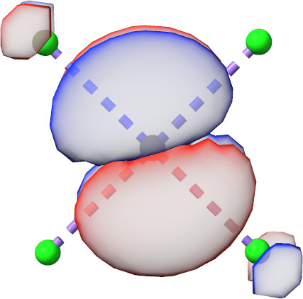
    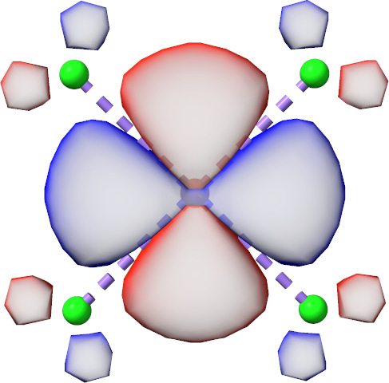
    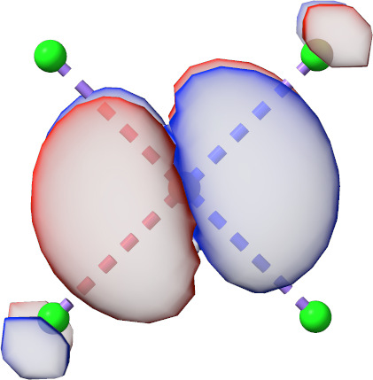

    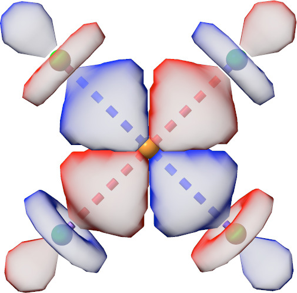
    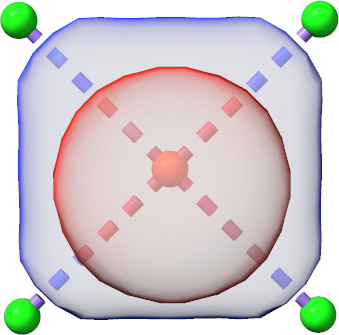

    Initial Minimal AS orbitals of CuCl$^-_{\text{4}}$ generated by AVAS.

The same calculation can be started also by using the
`%scf avas ... end end ` block.

```orca
%scf
 avas
  system
   shell   3,  3,  3,  3,  3
   l       2,  2,  2,  2,  2
   m_l     0,  1, -1,  2, -2
   center  0,  0, 0,  0, 0
  end
 end
end
```

Here, it is also possible to use target basis functions at different
atoms (`center`) and to select only a subset of functions in a shell
($m_\text{l}$). Note that if not all functions of a shell (3p, 5d,
7f) are selected, the molecule should be oriented manually to accomplish
the desired basis function overlap.

AVAS can be also used very conveniently in the same fashion for
double-d shell calculations with transition-metal complexes (`! AVAS(Double-D)`).
For each 3d transition-metal center in a molecule all 3d and 4d
target functions are considered.
Similarly, double-shell active spaces can be also set up for
4d and 5d transition-metal complexes.

There is also a similar keyword for lanthanides and actinides.
`! AVAS( Valence-F )` attempts to set up an active space with 7 f functions
 for each lanthanide or actinide atom in a molecule.
There is also the possibility to run double-f shell calculations using the
`! AVAS( Double-F )` keyword.

To avoid this issue for$\pi$ active space calculation, all three 2p
target AOs are considered first but they are weighted by the three
component of the principle axis of inertia with the largest
moment. [Sayfutyarova2019](../../bibliography.md) For those inertia moment calculations, masses
are ignored and only the centers of the desired target p AO are
considered.

For a CAS(10,9)$\pi$-active space calculation on tryptophan, the AVAS
input read

```orca
%casscf
  ...
  printgstate true # optional printing of the state-specific orbital gradients
end
```

and leads to the following output

```orca
-------------------------------------------------
INITIAL GUESS: Atomic Valence Active space (AVAS)
-------------------------------------------------

   AVAS threshold         : 0.400000
   AVAS minimal basis set : AUTO
   AVAS list              : Shell | 2 1  0> at atom 0 (system 0, type pz)
                          : Shell | 2 1  1> at atom 0 (system 0, type pz)
                          : Shell | 2 1 -1> at atom 0 (system 0, type pz)
                          : Shell | 2 1  0> at atom 1 (system 0, type pz)
                          : Shell | 2 1  1> at atom 1 (system 0, type pz)
                          : Shell | 2 1 -1> at atom 1 (system 0, type pz)
                          : Shell | 2 1  0> at atom 2 (system 0, type pz)
                          : Shell | 2 1  1> at atom 2 (system 0, type pz)
                          : Shell | 2 1 -1> at atom 2 (system 0, type pz)
                          : Shell | 2 1  0> at atom 3 (system 0, type pz)
                          : Shell | 2 1  1> at atom 3 (system 0, type pz)
                          : Shell | 2 1 -1> at atom 3 (system 0, type pz)
                          : Shell | 2 1  0> at atom 4 (system 0, type pz)
                          : Shell | 2 1  1> at atom 4 (system 0, type pz)
                          : Shell | 2 1 -1> at atom 4 (system 0, type pz)
                          : Shell | 2 1  0> at atom 5 (system 0, type pz)
                          : Shell | 2 1  1> at atom 5 (system 0, type pz)
                          : Shell | 2 1 -1> at atom 5 (system 0, type pz)
                          : Shell | 2 1  0> at atom 10 (system 0, type pz)
                          : Shell | 2 1  1> at atom 10 (system 0, type pz)
                          : Shell | 2 1 -1> at atom 10 (system 0, type pz)
                          : Shell | 2 1  0> at atom 11 (system 0, type pz)
                          : Shell | 2 1  1> at atom 11 (system 0, type pz)
                          : Shell | 2 1 -1> at atom 11 (system 0, type pz)
                          : Shell | 2 1  0> at atom 12 (system 0, type pz)
                          : Shell | 2 1  1> at atom 12 (system 0, type pz)
                          : Shell | 2 1 -1> at atom 12 (system 0, type pz)

   AVAS P matrix eig. val (  Occupied) : (0.000004)
   AVAS P matrix eig. val (  Occupied) : (0.000014)
   AVAS P matrix eig. val (  Occupied) : (0.000292)
   AVAS P matrix eig. val (  Occupied) : (0.040014)
   AVAS P matrix eig. val (  Occupied) : 0.978162
   AVAS P matrix eig. val (  Occupied) : 0.986637
   AVAS P matrix eig. val (  Occupied) : 0.993225
   AVAS P matrix eig. val (  Occupied) : 0.994300
   AVAS P matrix eig. val (  Occupied) : 0.996447
   AVAS P matrix eig. val (   Virtual) : 0.999996
   AVAS P matrix eig. val (   Virtual) : 0.999986
   AVAS P matrix eig. val (   Virtual) : 0.999708
   AVAS P matrix eig. val (   Virtual) : 0.959986
   AVAS P matrix eig. val (   Virtual) : (0.021838)
   AVAS P matrix eig. val (   Virtual) : (0.013363)
   AVAS P matrix eig. val (   Virtual) : (0.006775)
   AVAS P matrix eig. val (   Virtual) : (0.005700)
   AVAS P matrix eig. val (   Virtual) : (0.003553)

   AVAS electrons         : 10
   AVAS orbitals          : 9

                      ------------------
                      INITIAL GUESS DONE (   0.3 sec)
                      ------------------
```

and initial active orbitals.

<a id="fig:avas-tryp"></a>
!!! note "ABC|DEF|GHI"

    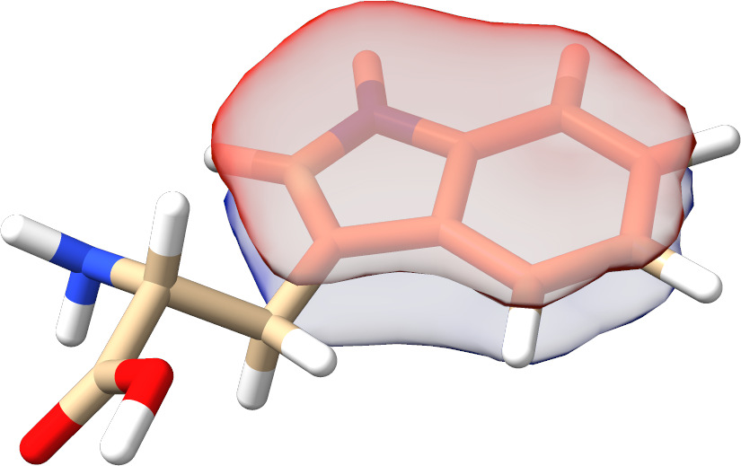
    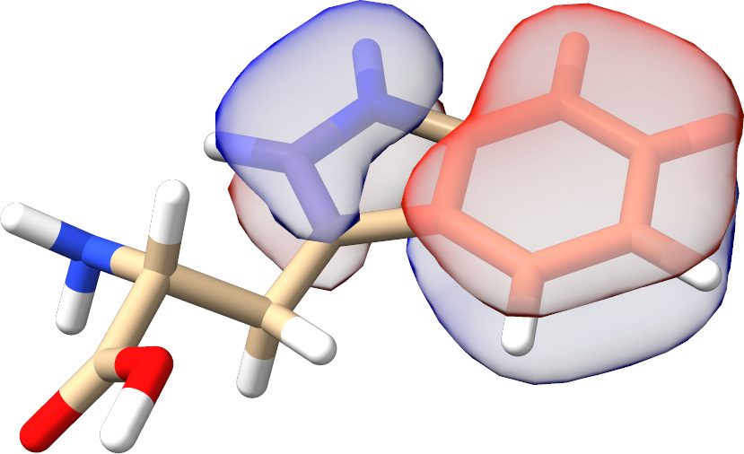
    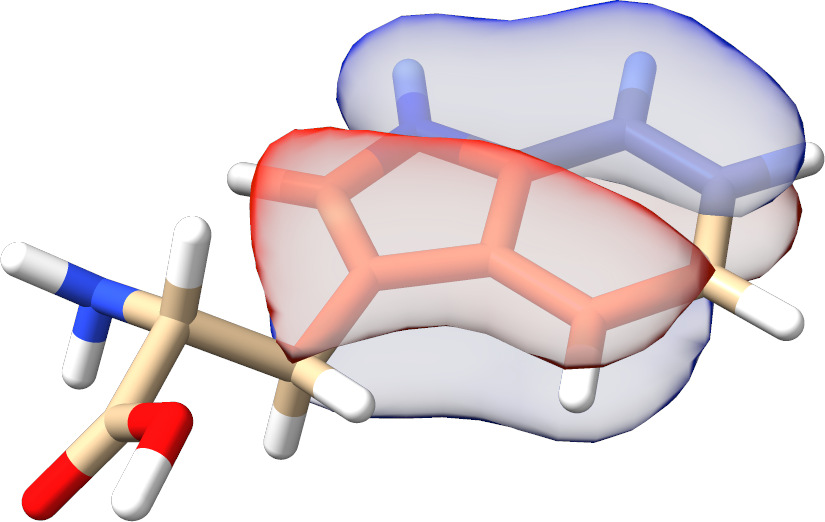

    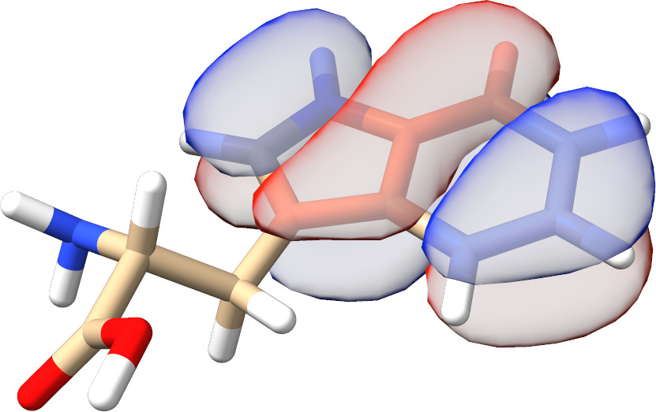
    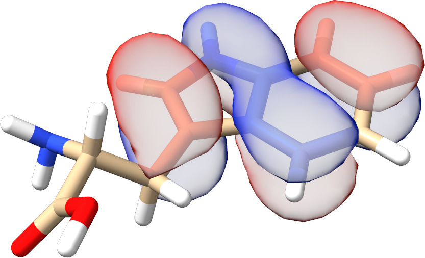
    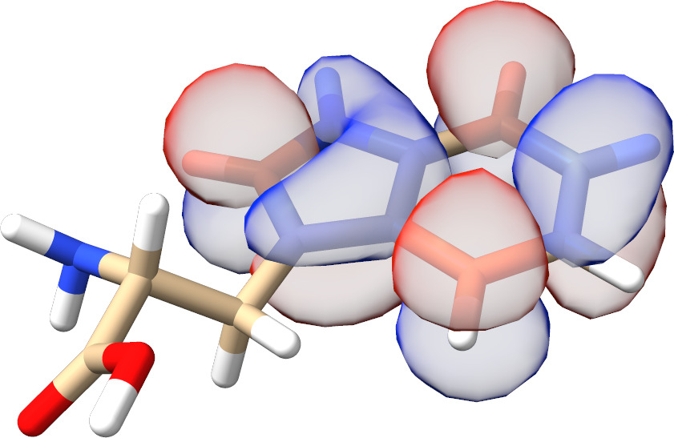

    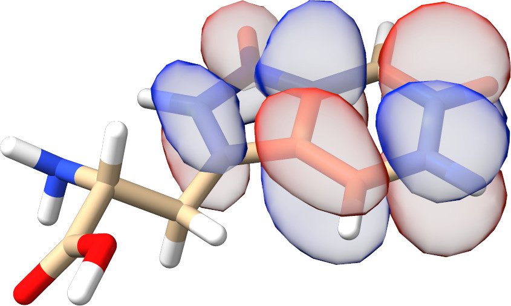
    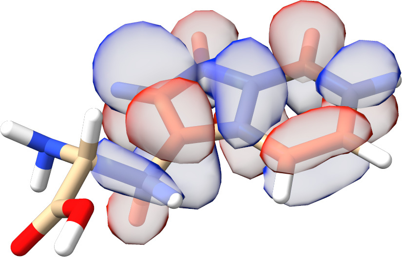
    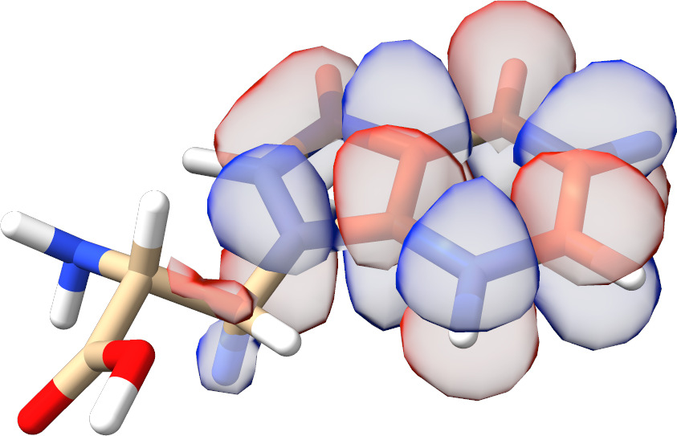

    Initial$\pi$ AS orbitals of tryptophan generated by AVAS.

It is also possible to specify the number of active electrons `nel` and
orbitals `norb` directly. For such a calculation, the AVAS singular
value decomposition threshold `tol` is ignored. In the following
calculation, the strongly occupied orbital from the previous CAS(10,9)
($\sigma^{\text{o} }_4$ in [fig:avas-tryp](#fig:avas-tryp)) calculation is omitted.

```orca
%scf
 avas
  system
   norb 8
   nel 8
   center 0, 1, 2, 3, 4, 5, 10, 11, 12
   type  pz, pz, pz, pz, pz, pz, pz, pz, pz
  end
 end
end
```

It is also possible to do the AVAS start MO generation for several
`system`s independently and then re-orthonormalize all MOs at the end
similar to  [Sayfutyarova2019](../../bibliography.md). This becomes interesting for
generating starting orbitals for multiple$\pi$ chromophores like the
bridged bithiophene biradical

```orca
%scf
 avas
  system
   norb 4
   nel  3
   center   0, 1, 2, 3, 4 # C / S atoms system 1
   type    pz, pz, pz, pz, pz
  end
  system
   norb 4
   nel  5
   center  38, 39, 40, 41, 43 # C / S atoms system 2
   type    pz, pz, pz, pz, pz
  end
 end
end
```

or the FeTPP molecule.

```mol
title: structure 3
theme: chem311
height: 320px
representation: ball-stick
--- xyz ---
37
structure (0 1)
Fe       0.0000       0.0000       0.0000
N        1.9764       0.0000       0.0000
N        0.0000       0.0000       1.9884
N       -1.9764       0.0000       0.0000
N        0.0000       0.0000      -1.9884
C        2.8182       0.0000      -1.0903
C        2.8182       0.0000       1.0903
C        1.0918       0.0000       2.8249
C       -1.0918       0.0000       2.8249
C       -2.8182       0.0000       1.0903
C       -2.8182       0.0000      -1.0903
C       -1.0918       0.0000      -2.8249
C        1.0918       0.0000      -2.8249
C        4.1961       0.0000      -0.6773
C        4.1961       0.0000       0.6773
C        0.6825       0.0000       4.1912
C       -0.6825       0.0000       4.1912
C       -4.1961       0.0000       0.6773
C       -4.1961       0.0000      -0.6773
C       -0.6825       0.0000      -4.1912
C        0.6825       0.0000      -4.1912
H        5.0441       0.0000      -1.3538
H        5.0441       0.0000       1.3538
H        1.3558       0.0000       5.0416
H       -1.3558       0.0000       5.0416
H       -5.0441       0.0000       1.3538
H       -5.0441       0.0000      -1.3538
H       -1.3558       0.0000      -5.0416
H        1.3558       0.0000      -5.0416
C        2.4150       0.0000       2.4083
C       -2.4150       0.0000       2.4083
C       -2.4150       0.0000      -2.4083
C        2.4150       0.0000      -2.4083
H        3.1855       0.0000       3.1752
H       -3.1855       0.0000       3.1752
H       -3.1855       0.0000      -3.1752
H        3.1855       0.0000      -3.1752
--- input ---
! SVP NoIter
! PModel

%scf
 avas
  system
   center 0
   type d
  end
  system
   center  1,  2,  3,  4,  5,  6,  7,  8,  9, 10, 11, 12, 13, 14, 15, 16, 17, 18, 19, 20, 29, 30, 31, 32
   type    pz, pz, pz, pz, pz, pz, pz, pz, pz, pz, pz, pz, pz, pz, pz, pz, pz, pz, pz, pz, pz, pz, pz, pz
  end
 end
end

*xyz 0 1
Fe 0.0000 0.0000  0.0000
N  1.9764 0.0000  0.0000
N  0.0000 0.0000  1.9884
N -1.9764 0.0000  0.0000
N  0.0000 0.0000 -1.9884
C  2.8182 0.0000 -1.0903
C  2.8182 0.0000  1.0903
C  1.0918 0.0000  2.8249
C -1.0918 0.0000  2.8249
C -2.8182 0.0000  1.0903
C -2.8182 0.0000 -1.0903
C -1.0918 0.0000 -2.8249
C  1.0918 0.0000 -2.8249
C  4.1961 0.0000 -0.6773
C  4.1961 0.0000  0.6773
C  0.6825 0.0000  4.1912
C -0.6825 0.0000  4.1912
C -4.1961 0.0000  0.6773
C -4.1961 0.0000 -0.6773
C -0.6825 0.0000 -4.1912
C  0.6825 0.0000 -4.1912
H  5.0441 0.0000 -1.3538
H  5.0441 0.0000  1.3538
H  1.3558 0.0000  5.0416
H -1.3558 0.0000  5.0416
H -5.0441 0.0000  1.3538
H -5.0441 0.0000 -1.3538
H -1.3558 0.0000 -5.0416
H  1.3558 0.0000 -5.0416
C  2.4150 0.0000  2.4083
C -2.4150 0.0000  2.4083
C -2.4150 0.0000 -2.4083
C  2.4150 0.0000 -2.4083
H  3.1855 0.0000  3.1752
H -3.1855 0.0000  3.1752
H -3.1855 0.0000 -3.1752
H  3.1855 0.0000 -3.1752
*
```

For those systems, all AVAS starting MOs have the desired$\pi$ or$d$
character as illustrated for the "active frontier orbitals" in [fig:avas-multi-sys](#fig:avas-multi-sys).

<a id="fig:avas-multi-sys"></a>
!!! note "AA|BB|CD"

    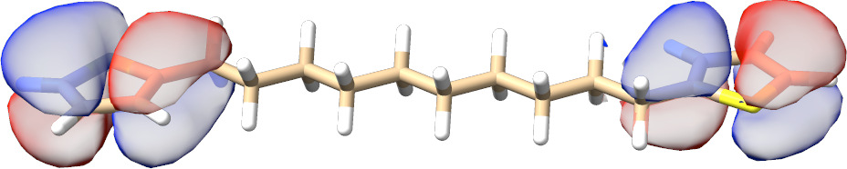
    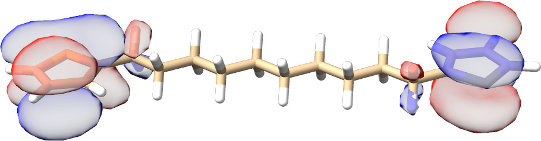
    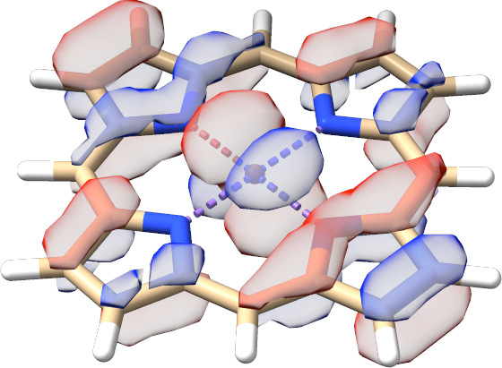
    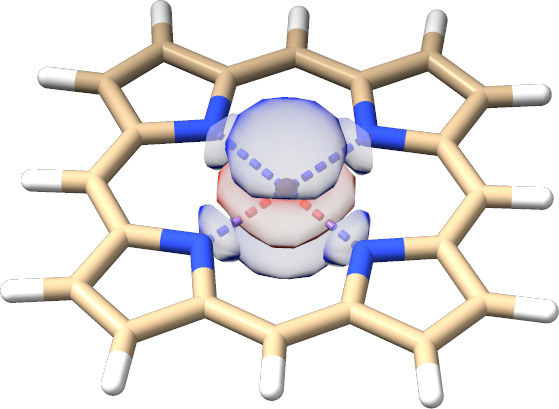

    Initial HOMO and LUMO AVAS orbitals of a bridged bithiophene biradical and FeTPP.

<a id="sec:modelchemistries.casscf.symmetry"></a>
## Example: Symmetry

The CASSCF program can make some use of symmetry. Thus, it is possible
to do the CI calculations separated by irreducible representations. This
allows one to calculate electronic states in a more controlled fashion.

Let us look at a simple example: C$_{2}$H$_{4}$. We first generate
symmetry adapted MP2 natural orbitals. Since we opt for initial guess
orbitals, the computationally cheaper unrelaxed density suffices:

```orca
! def2-TZVP def2-TZVP/C UseSym RI-MP2 conv # conventional is faster
                                           # for small molecules

%mp2 
density unrelaxed  # unrelaxed is sufficient for guess orbitals.
natorbs true       
end 

* int 0 1
C 0 0 0  0 0 0
C 1 0 0  1.35 0 0
H 1 2 0  1.1 120 0
H 1 2 3  1.1 120 180
H 2 1 3  1.1 120 0
H 2 1 3  1.1 120 180
*
```

The program does the following. It first identifies the group correctly
as D$_{2h}$ and sets up its irreducible representations. The process
detects symmetry within `SymThresh` ($10^{-4}$) and purifies the
geometry thereafter:

```orca
------------------
SYMMETRY DETECTION
------------------
The point group will now be determined using a tolerance of 1.0000e-04.
Splitting atom subsets according to nuclear charge, mass and basis set.
Splitting atom subsets according to distance from the molecule's center.
Identifying relative distance patterns of the atoms.
Splitting atom subsets according to atoms' relative distance patterns.
Bring atoms of each subset into input order.
The molecule is planar.
The molecule has a center of inversion.
Analyzing the first atom subset for its symmetry.
The atoms in the selected subset form a 4-gon with alternating side lengths.
Testing point group D2h.
Success!
This point group has been found:    D2h
Largest non-degenerate subgroup:    D2h

Symmetry-perfected Cartesians (point group D2h):

Atom          Symmetry-perfected Cartesians (x, y, z; au)
  0      -1.275565140397    0.000000000000    0.000000000000
  1       1.275565140397    0.000000000000    0.000000000000
  2      -2.314914514054    1.800205921988    0.000000000000
  3      -2.314914514054   -1.800205921988    0.000000000000
  4       2.314914514054    1.800205921988    0.000000000000
  5       2.314914514054   -1.800205921988    0.000000000000

-----------------------------------------------
SYMMETRY-PERFECTED CARTESIAN COORDINATES (A.U.)
-----------------------------------------------
Warning (ORCA_SYM): Coordinates were not cleaned so far!

------------------
SYMMETRY REDUCTION
------------------
ORCA supports only abelian point groups.
It is now checked, if the determined point group is supported:
Point Group ( D2h   ) is          ... supported

(Re)building abelian point group:
Creating Character Table          ... done
Making direct product table       ... done
Constructing symmetry operations  ... done
Creating atom transfer table      ... done
Creating asymmetric unit          ... done

----------------------
ASYMMETRIC UNIT IN D2h
----------------------
  #  AT     MASS              COORDS (A.U.)             BAS
   0 C   12.0110  -1.27556514   0.00000000   0.00000000   0
   2 H    1.0080  -2.31491451   1.80020592   0.00000000   0

----------------------
SYMMETRY ADAPTED BASIS
----------------------
The coefficients for the symmetry adapted linear combinations (SALCS)
of basis functions will now be computed:
Number of basis functions         ...    86
Preparing memory                  ... done
Constructing Gamma(red)           ... done
Reducing Gamma(red)               ... done
Constructing SALCs                ... done
Checking SALC integrity           ... nothing suspicious
Normalizing SALCs                 ... done

Storing the symmetry object:
Symmetry file                     ... Test-SYM-CAS-C2H4-1.sym.tmp
Writing symmetry information      ... done
```

It then performs the SCF calculation and keeps the symmetry in the
molecular orbitals.

```orca
NO   OCC          E(Eh)            E(eV)    Irrep
   0   2.0000     -11.236728      -305.7669    1-Ag
   1   2.0000     -11.235157      -305.7242    1-B3u
   2   2.0000      -1.027144       -27.9500    2-Ag
   3   2.0000      -0.784021       -21.3343    2-B3u
   4   2.0000      -0.641566       -17.4579    1-B2u
   5   2.0000      -0.575842       -15.6694    3-Ag
   6   2.0000      -0.508313       -13.8319    1-B1g
   7   2.0000      -0.373406       -10.1609    1-B1u
   8   0.0000       0.139580         3.7982    1-B2g
   9   0.0000       0.171982         4.6799    4-Ag
  10   0.0000       0.195186         5.3113    3-B3u
  11   0.0000       0.196786         5.3548    2-B2u
  12   0.0000       0.242832         6.6078    2-B1g
  13   0.0000       0.300191         8.1686    5-Ag
  14   0.0000       0.326339         8.8801    4-B3u
... etc
```

The MP2 module does not take any advantage of this information but
produces natural orbitals that are symmetry adapted:

```orca
N[  0](B3u) =   2.00000360
N[  1]( Ag) =   2.00000219
N[  2]( Ag) =   1.98056435
N[  3](B3u) =   1.97195041
N[  4](B2u) =   1.96746753
N[  5](B1g) =   1.96578954
N[  6]( Ag) =   1.95864726
N[  7](B1u) =   1.93107098
N[  8](B2g) =   0.04702701
N[  9](B3u) =   0.02071784
N[ 10](B2u) =   0.01727252
N[ 11]( Ag) =   0.01651489
N[ 12](B1g) =   0.01602695
N[ 13](B3u) =   0.01443373
N[ 14](B1u) =   0.01164204
N[ 15]( Ag) =   0.01008617
N[ 16](B2u) =   0.00999302
N[ 17]( Ag) =   0.00840326
N[ 18](B3g) =   0.00795053
N[ 19](B3u) =   0.00532044
N[ 20]( Au) =   0.00450556
etc.
```

From this information and visual inspection you will know what orbitals
you will have in the active space:

These natural orbitals can then be fed into the CASSCF calculation. We
perform a simple calculation in which we keep the ground state singlet
(A$_{1g}$ symmetry, irrep$=$0) and the first excitedtriplet state (B$_{3u}$ symmetry, irrep$=$7). In
general the ordering of irreps follows standard conventions and in case
of doubt you will find the relevant number for each irrep in the output.

For example, here (using `!LargePrint`):

```orca
----------------------------
CHARACTER TABLE OF GROUP D2h
----------------------------
GAMMA  O1   O2   O3   O4   O5   O6   O7   O8
 Ag :  1.0  1.0  1.0  1.0  1.0  1.0  1.0  1.0
 B1g:  1.0  1.0 -1.0 -1.0  1.0  1.0 -1.0 -1.0
 B2g:  1.0 -1.0  1.0 -1.0  1.0 -1.0  1.0 -1.0
 B3g:  1.0 -1.0 -1.0  1.0  1.0 -1.0 -1.0  1.0
 Au :  1.0  1.0  1.0  1.0 -1.0 -1.0 -1.0 -1.0
 B1u:  1.0  1.0 -1.0 -1.0 -1.0 -1.0  1.0  1.0
 B2u:  1.0 -1.0  1.0 -1.0 -1.0  1.0 -1.0  1.0
 B3u:  1.0 -1.0 -1.0  1.0 -1.0  1.0  1.0 -1.0

---------------------------------
DIRECT PRODUCT TABLE OF GROUP D2h
---------------------------------
   **   Ag  B1g B2g B3g Au  B1u B2u B3u

 Ag     Ag  B1g B2g B3g Au  B1u B2u B3u
 B1g    B1g Ag  B3g B2g B1u Au  B3u B2u
 B2g    B2g B3g Ag  B1g B2u B3u Au  B1u
 B3g    B3g B2g B1g Ag  B3u B2u B1u Au
 Au     Au  B1u B2u B3u Ag  B1g B2g B3g
 B1u    B1u Au  B3u B2u B1g Ag  B3g B2g
 B2u    B2u B3u Au  B1u B2g B3g Ag  B1g
 B3u    B3u B2u B1u Au  B3g B2g B1g Ag
```

We use the following input for CASSCF, where we tightened the integral
cut-offs and the convergence criteria using `!VeryTightSCF`.

```orca
# Keywords to be used as Orbstep/Switchstep
SuperCI_PT  # perturbative SuperCI (first-order) - default
TRAH        # restricted-step augmented Hessian (second-order 1-step)
#
SuperCI     # SuperCI (first-order)
DIIS        # DIIS (first-order)
KDIIS       # KDIIS (first-order)
SOSCF       # approx. Newton-Raphson (first-order)
NR          # augmented Hessian Newton-Raphson
            # unfolded two-step procedure
            # - still not true second-order
```

And gives:

```orca
------------
SCF SETTINGS
------------
Hamiltonian:
 Ab initio Hamiltonian  Method          .... Hartree-Fock(GTOs)

General Settings:
 Integral files         IntName         .... Test-SYM-CAS-C2H4-1
 Hartree-Fock type      HFTyp           .... CASSCF
 Total Charge           Charge          ....    0
 Multiplicity           Mult            ....    1
 Number of Electrons    NEL             ....   16
 Basis Dimension        Dim             ....   86
 Nuclear Repulsion      ENuc            ....     32.9609050695 Eh

 Symmetry handling      UseSym         .... ON
 Point group                           .... D2h
 Used point group                      .... D2h
 Number of irreps                      .... 8
   Irrep   Ag has   19 symmetry adapted basis functions (ofs=   0)
   Irrep  B1g has   12 symmetry adapted basis functions (ofs=  19)
   Irrep  B2g has    8 symmetry adapted basis functions (ofs=  31)
   Irrep  B3g has    4 symmetry adapted basis functions (ofs=  39)
   Irrep   Au has    4 symmetry adapted basis functions (ofs=  43)
   Irrep  B1u has    8 symmetry adapted basis functions (ofs=  47)
   Irrep  B2u has   12 symmetry adapted basis functions (ofs=  55)
   Irrep  B3u has   19 symmetry adapted basis functions (ofs=  67)
```

And further in the CASSCF program:

```orca
Symmetry handling      UseSym     ... ON
Point group                       ... D2h
Used point group                  ... D2h
Number of irreps                  ... 8
   Irrep   Ag has   19 SALCs (ofs=   0) #(closed)=   2 #(active)=   1
   Irrep  B1g has   12 SALCs (ofs=  19) #(closed)=   1 #(active)=   0
   Irrep  B2g has    8 SALCs (ofs=  31) #(closed)=   0 #(active)=   1
   Irrep  B3g has    4 SALCs (ofs=  39) #(closed)=   0 #(active)=   0
   Irrep   Au has    4 SALCs (ofs=  43) #(closed)=   0 #(active)=   0
   Irrep  B1u has    8 SALCs (ofs=  47) #(closed)=   0 #(active)=   1
   Irrep  B2u has   12 SALCs (ofs=  55) #(closed)=   1 #(active)=   0
   Irrep  B3u has   19 SALCs (ofs=  67) #(closed)=   2 #(active)=   1
 Symmetries of active orbitals:
   MO =    6  IRREP= 0 (Ag)
   MO =    7  IRREP= 5 (B1u)
   MO =    8  IRREP= 2 (B2g)
   MO =    9  IRREP= 7 (B3u)

Setting up the integral package       ... done
Building the CAS space                ... done (7 configurations for Mult=1 Irrep=0)
Building the CAS space                ... done (4 configurations for Mult=3 Irrep=7)
```

Note that the irrep occupations and active space irreps will be frozen
to what they are upon entering the CASSCF program. This helps to setup
the CI problem.

After which it smoothly converges to give:

```orca
    6:  1.986258       -0.753012    -20.4905   3-Ag
    7:  1.457849       -0.291201     -7.9240   1-B1u
    8:  0.541977        0.100890      2.7454   1-B2g
    9:  0.013915        0.964186     26.2368   3-B3u
```

As well as:

```orca
-----------------------------
SA-CASSCF TRANSITION ENERGIES
------------------------------

LOWEST ROOT =    -78.110314788 Eh -2125.490 eV

STATE   ROOT MULT IRREP DE/a.u.    DE/eV    DE/cm**-1
   1:    0    3  B3u   0.163741     4.456  35937.1
```

<a id="sec:modelchemistries.casscf.breakingbonds"></a>
## Example: Breaking Chemical Bonds

Let us turn to the breaking of chemical bonds. As a first example we
study the dissociation of the H$_{2}$ molecule. Scanning a bond, we have
two potential setups for the calculation: a) scan from the inside to the
outside or b) from the outside to inside. Of course both setups yield
identical results, but they differ in practical aspects i.e. convergence
properties. In general, **scanning from the outside to the inside is the
recommended procedure**. Using the default guess (PModel), starting
orbitals are much easier identified than at shorter distances, where
the antibonding orbitals are probably 'impure' and hence would require
some additional preparation. To ensure a smooth potential energy
surface, in all subsequent geometry steps, ORCA reads the converged
CASSCF orbitals from the previous geometry step. In the following,
`TightSCF` is used to tighten the convergence settings of CASSCF.

```orca
%casscf 
  OrbStep    SuperCI # or any other from the list above
  SwitchStep DIIS    # or any other from the list above

  SwitchConv 0.03 # gradient at which to switch
  SwitchIter 15   # iteration at which the switch takes place
                  # irrespective of the gradient

  MaxIter     75  # Maximum number of macro-iterations
end
```

The resulting potential energy surface (PES) is depicted in
[fig:7](#fig:7) together with PESs
obtained from RHF and broken-symmetry UHF calculations (input below).

```orca
! RHF Def2-SVP TightSCF

# etc...
```

And

```orca
! UHF Def2-SVP TightSCF

%scf
  FlipSpin 1
  FinalMs 0.0
end

# etc...
```

!!! note
    The `FlipSpin` option does not work together with the parameter
    scan. Only the first structure will undergo a spin flip. Therefore, at
    the current status, a separate input file (including the coordinates or
    with a corresponding coordinate file) has to be provided for each
    structure that is scanned along the PES.

<a id="fig:7"></a>
*Potential Energy Surface of the H$_2$ molecule from RHF, UHF and
CASSCF(2,2) calculations (Def2-SVP basis).*

It is obvious, that the CASSCF surface is concise and yields the correct
dissociation behavior. The RHF surface is roughly parallel to the CASSCF
surface in the vicinity of the minimum but then starts to fail badly as
the H-H bond starts to break. The broken-symmetry UHF solution is
identical to RHF in the vicinity of the minimum and dissociates
correctly. It is, however, of rather mediocre quality in the
intermediate region where it follows the RHF surface.

A more challenging case is to dissociate the N-N bond of the N$_{2}$
molecule correctly. Using CASSCF with the six p-orbitals we get a nice
potential energy curve (The depth of the minimum is still too shallow
compared to experiment by some 1 eV or so. A good dissociation energy
requires a dynamic correlation treatment on top of CASSCF and a larger
basis set).

<a id="fig:8"></a>
*Potential Energy Surface of the N$_2$ molecule from CASSCF(6,6)
calculations (Def2-SVP basis).*

One can use the H$_{2}$ example to illustrate the state-averaging
feature. Since we have two active electrons we have two singlets and one
triplet. Let us average the orbitals over these three states (we take
equal weights for all multiplicity blocks):

```mol
title: structure 4
theme: chem311
height: 320px
representation: ball-stick
--- xyz ---
1
structure (0 1)
H             0            0            0
--- input ---
!Def2-SVP TightSCF 

%casscf
  # define CAS(2,2)
  nel         2   
  norb        2
  
  # state-averaged triplet and singlet states
  mult        3,1 
  nroots      1,2 
end

# Scanning from the outside to the inside
%paras 
R [4.1 3.8 3.5 3.2 2.9 2.6 2.4 2.2 
   2 1.7 1.5 1.3 1.1 1 0.9 0.8 
   0.75 0.7 0.65 0.6]
end

* xyz 0 1 
 H 0 0 0 
 H 0 0 {R} 
end
```

which gives:

<a id="fig:9"></a>
*State averaged CASSCF(2,2) calculations on H$_2$ (two singlets, one
triplet; Def2-SVP basis). The grey curve is the ground state CASSCF(2,2)
curve*

One observes, that the singlet and triplet ground states become
degenerate for large distances (as required) while the second singlet
becomes the ionic singlet state which is high in energy. If one compares
the lowest root of the state-averaged calculation (in green) with the
dedicated ground state calculation (in gray) one gets an idea of the
energetic penalty that is associated with averaged as opposed to
dedicated orbitals.

A more involved example is the rotation around the double bond in
C$_{2}$H$_{4}$. Here, the$\pi$-bond is broken as one twists the
molecule. The means the proper active space consists of two active
electron in two orbitals.

The input is (for fun, we average over the lowest two singlets and the
triplet):

```orca
# SuperCI_PT specific settings
MaxRot 0.05  # cap stepsize 
DThresh 1e-6 # thresh for critical occupation
```

<a id="fig:10"></a>
*State averaged CASSCF(2,2) calculations on C$_2$H$_4$ (two singlets,
one triplet; SV(P) basis). The grey curve is the state averaged energy.*

We can see from this plot, that the CASSCF method produces a nice ground
state surface with the correct periodicity and degeneracy at the end
points, which represent the planar ethylene molecule. At 90$^{\circ}$
one has a weakly coupled diradical and the singlet and triplet states
become nearly degenerate, again as expected. Calculations with larger
basis sets and inclusion of dynamic correlation would give nice
quantitative results.

<a id="sec:modelchemistries.casscf.excitedstates"></a>
## Example: Excited States

As a final example, we do a state-average calculation on H$_{2}$CO in
order to illustrate excited state treatments. We expect from the ground
state (basically closed-shell) a n$\to \pi^{\ast }$ and a$\pi \to\pi^{\ast }$ excited state which we want to describe. For the n$\to\pi^{\ast }$ we also want to calculate the triplet since it is well
known experimentally. First we take DFT orbitals as starting guess.

```orca
MaxDIIS    15    # max. no of DIIS vectors to keep
DIISThresh 1e-7  # overlap criteria for linear dependency
```

In this example the DFT calculation produces the desired active space
(n,$\pi$ and$\pi^\ast$ orbitals) without further modification (e.g. swapping
orbitals). In general it is advised to verify the final converged
orbitals.

```orca
# default = dynamic level-shifting based on Ext-Act, Int-Act
ShiftUp      2.0   # static up-shift the virtual orbitals
ShiftDn      2.0   # static down-shift the internal orbitals
MinShift     0.6   # minimum separation subspaces 
```

We get:

```orca
-----------------------------
SA-CASSCF TRANSITION ENERGIES
------------------------------

LOWEST ROOT (ROOT 0 ,MULT 1) =   -113.805194041 Eh -3096.797 eV

STATE   ROOT MULT  DE/a.u.    DE/eV    DE/cm**-1
1:    0    3   0.129029     3.511  28318.5
2:    1    1   0.141507     3.851  31057.3
3:    2    1   0.453905    12.351  99620.7
```

The triplet n$\to \pi^{\ast }$ states is spot on with the experiment
excitation energy of 3.5 eV.[Robin1974](../../bibliography.md) Similarly, the singlet n
$\to \pi^{\ast }$ excited state is well reproduced compared to 3.79 eV
and 4.07 eV reported in the literature.[Robin1974,Kuppermann1987](../../bibliography.md)
Only the singlet$\pi \to \pi^{\ast }$ excited state stands out compared
to the theoretical estimate of 9.84 eV computed with
MR-AQCC.[muller_2001](../../bibliography.md). The good results are very fortuitous given the
small basis set, the minimal active space and the complete neglect of
dynamical correlation.

The state-average procedure might not do justice to the different nature
of the states (n$\to \pi^{\ast }$ versus$\pi \to \pi^{\ast }$). The
agreement should be better with the orbitals optimized for each state.
In ORCA, state-specific optimization are realized adjusting the weights
i.e. for the second singlet excited root:

```orca
Second-Singlet:
%casscf 
  # define CAS(5,4)
  nel         4
  norb        3
  # define singlet with and compute the 3 lowest 
  # states 
  mult        1
  nroots      3
  weights[0] = 0,0,1 # weights for the roots
end
```

Note, that state-specific orbital optimization are challenging to
converge and often prone to root-flipping.[rootflip](../../bibliography.md) 

To analyze electronic transitions, natural transition orbitals (NTO)
are available for state-averaged CASSCF (and also CASCI) calculations.
NTOs are switched on for every ground- to excited-state transition by
just adding `DoNTO true` to the `%casscf ... end` input block, i.e.
```orca
%casscf
  # define CAS(4,3)
  nel    4
  norb   3
  
  # state-average
  mult   1,3
  nroots 3,1
  
  DoNTO  true
end
```

For each excitation, the most dominant natural occupation numbers (singular values >1.e-4)
 are printed for each transition.
A set of donor orbitals and a set of acceptor orbitals, each
 of dimension N<sub>bf</sub> x (N<sub>occ</sub> + N<sub>act</sub>), are created and stored
 in files with unique names.
We obtain for the previous formamide example the following CASSCF NTO output

```orca
==========================================
CASSCF Natural Transition Orbitals
==========================================

------------------------------------------------
NATURAL TRANSITION ORBITALS FOR STATE     1 1A  
------------------------------------------------

STATE    1 1A  :  E=   0.141508 au      3.851 eV    31057.3 cm**-1

Threshold for printing occupation numbers 1.0000e-04

     0  : n=  1.30882812
     1  : n=  0.02641080

=> Natural Transition Orbitals (donor   ) were saved in casscf.1-1A_nto-donor.gbw
=> Natural Transition Orbitals (acceptor) were saved in casscf.1-1A_nto-acceptor.gbw

------------------------------------------------
NATURAL TRANSITION ORBITALS FOR STATE     2 1A  
------------------------------------------------

STATE    2 1A  :  E=   0.453905 au     12.351 eV    99620.7 cm**-1

Threshold for printing occupation numbers 1.0000e-04

     0  : n=  1.30519478
     1  : n=  0.24869813
     2  : n=  0.00471742

=> Natural Transition Orbitals (donor   ) were saved in casscf.2-1A_nto-donor.gbw
=> Natural Transition Orbitals (acceptor) were saved in casscf.2-1A_nto-acceptor.gbw
```

For each transition, plots of the NTO pairs can be generated with the `orca_plot` program (see Sec. [utilities.plots](../utilitiesvisualization/plots.md#sec:utilities.plots) for details),
, e.g., acceptor orbitals of the 2 <sup>1</sup>A<sub>1</sub> state in interactive mode:

```orca
orca_plot Test-CASSCF.H2CO-1.casscf.2-1A_nto-acceptor.gbw -i
```

<a id="fig:cas-ntos"></a>
*Most dominant natural transition orbital (NTO) pair for the
 2 <sup>1</sup>A<sub>1</sub> (S<sub>2</sub>) transition in formaldehyde.*

Alternatively, NTOs can also be computed directly in `orca_plot` from the
CASSCF transition density matrices.
Those need to be stored and kept in the density container by invoking
```orca
! KeepTransDensity
```

<a id="sec:modelchemistries.casscf.iceci"></a>
## Example: Large Active Spaces using ICE-CI

The state-averaged CASSCF procedure can be used for the calculation of spin-state
energetics of molecules showing a multi-reference character. The main obstacle 
in getting qualitatively accurate spin-state energetics for molecules with many
transition metal centers is the proper treatment of the
static-correlation effects between the large number of open-shell
electrons. In this section, we describe how one can effectively perform
CASSCF calculations on such systems containing a large number of
high-spin open-shell transition metal atoms.

As an example, consider the Iron-Sulfur dimer$[\text{Fe(III)}_2\text{SR}_2]^2-$
molecule. In this system, the Fe(III) centers can be seen as being made
up mostly of S=5/2 local spin states (lower spin states such as 3/2 and
1/2 will have small contributions due to Hunds' rule.) The main hurdle
while using the CASSCF protocol on such systems (with increasing number
of metal atoms) is the exponential growth of the Hilbert space although
the physics can be effectively seen as occurring in a very small set of
configuration state functions (CSFs). Therefore, in order to obtain
qualitatively correct spin-state energetics, one need not perform a
Full-CI on such molecules but rather a CIPSI like procedure using the
ICE-CI solver should give chemically accurate results. In the case of
the Fe(III) dimer, one can imagine that the ground singlet state is
composed almost entirely of the CSF where the two Fe(III) centers are
coupled antiferromagnetically. Such a CSF is represented as follows:

$$
\left| \Psi_0^{S=0} \right\rangle= \left[ 1, 1, 1, 1, 1, -1, -1, -1, -1, -1 \right]
$$

In order to make sense of this CSF representation, one needs to clarify
a few points which are as follows:

-   First, in the above basis the 10 orbitals are localized to 5 on each
    Fe center (following a high-spin UHF/UKS calculation.)

-   Second, the orbitals are ordered (as automatically done in ORCA_LOC)
    such that the first five orbitals lie on one Fe(III) center and the
    last five orbitals on the second Fe(III) center.

Using this ordering, one can read the CSF shown above in the following
way: The first five *1* represent the five electrons on the first
Fe(III) coupled in a parallel fashion to give a S=5/2 spin. The next
five *-1* represent two points:

-   First, the five consecutive *-1* signify the presence of five
    ferromagnetically coupled electrons on the second Fe(III) center
    resulting in a local S=5/2 spin state.

-   Second, the second set of spins are coupled to the first *1* via
    anti-parallel coupling as signified by the sign of the last five
    *-1* entries.

Therefore, we can see that using the CSF representation, one can obtain
an extremely compact representation of the wave function for molecules
consisting of open-shell transition metal atoms. This protocol of using
localized orbitals in a specified order to form compact CSF
representations for transition metal systems can be systematically
extended for large molecules.

We will use the example of the Iron-Sulfur dimer$[\text{Fe(III)}_2\text{SR}_2]^2-$
to demonstrate how to prepare a reference CSF and perform spin-state
energetics using the state-averaged CASSCF protocol. In such systems,
often one can obtain an estimate of the energy gap between the
singlet-state and the high-spin states from experiment. Ab initio values
for this gap be obtained using the state-averaged CASSCF protocol using
the input shown below.

```orca
E(CAS)=  -230.590325053 Eh DE=    -0.000798832
  --- Energy gap subspaces: Ext-Act = -0.244   Act-Int = -0.002
  --- current l-shift: Up(Ext-Act) = 0.54   Dn(Act-Int) = 0.30
```

The main keyword that needs to be used here (unlike in other CAS-SCF
calculations) is the *actorbs* keyword. Since we are using a local basis
with a specific ordering of the orbitals, in order to represent our
wave function it is imperative to preserve the local nature of the
orbitals as well as the orbital ordering. Therefore, we do not calculate
natural orbitals at the end of the CASSCF calculation (as is
traditionally done) instead we impose the orbitals to be as similar to
the input orbitals as possible. This is automatically enabled for
intermediate CASSCF macro iterations. The resulting CASSCF calculation
provides a chemically intuitive and simple wave function and transition
energy as shown below:

```orca
---------------------------------------------
CAS-SCF STATES FOR BLOCK  1 MULT=11 NROOTS= 1
---------------------------------------------

STATE   0 MULT=11: E=  -5066.8462457411 Eh W=  0.5000 DE= 0.000 eV      0.0 cm**-1
      1.00000 ( 1.000000000) CSF = 1+1+1+1+1+1+1+1+1+1+

---------------------------------------------
CAS-SCF STATES FOR BLOCK  2 MULT= 1 NROOTS= 1
---------------------------------------------

STATE   0 MULT= 1: E=  -5066.8548894831 Eh W=  0.5000 DE= 0.000 eV      0.0 cm**-1
      0.98159 (-0.990753235) CSF = 1+1+1+1+1+1-1-1-1-1-

-----------------------------
SA-CASSCF TRANSITION ENERGIES
------------------------------

LOWEST ROOT (ROOT 0 ,MULT 1) =  -5066.854889483 Eh -137876.131 eV

STATE   ROOT MULT  DE/a.u.    DE/eV    DE/cm**-1
   1:    0   11   0.008644     0.235   1897.1
```

As we can see from the output above, 98% of the wave function for the
singlet-state is given by a single CSF which we gave as a reference CSF.
This CSF has a very simple chemical interpretation representing the
anti-parallel coupling between the two high-spin Fe(III) centers. Since
Iron-Sulfur molecules show a strong anti-ferromagnetic coupling, we
expect the singlet state to be lower in energy than the high-spin (S=5)
state. The CASSCF transition energies show essentially this fact. The
transition energy is about$\text{2000cm}^{-1}$ which is what one expects from
a CASSCF calculation on such sulfide bridged transition-metal molecules.

## Example: Geometry Optimization
In this section, we want to optimize the geometry of formaldehyde with CASSCF. The present
implementation of analytic gradients are only implemented in the case that the solution is fully 
variational (orbitals are optimized for a single state). 

To define the active space, lets first look at the natural orbitals from a simple
correlation calculation like MP2 or a calculation with the MRCI module. Both are 
usually a good choice and easily generated. For example:

```orca
GradScaling  0.5   # constant damping in all steps
```

Now examine the occupation numbers of the natural orbitals (you will
find that in the output of the MP2 part of the calculation):

```orca
Natural Orbital Occupation Numbers:
N[  0] =   2.00000000
N[  1] =   2.00000000
N[  2] =   1.98676733
N[  3] =   1.97726840
N[  4] =   1.97500109
N[  5] =   1.96759239
N[  6] =   1.96423113
N[  7] =   1.93719340
N[  8] =   0.05427454
N[  9] =   0.02555886
N[ 10] =   0.02530580
N[ 11] =   0.01358500
N[ 12] =   0.01096092
N[ 13] =   0.01028129
N[ 14] =   0.00702048
N[ 15] =   0.00627820
```

A rule of thumb is that orbitals with occupation numbers between 1.98
and 0.02 should be in the active space. Thus, in the present case we
speculate that a 10 electrons in 8 orbitals active space would be
appropriate for the CASSCF of the ground state. Let's try:

```orca
FreezeIE 0.4       # keep active space until int-ext rotation have
# a contribution of less than 40% to the ||g||
FreezeActive 0.03  # keep almost doubly occupied orbitals as long as
# their contribution is less than 3%  to the ||g||
```

If we run that calculation, it converges and produces the following:

```orca
  MACRO-ITERATION  10:
  --- Inactive Energy E0 = -82.97337099 Eh
  E(CAS)=  -113.889438276 Eh DE=    -0.000000807
  --- Energy gap subspaces: Ext-Act = -0.431   Act-Int = -0.240
  N(occ)=  1.99763 1.99696 1.98360 1.97923 1.94253 0.05958 0.02153 0.01894
  ||g|| =      0.000361782 Max(G)=     0.000189613 Rot=9,2
  ---- THE CAS-SCF GRADIENT HAS CONVERGED ----
            --- FINALIZING ORBITALS ---
  ---- DOING ONE FINAL ITERATION FOR PRINTING ----
  --- Forming Natural Orbitals
  --- Canonicalize Internal Space
  --- Canonicalize External Space
```

From which we see that we had *two orbitals too many in the active
space* with occupation numbers very close to two. The presence of barely
correlated orbitals (occupation close to 0.0 or 2.0) can cause
convergence problems. Their inclusion in the active space does not
significantly change the energy and it might better to omit these
orbitals from the start.

In the present case, we re-run the CASSCF with 6 active electrons in six
orbitals. The result is:

```orca
  ...
  MACRO-ITERATION   8: 
  --- Inactive Energy E0 = -100.52457962 Eh
  E(CAS)=  -113.885584276 Eh DE=    -0.000001152
  --- Energy gap subspaces: Ext-Act = -0.438   Act-Int = -0.283
  N(occ)=  1.98134 1.97931 1.94184 0.05868 0.02101 0.01781
  ||g|| =      0.000752012 Max(G)=    -0.000357510 Rot=13,4
  ---- THE CAS-SCF GRADIENT HAS CONVERGED ----
  --- FINALIZING ORBITALS ---
  ---- DOING ONE FINAL ITERATION FOR PRINTING ----
  --- Forming Natural Orbitals
  --- Canonicalize Internal Space
  --- Canonicalize External Space
  
  MACRO-ITERATION   9: 
  --- Inactive Energy E0 = -100.52457962 Eh
  --- All densities will be recomputed
  E(CAS)=  -113.885584276 Eh DE=    -0.000000000
  --- Energy gap subspaces: Ext-Act = -0.858   Act-Int = -0.283
  N(occ)=  1.98172 1.97932 1.94207 0.05845 0.02100 0.01743
  ||g|| =      0.000752012 Max(G)=    -0.000327367 Rot=12,4
  --------------
  CASSCF RESULTS
  --------------
  
  Final CASSCF energy       : -113.885584276 Eh   -3098.9843 eV
```

The calculation converges very quickly and the occupation numbers show
you that all of these orbitals are actually needed in the active space.
The omission of the two orbitals from the active space came at an
increase of the energy by$\sim$4 mEh which seems to be
tolerable. Let's look what we have in the active space in figure
[fig:CAS-H2CO](#fig:CAS-H2CO).

<a id="fig:CAS-H2CO"></a>
!!! note "ABC|DEF"

    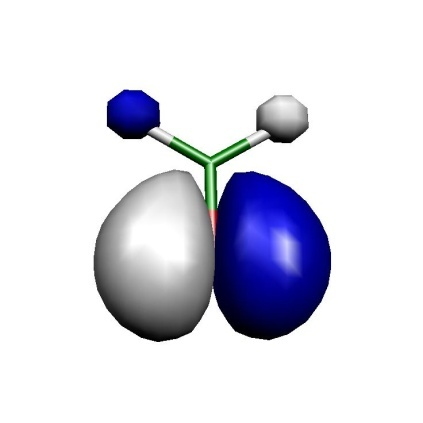
    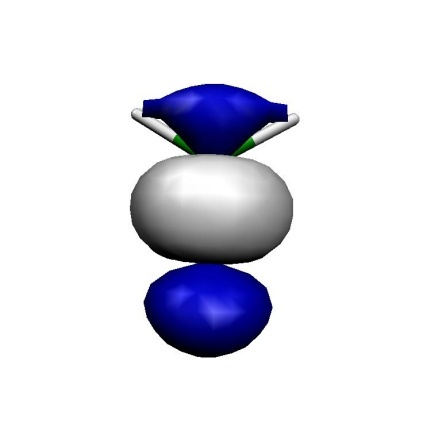
    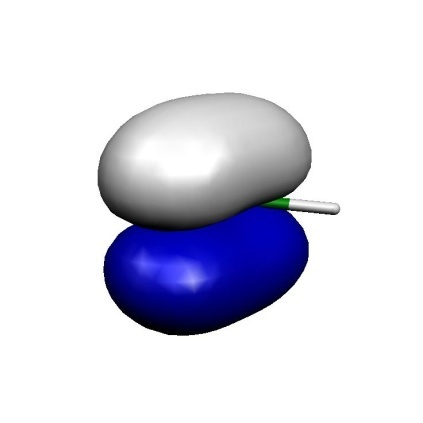
    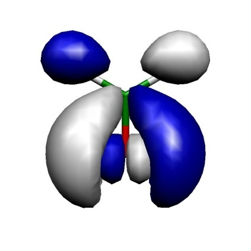
    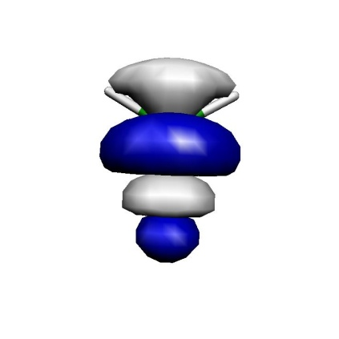
    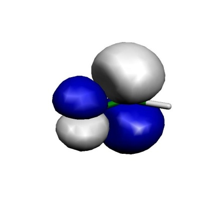

    Orbitals of the active space for the CASSCF(6,6) calculation of H$_2$CO.

Thus, we can see that we got a fairly nice result: our calculation has
correlated the in-plane oxygen lone pair, the C-O$\sigma$ and the C-O$\pi$ bond. For each strongly occupied bonding orbital, there is an
accompanying weakly occupied antibonding orbital in the active space
that is characterized by one more node. In particular, the correlating
lone pair and the C-O$\sigma^{\ast }$ orbital would have been hard to
find with any other procedure than the one chosen based on natural
orbitals. We have now done it blindly and looked at the orbitals only
after the CASSCF --- a better approach is normally to look at the
starting orbitals *before* you enter a potentially expensive CASSCF
calculation. If you have bonding/antibonding pairs in the active space
plus perhaps the singly-occupied MOs of the system you probably have
chosen a reasonable active space.

Now that we establish the good active space, let us optimize the
geometry of the molecule using a reasonable basis set:

```orca
FreezeGrad   0.2  # omit  hitting a gradient norm ||g|| <0.2
```

and get:

```orca
---------------------------------------------------------------------------
    Redundant Internal Coordinates
    
    --- Optimized Parameters ---
    (Angstroem and degrees)
    
    Definition                    OldVal   dE/dq     Step     FinalVal
    ----------------------------------------------------------------------------
    1. B(O   1,C   0)                1.2101  0.000259 -0.0002    1.2100
    2. B(H   2,C   0)                1.0942 -0.000029  0.0001    1.0943
    3. B(H   3,C   0)                1.0942 -0.000029  0.0001    1.0943
    4. A(O   1,C   0,H   3)          122.07  0.000023   -0.00    122.07
    5. A(H   2,C   0,H   3)          115.85 -0.000046    0.01    115.86
    6. A(O   1,C   0,H   2)          122.07  0.000023   -0.00    122.07
    7. I(O   1,H   3,H   2,C   0)     -0.00 -0.000000    0.00     -0.00
    ----------------------------------------------------------------------------
```

Let us compare to MP2 geometries (this job was actually run first):

```orca
FreezeGrad                         ... enabled if ||g|| is below 0.02
  Note Convergence can be signaled if the reduced gradient reaches GTol

  Last  frozen  orbital             ... 9
  First deleted orbital             ... 320
  Once rotations with core and deleted orbitals are stabilized they will be damped.
```

```orca
-------------------------------------------------------------------------
                         Redundant Internal Coordinates

                          --- Optimized Parameters ---
                            (Angstroem and degrees)

        Definition                    OldVal   dE/dq     Step     FinalVal
    ----------------------------------------------------------------------------
     1. B(O   1,C   0)                1.2127  0.000374 -0.0002    1.2125
     2. B(H   2,C   0)                1.0991 -0.000031  0.0001    1.0992
     3. B(H   3,C   0)                1.0991 -0.000031  0.0001    1.0992
     4. A(O   1,C   0,H   3)          121.77  0.000023   -0.00    121.77
     5. A(H   2,C   0,H   3)          116.45 -0.000046    0.01    116.46
     6. A(O   1,C   0,H   2)          121.77  0.000023   -0.00    121.77
     7. I(O   1,H   3,H   2,C   0)     -0.00 -0.000000    0.00     -0.00
    ----------------------------------------------------------------------------
```

The results are actually extremely similar (better than 1 pm agreement).
Compare to RHF:

```orca
---------------------------------------------------------------------------
                         Redundant Internal Coordinates

                          --- Optimized Parameters ---
                            (Angstroem and degrees)

        Definition                    OldVal   dE/dq     Step     FinalVal
    ----------------------------------------------------------------------------
     1. B(O   1,C   0)                1.1784 -0.000164  0.0001    1.1785
     2. B(H   2,C   0)                1.0921  0.000010 -0.0000    1.0921
     3. B(H   3,C   0)                1.0921  0.000010 -0.0000    1.0921
     4. A(O   1,C   0,H   3)          121.93 -0.000003   -0.00    121.93
     5. A(H   2,C   0,H   3)          116.13  0.000005    0.00    116.13
     6. A(O   1,C   0,H   2)          121.93 -0.000003   -0.00    121.93
     7. I(O   1,H   3,H   2,C   0)      0.00  0.000000   -0.00     -0.00
    ----------------------------------------------------------------------------
```

Thus, one can observe that the correlation brought in by CASSCF or MP2
has an important effect on the C$=$O distance ($\sim$4
pm), while the rest of the geometry is not much affected.

<a id="sec:modelchemistries.casscf.natorbitals"></a>
## Example: Natural Orbitals as Input for Coupled-Cluster Calculations

Consider the possibility that you are not sure about the orbital
occupancy of your system. Hence you carry out some CASSCF calculation
for various states of the system in an effort to decide on the ground
state. You can of course follow the CASSCF by MR-MP2 or MR-ACPF or SORCI
calculations to get a true multireference result for the state ordering.
Yet, in some cases you may also want to obtain a coupled-cluster
estimate for the state energy difference. Converging coupled-cluster
calculation on alternative states in a controlled manner is anything but
trivial. Here a feature of ORCA might be helpful. The best single
configuration that resembles a given CASSCF state is built from the
natural orbitals of this state. These orbitals are also ordered in the
right way to be input into the MDCI program. The convergence to excited
states is, of course, not without pitfalls and limitations as will
become evident in the two examples below.

As an example, consider some ionized states of the water
cation:

First, we generate the natural orbitals for each state with the help of the MRCI
module. To this end we run a state average CASSCF for the lowest three doublet
states and pass that information on to the MRCI module that does a CASCI calculation
and produces the natural orbitals:

```orca
||g|| =      0.001240414 Max(G)=    -0.000431747 Rot=319,1
  --- Option=FreezeGrad: ||g|| =      0.001081707
  = 87.21%
  Omitting frozencore elements
```

This produces the files `Basename.bm_sn.nat` where "m" is the number of the block
(m = 0 correspond to the doublet in this case) and "n" stands of the relevant state
(n = 0,1,2).

These natural orbitals are then fed into unrestricted QCISD(T) calculations:

```orca
||g|| =      0.771376945 Max(G)=     0.216712933 Rot=140,53
  --- Orbital Update [        NR]
  Warning:  NEGATIVE diagonal element D(81,53)=    -4.733590
  Warning:  NEGATIVE diagonal element D(82,53)=    -4.737955
  ...
```

As a reference we also perform a SORCI on the same system

```orca
--- Orbital Update [        NR]
  AugHess Tolerance (auto): Tol= 1.00e-07
  AUGHESS-ITER   0: E=    -0.174480747 <r|r>=      0.558679452
  AUGHESS-ITER   1: E=    -0.308672359 <r|r>=      0.468254671
  AUGHESS-ITER   2: E=    -0.434272813 <r|r>=      0.286305469
  AUGHESS-ITER   3: E=    -0.439149451 <r|r>=      0.286514628
  AUGHESS-ITER   4: E=    -0.605787445 <r|r>=      0.191691955
  AUGHESS-ITER   5: E=    -0.607766529 <r|r>=      0.310450670
  AUGHESS-ITER   6: E=    -0.611674930 <r|r>=      0.141402593
  AUGHESS-ITER   7: E=    -0.623145299 <r|r>=      0.394505306
  AUGHESS-ITER   8: E=    -0.658410333 <r|r>=      0.166915094
  AUGHESS-ITER   9: E=    -0.790571374 <r|r>=      4.722929453
  AUGHESS-ITER  10: E=    -0.790590554 <r|r>=      4.716012014
  AugHess: No convergence in the Davidson procedure	
  ...
```

we obtain the transition energies:

```orca
      SORCI   QCISD(T) (in cm-1)
  D0      0     0.0
  D1  16269   16293
  D2  50403   50509
```

Thus, in this example the agreement between single- and multireference
methods is good and the unrestricted QCISD(T) method is able to describe
these excited doublet states. The natural orbitals have been a reliable
way to guide the CC equations into the desired solutions. This will work
in many cases.

## CASSCF Densities
In general, densities are stored in the so-called density container (`.densities`file). Using 
the [`orca_plot` program](../utilitiesvisualization/utilities.md#sec:utilities.plot) we can print a list of the available densities: 
```
orca_plot jobname.densities
```
By default, the state-averaged density ('.scfp') and spin-density ('.scfr') are stored.
With the keyword `!KeepDens`, ORCA stores all of the computed densities. Below is an example snippet
from a [QD-NEVPT2 calculation](NEVPT2.md#sec:modelchemistries.nevpt2.qdnev) with spin-orbit coupling.
```
---------------------
List of density names
---------------------

Index:                                                   Name of Density
------------------------------------------------------------------------
    0:                                                          cas.scfp
    1:                                                          cas.scfr
    2:                                         Tdens-CAS.mult.3.root.0.p
    3:                                         Tdens-CAS.mult.3.root.1.p
    4:                                         Tdens-CAS.mult.3.root.2.p
    5:                                         Tdens-CAS.mult.1.root.0.p
    6:                                         Tdens-CAS.mult.1.root.1.p
    7:                                         Tdens-CAS.mult.1.root.2.p
    8:                                         Tdens-CAS.mult.3.root.0.r
    9:                                         Tdens-CAS.mult.3.root.1.r
   10:                                         Tdens-CAS.mult.3.root.2.r
   11:                                         Tdens-CAS.mult.1.root.0.r
   12:                                         Tdens-CAS.mult.1.root.1.r
   13:                                         Tdens-CAS.mult.1.root.2.r
   14:                                Tdens-CAS-DPDICPT2.mult.3.root.0.r
   15:                                Tdens-CAS-DPDICPT2.mult.3.root.1.r
   16:                                Tdens-CAS-DPDICPT2.mult.3.root.2.r
   17:                                Tdens-CAS-DPDICPT2.mult.1.root.0.r
   18:                                Tdens-CAS-DPDICPT2.mult.1.root.1.r
   19:                                Tdens-CAS-DPDICPT2.mult.1.root.2.r
   20:                                         Tdens-CASQDSOCMO.root.0.p
   21:                                           Tdens-CASQDSOC.root.0.p
   22:                                       Tdens-CASPTQDSOCMO.root.0.p
   23:                                         Tdens-CASPTQDSOC.root.0.p
   24:                                Tdens-CAS-DPDICPT2QDSOCMO.root.0.p
   25:                                  Tdens-CAS-DPDICPT2QDSOC.root.0.p

```

Here, the densities 2-12 are CASSCF state-specific densities denoted with "Tdens-CAS" and a string 
flagging its multiplicity (potentially also irreducible representation) and root count. Similarly, densities 13-19 arise from the QD-NEVPT2 procedure 
and carry the prefix "Tdens-CAS-DPDICPT2". The latter is shared with other diagonalize-perturb-diagonalize type theories (DPD).
The remaining densities containing the "SOC" substring, belong to densities computed in the framework of [quasi-degenerate peturbation theory](../spectroscopyproperties/qdpt_magnetic_properties.md#sec:spectroscopyproperties.qdpt_magnetic_properties) and differ
in the handling of the reference wavefunction and the choice of the diagonal energies. The prefix "Tdens-CASQDSOC" refers to the canonical CASSCF results. Densities with the NEVPT2 diagonal energies are 
maked as "TDens-CASPTQDSOC". And finally the density using the QD-NEVPT2 revised reference wavefunction contain 
the string "Tdens-CAS-DPDICPT2QDSOC".

!!! warning
    Densities with the "MO" substring in the prefix should be ignored as they are intermediates.

<a id="sec:modelchemistries.casscf.properties"></a>
## CASSCF Properties

The CASSCF program is able to calculate UV transition, CD spectra, SOC,
SSC, Zeeman splittings, EPR g-matrices and A-matrices (the latter
implemented in the same way as in the DCD-CAS(2) method[Lang2019](../../bibliography.md)),
magnetization, magnetic susceptibility and MCD spectra. Note that the
results for the Fermi contact contribution to A will not be reliable if
the spin density is dominated by spin polarization, which is a dynamic
correlation effect. The properties are exercised in more detail in the
[CASSCF tutorial](https://orcaforum.kofo.mpg.de/app.php/dlext/?cat=4&sid=9d58efcf2208abe23b1af87a601b42f6). 

In ORCA, the UV/CD spectra are computed using via the [one photon spectrocopy tool](../spectroscopyproperties/ops.md#sec:spectroscopyproperties.ops).
A few selected properties, such as the Zeeman splitting, are available through linear response described in
the section [spectroscopyproperties.casscfresp](../spectroscopyproperties/CASSCFresp.md#sec:spectroscopyproperties.casscfresp). The majority of magnetic properties are computed in the framework of [quasi-degenrate perturbation theory](../spectroscopyproperties/qdpt_magnetic_properties.md#sec:spectroscopyproperties.qdpt_magnetic_properties), which is also used in the `orca_mrci` program. Input and keywords mimic the ones in the MRCI module described in section
[mrci.soc](mrci.md#sec:modelchemistries.mrci.soc). As an example, the input file to calculate g-values and HFC constants A of CO$^{+}$ is listed below:

```orca
%casscf 
  ...
  # NR specific settings:
  aughess
    Solver   0             # Davidson (default)
             1             # Pople (pure NR steps)
             2             # DIIS
             
    MaxIter 35             # max. no. of CI iters.
    MaxDim  35             # Davidson expansion space
    MaxDIIS  12            # max. number of DIIS vectors
    
    UseSubMatrixGuess true # diag a submatrix of the Hessian
                           # as an initial guess
                           
    NGuessMat 512          # size of initial guess matrix (part of
                           # the Hessian exactly diagonalized)
                           
    ExactDiagSwitch 512    # up to this dimension the Hessian
                           # is exactly diagonalized (small problems)
                           
    PrintLevel 1           # amount of output during AH iterations
    Tol    1e-6            # convergence tolerance
    Compress true          # use compressed storage
    DiagShift 0.0          # shift of the diagonal elements of the
                           # Hessian
                           
    UseDiagPrec true       # use the diagonal in updating
    SecShift 1e-4          # shift the higher roots in the Davidson
                           # secular equations
                           
    UpdateShift 0.5        # shift of the denominator in the
                           # update of the AH coefficients
  end
end
```

In addition to pseudo-spin 1/2 A-tensors for individual Kramers
doublets, the CASSCF module also features the calculation of "intrinsic"
HFC A-tensors for the whole lowest nonrelativistic spin multiplet in the
effective Hamiltonian approach.[LangThesis](../../bibliography.md)

In contrast to the MRCI module, the CASSCF module also supports the
calculation of susceptibility tensors at non-zero magnetic fields. The
corresponding keywords are

```orca
...
%casscf
  ...
  rel
    dosoc true
    dosusceptibility true
    susctensor_nfields 2                    # number of user-defined magnetic fields
    susctensor_magfields[0] = 35000,0,0     # 1st user-defined magnetic field
    susctensor_magfields[1] = 70000,0,0     # 2nd user-defined magnetic field
  end
end
```

This example input calculates the susceptibility tensor at the two
(vector-valued!) magnetic fields (35000,0,0) and (70000,0,0) (in Gauss).
Note that for practical reasons it is necessary to specify the number of
user-defined magnetic fields using the keyword `susctensor_nfields`.

Until ORCA 4.0 it was possible to access spin-spin couplings only via
running CAS-CI type calculations in MRCI. Converged CASSCF orbitals can
be read setting the following flags

```mol
title: structure 5
theme: chem311
height: 320px
representation: ball-stick
--- xyz ---
2
structure (1 2)
C             0            0          0.0
O             0            0       2.3504
--- input ---
!MOREAD NOITER ALLOWRHF TZVPP  TightSCF Bohrs
%moinp "convergedCASSCF.gbw"

%mrci
  ...
  TPre 0.0
  citype mrci

  newblock 2 *
    excitations none
    refs CAS(9,8) end
  end

  soc
    DoSSC true # spin-spin coupling
    DoSOC true # spin-orbit coupling
    ...
  end
end
* xyz 1 2
 C 0 0  0.0
 O 0 0  2.3504
*
```

Starting with ORCA 4.1, spin-spin couplings are also directly accessible
in the CASSCF module via the keyword `DoSSC true` in the `rel` subblock.
Note that the calculation of SSC requires the definition of an auxiliary
basis set (`AuxC` auxiliary basis set slot), since it is only
implemented in conjunction with RI integrals. A common way to introduce
dynamical correlation for the property computation, is to replace the
energies entering the quasi-degenerate perturbation theory. If the
NEVPT2 energy correction is computed in CASSCF, there will be additional
printings where CASSCF energies are replaced by the more accurate NEVPT2
values. Alternatively, these diagonal energies can be taken from the
input file similarly how it is described for the MRCI module. A more
detailed documentation is presented in the MRCI property section.

!!! note
    -   The program does NOT print the SOC matrix by default! To obtain
        SOCMEs at the CASSCF/NEVPT2/... levels, please set the `PrintLevel`
        in the `rel` block to at least 2.

<a id="sec:modelchemistries.casscf.AbInitioLFT"></a>
## 1- and 2-shell Abinitio Ligand Field Theory (AILFT)

Starting from ORCA 5.0, ORCA features a 1- and 2-shell AILFT module.
AILFT was originally developed for 1-shell d- and f- LFT problems
[atanasov_modern_2011,lang_ailft_2020](../../bibliography.md). In ORCA 5.0 an extenion to
2-shell AILFT was devloped by increasing the parameter space of the LFT hamiltonian. This provides access to all common 1- and 2-shell AILFT
problems namely:

1.  Valence LFT problems, involving the d-, f-, sp-, ds- and df-shells

2.  Core LFT problems involving the sd-, pd-, sf- and pf-shells become
    readily accesible.

(Note: Since ORCA 6.1 it is also possible to project the ab initio hamiltonian of an extended active space calculation onto the 1-shell AILFT problem. This way one recover improved 1-shell parameters without introducing new parameters. This is covered in detail in the subsequent section.)

Requesting an CAS-AILFT calcultion withing the CASSCF module is provided
in two ways:

1.  Through the ActOrbs xOrbs keywords (e.g. xOrbs: dOrbs, fOrbs spOrbs,
    psOrbs, sdOrbs, dsOrbs, sfOrbs, fsOrbs, pdOrbs, dpOrbs, pfOrbs,
    fpOrbs, dfOrbs, fdOrbs)

2.  Through the LFTCase keyword where particular LFT problems can be
    requested according to the above 1- and 2-shell combinations (e.g.
    LFTCase 3d, LFTCase 4f, LFTCase 1s3d, LFTCase 2p3d \...)

Note: that the LFTCase keyword overwrites the ActOrbs keyword and as it
will be discussed below provides a particular utility that simplifies
the 2-shell AILFT input.

A simple input for the Ni$^{2+}$ $d^8$ ion is provided below:

```mol
title: structure 6
theme: chem311
height: 320px
representation: ball-stick
--- xyz ---
1
structure (2 3)
Ni 0.0000000000 0.0000000000 0.0000000000
--- input ---
!NEVPT2 def2-SVP def2-SVP/C
%casscf
 nel 8
 norb 5
 ActOrbs dOrbs
 mult 3,1
 nroots 10,15
 rel
  dosoc true
 end
end

*xyz 2 3
Ni      0.0000000000      0.0000000000      0.0000000000
*
```

The programm after the CASSCF convergence will undergo few important
steps and sanity checks which involve

1.  an Orbital purification step

2.  a Phase correction of the 1 and 2-electron integrals

It is then important from the user's perspective to monitor that these
steps have been succesfully performed. The relevant parts of the output
are provided below:

```
---- THE CAS-SCF GRADIENT HAS CONVERGED ----
--- FINALIZING ORBITALS ---
---- DOING ONE FINAL ITERATION FOR PRINTING ----
--- d-orbitals (depends on the molecular axis frame)
L-Center:  0 Ni [0.000, 0.000, 0.000] 
--- The active space contains 5 d Orbitals : OK
Setting 9 active MO to AO dz2     (11)
Setting 10 active MO to AO dxz     (12)
Setting 11 active MO to AO dyz     (13)
Setting 12 active MO to AO dx2y2   (14)
Setting 13 active MO to AO dxy     (15)
--- Canonicalize Internal Space
--- Canonicalize External Space

...

=============================
AB INITIO LIGAND FIELD THEORY
d8 configuration
2 CI blocks
MOs 9 to 13
=============================

Metal/Atom center is atom 0
orbital phases =   1.0   1.0   1.0   1.0   1.0 
Metal/Atom d-orbital parts of active orbitals
Shell 7
9        10        11        12        13
dz2     :  0.848522 -0.000000  0.000000 -0.000000 -0.000000
dxz     : -0.000000  0.848522  0.000000 -0.000000  0.000000
dyz     :  0.000000  0.000000  0.848522 -0.000000 -0.000000
dx2y2   : -0.000000 -0.000000 -0.000000  0.848522  0.000000
dxy     : -0.000000  0.000000 -0.000000  0.000000  0.848522
Shell 8
9        10        11        12        13
dz2     :  0.300072  0.000000 -0.000000  0.000000  0.000000
dxz     :  0.000000  0.300072 -0.000000  0.000000 -0.000000
dyz     : -0.000000 -0.000000  0.300072  0.000000  0.000000
dx2y2   :  0.000000  0.000000  0.000000  0.300072 -0.000000
dxy     :  0.000000 -0.000000  0.000000 -0.000000  0.300072

Adjusting phases of one-electron integrals               ... done
Adjusting phases of two-electron integrals               ... done
```

In a subsequent step the program will

1.  compute the AI Hamiltonian

2.  construct the parameterized LFT Hamiltonian

3.  and perform the fit

The relevant output can be seen below:

```orca
Calculating ab initio Hamiltonian matrices               ... 
------------------------------------------------------------
NRoots (NEVPT2) for this block = 10
NEVPT2 correction for this block is calculated
Full NEVPT2 Hamiltonian constructed
Full NEVPT2 Hamiltonian diagonalized
------------------------------------------------------------
------------------------------------------------------------
NRoots (NEVPT2) for this block = 15
NEVPT2 correction for this block is calculated
Full NEVPT2 Hamiltonian constructed
Full NEVPT2 Hamiltonian diagonalized
------------------------------------------------------------
Calculating fit matrices                                 ... done
Fitting                                                  ... done
```

In following the fitted 1-electron energies and SCP parameters also
Racah parameters for 1-shells will be printed at the CASSCF and NEVPT2
levels of theory

```orca
------------------------------
AILFT MATRIX ELEMENTS (CASSCF)
--------------------------------

Ligand field one-electron matrix VLFT (a.u.) : 
Orbital          dz2        dxz        dyz        dx2-y2     dxy
dz2         -8.111733  -0.000000  -0.000000   0.000000  -0.000000 
dxz         -0.000000  -8.111733  -0.000000  -0.000000   0.000000 
dyz         -0.000000  -0.000000  -8.111733  -0.000000   0.000000 
dx2-y2       0.000000  -0.000000  -0.000000  -8.111733  -0.000000 
dxy         -0.000000   0.000000   0.000000  -0.000000  -8.111733 

-------------------------------------------------
Slater-Condon Parameters (electronic repulsion) : 
-------------------------------------------------
F0dd(from 2el Ints)     =  0.980960738 a.u. = 26.693 eV =  215296.0 cm**-1 (fixed)
F2dd                    =  0.451725025 a.u. = 12.292 eV =   99142.2 cm**-1
F4dd                    =  0.280604669 a.u. =  7.636 eV =   61585.6 cm**-1
-------------------
Racah Parameters : 
-------------------
A(F0dd from 2el Ints)   =  0.949782441 a.u. = 25.845 eV =  208453.2 cm**-1
B                       =  0.006037419 a.u. =  0.164 eV =    1325.1 cm**-1
C                       =  0.022270212 a.u. =  0.606 eV =    4887.7 cm**-1
C/B                     =  3.689
-------------------------------------------------------------------------------

-----------------------------------------
The ligand field one electron eigenfunctions:
-----------------------------------------
Orbital Energy (eV) Energy(cm-1)  dz2       dxz       dyz     dx2-y2     dxy
1       0.000        0.0      -0.999978 -0.000164 -0.001934  0.005783 -0.002568 
2       0.000        0.0      -0.005768 -0.000269 -0.000262 -0.999967 -0.005788 
3       0.000        0.0       0.002600  0.000424  0.001046  0.005773 -0.999979 
4       0.000        0.0       0.000241 -0.999246 -0.038831  0.000280 -0.000462 
5       0.000        0.0       0.001930  0.038832 -0.999243  0.000246 -0.001022 
Ligand field orbitals were stored in ni.3d.casscf.lft.gbw

...

------------------------------
AILFT MATRIX ELEMENTS (NEVPT2)
--------------------------------

Ligand field one-electron matrix VLFT (a.u.) : 
Orbital          dz2        dxz        dyz        dx2-y2     dxy
dz2         -8.118685   0.000000   0.000000   0.000005  -0.000000 
dxz          0.000000  -8.118666  -0.000000  -0.000000   0.000000 
dyz          0.000000  -0.000000  -8.118674  -0.000000   0.000000 
dx2-y2       0.000005  -0.000000  -0.000000  -8.118676   0.000000 
dxy         -0.000000   0.000000   0.000000   0.000000  -8.118667 

-------------------------------------------------
Slater-Condon Parameters (electronic repulsion) : 
-------------------------------------------------
F2dd                    =  0.415943380 a.u. =    11.318 eV =   91289.0 cm**-1
F4dd                    =  0.259145554 a.u. =     7.052 eV =   56875.9 cm**-1
-------------------
Racah Parameters : 
-------------------
B                       =  0.005550482 a.u. =     0.151 eV =    1218.2 cm**-1
C                       =  0.020567107 a.u. =     0.560 eV =    4514.0 cm**-1
C/B                     =  3.705
-------------------------------------------------------------------------------

-----------------------------------------
The ligand field one electron eigenfunctions:
-----------------------------------------
Orbital Energy (eV) Energy(cm-1)   dz2       dxz       dyz      dx2-y2     dxy
1       0.000        0.0       -0.927589  0.002893  0.009447  0.373452 -0.003963 
2       0.000        3.0        0.337599  0.005897  0.449370  0.827017 -0.010128 
3       0.000        3.0        0.160011 -0.005672 -0.893243  0.420094  0.001383 
4       0.001        4.4        0.000644  0.105816 -0.006612 -0.009602 -0.994317 
5       0.001        4.6        0.001541  0.994348 -0.007084 -0.002573  0.105893 
Ligand field orbitals were stored in ni.3d.nevpt2.lft.gbw
```

Note that:

-   At the CASSCF level F0 (and subsequently racah A) is computed from
    CASSCF 2-electron coulomb integrals

-   On the other hand at the NEVPT2 level F0 is not defined hence F0 and
    racah A are not printed. Below an alternative using the effective
    Slater exponnets will be provided.

-   The LFT orbitals are saved in \*.lft.gbw files which can be
    processed by the orca_plot to generate orbital visualization files.

AILFT provides a Fit quality analysis (see the original paper
[atanasov_modern_2011,lang_ailft_2020](../../bibliography.md))

Note: That at the CASSCF level the AI matrix of free atoms and ions is
exactly parameterized in the chosen LFT parameterization scheme. As a
result the RMS AI-LFT fitting errors is expected to be practically zero.
This is not the case when a correlation treatment is chosen like NEVPT2
and the errors are expected to be somewhat larger.

The above is shown below:

```orca
Calculating statistical parameters                     ... done

Reference energy AI-LFT =    -38.134150221 au
Reference energy AI     =    -38.134150221 au

------------------------------------------------
COMPARISON OF AB INITIO AND LIGAND FIELD RESULTS
------------------------------------------------

Block   1
---------
AI-Root   0: E(AI)=  0.000 eV -> LF-Root   0:   0.000 eV  S= 0.998 Delta=  -0.000 eV
AI-Root   1: E(AI)=  0.000 eV -> LF-Root   1:   0.000 eV  S= 0.981 Delta=  -0.000 eV
AI-Root   2: E(AI)=  0.000 eV -> LF-Root   2:   0.000 eV  S= 0.980 Delta=  -0.000 eV
AI-Root   3: E(AI)=  0.000 eV -> LF-Root   3:   0.000 eV  S= 0.773 Delta=   0.000 eV
AI-Root   4: E(AI)=  0.000 eV -> LF-Root   4:   0.000 eV  S= 0.774 Delta=  -0.000 eV
AI-Root   5: E(AI)=  0.000 eV -> LF-Root   5:   0.000 eV  S= 0.985 Delta=  -0.000 eV
AI-Root   6: E(AI)=  0.000 eV -> LF-Root   6:   0.000 eV  S= 0.986 Delta=  -0.000 eV
AI-Root   7: E(AI)=  2.464 eV -> LF-Root   7:   2.464 eV  S= 0.998 Delta=  -0.000 eV
AI-Root   8: E(AI)=  2.464 eV -> LF-Root   8:   2.464 eV  S= 0.998 Delta=  -0.000 eV
AI-Root   9: E(AI)=  2.464 eV -> LF-Root   9:   2.464 eV  S= 1.000 Delta=  -0.000 eV
RMS error for this block =     0.000 eV =       0.0 cm**-1 

Block   2
---------
AI-Root   0: E(AI)=  2.033 eV -> LF-Root   0:   2.033 eV  S= 1.000 Delta=  -0.000 eV
AI-Root   1: E(AI)=  2.033 eV -> LF-Root   1:   2.033 eV  S= 1.000 Delta=  -0.000 eV
AI-Root   2: E(AI)=  2.033 eV -> LF-Root   2:   2.033 eV  S= 0.903 Delta=  -0.000 eV
AI-Root   3: E(AI)=  2.033 eV -> LF-Root   3:   2.033 eV  S= 0.967 Delta=  -0.000 eV
AI-Root   4: E(AI)=  2.033 eV -> LF-Root   4:   2.033 eV  S= 0.935 Delta=  -0.000 eV
AI-Root   5: E(AI)=  3.183 eV -> LF-Root   5:   3.183 eV  S= 0.996 Delta=  -0.000 eV
AI-Root   6: E(AI)=  3.183 eV -> LF-Root   6:   3.183 eV  S= 0.999 Delta=  -0.000 eV
AI-Root   7: E(AI)=  3.183 eV -> LF-Root   7:   3.183 eV  S= 0.996 Delta=  -0.000 eV
AI-Root   8: E(AI)=  3.183 eV -> LF-Root   8:   3.183 eV  S= 0.999 Delta=  -0.000 eV
AI-Root   9: E(AI)=  3.183 eV -> LF-Root   9:   3.183 eV  S= 0.999 Delta=  -0.000 eV
AI-Root  10: E(AI)=  3.183 eV -> LF-Root  10:   3.183 eV  S= 0.995 Delta=  -0.000 eV
AI-Root  11: E(AI)=  3.183 eV -> LF-Root  11:   3.183 eV  S= 0.992 Delta=  -0.000 eV
AI-Root  12: E(AI)=  3.183 eV -> LF-Root  12:   3.183 eV  S= 0.999 Delta=  -0.000 eV
AI-Root  13: E(AI)=  3.183 eV -> LF-Root  13:   3.183 eV  S= 0.996 Delta=  -0.000 eV
AI-Root  14: E(AI)=  7.856 eV -> LF-Root  14:   7.856 eV  S= 1.000 Delta=  -0.000 eV
RMS error for this block =     0.000 eV =       0.0 cm**-1 

Total RMS error g=     0.000 eV =       0.0 cm**-1
Note: Dropped RMS error for the reference energy.

Confidence intervals (95) computed from the square root of the
diagonal elements of the covariance matrix:
H(dz2   ,dz2   )=  0.000000000 a.u. =     0.000 eV =       0.0 cm**-1
H(dxz   ,dz2   )=  0.000000000 a.u. =     0.000 eV =       0.0 cm**-1
H(dxz   ,dxz   )=  0.000000000 a.u. =     0.000 eV =       0.0 cm**-1
H(dyz   ,dz2   )=  0.000000000 a.u. =     0.000 eV =       0.0 cm**-1
H(dyz   ,dxz   )=  0.000000000 a.u. =     0.000 eV =       0.0 cm**-1
H(dyz   ,dyz   )=  0.000000000 a.u. =     0.000 eV =       0.0 cm**-1
H(dx2-y2,dz2   )=  0.000000000 a.u. =     0.000 eV =       0.0 cm**-1
H(dx2-y2,dxz   )=  0.000000000 a.u. =     0.000 eV =       0.0 cm**-1
H(dx2-y2,dyz   )=  0.000000000 a.u. =     0.000 eV =       0.0 cm**-1
H(dx2-y2,dx2-y2)=  0.000000000 a.u. =     0.000 eV =       0.0 cm**-1
H(dxy   ,dz2   )=  0.000000000 a.u. =     0.000 eV =       0.0 cm**-1
H(dxy   ,dxz   )=  0.000000000 a.u. =     0.000 eV =       0.0 cm**-1
H(dxy   ,dyz   )=  0.000000000 a.u. =     0.000 eV =       0.0 cm**-1
H(dxy   ,dx2-y2)=  0.000000000 a.u. =     0.000 eV =       0.0 cm**-1
H(dxy   ,dxy   )=  0.000000000 a.u. =     0.000 eV =       0.0 cm**-1
F2dd            =  0.000000000 a.u. =     0.000 eV =       0.0 cm**-1
F4dd            =  0.000000000 a.u. =     0.000 eV =       0.0 cm**-1
Pearson's correlation coefficient =    1.000 (should be close to 1)
```

```orca
Calculating statistical parameters                     ... done

Reference energy AI-LFT =    -38.134345028 au
Reference energy AI     =    -38.134150221 au

------------------------------------------------
COMPARISON OF AB INITIO AND LIGAND FIELD RESULTS
------------------------------------------------

Block   1
---------
AI-Root   0: E(AI)= -0.000 eV -> LF-Root   0:   0.000 eV  S= 0.933 Delta=  -0.000 eV
AI-Root   1: E(AI)=  0.000 eV -> LF-Root   1:   0.000 eV  S= 0.769 Delta=  -0.000 eV
AI-Root   2: E(AI)=  0.001 eV -> LF-Root   2:   0.000 eV  S= 0.773 Delta=   0.000 eV
AI-Root   3: E(AI)=  0.001 eV -> LF-Root   3:   0.000 eV  S= 0.742 Delta=   0.001 eV
AI-Root   4: E(AI)=  0.002 eV -> LF-Root   4:   0.000 eV  S= 0.750 Delta=   0.001 eV
AI-Root   5: E(AI)=  0.003 eV -> LF-Root   5:   0.001 eV  S= 0.931 Delta=   0.002 eV
AI-Root   6: E(AI)=  0.003 eV -> LF-Root   6:   0.001 eV  S= 0.998 Delta=   0.003 eV
AI-Root   7: E(AI)=  2.195 eV -> LF-Root   7:   2.266 eV  S= 1.000 Delta=  -0.070 eV
AI-Root   8: E(AI)=  2.195 eV -> LF-Root   8:   2.266 eV  S= 0.998 Delta=  -0.070 eV
AI-Root   9: E(AI)=  2.195 eV -> LF-Root   9:   2.266 eV  S= 0.998 Delta=  -0.070 eV
RMS error for this block =     0.039 eV =     311.1 cm**-1 

Block   2
---------
AI-Root   0: E(AI)=  1.812 eV -> LF-Root   0:  1.875 eV  S= 0.825 Delta=  -0.063 eV
AI-Root   1: E(AI)=  1.812 eV -> LF-Root   1:  1.875 eV  S= 0.938 Delta=  -0.063 eV
AI-Root   2: E(AI)=  1.812 eV -> LF-Root   2:  1.875 eV  S= 1.000 Delta=  -0.063 eV
AI-Root   3: E(AI)=  1.812 eV -> LF-Root   3:  1.875 eV  S= 1.000 Delta=  -0.063 eV
AI-Root   4: E(AI)=  1.812 eV -> LF-Root   4:  1.875 eV  S= 0.773 Delta=  -0.063 eV
AI-Root   5: E(AI)=  2.987 eV -> LF-Root   5:  2.932 eV  S= 0.955 Delta=   0.056 eV
AI-Root   6: E(AI)=  2.987 eV -> LF-Root   6:  2.932 eV  S= 0.910 Delta=   0.055 eV
AI-Root   7: E(AI)=  2.988 eV -> LF-Root   7:  2.932 eV  S= 0.874 Delta=   0.056 eV
AI-Root   8: E(AI)=  2.988 eV -> LF-Root   8:  2.932 eV  S= 0.792 Delta=   0.056 eV
AI-Root   9: E(AI)=  2.988 eV -> LF-Root   9:  2.932 eV  S= 0.796 Delta=   0.056 eV
AI-Root  10: E(AI)=  2.988 eV -> LF-Root  10:  2.932 eV  S= 0.808 Delta=   0.056 eV
AI-Root  11: E(AI)=  2.988 eV -> LF-Root  11:  2.932 eV  S= 0.971 Delta=   0.056 eV
AI-Root  12: E(AI)=  2.988 eV -> LF-Root  12:  2.932 eV  S= 0.994 Delta=   0.056 eV
AI-Root  13: E(AI)=  2.989 eV -> LF-Root  13:  2.932 eV  S= 0.994 Delta=   0.057 eV
AI-Root  14: E(AI)=  7.122 eV -> LF-Root  14:  7.241 eV  S= 1.000 Delta=  -0.119 eV
RMS error for this block =     0.064 eV =     519.6 cm**-1 

Total RMS error g=     0.057 eV =     457.2 cm**-1
Note: Dropped RMS error for the reference energy.

Confidence intervals (95) computed from the square root of the
diagonal elements of the covariance matrix:
H(dz2   ,dz2   )=  0.000523387 a.u. =     0.014 eV =     114.9 cm**-1
H(dxz   ,dz2   )=  0.000393965 a.u. =     0.011 eV =      86.5 cm**-1
H(dxz   ,dxz   )=  0.000523387 a.u. =     0.014 eV =     114.9 cm**-1
H(dyz   ,dz2   )=  0.000393965 a.u. =     0.011 eV =      86.5 cm**-1
H(dyz   ,dxz   )=  0.000393965 a.u. =     0.011 eV =      86.5 cm**-1
H(dyz   ,dyz   )=  0.000523387 a.u. =     0.014 eV =     114.9 cm**-1
H(dx2-y2,dz2   )=  0.000393965 a.u. =     0.011 eV =      86.5 cm**-1
H(dx2-y2,dxz   )=  0.000393965 a.u. =     0.011 eV =      86.5 cm**-1
H(dx2-y2,dyz   )=  0.000393965 a.u. =     0.011 eV =      86.5 cm**-1
H(dx2-y2,dx2-y2)=  0.000523387 a.u. =     0.014 eV =     114.9 cm**-1
H(dxy   ,dz2   )=  0.000393965 a.u. =     0.011 eV =      86.5 cm**-1
H(dxy   ,dxz   )=  0.000393965 a.u. =     0.011 eV =      86.5 cm**-1
H(dxy   ,dyz   )=  0.000393965 a.u. =     0.011 eV =      86.5 cm**-1
H(dxy   ,dx2-y2)=  0.000393965 a.u. =     0.011 eV =      86.5 cm**-1
H(dxy   ,dxy   )=  0.000523387 a.u. =     0.014 eV =     114.9 cm**-1
F2dd            =  0.002351095 a.u. =     0.064 eV =     516.0 cm**-1
F4dd            =  0.003038264 a.u. =     0.083 eV =     666.8 cm**-1
Pearson's correlation coefficient =    1.000 (should be close to 1)
```

Several utilities are offered for more specialized tasks that provide
better control of the AILFT inputs and outputs:

-   Skipping orbital otimization or reading in previously computed
    orbitals can be requested in two ways:

    1.  By the !NoIter keyword in the command line

    2.  By the AILFT_SkipOrbOpt in the ailft block (see example below)

-   Estimating F0 SCPs or Racah A from single zeta Slater Exponents can
    be requested from the AILFT_EffectveSlaterExponents true keyword in
    the ailft block

-   For the above task the knowledge of the principle quantum numbers is
    required. This can be specidied in two ways:

    1.  By the AILFT_PQN x keyword in the ailft block (x=3 for 3d)

    2.  By the LFTCase x keyword (LFTCase 3d, ommiting in this way the
        ActOrbs dOrbs keyword)

Let us see how all the above translates in the above example of the
Ni$^{2+}$ $d^8$ ion

```mol
title: structure 7
theme: chem311
height: 320px
representation: ball-stick
--- xyz ---
1
structure (2 3)
Ni 0.0000000000 0.0000000000 0.0000000000
--- input ---
!NoIter NEVPT2 def2-SVP def2-SVP/C

%casscf
 nel 8
 norb 5
 LFTCase 3d
 mult 3,1
 nroots 10,15
 ailft
  #AILFT_SkipOrbOpt true (An alternative to NoIter)
  #AILFT_PQNs 3 (Works together with ActOrbs dOrbs as an alternative to LFTCase 3d)
  AILFT_SlaterExponents true
 end
 rel
  dosoc true
 end
end

*xyz 2 3
Ni      0.0000000000      0.0000000000      0.0000000000
*
```

By running the above input the fitted 1-electron energies and SCP
parameters also Racah parameters for 1-shells will be printed at the
CASSCF and NEVPT2 levels of theory, including F0s and Racah A as
estimated from single zeta effective Slater exponents from the fitted
F2dd SCPs.

```orca
------------------------------
AILFT MATRIX ELEMENTS (CASSCF)
--------------------------------

Ligand field one-electron matrix VLFT (a.u.) : 
Orbital          dz2        dxz        dyz        dx2-y2     dxy
dz2         -7.974440   0.000000  -0.000000   0.000000  -0.000000 
dxz          0.000000  -7.974440  -0.000000  -0.000000   0.000000 
dyz         -0.000000  -0.000000  -7.974440  -0.000000   0.000000 
dx2-y2       0.000000  -0.000000  -0.000000  -7.974440   0.000000 
dxy         -0.000000   0.000000   0.000000   0.000000  -7.974440 

-------------------------------------------------
Slater-Condon Parameters (electronic repulsion) : 
-------------------------------------------------
-------------------------------------------------------------------------------
Computed Single Zeta Slater Effective Exponents                         ...
-------------------------------------------------------------------------------
kd(SZ)(from F2dd)       =  3.134434893 a.u.
-------------------------------------------------------------------------------
Computed F0s from Single Zeta Slater Effective Exponents                ...
-------------------------------------------------------------------------------
F0dd(from F2dd kd(SZ))  =  0.809116820 a.u. =    22.017 eV =  177580.6 cm**-1
F2dd                    =  0.427107567 a.u. =    11.622 eV =   93739.3 cm**-1
F4dd                    =  0.264174069 a.u. =     7.189 eV =   57979.5 cm**-1
-------------------------------------------------------------------------------
-------------------
Racah Parameters : 
-------------------
A(from F2dd kd(SZ))     =  0.779764145 a.u. =    21.218 eV =  171138.4 cm**-1
B                       =  0.005721310 a.u. =     0.156 eV =    1255.7 cm**-1
C                       =  0.020966196 a.u. =     0.571 eV =    4601.5 cm**-1
C/B                     =  3.665
-------------------------------------------------------------------------------

-----------------------------------------
The ligand field one electron eigenfunctions:
-----------------------------------------
Orbital Energy (eV) Energy(cm-1)   dz2      dxz       dyz      dx2-y2     dxy
1       0.000        0.0       -0.999981  0.000787 -0.001735  0.004390 -0.003810 
2       0.000        0.0        0.003811  0.000493  0.000955  0.000497 -0.999992 
3       0.000        0.0        0.004388  0.000169  0.000080  0.999990  0.000514 
4       0.000        0.0       -0.000750 -0.999810 -0.019460  0.000174 -0.000514 
5       0.000        0.0       -0.001754 -0.019459  0.999809 -0.000069  0.000939 
Ligand field orbitals were stored in ni.3d.casscf.lft.gbw

...

------------------------------
AILFT MATRIX ELEMENTS (NEVPT2)
--------------------------------

Ligand field one-electron matrix VLFT (a.u.) : 
Orbital          dz2        dxz        dyz        dx2-y2     dxy
dz2         -7.974812  -0.000000  -0.000000   0.000002  -0.000000 
dxz         -0.000000  -7.974860   0.000000   0.000000   0.000000 
dyz         -0.000000   0.000000  -7.974856  -0.000000   0.000000 
dx2-y2       0.000002   0.000000  -0.000000  -7.974837   0.000000 
dxy         -0.000000   0.000000   0.000000   0.000000  -7.974837 

-------------------------------------------------
Slater-Condon Parameters (electronic repulsion) : 
-------------------------------------------------
-------------------------------------------------------------------------------
Computed Single Zeta Slater Effective Exponents                         ...
-------------------------------------------------------------------------------
kd(SZ)(from F2dd)       =  3.126330433 a.u.
-------------------------------------------------------------------------------
Computed F0s from Single Zeta Slater Effective Exponents                ...
-------------------------------------------------------------------------------
F0dd(from F2dd kd(SZ))  =  0.807024751 a.u. =    21.960 eV =  177121.5 cm**-1
F2dd                    =  0.426003229 a.u. =    11.592 eV =   93496.9 cm**-1
F4dd                    =  0.262001371 a.u. =     7.129 eV =   57502.7 cm**-1
-------------------------------------------------------------------------------
-------------------
Racah Parameters : 
-------------------
A(from F2dd kd(SZ))     =  0.777913487 a.u. =    21.168 eV =  170732.3 cm**-1
B                       =  0.005723406 a.u. =     0.156 eV =    1256.1 cm**-1
C                       =  0.020793760 a.u. =     0.566 eV =    4563.7 cm**-1
C/B                     =  3.633
-------------------------------------------------------------------------------

-----------------------------------------
The ligand field one electron eigenfunctions:
-----------------------------------------
Orbital  Energy (eV)  Energy(cm-1)   dz2       dxz       dyz     dx2-y2     dxy
1        0.000        0.0        -0.000608 -0.999795  0.017518  0.010019  0.001244 
2        0.000        0.9         0.000003 -0.017532 -0.999696 -0.003661  0.016920 
3        0.001        4.9         0.065092 -0.009854  0.004898 -0.995782  0.063719 
4        0.001        5.0        -0.004126  0.002173  0.016617  0.063640  0.997824 
5        0.001       10.5         0.997871  0.000042 -0.000237  0.065225 -0.000030 
Ligand field orbitals were stored in ni.3d.nevpt2.lft.gbw
```

It is also possible to treat only the High Spin states in the d- and f-
1-shell AILFT. Note that not all the cases can be treated as this
renters the different SCP parameters undefined. In the beggining, AILFT
will check whether such case is detected and will drop a warning message

For example in the case of the Fe$^{2+}$ $d^6$ ion with an input like
the following:

```mol
title: structure 8
theme: chem311
height: 320px
representation: ball-stick
--- xyz ---
1
structure (2 3)
Fe 0.0000000000 0.0000000000 0.0000000000
--- input ---
!NoIter def2-SVP def2-SVP/C

%casscf
 nel 6
 norb 5
 mult 5
 nroots 5
 LFTCase 3d
end

*xyz 2 3
Fe      0.0000000000      0.0000000000      0.0000000000
*
```

the following Warning will be printed in the beggining of the
calculation

```orca
WARNING: In AILFT F2dd remains undefined when considering only the HS Multiplicity block
Be Careful with the results!
TIP:     If possible use in addition a LS Multiplicity Block
```

Spin orbit coupling effects (SOC) can be introduced by parametrizing the
effective SOC constant$\zeta$. As long as SOC is requested in the rel
CASSCF block the respective requested shell effective SOC constant
$\zeta$ will be computed at the end of every AILFT calculation

Hence in the above examples one gets:

```orca
----------------------------------------------
SPIN ORBIT COUPLING (based on CASSCF orbitals)
----------------------------------------------

AI-SOC-X integrals (cm-1)
0          1          2          3          4    
0       0.000000   0.000000 1078.568273  -0.000000  -0.000000
1      -0.000000   0.000000  -0.000000  -0.000000 622.711683
2     -1078.568273   0.000000   0.000000 -622.711683   0.000000
3       0.000000   0.000000 622.711683   0.000000  -0.000000
4       0.000000 -622.711683  -0.000000   0.000000   0.000000
AI-SOC-Y integrals (cm-1)
0          1          2          3          4    
0      -0.000000 -1078.568273  -0.000000   0.000000   0.000000
1     1078.568273   0.000000  -0.000000 -622.711683  -0.000000
2       0.000000   0.000000   0.000000  -0.000000 -622.711683
3      -0.000000 622.711683   0.000000   0.000000  -0.000000
4      -0.000000   0.000000 622.711683   0.000000   0.000000
AI-SOC-Z integrals (cm-1)
0          1          2          3          4    
0       0.000000  -0.000000   0.000000  -0.000000   0.000000
1       0.000000  -0.000000 -622.711683  -0.000000   0.000000
2      -0.000000 622.711683   0.000000  -0.000000  -0.000000
3       0.000000   0.000000   0.000000  -0.000000 -1245.423365
4      -0.000000  -0.000000   0.000000 1245.423365   0.000000

Fit to the SOC matrix elements
a = 15.000000
b =     1.158 eV =    9340.7 cm**-1
SOC constant zeta =     0.077 eV =     622.7 cm**-1

LF-SOC-X integrals (cm-1)
0          1          2          3          4    
0       0.000000  -0.000000 1078.568273  -0.000000  -0.000000
1       0.000000   0.000000  -0.000000  -0.000000 622.711683
2     -1078.568273   0.000000   0.000000 -622.711683  -0.000000
3       0.000000   0.000000 622.711683   0.000000  -0.000000
4       0.000000 -622.711683   0.000000   0.000000   0.000000
LF-SOC-Y integrals (cm-1)
0          1          2          3          4    
0       0.000000 -1078.568273  -0.000000  -0.000000  -0.000000
1     1078.568273   0.000000  -0.000000 -622.711683  -0.000000
2       0.000000   0.000000   0.000000  -0.000000 -622.711683
3       0.000000 622.711683   0.000000   0.000000  -0.000000
4       0.000000   0.000000 622.711683   0.000000   0.000000
LF-SOC-Z integrals (cm-1)
0          1          2          3          4    
0       0.000000  -0.000000  -0.000000  -0.000000  -0.000000
1       0.000000   0.000000 -622.711683  -0.000000  -0.000000
2       0.000000 622.711683   0.000000  -0.000000  -0.000000
3       0.000000   0.000000   0.000000   0.000000 -1245.423365
4       0.000000   0.000000   0.000000 1245.423365   0.000000

RMS error of nonzero matrix elements =    0.0 cm**-1

-----SOC-CONSTANTS-----
---All Values in cm-1---
ZETA_D = 622.71 
------------------------
```

Starting fron ORCA 5.0 it is also possible in addition to CASSCF and
NEVPT2 to employ DCDCAS(2) and Hermitian QD-NEVPT2 Abinitio Hamiltonians
in AILFT Example inputs are provided below for DCDCAS(2):

```mol
title: structure 9
theme: chem311
height: 320px
representation: ball-stick
--- xyz ---
1
structure (2 3)
Ni 0.0000000000 0.0000000000 0.0000000000
--- input ---
!def2-SVP def2-SVP/C

%casscf
 nel 8
 norb 5
 actorbs dorbs
 mult 3,1
 nroots 10,15
 dcdcas true
 corrorder 2
 rel
  dosoc true
 end
end

*xyz 2 3
Ni      0.0000000000      0.0000000000      0.0000000000
*
```

and Hermitian QD-NEVPT2:

```mol
title: structure 10
theme: chem311
height: 320px
representation: ball-stick
--- xyz ---
1
structure (2 3)
Ni 0.0000000000 0.0000000000 0.0000000000
--- input ---
!def2-SVP def2-SVP/C

%casscf
 nel 8
 norb 5
 actorbs dorbs
 mult 3,1
 nroots 10,15
 PTMethod  sc_nevpt2
 PTSettings
   QDType QD_VanVleck
 end
 rel
  dosoc true
 end
end

*xyz 2 3
Ni      0.0000000000      0.0000000000      0.0000000000
*
```

Running the above inputs the respective DCDCAS(2) and Hermitian
QD-NEVPT2 Hamiltonians will be processed:

```orca
Calculating ab initio Hamiltonian matrices               ... 
------------------------------------------------------------
DCDCAS correction for this block/order is calculated
DCDCAS Hamiltonian of block = 0 and order =  0 is passed
DCDCAS Hamiltonian diagonalized 
------------------------------------------------------------  
------------------------------------------------------------
DCDCAS correction for this block/order is calculated
DCDCAS Hamiltonian of block = 0 and order =  1 is passed
DCDCAS Hamiltonian diagonalized 
------------------------------------------------------------  
------------------------------------------------------------
DCDCAS correction for this block/order is calculated
DCDCAS Hamiltonian of block = 0 and order =  2 is passed
DCDCAS Hamiltonian diagonalized 
------------------------------------------------------------  
------------------------------------------------------------
DCDCAS correction for this block/order is calculated
DCDCAS Hamiltonian of block = 1 and order =  0 is passed
DCDCAS Hamiltonian diagonalized 
------------------------------------------------------------  
------------------------------------------------------------
DCDCAS correction for this block/order is calculated
DCDCAS Hamiltonian of block = 1 and order =  1 is passed
DCDCAS Hamiltonian diagonalized 
------------------------------------------------------------  
------------------------------------------------------------
DCDCAS correction for this block/order is calculated
DCDCAS Hamiltonian of block = 1 and order =  2 is passed
DCDCAS Hamiltonian diagonalized 
------------------------------------------------------------  

...

Calculating ab initio Hamiltonian matrices               ... 
------------------------------------------------------------
Hermitian QD-NEVPT2 correction for this block is calculated
Hermitian QD-NEVPT2 Hamiltonian of block = 0 is passed
Hermitian QD-NEVPT2 Hamiltonian diagonalized 
------------------------------------------------------------  
------------------------------------------------------------
Hermitian QD-NEVPT2 correction for this block is calculated
Hermitian QD-NEVPT2 Hamiltonian of block = 1 is passed
Hermitian QD-NEVPT2 Hamiltonian diagonalized 
------------------------------------------------------------
```

It should be noted that NEVPT2 and Hermitian QD-NEVPT2 AILFT require a
complete saturation of the excitation space. This implies that if less
roots than the required are requested the AILFT analyis will be skipped
in these cases. This is on the contrary not the case in CASSCF or
DCDCAS(2) in which AILFT can operate under incomplete saturation of the
excitation space.

```orca
Calculating ab initio Hamiltonian matrices               ... 
WARNING: Number of NEVPT2 roots for block 0 (5) is not equal to the number of CASCI CSFs (10)!
Skipping AILFT analysis with NEVPT2 energies!

WARNING: Number of NEVPT2 roots for block 1 (2) is not equal to the number of CASCI CSFs (15)!
Skipping AILFT analysis with NEVPT2 energies!
```

In a similar fashion one can request a 2-shell AILFT calulation.

For this purpose the recomended steps are the following:

-   In a first step the valence active space orbitals are optimized in
    the framework of SA-CASSCF calculation, e.g., the 3d MOs in a core
    1s3d or 2p3d AILFT calculation, or the f MOs in an 4f5d AILFT
    calculation)

-   In a second step the relevant core or virtual orbitals are rotated
    into the active space and the chosen CASCI/AILFT problem is solved
    by saturating the excitation space with all the involved
    excitations/multiplicity.

-   In the most of the cases the excitation space of two multiplicities
    the High-Spin one and the subsequent Low-Spin one are enouph for a
    succesfull fitting of the parameters

It should be noted that 2-shell AILFT ivolves a 2-step fitting process
following a bottom up shell angular momentum approach :

1.  At first when possible an intra-shell fitting is performed

2.  In following the respective effective Slater exponents are derived

3.  In a last step an inter-shell fitting is performed and all the
    computed/fitted parameters are printed

This implies that:

-   the flag of computing effective Slater exponents is always on by
    default in 2-shell AILFT

-   the desired LFT problem is best requested by the LFTCase keywords
    (e.g. LFTCase 1s3d)

Let look at the case of 1s3d LFT problem of the Ni$^{2+}$ $d^8$ ion. A
relevant input is provided below:

```mol
title: structure 11
theme: chem311
height: 320px
representation: ball-stick
--- xyz ---
1
structure (2 3)
Ni 0.0000000000 0.0000000000 0.0000000000
--- input ---
!NoIter NEVPT2 def2-SVP def2-SVP/C
 
%method
 frozencore fc_none
end
 
%scf
 rotate
  {0,8,90}
 end
end
 
%casscf
 nel 10
 norb 6
 mult 3,1
 nroots 100,100 
 LFTCase 1s3d
 rel
  dosoc true
 end
end
 
 
*xyz 2 3
Ni      0.0000000000      0.0000000000      0.0000000000
*
```

Like in 1-shell AILFT, 2-shells AILFT starts with a sanity check

```orca
---- THE CAS-SCF GRADIENT HAS CONVERGED ----
--- FINALIZING ORBITALS ---
---- DOING ONE FINAL ITERATION FOR PRINTING ----
--- sd-orbitals (depends on the molecular axis frame)
L-Center:  0 Ni [0.000, 0.000, 0.000] 
L-Center:  0 Ni Active Orbital 0 is the s orbital ; l = 0 ; active shell = 0 
L-Center:  0 Ni Active Orbital 1 is one d orbital ; l = 2 ; active shell = 7 
L-Center:  0 Ni Active Orbital 2 is one d orbital ; l = 2 ; active shell = 7 
L-Center:  0 Ni Active Orbital 3 is one d orbital ; l = 2 ; active shell = 7 
L-Center:  0 Ni Active Orbital 4 is one d orbital ; l = 2 ; active shell = 7 
L-Center:  0 Ni Active Orbital 5 is one d orbital ; l = 2 ; active shell = 7 
--- The active space contains 1 s orbitals and 5 d orbitals : OK
Setting 8 active MO to AO s       (0)
Setting 9 active MO to AO dz2     (11)
Setting 10 active MO to AO dxz     (12)
Setting 11 active MO to AO dyz     (13)
Setting 12 active MO to AO dx2y2   (14)
Setting 13 active MO to AO dxy     (15)
--- Canonicalize Internal Space
--- Canonicalize External Space
```

In following the AI-LFT Hamiltonians are constructed and the LFT
parameters are fitted at the CASSCF and at the NEVPT2 levels of theory

```orca
------------------------------
AILFT MATRIX ELEMENTS (CASSCF)
--------------------------------

Ligand field one-electron matrix VLFT (a.u.) with V(0,0) fixed : 
0          1          2          3          4          5    
0     -334.652557  -0.000000   0.000000  -0.000000  -0.000000  -0.000000
1      -0.000000 -10.085777   0.000000   0.000000  -0.000000  -0.000000
2       0.000000   0.000000 -10.085777  -0.000000  -0.000000  -0.000000
3      -0.000000   0.000000  -0.000000 -10.085777   0.000000   0.000000
4      -0.000000  -0.000000  -0.000000   0.000000 -10.085777  -0.000000
5      -0.000000  -0.000000  -0.000000   0.000000  -0.000000 -10.085777

-------------------------------------------------
Slater-Condon Parameters (electronic repulsion) : 
-------------------------------------------------
F0ss            = 17.137989284 a.u. =   466.348 eV = 3761353.9 cm**-1
F0dd            =  0.809116820 a.u. =    22.017 eV =  177580.6 cm**-1
F2dd            =  0.427107567 a.u. =    11.622 eV =   93739.3 cm**-1
F4dd            =  0.278548413 a.u. =     7.580 eV =   61134.3 cm**-1
F0sd            =  1.285327742 a.u. =    34.976 eV =  282096.8 cm**-1
G2sd            =  0.001928559 a.u. =     0.052 eV =     423.3 cm**-1
R2sddd          =  0.003748289 a.u. =     0.102 eV =     822.7 cm**-1

-----------------------------------------
The ligand field one electron eigenfunctions:
-----------------------------------------
Orbital Energy (eV) Energy(cm-1)    s        dz2        dxz       dyz     dx2-y2      dxz
1          0.000        0.0     -1.000000 -0.000000  0.000000 -0.000000 -0.000000  0.000000
2       8831.911  71234174.2     0.000000 -0.006282  0.006583 -0.271975  0.962261  0.000000
3       8831.911  71234174.2     0.000000  0.000000  0.000000  0.000000  0.000000  1.000000
4       8831.911  71234174.2     0.000000 -0.075508 -0.016185 -0.959327 -0.271528  0.000000
5       8831.911  71234174.2    -0.000000  0.071391 -0.997365  0.008467  0.009682  0.000000
6       8831.911  71234174.2    -0.000000  0.994566  0.070404 -0.075159 -0.015232 -0.000000
Ligand field orbitals were stored ni.1s3d.casscf.lft.gbw

...

------------------------------
AILFT MATRIX ELEMENTS (NEVPT2)
--------------------------------

Ligand field one-electron matrix VLFT (a.u.) with V(0,0) fixed : 
0          1          2          3          4          5    
0     -334.652557  -0.000000   0.000000   0.000000   0.000000   0.000000
1      -0.000000 -10.298799   0.000008   0.000006  -0.000002  -0.000002
2       0.000000   0.000008 -10.293700  -0.000042  -0.000008  -0.000006
3       0.000000   0.000006  -0.000042 -10.293839  -0.000001   0.000008
4       0.000000  -0.000002  -0.000008  -0.000001 -10.293927  -0.000033
5       0.000000  -0.000002  -0.000006   0.000008  -0.000033 -10.293511

-------------------------------------------------
Slater-Condon Parameters (electronic repulsion) : 
-------------------------------------------------
F0ss            = 16.677683435 a.u. =   453.823 eV = 3660328.4 cm**-1
F0dd            =  0.806859685 a.u. =    21.956 eV =  177085.2 cm**-1
F2dd            =  0.425916096 a.u. =    11.590 eV =   93477.8 cm**-1
F4dd            =  0.277771367 a.u. =     7.559 eV =   60963.8 cm**-1
F0sd            =  1.424742585 a.u. =    38.769 eV =  312694.9 cm**-1
G2sd            =  0.025339297 a.u. =     0.690 eV =    5561.3 cm**-1
R2sddd          =  0.003739506 a.u. =     0.102 eV =     820.7 cm**-1

-----------------------------------------
The ligand field one electron eigenfunctions:
-----------------------------------------
Orbital Energy (eV) Energy(cm-1)    s          dz2      dxz      dyz     dx2-y2      dxz
1         0.000        0.0       1.000000  0.000000 -0.000000 -0.000000 -0.000000 -0.000000
2      8826.114  71187421.2     -0.000000  0.999998 -0.001607 -0.001229  0.000405  0.000329
3      8826.247  71188489.9     -0.000000  0.000330 -0.040203 -0.027545 -0.995773 -0.077852
4      8826.249  71188507.4     -0.000000  0.001631  0.264542  0.963492 -0.035726 -0.020544
5      8826.254  71188542.9      0.000000 -0.001223 -0.962932  0.264866  0.034492 -0.037635
6      8826.258  71188582.5      0.000000 -0.000317 -0.034070  0.027728 -0.077265  0.996042
Ligand field orbitals were stored in ni.1s3d.nevpt2.lft.gbw
```

As discussed above saturation of the excitation space is a requirement
also in the case of 2-shell AILFT. It is usually enough to specify a
large number of roots for two multiplicites (e.g. 100 singlets and
triplets in the above example) The exact number of roots will be
automatically detected.

```orca
Multiplicity                      ...    3
#(Configurations)                 ...   15
#(CSFs)                           ...   15
#(Roots)                          ...  100
WARNING (ORCA_CASSCF): NRoots > NCSFs. Adjusting to maximum number of roots. Please check the output carefully!
#(Roots)                          ...   15
ROOT=0 WEIGHT=    0.033333
ROOT=1 WEIGHT=    0.033333
ROOT=2 WEIGHT=    0.033333
ROOT=3 WEIGHT=    0.033333
ROOT=4 WEIGHT=    0.033333
ROOT=5 WEIGHT=    0.033333
ROOT=6 WEIGHT=    0.033333
ROOT=7 WEIGHT=    0.033333
ROOT=8 WEIGHT=    0.033333
ROOT=9 WEIGHT=    0.033333
ROOT=10 WEIGHT=    0.033333
ROOT=11 WEIGHT=    0.033333
ROOT=12 WEIGHT=    0.033333
ROOT=13 WEIGHT=    0.033333
ROOT=14 WEIGHT=    0.033333

BLOCK  2 WEIGHT=   0.5000
Multiplicity                      ...    1
#(Configurations)                 ...   21
#(CSFs)                           ...   21
#(Roots)                          ...  100
WARNING (ORCA_CASSCF): NRoots > NCSFs. Adjusting to maximum number of roots. Please check the output carefully!
#(Roots)                          ...   21
ROOT=0 WEIGHT=    0.023810
ROOT=1 WEIGHT=    0.023810
ROOT=2 WEIGHT=    0.023810
ROOT=3 WEIGHT=    0.023810
ROOT=4 WEIGHT=    0.023810
ROOT=5 WEIGHT=    0.023810
ROOT=6 WEIGHT=    0.023810
ROOT=7 WEIGHT=    0.023810
ROOT=8 WEIGHT=    0.023810
ROOT=9 WEIGHT=    0.023810
ROOT=10 WEIGHT=    0.023810
ROOT=11 WEIGHT=    0.023810
ROOT=12 WEIGHT=    0.023810
ROOT=13 WEIGHT=    0.023810
ROOT=14 WEIGHT=    0.023810
ROOT=15 WEIGHT=    0.023810
ROOT=16 WEIGHT=    0.023810
ROOT=17 WEIGHT=    0.023810
ROOT=18 WEIGHT=    0.023810
ROOT=19 WEIGHT=    0.023810
ROOT=20 WEIGHT=    0.023810
```

However very often the required number of states to be computed in the
framework of NEVPT2 type of calculations are quite large. In these cases
a Hamiltonian reduction process on the basis of the Restrictive Active
Space (RAS) is required. In fact all LFT parameters can be determined by
considering up to double excitations from the donor-shell.

Let us consider the 2p3d case of the Fe$^{2+}$ $d^6$ ion. Saturation of
the active space requires to consider 70 triplet and 378 singlet states.
Restriction of the active space to only up to double excitations from
the 2p-shell results in 65 quintet and 330 triplet states. The
Hamiltonian reduction can be requested in the ailft block:

```orca
ailft
 AILFT_Dimension 2 # Up to double excitations from the donor shell
                 Other options:
                 1   Up to single excitations from the donor shell
                 0   No excitations from the donor shell
end
```

Hence the relevant input can be now formulated as:

```mol
title: structure 12
theme: chem311
height: 320px
representation: ball-stick
--- xyz ---
1
structure (2 5)
Fe 0.0000000000 0.0000000000 0.0000000000
--- input ---
!NoIter MOREAD DKH2 DKH-def2-TZVP def2-TZVP/C NEVPT2

%moinp "fe.3d.gbw"

%pal
 nprocs 16
end

%method
 frozencore fc_none
end

%scf
 rotate
  {2,6,90}
  {3,7,90}
  {4,8,90}
 end
end

%casscf
 nel 12
 norb 8
 mult 5,3
 nroots 65,330
 LFTCase 2p3d
 ailft
  AILFT_Dimension 2
 end
 rel
  dosoc true
  GTensor false
  DoDTensor false
 end
end

*xyz 2 5
Fe      0.0000000000      0.0000000000      0.0000000000
*
```

Note that before running the above calculation:

-   An initial SA-CASSCF calculation has been performed on the valence
    states of Fe in the 3d active space. These orbitals (fe.3d.gbw) are
    read in

-   The computation of the g- and D- tensors is switched off. This is
    recomended if the magnetism analysis is not required

-   As core spectroscopy is targeted the frozen core is switched off

At the NEVPT2 part the reduced AI and LFT Hamiltonians will be
constructed

```orca
Calculating  ab initio Hamiltonian matrices              ... 
------------------------------------------------------------
NRoots (NEVPT2) for this block = 65
NEVPT2 correction for this block is calculated
Full NEVPT2 Hamiltonian constructed
Full NEVPT2 Hamiltonian diagonalized
------------------------------------------------------------
------------------------------------------------------------
NRoots (NEVPT2) for this block = 330
NEVPT2 correction for this block is calculated
Full NEVPT2 Hamiltonian constructed
Full NEVPT2 Hamiltonian diagonalized
------------------------------------------------------------
```

As a result the CASSCF and NEVPT2 LFT parameters will be determined in
the requested reduced basis

```orca
------------------------------
AILFT MATRIX ELEMENTS (CASSCF)
--------------------------------

-------------------------------------------------
Slater-Condon Parameters (electronic repulsion) : 
-------------------------------------------------
F0pp            =  3.889665545 a.u. =   105.843 eV =  853682.9 cm**-1
F2pp            =  1.832901835 a.u. =    49.876 eV =  402275.5 cm**-1
F0dd            =  0.767706319 a.u. =    20.890 eV =  168492.1 cm**-1
F2dd            =  0.405248254 a.u. =    11.027 eV =   88941.7 cm**-1
F4dd            =  0.264292339 a.u. =     7.192 eV =   58005.5 cm**-1
F0pd            =  1.174187892 a.u. =    31.951 eV =  257704.5 cm**-1
F2pd            =  0.220959621 a.u. =     6.013 eV =   48495.0 cm**-1
G1pd            =  0.157243007 a.u. =     4.279 eV =   34510.9 cm**-1
G3pd            =  0.089473762 a.u. =     2.435 eV =   19637.2 cm**-1

...

------------------------------
AILFT MATRIX ELEMENTS (NEVPT2)
--------------------------------

-------------------------------------------------
Slater-Condon Parameters (electronic repulsion) : 
-------------------------------------------------
F0pp            =  3.527444471 a.u. =    95.987 eV =  774184.6 cm**-1
F2pp            =  1.906123325 a.u. =    51.868 eV =  418345.7 cm**-1
F0dd            =  0.808248242 a.u. =    21.994 eV =  177390.0 cm**-1
F2dd            =  0.426649072 a.u. =    11.610 eV =   93638.6 cm**-1
F4dd            =  0.278249395 a.u. =     7.572 eV =   61068.7 cm**-1
F0pd            =  1.657417509 a.u. =    45.101 eV =  363761.1 cm**-1
F2pd            =  0.198646995 a.u. =     5.405 eV =   43598.0 cm**-1
G1pd            =  0.206111579 a.u. =     5.609 eV =   45236.3 cm**-1
G3pd            =  0.128174221 a.u. =     3.488 eV =   28131.0 cm**-1

...
```

In the above example inclusion of SOC will result in the computation of
the effective SOC$\zeta$ constants of both p and d shells:

```orca
-----SOC-CONSTANTS-----
---All Values in cm-1---
ZETA_P = 65018.19 
ZETA_D = 453.53 
------------------------
```

One important feature of 1- and in particular of the 2-shell AILFT is
that it is connected to the standalone orca_lft multiplet program. Hence
every succesfull AILFT calculation will automatically construct relevant
inputs for the orca_lft.

For example in the avove 2p3d case of the Fe$^{2+}$ $d^6$ ion the
following inputs will be constructed

```orca
fe.2p3d.casscf.lft.inp
fe.2p3d.nevpt2.lft.inp
```

with the NEVPT2 one looking like this:

```orca
%lft

#-----Parameters------
NEl= 12
Shell_PQN= 0, 2, 3, 0
Mult= 5, 3
NRoots= 65, 330
#--------------------

#---Slater-Condon Parameters---
#---All Values in eV---
PARAMETERS
F0pp =  95.9866
F2pp =  51.8683
F0dd =  21.9936
F2dd =  11.6097
F4dd =  7.5716
F0pd =  45.1006
F2pd =  5.4055
G1pd =  5.6086
G3pd =  3.4878
end
#--------------------

#---LFT-Matrix Elelemnts---
#---All Values in eV---
FUNCTIONS
0   0   "  0.0000"
1   0   " -0.0146"
1   1   "  0.0947"
2   0   "  0.0210"
2   1   "  0.0061"
2   2   "  0.1155"
3   0   "  0.0000"
3   1   " -0.0000"
3   2   " -0.0000"
3   3   "1086.2398"
4   0   "  0.0000"
4   1   " -0.0000"
4   2   " -0.0000"
4   3   "  0.0323"
4   4   "1086.2181"
5   0   " -0.0000"
5   1   "  0.0000"
5   2   "  0.0000"
5   3   " -0.0356"
5   4   " -0.0154"
5   5   "1086.1183"
6   0   "  0.0000"
6   1   " -0.0000"
6   2   " -0.0000"
6   3   " -0.0767"
6   4   " -0.0080"
6   5   "  0.0341"
6   6   "1086.1219"
7   0   " -0.0000"
7   1   "  0.0000"
7   2   "  0.0000"
7   3   "  0.0050"
7   4   " -0.0023"
7   5   "  0.0026"
7   6   " -0.0038"
7   7   "1086.0688"
end
#--------------------

#---SOC-CONSTANTS---
#---All Values in eV---
PARAMETERS
ZETA_P = 8.06
ZETA_D = 0.06
end
#--------------------

#---SPECTRA/PROPERTIES---
DoABS true
#------------------------
end

*xyz Charge Multiplicity
Atom 0.00 0.00 0.00
*
```

Further details regardin orca_lft can be found in the orca_lft section [utilities.lft](../utilitiesvisualization/utilities.md#sec:utilities.lft) and the orca_lft tutorial.
([utilities.lft](../utilitiesvisualization/utilities.md#sec:utilities.lft)) and the orca_lft tutorial.
<a id="sec:modelchemistries.casscf.ESAILFT"></a>
## Extended Space Ab initio Ligand Field Theory (ESAILFT)

While the one- and two-shell AILFT approach has been remarkably effective in extracting interpretable parameters. There are still limitation to this approach. The nature of the AILFT extraction requires the CASCI or effective Hamiltonian matrix to be of the same dimension as the LFT Hamiltonian. This means that an extension of the CASSCF calculation, with the active space larger than the d-space to incorporate static correlations without increasing the number of AILFT parameters, is not possible with the original recipes.

We now provide a solution to this limitation by introducing another effective Hamiltonian that is based on partitioning the extended active spaces in CASSCF calculations. This method (esAILFT)[rao_extended_2024](../../bibliography.md) allows us to perform AILFT calculations on the basis of extended CASSCF active spaces to, in principle, any number of orbitals. The central idea is that esAILFT would allow for the inclusion of effects such as radial correlation of d-orbitals and reduce the overestimation of the ionic character in the CASSCF calculation.

The method of partitioning given by Löwdin presents one approach for building effective Hamiltonians. In this case, the Hilbert space is divided into a model (A) and an outer (B) space. The time-independent Schrödinger equation can be rewritten as:

$$
\begin{split}
H^{AI}\begin{pmatrix}
C_{A}\\
C_{B}
\end{pmatrix}=\begin{pmatrix}
H_{AA} & H_{AB}\\
H_{BA} & H_{BB}
\end{pmatrix}
\begin{pmatrix}
C_{A}\\
C_{B}
\end{pmatrix}
=E^{(0)} \cdot
\begin{pmatrix}
C_{A}\\
C_{B}
\end{pmatrix}
\end{split}
$$

$$
\begin{split}
H_{part}^{AI}={H_{AA}-H_{AB}(H_{BB}-1 \cdot E_{0})^{-1}H_{BA}}
\end{split}
$$

Here$E_{0}$ can be fixed to the lowest energy of the CASCI matrix but a bias-correction term becomes necessary to correct the energies of$H_{part}^{AI}$

$$
\begin{split}
E^{BC}_{I}=[E_{I}-E_{0}]\times\sum_{k\in B}\frac{H^{AI}_{IK}H^{AI}_{KI}}{(E_{K}-E_{0})^{2}}
\end{split}
$$

The individual steps in the calculation are summarized as follows:

1. Orbital preparation
Optimized CASSCF MOs are obtained by solving the CASSCF equations. We then exploit the unitary invariance of the active orbital space in order to make these orbitals suitable for the extended AILFT procedure by performing the following three steps

   1.	The active orbitals are localized which will separate metal-based d- or  from ligand-based orbitals
 
   2.	The metal-d- orbitals are canonicalized by diagonalizing the matrix representation of the angular momentum operator 
𝐿̂ z
 and then phase-adjusted to be consistent with the ligand field orbitals. Both steps 1.1. and 1.2. are already present in the original AILFT procedure.
 
   3.	The remaining outer space orbitals are transformed to diagonalize the corresponding sub-block of the Fock operator. This step is optional but, in our experience, beneficial for the partitioning procedure and the interpretation of the results.
 
2. Generation of the effective Hamiltonian over the ligand field manifold space. The individual steps are as follows

   1.	Calculations of the actual effective Hamiltonian
 
   2.	Calculation of the bias correction
 
3.	The original AILFT procedure is then used on the effective Hamiltonian.

We can illustrate this with an example for$V^{2+}$. The process begins with a converged minimal space CASSCF calcutions.

```orca
ResetFreq 1 # reset frequency for direct SCF
```
We then run an extended space CASSCF:

```orca
switchdens  0.0001 # ~gtol * 0.1
```

This can then be used for computing LFT parameters:

```orca
ActConstraints  0 # no checks and no changes
                1 # maximize overlap of active orbitals and check sanity (default for DIIS)
                2 # make natural orbitals in every iteration (default SuperCI)
                3 # make canonical orbitals in every iteration
                4 # localize orbitals
```

The output will include a block dedicated for ESAILFT. The information displayed is in an identical format to the one-shell case except it is extracted from the partitioned hamiltonian.

```orca
------------------------------
AILFT MATRIX ELEMENTS (Hermitian HEffective)
--------------------------------
```

<a id="sec:casscf.CoreExitedStates.detailed"></a>
## Core Excited Spectra: CAS-CI/RAS-CI XAS/RIXS 

Starting from ORCA 4.1, a CASCI/NEVPT2 protocol can be used to compute
core excited spectra, namely X-ray absorption (XAS) and resonant
inelastic scattering (RIXS) spectra. RASCI calculations can also be
easily specified.

The XAS/RIXS spectra calculations requires two steps:

-   In a first step one needs to optimize the valence active space
    orbitals in the framework of SA-CASSCF calculations, e.g. including
    valence excited states in the range between 6 to 15 eV.

-   In a second step the relevant core orbitals are rotated into the
    active space and the (C/R)ASCI/NEVPT2 problem is solved by
    saturating the excitation space with singly core-excited electronic
    configurations using the previously optimized sets of orbitals

Further information can be found in reference[2018xascascinevpt2](../../bibliography.md)

A relevant input for Fe L-edge XAS calculation of a Fe(III) complex like
$\textrm{Fe(acac)}_3$ is given below for CASCI/NEVPT2:

```orca
%moinp "Fe_acac3_casscf.gbw"

%scf
rotate
{4,89,90,0,0}
{3,88,90,0,0}
{2,87,90,0,0}
end
end

%rel
picturechange true
FiniteNuc true
end

%method FrozenCore FC_NONE 
end

# CASSCF/NEVPT2 on the valence and L-edge excited states
%casscf
nel 11
norb 8
mult 6,4
nroots 16,173
maxiter 1
# account for spin-orbit coupling
rel
  DoSOC true
end
# adding the dynamical correlation with NEVPT2
PTMethod SC\_NEVPT2
end

* xyz 0 6
...
*
```

For RASCI/NEVPT2 calculations the valence d AS is set to RAS2. The RAS3
space is usually set empty. The RAS1 space contains the previously
rotated core orbitals. To generate a single core hole, the number of
maximum holes in the RAS1 space must be set to 1. Accordingly, the
maximum number of particles in the RAS3 space must be 0. The RASCI input
should thus look the following

```orca
%casscf
 nel 11
 norb 8
 ...
 refs
  ras(11:3 1/5/0 0) # (Nel: NRAS1 MaxHoles / NRAS2 / NRAS3 MaxParticles)
 end
 ...
end
```

As it is explicitly described in the respective ROCIS section RIXS
spectra can be requested by the following keywords:

```orca
RIXS    true   # Request RIXS calculation (NoSOC)
RIXSSOC true   # Request RIXS calculation (with SOC)
Elastic true   # Request RIXS calculation (Elastic)
```

Please consult section [rocis.rixs](../spectroscopyproperties/rocis.md#sec:spectroscopyproperties.rocis.rixs) for processing and analyzing the
generated spectra.

<a id="sec:modelchemistries.casscf.XES"></a>
## Core Excited Spectra: CAS-CI/RAS-CI XES

Starting from ORCA 5.0 likewise to RASCI-XES (see section [x-ray.spectroscopy](mrci.md#sec:modelchemistries.mrci.soc.x-ray.spectroscopy)) orca features a CASCI-XES protocol.

Likewise to the RASCI-XES the CASCI-XES calculations requires two steps:

-   In a first step one needs to optimize the valence active space
    orbitals in the framework of SA-CASSCF calculations, e.g. including
    valence excited states in the range between 6 to 15 eV.

-   In a second step the relevant core orbitals e.g metal 1s and 3p are
    rotated into the active space and the CASCI problem is solved for
    the ionized system by saturating the excitation space with singly
    core-excited electronic configurations using the previously
    optimized sets of orbitals. In CASCI-XES this can be acheived by
    defining reference configurations. or via the RAS functionality.

The XESSOC calculation is called by speciyfing the following keywords in
the rel block:

```orca
rel
XESSOC true
XASMOs Number of the rotated 1s MO
end
```

Following a SA-CASSCF calculation:

```mol
title: structure 13
theme: chem311
height: 320px
representation: ball-stick
--- xyz ---
7
structure (-3 6)
Fe            0            0            0
Cl         2.40            0            0
Cl        -2.40            0            0
Cl            0         2.40            0
Cl            0        -2.40            0
Cl            0            0         2.40
Cl            0            0        -2.40
--- input ---
! X2c x2c-TZVPall x2c/J  def2-TZVP/C
! NormalPrint
! NoLoewdin NoMulliken

%casscf
nel 5
norb 5
nroots 1, 24
mult 6, 4
end

* xyz -3 6
Fe      0       0       0
Cl      2.40    0       0
Cl      -2.40   0       0
Cl      0       2.40    0
Cl      0       -2.40   0
Cl      0       0       2.40
Cl      0       0       -2.40
*
```

A relevant input for Fe XES calculation of a Fe(III) complex like
FeCl$_6$ is given below:

```mol
title: structure 14
theme: chem311
height: 320px
representation: ball-stick
--- xyz ---
7
structure (-2 5)
Fe            0            0            0
Cl         2.40            0            0
Cl        -2.40            0            0
Cl            0         2.40            0
Cl            0        -2.40            0
Cl            0            0         2.40
Cl            0            0        -2.40
--- input ---
! def2-SVP def2-SVP/C ZORA CPCM PAL8
! NormalPrint
! MOREAD  
! NoLoewdin NoMulliken

%moinp "FeCl6_casscf.gbw"

%scf
#Rotate the 1s and 3p orbitals below the SOMOs by using the rotate option
rotate {0,59,90} {36,60,90} {37,61,90} {38,62,90} end
end

%casscf
nel 12
norb 9
nroots 1000, 1000
mult 7, 5
maxiter 1
refs
  1 2 2 2 0 0 1 2 2 
  1 2 2 2 0 0 2 1 2 
  1 2 2 2 0 0 2 2 1 
  1 2 2 2 0 1 0 2 2 
  1 2 2 2 0 1 1 1 2
  1 2 2 2 0 1 1 2 1 
  1 2 2 2 0 1 2 0 2 
...
  2 2 2 2 2 0 0 2 0 
  2 2 2 2 2 0 1 0 1 
  2 2 2 2 2 0 1 1 0 
  2 2 2 2 2 0 2 0 0 
  2 2 2 2 2 1 0 0 1 
  2 2 2 2 2 1 0 1 0 
  2 2 2 2 2 1 1 0 0 
  2 2 2 2 2 2 0 0 0 
end
DoDipoleVelocity true
DecomposeFosc true
rel
dosoc true
XESSOC true
XASMOs 59
DoDTensor false
DoVelocity true
end
end

%method
SpecialGridAtoms 26 #Increase the radial integration accuracy on Fe
SpecialGridIntAcc 7 #Requested radial integration accuracy values
end

* xyz -2 5
Fe      0       0       0
Cl      2.40    0       0
Cl      -2.40   0       0
Cl      0       2.40    0
Cl      0       -2.40   0
Cl      0       0       2.40
Cl      0       0       -2.40
*
```

In ORCA 6 all these type of inputs 
have been unified across the wavefunction based modiles (e.g. CASSCF MRCI, RASCI, ROCIS and LFT) 
so in a similar fashion to  [x-ray.spectroscopy](mrci.md#sec:modelchemistries.mrci.soc.x-ray.spectroscopy)
one can also specify the respective RAS excitation space as following:

```orca

%casscf
nel 12
norb 9
nroots 1000, 1000
mult 7, 5
maxiter 1
refs ras(12:4 1/5/ 0 0) end
DoDipoleVelocity true
DecomposeFosc true
rel
  DoSOc true
  Xessoc true
  xasmos 59
  DoDTensor false
  DoVelocity true
 end
end

```

In the above inputs one notes that the exact knowledge of the states to
saturate the excitations space is not required. One only need to specify
a large number (e.g. 1000) and the program will automatically detect the
required 19 septet and 270 quintet states:

```orca
BLOCK  1 WEIGHT=   0.5000
Multiplicity                      ...    7
#(Configurations)                 ...    4
#(CSFs)                           ...    4
#(Roots)                          ... 1000
WARNING (ORCA_CASSCF): NRoots > NCSFs. Adjusting to maximum number of roots. Please check the output carefully!
#(Roots)                          ...    4

...

BLOCK  2 WEIGHT=   0.5000
Multiplicity                      ...    5
#(Configurations)                 ...   89
#(CSFs)                           ...  105
#(Roots)                          ... 1000
WARNING (ORCA_CASSCF): NRoots > NCSFs. Adjusting to maximum number of roots. Please check the output carefully!
#(Roots)                          ...  105
```

By now running the above input for the 4 septet and the 81 quintet
states the following output is generated

```orca
--------------------------------------------------------------------------------------------------------
      SOC CORRECTED   EMISSION SPECTRUM VIA TRANSITION ELECTRIC DIPOLE MOMENTS    
--------------------------------------------------------------------------------------------------------
      Transition         Energy     Energy  Wavelength fosc(D2)      D2       |DX|      |DY|      |DZ|  
                          (eV)      (cm-1)    (nm)                 (au**2)    (au)      (au)      (au)  
--------------------------------------------------------------------------------------------------------
 421-7.0A->420-5.0A   7084.189573 57137848.2  0.2   0.000000870   0.00000   0.00000   0.00000   0.00007
 423-7.0A->420-5.0A   7084.189573 57137848.2  0.2   0.000001088   0.00000   0.00006   0.00006   0.00000
 424-7.0A->420-5.0A   7084.189573 57137848.2  0.2   0.000000898   0.00000   0.00002   0.00003   0.00006
 422-7.0A->420-5.0A   7084.189573 57137848.2  0.2   0.000000000   0.00000   0.00000   0.00000   0.00000
 426-7.0A->420-5.0A   7084.189573 57137848.2  0.2   0.000001048   0.00000   0.00005   0.00005   0.00003
 425-7.0A->420-5.0A   7084.189573 57137848.2  0.2   0.000000664   0.00000   0.00005   0.00004   0.00001
 427-7.0A->420-5.0A   7084.189573 57137848.2  0.2   0.000000653   0.00000   0.00004   0.00004   0.00000
 421-7.0A->419-5.0A   7084.189691 57137849.2  0.2   0.000001233   0.00000   0.00007   0.00005   0.00003
 423-7.0A->419-5.0A   7084.189691 57137849.2  0.2   0.000000354   0.00000   0.00002   0.00002   0.00004
 422-7.0A->419-5.0A   7084.189691 57137849.2  0.2   0.000001427   0.00000   0.00004   0.00008   0.00000
 424-7.0A->419-5.0A   7084.189691 57137849.2  0.2   0.000000467   0.00000   0.00005   0.00002   0.00001
 426-7.0A->419-5.0A   7084.189691 57137849.2  0.2   0.000000216   0.00000   0.00003   0.00002   0.00001
 425-7.0A->419-5.0A   7084.189691 57137849.2  0.2   0.000001334   0.00000   0.00001   0.00002   0.00009
 421-7.0A->418-5.0A   7084.189691 57137849.2  0.2   0.000000757   0.00000   0.00000   0.00005   0.00004
...
```

Finally by processing the .out file with orca_mapspc:

```orca
orca_mapspc fecl6_xes.out XESSOC -x07000 -x17200 -w4.0 -eV -n10000
```

and by plotting the resulted XES spectrum one will get the respective
RASCI-XES spectrum presented in [fig:FeCl6_RASCI_K_beta_XES](#fig:FeCl6_RASCI_K_beta_XES)

This will result in [fig:FeCl6_RASCI_K_beta_XES](#fig:FeCl6_RASCI_K_beta_XES).

<a id="fig:FeCl6_RASCI_K_beta_XES"></a>
*Calculated RASCI K$_\beta$ Mainline XES spectrum of$[Fe(Cl)_6]^{3+}$*

Since Orca 6.0 the computed transition moments in the presence of SOC can be taken beyond the
dipole approximation by using the OPS tool, check section [spectroscopyproperties.ops](../spectroscopyproperties/ops.md#sec:spectroscopyproperties.ops) for details.

All the possible approximations can be requested with the following commands:

```orca
#Non-Relativistic/Relativistic treatment

%casscf
 DoDipoleLength        true
 DoDipoleVelocity      true
 DecomposeFosc         true 
 DoFullSemiclassical   true
end
```
!!! note
    The recomended process for generating XES spectra 
    - within the electric dipole approximation (EDA) is via `DoDipoleLength` or `DoDipoleVelocity`
    - beyond EDA, employing the Full Field Matter Interatcion Operator FFMIO via the `DoFullSemiclassical`

Orca_mapspc can process all these files. The list of the relevant keywords in the case of RASCI-XES 
protocol is 

```orca
XESSOC           # This will process the SOC corrected beyond the
                 # electric dipole approcimation (EDA)
XESSOCFFMIO      # This will process the SOC corrected FFMIO X-ray
                 # Emission spectra
```

A more complete list can be found in
([utilities.mapspc](../utilitiesvisualization/utilities.md#sec:utilities.mapspc))

[^approxfci]: For approximate full CI approaches, CASSCF is neither invariant to
    active-active rotations nor exactly size-consistent.

!!! note
    This is inpriciple the recomended protocol for computing X-ray related spectra XAS, XES, RXES, RIXS:

    - As it provides  more direct and computationally efficient protocol for computing 
    - Metal K, L and M edge XAS spectra
    -$K_{\alpha}$:$\mathrm{Fe}\ 2p \rightarrow \mathrm{Fe}\ 1s$
    -$K_{\beta_{1,3}}$:$\mathrm{Fe}\ 3p \rightarrow \mathrm{Fe}\ 1s$ (Mainline XES)-$K_{\beta_{2,5}}$ /$K_{\beta'}$:$(\mathrm{Cl}\ 2p + \mathrm{Fe}\ 3d) \rightarrow \mathrm{Fe}\ 1s$ (VtC-XES)
    - as well the respective resonant XES (RIXS) spectra.
    - Combined with NEVPT2 the protocol can actually treat quite challenging cases in terms of electron correltion.
    - We should mention that within the limits of their applicability XES and RIXS spectra can also be computed on the basis 
    of Static Ground State DFT (SGS-DFT), see discussion in [spectroscopyproperties.xes](../spectroscopyproperties/xes.md#sec:spectroscopyproperties.xes) and ROCIS family of methods,
    see discussion in [rocis.rixs](../spectroscopyproperties/rocis.md#sec:spectroscopyproperties.rocis.rixs).
    - A general discussion regarding X-ray spectroscopy experiements and how to approach them on the basis of modern computational 
    spectroscopy methodologies is provided in reference [MatheNatRevChem2025](../../bibliography.md)

