<a id="sec:modelchemistries.mrci"></a>
# Multireference Configuration Interaction and Pertubation Theory (uncontracted)

The multireference correlation module (`orca_mrci`) is designed for
traditional (uncontracted) approaches (configuration interaction, MR-CI,
and perturbation theory, MR-PT), which is the main focus of this section.
For clarification, these approaches have in common that they consider excitations from each and every
configuration state function (CSF) of the reference wavefunction. Hence, the 
computational cost of such approaches grows rapidly with the size of
the reference space (e.g. CAS-CI). Furthermore, all integrals must be kept in memory to be efficient, which further 
limits the field of application.

Internally contracted multireference approaches, such as [N-electron Valence State Perturbation Theory (NEVPT2)](NEVPT2.md#sec:modelchemistries.nevpt2), do not
share these bottlenecks. Here, excitations are defined with respect to the entire reference
wavefunction. A number of internally contracted approaches ([NEVPT2](NEVPT2.md#sec:modelchemistries.nevpt2), [NEVPT4(SD)](autoci.md#sec:modelchemistries.autoci.ficnevpt.nevpt4), [FIC-MRCC](autoci.md#sec:modelchemistries.autoci.ficmrcc2)
and [FIC-MRCI](autoci.md#sec:modelchemistries.autoci.ficmrci)) are available and described elsewhere in the manual. 

!!! note
    NEVPT2 is typically the method of choice as it is
    fast and easy to use. It is highly recommended to check the respective
    section, when new to the field. The following chapter focuses on the
    traditional multi-reference approaches as part of the `orca_mrci`
    module.

<a id="sec:modelchemistries.mrci.intro"></a>
## Introductory Remarks
All of the approaches in `orca_mrci`are uncontracted and start with 
a reference wavefunction that consists of multiple
configurations (orbital occupation patterns). While the molecular orbitals typically arise from a CASSCF calculation, the reference wavefunction is not restricted to a complete active space (CAS).
Restrictive active spaces (RAS) or arbitrary list of configurations can be defined in the `refs`sub-block.

The total wavefunction is constructed by considering single and double
excitations out of the reference configurations. These excited
configurations are then used to generate configuration state functions
(CSF) that have the proper spin and spatial symmetry. The number of
wavefunction parameters rapidly grows with the number of reference
functions. The orca_mrci module features a set of truncation criteria
(`TSel, TPre, TNat`) that help to reduce the number of wavefunction
parameters. Furthermore, by default, the program only considers
reference configurations that already have the target spin and spatial
symmetry. There are situations, where this is undesired and the
restrictions can be lifted with the keyword `rejectinvalidrefs false`.
For more information on the theory, the program module as well as its
usage we recommend the review article by Neese et
al.[neese_advanced_2007](../../bibliography.md). A tutorial type introduction to the subject
is presented in chapter [modelchemistries.mrci](#sec:modelchemistries.mrci) of the manual and more examples in the
CASSCF tutorial.

Although there has been quite a bit of experience with it, this part of
the program is still somewhat hard to use and requires patience and
careful testing before the results should be accepted. While we try to
make your life as easy as possible, you have to be aware that ultimately
any meaningful multireference *ab initio* calculation requires more
insight and planning from the user side than standard SCF or DFT
calculation or single reference correlation approaches like MP2 -- so
don't be fainthearted! You should also be aware that with multireference
methods it is very easy to let a large computer run for a long time and
still to not produce a meaningful result -- your insight is a key
ingredient to a successful application! Below a few examples illustrate
some basic uses of the `orca_mrci` module.

## RI-approximation

First of all, it is important to understand that the default mode of the
MR-CI module in its present implementation performs a full integral
transformation from the AO to the MO basis. This becomes very laborious
and extremely memory intensive beyond approximately 200 MOs that are
included in the CI. Alternatively, one can construct molecular
electron-electron repulsion integrals from the resolution of the
identity (RI) approximation. *Thus a meaningful auxiliary basis set must
be provided if this option is chosen*. We recommend the fitting bases
developed by the TurboMole developers for MP2 calculations. These give
accurate transition energies; however, the error in the total energies
is somewhat higher and may be on the order of 1 mEh or so. Check
`IntMode` to change the default mode for the integral transformation.
Note that in either way, the individually selecting MRCI module requires
to have all integrals in memory which sets a limit on the size of the
molecule that can be studied.

## Individual Selection

Secondly, it is important to understand that the MR-CI module is of the
*individually selecting* type. Thus, only those excited configuration
state functions (CSFs) which interact more strongly than a given
threshold (**T**$_{sel })$ with the 0$^{\text{th} }$ order
approximations to the target states will be included in the variational
procedure. The effect of the rejected CSFs is estimated using second
order perturbation theory. The 0$^{\text{th} }$ order approximations to
the target states are obtained from the diagonalization of the reference
space configurations. A further approximation is to reduce the size of
this reference space through another selection -- all initial references
which contribute less than a second threshold (**T**$_{pre })$
to the 0$^{\text{th} }$ order states are rejected from the reference
space.

### Single excitations

One important aspect concerns the single excitations. If the reference
orbitals come from a CASSCF calculation the matrix elements between the
reference state and the single excitations vanishes and the singles will
not be selected. However, they contribute to fourth and higher orders in
perturbation theory and may be important for obtaining smooth potential
energy surfaces and accurate molecular properties. Hence, the default
mode of the MRCI module requires to include all of the single
excitations via the flag `AllSingles =true`. This may lead to lengthy
computations if the reference spaces becomes large!

### Reference Spaces

Third, the reference spaces in the MR-CI module can be of the complete
active space (**CAS(n-electrons,m-orbitals)** ) or restricted active
space (**RAS**, explained later) type. It is important to understand
that the program uses the orbitals around the HOMO-LUMO gap as provided
by the user to build up the reference space! Thus, if the orbitals that
you want to put in the active space are not coming "naturally" from your
SCF calculation in the right place you have to reorder them using the
"`moread`" and "`rotate`" features together with the `NoIter` directive.
To select the most meaningful and economic reference space is the most
important step in a multireference calculation. It *always* requires
insight from the user side and also care and, perhaps, a little trial
and error.

### Size Consistency

Fourth, it is important to understand that CI type methods are *not*
size consistent. Practically speaking the energy of the supermolecule
A-B with noninteracting A and B fragments is not equal to the energies
of isolated A and isolated B. There are approximate ways to account for
this (**ACPF, AQCC** and **CEPA** methods) but the effect will be
present in the energies, the more so the more electrons are included in
the treatment. The same is *not* true for the perturbation theory based
methods which are size consistent as long as the reference wavefunction
is.

### Performance

There are many flags that control the performance of the MR-CI program.
Please refer to chapter 0 for a description of possible flags,
thresholds and cut-offs. The most important thresholds are
T$_{\text{sel} }$ and T$_{\text{pre} }$, and for SORCI alsoT$_{\text{nat} }$.

<a id="fig22"></a>
*:width: 200px

Zwitter-ionic form of Serine.*

For some methods, like ACPF, it is possible to compare the performance
of the MRCI module with the performance of the MDCI module. The MDCI
module has been written to provide optimum performance if no
approximations are introduced. The MRCI module has ben written more with
the idea of flexibility rather than the idea of performance. Let us
compare the performance of the two programs in a slightly nontrivial
calculation -- the zwitter-ionic form of serine. We compare the
selecting MRCI approach with the approximation free MDCI module. The
molecular size is such that still all four index integrals can be stored
in memory.

<a id="tab:6"></a>
!!! note "Comparison of the performance of the MRCI and MDCI modules for a single reference calculation with the bn-ANO-DZP basis set on the zwitter-ionic form of serine (14 atoms, 133 basis functions)."
    | [**Module** ]{style="color: white"} | [**Method** ]{style="color: white"} | [**T**$_{sel }$**(Eh)** ]{style="color: white"} | [**Time (sec)** ]{style="color: white"} | [**Energy (Eh)** ]{style="color: white"} |
    |:------------------------------------|:------------------------------------|:---------------------------------------------------------:|:---------------------------------------:|:----------------------------------------:|
    | **MRCI**                            | ACPF                                |                         10$^{-6}$                         |                  3277                   |               -397.943250                |
    | **MDCI**                            | ACPF                                |                             0                             |                  1530                   |               -397.946429                |
    | **MDCI**                            | CCSD                                |                             0                             |                  2995                   |               -397.934824                |
    | **MDCI**                            | CCSD(T)                             |                             0                             |                  5146                   |               -397.974239                |

The selecting ACPF calculation selects about 15% of the possible double
excitations and solves a secular problem of size$\approx$ 360,000 CSFs.
The MDCI module ACPF calculation optimizes approximately 2.5 million
wavefunction amplitudes --- and this is not a large molecule or a large
basis set! Despite the fact that the MDCI module makes no approximation,
it runs twice as fast as the *selected* MRCI module and an estimated 50
times faster than the *unselected* MRCI module! This will become even
more pronounced for the larger and more accurate basis sets that one
should use in such calculations anyways. The error of the selection is
on the order of 3 mEh or 2 kcal/mol in the total energy. One can hope
that at least part of this error cancels upon taking energy
differences.[^1] The more rigorous CCSD calculation takes about a factor
of two longer than the ACPF calculation which seems reasonable. The
triples add another factor of roughly 2 in this example but this will
increase for larger calculations since it has a steeper scaling with the
system size. The ACPF energy is intermediate between CCSD and CCSD(T)
which is typical --- ACPF overshoots the effects of disconnected
quadruples which partially compensates for the neglect of triples.

These timings will strongly depend on the system that you run the
calculation on. Nevertheless, what you should take from this example are
the message that if you can use the MDCI module, do it.

The MDCI module can avoid a full integral transformation for larger
systems while the MRCI module can use selection and the RI approximation
for larger systems. Both types of calculation will become very expensive
very quickly! Approximate MDCI calculations are under development.

### Symmetry

The MRCI program really takes advantage of symmetry adapted orbitals. In
this case the MRCI matrix can be blocked according to irreducible
representations and be diagonalized irrep by irrep. This is a big
computational advantage and allows one to converge on specific excited
states much more readily than if symmetry is not taken into account.

The syntax is relatively easy. If you specify:

```orca
newblock 1 *
        nroots 8
        refs cas(4,4) end
        end
```

Then the "\*" indicates that this is to be repeated in each irrep of the
point group. Thus, in C$_{2v}$ the program would calculate 8 singletroots in each of the four irreps of the C$_{2v}$ point group thus
leading to a total of 32 states.

Alternatively, you can calculate just a few roots in the desired irreps:

```orca
newblock 1 0
        nroots 3
        refs cas(4,4) end
        end
      newblock 1 2
        nroots 5
        refs cas(4,4) end
        end
      newblock 3 1
        nroots 1
        refs cas(4,4) end
        end
```

In this example, we would calculate 3 singlet roots in the irrep "0"
(which is A$_{1})$, then five roots in irrep "2" (which is B$_{1})$ andthen 1 triplet root in irrep 1 (which is B$_{2})$.

Obviously, the results with and without symmetry will differ slightly.
This is due to the fact that without symmetry the reference space will
contain references that belong to "wrong" symmetry but will carry with
them excited configurations of "right" symmetry. Hence, the calculation
without use of symmetry will have more selected CSFs and hence a
slightly lower energy. This appears to be unavoidable. However, the
effects should not be very large for well designed reference spaces
since the additional CSFs do not belong to the first order interacing
space.

<a id="sec:modelchemistries.mrci.example"></a>
## A Tutorial Type Example of a MR Calculation

Perhaps, the most important use of the MR-CI module is for the
calculation of transition energies and optical spectra. Let us first
calculate the first excited singlet and triplet state of the
formaldehyde molecule using the MR-CI method together with the Davidson
correction to approximately account for the effect of unlinked quadruple
substitutions. We deliberately choose a somewhat small basis set for
this calculation which is already reasonable since we only look at a
valence excited state and want to demonstrate the principle.

Suppose that we already know from a ground state calculation that the
HOMO of H$_{2}$CO is an oxygen lone pair orbitals and the LUMO the
$\pi^{\ast}$ MO. Thus, we want to calculate the singlet and triplet n$\to \pi^{\ast }$ transitions and nothing else. Consequently, we only need to
correlate two electrons in two orbitals suggesting a CAS(2,2) reference
space.

```orca
newblock 1 *
        nroots 8
        refs cas(4,4) end
        end
```

This input -- which is much more than what is really required - needs
some explanations: First of all, we choose a standard RHF calculation
with the SVP basis set and we assign the SV/C fitting basis although it
is not used in the SCF procedure at all. In the `%mrci` block all
details of the MR-CI procedure are specified. First, `EWin`
(`%method frozencore fc_ewin`) selects the MOs within the given orbital
energy range to be included in the correlation treatment. The `CIType`
variable selects the type of multireference treatment. Numerous choices
are possible and MRCI is just the one selected for this application.

!!! note
    <i>The CIType statement selects several default values for other variables. So it is a very good idea to place this statement at the beginning of the MR-CI block and possibly overwrite the program selected defaults <u>later</u></i>. If you place the `CIType` statement after one of the values which it selects by default your input will simply be overwritten!

The variables `EUnselOpt` and `DavidsonOpt` control the corrections to
the MR-CI energies. `EUnselOpt` specifies the way in which the MR-CI
energies are extrapolated to zero threshold T$_{\text{Sel} }$. Here we
choose a full MR-MP2 calculation of the missing contributions to be done
*after* the variational step, i.e. using the relaxed part of the
reference wavefunction as a 0$^{\text{th} }$ order state for MR-PT. The
`DavidsonOpt` controls the type of estimate made for the effect of
higher substitutions. Again, multiple choices are possible but the most
commonly used one (despite some real shortcomings) is certainly the
choice `Davidson1`. The flag `UseIVOs` instructs the program to use
"improved virtual orbitals". These are virtual orbitals obtained from a
diagonalization of the Fock operator from which one electron has been
removed in an averaged way from the valence orbitals. Thus, these
orbitals "see" only a$N-1$ electron potential (as required) and are not
as diffuse as the standard virtual orbitals from Hartree-Fock
calculations. If you input DFT orbitals in the MR-CI moldule (which is
perfectly admittable and also recommended in some cases, for example for
transition metal complexes) then it is recommended to turn that flag off
since the DFT orbitals are already o.k. in this respect. The two
thresholds `Tsel` and `Tpre` are already explained above and represent
the selection criteria for the first order interacting space and the
reference space respectively. `Tsel` is given in units of Eh and refers
to the second order MR-MP2 energy contribution from a given excited CSF.
10$^{-6}$ Eh is a pretty good value. Reliable results for transitionenergies start with$\approx 10^{-5}$; however, the total energy is
converging pretty slowly with this parameter and this is one of the
greatest drawbacks of individually selecting CI procedures! (see below).
`Tpre` is dimensionless and refers to the *weight* of a given initial
reference after diagonalization of the given initial reference space
(10$^{-4\, }$is a pretty good value and there is little need to go much
lower. Aggressive values such as 10$^{-2}$ only select the truly leading
configurations for a given target state which can be time saving.
Intermediate values are not really recommended). The parameters
`MaxMemInt` and `MaxMemVec` tell the program how much memory (in MB) it
is allowed to allocate for integrals and for trial and sigma-vectors
respectively.

The flag `IntMode` tells the program to perform a full integral
transformation. This is possible for small cases with less than, say,
100--200 MOs. In this case that it is possible it speeds up the
calculations considerably. For larger molecules you *have to* set this
flag to `RITrafo` which means that integrals are recomputed on the fly
using the RI approximation which is more expensive but the only way to
do the calculation. To switch between the possible modes use:

```orca
%mrci  IntMode FullTrafo # exact 4 index transformation
               RITrafo   # use auxiliary basis sets
```

For small molecules or if high accuracy in the total energies is
required it is much better to use the exact four index transformation.
The limitations are that you will run out of disk space or main memory
with more than ca. 200--300 MOs.

The variable `Solver` can be `diag` (for Davidson type diagonalization)
or `DIIS` for multirrot DIIS type treatments.

```orca
%mrci  Solver Diag   # Davidson solver
              DIIS   # Multiroot DIIS
```

For CI methods, the diag solver is usually preferable. For methods like
ACPF that contain nonlinear terms, DIIS is imperative.

Next in the input comes the definition of what CI matrices are to be
constructed and diagonalized. Each multiplicity defines a *block* of the
CI matrix which is separately specified. Here we ask for two blocks --
singlet and triplet. The general syntax is:

```orca
NewBlock Multiplicity Irrep
         NRoots 1           # Number of roots to determine
         Excitations cisd   # Type of excitations
         Refs CAS(NEl,NOrb) end  # Reference space def.
         end                # Finalize the block
```

Now that all input is understood let us look at the outcome of this
calculation:

The first thing that happens after the SCF calculation is the
preparation of the frozen core Fock matrix and the improved virtual
orbitals by the program `orca_ciprep`. From the output the energies of
the IVOs can be seen. In this case the LUMO comes down to --8.2 eV which
is much more reasonable than the SCF value of$+$3....
eV. Concomitantly, the shape of this MO will be much more realistic and
this important since this orbital is in the reference space!

```orca
------------------------------------------------------------------------------
                             ORCA CI-PREPARATION
------------------------------------------------------------------------------

Reading the GBW file               ... done
Symmetry usage                     ... ON

One-Electron Matrix                ... test1.H.tmp
GBW-File                           ... test1.gbw
Improved virtual orbitals          ... test1.ivo
First MO in the CI                 ... 2
Internal Fock matrix               ... test1.fi.tmp
LastInternal Orbital               ... 6
Integral package used              ... LIBINT
Reading the GBW file               ... done
Symmetry usage                     ... ON

Reading the one-electron matrix    ... done
Forming inactive density           ... done
Forming averaged valence density   ...
Scaling the occupied orbital occupation numbers
First MO                            ... 2
Last MO                             ... 7
Number of electrons in the range    ...    12
Scaling factor                      ... 0.917

done
Forming internal density           ... done
Forming Fock matrix/matrices       ...
Nuclear repulsion    ...    31.371502
Core repulsion       ...    31.371502
One-electron energy  ...  -114.942080
Fock-energy          ...   -94.993431
Final value          ...   -73.596254
done
Modifying virtual orbitals         ...
Last occupied MO               ...    7
Total number of MOs            ...   38
Number of virtual MOs          ...   30
Doing diagonalization with symmetry
The improved virtual eigenvalues:
    0: -0.2955 au   -8.041 eV    2- B2
    1: -0.0701 au   -1.907 eV    6- A1
    2: -0.0176 au   -0.479 eV    3- B1
    3:  0.0064 au    0.175 eV    7- A1
    4:  0.2922 au    7.951 eV    8- A1
    5:  0.2948 au    8.021 eV    3- B2
    6:  0.3836 au   10.439 eV    4- B1
    7:  0.4333 au   11.790 eV    9- A1
    8:  0.4825 au   13.128 eV    5- B1
    9:  0.5027 au   13.680 eV   10- A1
   10:  0.7218 au   19.642 eV   11- A1
   11:  0.8351 au   22.723 eV    4- B2
   12:  0.9371 au   25.501 eV    6- B1
   13:  1.0265 au   27.933 eV    1- A2
   14:  1.1141 au   30.317 eV   12- A1
   15:  1.2869 au   35.017 eV    5- B2
   16:  1.4605 au   39.743 eV    7- B1
...

done
Transforming integrals             ... done
Storing passive energy             ... done (    -73.59625384 Eh)
Transforming internal FI           ... done
             .... done with the Frozen Core Fock matrices
```

The next step is to transform the electron-electron repulsion integrals
into the MO basis:

```orca
-------------------------
SHARK HALF TRANSFORMATION
-------------------------

Number of basis functions                ...     38
Number of operators                      ...      1
   Operator  0:    2-  37

Integral generator used                  ... SHARK
Contraction scheme used                  ... SEGMENTED CONTRACTION
MaxCore in resort                        ...    256 MB

Half transformed integrals for op=   0   ... test1.SHARK_MNPQ0.tmp
Resorted half transformed integrals      ... test1.JAO.tmp
Starting integral generation + half trafo...
Half trafo (segmented) done. Total time =0.1 sec integrals=0.0 sec trafo=0.0 sec
Starting integral resorting              ... done (  0.0 sec)

SHARK half integral transformation done. Total time =  0.1 sec.

-------------------
FULL TRANSFORMATION
-------------------

Processing MO  10
Processing MO  20
Processing MO  30
Full transformation done
Number of integrals made            ...       222111
Number of integrals stored          ...        59070
Timings:
Time for first half transformation  ...     0.068 sec
Time for second half transformation ...     0.014 sec
Total time                          ...     0.086 sec
```

This will result in a few additional disk files required by `orca_mrci`.
The program then tells you which multiplicities will be treated in this
MRCI run:

```orca
------------------
CI-BLOCK STRUCTURE
------------------

Number of CI-blocks                ... 3

===========
CI BLOCK 1
===========
Multiplicity             ...   1
Irrep                    ...   0
Number of reference defs ...   1
  Reference   1: CAS(2,2)

Excitation type          ... CISD
Excitation flags for singles:
    1 1 1 1
Excitation flags for doubles:
    1 1 1 / 1 1 1 / 1 1 1

===========
CI BLOCK 2
===========
Multiplicity             ...   1
Irrep                    ...   1
Number of reference defs ...   1
  Reference   1: CAS(2,2)

Excitation type          ... CISD
Excitation flags for singles:
    1 1 1 1
Excitation flags for doubles:
    1 1 1 / 1 1 1 / 1 1 1

===========
CI BLOCK 3
===========
Multiplicity             ...   3
Irrep                    ...   1
Number of reference defs ...   1
  Reference   1: CAS(2,2)

Excitation type          ... CISD
Excitation flags for singles:
    1 1 1 1
Excitation flags for doubles:
    1 1 1 / 1 1 1 / 1 1 1

        --------------------------------------------------------------------
        -------------------- ALL SETUP TASKS ACCOMPLISHED ------------------
        --------------------      (     0.139 sec)        ------------------
        --------------------------------------------------------------------
```

Now that all the setup tasks have been accomplished the MRCI calculation
itself begins.

```orca
###################################################
#                                                 #
#                       M R C I                   #
#                                                 #
# TSel    =   1.000e-06 Eh                        #
# TPre    =   1.000e-02                           #
# TIntCut =   1.000e-10 Eh                        #
# Extrapolation to unselected MR-CI by full MP2   #
# DAVIDSON-1 Correction to full CI                #
#                                                 #
###################################################

---------------------
INTEGRAL ORGANIZATION
---------------------

Reading the one-Electron matrix   ... done
E0 read was -73.596253835266
Reading the internal Fock matrix
    ... assuming it to be equal to the one-electron matrix !!! done
Preparing the integral list       ... done
Loading the full integral         ... done
Making the simple integrals       ... done

                  ***************************************
                  *              CI-BLOCK  1            *
                  ***************************************

Configurations with insufficient # of SOMOs WILL be rejected
Building a CAS(2,2) for multiplicity 1 and irrep=A1
Reference Space:
 Initial Number of Configurations :      2
 Internal Orbitals :    2 -    6
 Active Orbitals   :    7 -    8
 External Orbitals :    9 -   37
The number of CSFs in the reference is 2
Calling MRPT_Selection with N(ref)=2
```

In the first step, the reference space is diagonalized. From this CI,
the most important configurations are selected with `Tpre`:

```orca
------------------
REFERENCE SPACE CI
------------------

 Pre-diagonalization threshold                 : 1.000e-02
Warning: Setting NGuessMat to 512
N(ref-CFG)=2 N(ref-CSF)=2

                       ****Iteration    0****
   Lowest Energy          :  -113.779221580786
   Maximum Energy change  :   113.779221580786 (vector 0)
   Maximum residual norm  :     0.000000000000

      *** CONVERGENCE OF RESIDUAL NORM REACHED ***
Reference space selection using TPre= 1.00e-02

    ... found 1 reference configurations (1 CSFs)
        ... now redoing the reference space CI ...

Warning: Setting NGuessMat to 512
N(ref-CFG)=1 N(ref-CSF)=1

                       ****Iteration    0****
   Lowest Energy          :  -113.778810013503
   Maximum Energy change  :   113.778810013503 (vector 0)
   Maximum residual norm  :     0.000000000000

      *** CONVERGENCE OF RESIDUAL NORM REACHED ***
```

In this case, the CAS space only has 2 correctly symmetry adapted CSFs
one of which (the closed-shell determinant) is selected. In general,
larger CAS spaces usually carry around a lot of unnecessary CSFs which
are not needed for anything and then the selection is important to
reduce the computational effort. The result of the second reference
space CI is printed:

```orca
----------
CI-RESULTS
----------

The threshold for printing is  0.30 percent
The weights of configurations will be printed. The weights are summed over
all CSFs that belong to a given configuration before printing

STATE   0:  Energy=   -113.778810014 Eh RefWeight=  1.0000  0.00 eV      0.0 cm**-1
      1.0000  : h---h---[20]
```

**`Energy`** is the total energy in Eh. In the present case we can compare
to the SCF energy `-113.778810014 Eh` and find that the reference space
CI energy is identical, as it has to be since the lowest state coincides
with the reference space. **`RefWeight`** gives the weight of the reference
configurations in a CI state. This is 1.0 in the present case since
there were only reference configurations. The number `1.000` is the
weight of the following configuration in the CI vector. The description
of the configuration **`h—h—[20]p—p— `** is understood as follows:[^2] The
occupation of the active orbitals is explicitly given in square
brackets. Since the HOMO orbitals is number 7 from the SCF procedure,
this refers to MOs 7 and 8 in the present example since we have two
active orbitals. The `2` means doubly occupied, the `0` means empty. Any
number (instead of `—`) appearing after an `h` gives the index of an
internal orbital in which a hole is located. Simarly, any number after a
`p` gives the index of an virtual (external) MO where a particle is
located. Thus `h—h—[20] ` is a closed shell configuration and it
coincides with the SCF configuration---this was of course to be
expected. The second root (in CI-Block 2) `h—h—[11] ` by comparison
refers to the configuration in which one electron has been promoted from
the HOMO to the LUMO and is therefore the desired state that we wanted
to calculate. Things are happy therefore and we can proceed to look at
the output.

The next step is the generation of excited configurations and their
selection based on `Tsel`:

```orca
------------------------------
MR-PT SELECTION TSel= 1.00e-06
------------------------------

Setting reference configurations WITH use of symmetry
Building active patterns WITH use of symmetry

Selection will be done from 1 spatial configurations
Selection will make use of spatial symmetry
 ( 0) Refs        : Sel:     1CFGs/       1CSFs Gen:           1CFGs/      1CSFs  (0.000 sec)
Building active space densities          ...        0.002 sec
Building active space Fock operators     ...        0.000 sec
 ( 1) (p,q)->(r,s): Sel:     1CFGs/       1CSFs Gen:           1CFGs/      1CSFs  (0.000 sec)
 ( 2) (i,-)->(p,-): Sel:     1CFGs/       1CSFs Gen:           1CFGs/      1CSFs  (0.000 sec)
 ( 3) (i,j)->(p,q): Sel:     8CFGs/       8CSFs Gen:           8CFGs/      8CSFs  (0.000 sec)
 ( 4) (i,p)->(q,r): Sel:     0CFGs/       0CSFs Gen:           1CFGs/      1CSFs  (0.000 sec)
 ( 5) (p,-)->(a,-): Sel:     8CFGs/       8CSFs Gen:           8CFGs/      8CSFs  (0.000 sec)
 ( 6) (i,-)->(a,-): Sel:    52CFGs/      52CSFs Gen:          52CFGs/     52CSFs  (0.000 sec)
 ( 7) (i,j)->(p,a): Sel:    95CFGs/     166CSFs Gen:          96CFGs/    167CSFs  (0.000 sec)
 ( 8) (i,p)->(q,a): Sel:    21CFGs/      42CSFs Gen:          22CFGs/     44CSFs  (0.000 sec)
 ( 9) (p,q)->(r,a): Sel:     3CFGs/       3CSFs Gen:           5CFGs/      5CSFs  (0.000 sec)
 (10) (i,p)->(a,b): Sel:   555CFGs/    1082CSFs Gen:         584CFGs/   1139CSFs  (0.001 sec)
 (11) (p,q)->(a,b): Sel:   124CFGs/     124CSFs Gen:         148CFGs/    148CSFs  (0.000 sec)
 (12) (i,j)->(a,b): Sel:  1688CFGs/    2685CSFs Gen:        1887CFGs/   2947CSFs  (0.001 sec)

Selection results:
Total number of generated configurations:       2814
Number of selected configurations       :       2557 ( 90.9%)
Total number of generated CSFs          :       4522
Number of selected CSFS                 :       4173 ( 92.3%)

The selected tree structure:
Number of selected Internal Portions       :     11
Number of selected Singly External Portions:     27
   average number of VMOs/Portion          :   6.39
   percentage of selected singly externals :  22.83
Number of selected Doubly External Portions:     21
   average number of VMOs/Portion          : 107.59
   percentage of selected doubly externals :  27.76
```

Here, the program loops through classes of excitations. For each
excitation it produces the excited configurations (CFGs) and from it the
linearly independent spin functions (CSFs) which are possible within the
configuration. It then calculates the interaction with the contracted
$0^{th}$ order roots and includes all CSFs belonging to a given CFG in
the variational space if the largest second order perturbation energy is
larger or equal to `Tsel`. In the present case
$\approx$136,000 CSFs are produced of which 25% are
selected. For larger molecules and basis sets it is not uncommon to
produce$10^{9}$--$10^{10}$ configurations and then there is no choice
but to select a much smaller fraction than 20%. For your enjoyment, the
program also prints the total energies of each state after selection:

```orca
Diagonal second order perturbation results:
State      E(tot)           E(0)+E(1)     E2(sel)      E2(unsel)
             Eh                Eh           Eh           Eh
----------------------------------------------------------------
 0    -114.108350270   -113.778810014    -0.329433    -0.000107
```

You can ignore this output if you want. In cases that the perturbation
procedure is divergent (not that uncommon!) the total energies look
strange---don't worry---the following variational calculation is still
OK. The second order perturbation energy is here divided into a selected
part `E2(sel)` and the part procedure by the unselected configurations
`E2(unsel)`. Depending on the mode of `EUnselOpt` this value may
already be used later as an estimate of the energetic contribution of
the unselected CSFs.[^3]

Now we have$\approx$ 4,200 CSFs in the variational
space of CI block 1 and proceed to diagonalize the Hamiltonian over
these CSFs using a Davidson or DIIS type procedure:

```orca
------------------------
DAVIDSON-DIAGONALIZATION
------------------------

Dimension of the eigenvalue problem            ...   4173
Number of roots to be determined               ...      1
Maximum size of the expansion space            ...      4
Maximum number of iterations                   ...     35
Convergence tolerance for the residual         ...    1.000e-06
Convergence tolerance for the energies         ...    1.000e-06
Orthogonality tolerance                        ...    1.000e-14
Level Shift                                    ...    0.000e+00
Constructing the preconditioner                ... o.k.
Building the initial guess                     ... o.k.
Number of trial vectors determined             ...      4

                       ****Iteration    0****
   Size of expansion space: 3
   Lowest Energy          :  -113.937028067251
   Maximum Energy change  :   113.937028067251 (vector 0)
   Maximum residual norm  :     0.741727830968

                       ****Iteration    1****
   Size of expansion space: 4
   Lowest Energy          :  -114.082265676116
   Maximum Energy change  :     0.145237608865 (vector 0)
   Maximum residual norm  :     0.012707561344
   Rebuilding the expansion space

                       ****Iteration    2****
   Size of expansion space: 2
   Lowest Energy          :  -114.085350429118
   Maximum Energy change  :     0.003084753001 (vector 0)
   Maximum residual norm  :     0.002880697397

                       ****Iteration    3****
   Size of expansion space: 3
   Lowest Energy          :  -114.086043274125
   Maximum Energy change  :     0.000692845007 (vector 0)
   Maximum residual norm  :     0.000098595378

                       ****Iteration    4****
   Size of expansion space: 4
   Lowest Energy          :  -114.086074300143
   Maximum Energy change  :     0.000031026018 (vector 0)
   Maximum residual norm  :     0.000004959126
   Rebuilding the expansion space

                       ****Iteration    5****
   Size of expansion space: 2
   Lowest Energy          :  -114.086076038587
   Maximum Energy change  :     0.000001738444 (vector 0)
   Maximum residual norm  :     0.000000572348

      *** CONVERGENCE OF RESIDUAL NORM REACHED ***

Storing the converged CI vectors               ... test1.mrci.vec

                 *** DAVIDSON DONE ***
Returned from DIAG section
```

The procedure converges on all roots simultaneously and finishes after
six iterations which is reasonable. Now the program calculates the
Davidson correction (`DavidsonOpt`) which is printed for each root.

```orca
Davidson type correction:
Root= 0 W=   0.912 E0=  -113.778810014 ECI=  -114.086076039 DE=-0.026913
```

Already in this small example the correction is pretty large, ca. 27 mEh
for the ground state (and$\approx 36$ mEh for the excited state, later
in the output). Thus, a contribution of$\approx 9$ mEh = 0.25 eV is
obtained for the transition energy which is certainly significant.
Unfortunately, the correction becomes unreliable as the reference space
weight drops or the number of correlated electrons becomes large. Here
0.912 and 0.888 are still OK and the system is small enough to expect
good results from the Davidson correction.

The next step is to estimate the correction for the unselected
configurations:

```orca
Unselected CSF estimate:
Full relaxed MR-MP2 calculation           ...

Selection will be done from 1 spatial configurations
Selection will make use of spatial symmetry
Selection will make use of spatial symmetry
Selection will make use of spatial symmetry
done
Selected MR-MP2 energies                  ...

 Root=  0  E(unsel)=     -0.000106931
```

In the present case this is below 1 mEh and also very similar for all
three states such that it is not important for the transition energy.

```orca
----------
CI-RESULTS
----------

The threshold for printing is  0.30 percent
The weights of configurations will be printed. The weights are summed over
all CSFs that belong to a given configuration before printing

STATE   0:  Energy=   -114.113096211 Eh RefWeight=  0.9124  0.00 eV      0.0 cm**-1
      0.9124  : h---h---[20]
      0.0114  : h  6h  6[22]
```

The final ground state energy is `-114.113096211` which is an estimate
of the full CI energy in this basis set. The leading configuration is
still the closed-shell configuration with a weight of$\approx$ 91%.
However, a double excitation *outside* the reference space contributes
some 1%. This is the excitation MO6,MO6$\to$LUMO,LUMO. This indicates
that more accurate results are expected once MO6 is also included in the
reference space (this is the HOMO-1). The excited state is dominated by
the HOMO-LUMO transition (as desired) but a few other single- and
double- excitations also show up in the final CI vector.

Now that all CI vectors are known we can order the states according to
increasing energy and print (vertical) transition energies:

```orca
-------------------
TRANSITION ENERGIES
-------------------

The lowest energy is   -114.113096211 Eh

State Mult Irrep Root Block    mEh          eV      1/cm
  0    1    A1    0    0      0.000      0.000       0.0
  1    3    A2    0    2    134.086      3.649   29428.4
  2    1    A2    0    1    148.499      4.041   32591.8
```

This result is already pretty good and the transition energies are
within$\approx 0.1$ eV of their experimental gas phase values
($\approx 3.50$ and$\approx 4.00$ eV) and may be compared to the CIS
values of 3.8 and 4.6 eV which are considerably in error.

In the next step the densities and transition densities are evaluated
and the absorption and CD spectra are calculated (in the dipole length
formalism) for the spin-allowed transitions together with state dipole
moments:

```orca
----------------------------------------------------------------------------------------------------
                     ABSORPTION SPECTRUM VIA TRANSITION ELECTRIC DIPOLE MOMENTS
----------------------------------------------------------------------------------------------------
     Transition      Energy     Energy  Wavelength fosc(D2)      D2        DX        DY        DZ
                      (eV)      (cm-1)    (nm)                 (au**2)    (au)      (au)      (au)
----------------------------------------------------------------------------------------------------
  0-1A1 ->  0-1A2   4.040866   32591.8   306.8   0.000000000   0.00000  -0.00000   0.00000   0.00000

------------------------------------------------------------------------------------------
                     CD SPECTRUM VIA TRANSITION ELECTRIC DIPOLE MOMENTS
------------------------------------------------------------------------------------------
     Transition      Energy     Energy  Wavelength    R        MX        MY        MZ
                      (eV)      (cm-1)    (nm)   (1e40*cgs)   (au)      (au)      (au)
------------------------------------------------------------------------------------------
  0-1A1 ->  0-1A2   4.040866   32591.8   306.8   -0.00000  -0.00000  -0.00000   0.59348

------------------------------------------------------------------------------
                             STATE DIPOLE MOMENTS
------------------------------------------------------------------------------
  Root  Block           TX        TY        TZ           |T|
                      (Debye)   (Debye)   (Debye)      (Debye)
------------------------------------------------------------------------------
    0    0            0.00000  -0.00000   2.33244      2.33244
    0    2            0.00000  -0.00000   1.45831      1.45831
    0    1            0.00000  -0.00000   1.58658      1.58658
```

Here the transition is symmetry forbidden and therefore has no
oscillator strength. The state dipole moment for the ground state is
2.33 Debye which is somewhat lower than 2.87 Debye from the SCF
calculation. Thus, the effect of correlation is to reduce the polarity
consistent with the interpretation that the ionicity of the bonds, which
is always overestimated by HF theory, is reduced by the correlation.
Finally, you also get a detailed population analysis for each generated
state density which may be compared to the corresponding SCF analysis in
the preceding part of the output.

This concludes the initial example on the use of the MR-CI module. The
module leaves several files on disk most of which are not yet needed but
in the future will allow more analysis and restart and the like. The
`.ivo` file is a standard `.gbw` type file and the orbitals therein can
be used for visualization. This is important in order to figure out the
identity of the generated IVOs. Perhaps they are not the ones you wanted
and then you need to re-run the MR-CI with the IVOs as input, `NoIter`
and the IVO feature in the new run turned off! We could use the IVOs as
input for a state averaged CASSCF calculation:

```orca
! moread UseSym KDIIS
%moinp "Test-SYM-MRCI-H2CO.ivo"

%casscf nel    2
        norb   2
        irrep  0,1,1
        mult   1,1,3
        nroots 1,1,1
        end
```

If we based a MR-ACPF calculation on this reference space we will find
that the calculated transition energies are slightly poorer than in the
MRCI+Q calculation. This is typical of approximate cluster methods that
usually require somewhat larger reference spaces for accurate results. A
similar result is obtained with SORCI.

```orca
%mrci  CIType          SORCI
        tsel             1e-6
        tpre             1e-4
        tnat             1e-5
        AllSingles       true
        doNatOrbs        true
        IntMode     FullTrafo
        # ground state 1A1
        NewBlock 1 0
          NRoots 1
          Excitations cisd
          Refs CAS(2,2) end
          End
        # HOMO LUMO transition 1A2
        NewBlock 1 1
          NRoots 1
          Excitations cisd
          Refs CAS(2,2) end
          End
        # HOMO LUMO triplet transition 3A2
        NewBlock 3 1
          NRoots 1
          Excitations cisd
          Refs CAS(2,2) end
          End
end
```

This gives:

```orca
State Mult Irrep Root Block    mEh          eV      1/cm
  0    1    A1    0    0      0.000      0.000       0.0
  1    3    A2    0    2    144.563      3.934   31728.0
  2    1    A2    0    1    161.179      4.386   35374.7
```

This is systematically 0.4 eV too high. But let us look at the
approximate average natural orbital (AANOs) occupation numbers:

```orca
------------------------
AVERAGE NATURAL ORBITALS
------------------------

Trace of the density to be diagonalized = 12.000000
Sum of eigenvalues = 12.000000
Natural Orbital Occupation Numbers:
N[  2] ( A1)=   1.99831062
N[  3] ( A1)=   1.99761604
N[  4] ( A1)=   1.99479313
N[  5] ( B1)=   1.99016881
N[  6] ( B2)=   1.95818285
N[  7] ( B1)=   1.33014178
N[  8] ( B2)=   0.70688423
N[  9] ( B1)=   0.00988561
N[ 10] ( A1)=   0.00436843
```

This shows that there is a low-occupancy orbital (MO6) that has not been
part of the reference space. Thus, we try the same calculation again but
now with one more active orbital and two more active electrons:

```orca
! moread
%moinp "Test-SYM-MRCI-H2CO.gbw"

%casscf nel 4
        norb 3
        irrep  0,1,1
        mult   1,1,3
        nroots 1,1,1
        end

%mrci CIType          SORCI
      tsel             1e-6
      tpre             1e-4
      tnat             1e-5
      AllSingles       true
      doNatOrbs        true
      IntMode     FullTrafo
      # ground state 1A1
      NewBlock 1 0
        NRoots 1
        Excitations cisd
        Refs CAS(4,3) end
        End
      # HOMO LUMO transition 1A2
      NewBlock 1 1
        NRoots 1
        Excitations cisd
        Refs CAS(4,3) end
        End
      # HOMO LUMO triplet transition 3A2
      NewBlock 3 1
        NRoots 1
        Excitations cisd
        Refs CAS(4,3) end
        End
end
```

This gives:

```orca
State Mult Irrep Root Block    mEh          eV      1/cm
  0    1    A1    0    0      0.000      0.000       0.0
  1    3    A2    0    2    145.494      3.959   31932.3
  2    1    A2    0    1    162.222      4.414   35603.6
```

Which is now fine since all essential physics has been in the reference
space. Inspection of the occupation numbers show that there is no
suspicious orbital any more. Note that this is still a much more compact
calculation that the MRCI+Q.

Likewise, we get an accurate result from MRACPF with the extended
reference space.

```orca
State Mult Irrep Root Block    mEh          eV      1/cm
  0    1    A1    0    0      0.000      0.000       0.0
  1    3    A2    0    2    134.985      3.673   29625.8
  2    1    A2    0    1    148.330      4.036   32554.6
```

However, the SORCI calculation is *much* more compact. For larger
molecules the difference becomes more and more pronounced and SORCI or
even MRDDCI2 (with or without +Q) maybe the only feasible methods---if
at all.

<a id="sec:modelchemistries.mrci.exitationenergy"></a>
## Excitation Energies between Different Multiplicities

As an example for a relatively accurate MRCI+Q calculation consider the
following job which calculates the triplet- ground and as the first
excited singlet states of O$_{2}$.

```orca
newblock 1 0
        nroots 3
        refs cas(4,4) end
        end
      newblock 1 2
        nroots 5
        refs cas(4,4) end
        end
      newblock 3 1
        nroots 1
        refs cas(4,4) end
        end
```

Note that the linear molecule is run in D$_{2h}$. This creates a slight
problem as the CASSCF procedure necessarily breaks the symmetry of the
$^{1}\Delta$ state.

```orca
LOWEST ROOT (ROOT 0, MULT 3, IRREP B1g) =   -149.765383866 Eh -4075.323 eV

STATE   ROOT MULT IRREP DE/a.u.    DE/eV    DE/cm**-1
   1:    0    1  B1g   0.033334     0.907   7316.0
   2:    0    1   Ag   0.033650     0.916   7385.3
   3:    1    1   Ag   0.062381     1.697  13691.1
```

The result of the MRCI+Q is:

```orca
-------------------
TRANSITION ENERGIES
-------------------

The lowest energy is   -150.176905551 Eh

State Mult Irrep Root Block    mEh          eV      1/cm
  0    3   B1g    0    0      0.000      0.000       0.0
  1    1   B1g    0    2     36.971      1.006    8114.2
  2    1    Ag    0    1     38.021      1.035    8344.7
  3    1    Ag    1    1     62.765      1.708   13775.2
```

These excitation energies are accurate to within a few hundred
wavenumbers. Note that the$\approx 200$ wavenumber splitting in the
degenerate$^{1}\Delta$ state is due to the symmetry breaking of the CAS
and the individual selection. Repeating the calculation with the MP2
natural orbitals gives an almost indistinguishable result and a ground
state energy that is even lower than what was found with the CASSCF
orbitals. Thus, such natural orbitals (that might often be easier to
get) are a good substitute for CASSCF orbitals and at the same time the
symmetry breaking due to the use of symmetry appears to be difficult to
avoid.

```orca
-------------------
TRANSITION ENERGIES
-------------------

The lowest energy is   -150.177743426 Eh

State Mult Irrep Root Block    mEh          eV      1/cm
  0    3   B1g    0    0      0.000      0.000       0.0
  1    1   B1g    0    2     37.369      1.017    8201.5
  2    1    Ag    0    1     38.237      1.040    8392.1
  3    1    Ag    1    1     62.731      1.707   13767.9
```

<a id="sec:modelchemistries.mrci.correlationenergy"></a>
## Correlation Energies

The logic we are following here is the following: CID minus SCF gives
the effect of the doubles; going to CISD gives the effect of the
singles; QCISD(=CCD) minus CID gives the effect of the disconnected
quadruples. QCISD minus QCID gives simultaneously the effect of the
singles and the disconnected triples. They are a bit difficult to
separate but if one looks at the singles alone and compares with
singles + disconnected triples, a fair estimate is probably obtained.
Finally, QCISD(T) minus QCISD gives the effect of the connected triples.
One could of course also use CCSD instead of QCISD but I felt that the
higher powers of T$_{1}$ obscure the picture a little bit---but this is
open to discussion of course.

First H$_{2}$O/TZVPP at its MP2/TZVPP equilibrium geometry
($T_{\text{pre}} \hspace{0.5mm} = \hspace{0.5mm} 10^{-6}$ and$T_{\text{sel} } \hspace{0.5mm} = \hspace{0.5mm} 10^{-9}$ Eh for the MRCI and MRACPF
calculations):

| [**Excitation class** ]{style="color: white"} | [**Energy (Eh)** ]{style="color: white"} | [**Delta-Energy (mEh)** ]{style="color: white"} |
|:----------------------------------------------|:----------------------------------------:|:-----------------------------------------------:|
| None (RHF)                                    |                 -76.0624                 |                                                 |
| Doubles (CID)                                 |                 -76.3174                 |                       255                       |
| +Singles (CISD)                               |                 -76.3186                 |                        1                        |
| +Disconnected Quadruples (QCID)               |                 -76.3282                 |                       11                        |
| +Disconnected Triples (QCISD)                 |                 -76.3298                 |                        2                        |
| +Connected Triples (QCISD(T))                 |               **-76.3372**               |                        7                        |
| CASSCF(8,6)                                   |                 -76.1160                 |                                                 |
| CASSCF(8,6) + MRCI                            |                 -76.3264                 |                       210                       |
| CASSCF(8,6) + MRCI+Q                          |               **-76.3359**               |                       10                        |
| CASSCF(8,6) + MRACPF                          |               **-76.3341**               |                       218                       |

One observes quite good agreement between single- and multireference
approaches. In particular, the contribution of the disconnected triples
and singles is very small. The estimate for the disconnected quadruples
is fairly good from either the multireference Davidson correction or the
ACPF and the agreement between CCSD(T) and these MR methods is 2-3 mEh
in the total energy which is roughly within chemical accuracy.

In order to also have an open-shell molecule let us look at NH with a
N-H distance of 1.0 Å using the TZVPP basis set.

| [**Excitation class** ]{style="color: white"} | [**Energy (Eh)** ]{style="color: white"} | [**Delta-Energy (mEh)** ]{style="color: white"} |
|:----------------------------------------------|:----------------------------------------:|:-----------------------------------------------:|
| None (UHF)                                    |                 -54.9835                 |                                                 |
| Doubles (CID)                                 |                 -55.1333                 |                       150                       |
| +Singles (CISD)                               |                 -55.1344                 |                        1                        |
| +Disconnected Quadruples (QCID)               |                 -55.1366                 |                        3                        |
| +Disconnected Triples (QCISD)                 |                 -55.1378                 |                        1                        |
| +Connected Triples (QCISD(T))                 |               **-55.1414**               |                        4                        |
| CASSCF(6,5)                                   |                 -55.0004                 |                                                 |
| CASSCF(6,5) + MRCI                            |                 -55.1373                 |                       137                       |
| CASSCF(6,5) + MRCI+Q                          |               **-55.1429**               |                        6                        |
| CASSCF(6,5) + MRACPF                          |               **-55.1413**               |                       141                       |

Again, the agreement is fairly good and show that both single- and
multiple reference approaches converge to the same limit.

<a id="sec:modelchemistries.mrci.thresholds"></a>
## Thresholds

Now we choose the CO molecule (1.128 Ångström) with the SVP basis set
and study the convergence of the results with respect to the selection
threshold. Comparison to high level single-reference approaches is
feasible (The SCF energy is `-112.645 946 Eh`).

<a id="sec:modelchemistries.mrci.thresholds.reference"></a>
### Reference Values for Total Energies

The single-reference values are:

```orca
BD: -112.938 48002
              CCSD: -112.939 79145
             QCISD: -112.941 95700
             BD(T): -112.950 17278
           CCSD(T): -112.950 63889
          QCISD(T): -112.951 37425
         MP4(SDTQ): -112.954 80113
```

The calculations without connected triples (BD, CCSD, QCISD) are about
the best what can be achieved without explicitly considering triple
excitations. The CCSD is probably the best in this class. As soon as
connected triples are included the CCSD(T), QCISD(T) and BD(T) values
are close and from experience they are also close to the full CI values
which is then expected somewhere between --112.950 and --112.952 Eh.

<a id="sec:modelchemistries.mrci.thresholds.convsingle"></a>
### Convergence of Single Reference Approaches with Respect to T$_{\text{sel} }$

Next it is studied how these single reference methods converge with
T$_{\text{sel} }$:

```orca
Closed-Shell ACPF:
   Tsel        Energy      (NCSF)    Energy       (NCSF)
   (Eh)       AllSingles=true      AllSingles=false
  TSel=0      -112.943 387 (5671)
  TSel=1e-14  -112.943 387 (2543)  -112.943 387 (2478)
  TSel=1e-10  -112.943 387 (2543)  -112.941 023 (2453)
  TSel=1e-08  -112.943 387 (2451)  -112.937 087 (2346)
  TSel=1e-06  -112.943 350 (2283)  -112.937 046 (2178)
  TSel=1e-05  -112.943 176 (1660)  -112.936 821 (1555)
  TSel=1e-04  -112.944 039 ( 782)  -112.938 381 ( 677)
```

It is clear that the convergence is erratic if the singles are not
automatically included. This is the reason for making this the default
from release 2.6.35 on. In the present case singles will only be
selected due to round-off errors since by Brillouin's theorem the
singles have zero-interaction with the ground state determinant. Thus,
for individually selecting single-reference methods it is a good idea to
automatically include all single-excitations in order to get converged
results. The alternative would be a different singles selection
procedure which has not yet been developed however. The selection of
doubles appear to converge the total energies reasonably well. It is
seen that the selection selects most CSFs between 10$^{-5}$ and10$^{-7}$ Eh. Already a threshold of 10$^{-6}$ Eh yields an error of
less than 0.1 mEh which is negligible in relation to reaction energies
and the like. Even 10$^{-5}$ Eh gives an error of less than 0.1
kcal/mol.

<a id="sec:modelchemistries.mrci.thresholds.convmulti"></a>
### Convergence of Multireference Approaches with Respect to T$_{\text{pre} }$

We next turn to multireference treatments. Here we want to correlate all
valence electrons in all valence orbitals and therefore a CAS(10,8) is
the appropriate choice. We first ask for the converged value of
T$_{\text{pre} }$ by using T$_{\text{sel} }=$10$^{-14}$and obtain for MRCI$+$Q:

```orca
TPre = 1e-1: -112.943 964
         1e-2: -112.952 963
         1e-3: -112.953 786
         1e-4: -112.954 019
         1e-5: -112.954 336
         1e-6: -112.954 416
         1e-7: -112.954 440
```

Thus, pretty good convergence is obtained for
T$_{\text{pre} }=10^{-4}-10^{-6}$. Hence$10^{-4}$ is the default.

To show a convenient input consider the following:

```orcainput
#
# Here we calculate the CO ground state correlation energy with several methods
#
! Def2-SVP Def2-SV/C RI-MP2 CCSD(T)
%base "1"

%mp2  density relaxed
      donatorbs  true
      end

* int 0 1
 C     0   0   0   0.000000     0.000     0.000
 O     1   0   0   1.128        0.000     0.000
*

$new_job

! aug-SVP MRACPF
! moread
%moinp "1.mp2nat"
# the CASSCF is done with MP2 natural orbitals which is a good idea and
# secondly we use a large level shift in order to help convergence
%casscf nel     10
        norb     8
        mult     1
        nroots   1
        shiftup  2
        shiftdn  2
        end

%mrci   tsel 1e-8
        tpre 1e-6
        end

* int 0 1
 C     0   0   0   0.000  0.000  0.000
 O     1   0   0   1.128  0.000  0.000
*
```

This job computes at the same time all of the below and demonstrates
once more the agreement between consequent single- and multireference
correlation methods

```orca
SCF          =  -112.6459
RI-MP2       =  -112.9330
CCSD         =  -112.9398
CCSD(T)      =  -112.9506
CASSCF(10,8) =  -112.7769
MRACPF       =  -112.9514
```

<a id="sec:modelchemistries.mrci.bondbreaking"></a>
## Energy Differences - Bond Breaking

For the calculation of energy differences we start again with the
reference CCSD(T) calculation; this method is one of the few which can
claim chemical accuracy in practical applications:

```orca
Reference Total Energies for N2 at 1.0977 Angstr\"{o}m with
  The SVP basis
    E(CCSD)   = -109.163 497
    E(CCSD(T))= -109.175 625
  Nitrogen Atom (4S), SVP basis, unrestricted
    E(CCSD)   =  -54.421 004
    E(CCSD(T))=  -54.421 7183
  Energy Difference:
  Delta-E(CCSD)   = -0.321 489 = 8.75 eV
  Delta-E(CCSD(T))= -0.332 188 = 9.04 eV
```

The basis set is of course not suitable for quantitative comparison to
experimental values. However, this is not the point here in these
calculations which are illustrative in nature. The SVP basis is just
good enough to allow for a method assessment without leading to
excessively expensive calculations.

This is now to be compared with the corresponding energy differences
computed with some single-reference approaches. A typical input is (this
is a somewhat old-fashioned example -- in the present program version
you would do a full valence CASSCF(10,8) or CASSCF(6,6) and invoke the
MR-methods with a single keyword):

```mol
title: structure 1
theme: chem311
height: 320px
representation: ball-stick
--- xyz ---
3
structure (0 4)
N             0            0            0
N             0            0       1.0977
N             0            0            0
--- input ---
! HF def2-SVP def2-TZVPP/C VeryTightSCF NoPop

%base "1"

* xyz 0 1
N 0 0 0
N 0 0 1.0977
*
%method 
     frozencore fc_ewin
end

%mrci 
     EWin          -3,1000
     CIType       MRACPF2a
     Solver           DIIS
     IntMode      FullTrafo 
     UseIVOs          true
     AllSingles       true
     TSel            1e-14
     TPre            1e-05
     TNat              0.0  
     ETol            1e-10
     RTol            1e-10 
     NewBlock 1 *
          NRoots 1
          Excitations CISD
          refs CAS(0,0) end
     end
end

$new_job

! ROHF def2-SVP def2-TZVPP/C VeryTightSCF NoPop PModel

%base "2"

* xyz 0 4
N 0 0 0
*
%method 
       frozencore fc_ewin
end

%mrci  
      EWin          -3,1000
      CIType       MRACPF2a
      IntMode      FullTrafo 
      UseIVOs          true
      AllSingles       true
      TSel            1e-14
      TPre            1e-05
      TNat              0.0
      ETol            1e-10
      RTol            1e-10
      NewBlock 4 *
          NRoots 1
          Excitations CISD
          refs CAS(3,3) end
      end
end
```

The results are:

```orca
Single reference approaches:
  Method   N2-Molecule         N-Atom        Delta-E
  CISD+Q : -109.167 904        -54.422 769    8.77 eV
  ACPF   : -109.166 926        -54.421 783    8.80 eV
  ACPF2  : -109.166 751        -54.421 333    8.82 eV
  ACPF2a : -109.166 730        -54.421 186    8.83 eV
  CEPA1  : -109.159 721        -54.422 564    8.56 eV
  CEPA2  : -109.172 888        -54.422 732    8.91 eV
  CEPA3  : -109.161 034        -54.422 589    8.59 eV
  AQCC   : -109.160 574        -54.420 948    8.67 eV
  CEPA-0 : -109.174 924        -54.422 951    8.95 eV
```

With exception is CEPA1 and CEPA3, the results are OK. The reason for
the poor performance of these methods is simply that the formalism
implemented is only correct for closed shells -- open shells require a
different formalism which we do not have available in the MRCI module
(but in the single reference MDCI module). Due to the simple
approximations made in CEPA2 it should also be valid for open shells and
the numerical results are in support of that.

Next we turn to the multireference methods and take a CAS(10,8)
reference as for CO in order to correlate all valence electrons. [^4]

```orca
Multi reference approaches:
  Method     N2-Molecule         N-Atom        Delta-E
  MRCISD+Q: -109.180 089        -54.422 667    9.11 eV
  MRACPF  : -109.178 708        -54.421 685    9.12 eV
  MRACPF2 : -109.177 140        -54.421 236    9.11 eV
  MRAQCC  : -109.175 947        -54.420 851    9.10 eV
  SORCI   : -109.179 101        -54.422 703    9.08 eV
```

This test calculation pleasingly shows the high consistency of
multireference approaches which all converge more or less to the same
result which must be accurate.

<a id="sec:modelchemistries.mrci.spinflip"></a>
## Energy Differences - Spin Flipping

There are a number of interesting situations in which one is interested
in a small energy difference which arises from two states of different
multiplicity but same orbital configuration. This is the phenomenon met
in diradicals or in magnetic coupling in transition metal complexes. As
a primitive model for such cases one may consider the hypothetical
molecule H-Ne-H in a linear configuration which will be used as a model
in this section.

The reference value is obtained by a MR-ACPF calculation with all
valence electrons active (again, this example is somewhat old fashioned
-- in the present program version you would do a CASSCF calculation
followed by MR methods with a single keyword):

```orca
# A simple MRCI example
! def2-SVP def2-SVP/C UseSym

%method frozencore fc_ewin 
 		end

%mrci  ewin          -3,1000
       CIType           MRCI
       EUnselOpt     FullMP2
       DavidsonOpt Davidson1
       UseIVOs          true
       tsel             1e-6
       tpre             1e-2
       MaxMemInt         256
       MaxMemVec          32
       IntMode     FullTrafo
       AllSingles       true
       Solver           Diag
       # ground state 1A1
       NewBlock 1 0 
         NRoots 1
         Excitations cisd
         Refs CAS(2,2) end
         End
       # HOMO LUMO transition 1A2
       NewBlock 1 1 
         NRoots 1
         Excitations cisd
         Refs CAS(2,2) end
         End
       # HOMO LUMO triplet transition 3A2
       NewBlock 3 1 
         NRoots 1
         Excitations cisd
         Refs CAS(2,2) end
         end
       end

* int 0 1
 C     0   0   0   0.000000     0.000     0.000
 O     1   0   0   1.200371     0.000     0.000
 H     1   2   0   1.107372   121.941     0.000
 H     1   2   3   1.107372   121.941   180.000
*
```

which gives the reference value 108 cm$^{-1}$. We now compare that to
several other methods which only have the two "magnetic" orbitals (the
1s's on the hydrogens) in the active space:

```orca
... same as above
%mrci  EWin       -10,1000
       CIType      MRDDCI3
       ... same as previously
       NewBlock 1 *
          NRoots 1
          refs CAS(2,2) end
          end
       NewBlock 3 *
          NRoots 1
          refs CAS(2,2) end
          end
       end
```

This gives the result:

```orca
Method      S-T gap
MR-CI+Q  :  98 cm-1
MR-CI    :  93 cm-1
MR-ACPF  :  98 cm-1
MR-ACPF2 :  98 cm-1
MR-ACPF2a:  97 cm-1
MR-AQCC  :  95 cm-1
SORCI    : 131 cm-1
MR-DDCI2 :  85 cm-1
MR-DDCI3 : 130 cm-1
```

All these methods give good results with SORCI leading to a somewhat
larger error than the others. The (difference dedicated CI) DDCI2 method
slightly underestimates the coupling which is characteristic of this
method. It is nice in a way that DDCI3 gives the same result as SORCI
since SORCI is supposed to approximate the DDCI3 (or better the IDDCI3)
result which it obviously does.

This splitting can also be studied using broken symmetry HF and DFT
methods as explained elsewhere in this manual:

```orca
Method    S-T gap
 UHF     : 70 cm-1
 B3LYP/G : 240 cm-1
 BP86    : 354 cm-1
 PW91    : 234 cm-1
 PBE     : 234 cm-1
 PBE0    : 162 cm-1
 RPBE    : 242 cm-1
```

This confirms the usual notions; UHF underestimates the coupling and DFT
overestimates it, less so for hybrid functionals than for GGAs. The BP86
is worse than PW91 or PBE. The PBE0 hybrid may be the best of the DFT
methods. For some reason most of the DFT methods give the best results
if the BS state is simply taken as an approximation for the true
open-shell singlet. This is, in our opinion, not backed up by theory but
has been observed by other authors too.

Now let us study the dependence on T$_{\text{sel} }$ as this is supposed
to be critical (we use the DDCI3 method):

```orca
Tsel     S-T gap
    1e-04     121
    1e-05     128
    1e-06     132
    1e-07     131
    1e-08     131
    1e-10     131
    1e-12     131
    0         131
```

The convergence is excellent once `AllSingles` are included.

<a id="sec:modelchemistries.mrci.surface"></a>
## Potential Energy Surfaces

Another situation where multireference approaches are necessary is when
bond breaking is studied and one wants to calculate a full potential
energy surface. Say we want to compute the potential energy surface of
the CH molecule. First we have to figure out which states to include.
Hence, let us first determine a significant number of roots for the full
valence CASSCF reference state (we use a small basis set in order to
make the job fast).

```orca
%mrci  IntMode FullTrafo # exact 4 index transformation
               RITrafo   # use auxiliary basis sets
```

This yields:

```orca
-------------------
TRANSITION ENERGIES
-------------------

The lowest energy is    -38.308119994 Eh

State Mult Irrep Root Block    mEh          eV      1/cm
  0    2    -1    0    0      0.000      0.000       0.0
  1    2    -1    1    0      0.000      0.000       0.0
  2    4    -1    0    1     14.679      0.399    3221.6
  3    2    -1    2    0    126.464      3.441   27755.7
  4    2    -1    3    0    126.464      3.441   27755.7
  5    2    -1    4    0    132.689      3.611   29121.8
  6    2    -1    5    0    164.261      4.470   36051.2
  7    2    -1    6    0    305.087      8.302   66958.9
  8    2    -1    7    0    305.087      8.302   66958.9
  9    4    -1    1    1    328.911      8.950   72187.7
 10    4    -1    2    1    452.676     12.318   99350.8
 11    4    -1    3    1    452.676     12.318   99350.8
 12    2    -1    8    0    460.116     12.520  100983.9
 13    2    -1    9    0    463.438     12.611  101712.9
 14    2    -1   10    0    463.438     12.611  101712.9
 ...
```

Thus, if we want to focus on the low-lying states we should include five
doublet and one quartet root. Now we run a second job with these roots
and scan the internuclear distance.

```orca
%mrci  Solver Diag   # Davidson solver
              DIIS   # Multiroot DIIS
```

The surfaces obtained in this run are shown in
[fig:16](#fig:16). You can nicely
see the crossing of the$^{2}\Sigma$ and$^{2}\Delta$ states fairly
close to the equilibrium distance and also the merging of the
$^{4}\Sigma$ state with$^{2}\Pi$ and$^{2}\Sigma$ towards the asymptote
that where C-H dissociates in a neutral C-atom in its$^{3}$P ground
state and a neutral hydrogen atom in its$^{2}$S ground state. You can
observe that once `AllSingles` is set to true (the default), the default
settings of the MRCI module yield fairly smooth potential energy
surfaces.

<a id="fig:16"></a>
*Potential energy surfaces for some low-lying states of CH using the
MRCI+Q method*

In many cases one will focus on the region around the minimum where the
surface is nearly quadratic. In this case one can still perform a few
(2, 3, 5, ) point polynomial fitting from which the important parameters
can be determined. The numerical accuracy and the behavior with respect
to$T_\text{sel}$ has to be studied in these cases since the
selection produces some noise in the procedure. We illustrate this with
a calculation on the HF molecule:

```orca
NewBlock Multiplicity Irrep
         NRoots 1           # Number of roots to determine
         Excitations cisd   # Type of excitations
         Refs CAS(NEl,NOrb) end  # Reference space def.
         end                # Finalize the block
```

The output contains the result of a Morse fit:

```orca
Morse-Fit Results:
 Re               =   0.93014 Angstroem
 we               =   4111.2 cm**-1
 wexe             =     79.5 cm**-1
```

Which may be compared with the CCSD(T) values calculated with the same
basis set:

```orca
Morse-Fit Results:
 Re               =   0.92246 Angstroem
 we               =   4209.8 cm**-1
 wexe             =     97.6 cm**-1
```

The agreement between MRCI+Q and CCSD(T) results is fairly good.

<a id="sec:modelchemistries.mrci.multiref"></a>
## Multireference Systems - Ozone

The ozone molecule is a rather classical multireference system due to
its diradical character. Let us look at the three highest occupied and
lowest unoccupied MO (the next occupied MO is some 6 eV lower in energy
and the next virtual MO some 10 eV higher in energy):

<a id="fig:FrontierMO_Ozone"></a>
!!! note "ABCD"

    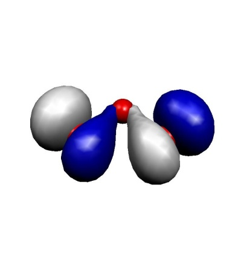
    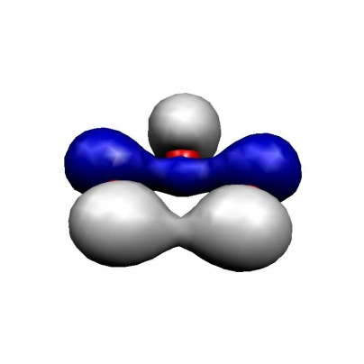
    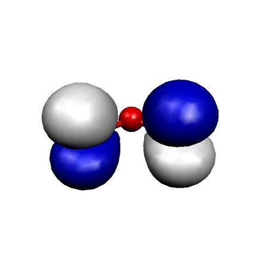
    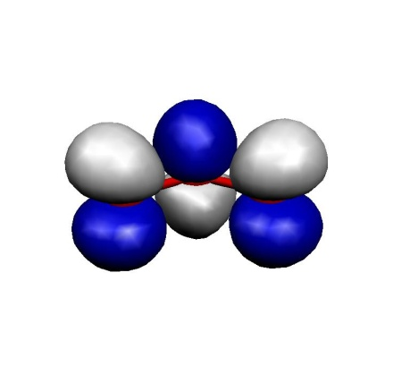

    Frontier MOs of the Ozone Molecule.

These MOs are two$\sigma$ lone pairs which are high in energy and thenthe symmetric and antisymmetric combinations of the oxygen$\pi$ lone
pairs. In particular, the LUMO is low lying and will lead to strong
correlation effects since the (HOMO)$^{2} \to$ (LUMO)$^{2}$ excitation will show up with a large coefficient. Physically speaking this is
testimony of the large diradical character of this molecule which is
roughly represented by the structure$\uparrow$O-O-O$\downarrow$. Thus,
the minimal active space to treat this molecule correctly is a CAS(2,2)
space which includes the HOMO and the LUMO. We illustrate the
calculation by looking at the RHF, MP2 MRACPF calculations of the
two-dimensional potential energy surface along the O--O bond distance
and the O-O-O angle (experimental values are 1.2717 Å and
116.78${^\circ}$).

```orca
------------------------------------------------------------------------------
                             ORCA CI-PREPARATION
------------------------------------------------------------------------------

Reading the GBW file               ... done
Symmetry usage                     ... ON

One-Electron Matrix                ... test1.H.tmp
GBW-File                           ... test1.gbw
Improved virtual orbitals          ... test1.ivo
First MO in the CI                 ... 2
Internal Fock matrix               ... test1.fi.tmp
LastInternal Orbital               ... 6
Integral package used              ... LIBINT
Reading the GBW file               ... done
Symmetry usage                     ... ON

Reading the one-electron matrix    ... done
Forming inactive density           ... done
Forming averaged valence density   ...
Scaling the occupied orbital occupation numbers
First MO                            ... 2
Last MO                             ... 7
Number of electrons in the range    ...    12
Scaling factor                      ... 0.917

done
Forming internal density           ... done
Forming Fock matrix/matrices       ...
Nuclear repulsion    ...    31.371502
Core repulsion       ...    31.371502
One-electron energy  ...  -114.942080
Fock-energy          ...   -94.993431
Final value          ...   -73.596254
done
Modifying virtual orbitals         ...
Last occupied MO               ...    7
Total number of MOs            ...   38
Number of virtual MOs          ...   30
Doing diagonalization with symmetry
The improved virtual eigenvalues:
    0: -0.2955 au   -8.041 eV    2- B2
    1: -0.0701 au   -1.907 eV    6- A1
    2: -0.0176 au   -0.479 eV    3- B1
    3:  0.0064 au    0.175 eV    7- A1
    4:  0.2922 au    7.951 eV    8- A1
    5:  0.2948 au    8.021 eV    3- B2
    6:  0.3836 au   10.439 eV    4- B1
    7:  0.4333 au   11.790 eV    9- A1
    8:  0.4825 au   13.128 eV    5- B1
    9:  0.5027 au   13.680 eV   10- A1
   10:  0.7218 au   19.642 eV   11- A1
   11:  0.8351 au   22.723 eV    4- B2
   12:  0.9371 au   25.501 eV    6- B1
   13:  1.0265 au   27.933 eV    1- A2
   14:  1.1141 au   30.317 eV   12- A1
   15:  1.2869 au   35.017 eV    5- B2
   16:  1.4605 au   39.743 eV    7- B1
...

done
Transforming integrals             ... done
Storing passive energy             ... done (    -73.59625384 Eh)
Transforming internal FI           ... done
             .... done with the Frozen Core Fock matrices
```

This is a slightly lengthy calculation due to the 441 energy evaluations
required. RHF does not find any meaningful minimum within the range of
examined geometries. MP2 is much better and comes close to the desired
minimum but underestimates the O--O distance by some 0.03 Å. CCSD(T)
gives a very good angle but a O--O distance that is too long. In fact,
the largest doubles amplitude is$\approx$ 0.2 in these
calculations (the HOMO--LUMO double excitation) which indicates a near
degeneracy calculation that even CCSD(T) has problems to deal with.
Already the CAS(2,2) calculation is in qualitative agreement with
experiment and the MRCI$+$Q calculation then gives almost perfect
agreement.

The difference between the CCSD(T) and MRCI$+$Q surfaces shows that the
CCSD(T) is a bit lower than the MRCI$+$Q one suggesting that it treats
more correlation. However, CCSD(T) does it in an unbalanced way. The
MRCI calculation employs single and double excitations on top of the
HOMO-LUMO double excitation, which results in triples and quadruples
that apparently play an important role in balancing the MR calculation.
These excitations are treated to all orders explicitly in the MRCI
calculation but only approximately (quadruples as simultaneous pair
excitations and triples perturbatively) in the coupled-cluster approach.
Thus, despite the considerable robustness of CC theory in electronically
difficult situations it is not applicable to genuine multireference
problems.

This is a nice result despite the too small basis set used and shows how
important it can be to go to a multireference treatment with a
physically reasonable active space (even if is only$2 \times 2$) in
order to get qualitatively and quantitatively correct results.

<a id="fig:2Dpotenergysurface_ozone"></a>
!!! note "ABCDEF"

    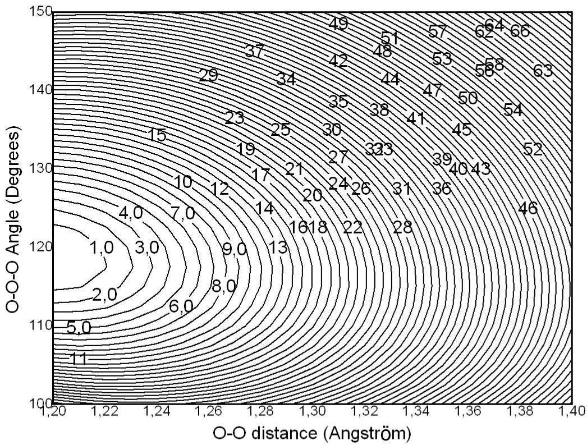
    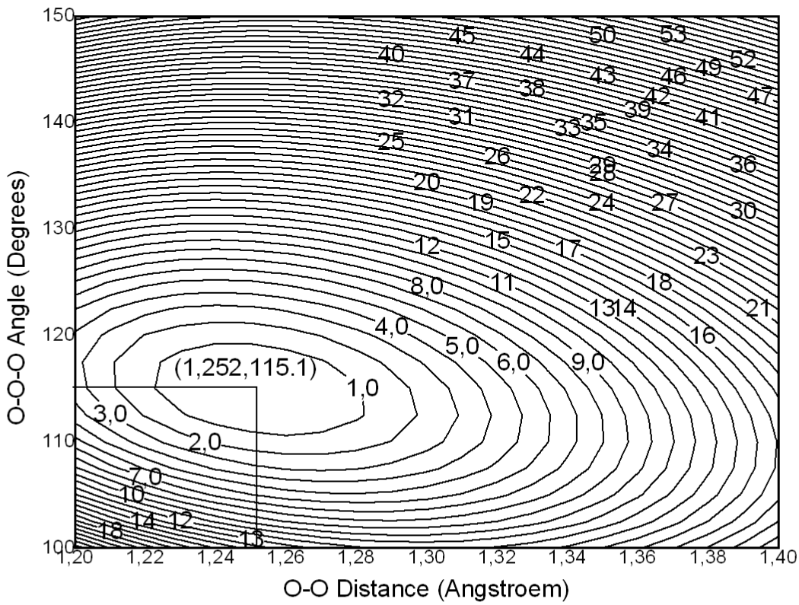
    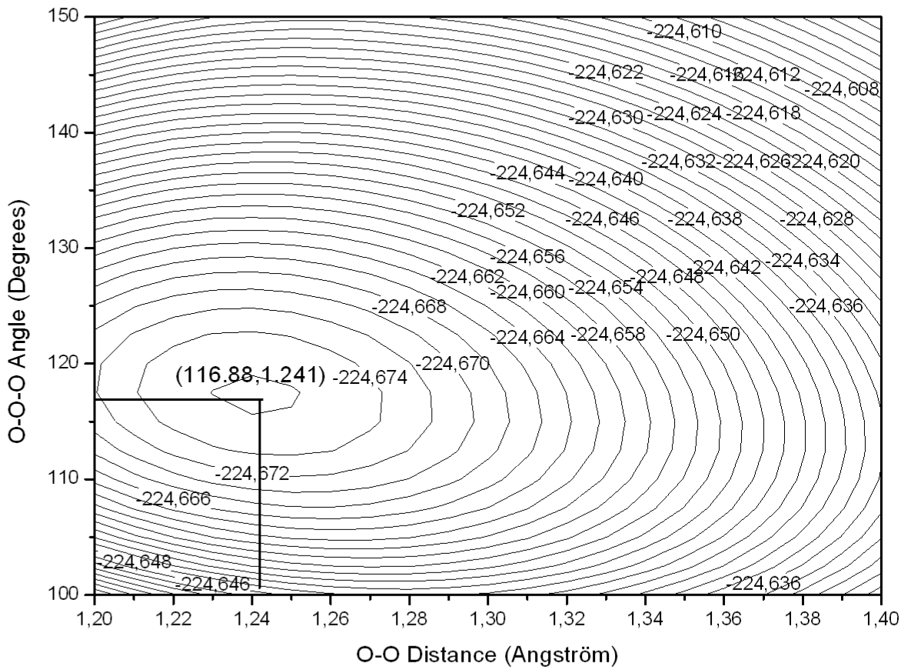
    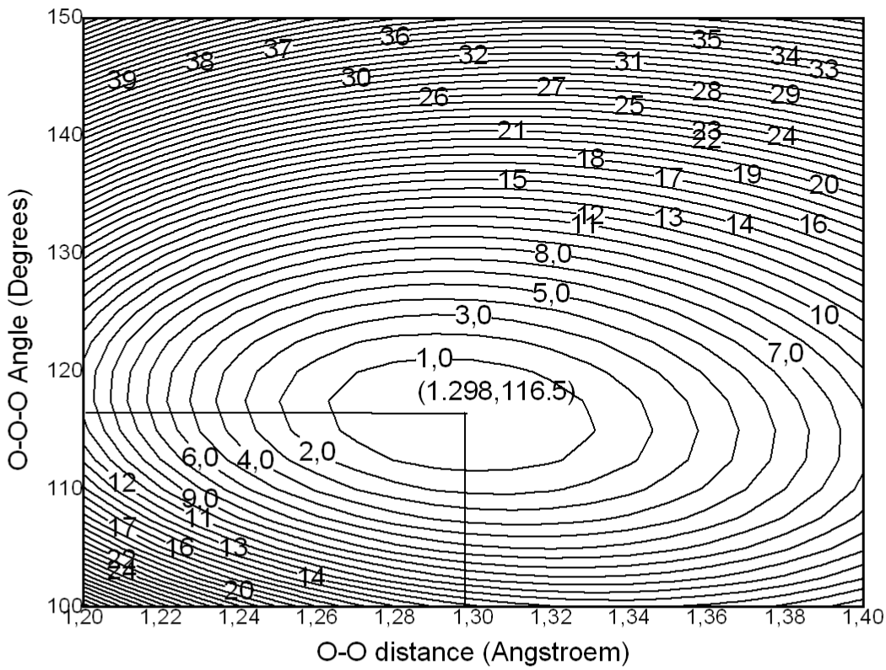
    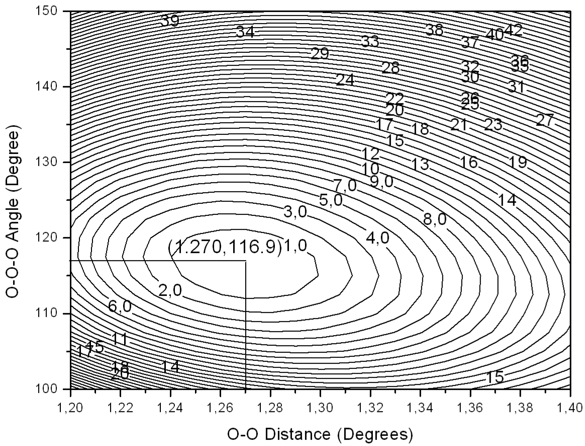
    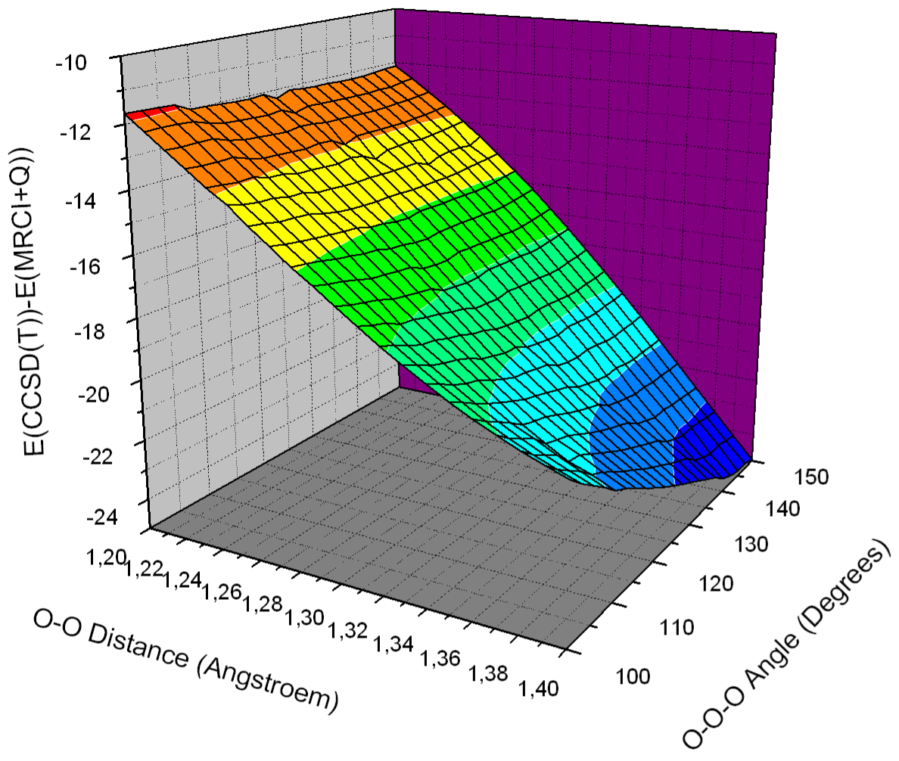

    2D potential energy surface for the$ O_3$ molecule calculated with different methods

<a id="sec:modelchemistries.mrci.size"></a>
## Size Consistency

Finally, we want to study the size consistency errors of the methods.
For this we study two non-interacting HF molecules at the single
reference level and compare to the energy of a single HF molecule. This
should give a reasonably fair idea of the typical performance of each
method (energies in Eh)[^5]:

```orca
E(HF)         E(HF+HF)  |Difference|
  CISD+Q   -100.138 475  -200.273 599     0.00335
  ACPF     -100.137 050  -200.274 010     0.00000
  ACPF2    -100.136 913  -200.273 823     0.00000
  AQCC     -100.135 059  -200.269 792     0.00032
```

The results are roughly as expected -- CISD+Q has a relatively large
error, ACPF and ACPF/2 are perfect for this type of example; AQCC is not
expected to be size consistent and is (only) about a factor of 10 better
than CISD+Q in this respect. CEPA-0 is also size consistent.

<a id="sec:modelchemistries.mrci.mrmp2"></a>
## Efficient MR-MP2 Calculations for Larger Molecules

Uncontracted MR-MP2 approaches are nowadays outdated. They are much more
expensive than internally contracted e.g. the NEVPT2 method described in
section
[modelchemistries.nevpt2](NEVPT2.md#sec:modelchemistries.nevpt2). Moreover, MR-MP2 is prone to intruder
states, which is a major obstacle for practical applications. For
historical reasons, this section is dedicated to the traditional MR-MP2
approach that is available since version 2.7.0 ORCA. The implementation
avoids the full integral transformation for MR-MP2 which leads to
significant savings in terms of time and memory. Thus, relatively large
RI-MR-MP2 calculations can be done with fairly high efficiency. However,
the program still uses an uncontracted first order wavefunction which
means that for very large reference space, the calculations still become
untractable.

Consider for example the rotation of the stilbene molecule around the
central double bond

<a id="fig:stillbene_rotation"></a>
!!! note "AB"

    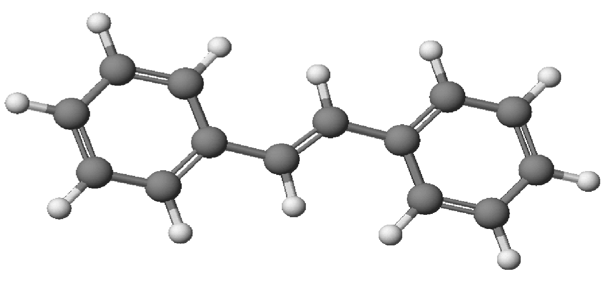
    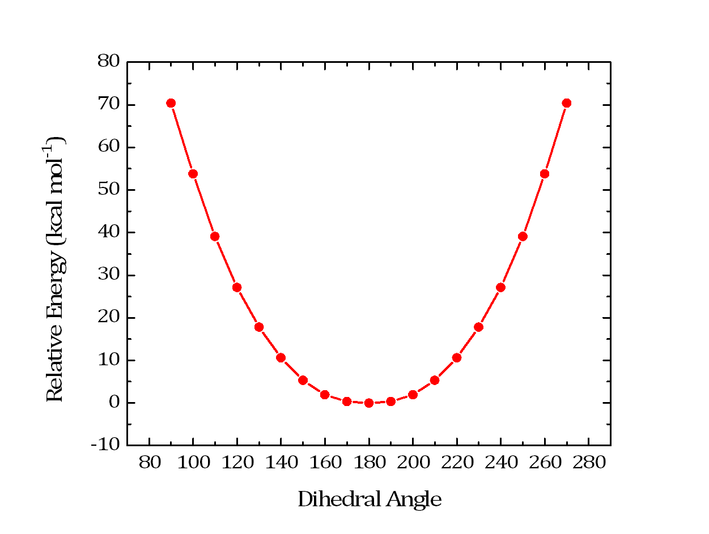

    Rotation of stilbene around the central double bond using a CASSCF(2,2) reference
    and correlating the reference with MR-MP2.

The input for this calculation is shown below. The calculation has more
than 500 basis functions and still runs through in less than one hour
per step (CASSCF-MR-MP2). The program takes care of the reduced number
of two-electron integrals relative to the parent MRCI method and hence
can be applied to larger molecules as well. Note that we have taken a
"JK" fitting basis in order to fit the Coulomb and the dynamic
correlation contributions both with sufficient accuracy. Thus, this
example demonstrates that MR-MP2 calculations for not too large
reference spaces can be done efficiently with ORCA (as a minor detail
note that the calculations were started at a dihedral angle of 90
degrees in order to make sure that the correct two orbitals are in the
active space, namely the central carbon p-orbitals that would make up
the pi-bond in the coplanar structure).

```orcainput
#
# Stilbene rotation using MRMP2
#
! def2-TZVP def2/JK RIJCOSX RI-MRMP2

%casscf nel            2
        norb           2
        end

%mrci   maxmemint 2000
        tsel 1e-8
        end

%paras  DIHED = 90,270, 19
        end

* int 0 1
 C     0   0   0   0.000000     0.000     0.000
 C     1   0   0   1.343827     0.000     0.000
 C     2   1   0   1.490606   125.126     0.000
 C     1   2   3   1.489535   125.829   \{DIHED\}
 C     4   1   2   1.400473   118.696   180.000
 C     4   1   2   1.400488   122.999     0.000
 C     6   4   1   1.395945   120.752   180.000
 C     5   4   1   1.394580   121.061   180.000
 C     8   5   4   1.392286   120.004     0.000
 C     3   2   1   1.400587   118.959   180.000
 C     3   2   1   1.401106   122.779     0.000
 C    11   3   2   1.395422   120.840   180.001
 C    12  11   3   1.392546   120.181     0.000
 C    13  12  11   1.392464   119.663     0.000
 H     1   2   3   1.099419   118.266     0.000
 H     2   1   3   1.100264   118.477   179.999
 H     5   4   1   1.102119   119.965     0.000
 H     6   4   1   1.100393   121.065     0.000
 H     7   6   4   1.102835   119.956   180.000
 H     8   5   4   1.102774   119.989   180.000
 H     9   8   5   1.102847   120.145   180.000
 H    10   3   2   1.102271   120.003     0.000
 H    11   3   2   1.100185   121.130     0.000
 H    12  11   3   1.103001   119.889   180.000
 H    13  12  11   1.102704   120.113   180.000
 H    14  13  12   1.102746   119.941   180.000
*
```

<a id="sec:modelchemistries.mrci.soc"></a>
## Properties Calculation Using the SOC Submodule

<a id="sec:modelchemistries.mrci.soc.zfs"></a>
### Zero-Field Splitting

The spin-orbit coupling (SOC) and spin-spin coupling (SSC) contributions
to the zero-field splitting (ZFS) can be calculated very accurately
using a wavefunction obtained from a multiconfigurational calculation of
a multi-reference type such as CASSCF, MRCI, or MRPT as is described in QDPT Magnetic Properties Section [spectroscopyproperties.qdpt_magnetic_properties](../spectroscopyproperties/qdpt_magnetic_properties.md#sec:spectroscopyproperties.qdpt_magnetic_properties).

```orca
# In case that you want to run QDPT-SOC calculation with manually adjusted
# diagonal energies you can copy the following part into the %mrci soc
# block and modify it as needed (energies are given in wavenumbers relative
# to the lowest state).                                  
#                                                                                                    
# NOTE: It is YOUR responsibility to make sure that the CAS-CI state that
#       you may want to dress with these energies correlates properly with
#       the energies printed here. The order of states or even the identity
#       of states may change with and without inclusion of dynamic
#       correlation. In the case that dynamic correlation strongly mixes,
#       different CAS-CI states there may not even be a proper correlation!       
#                                                                                                    
     EDiag[  0]    -149.526236244  # root   0 of block 0                                             
     EDiag[  1]    -149.359818263  # root   1 of block 0                                             
     EDiag[  2]    -149.359818263  # root   2 of block 0                                             
     EDiag[  3]    -149.496737695  # root   0 of block 1                                             
     EDiag[  4]    -149.496737695  # root   1 of block 1                                             
     EDiag[  5]    -149.474844108  # root   2 of block 1                                             
```

Those transition energies can be substituted by a more accurate energies
provided in the input file as follows:

```orca
%soc
dosoc true
dossc true
     EDiag[  0]    -149.526236244  # root   0 of block 0
     EDiag[  1]    -149.359818263  # root   1 of block 0
     EDiag[  2]    -149.359818263  # root   2 of block 0
     EDiag[  3]    -149.496737695  # root   0 of block 1
     EDiag[  4]    -149.496737695  # root   1 of block 1
     EDiag[  5]    -149.474844108  # root   2 of block 1
end
```

Accurate diagonal energies generally improve the accuracy of the SOC and
SSC splittings.

<a id="sec:modelchemistries.mrci.soc.lzfs"></a>
### Local Zero-Field Splitting

The submodule can also be used to calculate the local ZFS splitting
parameters of atomic centers. The method, referred to as local complete
active space configuration interaction (L-CASCI), can be used to
separate into atomic contributions the SOC part of the total ZFS tensor.
The rational behind it and additional details are described in the
original publication [retegan_first-principles_2014](../../bibliography.md); below are listed
only the steps required to reproduce the calculation for the dimer
complex presented there.

1\. The first step consists in obtaining the molecular orbitals that are
going to be used in the configuration interaction (CI) procedure. A good
set of orbitals can be obtained from a restricted open-shell
spin-averaged Hartree-Fock (SAHF) calculation. The relevant part of the
input is listed below:

```orca
! def2-TZVP

% scf
    hftyp rohf
    rohf_case sahf
    rohf_numop 2
    rohf_nel[1] 9
    rohf_norb[1] 10
    end
```

For the present Mn(II)Mn(III) dimer there are a total of 9 electrons
distributed into 10 d-orbitals.

2\. Next, the molecular orbitals are localized using one of the
implemented localization schemes. Below is the `orca_loc` input used in
this case:

```orca
sahf.gbw
sahf.loc
0
200 # first of the 10 d-orbitals
209 # last of the 10 d-orbitals
128
0.000001
0.75
0.65
2
```

3\. Following this, the localized orbitals are made locally canonical by
block diagonalizing the Fock matrix using the `orca_blockf` utility.

```orca
orca_blockf sahf.gbw sahf.loc 200 204 205 209
```

The first two numbers define the range of molecular orbitals localized
on one center; the last two are for the second center.

4\. The recanonicalized orbitals stored in the `sahf.loc` file can be
then used to calculate the SOC contribution to the local ZFS of the
Mn(III) center using the following MRCI input:

```orca
! ZORA-def2-TZVP def2-TZVP/C ZORA
! nomulliken noloewdin
! moread noiter allowrhf
! moread

% mrci
    citype mrci
    tsel 0
    tpre 0
    intmode ritrafo
    solver diis
    soc
        intmode ritrafo
        dosoc true
        end
    newblock 10 *
        nroots 5
        excitations none
        refs
            #  Mn(II)    Mn(III)
            {1 1 1 1 1  1 1 1 1 0}
            {1 1 1 1 1  1 1 1 0 1}
            {1 1 1 1 1  1 1 0 1 1}
            {1 1 1 1 1  1 0 1 1 1}
            {1 1 1 1 1  0 1 1 1 1}
            end
        end
    newblock 8 *
        nroots 45
        excitations none
        refs
            #  Mn(II)    Mn(III)
            {1 1 1 1 1  2 1 1 0 0}
            {1 1 1 1 1  2 1 0 1 0}
            {1 1 1 1 1  2 1 0 0 1}
            {1 1 1 1 1  2 0 1 1 0}
            {1 1 1 1 1  2 0 1 0 1}
            {1 1 1 1 1  2 0 0 1 1}
            {1 1 1 1 1  1 2 1 0 0}
            {1 1 1 1 1  1 2 0 1 0}
            {1 1 1 1 1  1 2 0 0 1}
            {1 1 1 1 1  1 1 2 0 0}
            {1 1 1 1 1  1 1 1 1 0}
            {1 1 1 1 1  1 1 1 0 1}
            {1 1 1 1 1  1 1 0 2 0}
            {1 1 1 1 1  1 1 0 1 1}
            {1 1 1 1 1  1 1 0 0 2}
            {1 1 1 1 1  1 0 2 1 0}
            {1 1 1 1 1  1 0 2 0 1}
            {1 1 1 1 1  1 0 1 2 0}
            {1 1 1 1 1  1 0 1 1 1}
            {1 1 1 1 1  1 0 1 0 2}
            {1 1 1 1 1  1 0 0 2 1}
            {1 1 1 1 1  1 0 0 1 2}
            {1 1 1 1 1  0 2 1 1 0}
            {1 1 1 1 1  0 2 1 0 1}
            {1 1 1 1 1  0 2 0 1 1}
            {1 1 1 1 1  0 1 2 1 0}
            {1 1 1 1 1  0 1 2 0 1}
            {1 1 1 1 1  0 1 1 2 0}
            {1 1 1 1 1  0 1 1 1 1}
            {1 1 1 1 1  0 1 1 0 2}
            {1 1 1 1 1  0 1 0 2 1}
            {1 1 1 1 1  0 1 0 1 2}
            {1 1 1 1 1  0 0 2 1 1}
            {1 1 1 1 1  0 0 1 2 1}
            {1 1 1 1 1  0 0 1 1 2}
            end
        end
    end
```

5\. The three second order ZFS components printed at the end of the
calculation (`Second order D-tensor: component 0`, etc.) are scaled
using the *S* value for the complex, which in this case is 4.5 (9
electrons$\times$ 0.5). In order to obtain the correct local value of
the ZFS, the three matrices have to be rescaled using the *S* value for
Mn(III), which is to 2. Note that the three matrices have different
scaling prefactors, and the dependence on *S* is not the same:

$D^{SOC-(0) } \propto \frac{1}{S^2}$

$D^{SOC-(-1) } \propto \frac{1}{S(2S-1) }$

$D^{SOC-(+1) } \propto \frac{1}{(S+1)(2S+1) }$

These equations can be used to calculate the required prefactors. For
example in the case of the *SOC*-(0) the prefactor is equal to:

$D_{\mathrm{Mn(III) }}^{SOC-(0) } = \frac{4.5^2}{2^2}\cdot D_{\mathrm{dimer} }^{SOC-(0) } = 5.0625 \cdot D_{\mathrm{dimer} }^{SOC-(0) }$

The final step is to scale the two remaining matrices using the
appropriate prefactors, sum all three of them up, diagonalize the
resulting the matrix, and use its eigenvalues to calculate the *D* and
*E* parameters. These represent the local ZFS parameters of the Mn(III)
center.

<a id="sec:modelchemistries.mrci.soc.excited_state_zfs"></a>
### Zero-Field Splitting from an excited Multiplet

For an excited state Multiplet the Calculationof ZFS can be requested by 

```orca
Lowest eigenvalue of the SOC matrix:    -149.86223277 Eh
Energy stabilization:    -2.54512 cm-1
Eigenvalues:     cm-1         eV      Boltzmann populations at T =  300.000 K
   0:            0.00        0.0000       3.36e-01
   1:            2.37        0.0003       3.32e-01
   2:            2.37        0.0003       3.32e-01
   3:         7757.65        0.9618       2.33e-17
   4:         7757.66        0.9618       2.33e-17
   5:        11913.81        1.4771       5.15e-26
```

```orca
soc
 DTensor true
 IStates 3,4,5
end
```

```orca
*****************************************
 EXCITED STATE ZERO-FIELD SPLITTING:
*****************************************

--------------------------------------------
Computing Excited State D Tensors of
Excited State Multiplet Consisting of States :  3  4  5
--------------------------------------------
          0         4     
          1         5     
          2         0     
          3         1     
          4         0     
          5         2     

--------------------------------------------
           ZERO-FIELD SPLITTING
(2ND ORDER SPIN-ORBIT COUPLING CONTRIBUTION)
--------------------------------------------

D   =   -2.668445  cm-1
E/D =    0.000103

...

--------------------------------------------------------
                  ZERO-FIELD SPLITTING
EFFECTIVE HAMILTONIAN SOC CONTRIBUTION
--------------------------------------------------------

D   =   -2.674495  cm-1
E/D =    0.009610

...
```

<a id="sec:modelchemistries.mrci.soc.gTensor"></a>
### g-Tensor

The `orca_mrci` program contains an option to calculate g-tensors using
MRCI wavefunctions. For a system with an odd number of electrons, the
doubly degenerate eigenvalues obtained from the QDPT procedure represent
Kramers pairs, which are used to build the matrix elements of the total
spin operator and the total angular momentum operator from the Zeeman
Hamiltonian. Denoting$\Psi$ as a solution and$\bar{\Psi}$ as its
Kramers partner and using matrix element notations

<a id="eqn:229"></a>

$$
\Phi_{11}^{k} =\left\langle\Psi \right|\hat{{L} }_{k} +g_{e} \hat{{S} }_{k}
\left| \Psi \right\rangle,\, \Phi_{12}^{k} =\left\langle\Psi
\right|\hat{{L} }_{k} +g_{e} \hat{{S} }_{k} \left| \bar{\Psi} \right\rangle,\, k=x,y,z\qquad \text{(eqn:229)}
$$

The elements of g-matrix are obtained as:

<a id="eqn:230"></a>

$$
g_{kz} =2\Phi_{11}^{k} ,\, g_{ky} =-2\Im\left({ \Phi_{12}^{k} }
\right) ,\, g_{kx} =2\Re\left({ \Phi_{12}^{k} } \right)\qquad \text{(eqn:230)}
$$

Then, the true tensor G is built from g-matrices:

<a id="eqn:231"></a>

$$
G=gg^{T}\qquad \text{(eqn:231)}
$$

G is subjected further to diagonalization yielding positive eigenvalues,
the square roots of which give the principal values of g-matrix.

<a id="eqn:232"></a>

$$
g_{xx} =\sqrt{ G_{xx} } ,\, g_{yy} =\sqrt{ G_{yy} } ,\, g_{zz} =\sqrt{ G_{zz} }\qquad \text{(eqn:232)}
$$

A typical mrci block of the input file for a g-tensor calculation should
(e.g. for a S=3/2 problem) look as the following:

```orca
%mrci   ewin -4,1000
        citype mrci
        cimode direct2
        intmode fulltrafo
        solver diis
        etol 1e-8
        rtol 1e-8
        tsel 1e-6
        tpre 1e-5
        soc
          PrintLevel 2
          GTensor true      # make g-tensor calculations
          NDoubGTensor 2    # number of Kramers doublets to account
                            # for every pair a separate
                            # calculation is performed
        end
        newblock 4 *
          excitations cisd
          nroots 10
          refs  cas(7,5) end
        end
end
```

The result for the first Kramers pair is printed as follows:

```orca
--------------
KRAMERS PAIR 1
--------------

Matrix elements Re<1|S|1>   -0.072128   0.024511  -2.998843 
Matrix elements Re<1|S|2>   -0.001088   0.000366  -0.002010 
Matrix elements Im<1|S|2>   -0.000354  -0.001037  -0.000173 
Matrix elements Re<1|L|1>   -0.027067   0.009209  -1.123531 
Matrix elements Re<1|L|2>   -0.000031   0.000010  -0.000763 
Matrix elements Im<1|L|2>   -0.000006  -0.000011  -0.000065 

-------------------
ELECTRONIC G-MATRIX
-------------------

g-matrix:
-0.002240     0.000754    -0.005551 
0.000720     0.002100     0.000477 
-0.198556     0.067498    -8.251703 

g-factors:
0.002220     0.002222     8.254370 iso =     2.752937

g-shifts:
-2.000100    -2.000098     6.252051 iso =     0.750618

Eigenvectors:
0.057426     0.998060     0.024055 
0.998327    -0.057244    -0.008177 
0.006784    -0.024484     0.999677
```

Here for the$L$ and$S$ matrix elements indices 1 and 2 are assumed to
denote Kramers partners, and three numbers in the first row stand for
$x, y, z$ contributions.

In addition the g-tensor is calculated within the Effective Hamiltonian
formalism.

```orca
----------------------------------------------
  ELECTRONIC G-MATRIX FROM EFFECTIVE HAMILTONIAN
  ----------------------------------------------

  g-matrix:
  1.978874    -0.000345     0.018908 
  -0.000345     1.977899    -0.006433 
  0.018879    -0.006418     2.763402 

  g-factors:
  1.977789     1.978477     2.763909 iso =     2.240058

  g-shifts:
  -0.024530    -0.023843     0.761590 iso =     0.237739

  Eigenvectors:
  0.288884     0.957062     0.024060 
  0.957364    -0.288770    -0.008181 
  0.000882    -0.025397     0.999677 

  # The g-factors are square roots of the eigenvalues of gT*g
  # Orientations are the eigenvectors of gT*g
```

Finally and only within the MRCI module the g-tensor is evaluated by
using the Sum Over States formalism[neese2003sos-gtensors](../../bibliography.md):

```orca
---------------------------------------------------------------------------
  SUM OVER STATES CALCULATION OF THE SPIN HAMILTONIAN (for g and HFC tensors)
  ---------------------------------------------------------------------------

  Ground state index        =     0
  Ground state multiplicity =     4
  Ground state spin density = P[  1]
  State =   1  <0|P|I>=   2  <0|Q|I>=  19
  State =   2  <0|P|I>=   3  <0|Q|I>=  27
  State =   3  <0|P|I>=   4  <0|Q|I>=  34
  State =   4  <0|P|I>=   5  <0|Q|I>=  40
  State =   5  <0|P|I>=   6  <0|Q|I>=  45
  State =   6  <0|P|I>=   7  <0|Q|I>=  49
  State =   7  <0|P|I>=   8  <0|Q|I>=  52
  State =   8  <0|P|I>=   9  <0|Q|I>=  54
  State =   9  <0|P|I>=  10  <0|Q|I>=  55

  Origin for angular momentum        ... ( -0.0006, -0.0010,  0.0021)
  Kinetic Energy                     ... done
  Relativistic mass correction       ... done
  Gauge correction                   ... done
  Angular momentum integrals         ... done
  Reading Spin-Orbit Integrals       ... done
  -----------------------
  MATRIX ELEMENT PRINTING
  -----------------------

  Energy differences (DE=EI-E0) and spin-orbit matrix elements (SO=<I|HSO|0>) are 
  printed in cm**-1. Orbital Zeeman matrix elements (L=<I|L|0>) are printed in au.

  State   DE        LX        LY        LZ          SOX         SOY         SOZ
  1    1349.3     0.0464   -0.0158    1.9264     -23.432       7.965    -974.312
  2   13026.2    -0.6596    0.6888    0.0214     337.028    -351.116     -10.966
  3   13615.1    -0.6961   -0.6514    0.0113     354.225     332.219      -5.736
  4   56686.3    -0.0053    0.0077    0.0971       1.794      -1.696     -36.786
  5   56954.2    -0.0516   -0.0048   -0.0042      28.211       5.821       1.459
  6   56994.0    -0.0418    0.0233   -0.0025      15.185      -2.144       1.145
  7   63371.5    -0.0211    0.0226    0.0078       3.833      -2.948      -2.724
  8   64176.0    -0.0652    0.0032   -0.0002      32.779       6.146       0.063
  9   74309.9    -0.0007    0.0032    0.0380       0.183      -1.058     -13.517

  -------------------
  ELECTRONIC G-MATRIX
  -------------------

  raw-matrix : 
  2.025533    -0.000738     0.021755  
  -0.000738     2.024537    -0.007389  
  0.021755    -0.007389     2.928943  

  g-factors: 
  2.024122     2.025363     2.929527 iso =     2.326338

  g-shifts:
  0.021803     0.023044     0.927208 iso =     0.324018

  Eigenvectors: 
  0.533896    -0.845208     0.024064  
  0.845530     0.533866    -0.008182  
  -0.005932     0.024715     0.999677  

  Euler angles w.r.t. molecular frame (degrees):
  -76.5038       1.4564    -161.2223

  -----------------------------
  CONTRIBUTIONS TO THE G-MATRIX
  -----------------------------

  Term                                g1           g2           g3
  --------------------------------------------------------------------
  Relativistic mass correction:   -0.0008220   -0.0008220   -0.0008220
  Gauge correction            :    0.0000000    0.0000000    0.0000000
  g(OZ/SOC)                   :    0.0226250    0.0238662    0.9280297

  State   1                   :    0.0000000   -0.0000000    0.9279829
  State   2                   :    0.0013767    0.0223913    0.0000000
  State   3                   :    0.0212332    0.0014408    0.0000000
  State   4                   :    0.0000000    0.0000004    0.0000418
  State   5                   :    0.0000074    0.0000099    0.0000001
  State   6                   :    0.0000002    0.0000078    0.0000001
  State   7                   :    0.0000000    0.0000015    0.0000002
  State   8                   :    0.0000076    0.0000144    0.0000000
  State   9                   :    0.0000000    0.0000000    0.0000046
  -----------------------------------------
  Total g-shifts              :    0.0218030    0.0230442    0.9272077

  # The g-factors are square roots of the eigenvalues of gT*g
  # Orientations are the eigenvectors of gT*g
```

Note that within the SOS formalism in addition to the second order (SOC)
contributions the bilinear to the field terms: Relativistic mass
correction and diamagnetic spin-orbit term (Gauge) are evaluated. As can
be seen these corrections are rather negligible in comparison to the
second order SOC contributions and most of the time can be safely
omitted. Moreover further insight is obtained by printing the individual
contribution of each excited state to the g-tensor. In the example above
the first excited state contributes to the$g_z$ component while the
next two to both the$g_x$ and$g_y$ components, respectively.

So to summarize the g-tensor calculations in the framework of
wavefunction based methods like MRCI and/or CASSCF can be evaluated:

-   via the QDPT approach within an individual Kramers doublet. This is
    valid analysis only for non-integer spin cases. In particular for
    systems with well isolated Kramers doublets where the EPR spectrum
    originates only from one Kramers doublet defined within the pseudo
    spin 1/2 formalism. This analysis has been proven useful in
    determining the sign of the ZFS and the electronic structure of the
    system under investigation.[maganas2011zfs](../../bibliography.md)

-   within the effective Hamiltonian approach. This is a valid analysis
    for all spin cases as it provides the principal g-values of the
    system under investigation evaluated in the molecular axis frame.
    These g-values can be directly compared with the experimentally
    determined ones.[maganas2015zfs](../../bibliography.md)

-   within the sum over states formalism (SOS). As above this analysis
    is valid for all spin cases and is only available via the MRCI
    module.

<a id="sec:modelchemistries.mrci.soc.magnet"></a>
### Magnetization and Magnetic Susceptibility

The MRCI and CASSCF modules of ORCA allow for the calculation of
magnetization and magnetic susceptibility curves at different fields and
temperatures by differentiation of the QDPT Hamiltonian with respect to
the magnetic field. For magnetic susceptibility, calculations are
performed in two ways when a static field different from zero is
defined: (i) as the second derivative of energy with respect to the
magnetic field and (ii) as the magnetization divided by the magnetic
field. Although the first method corresponds to the definition of
magnetic susceptibility, the second approach is widely used in the
experimental determination of$\chi*T$ curves. If the static field is
low, both formulas tend to provide similar values.

The full list of keywords is presented below.

```orca
%mrci
   citype mrci
   newblock 3 *
   excitations none
   refs cas(2,7) end
   end
   soc
     dosoc true
     domagnetization true      # Calculate magnetization (def: false)
     dosusceptibility true     # Calculate susceptiblity (def: false)
     LebedevPrec            5  # Precision of the grid for different field
                               # directions (meaningful values range from 1
                               # (smallest) to 10 (largest))
     nPointsFStep           5  # number of steps for numerical differentiation
                               # (def: 5, meaningful values are 3, 5 7 and 9)
     MAGFieldStep       100.0  # Size of field step for numerical 
                               # differentiation (def: 100 Gauss)
     MAGTemperatureMIN    4.0  # minimum temperature (K) for magnetization
     MAGTemperatureMAX    4.0  # maximum temperature (K) for magnetization
     MAGTemperatureNPoints  1  # number of temperature points for magnetization
     MAGFieldMIN          0.0  # minimum field (Gauss) for magnetization
     MAGFieldMAX      70000.0  # maximum field (Gauss) for magnetization
     MAGNpoints            15  # number of field points for magnetization
     SUSTempMIN           1.0  # minimum temperature (K) for susceptibility
     SUSTempMAX         300.0  # maximum temperature (K) for susceptibility
     SUSNPoints           300  # number of temperature points for susceptibility
     SUSStatFieldMIN      0.0  # minimum static field (Gauss) for susceptibility
     SUSStatFieldMAX      0.0  # maximum static field (Gauss) for susceptibility
     SUSStatFieldNPoints    1  # number of static fields for susceptibility
   end
end
```

The same keywords apply for CASSCF calculations in rel block (instead of
soc in MRCI). Although different aspects of integration and grid
precision can be modified through keywords, default values should
provide an accurate description of both properties. Calculated
magnetization and susceptibility are printed in .sus and .mag files,
respectively and also in the output file.

```orca
-------------------------------------------------------------------------------
FIELD DEPENDENT MAGNETIZATION AND MEAN SUSCEPTIBILITY (chi=M/B)
-------------------------------------------------------------------------------
TEMPERATURE (K)   M. FIELD (Gauss)   MAGNETIZATION (B.M.)   chi*T (cm3*K/mol)
-------------------------------------------------------------------------------

4.00               0.00               0.000000                  inf
4.00            5000.00               0.350759             1.567189
4.00           10000.00               0.688804             1.538788
4.00           15000.00               1.003466             1.494496
4.00           20000.00               1.287480             1.438115
4.00           25000.00               1.537346             1.373773
4.00           30000.00               1.752841             1.305282
4.00           35000.00               1.936067             1.235764
4.00           40000.00               2.090450             1.167516
4.00           45000.00               2.219920             1.102067
4.00           50000.00               2.328368             1.040315
4.00           55000.00               2.419335             0.982690
4.00           60000.00               2.495883             0.929301
4.00           65000.00               2.560582             0.880052
4.00           70000.00               2.615538             0.834730
-----------------------------------------------------------
```

```orca
-----------------------------------------------------------
  TEMPERATURE DEPENDENT MAGNETIC SUSCEPTIBILITY
  -----------------------------------------------------------
  STATIC  FIELD    TEMPERATURE       chi*T (cm3*K/mol)
  (Gauss)           (K)          M/B          d2E/dB2
  -----------------------------------------------------------

  0.00       1.00           ----       1.576836
  0.00       2.00           ----       1.576910
  0.00       3.00           ----       1.576951
  0.00       4.00           ----       1.576988
  0.00       5.00           ----       1.577023
  0.00       6.00           ----       1.577057
  0.00       7.00           ----       1.577091
  0.00       8.00           ----       1.577125
  0.00       9.00           ----       1.577159
  0.00      10.00           ----       1.577193
  0.00      11.00           ----       1.577227
  .....
  0.00     300.00           ----       1.586942
 1000.00     1.00       1.570517       1.558042
 1000.00     2.00       1.575324       1.572178
 1000.00     3.00       1.576246       1.574845
 1000.00     4.00       1.576590       1.575802
 1000.00     5.00       1.576768       1.576264
 1000.00     6.00       1.576880       1.576530
 1000.00     7.00       1.576961       1.576704
 1000.00     8.00       1.577026       1.576829
  .....
```

Note that the CASSCF module also supports the calculation of
susceptibility tensors at non-zero user-defined magnetic fields. This is
not yet possible with the MRCI module.

<a id="sec:modelchemistries.mrci.soc.mcd"></a>
### MCD and Absorption Spectra

The MRCI module of the ORCA program allows calculating MCD spectra and
the SOC effects on absorption spectra. The formalism is described in
detail by Ganyushin and Neese[ganyushin2008](../../bibliography.md). The approach is based on
the direct calculation of the transition energies and transition
probabilities between the magnetic levels. Namely, the differential
absorption of LCP- and RCP photons for transitions from a manifold of
initial states$A$ to a manifold of final states$J$. Using Fermi's
golden rule, the Franck-Condon approximation, assuming a pure electronic
dipole mechanism and accounting for the Boltzmann populations of the
energy levels, the basic equation of MCD spectroscopy may be written as
(atomic units are used throughout):

<a id="eqn:233"></a>

$$
\frac{\Delta \varepsilon }{E}=\gamma \sum\limits_{a,j} { \left({N_{a} -N_{j} } \right)\left({ \left|{ \left\langle { \Psi_{a} \left|{m_{\text{LCP} } } \right|\Psi_{j} } \right\rangle} \right|^{2}-\left|{\left\langle { \Psi_{a} \left|{ m_{\text{RCP} } } \right|\Psi_{j} } \right\rangle} \right|^{2} } \right)f\left( E \right)}\qquad \text{(eqn:233)}
$$

Here$a$ and$j$ label members of the initial and state manifold probed
in the experiments.

<a id="eqn:234"></a>

$$
N_{a} \left({ B,T} \right)=\frac{\exp \left({ -E_{a} /kT}
\right)}{\sum\limits_i { \exp \left({ -E_{i} /kT} \right)} }\qquad \text{(eqn:234)}
$$

denotes the Boltzmann population and if the$a$-th ground state sublevel
at energy$E_{a}$,$f\left( E \right)$ stands for a line shape function,and$\gamma$ denotes a collection of constants. The electric dipole
operators are given by:

<a id="eqn:235"></a>

$$
m_{\text{LCP} } \equiv m_{x} -im_{y}\qquad \text{(eqn:235)}
$$

<a id="eqn:236"></a>

$$
m_{\text{RCP} } \equiv m_{x} +im_{y}\qquad \text{(eqn:236)}
$$

They represent linear combinations of the dipole moment operator:

<a id="eqn:237"></a>

$$
\vec{{m} }=\sum\limits_N { Z_{N} \vec{{R} }_{N} } -\sum\limits_i { \vec{{r} }_{i} }\qquad \text{(eqn:237)}
$$

where$N$ and$i$ denotes summations of nuclei (at positions
$\vec{{R} }_{N}$ with charges$Z_{N})$ and electrons (at positions
$\vec{{r} }_{i} )$ respectively. The calculated transition dipole moment
are subjected to the space averaging over the Euler angles which is
performed by a simple summation over three angular grids.

<a id="eqn:238"></a>

$$
\left({ \frac{\Delta \varepsilon }{E} } \right)_{ev} =\frac{1}{8\pi
^{2} }\in t\limits_{\psi =0}^{2\pi } { \in t\limits_{\phi =0}^{2\pi }
{\in t\limits_{\theta =0}^\pi{ \left({ \frac{\Delta \varepsilon }{E} }
\right)\sin \theta d\theta d\phi d\psi } } } \approx \sum\limits_{\mu \eta
\tau } { \left({ \frac{\Delta \varepsilon }{E} } \right)_{\mu \eta \tau } }
\sin \theta_{\tau }\qquad \text{(eqn:238)}
$$

Finally, every transition is approximated by a Gaussian curve with a
definite Gaussian shape width parameter. Hence, the final calculated MCD
spectrum arises from the superposition of these curves.

As an illustration, consider calculation of a classical example of MCD
spectrum of [Fe(CN)$_{6}$]$^{3-}$. The mrci block of the input file
is presented below.

```orca
%mrci   ewin -4,10000
        citype mrddci2
        intmode ritrafo
        Tsel  1e-6
        Tpre  1e-5
        etol 1e-8
        rtol 1e-8
        cimode direct2
        maxmemint 300
        solver diis
        davidsonopt 0
        nguessmat 150
        MaxIter 50
        LevelShift 0.5
        PrintLevel 3
        soc
        printlevel 3
        Domcd true        # perform the MCD calculation
        NInitStates 24    # number of SOC and SSC state to account
                          # Starts from the lowest state
        NPointsTheta 10   # number of integration point for
        NPointsPhi 10     # Euler angles
        NPointsPsi 10     #
        B 43500           # experimental magnetic field strength
                          # in Gauss
        Temperature 299.0 # experimental temperature (in K)
        end
        newblock 2 *
         nroots 12
         excitations cisd
         refs cas(23,12) end
         end
        end
```

The parameters B and Temperature can be assigned in pairs, i.e. B$=$
1000, 2000, 3000..., Temperature$=$ 4, 10, 300.... The program
calculates the MCD and absorption spectra for every pair. Now for every
point of the integration grid the program prints out the Euler angles,
the orientation of the magnetic field in the coordinate system of a
molecule, and the energy levels.

```orca
Psi = 36.000 Phi = 72.000 Theta = 20.000

Bx = 8745.0 By = 12036.5 Bz = 40876.6

Energy levels (cm-1,eV):Boltzmann populations for T = 299.000   K
   0 :         0.000     0.0000         4.53e-01
   1 :         3.943     0.0005         4.45e-01
   2 :       454.228     0.0563         5.09e-02
   3 :       454.745     0.0564         5.08e-02
   4 :      1592.142     0.1974         2.13e-04
   5 :      1595.272     0.1978         2.10e-04
   6 :     25956.363     3.2182         2.59e-55
   7 :     25958.427     3.2184         2.56e-55
   8 :     25985.656     3.2218         2.25e-55
   9 :     25987.277     3.2220         2.23e-55
  10 :     26070.268     3.2323         1.49e-55
  11 :     26071.484     3.2325         1.49e-55
  12 :     31976.645     3.9646         6.78e-68
  13 :     31979.948     3.9650         6.67e-68
  14 :     32018.008     3.9697         5.56e-68
  15 :     32021.074     3.9701         5.48e-68
  16 :     32153.427     3.9865         2.90e-68
  17 :     32157.233     3.9870         2.84e-68
  18 :     42299.325     5.2444         1.81e-89
  19 :     42303.461     5.2450         1.78e-89
  20 :     42346.521     5.2503         1.45e-89
  21 :     42348.023     5.2505         1.44e-89
  22 :     42456.119     5.2639         8.53e-90
  23 :     42456.642     5.2640         8.51e-90
```

In the next lines, ORCA calculates the strength of LCP and RCP
transitions and prints the transition energies, the difference between
LCP and RCP transitions (denoted as C), and sum of LCP and RCP
transitions (denoted as D), and C by D ratio.

```orca
                dE      Na         C          D        C/D
  0 -> 1        3.943 4.53e-01  1.14e-13  8.13e-13   0.00e+00
  0 -> 2      454.228 4.53e-01  5.01e-09  9.90e-09   5.06e-01
  0 -> 3      454.745 4.53e-01 -4.65e-09  7.00e-09  -6.65e-01
  0 -> 4     1592.142 4.53e-01 -8.80e-08  1.02e-07  -8.67e-01
  0 -> 5     1595.272 4.53e-01 -2.29e-08  2.97e-08  -7.71e-01
  0 -> 6    25956.363 4.53e-01  1.22e+01  9.60e+01   1.27e-01
  0 -> 7    25958.427 4.53e-01  3.44e+01  3.52e+01   9.77e-01
  0 -> 8    25985.656 4.53e-01  3.83e+01  1.70e+02   2.25e-01
  0 -> 9    25987.277 4.53e-01 -7.73e+00  6.03e+01  -1.28e-01
  0 ->10    26070.268 4.53e-01 -6.11e+00  2.85e+01  -2.14e-01
  0 ->11    26071.484 4.53e-01  6.17e+00  9.21e+00   6.70e-01
  0 ->12    31976.645 4.53e-01  2.45e+01  6.21e+01   3.95e-01
  0 ->13    31979.948 4.53e-01 -6.58e+01  6.93e+01  -9.50e-01
  0 ->14    32018.008 4.53e-01  3.42e-01  1.07e+02   3.21e-03
  0 ->15    32021.074 4.53e-01 -6.16e+00  3.24e+01  -1.90e-01
  0 ->16    32153.427 4.53e-01 -4.73e+01  1.37e+02  -3.46e-01
  0 ->17    32157.233 4.53e-01 -1.02e+00  5.97e+01  -1.71e-02
  0 ->18    42299.325 4.53e-01  6.47e+00  2.11e+01   3.07e-01
  0 ->19    42303.461 4.53e-01 -2.59e+00  7.61e+00  -3.40e-01
  0 ->20    42346.521 4.53e-01  1.90e+01  8.99e+01   2.11e-01
  0 ->21    42348.023 4.53e-01  3.36e+00  3.55e+00   9.48e-01
  0 ->22    42456.119 4.53e-01  2.52e-01  4.86e-01   5.20e-01
  0 ->23    42456.642 4.53e-01 -2.01e+00  2.91e+00  -6.91e-01
  1 -> 2      450.285 4.45e-01  4.59e-09  6.87e-09   6.69e-01
  1 -> 3      450.802 4.45e-01 -4.96e-09  9.73e-09  -5.09e-01
```

All C and D values are copied additionally into the text files
input.1.mcd, input.2.mcd..., for every pair of Temperature and B
parameters. These files contain the energies and C and D values for
every calculated transition. These files are used by the program
`orca_mapspc` to calculate the spectra lines. The `orca_mapspc` program
generates from the raw transitions data into spectra lines. The main
parameters of the `orca_mapspc` program are described in section 7.18.1.
A typical usage of the `orca_mapspc` program for MCD spectra calculation
for the current example may look as the following:

```orca
orca_mapspc input.1.mcd MCD -x020000 -x150000 -w2000
```

Here the interval for the spectra generation is set from 20000 cm$^{-1}$
to 50000 cm$^{-1}$, and the line shape parameter is set to 2000
cm$^{-1}$.

Very often, it is desirable to assign different line width parameters to
different peaks of the spectra to obtain a better fitting to experiment.
`orca_mapspc` can read the line shape parameters from a simple text file
named as input.1.mcd.inp. This file should contain the energy intervals
(in cm$^{-1})$ and the line shape parameters for this energy interval in
the form of:

```orca
20000 35000 1000
35000 40000 2000
40000 50000 1000
```

This file should not be specified in the executing command;
`orca_mapspc` checks for its presence automatically:

```orca
orca_mapspc input.1.mcd MCD -x020000 -x150000
Mode is MCD
Number of peaks            ... 276001
Start wavenumber [cm-1]    ...  20000.0
Stop wavenumber [cm-1]     ...  50000.0
Line width parameters are taken from the file:input.1.mcd.inp
Number of points           ... 1024
```

Finally, the `orca_mapspc` program generates the output text file
input.1.mcd.dat which contains seven columns of numbers: transition
energies, intensities of MCD transitions (the MCD spectrum), intensities
of absorption transitions (the absorption spectrum), the ratio between
the MCD and absorption intensities, and the last three columns represent
the "sticks" of the corresponding transitions.

```orca
Energy      C         D         C/D       C        D       E/D
24310.8   0.6673    980.2678   0.0006   0.0000   0.0000   0.0000
24340.1   0.8471   1174.3637   0.0007  -0.0001   0.0129  -0.0112
24369.5   1.0664   1408.5788   0.0007   0.0001   0.0281   0.0033
24398.8   1.3325   1690.5275   0.0007   0.0000   0.0000   0.0000
24428.1   1.6542   2029.0152   0.0008   0.0000   0.0000   0.0000
24457.4   2.0416   2434.1699   0.0008   0.0000   0.0332   0.0003
```

Now the MCD and the absorption spectra can be plotted with a suitable
graphical program, for instance with the Origin program.

<a id="fig:713"></a>
*Calculated MCD and absorption spectra of [Fe(CN)$_6$]$^{3-}$ (dash
lines) compared to experimental spectra (solid
lines).*

<a id="sec:modelchemistries.mrci.soc.magField"></a>
### Addition of Magnetic Fields

The inclusion of the Zeeman contribution into the QDPT procedure allows
to obtain the splittings of the magnetic levels in an external magnetic
field. The switch for this calculation and the magnetic field strength
are defined in the soc subblock of the mrci block. Optionally the wave
function decomposition can be printed for `MagneticField_PrintLevel`
larger 0. The latter employs the thresh `TPrint` to omit small
contributions from the printing:

```orca
%mrci
  soc
    DoSOC true          #
    DoSSC true          #
    MagneticField true  # default false
    B 1,10,100,1000     # Strengh of the magnetic field in Gauss.
                        # 4000 is the default value
    
    # Optional printing of the wave function for each
    # magnetic field settings
    MagneticField_PrintLevel 0 # default (disabled)
    TPrint                    1e-3 
  end
end
```

Then, the output contains three sets of data of splittings of the
magnetic levels with the magnetic field applied parallel to x, y, and z
directions:

```orca
End B (Gauss)  Energy levels (cm-1) and populations for B || x

     1.0   -0.030   0.333   0.012   0.333   0.018   0.333
    10.0   -0.030   0.333   0.012   0.333   0.018   0.333
   100.0   -0.031   0.333   0.012   0.333   0.020   0.333
  1000.0   -0.102   0.333   0.012   0.333   0.091   0.333

B (Gauss)  Energy levels (cm-1) and populations for B || y

     1.0   -0.030   0.333   0.012   0.333   0.018   0.333
    10.0   -0.030   0.333   0.012   0.333   0.018   0.333
   100.0   -0.032   0.333   0.014   0.333   0.018   0.333
  1000.0   -0.105   0.334   0.018   0.333   0.087   0.333

B (Gauss)  Energy levels (cm-1) and populations for B || z

     1.0   -0.030   0.333   0.012   0.333   0.018   0.333
    10.0   -0.030   0.333   0.011   0.333   0.018   0.333
   100.0   -0.030   0.333   0.005   0.333   0.025   0.333
  1000.0   -0.079   0.333  -0.030   0.333   0.108   0.333
```

Here the number in a row represents the strength of the magnetic field
(in Gauss), and the following pairs of numbers denote the energy of the
magnetic level (in cm$^{-1})$ with its occupation number. This table can
be readily plotted with any suitable graphical program.

<a id="sec:modelchemistries.mrci.soc.picturechange"></a>
### Relativistic Picture Change in Douglas-Kroll-Hess SOC and Zeeman Operators

The DKH correction to the SOC operator is implemented in ORCA as a
correction to the one-electron part of the SOMF operator. The DKH
transformation is performed up to the second order, and the two-electron
part in our implementation is left untransformed. However, the
electronic density employed for evaluating the SOMF matrix elements is
obtained from a scalar relativistic calculation. The inclusion of the
DKH correction is controlled by the picturechange key in the rel block:

```orca
%rel method DKH              # relativistic method
     picturechange 2         # include the DKH correction to SOC
     end
```

The "picturechange" key can be set to 0, 1, and 2 for no picture change,
the first order, and the second order DKH transformations of the SOC
operator.

With "picturechange" set to 1 or 2 the DKH correction are applied in the
first order to the Zeeman operator. This correction has a visible effect
on calculated g-tensors for molecules containing third-row and heavier
atoms.

<a id="sec:modelchemistries.mrci.soc.x-ray.spectroscopy"></a>
### X-ray Spectroscopy

Likewise to the CASCI/NEVPT2 computational protocol presented in section
[CoreExitedStates.detailed](CASSCF.md#sec:casscf.CoreExitedStates.detailed) starting from ORCA 4.2
the MRCI module can be used to compute core excited spectra, namely
X-ray absorption (XAS) and resonant inelastic scattering (RIXS) spectra.

As discussed in the case of CASCI/NEVPT2 protocol
[CoreExitedStates.detailed](CASSCF.md#sec:casscf.CoreExitedStates.detailed) a similar strategy is
followed to compute XAS/RIXS spectra within the MRCI module. In
principle the XAS/RIXS spectra calculations require two steps:

-   In a first step one needs to optimize the valence active space
    orbitals in the framework of SA-CASSCF calculations, e.g. including
    valence excited states in the range between 6 to 15 eV.

-   In a second step the relevant core orbitals are rotated into the
    active space and the MRCI problem is solved by saturating the
    excitation space with singly core-excited electronic configurations
    using the previously optimized sets of orbitals.

-   The core orbitals are also included in the XASMOs definition. The
    use of this keyword is two fold. At first it effecteively reduces
    the number of the generated configuration state functions (CSFs) to
    those that exclusively contain contributions from the defined core
    orbitals. In the case of RIXS also XES (see below) the specified
    XASMOs are used to define intermediate or core ionized states.

A representative input for the case of Fe(Cl)$_4$ is provided bellow:

-   In the first step one performs a SA-CASSCF calculation for the 5 and
    15 quintet and triplet states (FeIICl4.casscf.inp).

```mol
title: structure 2
theme: chem311
height: 320px
representation: ball-stick
--- xyz ---
5
structure (-2 5)
Fe -17.84299991694815 -0.53096694321123 6.09104775508499
Cl -19.84288422845700 0.31089495619796 7.04101319789001
Cl -17.84298666758073 0.11868125024595 3.81067954087770
Cl -17.84301352218429 -2.87052442818457 6.45826391412877
Cl -15.84311566482982 0.31091516495189 7.04099559201853
--- input ---
!cc-PWCVTZ-DK cc-pVTZ/C RIJCOSX SARC/J TightSCF DKH2

%rel
  FiniteNuc true
end

%basis
  newgto Cl "cc-pVTZ-DK" end
  newauxgto Cl "cc-pVTZ/C" end
end

%method FrozenCore FC_NONE
end

%casscf nel   6
  norb   5
  mult   5,3
  nroots 5,15
  switchstep nr
end

* xyz -2 5
Fe  -17.84299991694815     -0.53096694321123      6.09104775508499
Cl  -19.84288422845700      0.31089495619796      7.04101319789001
Cl  -17.84298666758073      0.11868125024595      3.81067954087770
Cl  -17.84301352218429     -2.87052442818457      6.45826391412877
Cl  -15.84311566482982      0.31091516495189      7.04099559201853
*
```

-   In a second step the core orbitals are rotated in the active space
    and the MRCI problem is solved by saturating the excitation space
    with all the quintet and triplet states that involve single
    excitations from the core orbitals (FeIICl4-mrci.inp)

```mol
title: structure 3
theme: chem311
height: 320px
representation: ball-stick
--- xyz ---
5
structure (-2 5)
Fe -17.84299991694815 -0.53096694321123 6.09104775508499
Cl -19.84288422845700 0.31089495619796 7.04101319789001
Cl -17.84298666758073 0.11868125024595 3.81067954087770
Cl -17.84301352218429 -2.87052442818457 6.45826391412877
Cl -15.84311566482982 0.31091516495189 7.04099559201853
--- input ---
!MORead CC-PWCVTZ-DK cc-pVTZ/C  RIJCOSX SARC/J TightSCF DKH2 

%moinp "FeIICl4-casscf.gbw"

%rel
  FiniteNuc true
end

%method FrozenCore FC_NONE
end

%scf
  rotate { 6,42,90} { 7,43,90} { 8,44,90}  end
end

%basis
  newgto Cl "cc-pVTZ-DK" end
  newauxgto Cl "cc-pVTZ/C" end
end

%casscf
  nel    12
  norb   8
  mult   5,3
  nroots 34,195
  maxiter 1
  switchstep nr
end

%mrci
  CIType MRCI
  intmode fulltrafo
  XASMOs 42, 43, 44
  newblock 5 *
  nroots 34
  excitations cisd
  refs CAS(12,8)
  end
  end
  newblock 3 *
  nroots 195
  excitations cisd
  refs CAS(12,8)
  end
  end
  maxiter 100
  soc
  printlevel 3
  dosoc true
  end
end

* xyz -2 5
Fe  -17.84299991694815     -0.53096694321123      6.09104775508499
Cl  -19.84288422845700      0.31089495619796      7.04101319789001
Cl  -17.84298666758073      0.11868125024595      3.81067954087770
Cl  -17.84301352218429     -2.87052442818457      6.45826391412877
Cl  -15.84311566482982      0.31091516495189      7.04099559201853
*
```

In a similar fashion Multireference Equation of Motion Couple Cluster
MR-EOM-CC (see next section) can also be used to compute X-ray spectra.
Further information can be found in reference[2019xasmrcimreom](../../bibliography.md)

As it is explicitly described in the respective ROCIS section RIXS
spectra can be requested by the following keywords:

```orca
RIXS    true    # Request RIXS calculation (NoSOC)   
RIXSSOC true    # Request RIXS calculation (with SOC)   
Elastic true    # Request RIXS calculation (Elastic)
```

Please consult section
[rocis.rixs](../spectroscopyproperties/rocis.md#sec:spectroscopyproperties.rocis.rixs) for processing and analyzing the
generated spectra

Likewise to TDDFT
([spectroscopyproperties.tddft](../spectroscopyproperties/tddft.md#sec:spectroscopyproperties.tddft)) ROCIS
([excitedstates.rocis](../spectroscopyproperties/excitedstates.md#sec:spectroscopyproperties.excitedstates.rocis)) and CASSCF
([CoreExitedStates.detailed](CASSCF.md#sec:casscf.CoreExitedStates.detailed)) the computed
transition densities also in the presence of SOC can be taken beyond the
dipole approximation by using the [OPS tool](../spectroscopyproperties/ops.md#sec:spectroscopyproperties.ops) for details.

1.  by performing a multipolar expantion

2.  by computing the full semiclassical transition moments

The whole set of spectroscopy tables can be requested with the following commands:

```orca
%mrci
 DoDipoleLength        true
 DoDipoleVelocity      true
 DecomposeFosc         true
 DoFullSemiclassical   true
end
```

More details can be found in TDDFT
([spectroscopyproperties.tddft](../spectroscopyproperties/tddft.md#sec:spectroscopyproperties.tddft)) ROCIS
([excitedstates.rocis](../spectroscopyproperties/excitedstates.md#sec:spectroscopyproperties.excitedstates.rocis)) and CASSCF
([CoreExitedStates.detailed](CASSCF.md#sec:casscf.CoreExitedStates.detailed)) sections.

Starting from ORCA 4.2 the previously reported RASCI-XES protocol
reference[2014xesrasci](../../bibliography.md), which can compute K$_\beta$ Mainline XES
spectra, can be processed entirely within the ORCA modules. In ORCA 5.0
a similar protocol (CASCI-XES) exist in the CASSCF module
([CoreExitedStates.detailed](CASSCF.md#sec:casscf.CoreExitedStates.detailed))

-   Like above or in the CASCI/NEVPT2 case in a first step one needs to
    optimize the valence active space orbitals in the framework of
    SA-CASSCF calculations, e.g. including valence excited states in the
    range between 6 to 15 eV for the N electron system.

-   In a second step the metal 1s and 3p orbitals are rotated in the
    active space and the 1s MO is defined in the XASMOs list

-   Computes the XES spectrum in the RASCI framework for the N-1
    electron system in the presence of SOC if the XESSOC keyword for all
    the states that are dominated by 3p-1s electron decays.

A representative input sequence for the case of Fe(Cl)$_6$ is provided
bellow:

As described in reference[2014xesrasci](../../bibliography.md) at first for a CAS(5,5) the
excitation space is saturated by the sextet as well as the 24 quartet
and the 75 doublet states which are optimized in the SA-CASSCF fashion.

```mol
title: structure 4
theme: chem311
height: 320px
representation: ball-stick
--- xyz ---
7
structure (-3 6)
Fe       0.0000       0.0000     0.000000
Cl        2.478       0.0000        0.000
Cl       -2.478       0.0000        0.000
Cl     0.000005        2.478      0.00000
Cl     0.000005       -2.478      -0.0000
Cl       -0.000       -0.000        2.478
Cl        0.000      -0.0000       -2.478
--- input ---
X2c x2c-TZVPall x2c/J  def2-TZVP/C

%scf
  MaxDisk 40000
end

%casscf
  nel 5
  norb 5
  mult 6,4,2
  nroots 1,24,75
  shiftup 0.5
  shiftdn 0.5
  trafostep RI
  maxiter 150
end

*xyz -3  6 
Fe      0.0000       0.0000     0.000000
Cl      2.478        0.0000     0.000
Cl     -2.478        0.0000     0.000
Cl      0.000005     2.478      0.00000
Cl      0.000005    -2.478     -0.0000
Cl     -0.000       -0.000      2.478
Cl      0.000       -0.0000    -2.478
*
```

In following the 1s and 3p Fe based MOs are rotated in the active space
and the XES spectra are computed for the [Fe(Cl)$_6$]$^+$ system for
the 4 septet and 81 quintet states.

```mol
title: structure 5
theme: chem311
height: 320px
representation: ball-stick
--- xyz ---
7
structure (-2 7)
Fe       0.0000       0.0000     0.000000
Cl        2.478       0.0000        0.000
Cl       -2.478       0.0000        0.000
Cl     0.000005        2.478      0.00000
Cl     0.000005       -2.478      -0.0000
Cl       -0.000       -0.000        2.478
Cl        0.000      -0.0000       -2.478
--- input ---
! X2c x2c-TZVPall x2c/J  def2-TZVP/C MORead AllowRHF
! NormalPrint
! NoLoewdin NoMulliken

%moinp "fecl6_casscf.gbw"

%scf
  MaxDisk 40000
end

%scf
  #Rotate the 1s and 3p orbitals below the SOMOs by using the rotate option
  rotate {0,59,90} {36,60,90} {37,61,90} {38,62,90} end
end

%casscf
  nel 5
  norb 5
  mult 6,4
  nroots 1,24
  shiftup 0.5
  shiftdn 0.5
  trafostep exact
  maxiter 1
end

%mrci citype mrci
 UseIVOs false
 Etol 1e-8
 IntMode fulltrafo
 PrintLevel 3
 newblock 7 *
  excitations none
  nroots 4
  refs ras(12:4 1/5/0 0) end
 end
 newblock 5 *
  excitations none
  nroots 81
  refs ras(12:4 1/5/0 0) end
 end
 XASMOS 59
 soc
  dosoc true
  xessoc true
 end
end

*xyz -2  7 
Fe      0.0000       0.0000     0.000000
Cl      2.478        0.0000     0.000
Cl     -2.478        0.0000     0.000
Cl      0.000005     2.478      0.00000
Cl      0.000005    -2.478     -0.0000
Cl     -0.000       -0.000     2.478
Cl      0.000       -0.0000    -2.478
*
```

As a result the X-ray emission spectrum is calculated and the
intensities are computed on the basis of the transition electric dipole
moments

```orca
--------------------------------------------------------------------------------------------------------
      SOC CORRECTED   EMISSION SPECTRUM VIA TRANSITION ELECTRIC DIPOLE MOMENTS    
--------------------------------------------------------------------------------------------------------
      Transition         Energy     Energy  Wavelength fosc(D2)      D2       |DX|      |DY|      |DZ|  
                          (eV)      (cm-1)    (nm)                 (au**2)    (au)      (au)      (au)  
--------------------------------------------------------------------------------------------------------
 426-7.0A  -> 420-5.0A   7083.210737 57129953.4     0.2   0.000000203   0.00000   0.00002   0.00002   0.00002
 427-7.0A  -> 420-5.0A   7083.210737 57129953.4     0.2   0.000003409   0.00000   0.00003   0.00014   0.00000
 426-7.0A  -> 419-5.0A   7083.210739 57129953.4     0.2   0.000000626   0.00000   0.00004   0.00004   0.00002
 427-7.0A  -> 419-5.0A   7083.210739 57129953.4     0.2   0.000000169   0.00000   0.00000   0.00001   0.00003
 426-7.0A  -> 418-5.0A   7083.210756 57129953.5     0.2   0.000000867   0.00000   0.00003   0.00006   0.00002
 427-7.0A  -> 418-5.0A   7083.210756 57129953.5     0.2   0.000000228   0.00000   0.00000   0.00000   0.00004
 426-7.0A  -> 417-5.0A   7083.210911 57129954.8     0.2   0.000000824   0.00000   0.00001   0.00003   0.00006
 427-7.0A  -> 417-5.0A   7083.210911 57129954.8     0.2   0.000001296   0.00000   0.00008   0.00004   0.00000
 426-7.0A  -> 416-5.0A   7083.211098 57129956.3     0.2   0.000000159   0.00000   0.00000   0.00002   0.00002
  ...
 428-5.0A  ->  0-5.0A   7159.092436 57741980.6     0.2   0.000000000   0.00000   0.00000   0.00000   0.00000
 430-5.0A  ->  0-5.0A   7159.092436 57741980.6     0.2   0.000000000   0.00000   0.00000   0.00000   0.00000
 429-5.0A  ->  0-5.0A   7159.092436 57741980.6     0.2   0.000000000   0.00000   0.00000   0.00000   0.00000
 431-5.0A  ->  0-5.0A   7159.092436 57741980.6     0.2   0.000000000   0.00000   0.00000   0.00000   0.00000
 432-5.0A  ->  0-5.0A   7159.092436 57741980.6     0.2   0.000000000   0.00000   0.00000   0.00000   0.00000
--------------------------------------------------------------------------------------------------------
```

The resulted XES spectrum can be visualized by processing the above
output file with the `orca_mapspc`

```orca
orca_mapspc fecl6_xes.out XESSOC -x07000 -x17200 -w4.0 -eV -n10000
```
!!! note
    It is in general not recomended to compute rasci XES spectra on the basis of mrci module.

    - In fact$K_{\alpha}$:$\mathrm{Fe}\ 2p \rightarrow \mathrm{Fe}\ 1s$ and$K_{\alpha}$:$\mathrm{Fe}\ 2p \rightarrow \mathrm{Fe}\ 1s$ (Mainline XES) spectra are extreme state 
    demanding and require a large number of releativistic transition densities to be generate which brings 
    a lot of stress to the mrci module.

    - A more direct and computationally efficient alternative is provided by the rasci xes protocol
    via the %casscf module as described in [casscf.XES](CASSCF.md#sec:modelchemistries.casscf.XES). 
    This in principle provides suitable protocols for the computation of all X-ray emission 
    -$K_{\alpha}$:$\mathrm{Fe}\ 2p \rightarrow \mathrm{Fe}\ 1s$
    -$K_{\beta_{1,3}}$:$\mathrm{Fe}\ 3p \rightarrow \mathrm{Fe}\ 1s$ (Mainline XES)-$K_{\beta_{2,5}}$ /$K_{\beta'}$:$(\mathrm{Cl}\ 2p + \mathrm{Fe}\ 3d) \rightarrow \mathrm{Fe}\ 1s$ (VtC-XES)

    as well the respective resonant XES (RIXS) spectra.

    - We also recall that within the limits of their applicability XES and RIXS spectra can also be computed on the basis 
    of Static Ground State DFT (SGS-DFT), see discussion in [spectroscopyproperties.xes](../spectroscopyproperties/xes.md#sec:spectroscopyproperties.xes) and ROCIS family of methods,
    see discussion in [rocis.rixs](../spectroscopyproperties/rocis.md#sec:spectroscopyproperties.rocis.rixs).
    - A general discussion regarding X-ray spectroscopy experiements and how to approach them on the basis of modern computational 
    spectroscopy methodologies is provided in reference [MatheNatRevChem2025](../../bibliography.md)

Hence by processing the above spectra one obtains the exact similar spectrum as presented in 
[fig:FeCl6_RASCI_K_beta_XES](#fig:FeCl6_RASCI_K_beta_XES)

<a id="sec:modelchemistries.mrci.keywords"></a>
## Keywords

!!! warning
    The MRCI program is considered legacy.

Simple input keywords for the MRCI module are given in 
[tab:modelchemistries.mrci.keywords.simple](#tab:modelchemistries.mrci.keywords.simple).
Note that if these are used, 
all information about reference spaces, number of roots etc. 
is taken from the CASSCF module that is assumed to be run in advance. 
In general, these calculations are of the individually selecting type 
and are very time consuming. 
Very many flags can be set and modified for these methods 
and in general using these methods requires expert users! 
See the variables `Tsel`, `Tpre` and `Tnat` that define the individual selection process.
All of these methods can be used with RI integrals by using `RI-<Method>` etc. 
However, then the calculations become even more time consuming 
since integrals are made one- by one on the fly. 
Non-RI calculations will be pretty much limited to about 200-300 orbitals 
included in the CI.
A reasonably complete list of `%mrci` block keywords and their meaning follows below. 

<a id="tab:modelchemistries.mrci.keywords.simple"></a>
!!! note "Simple input keywords for the MRCI module."


| ****Keyword**** | Description |
| --- | --- |
| **`MRCI`** | Initiates a multireference configuration |

    interaction calculation with single and double excitations


| | **Same with multireference Davidson correction for unlinked** |
| --- | --- |
| **`MRCI+Q`** | Same with multireference Davidson correction for unlinked |

    quadruples


| | **Average coupled-pair functional** |
| --- | --- |
| **`MRACPF`** | Average coupled-pair functional |
| **`MRAQCC`** | Average quadratic coupled-cluster |
| **`MRDDCI1`** | Difference dedicated CI with one degree of freedom |
| **`MRDDCI2`** | Same with two degrees of freedom |
| **`MRDDCI3`** | Same with three degrees of freedom |
| **`MRDDCI<n>+Q`** | MRDDCI with Davidson correction (`n` = 1--3) |
| **`SORCI`** | Spectroscopy oriented CI |

```orca
%mrci
       # -----------------------------------------------------------
       # Orbital selection
       # NOTE: The orbitals are used as supplied. Thus, the ORDER of
       # orbitals is critical. Say you have
       #   nact    electrons in the active space
       #   nint    electrons in the internal space
       #   nfrozen electrons
       # * The first nfrozen/2 orbitals will not be included in the CI
       # * The next nint/2 orbitals will be doubly occupied in all
       #   references
       # * the nact electrons are distributed over the,say, mact
       #   orbitals according to the active space definitions.
       # The remaining orbitals are external.
       # IT IS YOUR RESPONSIBILITY THAT THE ORBITAL ORDERING MAKES
       # SENSE!
       # A sensible two-step procedure is:
       #  * generate some orbitals and LOOK AT THEM. Decide which ones
       #    to include in the CI.
       #  * re-read these orbitals with ! MORead NoIter. Perhaps use
       #    the "rotate" feature to reorder the MOs
       #    Then jump right into the CI which is defined in this se-
       #    cond job
       #
       # NOTE: the MRCI module respects the %method FrozenCore settings
       # -----------------------------------------------------------
       Loc  0,0,0
           # Localize orbitals in the internal (first flag), active
           # (second flag) and external space (third flag).
       UseIVOs  false
           # Use improved virtual orbitals in the CI
       # orbital energy window for the frozencore option FC_EWIN
       EWIN -40,1000 
       # alternative MO definition 
       MORanges  First_internal, Last_Internal, First_active, Last_Active, First-Virtual,Last_virtual
       XASMOs  x1,x2,x3,...   # List of XAS donor MOs (see above)
      
       # ---------------------------------
       # Method selection
       # ---------------------------------
       CIType   MRCI      # Multireference CI (default)
                MRDDCI1   # Difference dedicated CI 1-degree of freedom
                MRDDCI2   # Difference dedicated CI 2-degrees of freedom
                MRDDCI3   # Difference dedicated CI 3-degrees of freedom
                MRACPF    # Average coupled-pair functional
                MRACPF2   # Modified version of ACPF
                MRACPF2a  # A slightly modified version of ACPF-2a
                MRAQCC    # Average quadratic coupled-cluster
                MRCEPA_R  # Multireference CEPA due to Ruttink
                MRCEPA_0  # CEPA-0 approximation
                SORCI     # Spectroscopy oriented CI
                SORCP     # Spectroscopy oriented couplet pair approx.
                MRMP2     # Multireference Moeller-Plesset at second order
                MRMP3     # Multireference Moeller-Plesset at third order
                MRMP4     # Multireference Moeller-Plesset at fourth order
                          # but keeping only singles and doubles relative to
                          # the reference configurations.

       # ---------------------------------
       # Selection thresholds
       # ---------------------------------
       Tsel    1e-6   # Selection threshold for inclusion in the CI based
                      # 2nd order MP perturbation theory <0|H|I>/DE(MP)
       Tpre    1e-4   # Selection of configurations in the reference space
                      # after the initial diagonalization of the reference
                      # space only configurations with a weight large>Tpre
                      # to any root are included
       AllSingles   false
                      # include ALL SINGLES in the CI. Default is now TRUE!!!

       # perturbative estimate of the effect of the rejected configurations
       EunselOpt  0   # no correction
                  1   # based on the overlap with the 0th order wavefunction
                  2   # calculation with the relaxed reference space
                      # coefficients. This is the most accurate and only
                      # slightly more expensive

       # For CIType=MRCI,MRDDCI and SORCI the approximate correction for
       # higher excitations
       DavidsonOpt  Davidson1  # default
                    Davidson2  # modified version
                    Siegbahn   # Siegbahn's approximation
                    Pople      # Pople's approximation

       # For MRACPF,MRACPF2,MRAQCC and SORCP
       NelCorr      0
          # Number of electrons used for computing the average coupled-
          # pair correction.
          # =0 : set equal to ALL electrons in the CI
          # =-1: set equal to all ACTIVE SPACE electrons
          # =-2: set equal to ACTIVE SPACE electrons IF inactive doubles
          #      are excluded (as in MRDDCI)
          # >0 : set equal to user defined input value
       LinearResponse false
          # Use ground state correlation energy to compute the shift for
          # higher roots (not recommended)

       # ---------------------------------
       # Natural Orbital Iterations
       # ---------------------------------
       NatOrbIters    0 # default
          # number of average natural orbital iterations
       Tnat        1e-4
          # cutoff of natural orbitals. NOs with an occupation number less
          # then Tnat will not be included in the next iteration
          # Also, orbitals with occupation number closer than Tnat to 2.0
          # will be frozen in the next iteration
       Tnat2       -1
          # if chosen >0 then Tnat2 is the threshold for freezing the
          # almost doubly occupied orbitals. Otherwise it is set equal
          # to Tnat

       # ----------------------------------
       # Additional flags and algorithmic
       # details
       # ----------------------------------
       PrintLevel   2  # default. Values between 1 and 4 are possible

       DoDDCIMP2  false
          # for DDCI calculations: if set to true the program computes
          # a MP2 like correction for the effect of inactive double
          # excitations which are not explicitly included in the CI. This
          # is necessary if you compare molecules at different geometries
          # or compute potential energy surfaces.
       # ----------------------------------
       # The SORCP model
       # ----------------------------------
       CIType_in  # First step CIType
       CIType_fi  # Second step CIType
       Exc_in     # First step excitation scheme
       Exc_fi     # Second step excitation scheme
       Tsel_in    # First step Tsel
       Tsel_fi    # Second step Tsel
       Tpre_in    # First step Tsel
       Tpre_fi    # Second step Tpre

         # Thus, the SORCI model corresponds to CIType=SORCP with
         # CIType_in MRCI  CIType_fi MRCI
         # Exc_in    DDCI2 Cexc_fi   DDCI3
         # Tsel_in   1e-5  Tsel_fi   1e-5
         # Tpre_in   1e-2  Tpre_fi   1e-2

       # ----------------------------------
       # Multirerence perturbation theory
       # ----------------------------------
       MRPT_b  0.02   # Intruder state avoidance PT after Hirao (default 0.0)
                      # with this flag individual intruders are shifted away to
                      # to some extent from the reference space
       MRPT_shift 0.3 # Level shift introduced by Roos which shifts the entire
                      # excited manifold away in order to avoid intruder states.
                      # A correction is applied afterwards but results do depend
                      # on this (arbitrary) value to some extent.
       H0Opt  projected  # use an off-diagonal definition of H0
              Diagonal   # use a diagonal definition of H0 (much faster but maybe
                         # a little less reliable
       Partitioning MP   # Moeller plesset partitioning
                    EN   # Epstein-Nesbet partitioning (not recommended)
                    RE   # Fink's partitioning 
       Fopt  Standard    # Standard definition of MR Fock operators
             G3          # uses Anderson's g3 correction also used in CASPT2
       UsePartialTrafo   true/false    # speedups MRMP2

       #---------------------------------------
       # restrict reference configurations
       #---------------------------------------
       RejectInvalidRefs true # by default reference CSFs are restricted
                              # to target spin and spatial symmetry

       # ======================================
       # Definitions of blocks of the CI Matrix
       # ======================================
       NewBlock 2 *    # generate a Block with doublet(=2) multiplicity
         Nroots  1     # number of roots to be generated
         Excitations cis   # CI with single excitations
                     cid   # CI with double excitations
                     cisd  # CI with single and double excitations
                     ddci1 # DDCI list with one degree of freedom
                     ddci2 # DDCI list with two degrees of freedom
                     ddci3 # DDCI list with three degrees of freedom
         Flags[_class_] 0 or 1
                  # Turn excitation classes on or off individually
                  # ``s'' stands for any SOMO, ``i'',``j'' for internal orbitals
                  #  and ``a'',``b'' for external orbitals
                  #  Singles _class_ = ss, sa, is, ia
                  #  Doubles _class_ = ijss, ijsa, ijab,
                  #                    isss, issa, isab,
                  #                    ssss, sssa, ssab
                  # ``Flags'' takes priority over ``Excitations''. In fact 
                  # ``Excitations'' does nothing but to set ``Flags''. So, 
                  # you can use ``Excitations'' to provide initial values 
                  # for ``Flags'' and then modify them with subsequent
		  # ``Flags'' assignments
         refs
               #
               # First choice - complete active space
               #
               CAS(nel,norb)  # CAS-CI reference with nel electrons in
                              # Norb orbitals
               #
               # Second choice - restricted active space
               #
               RAS(nel: m1 h/ m2 / m3 p)
                              # RAS-reference with nel electrons
                     # m1= number orbitals in RAS-1
                     # h = max. number of holes in RAS-1
                     # m2= number of orbitals in RAS-2 (any number of
                     #     electrons or holes)
                     # m3= number of orbitals in RAS-3
                     # p = max. number of particles in RAS-3
               #
               # Third choice - individually defined configurations
               #
                \{ 2 0 1 0\}
                \{ 1 1 1 0\}
                  etc.
              # define as many configurations as you want. Doubly occupied MOs
              # singly occupied MOs and empty MOs. Important notes:
              #  a) the number of electrons must be the same in all references
              #  b) the number of orbitals is determined from the number of
              #     definitions. Thus, in the example above we have three active
              #     electrons and four active orbitals despite the fact that the
              #     highest orbital is not occupied in any reference.
              #  The program determines the internal, active and external spaces
              #  automatically from the number of active electrons and orbitals
               end
         end
         # there can be as many blocks as you want!!!

       # ----------------------------------
       # Density matrix generation flags
       #  First Key= State densities <I|D|I>
       #     =0: none
       #     =1: Ground state only (lowest root of all blocks; Electron only)
       #     =2: Ground state only (Electron and spin density)
       #     =3: Lowest root from each block (Electron density)
       #     =4: Lowest root from each block (Electron and spin density)
       #     =5: All states (Electron density)
       #     =6: All states (Electron and spin density)
       #  Second Key= Transition densities <I|D|J>
       #     needed for all transition intensities, g-tensor etc
       #     =0: none
       #     =1: from the ground state into all excited states (el)
       #     =2: from the ground state into all excited states (el+spin)
       #     =3: from all lowest states into all excited states (el)
       #     =4: from all lowest states into all excited states (el+spin)
       #     =5: all state pairs (el)
       #     =6: all state pairs (el+spin)
       # Note that for perturbation theory the density is computed as
       # an expectation value over the first (second) order wavefunction.
       # which is renormalized for this purpose
       # ----------------------------------
       Densities 1,1
       
       # ----------------------------------
       # Complete printing of the wavefunction 
       # ----------------------------------
       PrintWF    1      # CFG based printing (default)
                  det    # Determinant based wavefunction printing
       TPrintWF   3e-3   # Threshold for the printing of the CFGs/Dets

       # ----------------------------------
       # Algorithm for the solver
       # ----------------------------------
       Solver   Diag   # Davidson like solver
                DIIS   # DIIS like solver
         # both solvers have their pros and cons. The DIIS may converge
         # better or use less time since it only recomputes the vectors that
         # have not yet converged; The DIIS may be less sensitive to root
	 # flipping effects but occasionally it converges poorly and states
	 # of the same symmetry are occasionally a little problematic
         # For perturbation theory DIIS is always used.
       # For both solvers
       MaxIter   100  # the maximum number of iterations
       Etol      1e-6 # convergence tolerance for energies in Eh
       Rtol      1e-6 # convergence tolerance for residual

       # For Solver=Diag (Davidson solver)
       Otol      1e-16 # Orthogonality threshold for Schmidt process
       NGuessMat 512   # Dimension of the guess matrix 512x512
                       # be used to compute the initial guess of the actual
		       # MRCI calculation
       NGuessMatRefCI 512 # Dimension of the guess matrix 
                          # for the reference CI
        
       MaxDim       3  # Davidson expansion space = MaxDim * NRoots
       # For the Solver=DIIS. Particularly recommended for anything else but
       # straightforward CI and also for calculations in direct2 mode!
       MaxDIIS       5 # Maximum number of old vectors to be used in DIIS
       RelaxRefs  true # Relax reference space coefficients in the CI or
                       # freeze them to their zeroth order values
       LevelShift  0.4 # Level Shift for stabilizing the DIIS procedure
       
       # ----------------------------------
       # RI Approximation
       # ----------------------------------
       IntMode RITrafo #Use RI integrals
               FullTrafo #No RI (default)
       
       # ----------------------------------
       # Integral storage, memory and files
       # ----------------------------------
       FourIndexInts false (default)
                     True
          # Store ALL four index integrals over Mos in main memory
          # only possible for relatively small systems, perhaps up
          # to 150-200 MOs included in the CI
       MaxMemInt     256
          # Maximum amount of core memory devoted to the storage of
          # integrals. If NOT all three index integrals fit into main
          # memory the program fails
       MaxMemVec      16
          # Maximum amount of memory used for section of the trial and
          # sigma vectors. This is not a particularly critical variable
       KeepFiles    false
          # Keep integrals and CI program input file (.mrciinp). Then
          # you can manually edit the .mrciinp file which is a standard
          # ASCII file and run the MRCI program directly. The only thing
          # you cannot change is the orbital window.
       end
```

[^1]: Depending on whether one wants to take a pessimistic or an
    optimistic view one could either say that this result shows what can
    be achieved with a code that is dedicated to a single determinant
    reference. Alternatively one could (and perhaps should) complain
    about the high price one pays for the generality of the MRCI
    approach. In any case, the name of the game would be to develop MR
    approaches that are equally efficient to single reference
    approaches. See FIC-MRCI chapter for more information.

[^2]: Note that for printing we always sum over all linearly independent
    spin couplings of a given spatial configuration and only print the
    summed up weight for the configuration rather than for each
    individual CSF of the configuration.

[^3]: In this case the maximum overlap of the$0^{th}$ order states with
    the final CI vectors is computed and the perturbation energy is
    added to the "most similar root". This is of course a rather crude
    approximation and a better choice is to recomputed the second order
    energy of the unselected configurations rigorously as is done with
    `EUnselOpt = FullMP2`.

[^4]: Most of these results have been obtained with a slightly earlier
    version for which the MR energies are a little different from that
    what the present version gives. The energy differences will not be
    affected.

[^5]: Most of these numbers were obtained with a slightly older version
    but will not change too much in the present version.
