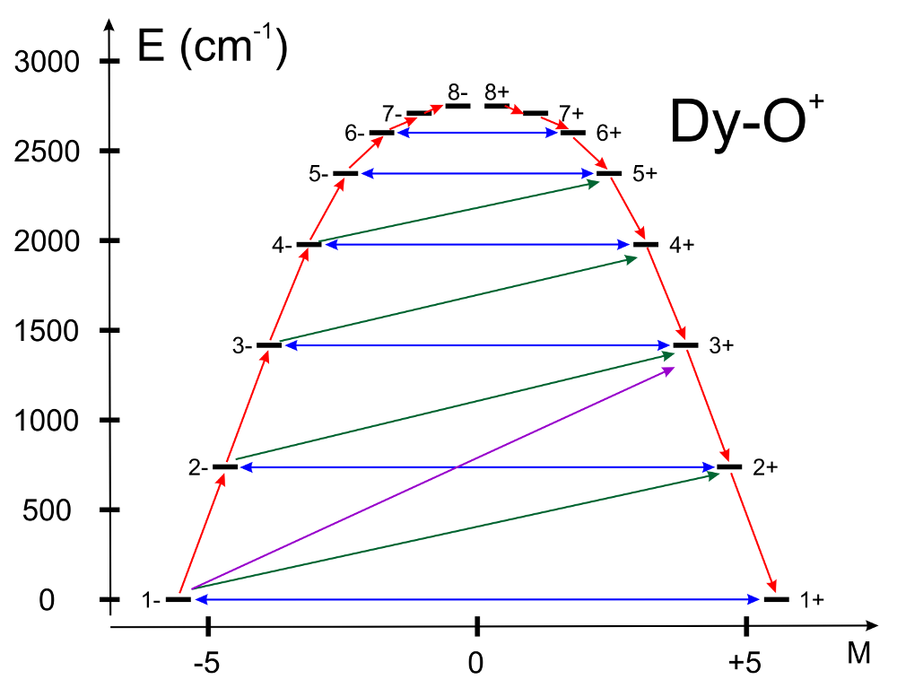

<a id="sec:spectroscopyproperties.single.aniso"></a>
# Interface to SINGLE_ANISO Module

<a id="sec:spectroscopyproperties.single.aniso.general"></a>
## General Description

The `SINGLE_ANISO` program allows the non-perturbative calculation of
effective spin (pseudospin) Hamiltonians and static magnetic properties
of mononuclear complexes and fragments on the basis of an *ab initio*,
including the spin-orbit interaction. As a starting point it uses the
results of a `CASSCF/NEVPT2/SOC` calculation for the ground and several
excited spin-orbit multiplets.

The following quantities can be computed:

- Parameters of pseudospin magnetic Hamiltonians (the methodology is
  described in [Liviu2012JCPs](../../bibliography.md)) :

  1. First order (linear after pseudospin) Zeeman splitting tensor
     ($g$ tensor), including the determination of the sign of the
     product $g_X\cdot g_Y\cdot g_Z$.

  2. Second order (bilinear after pseudospin) zero-field splitting
     tensor ($D$ tensor).

  3. Higher order zero-field splitting tensors $(D^2, D^4, D^6, ..., etc.)$

  4. Higher order Zeeman splitting tensors $(G^1, G^3, G^5, ..., etc.)$

- Crystal-Field parameters for the ground atomic $\tilde{J}$ multiplet
  for lanthanides. [UngurCF2017,Iwahara2018](../../bibliography.md)

- Crystal-Field parameters for the ground atomic $\tilde{L}$ term for
  lanthanides and transition metals.

- Static magnetic properties [Ungurphdthesis,Ungur2018book](../../bibliography.md):

  1.  Van Vleck susceptibility tensor $\chi_{\alpha\beta}(T)$.

  2.  Powder magnetic susceptibility function $\chi(T)$.

  3.  Magnetisation vector $\vec M(\vec H)$ for specified directions
      of the applied magnetic field $\vec H$.

  4.  Powder magnetisation $\overline{M_{mol} }(H,T)$.

  5.  Magnetisation torque function $\vec{\tau}_{mol}(H,T)$.

The magnetic Hamiltonians are defined for a desired group of $N$
low-lying electronic states obtained in `CASSCF/SOC` calculation to
which a *pseudospin* $\tilde{S}$ is subscribed according to the relation
$N=2\tilde{S}+1$. The *pseudospin* $\tilde{S}$ reduces to a true spin
$S$ in the absence of spin-orbit coupling. For instance, the two wave
functions of a Kramers doublet correspond to the pseudospin
$\tilde{S}=1/2$. The implementation is done for $any$ dimension of the
pseudospin $\tilde{S}$, and controlled by the keyword `MLTP`.

The calculation of magnetic properties takes into account the
contribution of excited states (the ligand-field and charge transfer
states of the complex or mononuclear fragment which were included in the
`CASSCF/CASPT2` calculation) via their thermal population and Zeeman
admixture. The effect of intermolecular exchange interaction between
magnetic molecules on the resulting magnetic properties in a crystal is
described by a phenomenological parameter $zJ$ specified by the user.

<a id="sec:spectroscopyproperties.single.aniso.running"></a>
## Running `SINGLE_ANISO` Calculations

The `SINGLE_ANISO` is, in principle, a stand-alone utility
(`otool_single_aniso`) that can be called directly from the shell with
its own input file, provided that the *ab initio* datafile is available:

```sh
bash:$
bash:$  $ORCA/x86_64/otool_single_aniso < single_aniso.input > single_aniso.output
bash:$
```

However, this usage may not be so convenient, as the file
`single_aniso.input` must include the true name of the datafile. For the
user's convenience, a deeper integration between `SINGLE_ANISO` and
CASSCF program in ORCA was implemented, as described below.

As a prerequisite for using the `SINGLE_ANISO` module to calculate the
magnetic properties of the investigated compound, **spin-orbit coupling
and other relativistic effects are already taken fully into account at
the stage of quantum chemistry calculation of the investigated
compound**. The necessary information of the *ab initio* calculation is
provided in a form of a "datafile": energy spectra, angular momentum
integrals, etc. The interface with ORCA generates the required
`datafile` automatically. The following naming conventions were adopted
for the `datafile` in function of the employed computational method:

-   `CASSCF+SOC+SINGLE_ANISO` $=>$ `"$orca_input_name.CASSCF.anisofile"`

-   `CASSCF+QD-NEVPT2+SOC+SINGLE_ANISO` $=>$
    `"$orca_input_name.NEVPT2.anisofile"`

Note that if the `CASSCF+QD-NEVPT2+SOC+SINGLE_ANISO` calculation is
requested, then the `SINGLE_ANISO` will be executed twice, and the above
two datafiles will be generated. The interface will generate the
`SINGLE_ANISO` input file with the keywords information provided in the
`CASSCF/aniso` subblock. These filename of the `datafile` is included
automatically in the input file for the `SINGLE_ANISO` utility (keyword
`DATA`), also generated automatically by the interface. The naming
convention for the generated input files for the `SINGLE_ANISO` utility
is "\$orca_input_name.anisofile".

All keywords of the `SINGLE_ANISO` program are possible to be specified
within the `CASSCF/ANISO` subblock. They are referenced in Section
[aniso.keywords](#sec:spectroscopyproperties.single.aniso.keywords). Optionally, a working
`SINGLE_ANISO` input file can be passed directly to the `CASSCF` module
setting the filename with keyword `InputNameOnDisk` in the `ANISO`
subblock.

An example of the full ORCA input for performing magnetic properties
calculations within the `CASSCF/SOC/SINGLE_ANISO` methodology for a
hypothetical Co(II) compound is provided below:

```mol
title: structure 1
theme: chem311
height: 320px
representation: ball-stick
--- xyz ---
16
structure (0 4)
Co  -2.80118000   9.91634000  19.40386000
O   -3.59660000  12.00284000  20.51731000
O   -5.12835000  10.85934000  19.53431000
O   -5.70975000  12.39302000  20.99406000
O   -1.30202341  11.67611386  19.17300658
O   -3.84191000   9.45315000  21.48634000
O   -1.27500262   8.12582233  19.18634310
O   -3.94611990   9.65426823  17.48476360
N   -4.85020000  11.78071000  20.36823000
H   -1.23636310  12.09677337  18.41017549
H   -1.07910455   7.59540828  19.85227241
H   -3.30514987   9.28034259  22.26327382
H   -4.79957696   9.43862752  21.55163236
H   -4.64801074   9.00163025  17.42987361
H   -3.73273676  10.19508893  16.72083912
H   -0.75470916  11.94100908  19.91589125
--- input ---
! 6-31G TightSCF # basis set and other global ORCA settings

%maxcore 2000

%casscf nel 7
  norb 5         # 7 electrons in 5 orbitals (3d shell)
  mult 4, 2
  nroots 10, 40  # 10 quartet and 40 doublet states

  rel
  dosoc true     # include spin-orbit coupling
  end

  ANISO
    doaniso true # generate datafile/input and call
                 # the SINGLE_ANISO module
    MLTP 2,2,2,2 # group of spin-orbit states for which the pseudospin
                 # Hamiltonian is computed: 4 low-lying spin-orbit doublet states

    TINT 0, 300, 301 # 301 steps in the temperature interval [0-300]
                     # for magnetic susceptibility (in Kelvin)
    HINT 0, 7.0, 71  # 71 steps in the field interval [0-7]
                     # for molar magnetisation (in Tesla)
    TMAG 1.0,1.2,1.8,2.5,3.6  # temperature points for which molar magnetisation
                                              # is computed
     CRYS_element "Co"
     CRYS_charge 2
     DoPLOT true     # requires the ANISO to produce gnuplot scripts,
                     # datafiles and plots of various quantities

    # Alternative to the snippet above. Provide separate input file:
    # InputFile "$orca_input_name.anisoinput"
  end
end

*xyz 0 4   # charge is 0 for this neutral compound
Co   -2.80118000    9.91634000   19.40386000
O    -3.59660000   12.00284000   20.51731000
O    -5.12835000   10.85934000   19.53431000
O    -5.70975000   12.39302000   20.99406000
O    -1.30202341   11.67611386   19.17300658
O    -3.84191000    9.45315000   21.48634000
O    -1.27500262    8.12582233   19.18634310
O    -3.94611990    9.65426823   17.48476360
N    -4.85020000   11.78071000   20.36823000
H    -1.23636310   12.09677337   18.41017549
H    -1.07910455    7.59540828   19.85227241
H    -3.30514987    9.28034259   22.26327382
H    -4.79957696    9.43862752   21.55163236
H    -4.64801074    9.00163025   17.42987361
H    -3.73273676   10.19508893   16.72083912
H    -0.75470916   11.94100908   19.91589125
*
```

The input above utilises the following keywords: `MLTP` keyword requires
the computation of the $g$ tensor for 4 groups of spin-orbit states, the
dimensionality of each group being 2 (Kramers or Ising doublets). `TINT`
requires computation of the magnetic susceptibility in the temperature
interval 0 K - 300 K distributed equally in 300 temperature intervals.
`TMAG` requires computation of powder molar magnetisation at 6
temperature points, in Kelvin (K): 1.0 K, 1.2 K, 1.8 K, 2.5 K, 2.9 K and
3.6 K. `HINT` defines the range for the magnetic field strength, in
Tesla. `DoPLOT` keyword invokes the plotting function of the module.
`CRYS_element + CRYS_charge` request for the computation of the crystal
field parameters for the ground term of the Co$^{2+}$ ion. For more
information about the keywords in `SINGLE_ANISO` module, you can refer
to section
[aniso.keywords](#sec:spectroscopyproperties.single.aniso.keywords).

**Please always check the obtained orbitals after `CASSCF`
calculation**. In this particular case, the active orbitals (45-49) are
localised on the Co site and display dominant 3$d$ character.

```orca
                45        46        47        48        49
           -0.37264  -0.36672  -0.36520  -0.36153  -0.35018
            1.40513   1.40270   1.39998   1.39823   1.39395
            --------  --------  --------  --------  --------
0 Co s         0.0       0.0       0.0       0.0       0.2
0 Co pz        0.1       0.1       0.1       0.0       0.0
0 Co px        0.0       0.2       0.0       0.0       0.1
0 Co py        0.1       0.1       0.0       0.0       0.1
0 Co dz2      23.6      39.5      10.0       2.0      23.5
0 Co dxz      12.8      30.8      48.6       4.4       2.2
0 Co dyz      46.5      10.4      19.3      20.8       2.4
0 Co dx2y2     6.9       0.3      21.2      69.2       1.6
0 Co dxy       9.5      17.6       0.2       2.8      68.0
```

We see that in the above output section, the five active orbitals have
dominant contribution from the Co-3$d$ basis functions. This is OK and
is expected for common transition metal compounds. For lanthanide
compounds, the seven active orbitals should have dominant contribution
from the 4$f$ shell. Larger active spaces must be carefully inspected
and analysed. We refer here to the respective section of this manual
describing the CASSCF method and how to achieve convergence
[modelchemistries.casscf](#sec:modelchemistries.casscf).

The results calculated by using `SINGLE_ANISO` module are placed after
the `SOC` section in ORCA output. Here is the explanation for these
results.

```orca
%%%%%%%%%%%%%%%%%%%%%%%%%%%%%%%%%%%%%%%%%%%%%%%%%%%%%%%%%%%%%%%%%%%%%%%
CALCULATION OF PSEUDOSPIN HAMILTONIAN TENSORS FOR THE MULTIPLET 1 (effective S=1/2)
%%%%%%%%%%%%%%%%%%%%%%%%%%%%%%%%%%%%%%%%%%%%%%%%%%%%%%%%%%%%%%%%%%%%%%%
The pseudospin is defined in the basis of the following spin-orbit states:
spin-orbit state 1. energy(1) =       0.000 cm-1.
spin-orbit state 2. energy(2) =       0.000 cm-1.

g TENSOR:
|--------------------------------------------------------|
|    MAIN VALUES    |             MAIN MAGNETIC AXES     | x ,y ,z  - initial Cartesian axes
|-------------------|----|----- x ------- y ------- z ---| Xm,Ym,Zm - main magnetic axes
| gX =   0.09871069 | Xm | -0.456536 -0.363638  0.811998 |
| gY =   0.11729280 | Ym |  0.643532  0.495246  0.583605 |
| gZ =  11.21949040 | Zm | -0.614361  0.788985  0.007914 |
|--------------------------------------------------------|
The sign of the product gX * gY * gZ for multiplet 1: < 0.
```

The section above shows the $g$ tensor for the ground Kramers doublet.
Since the $g_X$ and $g_Y$ are much smaller than the $g_Z$ component, the
$Zm$ axis is denoted as the $main magnetic axis$ of the computed
molecule. The "Zm $|$ -0.614361 0.788985 0.007914 $|$" denotes the Cartesian components
of the $Zm$ vector.

In the case the computation of the parameters of the crystal field is
requested by `CRYS_element` and `CRYS_charge`, the following section
will be found in the output:

```orca
%%%%%%%%%%%%%%%%%%%%%%%%%%%%%%%%%%%%%%%%%%%%%%%%%%%%%%%%%%%%%%%%%%%%%%%
     CALCULATION OF CRYSTAL-FIELD PARAMETERS OF THE GROUND ATOMIC TERM, L =  3.
%%%%%%%%%%%%%%%%%%%%%%%%%%%%%%%%%%%%%%%%%%%%%%%%%%%%%%%%%%%%%%%%%%%%%%%

The parameters of the Crystal Field matrix are written in the coordinate system:
(Xm, Ym, Zm) --  the main magnetic axes of the ground pseudo-L = | 3> orbital multiplet.
Rotation matrix from the initial coordinate system to the employed coordinate system is:
-------------------------------------------------------------------|
x , y , z  -- initial Cartesian axes                               |
Xm, Ym, Zm -- main magnetic axes                                   |
                     x                 y                 z         |
      | Xm | -0.61155332461133 -0.79120321735748  0.00000000001900 |
 R =  | Ym |  0.79120321735748 -0.61155332461133 -0.00000000000264 |
      | Zm |  0.00000000001371  0.00000000001342  1.00000000000000 |
-------------------------------------------------------------------|
Quantization axis is Zm.

----------------------------------------------------------------------------------------------|
   Ab Initio Crystal-Field Splitting Matrix written in the basis of Pseudo-L Eigenfunctions   |
----------------------------------------------------------------------------------------------|
          |                    | -3 >               |                    | -2 >               |
----------|---------- REAL ----------- IMAGINARY ---|---------- REAL ----------- IMAGINARY ---|
   < -3 | |  -777.2218617165776     0.0000000000000 |    -0.0000000454613     0.0000000351393 |
   < -2 | |    -0.0000000454613    -0.0000000351393 |   285.4563720817839     0.0000000000000 |
   < -1 | |     0.0285952366255    -0.0055088548681 |     0.0000000002580    -0.0000000024089 |
   <  0 | |    -0.0000000160911     0.0000000604843 |     0.0001933353720    -0.0013498718536 |
   <  1 | |     0.0116130821579    -0.0096419531309 |    -0.0000000005651    -0.0000000026613 |
   <  2 | |     0.0000000070279    -0.0000000332291 |     0.0141002831881    -0.0117070160056 |
   <  3 | |    -0.0000002782243     0.0000001745761 |    -0.0000000070278     0.0000000332291 |
----------------------------------------------------------------------------------------------|
----------------------------------------------------------------------------------------------|
          |                    | -1 >               |                    |  0 >               |
----------|---------- REAL ----------- IMAGINARY ---|---------- REAL ----------- IMAGINARY ---|
   < -3 | |     0.0285952366255     0.0055088548681 |    -0.0000000160911    -0.0000000604843 |
   < -2 | |     0.0000000002580     0.0000000024089 |     0.0001933353720     0.0013498718536 |
   < -1 | |   347.8121781289439    -0.0000000000000 |     0.0000000069613    -0.0000000861891 |
   <  0 | |     0.0000000069613     0.0000000861891 |   287.9066230116981     0.0000000000000 |
   <  1 | |    -0.0106576508828     0.0003303251251 |    -0.0000000069613    -0.0000000861891 |
   <  2 | |     0.0000000005651     0.0000000026613 |     0.0001933353720    -0.0013498718536 |
   <  3 | |     0.0116130821579    -0.0096419531309 |     0.0000000160911    -0.0000000604843 |
----------------------------------------------------------------------------------------------|
----------------------------------------------------------------------------------------------|
          |                    |  1 >               |                    |  2 >               |
----------|---------- REAL ----------- IMAGINARY ---|---------- REAL ----------- IMAGINARY ---|
   < -3 | |     0.0116130821579     0.0096419531309 |     0.0000000070279     0.0000000332291 |
   < -2 | |    -0.0000000005651     0.0000000026613 |     0.0141002831881     0.0117070160056 |
   < -1 | |    -0.0106576508828    -0.0003303251251 |     0.0000000005651    -0.0000000026613 |
   <  0 | |    -0.0000000069613     0.0000000861891 |     0.0001933353720     0.0013498718536 |
   <  1 | |   347.8121781289439    -0.0000000000000 |    -0.0000000002580    -0.0000000024089 |
   <  2 | |    -0.0000000002580     0.0000000024089 |   285.4563720817837     0.0000000000000 |
   <  3 | |     0.0285952366255    -0.0055088548681 |     0.0000000454613     0.0000000351392 |
----------------------------------------------------------------------------------------------|
----------------------------------------------------|
          |                    |  3 >               |
----------|---------- REAL ----------- IMAGINARY ---|
   < -3 | |    -0.0000002782241    -0.0000001745761 |
   < -2 | |    -0.0000000070278    -0.0000000332291 |
   < -1 | |     0.0116130821579     0.0096419531309 |
   <  0 | |     0.0000000160911     0.0000000604843 |
   <  1 | |     0.0285952366255     0.0055088548681 |
   <  2 | |     0.0000000454613    -0.0000000351392 |
   <  3 | |  -777.2218617165773     0.0000000000000 |
----------------------------------------------------|
```

In the above section, the low-lying CASSCF states of the Co$^{2+}$ site
originating from the free ion $^{4}$F term are transformed towards the
eigenstates of the ($\tilde{L}=3$), and the low-lying CASSCF *diagonal*
$7\times7$ energy matrix is re-written in this basis. The *non-diagonal*
"Ab Initio Crystal-Field Splitting Matrix" is printed in the above
section. In the subsequent output sections, the obtained crystal field
matrix is decomposed in a linear combination of Irreducible Tensorial
Operators (ITOs) and the obtained expansion coefficients are listed in
the output.

$$
\hat{H}_{CF} = \sum_{k}^{2L} \sum_{q}^{-k,+k} B_{k}^{q} \hat{O}_{k}^{q}(\tilde{L})
$$

The parameters are given for several sets of ITOs.

```orca
********************************************************************************
The Crystal-Field Hamiltonian:
   Hcf = SUM_{k,q} * [ B(k,q) * O(k,q) ];
where:
   O(k,q) =  Extended Stevens Operators (ESO)as defined in:
          1. Rudowicz, C.; J.Phys.C: Solid State Phys.,18(1985) 1415-1430.
          2. Implemented in the "EasySpin" function in MATLAB, www.easyspin.org.
   k - the rank of the ITO, = 2, 4, 6, 8, 10, 12.
   q - the component of the ITO, = -k, -k+1, ... 0, 1, ... k;
Knm are proportionality coefficients between the ESO and operators defined in
J. Chem. Phys., 137, 064112 (2012).
------------------------------------------------|
  k |  q  |    (K)^2    |         B(k,q)        |
----|-----|-------------|-----------------------|
  2 |  -2 |       1.50  |  0.44029016547734E-03 |
  2 |  -1 |       6.00  |  0.24547763681975E-08 |
  2 |   0 |       1.00  | -0.43693326103120E+02 |
  2 |   1 |       6.00  | -0.84162317914775E-08 |
  2 |   2 |       1.50  |  0.12672200639220E-02 |
----|-----|-------------|-----------------------|
  4 |  -4 |      17.50  |  0.20185049671189E-03 |
  4 |  -3 |     140.00  | -0.24080325997038E-08 |
  4 |  -2 |      10.00  |  0.53646717565242E-04 |
  4 |  -1 |      20.00  |  0.99248109880376E-09 |
  4 |   0 |       1.00  | -0.67496280141952E+00 |
  4 |   1 |      20.00  | -0.53708624488205E-09 |
  4 |   2 |      10.00  |  0.33333801678482E-03 |
  4 |   3 |     140.00  | -0.66502585057483E-09 |
  4 |   4 |      17.50  |  0.24311509626065E-03 |
----|-----|-------------|-----------------------|
  6 |  -6 |      57.75  | -0.48493356946616E-09 |
  6 |  -5 |     693.00  |  0.45219078679397E-09 |
  6 |  -4 |      31.50  |  0.11222605476277E-05 |
  6 |  -3 |     105.00  | -0.14936428088413E-09 |
  6 |  -2 |      26.25  |  0.68538037767693E-06 |
  6 |  -1 |      42.00  | -0.24067665895440E-09 |
  6 |   0 |       1.00  | -0.18259217459128E-02 |
  6 |   1 |      42.00  |  0.11394843516111E-11 |
  6 |   2 |      26.25  |  0.48314159464149E-05 |
  6 |   3 |     105.00  | -0.33636623245296E-10 |
  6 |   4 |      31.50  |  0.13517294099051E-05 |
  6 |   5 |     693.00  |  0.95637007025194E-10 |
  6 |   6 |      57.75  | -0.77284500243776E-09 |
------------------------------------------------|
```

In the sections below, the weight of various expansion terms on the
total energy splitting of the corresponding term or multiplet is
analysed.

```orca
CUMULATIVE WEIGHT OF INDIVIDUAL-RANK OPERATORS ON THE CRYSTAL FIELD SPLITTING:
  O2 :------------------------------------------:  70.094642 %.
  O2 + O4 :-------------------------------------:  99.417093 %.
  O2 + O4 + O6 :--------------------------------: 100.000000 %.

ENERGY SPLITTING INDUCED BY CUMULATIVE INDIVIDUAL-RANK OPERATORS (in cm-1).
----------|---------------|---------------|---------------|---------------|
  L = 3   |     RASSCF    |     ONLY      |     ONLY      |     ONLY      |
          |     INITIAL   |      O2       |     O2+O4     |   O2+O4+O6    |
----------|---------------|---------------|---------------|---------------|
 w.f.  1  |    0.00000000 |    0.00000000 |    0.00000000 |    0.00000000 |
 w.f.  2  |    0.00000220 |    0.00000000 |    0.00000149 |    0.00000220 |
 w.f.  3  | 1062.65990786 |  655.39989137 | 1058.22649805 | 1062.65990786 |
 w.f.  4  | 1062.69656233 |  655.39989157 | 1060.35861560 | 1062.69656233 |
 w.f.  5  | 1065.12848829 | 1048.63177735 | 1060.39653667 | 1065.12848829 |
 w.f.  6  | 1125.02338078 | 1048.64787570 | 1129.62295551 | 1125.02338078 |
 w.f.  7  | 1125.04470493 | 1179.71980502 | 1129.64777494 | 1125.04470493 |
----------|---------------|---------------|---------------|---------------|

WEIGHT OF INDIVIDUAL-RANK OPERATORS ON THE CRYSTAL FIELD SPLITTING:
  O2  :-----------------------------------------:  70.094642 %.
  O4  :-----------------------------------------:  29.322451 %.
  O6  :-----------------------------------------:   0.582907 %.

ENERGY SPLITTING INDUCED BY INDIVIDUAL-RANK OPERATORS (in cm-1).
----------|---------------|---------------|---------------|---------------|
  L = 3   |     RASSCF    |     ONLY      |     ONLY      |     ONLY      |
          |     INITIAL   |      O2       |      O4       |      O6       |
----------|---------------|---------------|---------------|---------------|
 w.f.  1  |    0.00000000 |    0.00000000 |    0.00000000 |    0.00000000 |
 w.f.  2  |    0.00000220 |    0.00000000 |  121.49328633 |    0.00351330 |
 w.f.  3  | 1062.65990786 |  655.39989137 |  121.49330341 |    4.60307936 |
 w.f.  4  | 1062.69656233 |  655.39989157 |  202.46860036 |    4.60307986 |
 w.f.  5  | 1065.12848829 | 1048.63177735 |  202.50909974 |    6.90310777 |
 w.f.  6  | 1125.02338078 | 1048.64787570 |  526.45202593 |    6.90437338 |
 w.f.  7  | 1125.04470493 | 1179.71980502 |  526.48994463 |   11.50506445 |
----------|---------------|---------------|---------------|---------------|

WEIGHT OF INDIVIDUAL CRYSTAL FIELD PARAMETERS ON THE CRYSTAL FIELD SPLITTING:
(in descending order):
CFP are given in ITO used in J. Chem. Phys. 137, 064112 (2012).
-----------------------------------------------------|
k |  q  |         B(k,q)        |    Weight (in %)   |
--|-----|-----------------------|--------------------|
2 |   0 | -0.43693326103120E+02 |  70.08577012260780 |
4 |   0 | -0.67496280141952E+00 |  29.31873954450217 |
6 |   0 | -0.18259217459128E-02 |   0.58283348856981 |
4 |   2 |  0.10541073637635E-03 |   0.00457878555457 |
4 |   4 |  0.58115623682363E-04 |   0.00252440109385 |
4 |  -4 |  0.48251497695683E-04 |   0.00209592749496 |
2 |   2 |  0.10346808494753E-02 |   0.00165966774870 |
4 |  -2 |  0.16964581649793E-04 |   0.00073690009261 |
2 |  -2 |  0.35949541472835E-03 |   0.00057664442705 |
6 |   2 |  0.94299583491020E-06 |   0.00030100389209 |
6 |   4 |  0.24084325388052E-06 |   0.00007687706999 |
6 |  -4 |  0.19995783180553E-06 |   0.00006382645967 |
6 |  -2 |  0.13377255211448E-06 |   0.00004270014495 |
6 |   6 | -0.10169893585902E-09 |   0.00000003246226 |
6 |  -6 | -0.63812572794630E-10 |   0.00000002036895 |
6 |  -1 | -0.37137214734348E-10 |   0.00000001185418 |
4 |  -1 |  0.22192552033089E-09 |   0.00000000963990 |
4 |  -3 | -0.20351589971646E-09 |   0.00000000884023 |
2 |   1 | -0.34359122410183E-08 |   0.00000000551133 |
6 |  -5 |  0.17177307577593E-10 |   0.00000000548299 |
4 |   1 | -0.12009613533364E-09 |   0.00000000521668 |
6 |  -3 | -0.14576461261073E-10 |   0.00000000465280 |
4 |   3 | -0.56204942711777E-10 |   0.00000000244141 |
2 |  -1 |  0.10021582557877E-08 |   0.00000000160750 |
6 |   5 |  0.36329494838219E-11 |   0.00000000115964 |
6 |   3 | -0.32825983078827E-11 |   0.00000000104780 |
6 |   1 |  0.17582625268298E-12 |   0.00000000005612 |
--|-----|-----------------------|--------------------|
```

In the case of lanthanide compounds, the same keywords (`CRYS_element`
and `CRYS_charge`) trigger the energy decomposition of the lowest energy
matrix corresponding to the ground $J-$ multiplet of the respective
lanthanide ion.

```orca
%%%%%%%%%%%%%%%%%%%%%%%%%%%%%%%%%%%%%%%%%%%%%%%%%%%%%%%%%%%%%%%%%%%%%%%%%%%%%%%%%%%%%%%%%%%%%%%
CALCULATION OF THE MAGNETIC SUSCEPTIBILITY
%%%%%%%%%%%%%%%%%%%%%%%%%%%%%%%%%%%%%%%%%%%%%%%%%%%%%%%%%%%%%%%%%%%%%%%%%%%%%%%%%%%%%%%%%%%%%%%

  Temperature dependence of the magnetic susceptibility will be calculated in 301 points,
  equally distributed in temperature range  0.0 --- 300.0 K.

|----------------------------------------------------------------------------------------|
|     |     T      | STATISTICAL |     X*T     |     X*T     |      X      |     1/X     |
|     |            |  SUM (Z)    |    (zJ=0)   |             |             |             |
|-----|----------------------------------------------------------------------------------|
|Units|   Kelvin   |    ---      |  cm3*K/mol  |  cm3*K/mol  |   cm3/mol   |   mol/cm3   |
|-----|----------------------------------------------------------------------------------|
|     |   0.000100 | 0.20000E+01 |  3.93592010 |  3.93592010 | 0.39359E+05 | 0.25407E-04 |
|     |   1.000000 | 0.20000E+01 |  3.94046247 |  3.94046247 | 0.39405E+01 | 0.25378E+00 |
|     |   2.000000 | 0.20000E+01 |  3.94500530 |  3.94500530 | 0.19725E+01 | 0.50697E+00 |
|     |   3.000000 | 0.20000E+01 |  3.94954814 |  3.94954814 | 0.13165E+01 | 0.75958E+00 |
|     |   4.000000 | 0.20000E+01 |  3.95409097 |  3.95409097 | 0.98852E+00 | 0.10116E+01 |
|     |   5.000000 | 0.20000E+01 |  3.95863380 |  3.95863380 | 0.79173E+00 | 0.12631E+01 |
|     |   6.000000 | 0.20000E+01 |  3.96317663 |  3.96317663 | 0.66053E+00 | 0.15139E+01 |
|     |   7.000000 | 0.20000E+01 |  3.96771946 |  3.96771946 | 0.56682E+00 | 0.17642E+01 |
|     |   8.000000 | 0.20000E+01 |  3.97226229 |  3.97226229 | 0.49653E+00 | 0.20140E+01 |
|     |   9.000000 | 0.20000E+01 |  3.97680512 |  3.97680512 | 0.44187E+00 | 0.22631E+01 |
|     |  10.000000 | 0.20000E+01 |  3.98134795 |  3.98134795 | 0.39813E+00 | 0.25117E+01 |
...
```

This section shows the computed magnetic susceptibility. The formula
used for this calculation assumes the zero-field limit, $i.e. H=0.0$
Tesla. A picture called "XT_no_field.png" using the above data will be
created in the working directory whenever the `DoPLOT` keyword is included
in the `SINGLE_ANISO` input. The picture shows the temperature
dependence of the magnetic susceptibility.

```orca
|------------------------------------------------------------------------------------------------------|
|                      VAN VLECK SUSCEPTIBILITY TENSOR FOR zJ = 0,  in cm3*K/mol                       |
|------------------------------------------------------------------------------------------------------|
|   T(K)   | |        SUSCEPTIBILITY TENSOR      |  MAIN VALUES  |               MAIN AXES             |
|----------|-|----- x --------- y --------- z ---|---------------|------ x --------- y --------- z ----|
|          |x|  4.456611   -5.721848   -0.057261 | X:   0.000914 |  0.45654560  0.36364537 -0.81199025 |
| 0.000100 |y| -5.721848    7.349367    0.073827 | Y:   0.001291 |  0.64352653  0.49524178  0.58361733 |
|          |z| -0.057261    0.073827    0.001782 | Z:  11.805555 | -0.61436123  0.78898519  0.00791499 |
|----------|-|----- x --------- y --------- z ---|---------------|------ x --------- y --------- z ----|
|          |x|  4.461142   -5.718873   -0.057275 | X:   0.007129 |  0.48578721  0.38619740 -0.78413160 |
| 1.000000 |y| -5.718873    7.351927    0.074460 | Y:   0.008275 |  0.62173382  0.47788368  0.62054351 |
|          |z| -0.057275    0.074460    0.008319 | Z:  11.805983 | -0.61437598  0.78897323  0.00796220 |
|----------|-|----- x --------- y --------- z ---|---------------|------ x --------- y --------- z ----|
|          |x|  4.465674   -5.715898   -0.057290 | X:   0.013344 | -0.49137357 -0.39055217  0.77847352 |
| 2.000000 |y| -5.715898    7.354486    0.075093 | Y:   0.015261 |  0.61731357  0.47435127  0.62762635 |
|          |z| -0.057290    0.075093    0.014856 | Z:  11.806411 | -0.61439073  0.78896126  0.00800947 |
...
```

The section above shows how the main axes of the susceptibility tensor
evolves with temperature.

```orca
        HIGH-FIELD POWDER MAGNETIZATION
              (Units: Bohr magneton)

|-----------|---------------|---------------|---------------|---------------|---------------|
|    H(T)   |STATISTICAL SUM|     1.000 K.  |     1.200 K.  |     1.800 K.  |     2.500 K.  |
|-----------|---------------|---------------|---------------|---------------|---------------|
|  0.000100 |     1.9995371 |  0.0007055560 |  0.0005880989 |  0.0003923371 |  0.0002827105 |
|  0.100000 |     1.6293687 |  0.6863212310 |  0.5768343572 |  0.3889480349 |  0.2814379254 |
|  0.200000 |     1.3961049 |  1.2730827904 |  1.0928431358 |  0.7585259147 |  0.5554332924 |
|  0.300000 |     1.2492960 |  1.7176941099 |  1.5137449727 |  1.0936561795 |  0.8154486026 |
|  0.400000 |     1.1568991 |  2.0312460704 |  1.8358752195 |  1.3858429640 |  1.0565149122 |
|  0.500000 |     1.0987474 |  2.2456644189 |  2.0736324473 |  1.6329635867 |  1.2755212118 |
|  0.600000 |     1.0621485 |  2.3917509695 |  2.2464760254 |  1.8374994655 |  1.4711430994 |
|  0.700000 |     1.0391143 |  2.4924803644 |  2.3720174309 |  2.0044495622 |  1.6435265950 |
|  0.800000 |     1.0246173 |  2.5633469179 |  2.4639356325 |  2.1396808073 |  1.7938697856 |
|  0.900000 |     1.0154934 |  2.6144012337 |  2.5321303741 |  2.2489088878 |  1.9240150206 |
|  1.000000 |     1.0097510 |  2.6521008670 |  2.5835380488 |  2.3371993536 |  2.0361143785 |
|  1.100000 |     1.0061370 |  2.6806180412 |  2.6229602467 |  2.4088035375 |  2.1323879997 |
|  1.200000 |     1.0038624 |  2.7026854246 |  2.6537186141 |  2.4671744880 |  2.2149684436 |
|  1.300000 |     1.0024309 |  2.7201250266 |  2.6781249799 |  2.5150622492 |  2.2858129074 |
|  1.400000 |     1.0015299 |  2.7341759016 |  2.6978046065 |  2.5546323752 |  2.3466634357 |
...
```

This section shows the field dependence of the powder molar
magnetisation. A picture named "MH.png" can be created by using the
`DoPLOT` keyword in the `SINGLE_ANISO` input file.

Running `CASSCF` calculations on lanthanides compounds in ORCA might be
a bit more cumbersome compared to transition metal compounds, due to the
convergence of this method. However, following the instructions in the
[modelchemistries.casscf](#sec:modelchemistries.casscf) section and the related tips in this
manual and on the Forum, the calculations could be performed. From our
experience, the main reason for the poor convergence of `CASSCF`
calculation originates from the wrong orbitals occupying the active
space. This issue can be overcame by performing a proper rotation of the
molecular orbitals such that the seven orbitals with dominant 4$f$
contribution are placed in the active space. As soon as the active
orbitals acquire the dominant 4$f$ weight, the convergence is quite
straightforward.

Below we describe the calculation on a lanthanide fragment [Ce(COT)
$_{2}$]$^{-}$ (COT=(C$_{8}$H${_8}$) $^{2-}$) as an example:

```mol
title: structure 2
theme: chem311
height: 320px
representation: ball-stick
--- xyz ---
33
structure (-1 2)
Ce   5.97600100   5.09133100  13.17268800
C    5.47882500   2.98632700  11.42941100
C    4.38424700   3.88677900  11.27367600
H    4.21867900   4.06431900  10.35453600
C    3.47138800   4.59373300  12.09958800
H    2.87027600   5.12178400  11.58692300
C    3.21937800   4.72005000  13.49499100
C    3.84198900   4.08874200  14.61728000
H    3.46926600   4.38472800  15.43857500
C    4.86395700   3.14327700  14.81900800
H    4.97094200   2.92197400  15.73690500
C    5.77247800   2.44085400  13.98883400
H    6.34594800   1.86846400  14.48498500
C    6.03182900   2.38537000  12.60408600
H    6.75450600   1.80396200  12.40022700
C    6.40698800   7.65195200  12.14877700
C    6.11546300   7.83965300  13.53689900
H    5.47247100   8.52635500  13.66635300
C    6.52698400   7.27593700  14.77461400
H    6.07344100   7.67704500  15.50605500
C    7.44425200   6.26569500  15.21837900
C    8.37896000   5.47470700  14.49350900
H    8.88315100   4.90771300  15.06566300
C    8.74883600   5.31701900  13.13468700
H    9.45277500   4.68873000  13.02529900
C    8.32602800   5.86701900  11.90372100
H    8.81295200   5.51473700  11.16784000
C    7.36115600   6.80638600  11.50204100
H    7.33662500   6.90506000  10.55697400
H    5.93270067   2.68976505  10.50694264
H    5.83417492   8.22959522  11.45371334
H    2.43475960   5.39234559  13.77300645
H    7.40021961   6.07954201  16.27114118
--- input ---
!DKH DKH-DEF2-SVP slowconv KDIIS BP

%basis
newgto Ce "SARC2-DKH-QZVP" end
end

%scf
MaxIter 500
end

*xyz -1 2
Ce   5.97600100    5.09133100   13.17268800
C    5.47882500    2.98632700   11.42941100
C    4.38424700    3.88677900   11.27367600
H    4.21867900    4.06431900   10.35453600
C    3.47138800    4.59373300   12.09958800
H    2.87027600    5.12178400   11.58692300
C    3.21937800    4.72005000   13.49499100
C    3.84198900    4.08874200   14.61728000
H    3.46926600    4.38472800   15.43857500
C    4.86395700    3.14327700   14.81900800
H    4.97094200    2.92197400   15.73690500
C    5.77247800    2.44085400   13.98883400
H    6.34594800    1.86846400   14.48498500
C    6.03182900    2.38537000   12.60408600
H    6.75450600    1.80396200   12.40022700
C    6.40698800    7.65195200   12.14877700
C    6.11546300    7.83965300   13.53689900
H    5.47247100    8.52635500   13.66635300
C    6.52698400    7.27593700   14.77461400
H    6.07344100    7.67704500   15.50605500
C    7.44425200    6.26569500   15.21837900
C    8.37896000    5.47470700   14.49350900
H    8.88315100    4.90771300   15.06566300
C    8.74883600    5.31701900   13.13468700
H    9.45277500    4.68873000   13.02529900
C    8.32602800    5.86701900   11.90372100
H    8.81295200    5.51473700   11.16784000
C    7.36115600    6.80638600   11.50204100
H    7.33662500    6.90506000   10.55697400
H    5.93270067    2.68976505   10.50694264
H    5.83417492    8.22959522   11.45371334
H    2.43475960    5.39234559   13.77300645
H    7.40021961    6.07954201   16.27114118
*
```

This is the first step of the calculation. For heavier elements like
lanthanides, we must consider relativistic effect by using `DKH`
keyword. We explicitly use `KDIIS` in the calculation to smoothen out
convergence. The orbital file called "CeCOT2_1.gbw" will be generated
after this step. We further use this gbw file to do the `CASSCF`
calculation.

```orca
!DKH DKH-DEF2-SVP TightSCF conv Moread

%moinp "CeCOT2_1.gbw"

%basis
newgto Ce "SARC2-DKH-QZVP" end
end

%casscf nel 1
   norb 7  # 1 electrons in 7 f orbitals
   mult 2
   nroots 7  # 7 doublet states

   rel
     dosoc true  # include spin-orbit coupling
   end
end

*xyz -1 2
......
*
```

We need to check the orbitals after the `CASSCF` step with the orbital
file named "CeCOT2_2.gbw" obtained.

```orca
              85        86        87        88        89        90        91
            0.45543   0.45310   0.27655   0.45085   0.45251   0.45760   0.45713
            0.14286   0.14286   0.14286   0.14286   0.14286   0.14286   0.14286
            --------  --------  --------  --------  --------  --------  --------
0 Ce f0       26.2       0.9       0.0       1.3       3.3       0.5       6.6
0 Ce f+1       5.4      20.2       0.0      24.0       3.4       5.6      39.1
0 Ce f-1       0.4      30.4       0.0      52.8      10.7       0.6       3.9
0 Ce f+2       3.8       0.2       0.7       1.4       4.7      76.7      10.7
0 Ce f-2      50.7       0.7       0.0       2.1       4.2       4.0       1.3
0 Ce f+3       8.2      22.0       0.0       1.2      55.8       0.0      11.6
0 Ce f-3       4.7      25.3       0.0      16.5      17.1      10.1      25.2
```

Orbitals 85, 86, 88-91 and 130 are occupied and strongly metal based
$4f$-orbitals. For comparison, the converged `CASSCF` orbitals are pure
$4f$-orbitals (99% metal-based). The orbitals need to be rotated in
order to fit the active space (85-91). Then we can use the results of
`CASSCF/SOC` calculation to call for the `SINGLE_ANISO` program.

```orca
!DKH DKH-DEF2-SVP TightSCF conv Moread
%moinp "CeCOT2_2.gbw"

%basis
newgto Ce "SARC2-DKH-QZVP" end
end

%scf rotate {87,130,90} end
end

%casscf nel 1
   norb 7
   mult 2
   nroots 7

   rel
   dosoc true
   end

   ANISO
     doaniso true
     MLTP 2,2,2    # 3 Kramers doublets, J=5/2
     MAVE 1, 12   # nsym=1, Lebedev grid number 12
     XFIE 0.1        # the applied magnetic field is 0.1 T
     CRYS_element "Ce"
     CRYS_charge 3
     NCUT 14
     ABCC_abc     11.0735, 12.6738, 22.4854, 84.436, 86.690, 83.969
     ABCC_center  0.82682, 0.31234, 0.78619
     ZJPR  -0.120
     HEXP_temp  2.0, 3.0 
     HEXP_H  0.0, 1.0, 2.0, 3.0, 4.0
     HEXP_M[0]= 0.0, 2.46, 2.86, 2.95, 2.98
     HEXP_M[1]= 0.0, 2.04, 2.68, 2.87, 2.94
     TEXP_temp  0.0, 10.0, 20.0, 30.0, 40.0, 50.0
     TEXP_chiT  4.5, 4.5, 4.58, 4.62, 4.66, 4.70
     UBAR true
     DoPLOT true
     ZEEM[0]=1.0, 0.0, 0.0
     ZEEM[1]=0.0, 0.0, 1.0
     ZEEM[2]=0.0, 1.0, 0.0
     ZEEM[3]=0.75, 0.0, 0.25
   end
end

*xyz -1 2
......
*
```

The order of the keywords listed in the `CASSCF/ANISO` subblock does not
matter.

<a id="sec:spectroscopyproperties.single.aniso.keywords"></a>
## Reference List of CASSCF/ANISO Keywords

The only required keyword for `SINGLE_ANISO` is the `DATA`, specifying
the name of the datafile containing the *ab initio* information. The
ORCA interface includes this keyword automatically and therefore it is
not referenced here. All other keywords are extra and allow various
customisation of the execution. For the computation of the EPR
$g$-tensor, the only unknown variable for `SINGLE_ANISO` is the
dimension (multiplicity) of the pseudospin(s). This information can be
provided by the `MLTP` keyword. For example, in cases where spin-orbit
coupling is weak, the multiplicity of the effective spin Hamiltonian is
usually the same as the multiplicity of the lowest term (e.g. high spin
$Fe^{3+}$: $S=\tilde{S}=5/2$), while in the cases with strong anisotropy
(lanthanide, actinide complexes, $Co^{2+}$ complexes, cases with
near-orbital degeneracy, etc.) the lowest energy levels form a group of
states which may differ drastically from the spins of the lowest term.
In these cases the user should specify the multiplicity corresponding to
a chosen value of pseudospin ($2\tilde{S}+1$). For instance, in
$Dy^{3+}$ the spin of the ground state term is $S=5/2$, but in most of
real compounds only the ground Kramers doublet is considered. In such
case, the multiplicity of the pseudospin equals to 2 (see `MLTP`
keyword). For the calculation of the parameters of the crystal field
corresponding to the ground atomic `multiplet` $J$ for lanthanides
should be requested with the keywords `CRYS_element` and `CRYS_charge`.
Similarly, the parameters of the crystal field corresponding to the
ground atomic `term` $L$ for lanthanides and transition metals compounds
can be requested with same keywords: `CRYS_element` and `CRYS_charge`.

Note that the keywords/syntax in the ORCA CASSCF/ANISO block are
slightly different from the genuine `SINGLE_ANISO` input, where some of
the keywords are grouped together. We aimed at keeping the control
keywords as close as possible.

Optional general keywords to control the input within the ORCA interface
(CASSCF/ANISO subblock):

`InputNameOnDisk`
: This keyword reads the name of the
  input file for `SINGLE_ANISO`, a
  string given between quotations.
  Example:

  ```orca
  InputNameOnDisk "my_input_for_aniso.inp"
  ```

  The interface with ORCA will add
  the `DATA` keyword with specific
  name of the datafile for the
  performed calculation. All the
  other keywords provided inside this
  file must follow their original
  names, as in `MOLCAS`.

`MLTP`
: The number of molecular multiplets
  ($i.e.$ groups of spin-orbital
  eigenstates) for which $g$, $D$ and
  higher magnetic tensors will be
  calculated (default `MLTP`=1). With
  `MLTP` an comma separated list of
  numbers specifying the dimension of
  each multiplet is passed. The
  default is to select one multiplet
  which has the dimension equal to
  the multiplicity of the ground
  term. In cases of strong spin-orbit
  coupling the usage of this keyword
  is mandatory. Example:

  ```orca
  MLTP 4, 4, 2, 2
  ```

  `SINGLE_ANISO` will compute the $g$
  tensor for 4 groups of states: 2
  groups having the effective spin
  $S=|3/2>$, and other 2 groups of
  states being Kramers doublets.

`TINT`
: Specifies the temperature points
  for the evaluation of the magnetic
  susceptibility. The program will
  read three numbers: $T_{min}$,
  $T_{max}$, and $nT$.

  -   $T_{min}$ - the minimal
      temperature (Default 0.0K)

  -   $T_{max}$ - the maximal
      temperature (Default 300.0K)

  -   $nT$ - number of temperature
      points (Default 101)

  Example:

  ```orca
  TINT 0.0, 330.0, 331
  ```

  `SINGLE_ANISO` will compute
  temperature dependence of the
  magnetic susceptibility in 331
  points evenly distributed in
  temperature interval: 0.0K -
  330.0K.

`HINT`
: Specifies the field points for the
  evaluation of the magnetisation in
  a certain direction. The program
  will read three numbers: $H_{min}$,
  $H_{max}$ and $nH$.

  -   $H_{min}$ - the minimal field
      (Default 0.0T)

  -   $H_{max}$ - the maximal filed
      (Default 10.0T)

  -   $nH$ - number of field points
      (Default 101)

  Example:

  ```orca
  HINT 0.0, 20.0, 201
  ```

  `SINGLE_ANISO` will compute the
  molar magnetisation in 201 points
  evenly distributed in field
  interval: 0.0T - 20.0T.

`TMAG`
: Specifies the temperature(s) at
  which the field-dependent
  magnetisation is calculated. The
  program will read the temperatures
  (in Kelvin) at which magnetisation
  is to be computed. Default is to
  compute magnetisation at one
  temperature point (2.0 K). Example:

  ```orca
  TMAG 1.8, 2.0, 3.0, 4.0, 5.0
  ```

  `SINGLE_ANISO` will compute the
  molar magnetisation at 5
  temperature points (1.8 K, 2.0 K,
  3.4 K, 4.0 K, and 5.0 K).

`ENCU`
: The keyword expects to read two
  integer numbers. The two parameters
  (`NK` and `MG`) are used to define
  the cut-off energy for the lowest
  states for which Zeeman interaction
  is taken into account exactly. The
  contribution to the magnetisation
  coming from states that are higher
  in energy than $E$ (see below) is
  done by second order perturbation
  theory. The program will read two
  integer numbers: $NK$ and $MG$.
  Default values are:
  $NK=100, MG=100$.

$$
E=NK \cdot k_{
  Boltz} \cdot \texttt{TMAG}_{max} +
  MG \cdot \mu_{Bohr} \cdot H_{max}
$$

  The field-dependent magnetisation
  is calculated at the maximal
  temperature value given by `TMAG`
  keyword. Example:

  ```orca
  ENCU 250, 150
  ```

  If $H_{max}$ = 10 T and `TMAG` =
  1.8 K, then the cut-off energy is:

$$
E=250 \cdot k_{Bol
  tz} \cdot 1.8 + 150 \cdot \mu_{Bohr
  } \cdot 10 = 1013.06258 (cm^{-1})
$$

  
  This means that the magnetisation
  arising from all spin-orbit states
  with energy lower than
  $E = 1013.06258 (cm^{-1})$ will be
  computed exactly (i.e. are included
  in the exact Zeeman
  diagonalisation) The keywords
  `NCUT`, `ERAT` and `ENCU` have
  similar purpose. If two of them are
  used at the same time, the
  following priority is defined:
  `NCUT > ENCU > ERAT`.

`NCUT`
: This flag is used to define the
  cut-off energy for the low-lying
  spin-orbit states for which Zeeman
  interaction is taken into account
  exactly. The contribution to the
  magnetisation arising from states
  that are higher in energy than
  lowest $N_{CUT}$ states, is done by
  second-order perturbation theory.
  The program will read one integer
  number. In case the number is
  larger than the total number of
  spin-orbit states($N_{SS}$, then
  the $N_{CUT}$ is set to $N_{SS}$
  (which means that the molar
  magnetisation will be computed
  exactly, using full Zeeman
  diagonalisation for all field
  points). The field-dependent
  magnetisation is calculated at the
  temperature value(s) defined by
  `TMAG`. Example:

  ```orca
  NCUT 32
  ```

  The keywords `NCUT`, `ERAT` and
  `ENCU` have similar purpose. If two
  of them are used at the same time,
  the following priority is defined:
  `NCUT > ENCU > ERAT`.

`ERAT`
: This flag is used to define the
  cut-off energy for the low-lying
  spin-orbit states for which Zeeman
  interaction is taken into account
  exactly. The program will read one
  single real number specifying the
  ratio of the energy states which
  are included in the exact Zeeman
  Hamiltonian. As example, a value of
  0.5 means that the lowest half of
  the energy states included in the
  spin-orbit calculation are used for
  exact Zeeman diagonalisation.

  Example:

  ```orca
  ERAT 0.333
  ```

  The keywords `NCUT`, `ERAT` and
  `ENCU` have similar purpose. If two
  of them are used at the same time,
  the following priority is defined:
  `NCUT > ENCU > ERAT`.

`MVEC_x` `MVEC_y` `MVEC_z`
: `MVEC_x`, `MVEC_y` and `MVEC_z`
  define a number of directions for
  which the magnetisation vector will
  be computed. The directions are
  given as unitary vectors specifying
  the direction *i* of the applied
  magnetic field).

  Example:

  ```orca
  MVEC_x 0.00, 1.57, 1.57, 0.425
  MVEC_y 0.00, 0.00, 1.57, 0.418
  MVEC_z 0.00, 0.00, 1.57, 0.418
  ```

`ZEEM`
: This keyword allows to compute
  Zeeman splitting spectra along
  certain directions of applied
  field. Directions of applied field
  are given as three real number for
  each direction, specifying the
  projections along each direction:
  Example:

  ```orca
  ZEEM[0] 1.0, 0.0, 0.0
  ZEEM[1] 0.0, 1.0, 0.0
  ZEEM[2] 0.0, 0.0, 1.0
  ZEEM[3] 0.0, 1.0, 1.0
  ZEEM[4] 1.0, 0.0, 1.0
  ZEEM[5] 1.0, 1.0, 0.0
  ```

  The above input will request
  computation of the Zeeman spectra
  along six directions: Cartesian
  axes X, Y, Z (directions 1,2 and
  3), and between any two Cartesian
  axes: YZ, XZ and XY, respectively.
  The program will re-normalise the
  input vectors according to unity
  length. In combination with `DoPLOT`
  keyword, the corresponding
  `zeeman_energy_xxx.png` images will
  be produced.

`MAVE`
: The keyword requires two integer
  numbers, denoted `MAVE_nsym` and
  `MAVE_ngrid`. The parameters
  `MAVE_nsym` and `MAVE_ngrid`
  specify the grid density in the
  computation of powder molar
  magnetisation. The program uses
  Lebedev-Laikov distribution of
  points on the unit sphere. The
  parameters are integer numbers:
  $n_{sym}$ and $n_{grid}$. The
  $n_{sym}$ defines which part of the
  sphere is used for averaging. It
  takes one of the three values: 1
  (half-sphere), 2 (a quarter of a
  sphere) or 3 (an octant of the
  sphere). $n_{grid}$ takes values
  from 1 (the smallest grid) till 32
  (the largest grid, i.e. the
  densest). The default is to
  consider integration over a
  half-sphere (since $M(H)=-M(-H)$):
  $n_{sym}=1$ and $n_{sym}=15$ (i.e
  185 points distributed over
  half-sphere). In case of symmetric
  compounds, powder magnetisation may
  be averaged over a smaller part of
  the sphere, reducing thus the
  number of points for the
  integration. The user is
  responsible to choose the
  appropriate integration scheme.
  Note that the program's default is
  rather conservative.

  Example:

  ```orca
  MAVE 1, 8
  ```

`TEXP_temp` `TEXP_chiT`
: The parameters `TEXP_temp` and
  `TEXP_chiT` allow the computation
  of the magnetic susceptibility
  $\chi T(T)$ at experimental points.
  The experimental temperature (in
  $K$) and the experimental magnetic
  susceptibility (in $cm^3Kmol^{-1}$
  ) are read as comma separated list.
  In the case both `TEXP` and `TINT`
  keywords are given, the `TEXP` will
  be used while the `TINT` input will
  be ignored.

  Example:

  ```orca
  TEXP_temp 0.0, 10.0, 20.0, 30.0, 40.0, 50.0
  TEXP_chiT 4.5, 4.5, 4.58, 4.62, 4.66, 4.70
  ```

`HEXP_temp` `HEXP_H` `HEXP_M`
: The three keywords `HEXP_temp`,
  `HEXP_H` and `HEXP_M` enable the
  computation of the molar
  magnetisation $M_{mol}(H)$ at
  experimental points. The
  experimental field strength (in
  Tesla) and the experimental
  magnetisation (in $\mu_{Bohr}$) are
  read as a comma separated list. In
  the case both `HEXP` and `HINT`
  keywords are given, the `HEXP` will
  be used while the `HINT` input will
  be ignored. The magnetisation
  routine will print the standard
  deviation from the experiment.
  Example:

  ```orca
  HEXP_temp 2.0, 3.0
  HEXP_H 0.0, 1.0, 2.0, 3.0, 4.0
  HEXP_M[0]= 0.0, 2.46, 2.86, 2.95, 2.98  # exp. M at T=2.0 K 
  HEXP_M[1]= 0.0, 2.04, 2.68, 2.87, 2.94  # exp. M at T=3.0 K
  ```

`ZJPR`
: This keyword specifies the value
  (in $cm^{-1}$) of a
  phenomenological parameter of a
  mean molecular field acting on the
  spin of the complex (the average
  intermolecular exchange constant).
  It is used in the calculation of
  all magnetic properties (not for
  spin Hamiltonians) (Default is
  0.0).

  ```orca
  ZJPR -0.02
  ```

`TORQ`
: This keyword specifies the number
  of angular points for the
  computation of the magnetisation
  torque function,
  $\vec{\tau}_{\alpha}$ as function
  of the temperature, field strength
  and field orientation.

  ```orca
  TORQ 55
  ```

  The torque is computed at all
  temperature given by `TMAG` or
  `HEXP_temp` inputs. Three rotations
  around Cartesian axes X, Y and Z
  are performed.

`PrintLevel`
: This keyword controls the print level.

  - 2 - normal. (Default)
  - 3 or larger (debug)

`CRYS_element` `CRYS_charge`
: The keywords `CRYS_element` and
  `CRYS_charge` request the
  computation of all 27 Crystal-Field
  parameters acting on the ground
  atomic multiplet of a lanthanide.
  With `CRYS_element` the chemical
  symbol of the lanthanide is set.
  **Note that the element symbol must
  be enclosed in quotation marks**.
  The charge is defined with
  `CRYS_charge`. By default the
  program will not compute the
  parameters of the Crystal-Field.

  Example:

  ```orca
  CRYS_element "Dy" CRYS_charge 3
  ```

`QUAX`
: This keyword controls the
  quantisation axis for the
  computation of the Crystal-Field
  parameters acting on the ground
  atomic multiplet of a lanthanide.
  On the next line, the program will
  read one of the three values: 1, 2
  or 3.

  -   1 - quantisation axis is the
      main magnetic axis $Zm$ of the
      ground pseudospin multiplet,
      whose size is specified within
      the `MLTP` keyword. (Default)

  -   2 - quantisation axis is the
      main magnetic axis $Zm$ of the
      entire atomic multiplet
      $|J,M_{J}>$.

  -   3 - quantisation axis is the
      original Cartesian Z axis.
      Rotation matrix is unity.

  Example:

  ```orca
  QUAX 3
  ```

`UBAR`
: With `UBAR` set to "true", the
  blocking barrier of a
  single-molecule magnet is
  estimated. The default is not to
  compute it. The method prints
  transition matrix elements of the
  magnetic moment according to the
  Figure below:

  

  In this figure, a qualitative
  performance picture of the
  investigated single-molecular
  magnet is estimated by the
  strengths of the transition matrix
  elements of the magnetic moment
  connecting states with opposite
  magnetisaskytions
  ($n+ \rightarrow n-$). The height
  of the barrier is qualitatively
  estimated by the energy at which
  the matrix element
  ($n+ \rightarrow n-$) is large
  enough to induce significant
  tunnelling splitting at usual
  magnetic fields (internal) present
  in the magnetic crystals (0.01-0.1
  Tesla). For the above example, the
  blocking barrier closes at the
  state ($8+ \rightarrow 8-$).

  All transition matrix elements of
  the magnetic moment are given as
  $((|\mu_X|+|\mu_Y|+|\mu_Z|)/3)$.
  The data is given in Bohr magnetons
  ($\mu_{Bohr}$).

  Example:

  ```orca
  UBAR true
  ```

`ABCC_abc` `ABCC_center`
: The keywords `ABCC_abc` and
  `ABCC_center` set the computation
  of magnetic and anisotropy axes in
  the crystallographic $abc$ system.
  With `ABCC_abc`, the program reads
  six real values, namely
  $a, b, c, \alpha, \beta$, and
  $\gamma$, defining the crystal
  lattice. The values must be
  separated by a comma. With
  `ABCC_center`, the program reads
  the fractional coordinates of the
  magnetic center (from the CIF
  file) - again separated by comma.
  It is assumed that the XYZ
  coordinates used for the *ab
  initio* calculations did not rotate
  or translate the molecule from its
  crystallographic position. This
  input will ensure that all tensors
  computed by `SINGLE_ANISO` are
  given also in the $abc$ system. The
  computed values in the output
  correspond to the crystallographic
  position of three "dummy atoms"
  located on the corresponding
  anisotropy axes, at the distance of
  1.0 $\mathring{A}$ from the metal
  site. Example:

  ```orca
  ABCC_abc 12.977, 12.977, 16.573, 90, 90, 120
  ABCC_center 0.666667, 0.333333, 0.20413
  ```

`XFIE`
: This keyword specifies the value
  (in T) of applied magnetic field
  for the computation of magnetic
  susceptibility by $dM/dH$ and $M/H$
  formulas. A comparison with the
  usual formula (in the limit of zero
  applied field) is provided.
  (Default is 0.0). Example:

  ```orca
  XFIE 0.35
  ```

  This keyword together with the
  keyword `DoPLOT` will enable the
  generation of two additional plots:
  `XT_with_field_dM_over_dH.png` and
  `XT_with_field_M_over_H.png`, one
  for each of the two above formula
  used, alongside with respective
  `gnuplot` scripts and gnuplot
  datafiles.

`DoPLOT`
: Set to "true", the program
  generates a few plots (png or eps
  format) via an interface to the
  linux program *gnuplot*. The
  interface generates a datafile, a
  *gnuplot* script and attempts
  execution of the script for
  generation of the image. The plots
  are generated only if the
  respective function is invoked. The
  magnetic susceptibility, molar
  magnetisation and blocking barrier
  (`UBAR`) plots are generated. The
  files are named: `XT_no_field.dat`,
  `XT_no_field.plt`,
  `XT_no_field.png`, `MH.dat`,
  `MH.plt`, `MH.png`,
  `BARRIER_TME.dat`,
  `BARRIER_ENE.dat`, `BARRIER.plt`
  and `BARRIER.png`,
  `zeeman_energy_xxx.png` etc. All
  files produced by `SINGLE_ANISO`
  are referenced in the corresponding
  output section. Example:

  ```orca
  DoPLOT true
  ```

<a id="sec:spectroscopyproperties.single.aniso.cite"></a>
## How to cite

We would appreciate if you cite the following papers in publications
resulting from the use of `SINGLE_ANISO`:

-   Chibotaru, L. F.; Ungur, L. *J. Chem. Phys.*, **2012**, *137*,
    064112.

-   Ungur, L. Chibotaru, L. F. *Chem. Eur. J.*, **2017**, *23*,
    3708-3718.

In addition, useful information like the definition of pseudospin
Hamiltonians and their derivation can be found in this paper.
