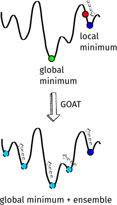
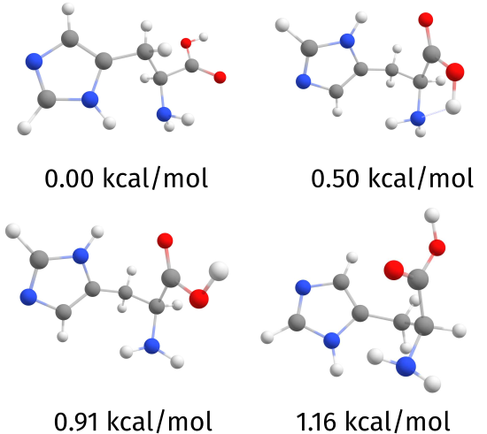

<a id="sec:structurereactivity.GOAT"></a>
# GOAT: global geometry optimization and ensemble generator

If instead of trying to optimize a single structure, starting from a
given guess geometry, you want to find the **global** minimum or the
ensemble around it, ORCA features a Global Optimizer Algorithm (GOAT)[desouza2025goat](../../bibliography.md) 
inspired by Wales and Doye's basin-hopping [walesglobal1997](../../bibliography.md), Goedecker's minima
hopping [goedeckerminima2004](../../bibliography.md), Simulated Annealing and Taboo Search.

The idea is to start from somewhere on the potential energy surface
(PES; red ball on [fig:GOAT_PES](#fig:GOAT_PES)), go first to the nearest local minimum (blue
ball), and from there start pushing \"uphill\" on a random direction
until a barrier is crossed. Then a new minimum is found and the process
is restarted, with another uphill push followed by an optimization.
After several of these GOAT iterations (uphill + downhill), if no new
global minimum was found between the two last global iterations.

<a id="fig:GOAT_PES"></a>


*A simple depiction of the difference between a regular geometry optimization (above), and the GOAT global optimizer (below). By using the latter, one finds not only one local minimum but the global one and the conformational ensemble around it.*

Since structures are collected along the way to the global minimum, we
have in the end not only the global minimum, but also the conformational
ensemble for that molecule, meaning all the conformations it **can**
have and their relative energies. This is also useful later to compute
Boltzmann-averaged spectra and properties.

The idea is similar to what is done with CREST from the group of Prof.
Grimme [prachtautomated2020](../../bibliography.md), except that no metadynamics is required
and thus much less gradient runs are needed. It is thus suitable not
only for super fast methods such as XTB and force-fields, but can also
be used directly using DFT or with any method available in ORCA.

Please note that there is no *ab initio* way to find global minima for
arbitrary unknown functions, and stochastic methods are the most
efficient on finding these. The drawback is that it is based on random
choices, so that many geometry optimizations are needed - here in the order of
$100\times$ the number of atoms. Good news is: these can be efficiently
parallelized (even multinode) and this number can be brought down to less than $3\times$ the
number of atoms (see below)!

<a id="sec:structurereactivity.GOAT.histidine"></a>
## GOAT simple usage example - Histidine

Let's start with a simple example, the amino acid histidine:

<a id="fig:GOAT_his"></a>


*A histidine molecule.*

By simply looking at its Lewis structure, it is not at all evident that
there are actually at least 20 conformers in the 3 kcal/mol range from
the global minimum on the XTB PES! In order to find them, one can run:

```mol
title: structure 1
theme: chem311
height: 320px
representation: ball-stick
--- xyz ---
20
structure (0 1)
N      -0.13033     -0.28496     -0.67901
C       1.30551     -0.36383     -0.41824
C       1.51611     -1.04435      0.94169
O       0.58926     -1.43597      1.64771
C       1.97932      1.02323     -0.44331
H       2.41593      1.27074      0.53237
H       1.24598      1.81337     -0.65132
C       3.04894      1.09545     -1.48009
N       2.77779      1.01389     -2.82650
C       3.97051      1.07618     -3.48654
H       4.04071      1.01588     -4.56429
N       4.97724      1.21154     -2.65295
C       4.41545      1.24248     -1.40412
H       5.02774      1.35929     -0.51882
H       1.85722      0.88822     -3.24287
H      -0.75420     -0.54264      0.08211
H       1.72153     -1.03742     -1.17913
H      -0.47113      0.20468     -1.50142
O       2.79298     -1.20515      1.35271
H       3.59528     -0.86615      0.74156
--- input ---
!XTB GOAT #XTB version 6.4.0

* xyz 0 1
N         -0.13033       -0.28496       -0.67901
C          1.30551       -0.36383       -0.41824
C          1.51611       -1.04435        0.94169
O          0.58926       -1.43597        1.64771
C          1.97932        1.02323       -0.44331
H          2.41593        1.27074        0.53237
H          1.24598        1.81337       -0.65132
C          3.04894        1.09545       -1.48009
N          2.77779        1.01389       -2.82650
C          3.97051        1.07618       -3.48654
H          4.04071        1.01588       -4.56429
N          4.97724        1.21154       -2.65295
C          4.41545        1.24248       -1.40412
H          5.02774        1.35929       -0.51882
H          1.85722        0.88822       -3.24287
H         -0.75420       -0.54264        0.08211
H          1.72153       -1.03742       -1.17913
H         -0.47113        0.20468       -1.50142
O          2.79298       -1.20515        1.35271
H          3.59528       -0.86615        0.74156
*
```

The command to call the global optimizer is simply `!GOAT`, like you would
with `!OPT`, and its options can be given under the `%GOAT` block as usual.
You can give it together with any other method available in ORCA, but it
needs to be a fast one because a lot of geometry optimizations need to
be done. Here we will just use `GFN2` (or `!XTB`). What will happen next is:

1.  First a regular geometry optimization will be done to find the minimum
    closest to the input structure.

2.  With that information in hand, the number of necessary GOAT
    iterations will be computed and divided among `NWorkers` (8 by
    default).

3.  Each `Worker` has its own parameters and will run a certain number of
    geometry optimizations.

4.  After all workers in a global cycle are done, data will be collected
    and a new cycle will begin. There will be at least a \"Minimum
    global steps\" number of global cycles like this.

5.  Once the difference between two global steps is negligible, it
    stops, collects everything and prints the ensemble energies and a
    file with all structures.

<a id="sec:structurereactivity.GOAT.output"></a>
## Understanding the output

After the usual geometry optimization, the output looks like:

```orca
Global parameters
-----------------
GOAT version                               ... default
Minimum global steps                       ... 3
Number of base workers                     ... 4
Split workers by                           ... 2
Final number of workers                    ... 8
Number of available CPUs                   ... 16
Parameter list (worker : temperature)      ...  0 : 2903.97,  1 : 1451.98,
                                                2 :  725.99,  3 :  363.00,
                                                4 : 2903.97,  5 : 1451.98,
                                                6 :  725.99,  7 :  363.00
GradComp (mean : sigma)                    ... 1.00 : 0.50
Number of atoms                            ... 20
Number of fragments                        ... 1
Flexibility parameter                      ... 0.45
Optimizations per global step              ... 160
Optimizations per worker                   ... 20

Filtering criteria
------------------
RMSD                                       ... 0.125 Angs (atom. pos.)
EnDiff                                     ... 0.100 kcal/mol
RotConst                                   ... 1.00-2.50 %
Maximum Conf. Energy                       ... 6.000 kcal/mol

Thermodynamics
--------------
Ensemble temperature                       ... 298.15 K
Degeneracy of conformers                   ... 1
*No rotamers will be included in Gconf
```

On the top there is some general information. Most important here is
that we have 8 workers and 1 CPU, meaning each worker will run only
after the other is done. If you want to speed up, just add more CPUs via
e.g., `!PAL8` and workers will run in parallel making it 8x faster. GOAT
can also run multinode, so feel free to use any number of processors via
`%PAL`. In the end the filtering criteria used to differentiate conformers
and rotamers is printed.

The default filtering is precisely the same as that of CREST: RMSD of
atomic positions together with the rotational constant, considering its
anisotropy. For [`GOAT-EXPLORE`](#sec:structurereactivity.GOAT.explore), the default RMSD metric is
based on the eigenvalues of the distance matrix instead, since it is
invariant to translations, rotations and the atom ordering, which
changes quite often in these cases.

After that, the algorithm starts:

```orca
------------------------------------------------------------------------------
Iter  MinTemp     MaxEn       GradComp    NOpt   NProcs    Output
------------------------------------------------------------------------------
0     2903.97     60.00    1.00 : 0.50      20        2    HIS.goat.0.0.out
1     1451.98     60.00    1.00 : 0.50      20        2    HIS.goat.0.1.out
2      725.99     60.00    1.00 : 0.50      20        2    HIS.goat.0.2.out
3      363.00     60.00    1.00 : 0.50      20        2    HIS.goat.0.3.out
4     2903.97     60.00    1.00 : 0.50      20        2    HIS.goat.0.4.out
5     1451.98     60.00    1.00 : 0.50      20        2    HIS.goat.0.5.out
6      725.99     60.00    1.00 : 0.50      20        2    HIS.goat.0.6.out
7      363.00     60.00    1.00 : 0.50      20        2    HIS.goat.0.7.out

                              GOAT Global Iter 1
                 Iter    Min En       Sconf       Gconf
                         Hartree      cal/(molK)  kcal/mol
                 =========================================

                    1    -34.346656   4.432       -0.551
	
0     2903.97     60.00    1.00 : 0.50      20        2    HIS.goat.0.0.out
1     1451.98     60.00    1.00 : 0.50      20        2    HIS.goat.0.1.out
2      725.99     60.00    1.00 : 0.50      20        2    HIS.goat.0.2.out
3      363.00     60.00    1.00 : 0.50      20        2    HIS.goat.0.3.out
4     2903.97     60.00    1.00 : 0.50      20        2    HIS.goat.0.4.out
5     1451.98     60.00    1.00 : 0.50      20        2    HIS.goat.0.5.out
6      725.99     60.00    1.00 : 0.50      20        2    HIS.goat.0.6.out
7      363.00     60.00    1.00 : 0.50      20        2    HIS.goat.0.7.out
                     
                             GOAT Global Iter 2
                 Iter    Min En       Sconf       Gconf
                         Hartree      cal/(molK)  kcal/mol
                 =========================================
                 
                    1    -34.346656   4.432       -0.551
                    2    -34.346656   4.528       -0.559
	
0     2903.97     60.00    1.00 : 0.50      20        2    HIS.goat.0.0.out
1     1451.98     60.00    1.00 : 0.50      20        2    HIS.goat.0.1.out
2      725.99     60.00    1.00 : 0.50      20        2    HIS.goat.0.2.out
3      363.00     60.00    1.00 : 0.50      20        2    HIS.goat.0.3.out
4     2903.97     60.00    1.00 : 0.50      20        2    HIS.goat.0.4.out
5     1451.98     60.00    1.00 : 0.50      20        2    HIS.goat.0.5.out
6      725.99     60.00    1.00 : 0.50      20        2    HIS.goat.0.6.out
7      363.00     60.00    1.00 : 0.50      20        2    HIS.goat.0.7.out
	
                             GOAT Global Iter 3
                 Iter    Min En       Sconf       Gconf
                         Hartree      cal/(molK)  kcal/mol
                 =========================================
                    
                    1    -34.346656   4.432       -0.551
                    2    -34.346656   4.528       -0.559
                    3    -34.346656   4.541       -0.560
                 
	                              Global minimum found!
	                  Writing structure to HIS.globalminimum.xyz
```

On the top header one can see what are the temperatures used, the
maximum energy allowed during an uphill step, the maximum coefficient
for gradient reflection, the number of optimizations done per worker,
the number of processors used for each and the local output file name.

The names of the output files are chosen as
`BaseName.goat.globaliteration.workernumber.out`. These are deleted after
the run by default, but can be kept by setting `KEEPWORKERDATA TRUE` under
`%GOAT`.

During each global iteration, the minimum energy so far, the
conformational entropy $S_{\rm conf}$ and the conformational Gibbs free
energy $G_{\rm conf}$ are printed. Since **there are no rotamers here**, the
entropy is calculated only on the basis of the conformer energies and
its convergence hints to the completeness of the ensemble created.

<a id="sec:structurereactivity.GOAT.finalensemble"></a>
## The final ensemble

In this case, as you can see, it already found the global minimum after
the first global cycle with E = -34.346656 Hartree, but it keeps running
for at least 3 cycles, following the defaults. This happens because it
is a small molecule, but it is not necessarily so and more cycles will
be done if needed.

The final relative energies of the ensemble are printed afterwards,
together with a `BaseName.finalensemble.xyz` file:

```orca
                # Final ensemble info #
                Conformer     Energy     Degen.   % total   % cumul.
                              (kcal/mol)
                ------------------------------------------------------
                        0     0.000          1      37.96      37.96
                        1     0.503          1      16.25      54.20
                        2     0.914          1       8.11      62.32
                        3     1.159          1       5.37      67.68
                        4     1.297          1       4.25      71.94
                        5     1.320          1       4.09      76.03
                                           (...)
                       41     5.180          1       0.01      99.98
                       42     5.199          1       0.01      99.99
                       43     5.491          1       0.00      99.99
                       44     5.547          1       0.00      99.99
                       45     5.861          1       0.00     100.00

Conformers below 3 kcal/mol: 22
Lowest energy conformer    : -34.346656 Eh
Sconf at 298.15 K          :  4.54 cal/(molK)
Gconf at 298.15 K          : -0.56 kcal/mol

Writing final ensemble to HIS.finalensemble.xyz
```

Just for the record, here is how the four lowest lying conformers look
like:

<a id="fig:GOAT_his_ensemble"></a>


*The four lowest conformers found for histidine on the XTB PES.*

Whenever using `GOAT`, the `EnforceStrictConvergence` policy from ORCA's optimizer
is set to `TRUE`. This is recommended here the ensure equal criteria for
different molecules in the ensemble. It can be turned off by setting
`%GEOM EnforceStrictConvergence FALSE END`.

The regular optimization thresholds are already good, but it might also
be a good idea to use `!TIGHTOPT` to make sure all your ensemble molecules
are well converged, specially for the `GOAT-EXPLORE`!

<a id="sec:structurereactivity.GOAT.entropy"></a>
## GOAT-ENTROPY: expanding ensemble completeness by maximizing entropy

If you want to be as complete as possible in terms of the ensemble, you
can use the `!GOAT-ENTROPY` keyword instead. This will not only try to
find the global minimum until the energy is converged, but will actually
only stop when the $\Delta S_{\rm conf}$ also converges to less than 0.1
cal/(molK), which is equivalent to maximizing the conformational
entropy (the threshold can be altered -- see keyword list below).

This will push the algorithm so that all conformers around the global
minimum should be found together with it. Both temperature and
$\Delta S_{\rm conf}$ can be changed via specific keywords shown at the list
below. A higher temperature will make the $\Delta S_{\rm conf}$ more
sensitive to changes in high energy conformational regions and should
make the search even more complete.

Being more explicit, the conformational entropy, enthalpy and Gibbs
free energy are calculated according to:

$$
S_{\rm conf} = R\left[\ln \sum g'_ie^{-E_i\beta} + \frac{\sum g'_i(E_i\beta)e^{-E_i\beta} }{\sum g'_i e^{-E_i\beta} }\right]
$$

$$
\bigl[H(T) - H(0)\bigr]_{\rm conf} = RT\frac{\sum g_i(E_i\beta)e^{-E_i\beta} }{\sum g_i e^{-E_i\beta} }
$$

where $\beta = \frac{1}{k_BT}$ and $g_i$ is the \"degeneracy\" of
conformer $i$, i.e. its number of rotamers. This is the correct approach
to deal with degenerate states [pracht_entropy_2021](../../bibliography.md). The only
difference from the reference above is that $g'_i$ is always one and we
don't discriminate any factor for \"geometrical enantiomers\".

<a id="sec:structurereactivity.GOAT.sconf"></a>
## More on the $\Delta S_{\rm conf}$

It is important to say that, by default, the $\Delta S_{\rm conf}$ **is not
the same as that found by a default CREST run**. There it includes also
the rotamer degeneracy on the calculation of the entropy, while here
that is 1. The reasons for that are:

1.  There are formal arguments for using only one, assuming that
    rotamers are indistinguishable. Please check Grimme's reference
    [pracht_entropy_2021](../../bibliography.md) for details.

2.  For systems with many rotamers, e.g. molecules with 3 *tert*-butyl
    groups which give rise to at least ($27^3$) 19683 rotamers per
    conformer, the algorithm will never find all of these anyway.

3.  When calling `GOAT-ENTROPY`, it is the entropy of the **conformers**
    that will be maximized, not of the ensemble. That guarantees the
    maximal distribution of different conformers during these searches.

Once the final ensemble is found and if you know how many rotamers per
conformer you have (assuming a constant number, like the *tert*-butyl
case), one can reset that number by using `READENSEMBLE "ensemble.xyz"`
to read it and `CONFDEGEN` to set a degeneracy. In the previous example
that would be `CONFDEGEN 19683` and would give you the desired
$\Delta G_{\rm conf}$ for that given ensemble.

<a id="sec:structurereactivity.GOAT.entropy.rot"></a>
### Finding rotamers automatically

It is always possible to switch on the automatic search for rotamers and
their degeneracy by setting `CONFDEGEN AUTO` if that is what you want.
They will be added to the ensemble instead of being filtered out and the full
ensemble will be saved in files named `.confrot.xyz`.

Another approach would be to assume that, since the algorithm might find
all rotamers for some conformers but not for all, one might set the
degeneracy of all equal to the maximum value found so far (`CONFDEGEN AUTOMAX`). Let's take as
an example a system with a *tert*-butyl + a methyl group with 81 rotamers
per conformer. GOAT will hardly find 81 rotamers for every single
conformer, but if it finds them for one conformer, all the others will
also have that same number.

Please be aware that there are cases where different conformers might
have different numbers of rotamers (e.g. decane or long alkyl chains),
and these cases should be treated with care.

<a id="sec:structurereactivity.GOAT.explore"></a>
## GOAT-EXPLORE: global minima of atomic clusters or topology-free PES searches

In case you want to find the lowest energy conformer for a cluster or
don't want to keep the initial topology at all, you can use the
`!GOAT-EXPLORE` option instead. This will possibly break all bonds and
find the lowest energy structure for that given set of atoms, be that a
nanoparticle or an organic molecule.

For instance, let's find the minimum of an Au$_8$ nanoparticle on the GFN1
PES, starting from just a random agglomeration of gold atoms:

```mol
title: structure 2
theme: chem311
height: 320px
representation: ball-stick
--- xyz ---
8
structure (0 1)
Au     -1.39858      2.62611     -0.79278
Au     -2.50552     -0.07122      0.67538
Au     -0.52174     -2.57892     -0.02415
Au      0.78881      0.39733      0.21816
Au      1.21116      1.90621     -2.64617
Au     -1.19205     -0.30099     -2.30429
Au     -0.33808     -1.07129      2.90822
Au     -0.85565      2.15342      2.41956
--- input ---
!XTB1 GOAT-EXPLORE PAL16 #XTB version 6.4.0

%GOAT NWORKERS 16 END

* xyz 0 1
Au        -1.39858        2.62611       -0.79278
Au        -2.50552       -0.07122        0.67538
Au        -0.52174       -2.57892       -0.02415
Au         0.78881        0.39733        0.21816
Au         1.21116        1.90621       -2.64617
Au        -1.19205       -0.30099       -2.30429
Au        -0.33808       -1.07129        2.90822
Au        -0.85565        2.15342        2.41956
*
```

Please note that there is a minimum number of optimizations per worker
that must be respected in order for the algorithm to make sense.
Otherwise, on the limit, one optimization per worker would mean almost
nothing happens. This minimum number is `max(N, 15)` for the regular GOAT
and `max(3N, 45)` for [`GOAT-EXPLORE`](#sec:structurereactivity.GOAT.explore) and 
[`GOAT-REACT`](#sec:structurereactivity.GOAT.react) (see below), where N is the number of atoms. 
The searches using free topology are more demanding because there are many more degrees of freedom.

When the minimum number of optimizations per worker is reached, the
information is printed on the bottom of the header as:

```orca
GOAT version                               ... explore
Minimum global steps                       ... 3
Number of base workers                     ... 4
Split workers by                           ... 4
Final number of workers                    ... 16
Number of available CPUs                   ... 1
Parameter list (worker : temperature)      ...  0 : 2903.97,  1 : 1451.98, 
                                                2 :  725.99,  3 :  363.00, 
                                                4 : 2903.97,  5 : 1451.98, 
                                                6 :  725.99,  7 :  363.00, 
                                                8 : 2903.97,  9 : 1451.98, 
                                                10 :  725.99, 11 :  363.00, 
                                                12 : 2903.97, 13 : 1451.98, 
                                                14 :  725.99, 15 :  363.00 
GradComp (mean : sigma)                    ... 1.00 : 0.50
Number of atoms                            ... 8
Number of fragments                        ... 1
Flexibility parameter                      ... 1.00
Optimizations per global step              ... 528
Optimizations per worker                   ... 66
*Reached the minimum optimizations per worker [fmax(3 * NAtoms, 45)]!
```

The global minimum found is a $D_{4h}$ planar structure, the same as found on 
the literature for the Au$_8$ cluster using other DFT methods
[assadollahzadehsystematic2009](../../bibliography.md):

<a id="fig:GOAT_au8"></a>


*The lowest energy conformer of the Au$_8$ cluster on the GFN1-xTB PES.*

<a id="sec:structurereactivity.GOAT.react"></a>
## GOAT-REACT: an algorithm for automatic reaction pathway exploration

Another variant of the GOAT algorithm was created to allow for automatic reaction exploration, which in the end is nothing more than an exploration on the collective PES of reactant and product. 

Here the user can be really creative and there are many different ways to explore this algorithm, but let us start with a simple reaction: the gas phase reaction of ethylene and singlet oxygen.

<a id="fig:GOAT_react_o2"></a>


*What could be the products of the reaction between ethylene and singlet oxygen?*

After running the following input:

```mol
title: structure 3
theme: chem311
height: 320px
representation: ball-stick
--- xyz ---
8
structure (0 1)
C      -3.26482     -0.47497      0.33191
C      -2.16518      0.24269      0.35382
H      -4.23539     -0.01923      0.27823
H      -3.23979     -1.54754      0.37118
H      -2.19035      1.31540      0.31866
H      -1.19481     -0.21295      0.41157
O      -3.42426     -0.30941      2.30779
O      -2.17088      0.05188      2.32517
--- input ---
!XTB GOAT-REACT

* XYZ 0 1
C         -3.26482       -0.47497        0.33191
C         -2.16518        0.24269        0.35382
H         -4.23539       -0.01923        0.27823
H         -3.23979       -1.54754        0.37118
H         -2.19035        1.31540        0.31866
H         -1.19481       -0.21295        0.41157
O         -3.42426       -0.30941        2.30779
O         -2.17088        0.05188        2.32517
*
```

the output looks more or less similar to the regular `GOAT-EXPLORE`, except for a few differences:

1. The maximum barriers GOAT is allowed to cross are higher.
2. The very initial geometry optimization is skipped by default.
3. `AUTOWALL` is set to `TRUE` which means that an ellipsoid wall potential is 
   added using the maximum x,y,z dimensions of the molecule + 5 Angs as radii.
   
Another important factor is the maximum topological difference (`MAXTOPODIFF`), which is set to 8 by default, as printed on the output:

```orca
Global parameters
-----------------
  GOAT version                               ... react
  Max. topological diff.                     ... 8
  Minimum global steps                       ... 3
  Number of base workers                     ... 4 
```

`MAXTOPODIFF` is a key concept here. If one simply looks for all possible topological permutations between reactants and products, even simple systems such as this could lead to an enormous number of combinations.

We defined the topological difference simply as the sum of broken bonds + formed bonds from some reference structure, which is taken from the structure obtained after the first geometry optimization inside the GOAT iterations (before any uphill step).

There will be more files printed than usual, the most important ones are:

1. `Basename.products.xyz`            -- contains all *reactomers* and all their conformers for the reaction. It is usually a very large file.
2. `Basename.products.topodiff2.xyz`  -- contains only those separated with topodiff 2 from the reference structure, and so on.
3. `Basename.products.unique.xyz`     -- contains a list of all topologically **unique** products, without their conformers or rotamers, only the lowest energy conformer is printed. Here the reference structure will come first and the others will be shown with their relative energy difference in kcal/mol.

Some of the products found as an example for this reaction are:

<a id="fig:GOAT_react_o2_products"></a>


*Some products automatically found by GOAT-REACT using the input given above.*

!!! note
    Please be aware that singlet oxygen is so reactive that even the first optimization leads to a cyclization reaction and the reaction product is then taken as the reference structure.

!!! note
    The use of force-fields like the GFN-FF is not recommended here, because it is not supposed to break bonds.

<a id="sec:structurereactivity.GOAT.diversity"></a>
## Exploring geometrical diversity: the GOAT-DIVERSITY option

Besides looking for an accurate ensemble around the global energy minimum, in some cases one might be looking only for **structural** diversity instead. For example, if you know your PES is too bad anyways for a given system, it might make sense to explore first the geometrical diversity and only later refine those on a higher level PES optimization.

We have a special keyword for that called `!GOAT-DIVERSITY`, which will:

1. Ignore energy differences when filtering different conformers;

2. Set the RMSD difference value for the filtering from 0.125 to 0.5 Angs;

3. Set the geometry convergence criteria for `SLOPPYOPT` - we are not looking for very accurate energies;

4. Allow conformers up to 60 kcal/mol to be included.

With all that, what effectively happens is that a set of structures within a radius of about 0.5 RMSD from each other are taken into the final ensemble, irrespective of energy differences. This distance can be controlled as usual by:

```orca
%GOAT RMSD 1.5 END # RMSD here in angstroem
```

Also, if some of the usual optimization flags are set like `!NORMALOPT` or `!TIGHTOPT`, these will overwrite the `SLOPPYOPT` set here automatically.

<a id="sec:structurereactivity.GOAT.coarse"></a>
## Automated coarse-grained with GOAT-COARSE

For large systems, we can also now combine GOAT with the `RIGIDBODYOPT` ([optimization.rigidbody](optimizations.md#sec:structurereactivity.optimization.rigidbody)) and the [automatic fragmentation](../essentialelements/fragmentation.md#sec:essentialelements.fragmentation.inputfile) options to reduce the dimensionality of large system. The single input that controls that is called `!GOAT-COARSE`. Important is that it will **not** define the fragments by itself, that is something you have to do.

For example, you can give phenyl groups, isopropyl, cyclohenane, terc-butyl and etc. as fragments using your own library, and the `GOAT-COARSE` will make sure that these will only rotate and translate as rigid bodies. Or you can split peptides into the individual amino-acids. There is a lot of room to work here!

From the point of view of an algorithm like GOAT, that means reducing the 11 atoms of a phenyl group to essentially 1. Since the conformational search is an exponential-scaling problem, the effective time reduction can be very large, and actually more than a factor of 10.

!!! note
    Currently, for large systems, the rate-limiting step using fast Hamiltonians (e.g. xTB) or force-fields is still the transformations necessary for the internal coordinate transformations. More on the will come with future ORCA versions.

Feel free to be creative with the fragmentation, and as long as the `GOAT-COARSE` flag is there, GOAT will adapt for a significant speedup. This is essentially an automatically coarse-grained version of it.

<a id="sec:structurereactivity.GOAT.generalobs"></a>
## Some general observations

<a id="sec:structurereactivity.GOAT.freezes"></a>
### Default frozen coordinates during uphill step

During the uphill phase only, by default GOAT will freeze:

1.  all bonds,

2.  all angles involving two sp2 atoms within the same ring,

3.  all dihedrals around a strong bond (d(B,C) \< [0.9 x (sum of covalent radii)]).

"sp2 atoms" are here loosely defined only for C, N and O with less than 4,3 and 2 bonds respectively.

The first freeze is to avoid change of topology by bond breaking. The second and third are to avoid going over very high energy barriers on changing these angles, which in practice, unless under very special circumstances will never flip anyway!

These constraints are automatically lifted for `GOAT-EXPLORE` and can also be set to `FALSE` with their specific keywords.

### Parallelization of GOAT

GOAT will profit from a large number of cores in a different way than most ORCA jobs, because it distributes the necessary work along different workers. It can also work multidone and distribute these workers through different nodes.

Since there is usually a regular first optimization step before starting GOAT, which will **not** profit from a large number of cores, these are limited by the flag `MAXCORESOPT` and set to a maximum of 32. After that, GOAT will switch back to use all cores provided. We do not recommend changing that maximum number, because it will probably only make things slower, but it can be controlled inside the `%GOAT` block.

### Tips and extra details

!!! note

    - GOAT will work with any method in ORCA, all you need is the gradient. That includes using DFT, QM/MM, ONIOM, broken-symmetry states, excited states etc.

    - Be aware that DFT is **much** costlier than XTB. It is perfectly possible to run GOAT with R2SCAN-3C, but be prepared to use many cores or wait for a few days :D. We recommend at least `%PAL NPROCS 32 END`, to have 8 workers with 4 cores each. Hybrid DFT is even heavier, so if you want to use B3LYP,go with at least `NPROCS 64` - and don't hurry. The aim is to do a global search here, it does not come for free!

    - In many cases, it might be useful to use `GFNUPHILL GFNFF` to use the GFN-FF force-field PES during the uphill steps. There, an exact potential is not really needed as the main objective is to take structures out of their current minimum and GOAT will run much faster, only using the chosen method for the actual optimizations. GFN2XTB, GFN1XTB or GFN0XTB are also valid options.

    - For methods that need bond breaking, such as `GOAT-EXPLORE` or `GOAT-REACT`, `GFNUPHILL gfnff` cannot be used because the GFN-FF will not allow for bond breaking. Choose GFN2-xTB (`gfn2xtb`), GFN1-xTB (`gfn1xtb`) or GFN0-xTB (`gfn0xtb`).

    - You can always check what the workers are doing by looking into the `Basename.goat.x.x.out` files. The first number refers to the global iteration and the second to the specific worker. This is an ORCA output (with some suppressed printing to save space) that can be opened in most GUIs.

    - GOAT automatically enables fragment detection at the very beginning of the process, even before the first geometry optimization. It also respects fragments defined via the `%frag`  block. For a detailed explanation of fragment selection, see the [Fragment Specification](../essentialelements/fragmentation.md#sec:essentialelements.fragmentation) section.

    - Amide bond chirality is **not** frozen by default, which means the input topology you gave for amides (cis or trans) may change. If you want to freeze it, set `FREEZEAMIDES` to `TRUE`.

    - Similarly double bonds outside rings can also change their topology. Choose `FREEZECISTRANS TRUE` in order to freeze those dihedrals.

    - For certain molecules, it might be interesting to limit the coordination number of certain atoms, in that case use `MAXCOORDNUMBER`.

    - GOAT will respect the choices from the `%GEOM` block for the geometries so you can use all kinds of constraints you need for other types of coordinate freeze. It can also be combined with all kinds of arbitrary bias and wall potentials available (see [optimization.biaspot](optimizations.md#sec:structurereactivity.optimization.biaspot)).

    - If you want to push only certain atoms uphill, you can give a list to `UPHILLATOMS`. In that case the uphill force shown in [fig:GOAT_PES](#fig:GOAT_PES) will be applied only to the coordinates involving those atoms and the rest of the molecule will only react to that. This is useful for conformational searches on parts of a bigger system.

    - By default conformers up to 12.0 kcal/mol from the global minimum
      are included, this can be changed by setting `MAXEN`.

<a id="sec:structurereactivity.GOAT.options"></a>
## Keywords

A collection of GOAT related simple input keywords is given in [tab:structurereactivity.goat.keywords.simple](#tab:structurereactivity.goat.keywords.simple). All
`%goat` block options are summarized in [tab:structurereactivity.goat.keywords.block](#tab:structurereactivity.goat.keywords.block).

<a id="tab:structurereactivity.goat.keywords.simple"></a>
!!! note "Simple input keywords for the GOAT algorithm."
    | Keyword                         | Description                                                             |
    |:--------------------------------|:------------------------------------------------------------------------|
    | `GOAT`                          | Request a default [GOAT](#sec:structurereactivity.GOAT) run              |
    | `GOAT-ENTROPY`                  | Request a [GOAT-ENTROPY](#sec:structurereactivity.GOAT.entropy) run      |
    | `GOAT-EXPLORE`                  | Request a [GOAT-EXPLORE](#sec:structurereactivity.GOAT.explore) run      |
    | `GOAT-REACT`                    | Request a [GOAT-REACT](#sec:structurereactivity.GOAT.react) run          |
    | `GOAT-DIVERSITY`                | Request a [GOAT-DIVERSITY](#sec:structurereactivity.GOAT.diversity) run  |
    | `GOAT-COARSE`                   | Request a [GOAT-COARSE](#sec:structurereactivity.GOAT.coarse) run        |

<a id="tab:structurereactivity.goat.keywords.block"></a>
!!! note "`%goat` block input keywords for the GOAT algorithm."


| ****Keyword**** | Options | Description |
| --- | --- | --- |
| **`MAXITER`** | `128` | defines an arbitrary number of max GOAT geom opt iters per worker. |
| **`MAXOPTITER`** | `256` | maximum number of geometry optimizations per GOAT iter. |
| **`SKIPINITIALOPT`** | `true` | if you want to skip the initial optimization (default FALSE). |
| **`RANDOMSEED`** | `true` | set it to false to have a deterministic GOAT run. since the geometry optimization can change due to numerical differences it might not be fully deterministic in some cases. |
| **`READENSEMBLE`** | `"name.xyz"` | an ensemble file to be read. the comment line should have the format "Energy (float)", as generated by GOAT. nothing will be done, except that the filters will be reapplied. |
| **`AUTOWALL`** | `true` | automatically create an ellipsoid wall potential around the structure (+5 Angs). (default is false). |
| **`TEMPLIST`** | `3000, 2000, 750, 500` | a list of temperatures, defines the number of basic workers, in Kelvin. do not change unless you know what to do. |
| **`MAXCORESOPT`** | `32` | the max. number of cores used during the very first opt |
| **`PRINTINTERNALS`** | `true` | print all the internal coordinates on the worker outputs? default false, can significantly improve the output size! |
| ***Worker options:*** |  |  |

| **`NWORKERS`** | — |

      - `auto`
      - define the number of workers (default auto). auto for an automatic ideal assignment, or give any number multiple of 4 (number of temperatures).


| | **`3`** | a simple keyword to multiply the number of geometry optimizations per worker. will quickly increase MAXITER. |
| --- | --- | --- |
| **`MAXITERMULT`** | `3` | a simple keyword to multiply the number of geometry optimizations per worker. will quickly increase MAXITER. |
| **`MINGLOBALITER`** | `3` | the minimum number of global iterations needed for the run |
| **`MAXGLOBALITER`** | `12` | a maximum number of global iterations. Default is 100. |
| **`KEEPWORKERDATA`** | `false` | set to true to keep the worker outputs (might be a lot of data!). |
| **`WORKERRANDOMSTART`** | `true` | after the first cycle, each worker starts with a random structure from the previous set up to 3 kcal/mol instead of the lowest energy only. at least one starts from the lowest (default true). |
| ***Uphill step:*** |  |  |

| **`UPHILLATOMS`** | — |

      - `{0:2 5 14:29} end`
      - if given, only those atoms listed will be pushed, uphill others will just respond to it.


| | **`gfnff`** | use GFN-FF (`gfnff`) only during the uphill steps? GFN2-xTB (`gfn2xtb`), GFN1-xTB (`gfn1xtb`) or GFN0-xTB (`gfn0xtb`) are also valid options for the respective methods. |
| --- | --- | --- |
| **`GFNUPHILL`** | `gfnff` | use GFN-FF (`gfnff`) only during the uphill steps? GFN2-xTB (`gfn2xtb`), GFN1-xTB (`gfn1xtb`) or GFN0-xTB (`gfn0xtb`) are also valid options for the respective methods. |
| **`MAXENPERATOM`** | `4` | the maximum height of a barrier a molecule is allow to go during the uphill step, given in kcal/mol per atom. Default is `3` kcal/mol per atom. |
| ***Filtering and screening:*** |  |  |

| **`ALIGN`** | — |

      - `false`
      - align all final conformers with respect to the lowest energy one.


| | **`0.1`** | minimum energy difference needed to differentiate conformers, in kcal/mol. |
| --- | --- | --- |
| **`ENDIFF`** | `0.1` | minimum energy difference needed to differentiate conformers, in kcal/mol. |
| **`MAXEN`** | `6.0` | the maximum relative energy of a conformer to be taken, in kcal/mol. 6 kcal/mol by default. |
| **`RMSD`** | `0.125` | minimum RMSD to differentiate conformers, in Angstroem. |
| **`ROTCONSTDIFF`** | `0.01` | maximum difference for the rotational constant, in %. |
| **`RMSDMETRIC`** | `eigenvalue` | use eigenvalues of distance matrix for RMSD? default is RMSD in general and eigenvalue for GOAT-EXPLORE. |
| **`BONDFACTOR`** | `1.2` | the multiplier for the sum of covalent radii which defines the basic chemical bond. |
| ***GOAT-ENTROPY:*** |  |  |

| **`MAXENTROPY`** | — |

      - `false`
      - add delta Gconf as convergence criteria (default false)


| | **`298.15`** | temperature used to compute the free energy, in Kelvin. |
| --- | --- | --- |
| **`CONFTEMP`** | `298.15` | temperature used to compute the free energy, in Kelvin. |
| **`MINDELS`** | `0.1` | the minimum entropy difference between two iterations to signal convergence, in cal/(molK). |
| **`CONFDEGEN`** | `2`, `auto`, `automax` | set an arbitrary degeneracy per conformer? auto find that automatically based on the RMSD. automax same as auto, but take the largest value as reference for all conformers. |
| ***Free topology:*** |  |  |

| **`FREEHETEROATOMS`** | — |

      - `false`
      - free all atoms besides H and C.


| | **`false`** | free all non H atoms |
| --- | --- | --- |
| **`FREENONHATOMS`** | `false` | free all non H atoms |
| **`FREEFRAGMENTS`** | `false` | free interfragment topology, i.e., bonds between fragments might be formed or broken during the search but bonds within the same fragment will be kept. |
| **`TOPOBREAK`** | `{1 5 6 13} end` | a list of atom for which the topology *might* break |
| ***Freeze options (we don't recommend changing these unless you really need to!):*** |  |  |

| **`FREEZEBONDS`** | — |

      - `false`
      - freeze bonds uphill (default true)


| | **`false`** | freeze sp2 angles and dihedrals uphill (default true) |
| --- | --- | --- |
| **`FREEZEANGLES`** | `false` | freeze sp2 angles and dihedrals uphill (default true) |
| **`FREEZECISTRANS`** | `false` | freeze cis-trans isomers outside rings (default false) |
| **`FREEZEAMIDES`** | `false` | freeze amide cis/trans chirality (default false) |
| **`MAXCOORDNUMBER`** | `10, 4, 11, 6` | a list of "atom number, coordination number" that will define the maximum coordination number for those listed atoms, taken from distance-based criteria. in this case atom 10 will have a maximum of 4 and atom 11 a maximum of 6. others follow defaults. |
| ***GOAT-REACT:*** |  |  |

| **`MAXTOPODIFF`** | — |

      - `8`
      - the maximum topological difference that is allow. Topodiff is simply defined based on number of broken + number of formed bonds using ORCA's regular distance based criteria [1.3 * (sum of Cov. Radii)]

