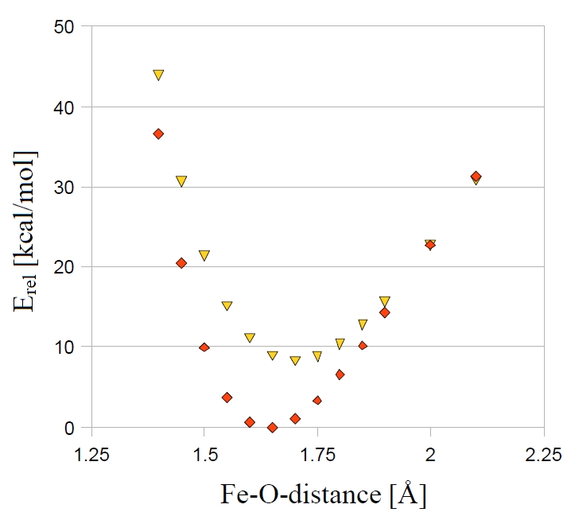

<a id="sec:structurereactivity.mecp"></a>
# Minimum Energy Crossing Points (MECP)

The MECP optimization allows the user to optimize to structures where
two different potential energy surfaces (PES1 and PES2) cross each
other. In this optimization two conditions apply: the energy $E_{1}$ of
PES1 is minimized while at the same time the energy difference
$\left({ E_{1} -E_{2} } \right)^{2}$ of both surfaces is minimized. For
the implementation we follow in principle the suggestions of Harvey et
al. in [harvey1998theor](../../bibliography.md).

For the minimization two different gradients are constructed:

The first gradient chosen for the minimization is

$$
f=\frac{\partial }{\partial q}\left({ E_{1} -E_{2} }
\right)^{2}=2\left({ E_{1} -E_{2} } \right)\cdot x_{1}\qquad \text{(eq199)}
$$

where $x_1$ is the gradient difference vector

$$
x_{1} =\left[{ \left({ \frac{\partial E_{1} }{\partial q} } \right)-\left({\frac{\partial E_{2} }{\partial q} } \right)} \right]\qquad \text{(eqn:209)}
$$

which is orthogonal to the crossing hyperline  near the MECP.

The gradient

$$
g=\left({ \frac{\partial E_{1} }{\partial q} }
\right)-\frac{x_{1} }{\left|{ x_{1} } \right|}\left[{ \left({ \frac{\partial
E_{1} }{\partial q} } \right)\cdot \frac{x_{1} }{\left|{ x_{1} } \right|} }
\right]\qquad \text{(eqn:210)}
$$

is orthogonal to $x_1$.

Both gradients are combined to yield the effective surface crossing
gradient

$$
g_{SC } =\, g+f\qquad \text{(eqn:211)}
$$

The crossing hyperline is defined as the $3N-7$ dimensional subspace of
PES1, which is orthogonal to $x_1$. In the MECP optimization we want to
find the point of lowest energy within this subspace.

Our calculation of normal modes and force constants for movements along
the crossing hyperline differ from the one proposed by Harvey et al. A
standard frequency analysis cannot be performed, but a similar
procedure is applied:

Let us regard the second-order Taylor expansion for the energy of both
surfaces near the MECP for a displacement along the crossing hyperline
(orthogonal to $x_1$):

$$
E_{A} =E_{\mathrm{MECP} } +\frac{1}{2}\Delta
q^{T}H_{\mathrm{eff},A} \Delta q\qquad \text{(eqn:212)}
$$

with:

|                    |                                           |
|:-------------------|:------------------------------------------|
| $E_{A}$   | Energy E$_{1}$ on PES1 or E$_{2}$ on PES2 |
| $H_{\mathrm{eff},A}$ | effective Hessian for PES1 or PES2        |
| $\Delta q$         | displacement along the crossing hyperline |

Diagonalization of this effective Hessian gives us the normal modes of
the crossing hyperline and thus allows us to decide whether the MECP
optimization converged to a minimum in the $3N-7$ dimensional subspace
of the crossing hyperline.

The procedure for the calculation of the effective Hessian is now as
follows: For each of both surfaces the second derivative matrix is
calculated. Then the 6 rotations and translations and additionally the
direction of the gradient difference vector $x_1$ (this ensures that
movement orthogonal to the crossing hyperline, for which we do NOT
satisfy the conditions of a stationary point, is excluded) are projected
out from the Hessian matrix.

As an example we show the MECP optimization of the
quartet and sextet state of [FeO]$^{+}$.

```mol
title: structure 1
theme: chem311
height: 320px
representation: ball-stick
--- xyz ---
2
structure (+1 6)
Fe     0.000000     0.000000     0.000000
O      0.000000     0.000000     1.670000
--- input ---
! B3LYP TZVP Opt SurfCrossOpt SlowConv

%mecp
   Mult 4
end

* xyz +1 6
Fe 0.000000     0.000000     0.000000
O  0.000000     0.000000     1.670000
*
```

!!! tip
    You can often use a minimum or TS structure of one of the two
    spin states as initial guess for your MECP-optimization. If this doesn't
    work, you might try a scan to get a better initial guess.

The results of the MECP optimization are given in the following output.
The distance where both surfaces cross is at 1.994 Å. In this simple
example there is only one degree of freedom and we can also locate the
MECP via a parameter scan. The results of the scan are given in [fig:14](#fig:14) for comparison.
Here we see that the crossing occurs at a Fe-O-distance of around 2 Å.

For systems with more than two atoms a scan is not sufficient any more
and you have to use the MECP optimization.

```orca
***********************HURRAY********************
***        THE OPTIMIZATION HAS CONVERGED     ***
*************************************************

-------------------------------------------------------------------
                   Redundant Internal Coordinates
                   --- Optimized Parameters ---
                   (Angstroem and degrees)
  Definition                   OldVal   dE/dq     Step     FinalVal
   -------------------------------------------------------------------
1. B(O   1,Fe  0)              1.9940 -0.000001  0.0000    1.9940
   -------------------------------------------------------------------

      *******************************************************
      *** FINAL ENERGY EVALUATION AT THE STATIONARY POINT ***
      ***               (AFTER    8 CYCLES)               ***
      *******************************************************

    -------------------------------------   ----------------
    Energy difference between both states       -0.000000004
    -------------------------------------   ----------------
```

<a id="fig:14"></a>


*Parameter scan for the quartet and sextet state of [FeO]$^+$
(B3LYP/SV(P)).*

A more realistic example with more than one degree of freedom is the
MECP optimization of a structure along the reaction path of the
CH$_{3}$O $\leftrightarrow$ CH$_{2}$OH isomerization.

```mol
title: structure 2
theme: chem311
height: 320px
representation: ball-stick
--- xyz ---
5
structure (1 3)
C      0.000000     0.000000     0.000000
H      0.000000     0.000000     1.300000
H      1.026719     0.000000    -0.363000
O     -0.879955     0.000000    -1.088889
H     -0.119662    -0.866667     0.961546
--- input ---
! B3LYP SV SurfCrossOpt SurfCrossNumFreq

%mecp 
   Mult 1
end

*xyz 1 3
 C     0.000000     0.000000     0.000000
 H     0.000000     0.000000     1.300000
 H     1.026719     0.000000    -0.363000
 O    -0.879955     0.000000    -1.088889
 H    -0.119662    -0.866667     0.961546
*
```

!!! note
    -   To verify that a stationary point in a MECP optimization is a
        minimum, you have to use an adapted frequency analysis, called by
        `SurfCrossNumFreq`.

<a id="sec:structurereactivity.mecp.keywords"></a>
## Keywords

For MECP optimizations the following options exist:

```orca
%mecp
   SurfCrossOpt true  # switches on the MECP optimization
                      #  alternatively use: ! SurfCrossOpt
   SurfCrossNumFreq true # switches on the MECP effective Hessian
                         #  calculation
                         #  alternatively use: ! SurfCrossNumFreq
 # separate MO input for the second spin state (PES2)
   moinp "Myfile.gbw"# MO input for PES2
 # information on the electronic structure of PES 2
   Mult 3            # multiplicity of PES2
   brokenSym 1,1     # broken symmetry for PES2
 # CASSCF options for PES2 (also see the CASSCF chapter)
   casscf_nel 6       # number of active space electrons
   casscf_norb 6      # number of active orbitals
   casscf_mult 1,3    # multiplicities singlet and triplet
   casscf_nroots 4,2  # four singlets, two triplets
   casscf_bweight 2,1 # singlets and triplets weighted 2:1
   casscf_weights[0] = 0.5,0.2,0.2,0.2 # singlet weights
   casscf_weights[1] = 0.7,0.3         # triplet weights
end
```
