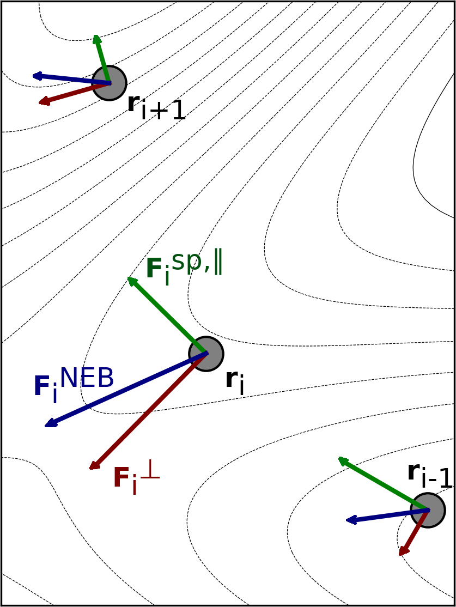
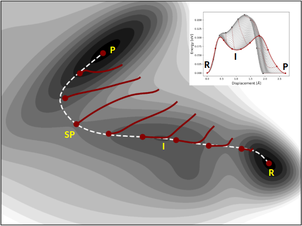
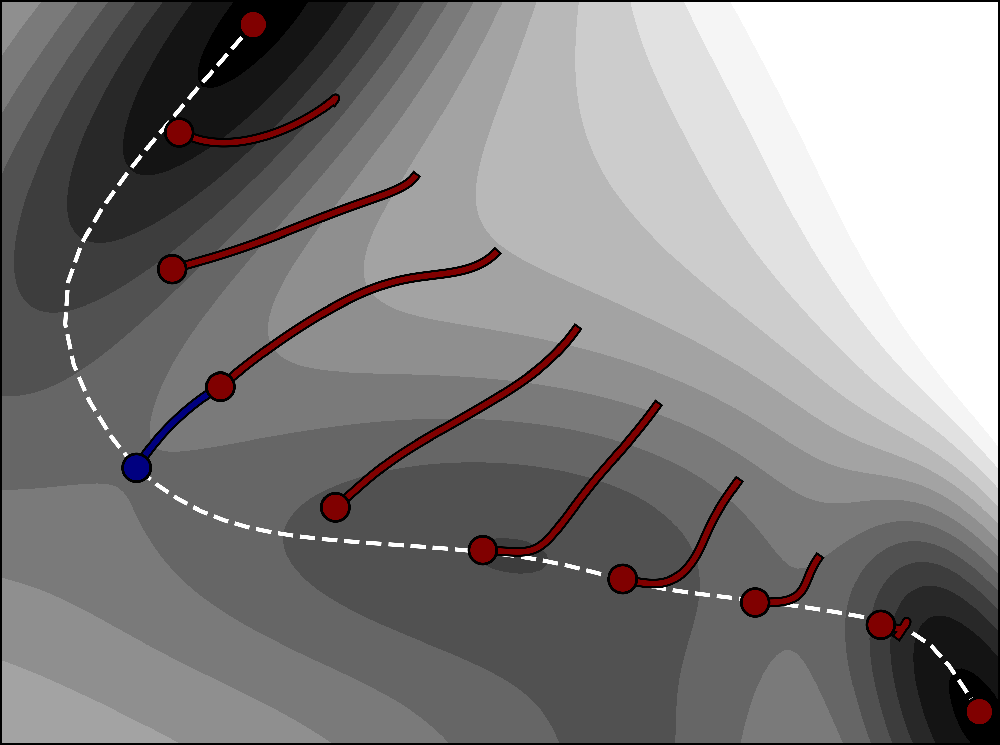

<a id="sec:structurereactivity.neb"></a>
# Nudged Elastic Band Method
## Theory

The Nudged Elastic Band (NEB)[Mills1995,Jonsson1998,Henkelman2000a](../../bibliography.md)
method is used to find a minimum energy path (MEP) connecting two local
energy minima on the potential energy surface (PES) and thereby an
estimate of the activation energy for the transition. The two minima are
referred to as the reactant and product in the following discussion. The
path can have one or more maxima, each one corresponding to a first
order saddle point on the energy surface. The NEB method offers an
advantage over eigenvector-following methods in that it is guaranteed to
find saddle points that connect the given reactant and product states.
The minimum energy path is often used to represent the reaction
coordinate of the transition between the two states. The methods and
implementation outlined below are discussed further in
Ref. [Asgeirsson2021](../../bibliography.md).

The user needs to specify the reactant and product configurations. The
reactant energy minimum is inserted into the regular ORCA input file
while the product should be in a separate .xyz file (keyword:
*neb_end_xyzfile*). The reactant and product configurations should be
optimized *a priori* by relaxing to energy minima on the PES, see
section
[optimization.geometry](optimizations.md#sec:structurereactivity.optimization.geometry). This can also be
achieved via the 'preopt_ends' keyword. It is important to carefully
prepare the reactant and product such that the position (or index) of
the atoms is the same in the two configuration files, i.e. there should
be one-to-one mapping between the reactant and product configurations.

The discretized path between the two minima is represented by a set of
$M$ system configurations that are referred to as images, i.e.
$R = [r_0, r_1, ..., r_{M-1}]$. The number of intermediate
images between the end points (i.e. reactant and product) is specified
by the user. The general rule of thumb is to include $M=7-12$, or $5-10$
intermediate images per energy maximum in order to obtain a high enough
resolution of the path and the saddle point. However, calculations can
often converge and give accurate results with fewer images but complex
paths with multiple maxima or long tails may require more images. During
an NEB calculation the intermediate images are iteratively shifted
towards the MEP using the component of the atomic force that is
perpendicular to the current path as estimated from the tangent to the
path at each image, while the endpoint images are typically kept
fixed. In each step of the iterative process, the energy and atomic
forces of each intermediate image need to be computed. One of the main
advantages of the NEB method is that the calculations of the images are
carried out in parallel, where the electronic structure computations can
be distributed over multiple processors (see discussion below for more
details on the parallelization). While the CPU time is proportional to
the number of images, the number of iterations needed for convergence to
the MEP can become smaller when more images are included in the discrete
representation of the path.

The tangent to the path at each image, $\hat{\tau}_i$, can be estimated
in two ways (keyword: *tangent*), either by the original method
[Jonsson1998](../../bibliography.md) or by the more numerically stable improved
[Henkelman2000a](../../bibliography.md) estimate (default option). In the former, the tangent
at an image is taken to be a linear combination of the two line segments
that connect to image $i$,

$$
\tau_i = \dfrac{r_{i+1}-r_{i} }{|r_{i+1}-r_{i}|} + \dfrac{r_{i}-r_{i-1} }{|r_{i}-r_{i-1}|}
$$

In the improved tangent estimate, the line segment from the current
image to the adjacent image with higher energy is used, i.e.

$$
\tau_i =
    \begin{cases}
      \tau^+ & \text{if E_{i+1} > E_i > E_{i-1}}\\
      \tau^- & \text{if E_{i+1} < E_i < E_{i-1}}\\
    \end{cases}
$$

where $\tau^+ = r_{i+1}-r_i$ and $\tau^- = r_{i}-r_{i-1}$. With the
exception of image $i$ being at an energy extremum along the path, then
an energy-weighted average of the two line segments to adjacent images
is used,

$$
\tau_i =
    \begin{cases}
      \tau^+\Delta V^\text{max}_i + \tau^- \Delta V^\text{min}_i & \text{if E_{i+1} > E_{i-1}}\\
      \tau^+\Delta V^\text{min}_i + \tau^- \Delta V^\text{max}_i & \text{if E_{i+1} < E_{i-1}}\\
    \end{cases}
$$

where

$$
\begin{aligned}
\Delta V^\text{max}_i = \max(|E_{i+1}-E_{i}|, |E_{i-1}-E_i|)\\
\Delta V^\text{max}_i = \min(|E_{i+1}-E_{i}|, |E_{i-1}-E_i|)\end{aligned}
$$

Then the tangent is normalized, $\hat{\tau}_i = \tau_i/|\tau_i|$. With
an accurate estimate of the tangent, the perpendicular component of the
atom force is computed by,

$$
F_i^\perp = F_i - \left(F_i\cdot \hat{\tau}_i\right)\hat{\tau}_i
$$

In the free-end NEB method, the endpoint images are optimized
simultaneously along with the intermediate images, i.e. $M$ movable
images are used. Three different variants of the free-end NEB method
(keywords:*free_end*, *free_end_type*) are included in ORCA: where (i)
the endpoints are restrained to move along the same (or separate) energy
isocontour[Zhu2007,Asgeirsson2018](../../bibliography.md), (ii) according to the atomic
force acting perpendicular to the path and (iii) the full atomic force.
For the first variant, the 'reactant' and 'product' endpont images, can
be restrained to move along two different energy contours, $E_0$ (given
by keyword:*free_end_ec*) and $E_1$ (given by keyword:
*free_end_ec_end*), to keep the path bounded. Then, if the images drift
away from the isocontour because of curvature of the energy surface, an
harmonic restraint term is used to pull the image back to the
contour.[Asgeirsson2018](../../bibliography.md) The stiffness of the harmonic restraint is
given by a user-supplied parameter (keyword:*free_end_kappa*). It is
important to carefully select the energy values and the strength of the
harmonic restraint, otherwise the path may become kinked. For the second
variant, the endpoint images are unbounded but displaced directly
towards the MEP. This is typically acceptable if the endpoint images are
already in vicinity to the MEP and is less prone to kinks developing
along the path. For the third variant, the endpoint images become
optimized to the reactant and product energy minimum.
## Spring Forces
In order to control the distribution of the images along the path,
spring forces are included to act between adjacent images, tangential to
the path[Jonsson1998](../../bibliography.md),

$$
F^{\text{sp},\parallel}_i = \left(k_{i}^\text{sp}|r_{i+1}-r_{i}|-k_{i-1}^\text{sp}|r_i - r_{i-1}|\right)\hat{\tau}_i
$$

The magnitude of the spring forces (i.e. stiffness) is controlled by
spring constants, $k^\text{sp}$. The typical values of the spring
constant (keyword: *springconst*) can be taken to be within the range of
0.01 Eh/Bohr$^2$ to 1.0 Eh/Bohr$^2$. If the spring constants are choosen
to be the same for all pairs of adjacent images, the images will be
equally distributed along the path. However, it is also possible to
choose energy-weighted spring constants (keyword: *energy_weighted*) so
as to increase the density of images in the higher energy
regions[Henkelman2000b,Asgeirsson2021](../../bibliography.md). In an energy-weighted NEB
calculation the spring constants are scaled according to the relative
energy of the images, from a lower-bound value (keyword:*springconst*)
to an upper-bound value (keyword:*springconst2*), by

$$
\begin{aligned}
k^{\text{sp} }_i &=\left\{  \begin{array}{@{}ll@{} }
    (1-\alpha_i)k_{\text{u} } + \alpha_i k_\text{l}, & \text{if} E_i > E_\text{ref} \\
    k_l, & \text{otherwise}
  \end{array}\right.\\
  \alpha_i &= \frac{E_\text{max} - E_i}{E_{\text{max} }-E_\text{ref} }\end{aligned}
$$

where $k_{\text{u} }$ and $k_{\text{l} }$ are the upper- and lower-bound
values for the spring constant. $E_\text{max}$ is the current estimate
of the maximum energy along the path, $E_i$ is the higher energy image
of the pair of images connected by line segment $i$ and $E_\text{ref}$
is the energy of the higher energy minimum. The energy-weighted springs
will typically serve to improve the tangent estimate in the barrier
region and hence stabilize the calculations. The inclusion of
energy-weighted springs can be important in reactions where the energy
barrier is narrow and/or the pathway is characterized by a long 'energy
tail', e.g., in rearrangements or dissociation reactions. The choice of
spring constants will affect the behavior of a calculation, especially
the number of iterations needed to reach convergence. Other formulations
for spring forces are also available since ORCA 4.2 (keyword:
*springtype*). These are referred to as the original[Jonsson1998](../../bibliography.md) and
ideal[Maras2016](../../bibliography.md) spring forces. The original spring forces are
estimated by a spring acting on each degree of freedom between a pair of
adjacent images. For ideal springs each image is assigned an ideal
position along the path based on a linear interpolation of the current
location of the images and the individual images interact with the ideal
locations via spring forces. The ideal springs are currently not
implemented to work with energy weighted spring constants.
While only the component of the spring force parallel to the path is
included in an NEB calculation (by default) the user can choose to
include a fraction of the spring force acting perpendicular to the path
to stabilize calculations (keyword: *perpspring*. Since, the
perpendicular component of the spring force can serve to straighten out
the path and is useful for complex pathways with multiple energy extrema
and low resolution of the path. The inclusion of the perpendicular
component of the spring force is always accompanied by a switching
function that is used to scale it according to (i) convergence to the
MEP (the 'tan' function)[Sheppard08](../../bibliography.md) (ii) the angle between adjacent
images (the 'cos' function)[Jonsson1998](../../bibliography.md) or a combination of both. The
inclusion of the perpendicular spring force can help to reduce the
number of iterations and eliminate kinks on the path. However, it is
important to stress that by inclusion of the perpendicular spring
forces, the images may not converge on the MEP. Alternatively, the user
can choose to use the modified DNEB method[DNEB2005,Sheppard08](../../bibliography.md).
## Optimization and Convergence of the NEB Method
The effective force used in a standard NEB calculations is the sum of
the atomic force component perpendicular to the path and the spring
force component parallel to the path,

$$
F^\text{NEB}_i = F^\perp_i  + F^{\text{sp},\parallel}_i
$$

The path can be brought to the MEP by moving according to the effective
force, as is shown in [fig:neb-forces](#fig:neb-forces).
<a id="fig:neb-forces"></a>

*Visualization of the effective force, $F^\text{NEB}$ and its two components: $F^\perp_i$ and $F^{\text{sp},\parallel}_i$ for three images along an intermediate path in a NEB optimization. The figure is taken from Ref. [Asgeirsson2021b](../../bibliography.md)*
This can be achieved by using any of the three optimization methods
implemented (keyword:*opt_method*): velocity projection optimization
(VPO)[Jonsson1998](../../bibliography.md), fast inertial relxation engine (FIRE)[Bitzek2006](../../bibliography.md)
and L-BFGS[LBFGS](../../bibliography.md). VPO and FIRE are more robust for regions that are
far from the MEP, while L-BFGS converges faster when the images are
close to the MEP. FIRE and VPO both have a local and global
implementation (keyword:*local*). In the local variant, all of the
images are treated individually when taking an optimization step, while
in the latter the whole band is treated as a single point. A constant
'trust-radius' is used for all optimization methods, where if the
magnitude of the maximum Cartesian component of an optimization step
exceeds a user-supplied threshold (keyword:*maxmove*), the whole
displacement is scaled down accordingly. The number of steps stored in
the L-BFGS optimization for the construction of the approximate Hessian
matrix can be adjusted by the user (keyword:*lbfgs_memory*). For a more
conservative optimization with L-BFGS, the memory can also be erased if
a large step is attempted (keyword:*lbfgs_restart_on_maxmove*).
The convergence of the intermediate images is gauged from the maximum
Cartesian component of the perpendicular atom force as well as the
root-mean-square, i.e.
$\max(|F^\perp|), \text{RMS}(F^\perp)$. The atomic
force on the images perpendicular to the path vanishes as the images are
located on the MEP. A typical value of the tolerance for the maximum
component of the atomic force perpendicular to the path is
$1\cdot10^{-3}$ Eh/Bohr. Typically the tolerance for the
root-mean-square value is chosen to be smaller by a factor of 1/2 or
1/3. Sometimes a tighter tolerance for the maximum component of the
force is needed, for example $5\cdot 10^{-4}$ Eh/Bohr or even
$2 \cdot 10^{-4}$ Eh/Bohr. The maximum number of optimization steps
allowed is set by the keyword 'maxiter'.
The configuration of each image after each iteration is written to a
'\_trj.xyz' file (see file: basename_MEP$\_$ALL_trj.xyz). This file is
useful for troubleshooting non-convergent calculations.
## Climbing Image NEB (CI-NEB)
In order make the highest energy image converge more accurately to the
(highest) energy maximum along the MEP, the climbing image variant of
the NEB method (CI-NEB) can be used. [Henkelman2000b](../../bibliography.md) In the CI-NEB
method, the effective force $F^\text{NEB}$ acting on the climbing image
(i.e. $i=\text{ci}$) is transformed to:

$$
F_\text{ci}^\text{NEB} = F_\text{ci} - 2\left(F_\text{ci}\cdot \hat{\tau}_\text{ci}\right)\hat{\tau}_\text{ci}
$$

where the climbing image is pushed up-hill along the path and relaxed
down-hill perpendicular to the path. That is, the energy is maximized
with respect to one degree of freedom corresponding to the direction of
the tangent while the energy is minimized with respect to all other
degrees of freedom. The effective force on the climbing image does not
include any spring force and the density of images then becomes
different on either side of the climbing image. As long as the tangent
estimate is accurate enough the climbing image will converge rigorously
to the point of highest energy along the path. An illustration of how
the climbing image NEB method works is shown in [fig:cineb-mb](#fig:cineb-mb) 
for a simple two-dimensional energy function.
<a id="fig:cineb-mb"></a>

*Illustration of how the CI-NEB method works on a two-dimensional
Müller-Brown energy surface, $E(x,y)$.[Muller1979](../../bibliography.md) The 
calculation is started from a linear interpolation between the 
reactant (**R**) and product (**P**) energy minima, using $M=10$. 
The images are displaced in the orthogonal direction to the path 
(red curves), until they converge to the minimum energy path 
(white dashed curve). The climbing image accurately locates the 
higher energy first-order saddle point along the path (denoted by 
**SP**). The optimization profile is shown as an inset. In such a 
plot the interpolated energy along the path is plotted as a function 
of displacement, for each (or selected) optimization step. 
The figure is taken from Ref. [Asgeirsson2021b](../../bibliography.md)*
It can be useful to start the climbing image after the magnitude of the
atomic forces perpendicular to the path drops below a given user
supplied threshold (keyword: *tol$\_$turn$\_$on$\_$ci*). Then, the
highest energy image along the current path is converted to a climbing
image. It is usually most efficient to initiate the climbing image early
on or even from the start of the NEB calculation. This applies when
using the VPO optimization method. For L-BFGS it is recommended to start
CI-NEB when the path has partially converged to the MEP, e.g., around
0.01-0.02 Eh/Bohr. If there are two or more maxima in the energy along
the MEP it is possible that the image near the highest maximum is not
chosen as the climbing image at an early stage of the NEB calculation.
Then, later on the choice of the climbing image can be switched
automatically. Also, for barrierless reactions, the climbing image is
not turned on. The atom coordinates of the climbing image (in a CI-NEB
calculation) or the highest energy image (in an NEB calculation) are
written to files '\_NEB-CI$\_$converged.xyz' and
'\_NEB-HEI$\_$converged.xyz', respectively, when a calculation has
successfully completed.
The convergence of a CI-NEB calculation can either be gauged by
monitoring the forces on all images or only on the climbing image,
(keyword: *convtype*). The latter option may be used when the objective
of the calculation is to locate the highest energy saddle point
connecting the reactant and product states and can save significant
computational effort. To gauge for convergence on the climbing image,
both the root-mean-square and magnitude of the maximum (Cartesian)
component of the atom force are monitored, i.e.
$\max(|F_\text{ci}|), \text{RMS}(F_\text{ci})$. When
gauging the convergence of all images in a CI-NEB calculation it is
typically acceptable to converge the regular images more loosely than
the climbing image. By default, the tolerance for the regular images is
a factor of 10 larger than that of the climbing image. This scaling of
the tolerances is a parameter that can be set by the user (keyword:
*tol_scale*). Typically for an acceptable convergence to the saddle
point, the tolerance threshold for the maximum magnitude of an atomic
force component of the climbing image can be set to $5\cdot 10^{-4}$
Eh/Bohr.
## Generation of the Initial Path
One of the most important aspects of any NEB or CI-NEB calculation is
the generation of the initial path between the reactant and product
energy minima (keyword: *interpolation*). The recommended method is the
image-dependent pair potential (IDPP) method [IDPP2014](../../bibliography.md). An alternative
and simpler method is linear interpolation in Cartesian coordinates. In
either case, the user should always inspect the initial path (see file:
basename$\_$initial$\_$path_trj.xyz) to make certain that it is
acceptable.
By default, the endpoint structures are scanned for covalently linked
fragments. If two fragments are detected in either of the endpoint
structures, the structure is automatically prepared such that the
distance between the fragments is no larger than a maximum distance
defaulted to 3.5 Angstrom.
The linear interpolation in Cartesian coordinates may result in overlap
of atoms leading to large, initial, atomic forces and even divergence in
the SCF cycles. The IDPP method solves these problems by interpolating
pairwise distances between neighboring atoms in the reactant and product
energy minimum. Then, a path is generated to match those distances as
closely as possible. Since there are many more pairwise distances than
atom coordinates, the initial path is found by minimizing the objective
function,

$$
S_\kappa^{\text{IDPP} }( r_i) = \sum_A^M \sum^M_{B > A} w(d_{AB}) \left(d_{AB}^\kappa - d_{AB}\right)^2\qquad \text{(eq:idpp)}
$$

where $d_{AB}$ is the pairwise distance between atoms $A$ and $B$ for
intermediate image $i$. $d^\kappa_{AB}$ is the ideal interpolated
distance between atoms $A$ and $B$ of the same image. $w$ is a
weight function to give shorter bond distances more weight and make
unnecessary bond-breaking unfavorable. The weight function is given as
$w = (d_{\text{AB} })^{-4}$. The IDPP path avoids the overlap of atoms
and can also generate a path that is closer to the MEP than the linear
interpolation in Cartesian coordinates[IDPP2014](../../bibliography.md). The IDPP path is
obtained from an NEB calculation using the IDPP objective function starting
from a linear interpolation of the Cartesian coordinates between the endpoint structures, but
this calculation requires little computational effort since it does not
require any electronic structure computations. Note that it is possible
that the initial path breaks covalent bonds and that it can be far from the
optimal MEP. If this is the case, the default algorithm detects it and
automatically regenerates a different IDPP initial path. This is repeated
until either an initial path without unnecessary bond changes is obtained
or all initial path option are exhausted, at which point the best initial
path is identified. In any case, the user should
always inspect the initial path before
starting an NEB calculation. The user can adjust the settings of the
IDPP calculations using the 'idpp' related keywords, but the default
values should suffice for most applications. Note that the units of the
IDPP are in Ångströms instead of atomic units.
The matrix of ideal interpolated distance between the atoms $A$ and $B$ at image $i$,
$d_{AB,\ i}^\kappa\,$, is most simply obtained by linear interpolation as

$$
d_{AB,\ i}^\kappa = d_{AB}^{initial} + P_{i} * \left(d_{AB}^{final} - d_{AB}^{initial}\right)\,,
$$

where $P_{i} = \frac{i}{n_{im} - 1}$ is the position of image $i$ on the path
between 0, corresponding to the initial image, and 1, corresponding to the
final image, and $n_{im}$ is the total number of images.

As this linear distance interpolation may not be ideal, one can alternatively
choose a bilinear distance interpolation scheme that takes atomic bonds into
account. Bonds between the atoms $A$ and $B$ in the initial and final images are
identified if their distance
$d_{AB} < t_{bond} = t_{c}\left(R_{A}^{cov} + R_{B}^{cov}\right)\,,$
where $t_{c}$ is an input factor impacting at what distances a bond
is detected by default taken to be 1.3, and $R_{X}^{cov}$ is the
covalent radius of atom $X$. If a bond is detected in one of the endpoint
structures but not the other, two linear distance interpolations are performed
to obtain $d_{AB, i}^{\kappa}$. The first interpolates the distance between
the endpoint structure in which the atoms are bonded and $t_{bond}$,
the second interpolates the distance between $t_{bond}$ and the
endpoint structure in which the bond is broken. The two linear distance
interpolations are joined at the path position $P_{join}$ defaulted to 0.5,
corresponding to the midpoint on the path between the endpoint images. If
the atoms are bonded in the initial structure but not in the final structure,
the interpolation is

$$
d_{AB,\ i}^{\kappa} = \begin{cases} d_{AB}^{initial} 
+ \frac{P_{i}\left(t_{bond} - d_{AB}^{initial}\right)}{P_{join}}\,,\ \hspace{11pt}\text{if}\ P_{i} < P_{join}\\
d_{AB}^{final} - \frac{(1 - P_{i})\left(d_{AB}^{final} - t_{bond}\right)}{\left(1.0 - P_{join}\right)}\,,\ \text{if}\ P_{i} \geq P_{join}\,.\end{cases}
$$

If the atoms are bonded in the final structure but not in the initial structure,
the interpolation is

$$
d_{AB,\ i}^{\kappa} = \begin{cases} d_{AB}^{initial} 
- \frac{P_{i}\left(d_{AB}^{initial} - t_{bond}\right)}{1 - P_{join}}\,,\ \hspace{11pt}\text{if}\ P_{i} < 1 - P_{join}\\
d_{AB}^{final} + \frac{(1 - P_{i})\left(t_{bond} - d_{AB}^{final}\right)}{P_{join}}\,,\ \text{if}\ P_{i} \geq 1 - P_{join}\,.\end{cases}
$$

This bilinear interpolation leads to a slower increase of the atom distance
in the bonded region compared to the non-bonded region in most cases, emphasizing the
bond-breaking process and thus the region where the energy is changed most
by a change in the bond distance. If the change in the bond distance in
the non-bonded region is slower than the change in the bonded region, the
implementation falls back to the regular linear distance interpolation.

In challenging cases, even the IDPP NEB calculation starting from a linear
interpolation of the Cartesian coordinates between the endpoint structures
may not provide a reasonable initial path. This may happen when the linear
interpolation path has atoms come very close to each other in intermediate
images, which leads to bond breaking even after NEB optimization using the
IDPP objective function. In such cases, a reasonable initial path can often
be obtained by avoiding the linear interpolation by sequentially adding images
to the path starting from both endpoint structures instead. This method is
referred to as sequential IDPP (S-IDPP).[Schmerwitz2024a](../../bibliography.md) The two sets of
images close to each endpoint structure are separated by a larger distance
than the images in each set by choosing a smaller spring constant than
between the images in each set where equal spring constants are used. The
images closest to the center are converged in an NEB calculation and an image
added at an appropriate distance from the converged image between the two
images closest to the center. This process is repeated until the requested
amount of images has been added. The tangent of the images closest to the
center follows the improved tangent definition and always treats them as
extrema on the path, i.e. an average of the normalized distance vectors to
the adjacent images is used. The number of images used to form the S-IDPP
initial path can be different from the number of images used in the
subsequent NEB calculation involving electronic structure calculations.
It can be beneficial to use an even number of images in the S-IDPP computation
since no image is placed at the center of the initial path then and moving
to the requested odd number of images in an additional IDPP NEB calculation
afterwards. This option is used by default, but can be deactivated. For
systems involving very heavy rotations of large groups, the method becomes
more robust when twice the amount of images is used in the S-IDPP calculation.
Half the images are then removed automatically for the subsequent NEB
calculation involving electronic structure calculations. This option is
available, but not used by default.

The initial path generated with the chosen settings is checked for
unnecessary bond breaking or bond formation. Bonds between the atoms $A$
and $B$  are
identified if their distance
$d_{AB} < t_{bond} = t_{c}\left(R_{A}^{cov} + R_{B}^{cov}\right)\,,$
where $t_{c}$ is an input factor impacting at what distances a bond
is detected by default taken to be 1.3, and $R_{X}^{cov}$ is the
covalent radius of atom $X$. A change in the connectivity of atoms $A$ and $B$ is considered
unnecessary if their connectivity does not change between the endpoint structures. If it does changebe
tween the endpoint structures, the connectivity is allowed to change exactly once, but any further
connectivity changes along the initial path are considered unnecessary. If any unnecessary
connectivity changes occur on the initial path, the flexibility of S-IDPP is used to generate more
initial paths with different
settings systematically, until one without unnecessary connectivity changes is obtained. The
parameter space for this hyperparameter search consists of all combinations of the settings
*SIDPP_Reparam*, *SIDPP_Energy_Weighted_Tangent*, *SIDPP_Even_NIm, SIDPP_Double_NIm*,
*SIDPP_Ideal_Springconst*, and four values (0.05, 0.01, 0.005, and 0.001) for *SIDPP_Tol_MaxF*,
leading to a total of 128 options in addition to the chosen settings. Once an initial path without
unnecessary connectivity changes is found, the hyperparameter search is terminated. In the unlikely
scenario that none of the generated initial paths show no unnecessary connectivity changes, the
initial path with the fewest is taken by default, but the user may prefer to have the calculation
abort to inspect the initial path, which may be set with the keyword
*SIDPP_HyperSearch_StrictConnectivity*.

!!! note
    In certain cases, for instance rotations of large sterically limited groups in a molecule, the
    reaction may only be possible by breaking and reforming a bond along the MEP. You may not always be
    looking for an initial path completely free of unnecessary connectivity changes!

The user may have a preconceived notion of the saddle point
configuration or have an estimate of the path from a calculation carried
out at a lower level of theory. The initial path can be generated in
such a way as to include an intermediate configuration as one of the
images using the 'NEB_TS_XYZFile' keyword. Since this image will be
optimized along with the other intermediate images during the NEB
calculation the guess does not have to be accurate.

If inspection of the initial path reveals problems, e.g., unnecessary
bond breaking, it is often a good idea to insert a reasonable
configuration into the initial interpolation to avoid such problems.
Moreover, if an NEB calculation is unable to converge to the MEP (or
saddle point) with the given maximum number of iterations, the user can
restart the calculation from the 'allxyz' file (see file:
basename_MEP.allxyz) which is written to the disk after each iteration
during the optimization. Note, when starting an NEB calculation from an
output from a previous CI-NEB calculation and vice-versa the band may
require a few iterations to adjust the distribution of images to achieve
the desired distribution, depending on the selected spring type and the
choice of NEB method.

If the system can be modeled reasonably well using the GFN-xTB method,
another possible choice is the generation of an initial path on XTB
level (keywords 'XTB0', 'XTB1' or 'XTB2' for GFN0-xTB[pracht2019xtb](../../bibliography.md) GFN-xTB[grimme2017xtb](../../bibliography.md) or
GFN2-xTB[grimme2019xtb](../../bibliography.md)). In this case the initial path on IDPP level
is refined using an NEB calculation on the chosen XTB level. If this NEB
run is successful, the entire MEP on XTB level is used as the initial
path. If the NEB run on XTB level is not successful, the initial path on
IDPP level is used instead.

Another keyword that makes use of the XTB method is the 'XTBTS' keyword
('XTB0TS', 'XTB1TS' or 'XTB2TS'). In this case the initial path on IDPP level is
refined using an NEB-CI calculation on XTB level. If the NEB-CI run is
successful, the resulting CI structure is chosen as TS guess structure,
and the final initial path is generated using an IDPP path from reactant
to TS guess and from TS guess to product. If the NEB-CI run on XTB level
is not successful, the initial path on IDPP level is used instead.

## Removal of Translational and Rotational Degrees of Freedom

For NEB and CI-NEB calculations of molecular systems it is important to
project out the six (or five in the case of linear molecules) degrees of
freedom corresponding to the global rotation and translation of the
system. This can be done either at the start of a calculation or for
each optimization step (keyword: *quatern*). For the latter, the
center-of-geometry of each image is translated to origin and a
rotational matrix is constructed using the quaternion
approach[marko2016](../../bibliography.md) to minimize the root-mean-square deviation between
any two adjacent images. Depending on whether a fixed center is used
(keyword: *fix_center*), the images are either kept in that place or
transferred back to their original position. This procedure is repeated
for any pair of adjacent images in each step of the optimization. Also,
the net effective NEB force is set to zero (keyword:
*remove_extern_force*).[removetranslation1998](../../bibliography.md)

<a id="sec:structurereactivity.optimization.neb"></a>
## Optimizations using the Nudged Elastic Band Method 

So to recap - the Nudged Elastic Band (NEB) method is used to find a minimum energy
path (MEP) connecting given reactant and product state minima on the
energy surface. An initial path is generated and represented by a
discrete set of configurations of the atoms, referred to as images of
the system. The number of images is specified by the user and has to be
large enough to obtain sufficient resolution of the path. The
implementation in ORCA is described in detail in the article by
Ásgeirsson et. al.[Asgeirsson2021](../../bibliography.md) and in section
[structurereactivity.neb](#sec:structurereactivity.neb) along with the input options. The most
common use of the NEB method is to find the highest energy saddle point
on the potential energy surface specifying the transition state for a
given initial and final state. Rigorous convergence to a first-order
saddle point can be obtained with the climbing image NEB (CI-NEB), where
the highest energy image is pushed uphill in energy along the tangent to
the path while relaxing downhill in orthogonal directions. Another
method for finding a first-order saddle point is the NEB-TS which uses
the CI-NEB method with a loose tolerance to begin with and then switches
over to the OptTS method to converge on the saddle point. This
combination can be a good choice for calculations of complex reactions
where the ScanTS method fails or where 2D relaxed surface scans are
necessary to find a good initial guess structure for the OptTS method.
The zoomNEB variants are a good choice in case of very complex
transition states with long tails. For more detailed information on
the various NEB variants implemented in ORCA please consult
section [structurereactivity.neb](#sec:structurereactivity.neb).

In their simplest form NEB, NEB-CI and NEB-TS only require the reactant
and product state configurations (one via the xyz block, and the other
one via the keyword neb_end_xyzfile):

```orca
!NEB-TS # or !NEB or !NEB-CI or !ZOOM-NEB-TS or !ZOOM-NEB-CI
        # or !Fast-NEB-TS  (corresponds to IDPP-TS defined
	# in the NEB-TS manuscript)
        # or !Loose-NEB-TS (corresponds to default NEB-TS
	# in the NEB-TS manuscript)
%neb
 neb_end_xyzfile "final.xyz"
end
```

Below is an example of an NEB-TS run involving an intramolecular proton
transfer within acetic acid. The simplest input is

```mol
title: structure 1
theme: chem311
height: 320px
representation: ball-stick
--- xyz ---
8
structure (0 1)
C      0.416168     0.038758    -0.014077
C      0.041816     0.011798     1.439610
O      1.524458     0.176600    -0.453888
O     -0.654209    -0.127881    -0.803857
H     -0.391037    -0.126036    -1.737478
H     -0.913438     0.507022     1.585301
H     -0.057787    -1.026455     1.750845
H      0.819515     0.485425     2.030252
--- input ---
!XTB NEB-TS
%neb
 neb_end_xyzfile "final.xyz"
end

*xyz 0 1
C      0.416168     0.038758    -0.014077
C      0.041816     0.011798     1.439610
O      1.524458     0.176600    -0.453888
O     -0.654209    -0.127881    -0.803857
H     -0.391037    -0.126036    -1.737478
H     -0.913438     0.507022     1.585301
H     -0.057787    -1.026455     1.750845
H      0.819515     0.485425     2.030252
*
```

Where the final.xyz structure contains the corresponding structure with
the proton on the other oxygen.

The initial path is reasonable and the CI calculation can be switched on
after five NEB iterations.

```
Starting iterations:

Optim.  Iteration  HEI  E(HEI)-E(0)  max(|Fp|)   RMS(Fp)    dS
Switch-on CI threshold               0.020000
   LBFGS     0      4    0.081017    0.073897   0.018915  3.2882
   LBFGS     1      5    0.070244    0.056668   0.013913  3.2770
   LBFGS     2      5    0.062934    0.038972   0.008763  3.3376
   LBFGS     3      5    0.057358    0.032076   0.006535  3.3950
   LBFGS     4      4    0.053260    0.019015   0.003599  3.4826

Image 4 will be converted to a climbing image in the next iteration (max(|Fp|)<0.0200)

Optim.  Iteration  CI   E(CI)-E(0) max(|Fp|)   RMS(Fp)    dS     max(|FCI|)   RMS(FCI)
Convergence thresholds             0.020000   0.010000            0.002000    0.001000
```

The CI run converges after another couple of iterations:

```
*********************H U R R A Y*********************
***        THE NEB OPTIMIZATION HAS CONVERGED     ***
*****************************************************
```

Subsequently a summary of the MEP is printed:

```
---------------------------------------------------------------
                         PATH SUMMARY              
---------------------------------------------------------------
All forces in Eh/Bohr.

Image Dist.(Ang.)    E(Eh)   dE(kcal/mol)  max(|Fp|)  RMS(Fp)
  0     0.000     -14.45993      0.00       0.00011   0.00004
  1     0.426     -14.44891      6.91       0.00092   0.00033
  2     0.652     -14.42864     19.63       0.00084   0.00038
  3     0.805     -14.41132     30.50       0.00075   0.00027
  4     0.932     -14.40562     34.08       0.00057   0.00018 <= CI
  5     1.044     -14.41047     31.03       0.00057   0.00024
  6     1.153     -14.42200     23.80       0.00103   0.00034
  7     1.280     -14.43666     14.60       0.00098   0.00037
  8     1.476     -14.45106      5.56       0.00106   0.00033
  9     1.869     -14.45988      0.03       0.00013   0.00006
```

Additionally, detailed information on the highest energy image (or the
CI) is printed:

```mol
title: structure 2
theme: chem311
height: 320px
representation: ball-stick
--- xyz ---
10
structure
C      0.040867     0.007347    -0.497635
C     -0.075595     0.017879     0.979075
O      1.122340     0.126074    -1.145534
O     -0.928470    -0.137946    -1.298318
H      0.165808    -0.021676    -2.055704
H     -0.996979     0.514720     1.271668
H     -0.116377    -1.013504     1.327873
H      0.788406     0.507105     1.418575
C     -0.000646    -0.000111     0.000086
C     -0.246569    -0.031821    -0.019359
```

Finally, a TS optimization is started, after which the MEP information
is updated by including the TS structure:

```
---------------------------------------------------------------
                      PATH SUMMARY FOR NEB-TS             
---------------------------------------------------------------
All forces in Eh/Bohr. Global forces for TS.

Image     E(Eh)   dE(kcal/mol)  max(|Fp|)  RMS(Fp)
  0     -14.45993     0.00       0.00011   0.00004
  1     -14.44891     6.91       0.00092   0.00033
  2     -14.42864    19.63       0.00084   0.00038
  3     -14.41132    30.50       0.00075   0.00027
  4     -14.40562    34.08       0.00057   0.00018 <= CI
 TS     -14.40562    34.08       0.00033   0.00013 <= TS
  5     -14.41047    31.03       0.00057   0.00024
  6     -14.42200    23.80       0.00103   0.00034
  7     -14.43666    14.60       0.00098   0.00037
  8     -14.45106     5.56       0.00106   0.00033
  9     -14.45988     0.03       0.00013   0.00006
```

Note that here both TS and CI are printed for comparison.

## Reparametrization of the Path

In some cases it may be beneficial to enable redistribution of the
images along the path every $N$ iterations (i.e. analogous to the string
method[E2002](../../bibliography.md)) (keyword: *reparam*). The path is then interpolated
using either a linear or cubic polynomial fitted to both the coordinates
and the tangent to the path, and the images are redistributed evenly
along the interpolated path. Both $N$ and the type of interpolation are
specified by the user (keyword: *reparam_type*). The cubic interpolation
method should be better in calculations where the resolution of the path
and hence the estimate of the tangent is good, while the linear
interpolation is generally more robust as it is not as dependent on
the tangent.

## Useful Output

After each iteration, the energy profile along the path is obtained by
making a piecewise cubic polynomial interpolation using both the energy
and the component of the atom force tangentinal to the
path[Henkelman2000a](../../bibliography.md). The interpolation can reveal important
information about the MEP in locations between the intermediate images.
The interpolation is written to the file 'interp' (see file:
basename.interp) in each step of the optimization. Moreover, as NEB and
CI-NEB calculations can be quite computationally demanding and in order
to properly analyze what may have gone wrong in such a calculation, the
user can inspect the '.log' file, which includes information about the
type of calculation, energy, length of the path, spring forces, atomic
forces etc.

## Important Warning Messages

Some tests are carried out during the optimization in order to detect
problems on the fly. The angle between the two straight lines going
through an image and its neighbors on each side is calculated. If the
angle becomes large e.g. exceeding 90$^\circ$ the estimate of the
tangent has likely become inaccurate and a better resolution of the path
is required. If the angle is close to 180$^\circ$ the ordering of the
images may have become incorrect. Especially in the latter case, it may
be a good choice of action to terminate the calculation and include a
larger number of intermediate images in the subsequent calculation. Some
information from the calculation, e.g, a guess for the saddle point,
could be incorporated in the new calculation.

Another issue is the identification of an intermediate minimum along the
path. If an intermediate minimum is observed in $M$ subsequent
iterations ($M$ is supplied by the user) a warning is issued to the user
that a possible intermediate minimum may exist along the path. It is a
good idea to check the status of the calculation, the path and the
convergence behaviour. If the calculation appears to be proceeding
normally and heading for convergence, the best course of action is to
allow the calculation to finish. However, it is in general better to
carry out separate NEB calculations for segments of the MEP on either
side of the intermediate minimum. Especially, if the intermediate
minimum is deep w.r.t to the reactant and product state energy minima.

In such cases, the image closest to the apparent intermediate minimum is
selected and a structural minimization is carried out. The resulting
configuration is then used as the initial state or final state in the
subsequent CI-NEB calculations.

## Parallel Execution

If the number of processes (NProcs) specified in the input is larger
than 1, NEB will automatically start up in multi-process mode:

NProcs \<= NImages

:   NProcs processes will handle NProcs images independently with 1
    process per image. Choose NProcs = X\*NImages (e.g. X = 1 or 0.5)

NProcs \> NImages

:   NProcs processes will handle NImage images, each image being treated
    by (NProcs/ NImages) processes. If you want to dedicate more than 1
    process to each single image-calculation, choose NProcs = X\*NImages
    (e.g. X = 2, 3, 4, \...).

Note: If in the second case multiple compute-nodes are involved, the
user will need to define the ORCA-specific environment variable
RSH_COMMAND, which tells the NEB driver how to connect to the individual
nodes (set it to either 'rsh' or 'ssh'). However, this may not work with
all queueing systems.

If the energy and force calculations are fast (e.g. with semiempirical
methods), there is no gain in using multiple processes per image.
Starting up and finalizing MPI may consume more time than the gain from
parallel processing.

## Zoom-NEB

A preliminary version of the Zoom-NEB (Z-NEB) method has been included
in this implementation, where the objective of the method is to locate a
saddle point more accurately with a better resolution compared to CI-NEB
calculations. The Z-NEB method is an automatic two-step procedure, where
in the first step a CI-NEB calculation is carried out to obtain a rough
convergence towards the MEP. Then, the region surrounding the highest
energy maximum along the path is identified and a new set of images
is distributed along this region. In the second step, a free-end CI-NEB
calculation is started from this new path. In this calculation, the
endpoints are optimized according to the atom force acting perpendicular
to the path. This will ensure that the endpoints of the second CI-NEB
calculation will converge to the MEP, as well. Furthermore, to maintain
the parallelization of the CI-NEB method, the same number of movable images
are used in the first and second CI-NEB calculations.

<a id="sec:structurereactivity.neb.nebts"></a>
## NEB-TS

Probably the most efficient saddle point search methods are obtained
when double-ended methods (e.g. NEB) are combined with single-ended
methods (e.g., eigenvector-following). In the current implementation, a
combination of EW-CI-NEB and EF P-RFO (eigenvector-following partitioned
rational function optimization) methods is presented and referred to as
the NEB-TS method [Asgeirsson2021](../../bibliography.md).

In NEB-TS, the EW-CI-NEB method is used to partially converge to the MEP
and hence saddle point, i.e., the optimization of the images along the
MEP is halted once the climbing image is converged to a prescribed
tolerance. Then, the climbing image is used to provide a subsequent
eigenvector-following calculation with an accurate initial guess
configuration, as is shown in [fig:nebts-mb](#fig:nebts-mb) and the tangent at the CI is used to select
the eigenvector to be followed. The tangent estimate should already
provide an accurate approximation to the unstable mode at the saddle
point. The initial Hessian matrix needed for the eigenvector-following
calculation can either be computed analytically (if available) or taken
as the Almlöf empirical Hessian matrix [fischer1992phys](../../bibliography.md). If the Almlöf
Hessian matrix is used, the curvature at the CI is estimated by using a
finite difference approximation (i.e. using the atom force acting on the
neighboring images to CI) and used to scale the corresponding eigenvalue
of the selected eigenvector, allowing the eigenvector-following
calculation to be started from a Hessian matrix of the correct form. The
typical '%geom' block can be used to modify the settings of the
eigenvector-following calculation.

<a id="fig:nebts-mb"></a>


*Illustration of how the NEB-TS method works on a two-dimensional Müller-Brown 
energy surface, $E(x,y)$ [Muller1979](../../bibliography.md). The calculation is started from a 
linear interpolation between the reactant and product energy minima, using 
$M=10$. The images are displaced in the orthogonal direction to the path (red 
curves) using the CI-NEB algorithm, until a rough convergence to the minimum 
energy path (white dashed curve) is obtained. The climbing image then provides 
an approximate saddle point configuration that can be used to start 
eigenvector-following partitioned rational function optimization to accurately 
(and swiftly) identify the (higher energy) first-order saddle point. The figure 
is taken from Ref. [Asgeirsson2021](../../bibliography.md)*

## FAST-NEB-TS and LOOSE-NEB-TS

Since our first NEB-TS implementation, we investigated a lot more
settings and variants, see [Asgeirsson2021](../../bibliography.md). Based on those findings,
two new algorithms and convergence threshold settings have been
implemented into ORCA. FAST-NEB-TS corresponds to the IDPP-TS in the
paper, and LOOSE-NEB-TS corresponds to the actual NEB-TS defaults, which
are defined in the paper. Both features, FAST- and LOOSE-NEB-TS, show
slightly lower robustness, but need significantly fewer NEB cycles.

## NEB / NEB-TS and TD-DFT

The NEB and NEB-TS algorithm now also works in combination with TD-DFT.
The input:

```orca
! NEB-TS
%neb 
 product "product.xyz"
end
%tddft
 NRoots 1
 IRoot 1
end
```

not only computes the MEP and TS of the first excited state, but it also
prints out (after NEB convergence) the excited state as well as ground
state energies over the MEP:

```orca
-----------------------------------------
Image    E0      Root  1
-----------------------------------------
  0   -67.203     0.000
  1   -66.443     1.517
  2   -54.382     5.774
  3   -42.483    10.473
  4   -32.798    14.323
  5   -28.056    16.108
  6   -34.102    13.915
  7   -48.125     8.249
  8   -64.188     2.212
  9   -67.066     0.018
```

You can even request an NEB-TS calculation on the ground state PES, and
at the same time gain information on the excited PES via the input:

```orca
! NEB-TS
%neb 
 product "product.xyz"
end
%tddft
 NRoots 1
 IRoot 0
end
```

During this NEB calculation, only ground state energies and gradients
are computed. Only after NEB convergence, the additional excited state
energies are computed on each image, in order to yield the ordering of
the states on the MEP:

```orca
-----------------------------------------
Image    E0      Root  1
-----------------------------------------
  0     0.000   121.545
  1     6.281   128.198
  2    21.434   143.835
  3    35.437   151.581
  4    43.223   155.579
  5    43.235   155.501
  6    35.472   151.495
  7    21.498   143.715
  8     6.395   128.060
  9     0.166   121.425
```

<a id="sec:structurereactivity.neb.keywords"></a>
## Summary of Keywords

The following keywords are available:

```orca
! NEB           # NEB calculation
! NEB-CI        # Climbing Image NEB calculation
! NEB-TS        # NEB calculation plus subsequent TS optimization
! FAST-NEB-TS   # NEB calculation with one iteration only plus subsequent TS opt.
! LOOSE-NEB-TS  # NEB calculation with default convergence criteria
                # from NEB-TS paper
! TIGHT-NEB-TS  # NEB calculation with tighter convergence criteria plus 
                # subsequent TS optimization
! ZOOM-NEB      # NEB calculation plus zoomed NEB calculation
! ZOOM-NEB-CI   # Climbing Image NEB plus zoomed climbing image NEB calculation
! ZOOM-NEB-TS   # NEB calculation plus zoomed NEB calculation plus subsequent
                #  TS optimization
! NEB-IDPP      # IDPP (Initial Path) NEB calculation - for estimation of path
                #  length
%neb
   Product "product.xyz" # product structure. Input is mandatory.
   NImages  8         # default 8. Number of images without fixed endpoints, 
                      #  for free_end total number of images
   PrintLevel   1     # default 1. Normal printout. Use 0 for no printout, higher 
                      #  numbers (<=4) for more detailed printout.
                      
   TS "TSGuess.xyz"   # Provide guess for the TS structure. Images 
                                  #  are interpolated between reactant and TS guess
                                  #  and between TS guess and product.
   NEB_TS_Image     3 # default -1. Number of the image the TS guess is used for.
                      #  If not defined (=-1), the image which gives lowest RMSD
                      #  for all image distances is used.
                      
 # Restart option: After each iteration the NEB method stores all image 
 # structures in an .allxyz file. In case of an abort this file can be used 
 # for a restart. File should contain the structures for all images.
   Restart_ALLXYZFile "NEB1.allxyz"# use the trajectory from file if filename is 
                                   #  provided 

 # Alternatively, NEB can be started on user-prepared wavefunctions for each image.
 # The names of these wavefunction files should consist of a user-chosen basename
 # and the extension '_imN.gbw', where N is the image number.
 # The basename should be provided in the input, ORCA will add extension '_imN.gbw' 
   Restart_GBW_BaseName "NEB2"     # use the wavefunctions from file NEB2_imN.gbw  

 # Check SCF convergence: If true, SCF convergence is checked for and 
 # calculation aborts if: 
 # -any of the images does not show SCF convergence in four subsequent cycles.
 # -any of the images does not show SCF convergence in two subsequent cycles
 #  after the gradient is converged.
   CheckSCFConv     true           # default true  
   
 # PDB file input format:
   Product_PDBFile  "product.pdb"  # Product structure in pdb format. If this is
                                   #  given, xyz does not need to be given.
   TS_PDBFile       "TSGuess.pdb"  # TS guess structure in pdb format. If this is 
                                   #  given, xyz does not need to be given. 
   Free_End         false          # Use free-end NEB. In this case the NImages 
                                   #  corresponds to the total number of images.
   PreOpt           false          # do optimization of reactant and product in  
                                   #  internal coordinates before NEB starts
   NSteps_FoundIntermediate  30    # Number of steps the intermediate has to be 
                                   #  present
   AbortIf_FoundIntermediate false # If an intermediate is found abort the run.
   NPTS_Interpol    10             # Number of abscissa in cubic polynomial 
                                   #  interpolation   
   Interpolation    IDPP           # Method to generate the images based on the 
                                   #  reactant, product (and potentially TS guess)
                                   # linear 
                                   # IDPP 
                                   # XTB0TS  - TS on GFN0-xTB level 
                                   # XTB0    - entire path on GFN0-xTB level 
                                   # XTB1TS  - TS on GFN1-xTB level 
                                   # XTB1    - entire path on GFN1-xTB level 
                                   # XTB2TS   - TS on GFN2-xTB level 
                                   # XTB2     - entire path on GFN2-xTB level 
   Prepare_Frags    true           # Analyze endpoint structures for fragments.
                                   #  If two fragments are detected in an
                                   #  endpoint structure, reduce distance to
                                   #  maximum distance given by Max_Frag_Dist
   Max_Frag_Dist    3.5            # Maximum allowed fragment distance. If they
                                   #  are farther apart, reduce the distance to
                                   #  this value (Ang.)
   Bond_Cutoff      1.2            # Factor to multiply sum of covalent radii of
                                   #  two atoms by. If the distance is smaller
                                   #  than the result, the atoms are considered
                                   #  bonded.
                                   
  # The formulation used to estimate the tangent to the path
   Tangent improved                # improved (default)
                                   # original

  # The type of the spring interaction parallel to the path. Original springs apply 
  # spring interaction between each degree of freedom of adjacent images, while 
  # 'image' springs apply a spring interaction between the images
  # Spring type  
   SpringType image                # image / distance (default)
                                   # dof / original
                                   # ideal                                    
   SpringConst  0.01               # The spring constant used to scale the spring 
                                   #  forces parallel to the path. If energy-
				   #  weighted springs are used. This parameter
				   #  gives the lower bound value of the spring
				   #  constant     
   SpringConst2 0.1                # If energy-weighted spring forces are used.
                                   #  This parameters give the value for the upper
                                   #  bound value of the spring constant.
   Energy_Weighted true            # Employ energy-weighted springs. When 
                                   #  energy-weighted springs are used, the
                                   #  images tend to accumlate in higher energy
                                   #  regions of the path. 
   
  # The type of the spring interaction perpendicular to the path. The perpendicular
  # spring is introduced via a scaling function: cos, tan, costan, which all use 
  # the spring component perpendicular to the path. 
  # DNEB is the doubly nudged elastic band method.                                 
   PerpSpring    no                # no      (default)   
                                   # cos        
                                   # tan        
                                   # cosTan
                                   # DNEB 
                                    
    LLT_Cos true                   # Enables the cos-type spring force 
                                   #  acting perpendicular to the band.
   
  # Translational and rotational degrees of freedom
  Quatern     always           # no, 
                               # startonly
                               # always (default)
  # Fix_center specifies whether the centroid of each image should be
  # constrained to the origin of the coordinate system or to the center 
  # of each image individually.   
  Fix_center  True                

  # Fix_center specifies whether the centroid of each image should be
  # constrained to the origin of the coordinate system or to the center 
  # of each image individually.   
  Remove_extern_Force  True    # Removes the net effective NEB force before
                               #  translation of the path
  
  # Options for Free-End NEB
   Free_End_Type    Perp       # Type of optimization of endpoints in free-end
                               #  NEB.
                               # contour - constrain endpoints to a fixed
                               #  contour with energy EC, see below
                               # perp - allow end points to move according to
                               #  perp. spring force
                               # full - allow to move according to full force,
                               #  i.e. relax to energy minimum
   Free_End_EC                 # Energy contour value for image 0 - needed for
                               #  free_end_type = contour
   Free_End_EC_End             # Energy contour value for image N - needed for
                               #  free_end_type = contour
   Free_End_Kappa              # harmonic restraint term - needed for
                               #  free_end_type = contour
   
                                    
 # Monitor convergence for all images or only the CI.                       
 # Convergence type
   ConvType all                    # all   (default)
                                   # CIOnly  

   CI false                        # Do Climbing image NEB

   NEB_TS false                    # Do CI NEB and subsequent TS opt.
                      
 # Convergence tolerance. In Eh / Bohr (except Tol_Scale ).
   Tol_MaxFP_I      1.e-3  # Default. The convergence tolerance for the 
                           #  maximum component of the atomic force 
                           #  perpendicular to the path.
   Tol_RMSFP_I      5.e-4  # Default. The convergence tolerance for the rms
                           #  atomic force perpendicular to the path. Only
                           #  applies to regular images.
   Tol_MaxF_CI      2.e-3  # The convergence tolerance for the maxmimum 
                           #  component of the atomic force acting on the CI. 
                           #  Only applies to (ZOOM-)NEB-CI/-TS calculations.
                           #  Default is 5.e-4 (-CI) and 2.e-3 (-TS)
   Tol_RMSF_CI      1.e-3  # The convergence tolerance for the rms atomic 
                           #  force acting on the CI. Only applies to (ZOOM-)NEB-CI.
                           #  Default is 2.5e-4 (-CI) and 1.e-3 (-TS)
   Tol_Turn_On_CI   2.e-2  # Thresholds for max. atomic force for switching on 
                           #  CI in (ZOOM-)NEB-CI and (ZOOM-)NEB-TS. 
                           #  Defaults: 0.02 for LBFGS, 0.2 for VPO and FIRE
   Tol_Scale        10.0   # For convergence type 'all' the user can scale 
                           #  the convergence tolerance of the regular images 
                           #  relative to the CI values using this 
                           #  multiplicative factor. Only applies to (ZOOM-)NEB-CI
                           #  and (ZOOM-)NEB-TS calculations.
   
  # Interpolation and redistribution of the path is performed every 'reparam' 
  # iterations. The type of interpolation is set by reparam_type.
   Reparam_type linear   # Cubic
                         # Linear (default)
   Reparam 0             # No. of iterations after which the path should be 
                         #  reparametrized
                         #  0 (default) means: reparametrization is off
   Tol_Reparam 0.0       # User-defined threshold at which the path should be 
                         #  reparametrized
                         # 0.0 (default) means: reparametrization is off 
  # The optimization method used to converge the band on the MEP / saddle point. 
  # The L-BFGS is more aggressive and efficient, but also more error-prone. 
  # VPO is conservative and robust.
   Opt_Method LBFGS      # LBFGS   (default)          
                         # VPO   
                         # FIRE
                         # BFGS  
                   
 # Options Optim. Method
   Maxmove  0.1    # maximum component allowed per step. Default is 0.1 (LBFGS) 
                   # and 0.2 (VPO / FIRE)
   Stepsize 1.0    # multiplicative factor to scale the size of the step in each 
                   # optimization cycle.
                   # Default is 1.0 (LBFGS) and 0.5 (VPO / FIRE)
   MaxIter  500    # Maximum number of iterations.
                   # 500 for LBFGS, 1000 for VPO / FIRE.
   Local    false  # Use local optimization. 
                   # Default is false for NEB, but true for (ZOOM-)NEB-CI/-TS.
                         
 # Options LBFGS 
   LBFGS_Mem      20    # the number of previous steps to be kept in memory and 
                        # used to construct the approximate Hessian matrix.
   LBFGS_DR 1.e-3       # Size of the finite difference step taken at the 
                        # initialization of L-BFGS
   LBFGS_Restart_On_Maxmove true  # Re-initialize L-BFGS for the next step when 
                                  # the 'max-move' limit is reached.
   LBFGS_Reparam_On_Restart false # Re-parametrize when L-BFGS is re-initialized
   LBFGS_Precondition true        # If true, then after initialization, the curvature
                                  # curvature along direction of the force is
				  # estimated and used to determine the first step

 # FIRE parameters 
   FIRE_INITIAL_DAMP 0.1   # Initial value for the damping factor
   FIRE_DAMP_DECR"   0.99  # Decrease of the damping factor
   FIRE_STEP_INCR"   1.1   # Factor to increase the stepsize
   FIRE_STEP_DECR"   0.5   # Factor to decrease the stepsize
   FIRE_MAX_STEP"    5.0   # Default is 10 x Stepsize
   FIRE_RETENTION"   5     # Retention before starting acceleration 

 # Options Zoom
   Tol_Turn_On_Zoom  0.1   # use ZOOM-NEB(-CI/TS)
   Zoom_Offset       1     # if manual selection is chosen, how many
                           #  images away from CI should be chosen
   Zoom_Auto         true  # automatically select zoom region
   Zoom_Alpha        0.5   # determines how much of the barrier 
                           #  zoom-auto should select
   Zoom_Interpolation      # linear (default)
                           # cubic
   Zoom_PrintFullTrj       # print full trajectory including fixed region 
                           # during Zoom
   
 # Set of parameters to adjust the IDPP pre-optimization when generating the
 # the initial path.

 # Options IDPP 
   IDPP_NMax                     7000  # maximum number of cycles allowed in IDPP
   IDPP_Tol_MaxF                 0.01  # tolerance on the maximum component of the
                                       #  atomic force perpendicular to the path.
                                       #  For S-IDPP, this setting is used in the
                                       #  final IDPP optimization after all images
                                       #  have been added to the path
   IDPP_ksp                      1.0   # spring constant used to scale the spring
                                       #  force parallel to the path.
   IDPP_Alpha                    0.01  # multiplicative factor to scale the size
                                       #  of the step in each opt. cycle
   IDPP_MaxMove                  0.05  # maximum component allowed per step
   IDPP_Debug                    false # will print out the convergence of IDPP 
                                       #  and also the optimization trajectory and
                                       #  the log file for the IDPP run.
   IDPP_Quatern                  true  # Whether quaternions should be used in the
                                       #  IDPP optimization
  # Interpolation scheme between the endpoint images to use for the pairwise atom
  # distances to obtain the ideal distances. Bilinear identifies bonded atoms in
  # one endpoint structure that are not bonded in the other and leads to a smaller
  # change in the bond distance in the bonded region than in the non-bonded one.
   IDPP_Dist_Interpolation             # Linear (default)
                                       # Bilinear
   IDPP_Bilinear_Partition       0.5   # Path position at which to join the two
                                       # linear distance interpolations. The 
                                       # default corresponds to the midpoint 
                                       # of the path.
   SIDPP                         false # Whether the IDPP optimization should use a
                                       # Cartesian linear interpolation initial
                                       # guess or sequentially add images to the
                                       # path
   SIDPP_Tol_MaxF                0.01  # Tolerance on the maximum component of the
                                       #  atomic force perpendicular to the path
                                       #  acting on the images closest to the 
                                       #  center of the path. This setting defines 
                                       #  when new images are added to the path
   SIDPP_Reparam                 true  # Whether to reparameterize the path once
                                       #  after all images have been added to it
                                       #  (uses Reparam_type setting) before the
                                       #  final IDPP optimization of the full path
   SIDPP_Energy_Weighted_Tangent false # Whether to use an energy weight in the
                                       #  tangent definition of the images closest
                                       #  to the center of the path
   SIDPP_Even_NIm                true  # Whether to perform S-IDPP with one image
                                       #  less than requested until all images
                                       #  have been added to the path and then
                                       #  add the last image afterwards. This
                                       #  setting increases robustness of the
                                       #  method since no image is placed in the
                                       #  center of the path during image addition
   SIDPP_Double_NIm              false # Whether to perform S-IDPP with twice the
                                       #  amount of images and then remove half of
                                       #  them automatically. This setting
                                       #  increases robustness of the method for
                                       #  systems involving very heavy rotations of
                                       #  large groups
   SIDPP_Ideal_Springconst       false # Whether the spring constant between the
                                       #  images closest to the center of the path
                                       #  should be scaled according to the ratio
                                       #  of the number of images that have been
                                       #  placed on the path already and the
                                       #  requested number of images. This is a
                                       #  more aggressive setting pulling the
                                       #  images closest to the center of the path
                                       #  together more.

   SIDPP_HyperSearch             true  # Check connectivity of initial path
                                       #  and perform hypersearch for S-IDPP
                                       #  initial path with minimal
                                       #  unnecessary connectivity changes?

   SIDPP_HyperSearch_StrictConnectivity
                                 false # Abort if no initial path with no
                                       #  unnecessary connectivity changes
                                       #  is found? Otherwise, use the one
                                       #  with the fewest
 
 # Extra Output options   
   Monitor_Internals # Up to three internal coordinates can be defined 
      {B 0 1}        # for which the values are printed during the NEB run.
      {B 1 5}        #  Possible are (B)onds, (A)ngles, (D)ihedrals and (I)mpropers
   end 
 end
```

Output files:

-   Configuration and trajectory files:

    -   basename_initial_path_trj.xyz: The initial path generated at the
        start of the NEB run and after minimization of RMSD between the
        reactant and product states.

    -   basename_MEP_trj.xyz: The final converged MEP trajectory.

    -   basename_MEP_ALL_trj.xyz: The configurations of each image are
        appended to this file for each step of the NEB optimization.

    -   basename_trj.xyz: The trajectory of TS optimization.

    -   basename_MEP.allxyz: Restart file that includes the
        configuration of each image from the last iteration of an NEB or
        NEB-CI iteration.

    -   basename_NEB-CI_converged.xyz: The configuration of the climbing
        image after a successful NEB-CI calculation.

    -   basename_NEB-HEI_converged.xyz: The configuration of the highest
        energy image after a successful NEB calculation.

    -   basename.xyz: The configuration of the optimized saddle point
        using the TS optimization.

-   Log files:

    -   basename.interp: The interpolated energy profile of the path for
        each iteration during the NEB/NEB-CI optimization.

    -   basename.interp.final: The energy profile for the converged path
        of an NEB/NEB-CI optimization.

    -   basename.log: A general log file containing essential
        information regarding the run e.g., energy, forces and step
        size.
