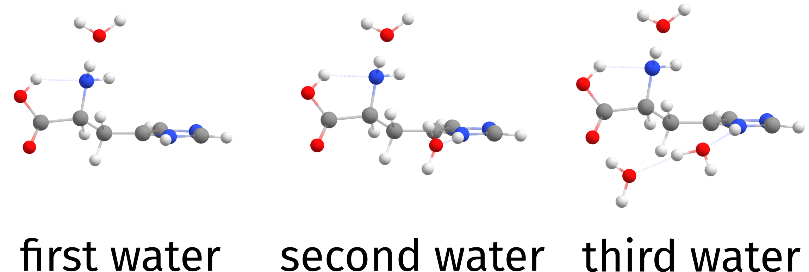
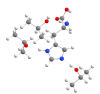
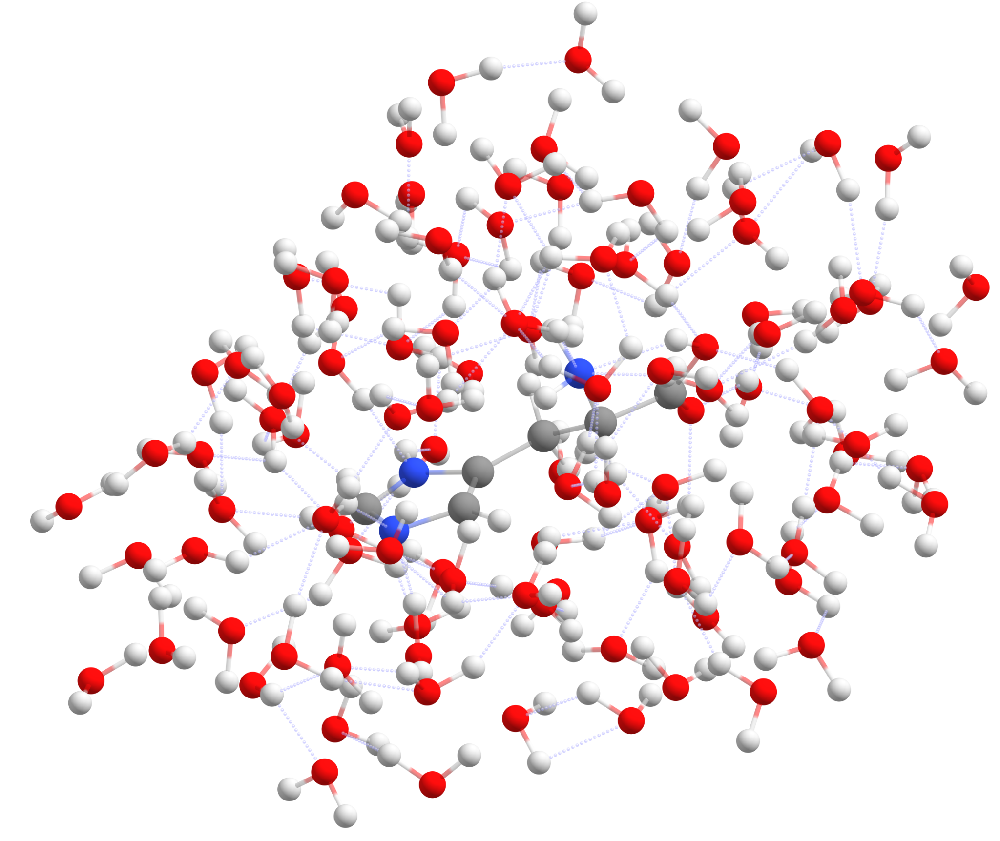
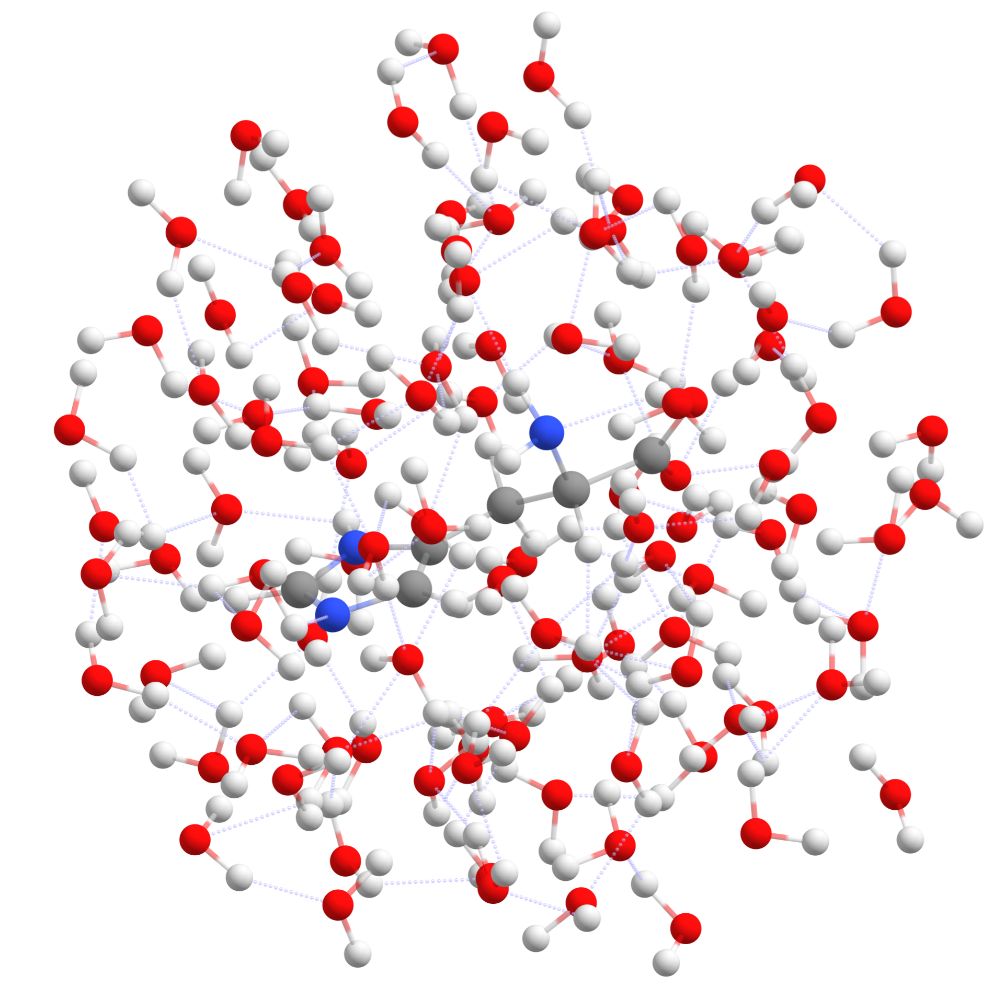
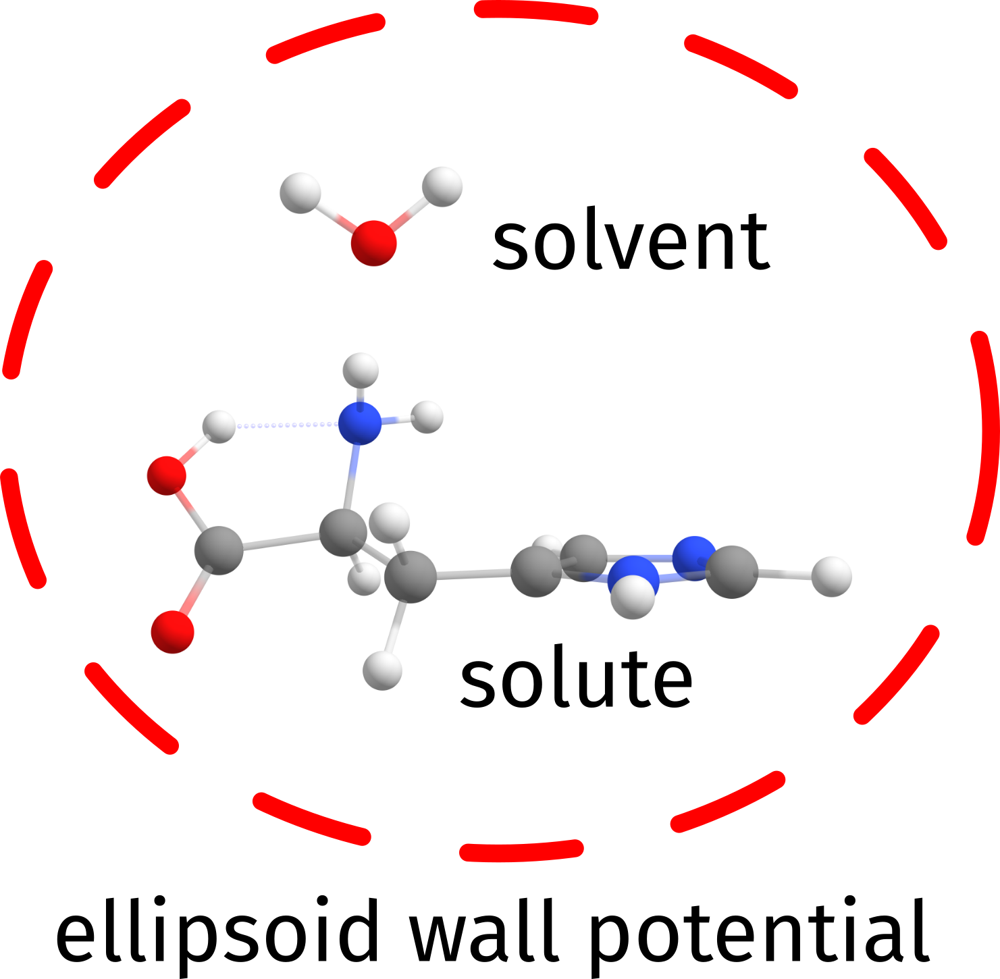

<a id="sec:structurereactivity.solvator"></a>
# SOLVATOR: Automated Explicit Solvation

The SOLVATOR is an algorithm to automatically add explicit solvent molecules to a given system. By default, SOLVATOR makes use of the [DOCKER](docker.md#sec:structurereactivity.docker) algorithm. If a very large number of solvent molecules should be added, a very fast but less accurate [stochastic method](#sec:structurereactivity.solvator.stochastic) method is available. The [ALPB solvation model](../modelchemistries/semiempirical.md#sec:modelchemistries.semiempirical.xtb.solvation) is used to create an implicit continuum solvation around the generated clusters. Currently the SOLVATOR is **only** working with the [GFN-xTB and GFN-FF methods](../modelchemistries/semiempirical.md#sec:modelchemistries.semiempirical.xtb). A complete list of available keywords and options can be found in [solvator.keywords](#sec:structurereactivity.solvator.keywords).

!!! note
      The DOCKER on ORCA 6.1 was significantly improved, in both speed and accuracy, when compared to ORCA 6.0. These changes can also alter the results of the SOLVATOR, but only because they will be even more accurate.

<a id="sec:structurereactivity.solvator.basicusage"></a>
## Basic Usage

The default SOLVATOR is invoked via the `%SOLVATOR` block by defining the number of solvent molecules via `NSOLV <integer>`. The solvent to be added can be either chosen from ORCA's internal solvent library in combination with the `!ALPB(<solvent>)` simple input keyword (cf. [tab:modelchemistries.semiempirical.xtb.solvation.solvents](#tab:modelchemistries.semiempirical.xtb.solvation.solvents)) or by providing a [custom solvent](#sec:structurereactivity.solvator.customsolvents).

!!! warning
    * The SOLVATOR will by default make use of `CLUSTERMODE DOCKING` with settings that are equivalent to `!QUICKDOCK` (cf. [DOCKER](docker.md#sec:structurereactivity.docker)). For more accurate results `!NORMALDOCK` or even `!COMPLETEDOCK` may be used, however these approaches will be much slower! 
    * All options related to the docking process can be controlled via the `%DOCKER` block as described in [structurereactivity.docker](docker.md#sec:structurereactivity.docker).
    * All options given in the `%GEOM` block such as [constraints](optimizations.md#sec:structurereactivity.geomopt.constrained) etc., will be respected during the docking of the solvent, but can only be given for the solute.

```orca
!GFN2-XTB ALPB(<solvent>)

%SOLVATOR
   NSOLV <integer>
END
```

A simple example could be adding three water molecules to a Histidine molecule using the default settings and the GFN2-xTB method.

```mol
title: structure 1
theme: chem311
height: 320px
representation: ball-stick
--- xyz ---
20
structure (0 1)
N      0.885996    -0.961304    -0.120339
C      1.798313     0.104987     0.275069
C      1.249714     0.744242     1.567548
O      1.573032     1.831447     1.951866
C      2.049102     1.187937    -0.781297
C      2.714441     0.645674    -1.999072
N      2.728606     1.335092    -3.185194
C      3.401683     0.571600    -4.081842
N      3.805612    -0.545068    -3.552995
C      3.389082    -0.516790    -2.258890
O      0.397674    -0.041862     2.212628
H      0.272440    -0.853698     1.671197
H      1.339440    -1.612664    -0.750009
H      0.086389    -0.572348    -0.612909
H      2.756495    -0.353470     0.548654
H      2.661849     1.969568    -0.321790
H      1.092545     1.646672    -1.057454
H      2.328734     2.246496    -3.338113
H      3.566873     0.866218    -5.098496
H      3.616501    -1.333139    -1.602802
--- input ---
!GFN2-XTB ALPB(WATER) PAL16

%SOLVATOR 
   NSOLV 3 
END

* XYZ 0 1
  N     0.885996   -0.961304   -0.120339
  C     1.798313    0.104987    0.275069
  C     1.249714    0.744242    1.567548
  O     1.573032    1.831447    1.951866
  C     2.049102    1.187937   -0.781297
  C     2.714441    0.645674   -1.999072
  N     2.728606    1.335092   -3.185194
  C     3.401683    0.571600   -4.081842
  N     3.805612   -0.545068   -3.552995
  C     3.389082   -0.516790   -2.258890
  O     0.397674   -0.041862    2.212628
  H     0.272440   -0.853698    1.671197
  H     1.339440   -1.612664   -0.750009
  H     0.086389   -0.572348   -0.612909
  H     2.756495   -0.353470    0.548654
  H     2.661849    1.969568   -0.321790
  H     1.092545    1.646672   -1.057454
  H     2.328734    2.246496   -3.338113
  H     3.566873    0.866218   -5.098496
  H     3.616501   -1.333139   -1.602802
*
```

The output report the solvent chosen, together with some details about its dimensions, the number of molecules to be added and the method. The structure from the internal database is also always printed.

```mol
title: structure 2
theme: chem311
height: 320px
representation: ball-stick
--- xyz ---
3
structure
O      0.000014     0.401429     0.000000
H      0.765192    -0.200729     0.000000
H     -0.765206    -0.200700     0.000000
```

Further, the solvation process is monitored per solvent molecule and the final result is printed to the file `basename.solvator.xyz`. There will be also an intermediate file named `basename.solvator.solventbuild.xyz` with the solvent molecules added one by one. On the output `Einter` is the interaction energy obtained from the DOCKER used within the SOLVATOR process and `dE` is the different between the current and the previous `Einter`.

```orca
Adding solvent molecules to the solute         ....

      Iter       Energy      Einter          dE          Time
                  (Eh)     (kcal/mol)    (kcal/mol)     (min)
      -------------------------------------------------------
         1    -39.452446    -4.331670     -4.331670      0.26
         2    -44.544347    -4.316639      0.015031      0.34
         3    -49.636018    -4.171990      0.144649      0.40

Final radius after microsolvation:             .... 4.88 Angs
Time needed for microsolvation   :             .... 60.54 s
Final structured saved to        :             HIS.solvator.xyz

                ****ORCA-SOLVATOR TERMINATED NORMALLY****
```

!!! note
    In contrast to the [DOCKER](docker.md#sec:structurereactivity.docker), the solute is frozen by default in the SOLVATOR algorithm. Set `FIXSOLUTE FALSE` in the `%SOLVATOR` block to change that.

The solvated Histidine molecule generated this way is depicted in [fig:solvator_HIS_water](#fig:solvator_HIS_water).

<a id="fig:solvator_HIS_water"></a>


*Three water molecules added to Histidine by the SOLVATOR.*

<a id="sec:structurereactivity.solvator.customsolvents"></a>
## Custom Solvents

The SOLVATOR method itself is agnostic to the solvent, and in principle any other solvent can be used. If the desired solvent is not available in ORCA's [internal solvent database](tab:modelchemistries.semiempirical.xtb.solvation.solvents), a custom solvent molecule can be provided in `.xyz` format via the `SOLVENTFILE` keyword in the `%SOLVATOR` block.

```orca
%SOLVATOR 
   SOLVENTFILE "solvent_file_name.xyz" 
END
```

As with the [DOCKER](docker.md#sec:structurereactivity.docker), the `charge` and `multiplicty` can be given to the solvent as two integers on the comment line of the `solvent_file_name.xyz` (default is neutral closed-shell). Since the `ALPB` method only has a limited number of [available solvents](tab:modelchemistries.semiempirical.xtb.solvation.solvents), the the dielectric constant $\epsilon$ should be approximated to the next closest available solvent. Currently, it is not possible to define custom dielectric constants for ALPB.

For example, isopropanol can be used as solvent by providing a `isopropanol.xyz` file. In this case, the dielectric constant of isopropanol is approximated to that of ethanol. As the ALPB implicit solvation is a quite crude implicit solvation model the results will be sufficiently similar. The resulting cluster is depicted in [fig:solvator_HIS_isoprop](#fig:solvator_HIS_isoprop).

```mol
title: structure 3
theme: chem311
height: 320px
representation: ball-stick
--- xyz ---
12
0 1
C      -3.79410      2.24670     -0.09622
C      -3.45574      0.76660     -0.18820
H      -2.94382      2.85306     -0.42645
H      -4.00575      2.53923      0.93817
H      -4.66172      2.49512     -0.71492
C      -4.60559     -0.10847      0.28691
H      -4.84802      0.09429      1.33594
H      -4.32886     -1.16657      0.22730
H      -5.50341      0.05251     -0.31744
O      -2.30376      0.49878      0.60542
H      -3.20686      0.51239     -1.22373
H      -2.51694      0.72259      1.52758
```

```orca
!GFN2-XTB ALPB(ETHANOL) PAL16

%SOLVATOR 
   SOLVENTFILE "isopropanol.xyz" 
   NSOLV 3 
END

* XYZFILE 0 1 HIS.xyz
```

<a id="fig:solvator_HIS_isoprop"></a>


*Three iso-propanol molecules added by the solvator.*

<a id="sec:structurereactivity.solvator.stochastic"></a>
## Stochastic Method

In case you want to add a really large number of explicit solvent molecules, the `STOCHASTIC` mode will be significantly faster. It can be invoked via the `CLUSTERMODE STOCHASTIC` keyword in the `%SOLVATOR` block.

!!! warning
     `CLUSTERMODE STOCHASTIC` is a probabilistic approach and is not nearly as accurate as `CLUSTERMODE DOCKING`! Nonetheless it is useful for quite a few applications.

```orca
!GFN2-XTB ALPB(WATER) PAL16

%SOLVATOR 
    NSOLV       100 
    CLUSTERMODE STOCHASTIC
END

* XYZFILE 0 1 HIS.xyz
```

The output will slightly differ from that generated by default. For this example, hundred water molecules are added in seconds to the histidine molecule ([fig:solvator_HIS_100water](#fig:solvator_HIS_100water)).

```mol
title: structure 4
theme: chem311
height: 320px
representation: ball-stick
--- xyz ---
3
structure
O      0.000014     0.401429     0.000000
H      0.765192    -0.200729     0.000000
H     -0.765206    -0.200700     0.000000
```

<a id="fig:solvator_HIS_100water"></a>


*A hundred water molecules added to Histidine using `CLUSTERMODE STOCHASTIC`.*

<a id="sec:structurereactivity.solvator.stochastic.details"></a>
### Details on the Stochastic Method

`CLUSTERMODE STOCHASTIC` basically uses random trial and error to assign the placing of the solvents. The algorithm actually uses information from self-consistent EEQ charges [caldeweyher2019](../../bibliography.md) as part of an simplistic potential to guide the placing of polar molecules in a more reasonable way.

After trying to distribute the solvent molecule somewhere and checking for clashes, we first compute the electrostatic energy between solvent and solute:

$$
E_{elec} = \sum_{A}^{solute} \sum_{B}^{solvent} \frac {Q_A Q_B} { R_{AB} 4 \pi \epsilon_{solv}} ,\qquad \text{(eq:solvator_pot)}
$$

and define our target function to be minimized ($V$) as a damped version of that, using the minimum distance $R_{min}$ between the solute and solvent atoms:

$$
\begin{aligned}
V    &= E_{elec}e^{-R_{min}^2}  && \text{ if } E_{elec} < 0 \\
     &= R_{min} &&  \text{otherwise},
\end{aligned}\qquad \text{(eq:solvator_errorfnct)}
$$

The `STOCHASTIC` mode then consists of finding the correct solvent placement that minimizes $V$ for a given solute. The damping function is there to ensure that:

1. The electrostatic interaction decays strongly with distance,
2. Repulsive energies will be so unfavorable that only the distance will matter.

The result is such that solvent molecules are placed as close as possible to the solute and maximizing electrostatic interactions. This helps to create the solvent shell such that is does look like the actual result one would expect from a more elaborate calculation, but with essentially zero cost.

The best value for $V$ found after each solvent was added is what is printed in the output as `Target function`:

```orca
      Iter     Target function   Time
                                (min)
      -------------------------------
         1     -4.342597e-07     0.00
         2     -3.166857e-07     0.00
         3     -4.814590e-08     0.00
```

When using the [`DROPLET` mode](#sec:structurereactivity.solvator.droplets) , the $R_{min}$ is defined as the distance to the centroid of the solute, instead of that of the closest atom pair instead.

If you don't want to include the electrostatic component for any reason, just set `%SOLVATOR USEEEQCHARGES FALSE END`. In the future other charge models will be available as well.

<a id="sec:structurereactivity.solvator.droplets"></a>
## Creating a Droplet

!!! warning
    The droplet mode and its variants are only available for [`CLUSTERMODE STOCHASTIC`](#sec:structurereactivity.solvator.stochastic).

The regular stochastic method will create a solvation sphere around the solute following its shape and topology. If required, the `DROPLET` mode can be activated to create spherical droplets whose sizes are controlled either by the number of solvent molecules added via `NSOLV` or by a predefined radius controlled via the `RADIUS` keyword. If a predefined radius is given, the solvator will add solvent molecules until the desired radius is reached.

Spherical droplets are invoked by the `DROPLET TRUE` keyword. If the size is defined by `NSOLV` the resulting cluster will look like [fig:solvator_HIS_100water_droplet](#fig:solvator_HIS_100water_droplet).

```orca
!XTB ALPB(WATER) PAL16

%SOLVATOR 
    NSOLV       100 
    CLUSTERMODE STOCHASTIC
    DROPLET     TRUE
END

* XYZFILE 0 1 HIS.xyz
```

<a id="fig:solvator_HIS_100water_droplet"></a>


*Hundred water molecules added around histidine by the SOLVATOR enforcing spherical symmetry.*

If the maximum radius is defined by `RADIUS` the SOLVATOR will add as many molecules as necessary until the radius is reached. The radius is always taken from the centroid of the solute.

```orca
!GFN2-XTB ALPB(WATER) PAL16

%SOLVATOR 
    RADIUS      15 # in angstroem
    CLUSTERMODE STOCHASTIC
END

* XYZFILE 0 1 HIS.xyz
```

For this example, the output print the actual droplet radius reached and the number of molecules required to reach it, in this case 668. The resulting cluster is depicted in [fig:solvator_HIS_rad15](#fig:solvator_HIS_rad15)

```orca
Desired sovent radius:                         .... 15.00 Angs
Actual sovent radius:                          .... 15.18 Angs
Final number of solvent molecules:             .... 668 molecules
```

<a id="fig:solvator_HIS_rad15"></a>


*A droplet created with 668 water molecules to achieve a radius of approximately 15 Angstroem.*

<a id="sec:structurereactivity.solvator.wallpotential"></a>
## The Wall Potential

If one uses the default approach using the `CLUSTERMODE DOCKING`, a fictitious wall potential is added to guarantee that the solvents are added such that they fill most of the first solvation sphere around the solute before being placed further.

!!! note
    This resembles to some extent what was published recently by the group of Prof. Stefan Grimme (called \"quantum cluster growth\"), but here only a single outer wall potential is used [spicher_automated_2022](../../bibliography.md). Otherwise, the present algorithm is independent and unrelated to it.

As one can see from the output of the Histine example discussed in the previous sections, by default an ellipsoid potential is built with dimensions such that it will enclose the solute plus at least one molecule of the solvent in all directions ([fig:solvator_HIS_wall](#fig:solvator_HIS_wall)).

```orca
Ellipsoid potential radii:                     .... 8.37, 6.28, 5.76 Angs
```

<a id="fig:solvator_HIS_wall"></a>


*A simple scheme to show how the wall potential is built to keep the solvent molecules close to the solute space.*

A single parameter controlled by `SOLVWALLFAC` in the `%SOLVATOR` block defines how further this wall is built outside the solute. Its default value is 1.0, and increasing it to larger values will increase the default initial wall by about half the sum of the maximum dimensions of solute plus solvent for each unit.

The initial wall potential is by default not changed, unless a) the algorithm can not place a solvent, or b) the energy of the placed solvent is higher than before. Only then the walls will be updated to help allocating the next solvent molecule, and a message will be printed with the current scaling factor.

<a id="sec:structurereactivity.solvator.randomness"></a>
## Controlling Randomness

Both clustermodes, `DOCKER` and `STOCHASTIC`, are intrinsically dependent on random numbers. However, ORCA sets a fixed random seed such that the same results are always obtained on the same machine if calculations are repeated.

In order to make both fully random, please use the `RANDOMSOLVATION TRUE` keyword in the `%SOLVATOR` block.

<a id="sec:structurereactivity.solvator.vacuumsearch"></a>
## Vacuum Search

One option that might come in handy under certain conditions is to use the SOLVATOR to add the explicit solvent based on the implicit solvation information, but actually **not** use any implicit solvation while trying to place them.

That is useful for instance when trying to generate aggregates of solute plus solvents that can form in gas-phase only, where there will be no other solvent molecules around. That can be set by the `VACUUMSEARCH TRUE` keyword in the `%SOLVATOR` block and the implicit solvation method will be ignored to compute energies and gradients. In the `STOCHASTIC` method, the $\epsilon_{solv}$ will be set to 1.0.

!!! warning
     By the time of this release, this algorithm was still not published. Publications are under preparation.

<a id="sec:structurereactivity.solvator.keywords"></a>
## Keywords

A collection of SOLVATOR related keywords can be fount in [tab:structurereactivity.solvator.keywords.block](#tab:structurereactivity.solvator.keywords.block).

<a id="tab:structurereactivity.solvator.keywords.block"></a>
!!! note "`%SOLVATOR` block input keywords for the SOLVATOR algorithm."


| ****Keyword**** | Options | Description |
| --- | --- | --- |
| **`NSOLV`** | `10` | number of explicit solvent molecules to be added. |
| **`SOLVENTFILE`** | `"solvent_file_name.xyz"` | a file for custom solvents. NOT needed for the regular solvents available via ALPB(solvent). charge and multipl. can be given on the comment. |
| **`CLUSTERMODE`** | `docking` | Docking method for adding new solvent molecules (default). |
| **—** | `stochastic` | Stochastic method for adding new solvent molecules. Default is `docking`. |
| **`PRINTLEVEL`** | `low` | Low level of print verbosity. Default is `normal`. |
| **—** | `normal` | Normal level of print verbosity (default). |
| **—** | `high` | High level of print verbosity. Default is `normal`. |
| **`RANDOMSOLV`** | `false` | Make it completely random (default = `false`) . |
| **`FIXSOLUTE`** | `true` | keep the solute constrained? (default = `true`) |
| **`VACUUMSEARCH`** | `false` | Activate the search in vacuum. (default = `false`) |
| ***Stochastic method:*** |  |  |
| **`USEEEQCHARGES`** | `true` | Use eeq charges during the stochastic mode? Default is true (default = `true`). |
| **`DROPLET`** | `false` | Create a spherical droplet (default = `false`). |
| **`RADIUS`** | `10` | A radius in Angström for the droplet. Solvent molecules will be added until the target radius is reached. |
| ***Docking method:*** |  |  |
| **`WALLFAC`** | `1.0` | Factor use to define the initial size of the wall potential. |

!!! note
    All other docking options are controlled as usual via the `%docker` block. Flags such as `!NORMALDOCK` and `!COMPLETEDOCK` will apply here as well.

