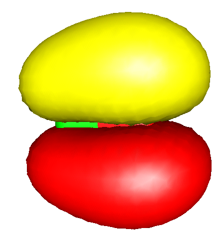
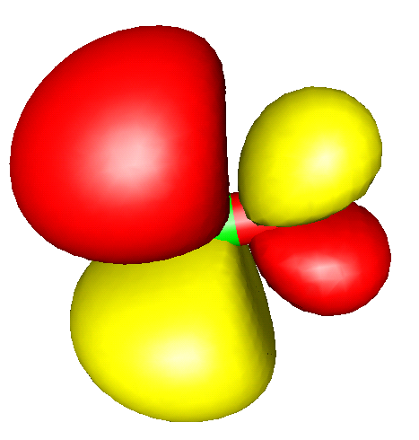

<a id="sec:utilities.plots"></a>
# Orbital and Density Plots

There are two types of graphics output possible in ORCA - two
dimensional contour plots and three dimensional surface plots. The
quantities that can be plotted are the atomic orbitals, molecular
orbitals, natural orbitals, the total electron density or the total spin
density. The graphics is controlled through the block `%plots`.

<a id="sec:utilities.plots.contour"></a>
## Contour Plots

The contour plots are controlled via the following variables

```orca
%plots
  #*** the vectors defining the cut plane
  v1 0, 0, 0  # pointer to the origin
  v2 1, 0, 0  # first direction
  v3 0, 1, 0  # second direction
  #*** alternative to defining vectors. Use atom coordinates
  at1 0 # first atom defining v1
  at2 2 # second atom defining v2
  at3 4 # third atom defining v3
  #*** resolution of the contour
  dim1  45   # resolution in v2-direction
  dim2  45   # resolution in v3-direction
  #*** minimum and maximum values along v2 and v3
  min1  -7.0 # min value along v2 in bohr
  max1   7.0 # min value along v2 in bohr
  min2  -7.0 # min value along v3 in bohr
  max2   7.0 # max value along v3 in bohr
  #***
  UseCol   true   # Use color in the plot (blue=positive,
                  # red=negative)
  Skeleton true   # Draw Skeleton of the molecule of those
                  # atoms that are in or close to the cut
                  # plane
  Atoms    true   # Draw the atoms that are in the plane as
                  # circles
  NCont    200    # Number of contour levels.
  ICont    0      # Draw NCont equally space contours
           1      # Start with 1/NCont and the double the 
                  # value for each additional contour
  #*** the format of the output file
  Format   Origin   # straight ascii files
           HPGL     # plotter language files 
  #*** the quantities to plot
  MO("MyOrbital-15xy.plt",15,0);  # orbital to plot
  v3= 0, 0, 1                     # change cut plane
  MO("MyOrbital-16xz.plt",16,0);  # orbital to plot
  ElDens("MyElDens.plt");         # Electron density
  SpinDens("MySpinDens");         # Spin density
end
```

<a id="fig:738"></a>

The input was:\
`v1 = 0, 0, 0; v2 = 1, 0, 0; v3 = 0, 1, 0; min1= -8; max1= 8; min2= -8; max2= 8; dim1= 50; dim2=50; Format = HPGL; NCont = 200; Icont = 1; Skeleton= true; Atoms = true; MO("Test-DFT-H2CO+-MO7xy.plt",7,1);`

NOTE:

-   The command `MO("MyOrbital-15xy.plt",15,0);` is to be interpreted as
    follows: `MO` means that a MO is to be plotted.
    \"`MyOrbital-15xy.plt`\" is the file to be created. `15` is the
    number of the MO to be drawn (remember: counting starts at orbital
    0!) and `0` is the operator the orbital belongs to. For a RHF (or
    RKS) calculation there is only one operator which has number 0. For
    a UHF (or UKS) calculation there are two operators - the spin-up
    orbitals belong to operator 0 and the spin-down orbitals belong to
    operator 1. For ROHF calculations there may be many operators but at
    the end all orbitals will be collected in one set of vectors. Thus
    the operator is always $=$0 in ROHF.

-   The `ELDENS` (plot of the total electron density) and `SPINDENS`
    (plot of the total spin density) commands work analogous to the `MO`
    with the obvious difference that there is no MO or operator to be
    defined.

-   Analogous to `ELDENS` and `SPINDENS`, post-HF densities can be
    selected using the keyword extended by the respective method.
    `ELDENSMDCI` / `SPINDENSMDCI` will plot the MDCI density, of course
    only if is available. `ELDENSMP2RE` and `SPINDENSMP2RE` will work
    with the MP2 relaxed density, while `ELDENSMP2UR` and
    `SPINDENSMP2UR` will yield the MP2 unrelaxed density. The OO-RI-MP2
    densities can be requested by `ELDENSOO` or `SPINDENSOO`. Similarly,
    AutoCI relaxed densities can be plotted by using the
    `ELDENSAUTOCIRE` and `SPINDENSAUTOCIRE` keywords, and the unrelaxed
    densities by using `ELDENSAUTOCIUR` and `SPINDENSAUTOCIUR`.

-   The `UNO` option plots natural orbitals of the UHF wavefunction (if
    they are available). No operator can be given for this command
    because there is only one set of UHF-NOs. Similarly, using `UCO`
    option can be used to plot the UHF corresponding orbitals.

-   If the program cannot find the plot module ("Bad command or
    filename") try to use `ProgPlot="orca_plot.exe"` in the `%method`
    block or point to the explicit path.

-   The defining vectors `v2` and `v3` are required to be orthonormal.
    The program will use a Schmidt orthonormalization of `v3` with
    respect to `v2` to ensure orthonormality. If you do not like this
    make sure that the input vectors are already orthogonal.

-   `at1`, `at2` and `at3` can be used instead of `v1`, `v2` and `v3`.
    In this case say `v1` is taken as the coordinates of atom `at1`.
    Mixed definitions where say `v2` is explicitly given and say `v3` is
    defined through `at3` are possible. A value of -1 for `at1`, `at2`
    and `at3` signals that `at1`, `at2` and `at3` are not to be used.
    This type of definition may sometimes be more convenient.

-   Variables can be assigned several times. The "actual" value a
    variable has is stored together with the command to generate a plot
    (`MO`, `ELDENS` or `SPINDENS`). Thus after each plot command the
    format or orientation of the plot can be changed for the next one.

-   The `Origin` format produces a straightforward ASCII file with x, y
    and z values that can be read into your favorite contour plot
    program or you could write a small program that reads such files and
    converts them to whatever format is more appropriate for you.

-   I usually use Word for Windows to open the `HPGL` files which
    appears to work fine. Double clicking on the graphics will allow
    modification of linewidth etc. For some reason that is not clear to
    me some graphics programs do not like the HPGL code that is produced
    by ORCA. If you are an HPGL expert and you have a suggestion - let
    me know.

<a id="sec:utilities.plots.surface"></a>
## Surface Plots

<a id="sec:utilities.plots.surface.general"></a>
### General Points

Surface plots can, for example, be created through an interface to Leif
Laaksonen's ***gOpenMol*** program. This program can be obtained free of
charge over the internet. It runs
on a wide variety of platforms, is easy to use, produces high quality
graphics and is easy to interface[^winprob] - thank you Leif for making this
program available!

The relevant `[PLOTS]` section looks like this:

```orca
%output
  XYZFile  true
end

%plots
  dim1  45   # resolution in x-direction
  dim2  45   # resolution in y-direction
  dim3  45   # resolution in z-direction
  min1  -7.0 # x-min value in bohr
  max1   7.0 # x-min value in bohr
  min2  -7.0 # y-min value in bohr
  max2   7.0 # y-max value in bohr
  min3  -7.0 # z-min value in bohr
  max3   7.0 # z-max value in bohr
  Format  gOpenMol_bin        # binary *.plt file
          gOpenMol_ascii      # ascii *.plt file
          Gaussian_Cube       # Gaussian-cube format 
                              # (an ASCII file)
  MO("MyOrbital-15.plt",15,0);  # orbital to plot
  MO("MyOrbital-16.plt",16,0);  # orbital to plot
  UNO("MyUNO-48.plt",48);       # UHF-NO to plot
  ElDens("MyElDens.plt");       # Electron density
  SpinDens("MySpinDens.plt");   # Spin density
end
```

!!! note
    -   it is admittedly inconvenient to manually input the dimension of the
        cube that is used for plotting. If you do nothing such that
        `min1 = max1 = min2 = max2 = min3 = max3=0` then the program will
        try to be smart and figure out a good cube size by itself. It will
        look at the minimum and maximum values of the coordinates and then
        add 7 bohrs to each dimension in the hope to properly catch all
        wavefunction tails.

Sometimes you will want to produce orbital plots after you looked at the
output file and decided which orbitals you are interested in. In this
case you can also run the `orca_plot` program in a crude interactive
form by invoking it as:

```orca
orca_plot  MyGBWFile.gbw  -i
```

This will provide you with a subset of the capabilities of
this program but may already be enough to produce the plots you want to
look at. Note that for the name of the GBW-file you may as well input
files that result from natural orbitals (normally `*.uno`),
corresponding orbitals (normally `*.uco`) or localized orbitals
(normally `*.loc`).
Once in the interactive program, by entering '1' for 'Enter type of plot,' you will
access a list of available plot capabilities relevant to your current calculation 
file (MyGBWFile.gbw):

```orca
-----------------------------------------------------------------------
Plot-Type is presently: 1
-----------------------------------------------------------------------
Searching for Ground State Electron or Spin Densities:              ...
-----------------------------------------------------------------------
     1 -   molecular orbitals                          
     2 -   (scf) electron density                              ......  (scfp                     )  => AVAILABLE
     3 -   (scf) spin density                                  ......  (scfr                     )  => AVAILABLE
     4 -   natural orbitals                               
     5 -   corresponding orbitals                         
     6 -   atomic orbitals                                
     7 -   mdci electron density                               ......  (mdcip                    )  - NOT AVAILABLE
     8 -   mdci spin density                                   ......  (mdcir                    )  - NOT AVAILABLE
     9 -   OO-RI-MP2 density                                   ......  (pmp2re                   )  - NOT AVAILABLE
    10 -   OO-RI-MP2 spin density                              ......  (pmp2ur                   )  - NOT AVAILABLE
    11 -   MP2 relaxed density                                 ......  (pmp2re                   )  - NOT AVAILABLE
    12 -   MP2 unrelaxed density                               ......  (pmp2ur                   )  - NOT AVAILABLE
    13 -   MP2 relaxed spin density                            ......  (rmp2re                   )  - NOT AVAILABLE
    14 -   MP2 unrelaxed spin density                          ......  (rmp2ur                   )  - NOT AVAILABLE
    15 -   LED dispersion interaction density                  ......  (ded21                    )  - NOT AVAILABLE
    16 -   Atom pair density                           
    17 -   Shielding Tensors                           
    18 -   Polarisability Tensor                       
    19 -   AutoCI relaxed density                              ......  (autocipre                )  - NOT AVAILABLE
    20 -   AutoCI unrelaxed density                            ......  (autocipur                )  - NOT AVAILABLE
    21 -   AutoCI relaxed spin density                         ......  (autocirre                )  - NOT AVAILABLE
    22 -   AutoCI unrelaxed spin density                       ......  (autocirur                )  - NOT AVAILABLE
-----------------------------------------------------------------------
Searching for State or Transition State AO Electron Densities:      ...
-----------------------------------------------------------------------
    23 -   CIS unrelaxed transition AO density                 ......  (Tdens-CIS                )  - NOT AVAILABLE
    24 -   ROCIS unrelaxed transition AO density               ......  (Tdens-ROCIS              )  - NOT AVAILABLE
    25 -   CAS unrelaxed transition AO density                 ......  (Tdens-CAS                )  - NOT AVAILABLE
    26 -   ICE unrelaxed transition AO density                 ......  (Tdens-ICE                )  - NOT AVAILABLE
    27 -   MRCI unrelaxed transition AO density                ......  (Tdens-MRCI               )  - NOT AVAILABLE
    28 -   LFT unrelaxed transition AO density                 ......  (Tdens-LFT                )  - NOT AVAILABLE
-----------------------------------------------------------------------
Searching for State or Transition State MO Electron Densities:      ...
-----------------------------------------------------------------------
    29 -   CIS unrelaxed transition MO density                 ......  (Tdens-CISMO              )  - NOT AVAILABLE
    30 -   ROCIS unrelaxed transition MO density               ......  (Tdens-ROCISMO            )  - NOT AVAILABLE
    31 -   CAS unrelaxed transition MO density                 ......  (Tdens-CASMO              )  - NOT AVAILABLE
    32 -   ICE unrelaxed transition MO density                 ......  (Tdens-ICEMO              )  - NOT AVAILABLE
    33 -   MRCI unrelaxed transition MO density                ......  (Tdens-MRCIMO             )  - NOT AVAILABLE
    34 -   LFT unrelaxed transition MO density                 ......  (Tdens-LFTMO              )  - NOT AVAILABLE
-----------------------------------------------------------------------
Searching for State or Transition State QDPT AO Electron Densities: ...
-----------------------------------------------------------------------
    35 -   CAS QDPT unrelaxed transition AO density            ......  (Tdens-CASQDSOC           )  - NOT AVAILABLE
    36 -   DCDCAS QDPT unrelaxed transition AO density         ......  (Tdens-CASDCDQDSOC        )  - NOT AVAILABLE
    37 -   CAS CUSTOM E QDPT unrelaxed transition AO density   ......  (Tdens-CASCUSTOMEQDSOC    )  - NOT AVAILABLE
    38 -   NEVPT2 QDPT unrelaxed transition AO density         ......  (Tdens-CASPTQDSOC         )  - NOT AVAILABLE
    39 -   QDNEVPT2 QDPT unrelaxed transition AO density       ......  (Tdens-CASQDPTQDSOC       )  - NOT AVAILABLE
    40 -   MRCI QDPT unrelaxed transition AO density           ......  (Tdens-MRCIQDSOC          )  - NOT AVAILABLE
    41 -   ROCIS QDPT unrelaxed transition AO density          ......  (Tdens-ROCISQDSOC         )  - NOT AVAILABLE
    42 -   LFT QDPT unrelaxed transition AO density            ......  (Tdens-LFTQDSOC           )  - NOT AVAILABLE
```

<a id="fig:741"></a>
*The $\pi^{\ast}$ orbital of H$_{2}$CO as calculated by the RI-BP/VDZP
method.*

!!! info
    The visualization of fractional occupation weighted densities (FOD) is described in [fod.plot](../spectroscopyproperties/fod.md#sec:spectroscopyproperties.fod.plot).

<a id="sec:utilities.plots.surface.gopenmol"></a>
### Interface to gOpenMol

Here is a short summary of how to produce these plots with gOpenMol:

-   First of all the molecular geometry must be save by choosing
    `XYZFile=true` in the `[OUTPUT]` block. This will produce a
    straightforward ascii file containing the molecular geometry (or
    simply `! XYZFile`).

-   After having produced the plot files start ***gOpenMol*** and choose
    ***File-Import-Coords*** . In the dialog choose the *XYZ* format and
    select the file. Then press ***apply*** and ***dismiss*** . The
    molecule should now be displayed in the graphics window.

-   You can change the appearance by choosing ***View-Atom type*** .

-   The color of the background can be changed with
    ***Colour-Background*** .

-   After having done all this choose ***Plot-Contour*** and select the
    ***Browse*** button to select the appropriate file. Then press
    ***Import File*** to read it in. NOTE: you can only directly read
    files that were produced in `gOpenMol_bin` format. If you have
    chosen `gOpenMol_ascii` you must first use the ***gOpenMol*** file
    conversion utility under ***Run-Pltfile (conversion)*** to produce
    the binary plt file.

-   After having read the plt file choose the appropriate isocontour
    value (one for the positive and one for the negative lobes of an
    orbital) and select suitable colors via ***Colour(n)*** to the right
    of the isocontour value. The ***Details*** button allows you to
    choose between solid and mesh representation and other things.

-   Once the plot looks the way you like, use ***File-Hardcopy*** to
    produce a publication quality postscript or bitmap picture that can
    be imported into any word processing or graphics software.

<a id="sec:utilities.plots.surface.molekel"></a>
### Interface to Molekel

The Molekel program (<http://ugovaretto.github.io/molekel/>) is another
beautiful and easy-to-use graphics tool that is recommended in
combination with ORCA. You may even find it a little easier to use than
gOpenMol but this may be a matter of personal taste. In order to produce
plots with Molekel follow the following procedure:

-   Produce Gaussian-Cube files (and optionally also an XYZ file) with
    ORCA as described above.

-   Start Molekel and use the right mouse button to obtain the **Load**
    menu.

-   Choose the format **xyz** to load your coordinates

-   Use the right mouse button again to select the **Surface** menu

-   Choose the format "Gaussian Cube" and click **Load Surface**

-   Click on **Both Signs** if you visualize an orbital or spin density

-   Select a suitable contour value in the **Cutoff** box.

-   Click on **Create Surface**. That's it!

-   In the **Color** menu (also available via the right mouse button)
    you can adjust the colors and in the main menu the display options
    for your molecule. Default settings are in a startup file that you
    can modify to suit your taste. More details are in the Molekel
    manual -- check it out; it can do many other useful things for you
    too!

[^winprob]: There were some reports of problems with the program on Windows
    platforms. Apparently it is better to choose the display settings as
    "true color 32 bit" rather than "high 16 bit". Thanks to Thomas
    Brunold!

Visualization of three-dimensional representation of MOs, natural orbitals, 
electron densities, and spin densities is usually more intuitive than 
examining MO coefficients and it is  is described in detail in section 
[utilities.plots](#sec:utilities.plots). The files necessary for such visualizations 
can be readily generated with ORCA in various ways and then opened in 
visualization software such as `gOpenMol` and `Molekel`.[^molekel]
In the following example, we briefly describe visualization of MOs. 

To visualize MOs with`gOpenMol`, the `plt` file of MOs can be generated in the 
`gOpenMol_bin` format from the `gbw` file using `orca_plot` utility program or
directly from the ORCA run through the `%plots` block of the input file:

```orca
%plots
  #*** the vectors defining the cut plane
  v1 0, 0, 0  # pointer to the origin
  v2 1, 0, 0  # first direction
  v3 0, 1, 0  # second direction
  #*** alternative to defining vectors. Use atom coordinates
  at1 0 # first atom defining v1
  at2 2 # second atom defining v2
  at3 4 # third atom defining v3
  #*** resolution of the contour
  dim1  45   # resolution in v2-direction
  dim2  45   # resolution in v3-direction
  #*** minimum and maximum values along v2 and v3
  min1  -7.0 # min value along v2 in bohr
  max1   7.0 # min value along v2 in bohr
  min2  -7.0 # min value along v3 in bohr
  max2   7.0 # max value along v3 in bohr
  #***
  UseCol   true   # Use color in the plot (blue=positive,
                  # red=negative)
  Skeleton true   # Draw Skeleton of the molecule of those
                  # atoms that are in or close to the cut
                  # plane
  Atoms    true   # Draw the atoms that are in the plane as
                  # circles
  NCont    200    # Number of contour levels.
  ICont    0      # Draw NCont equally space contours
           1      # Start with 1/NCont and the double the 
                  # value for each additional contour
  #*** the format of the output file
  Format   Origin   # straight ascii files
           HPGL     # plotter language files 
  #*** the quantities to plot
  MO("MyOrbital-15xy.plt",15,0);  # orbital to plot
  v3= 0, 0, 1                     # change cut plane
  MO("MyOrbital-16xz.plt",16,0);  # orbital to plot
  ElDens("MyElDens.plt");         # Electron density
  SpinDens("MySpinDens");         # Spin density
end
```

In this input file, the `MO("CO-4.plt",4,0);` command is used to evaluare MO
labeled as 4 for operator 0 and then to strore it in the \"CO-4.plt\" file. 
For RHF and ROHF, one should always use operator 0. For UHF, operators 0 and 1 
correspond to spin-up and spin-down orbitals, respectively.

When the produced `plt` files are opened with `gOpenMol` (see section
[plots.surface](#sec:utilities.plots.surface) for details), the textbook-like $\pi$ and $\pi^{\ast}$ MOs 
of the CO molecule are visualized as in Figure [fig:629](#fig:629).

<a id="fig:629"></a>
!!! note "AB"

    
    

    (a) $\pi$ and (b) $\pi^\ast$ MOs of the CO molecule obtained from the interface of `ORCA` to `gOpenMol`.

If the `gOpenMol_ascii` file format was requested, gOpenMol conversion utility
or some other tools might then be needed to convert this human-readable file to 
the machine-readable `gOpenMol_bin` format.

In order to use the interface to `Molekel`, an ASCII file in the 
`Cube` or `Gaussian_Cube` format needs to be generated. Such ASCII files can be
actually transferred between platforms. The `Cube` format can be requested in 
the `%plots` block as:

```orca
%output
  XYZFile  true
end

%plots
  dim1  45   # resolution in x-direction
  dim2  45   # resolution in y-direction
  dim3  45   # resolution in z-direction
  min1  -7.0 # x-min value in bohr
  max1   7.0 # x-min value in bohr
  min2  -7.0 # y-min value in bohr
  max2   7.0 # y-max value in bohr
  min3  -7.0 # z-min value in bohr
  max3   7.0 # z-max value in bohr
  Format  gOpenMol_bin        # binary *.plt file
          gOpenMol_ascii      # ascii *.plt file
          Gaussian_Cube       # Gaussian-cube format 
                              # (an ASCII file)
  MO("MyOrbital-15.plt",15,0);  # orbital to plot
  MO("MyOrbital-16.plt",16,0);  # orbital to plot
  UNO("MyUNO-48.plt",48);       # UHF-NO to plot
  ElDens("MyElDens.plt");       # Electron density
  SpinDens("MySpinDens.plt");   # Spin density
end
```

To visualize MOs strored in the `*.cube` file, start `Molekel` and, 
via a right mouse click, load the `*.xyz` file and/or the `*.cube` file. 
lternatively, navigate to the surface menu, select the "gaussian-cube" format,
and load the surface. For orbitals, click the "both signs" button and select
a countour value in the "cutoff" field. Then, click "create surface". 
The colour schemes and other fine details of the plots can be easily
adjusted as desired. Finally, create files via the "snapshot" feature
of `Molekel`. Figure [fig:631](#fig:631) demonstrates a `Molekel` variant
of Figure [fig:629](#fig:629).

<a id="fig:631"></a>
!!! note "AB"

    
    

    (a) $\pi$ and (b) $\pi^\ast$ MOs of the CO molecule obtained from the interface of `ORCA` to `Molekel`.

It is worth noting that there are several other freeware programs, such as
`UCSF CHIMERA`, that can read `Gaussian_Cube` files and provide high-quality plots.

In some situations, visualization of the electronic structure in terms
of localized molecular orbitals might be quite helpful. As unitary 
transformations among occupied orbitals do not change the total 
wavefunction, such transformations can be applied to the canonical
SCF orbitals with no change of the physical content of the SCF 
wavefunction. The localized orbitals correspond more closely to the 
pictures of orbitals that chemists often enjoy to think about.
Localized orbitals according to the Pipek-Mezey population-localization
scheme are quite easy to compute. For example, the following run 
reproduces the calculations reported by Pipek and Mezey in their 
original paper for the N$_{2}$O$_{4}$ molecule. 

```orca
orca_plot  MyGBWFile.gbw  -i
```
Based on the output file of this job, localized MOs consist of
six core like orbitals (one for each N and one for each O), two distinct
lone pairs on each oxygen, a $\sigma$- and a $\pi$-bonding orbital for
each N-O bond and one N-N $\sigma$-bonding orbital which corresponds
to the dominant resonance structure of this molecule. You will also
find a file with the extension `.loc` in the directory where you run
the calculation. Like the standard `gbw` file, it can used to extract
files for plotting or as input for another calculation (warning!
The localized orbitals have no well defined orbital energy. If you do
use them as input for another calculation use `GuessMode=CMatrix`
in the `%scf` block).

[^molekel]: The `Molekel` developers ask for the following citation -- please
    do as they ask:

    MOLEKEL 4.2, P. Flukiger, H.P. Lüthi, S. Portmann, J. Weber, Swiss
    Center for Scientific Computing, Manno (Switzerland), 2000-2006.

    S. Portmann, H.P.Łüthi. MOLEKEL: An Interactive Molecular Graphics
    Tool. CHIMIA (2000), [54]{.underline}, 766-770. The program appears
    to be maintained by Ugo Varetto at this time.
