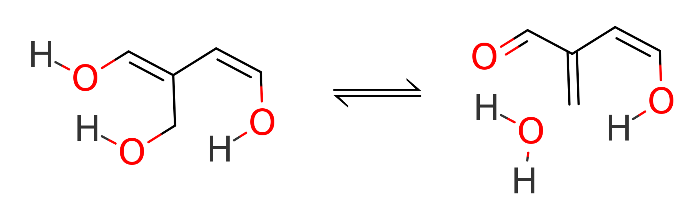
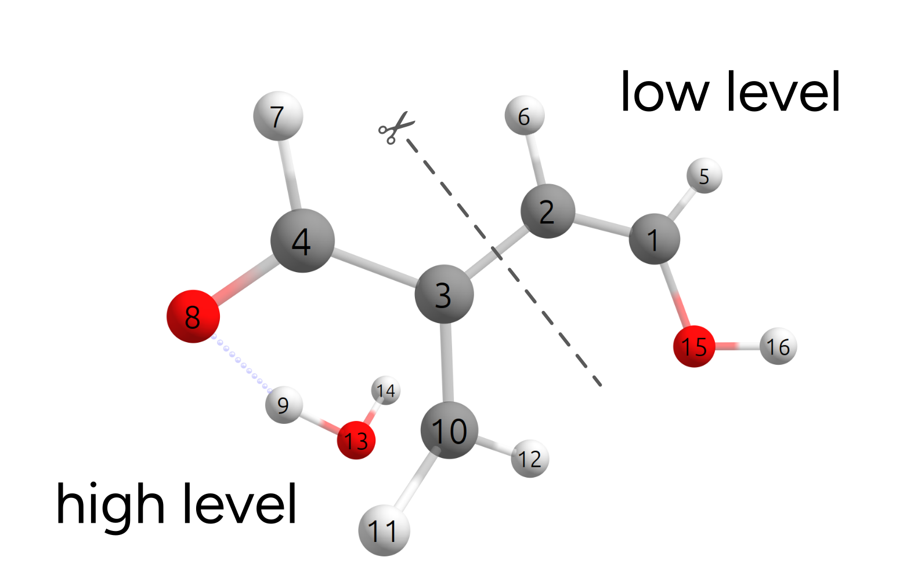

# ONIOM methods beyond QM/XTB

There is no reason to be constrained to XTB as the low-level method during a ONIOM calculation. Combinations of any two methods available in ORCA can be chosen! Let us explore some of the possibilities studying the transition state energy of the follow dehydration reaction:

[](../images/reaction.png)

The reactant and transition state were taken from the BHDIV10 set, a subset of the GMTKN55 benchmark set [[Grimme2017b]](../bib.md#grimme2017b). Geometries for the educt (ed1) and transition state (ts1) are from [here](http://www.thch.uni-bonn.de/tc.old/downloads/GMTKN/GMTKN55/BHDIV10.html).

## Example 1: Mix of hybrid and non-hybrid DFT

Let's first try a combination of two DFT methods: a high-level hybrid wB97X-D3/DEF2-TZVP and a lower-level PBE/DEF2-SVP. Our split of the QM regions will be again considering where the reaction does take place and which parts needs to be modeled with more accuracy.

In this particular case, the dehydration reaction is rather localized, and we will split our system as:

[](../images/ts.png)

which, as an ORCA input is simply written as:

```text
!QM/QM2 WB97X-D3 DEF2-TZVP
%QMMM QM2CUSTOMMETHOD "PBE D3BJ DEF2-SVP"
      QMATOMS {2:3} {6:13} END
END
* XYZ 0 1
(...)
```

The *QM/QM2* flag indicates that we will again use two different QM methods. The first, high-level one is simply defined in the same input line as always, here *wB97X-D3 DEF2-TZVP*. The second is given under *%QMMM* after *QM2CUSTOMMETHOD*, as a string, which here was chosen as `PBE D3BJ DEF2-SVP`.

The *QMATOMS* list is then used to define the high-level region, and all the others are assigned to the lower-level region. The results here is then $E^{ONIOM}_{barrier} = 24.29$ $kcal/mol$, which is very close to the full wB97X-D3/DEF2-TZVP result of $E^{wB97X-D3}_{barrier} = 24.34$ $kcal/mol$.

## Methods to compute the charges of the QM2 region

Looking closely at the ONIOM header printed in the very beginning, you might have noticed the reference to Hirshfeld charges:

```text
QM2 method                             ... Custom-QM2
        QM2 method                     ... PBE D3BJ DEF2-SVP
        QM2 basis                      ...
Coupling Scheme                        ... subtractive
Embedding Scheme                       ... electrostatic
PrintLevel                             ... 1
Method for determining QM2 charges     ... Hirshfeld
Charge of total system                 ... 0
```

This is related to how the charges are computed at the lower level (QM2), which will later then be used to compute the higher-level method (QM1), as necessary for the electrostatic embedding ([What is "electrostatic embedding"?](../multi/basics.md#elecembedding)).

In case needed, these can be changed by setting *Charge_Method* under %QMMM, and the options are:

```text
%QMMM Charge_Method     Hirshfeld # (default)
                        # CHELPG
                        # Mulliken
                        # Loewdin (default for QM2 = AM1 or PM3)
END
```

For XTB, the charges used are the ones calculated directly via the XTB method. We don't recommend changing these, but the options are laid out here for completion.
More details can be found, as always, in the [ORCA manual](https://www.faccts.de/docs/orca/6.0/manual).

## Example 2: Mix of CCSD(T) and DFT

The results obtained with mixed DFT methods ($E^{ONIOM}_{barrier} = 24.29$ $kcal/mol$) were not bad compared to the reference values obtained from extrapolated coupled-cluster with a large basis $E^{Ref}_{barrier} = 25.65$ $kcal/mol$.

However, $1.4$ $kcal/mol$ in an energy barrier is an error of one order of magnitude on the resulting rate constant, and maybe that could be improved.

We can actually do that by combining CCSD(T) and DFT in a single run! In particular, we can combine here DLPNO-CCSD(T) and DFT using:

```text
!QM/QM2 DLPNO-CCSD(T) DEF2-TZVP DEF2-TZVP/C RIJCOSX
%QMMM QM2CUSTOMMETHOD "PBE D3BJ DEF2-SVP"
      QMATOMS {2:3} {6:13} END
END
* XYZ 0 1
(...)
```

More details related to the coupled-cluster can be found in the [Correlation energy](../prop/corren.md#corren) section, but it is important to say that, using *!PAL16* to use 16 cores these calculations took only 30 seconds!

The energy obtained from the CCSD(T)/DFT ONIOM is found to be $E^{ONIOM}_{barrier} = 25.48$ $kcal/mol$, which is very close to the reference value, wrong by only $0.17$ $kcal/mol$. Here is a table with values from a few combinations:

| Method | $E_{binding}$ kcal/mol |
| --- | --- |
| full wB97X-D3 | 24.34 |
| full XTB | 32.73 |
| wB97X-D3/XTB | 24.06 |
| wB97X-D3/PBE | 24.49 |
| wB97X-D3/wB97X-D3 | 24.34 |
| DLPNO-CCSD(T)/PBE | 25.48 |
| DLPNO-CCSD(T)/wB97X-D3 | 25.34 |
| Reference [[Grimme2017b]](../bib.md#grimme2017b) | 25.65 |

## Link atoms

You might be wondering how does ORCA treat the broken bonds when doing a multiscale calculation. After all, we have split the molecule here in two, and treated each part on a different level.

In QMMM or ONIOM approaches, this is solved using the idea of "link atoms" [[Hobza2011]](../bib.md#hobza2011). The approach is to substitute single bonds between any two atoms by a atom-hydrogen bond on both sides. There are some predefined rules for how to do it, and the number of link atoms is printed in the beginning of the output, on the ONIOM header:

```text
Size of different subsystems (in atoms):
Size of QMMM System                    ... 16
Size of QM2 Subsystem                  ... 6
Size of QM1 Subsystem                  ... 10
Number of link atoms                   ... 1
Size of QM1 Subsystem plus link atoms  ... 11
Size of region for optimizer           ... 16
        optimized atoms = activeRegion ... 16
```

And here we have only 1 link atom. Looking closely at the higher level QM calculation output, the molecule that is actually calculated on that level is:

[](../images/link.png)

There is nothing to worry about this and ORCA does all the necessary corrections internally, but in case you need more details or want to change something, please check the [ORCA manual](https://www.faccts.de/docs/orca/6.0/manual).

> **Important**
> **When defining the QM1 and QM2 regions, you can not:**
> : 1. cut through a bond with a hydrogen, for it would be substituted by a H link atom anyway.
> 2. cut through a double/triple/multiple bond, for the link atom approach would not be able to fix that.

### Structures

### Reactant

```mol
title: basics-otheroniom #6
theme: chem311
height: 360px
representation: ball-stick
--- xyz ---
16
structure
C       -2.118863000      0.733915100     -0.120354900
C       -0.831065600      1.027745800     -0.298682000
C        0.346267900      0.196662000     -0.060529900
C        1.517385500      0.831557800      0.040795600
H       -2.872626600      1.481366900     -0.350860500
H       -0.646969800      2.040075700     -0.642602600
H        1.583772600      1.909747800     -0.084134500
O        2.682971400      0.193400100      0.324250900
H        3.417369900      0.805818600      0.318366600
C        0.227135500     -1.310846700      0.062980100
H       -0.666494300     -1.638084100     -0.465969200
H        0.066950500     -1.569178200      1.120977100
O        1.281736200     -2.037363300     -0.502500400
H        2.113152500     -1.771922400     -0.108879900
O       -2.573710900     -0.451182700      0.348621600
H       -3.527011700     -0.441712500      0.418522000
```

### Transition State

```mol
title: basics-otheroniom #7
theme: chem311
height: 360px
representation: ball-stick
--- xyz ---
16
structure
C       -1.989594700      0.968799900      0.378632800
C       -0.704362000      1.213317200      0.126101400
C        0.333797200      0.312882800     -0.347547900
C        1.628514700      0.793545600     -0.597906200
H       -2.642025400      1.765159500      0.723432700
H       -0.397850600      2.241771700      0.287952900
H        1.791013100      1.881154900     -0.658145900
O        2.626330800      0.037013800     -0.675321300
H        2.218546300     -1.160637800      0.101755700
C        0.226280200     -1.101394500     -0.443491500
H        0.642003100     -1.582300600     -1.324430400
H       -0.660602500     -1.596253300     -0.069544500
O        1.550722700     -1.816403300      0.568157400
H        1.427509000     -1.489854300      1.467453400
O       -2.549787700     -0.269328800      0.267408200
H       -3.500494100     -0.197472700      0.195493200
```
