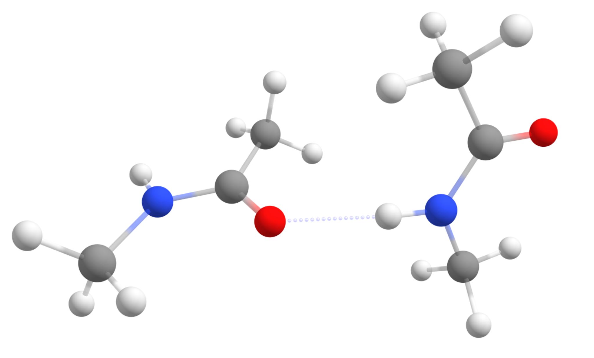
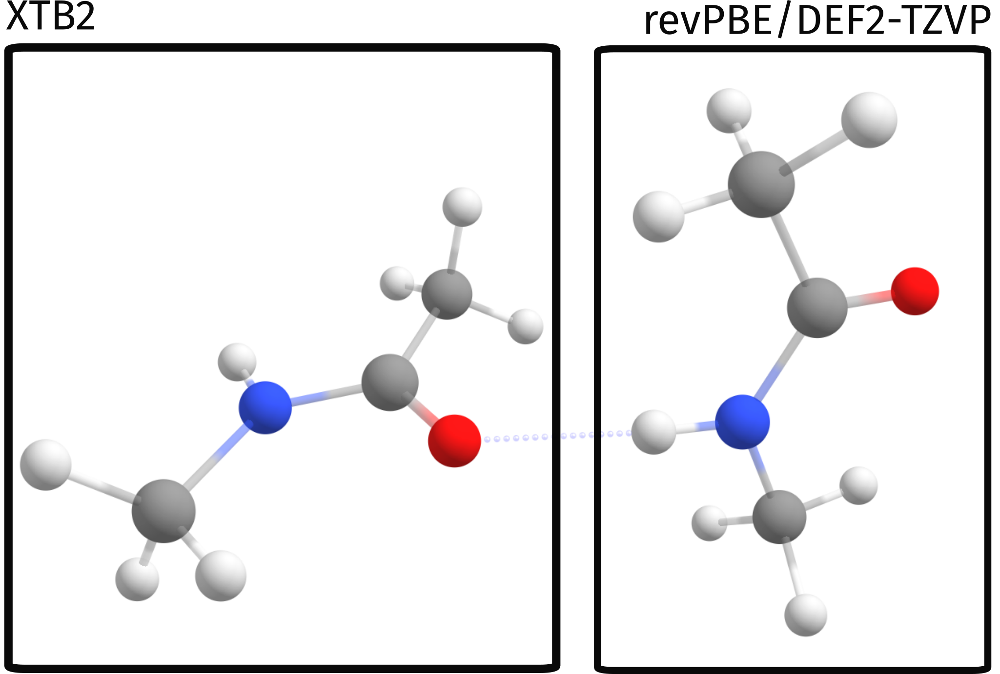
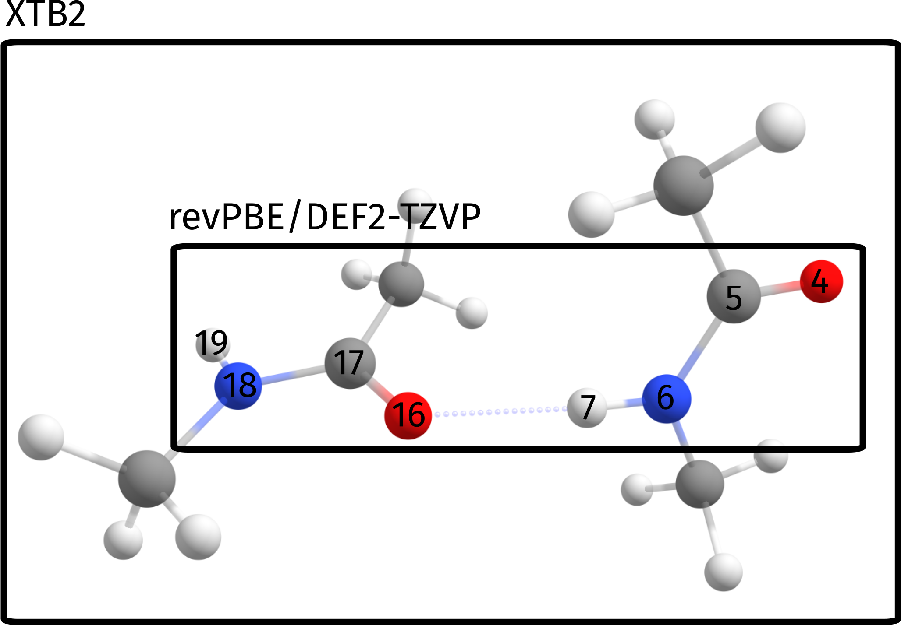

# Starting with Multiscale models - QM/XTB ONIOM

Let's start our incursion on the world of multiscale calculations. Multiscale here means that we will use different levels of theory/methods for different parts of our system.

These multiscale models can be useful for a variety of problems: treating the active site of a protein on a higher level and the rest of the protein on a simpler level, modeling a chromophore on a higher level and the surrounding explicit solvent on a lower level, or even splitting a medium-sized system into smaller parts for improved efficiency.

In ORCA, there are different approaches to run multiscale simulations, based on three main categories:

1. ONIOM methods mixing different "Quantum Mechanical" (QM) methods,
2. QM/MM methods mixing QM with "Molecular Mechanics" (MM) methods that rely on predefined force-fields, and
3. Crystal-QM/MM methods which treat a small part of a periodic crystal (e.g. the unit cell) at a high QM level and embed this in a lower level model of the large super-cell model.

It is important to emphasize that our implementation is focused in all cases on a "QM-centric" perspective, meaning it is aimed at users familiar with QM approaches, and so will be these tutorials.

## Our first ONIOM single point

We will begin with a very simple approach: a QM/QM2 calculation. This means we will use two different levels of QM on different parts of the same system. In particular, let's start really simple and use QM/XTB, with the GFN2 method from Stefan Grimme (XTB2) [[Grimme2019]](../bib.md#grimme2019) being used together with a regular [Density functional theory (DFT)](../prop/single_point.md#dft).

For our test case, the Peptide...Peptide pair from the S66 benchmark set will be used [[Hobza2011]](../bib.md#hobza2011) (structure taken from [here](http://www.begdb.org/index.php?action=oneMolecule&amp;state=show&amp;id=4127) ). It is a complex of two simple amides, made to simulate peptide intermolecular interactions:

[](../images/pep2.png)

Starting with the objective to compute only [Single point energies](../prop/single_point.md#spen), you will see that using QM/XTB in ORCA is really simple. All you have to do is prepare your regular QM input and just add the !QM/XTB flag, plus a list of atoms that should be treated at the higher QM level under %QMMM.

In our first trial let's just separate the two molecules, treating one at revPBE level and the other at XTB2:

```mol
title: basics #1
theme: chem311
height: 360px
representation: ball-stick
--- xyz ---
24
structure
C   -0.701502936  -0.290627698   2.406884396
H   -1.183295956   0.395647770   3.098874220
H    0.349561571  -0.030321572   2.307833035
H   -0.794056854  -1.291605451   2.824039291
C   -1.448546246  -0.244876636   1.091815299
O   -2.660450004  -0.428479088   1.034345768
N   -0.670056563   0.005916557   0.009776912
H    0.326675319   0.122563958   0.141592839
C   -1.227054574   0.089793737  -1.319967541
H   -2.292024256  -0.106501186  -1.240877562
H   -1.077801692   1.079940300  -1.748543540
H   -0.776628489  -0.647999190  -1.983372734
C    2.041774914  -2.351697968   0.686397615
H    2.599999718  -3.261701204   0.480489612
H    1.113083056  -2.358227418   0.122072198
H    1.782555985  -2.328251269   1.743338615
C    2.809410856  -1.097285929   0.350160876
O    2.264224213   0.004150876   0.293188485
N    4.136169069  -1.266099696   0.136412906
H    4.512490369  -2.193345392   0.213170232
C    5.023407253  -0.159633723  -0.152535629
H    4.409214873   0.731176053  -0.232359342
H    5.750821803  -0.020167991   0.644867678
H    5.548397546  -0.319615451  -1.091677965
--- input ---
!QM/XTB revPBE D4 DEF2-TZVP
%QMMM QMATOMS {0:11} END END
* XYZ 0 1
C   -0.701502936  -0.290627698   2.406884396
H   -1.183295956   0.395647770   3.098874220
H    0.349561571  -0.030321572   2.307833035
H   -0.794056854  -1.291605451   2.824039291
C   -1.448546246  -0.244876636   1.091815299
O   -2.660450004  -0.428479088   1.034345768
N   -0.670056563   0.005916557   0.009776912
H    0.326675319   0.122563958   0.141592839
C   -1.227054574   0.089793737  -1.319967541
H   -2.292024256  -0.106501186  -1.240877562
H   -1.077801692   1.079940300  -1.748543540
H   -0.776628489  -0.647999190  -1.983372734
C    2.041774914  -2.351697968   0.686397615
H    2.599999718  -3.261701204   0.480489612
H    1.113083056  -2.358227418   0.122072198
H    1.782555985  -2.328251269   1.743338615
C    2.809410856  -1.097285929   0.350160876
O    2.264224213   0.004150876   0.293188485
N    4.136169069  -1.266099696   0.136412906
H    4.512490369  -2.193345392   0.213170232
C    5.023407253  -0.159633723  -0.152535629
H    4.409214873   0.731176053  -0.232359342
H    5.750821803  -0.020167991   0.644867678
H    5.548397546  -0.319615451  -1.091677965
*
```

In this case, the calculation will be such that the QM method (revPBE D4 DEF2-TZVP) will be applied to atoms 0 to 11. These atoms form the high level region. The other atoms which are **not** in that list (12-23) will be treated on XTB level only.

> **Important**
> ORCA atom counting starts from 0!

In a simple graphical representation, that is:

[](../images/pep2_qmmmregions.png)

## ONIOM output

Now, except for the regular ORCA output, there are the QM/QM2 specific parts:

```text
**************************
                     *    2-layered ONIOM     *
                     **************************
(...)
Multiscale model                       ... QM1/QM2
QM2 method                             ... XTB2
Coupling Scheme                        ... subtractive
Embedding Scheme                       ... electrostatic
(...)
Size of different subsystems (in atoms):
Size of QMMM System                    ... 24
Size of QM2 Subsystem                  ... 12
Size of QM1 Subsystem                  ... 12
(...)
```

There is quite some printing related to the ONIOM method, but what matters here is:

> 1. the *Multiscale model* is *QM1/QM2*, using *XTB2* as *QM2*
> 2. the default coupling scheme is *subtractive*. This is related to how the final energy is calculated.
> 3. the default embedding scheme is *electrostatic*. This is related to how both QM systems interact electrostatically.
> 4. the full size of the system is 24 atoms, and the size of each subsystem is 12.

Next come the calculations necessary for the subtractive scheme: full system using QM2, high level region (small system) using QM2 and high level region using QM1. First, both QM2 level calculations are printed:

```text
************************************
            *       QM/   XTB2 SP Energy       *
            ************************************

------------------------------------------------------------------------------
                          XTB2 - FULL SYSTEM
------------------------------------------------------------------------------
Running XTB calculation
---------------------------------   --------------------
FINAL SINGLE POINT ENERGY (L-QM2)      -33.983328801310
---------------------------------   --------------------
------------------------------------------------------------------------------
                          XTB2 - SMALL SYSTEM
------------------------------------------------------------------------------
Running XTB calculation
---------------------------------   --------------------
FINAL SINGLE POINT ENERGY (S-QM2)      -16.992757934120
---------------------------------   --------------------
```

and the high level QM1 calculation:

```text
------------------------------------------------------------------------------
                                QM - SMALL SYSTEM
------------------------------------------------------------------------------
```

comes next, with the same printout as a regular single point calculation would have.

At the very end, we have the energy of the high level region using QM1 printed as:

```text
-------------------------   --------------------
FINAL SINGLE POINT ENERGY      -248.586744400306
-------------------------   --------------------
```

**But this is still not our ONIOM energy!** The final energy for our multiscale calculation is then given by:

```text
--------------------------------------   --------------------
FINAL SINGLE POINT ENERGY (QM/QM2)          -265.577315267496
--------------------------------------   --------------------
```

## Using ONIOM to compute binding energies

Now let's explore a bit more of the ONIOM method to compute a property. For example, let's compute a simple binding energy between these two amides. By "binding energy" here we mean simply the energy necessary to separate both molecules while keeping their geometry.

Our reference structure for the separate molecules will be:

```mol
title: basics #7
theme: chem311
height: 360px
representation: ball-stick
--- xyz ---
24
structure
C      -14.659345474      0.562404274      1.314809681
H      -15.141138494      1.248679742      2.006799505
H      -13.608280967      0.822710400      1.215758320
H      -14.751899392     -0.438573479      1.731964576
C      -15.406388784      0.608155336     -0.000259416
O      -16.618292542      0.424552884     -0.057728947
N      -14.627899101      0.858948529     -1.082297803
H      -13.631167219      0.975595930     -0.950481876
C      -15.184897112      0.942825709     -2.412042256
H      -16.249866794      0.746530786     -2.332952277
H      -15.035644230      1.932972272     -2.840618255
H      -14.734471027      0.205032782     -3.075447449
C       15.999617452     -3.204729940      1.778472330
H       16.557842256     -4.114733176      1.572564327
H       15.070925594     -3.211259390      1.214146913
H       15.740398523     -3.181283241      2.835413330
C       16.767253394     -1.950317901      1.442235591
O       16.222066751     -0.848881096      1.385263200
N       18.094011607     -2.119131668      1.228487621
H       18.470332907     -3.046377364      1.305244947
C       18.981249791     -1.012665695      0.939539086
H       18.367057411     -0.121855919      0.859715373
H       19.708664341     -0.873199963      1.736942393
H       19.506240084     -1.172647423      0.000396750
```

Now, when computing the energy difference $E^{ONIOM}_{binding} = E^{ONIOM}_{far} - E^{ONIOM}_{close}$ we get a value of $10.25 \hspace{3pt} kcal/mol$. This value is not too good when compared to either the pure DFT result ($8.70 \hspace{3pt} kcal/mol$) or the pure XTB value ($8.03 \hspace{3pt} kcal/mol$), which are closer to the reference value of $~8.7 \hspace{3pt} kcal/mol$ [[Hobza2011]](../bib.md#hobza2011).

### Selection of the proper QM region

This error actually is not intrinsic from the ONIOM process, but rather stems from a poor choice of the QM regions *for this particular problem*. Since we want to ultimately compute the energy related to the breaking of the hydrogen bond, which is our strongest binding point here, a more sensible choice of spaces would be to select the atoms directly involved in binding as our high level region:

[](../images/pep2_qmmmregions_2.png)

Which in terms of the input simply translates to a slightly different input:

```text
! QM/XTB revPBE D4 DEF2-TZVP PAL16
%QMMM QMATOMS {4:7 16:19} END END
%MAXCORE 3000
* XYZ 0 1
```

And a resulting binding energy of $E^{ONIOM}_{binding} = 8.41 \hspace{3pt} kcal/mol$, which deviates only by $0.3 \hspace{3pt} kcal/mol$ from the reference value.

Of course, this is a rather small example, but the same would apply for a much larger system. As long as the regions are chosen properly, the multiscale methods can greatly accelerate calculations with a still relatively small error!

| Method | $E_{binding}$ kcal/mol |
| --- | --- |
| pure DFT | 8.70 |
| pure XTB | 8.03 |
| naive ONIOM | 10.25 |
| proper ONIOM | 8.41 |
| Reference [[Hobza2011]](../bib.md#hobza2011) | 8.72 |

> **Important**
> Always choose your QM region such that it reflects the chemical phenomenon that you want to study!

## Extra content

Here are some extra comments on the ONIOM or QM/MM schemes. A nice reference related to these can be found in the review by Lili Cao and Ulf Ryde [[Ryde2018]](../bib.md#ryde2018).

### What is "subtractive ONIOM"?

There are two major approaches to compute QM/MM or ONIOM energies: additive and subtractive. In the subtractive scheme, the energy is computed as:

$$
E^{sub}_{QM1/QM2} = E_1^{QM1} + E_{12}^{QM2} - E_1^{QM2}
$$

where the subscript refers to the system where the method is applied: 1 corresponds to high level region, 2 to low level region and 12 to the full system. The subtractive scheme can be applied for QM1/QM2 methods and QM/MM methods.

In the additive scheme, which can only be used for QM/MM, the energy is computed as:

$$
E^{add}_{QM/MM} = E_1^{QM} + E_{2}^{MM} + E_{1/2}^{QM/MM}
$$

with the last term corresponding to the interaction energy term between systems 1 and 2.

In ORCA, the default for the ONIOM method is the subtractive scheme, while the default for QM/MM is the additive scheme.

### What is "electrostatic embedding"?

When splitting a large system into two or more smaller ones we need to decide how to properly include the interaction between them? There are two different schemes to compute the electrostatic interaction between high and low level region: "mechanical embedding" and "electrostatic embedding".

In the simpler **mechanical embedding** scheme, the electrostatic interaction of both systems is just considered using the lower QM2 or MM level method, without accounting for the polarization of the high level region by the low level region at the higher level QM method.

In the **electrostatic embedding** scheme (ORCA's default), the higher level calculation is done in the presence of the charges of the lower level region. This second approach is more accurate, for it lets the high level region polarize in the presence of the low level region on the higher level calculation.
