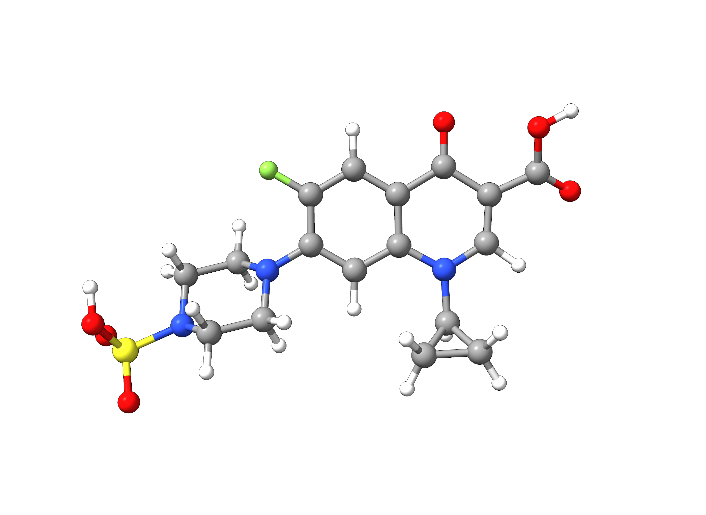
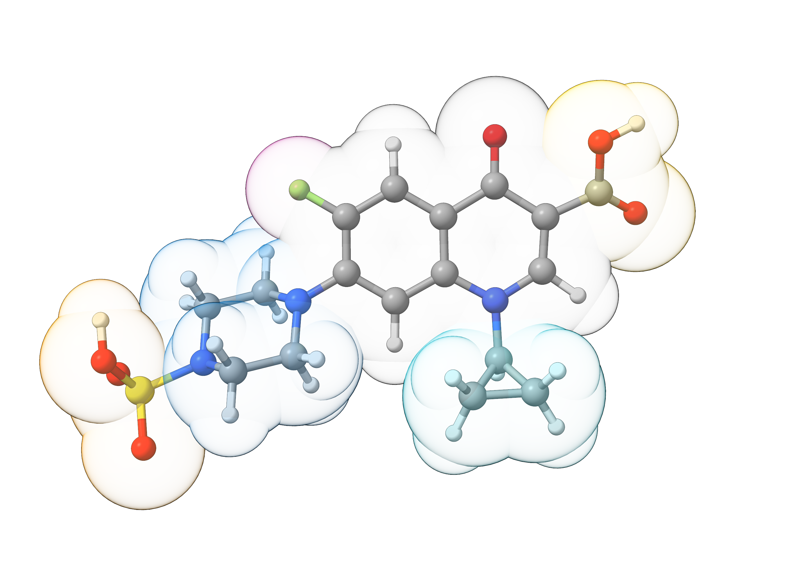
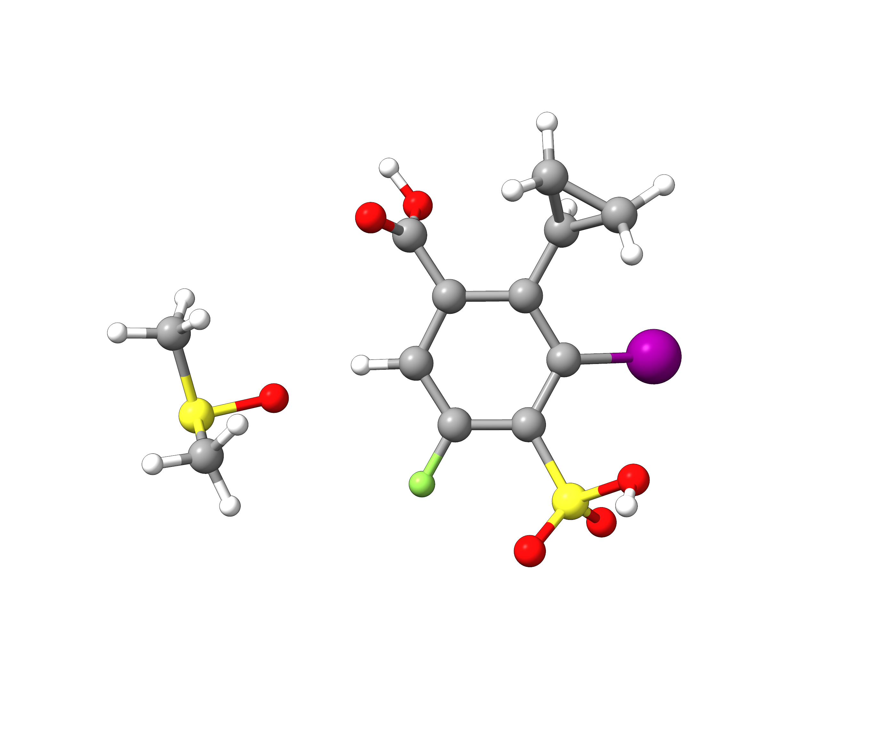
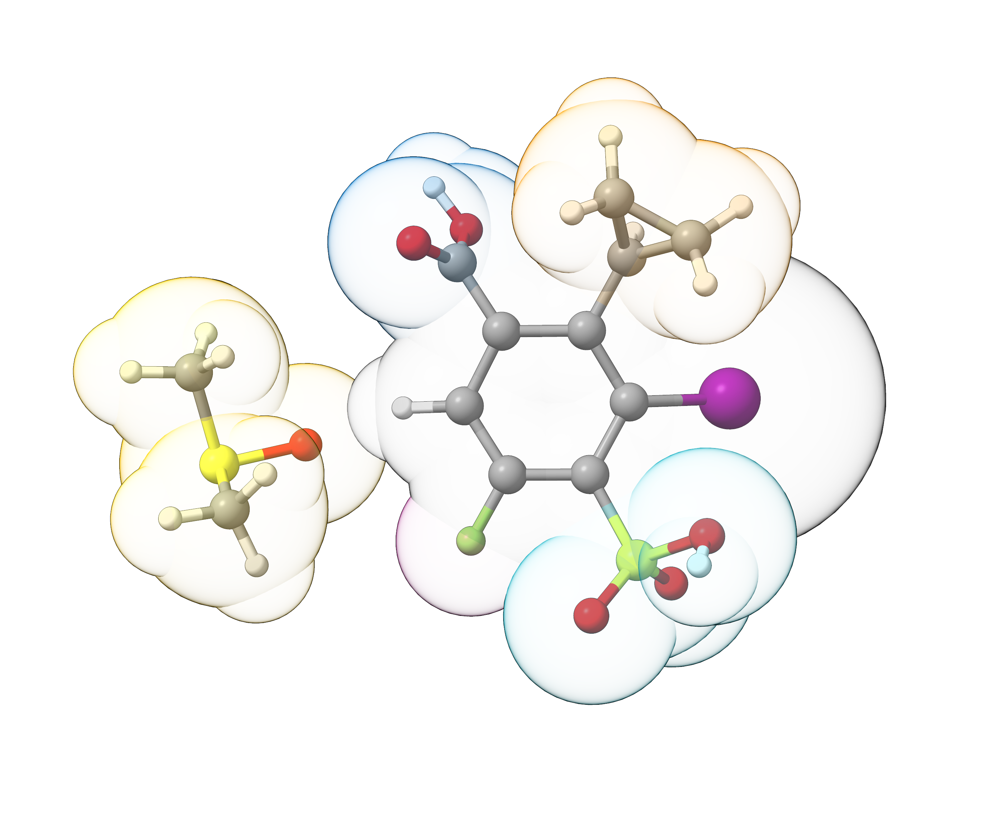
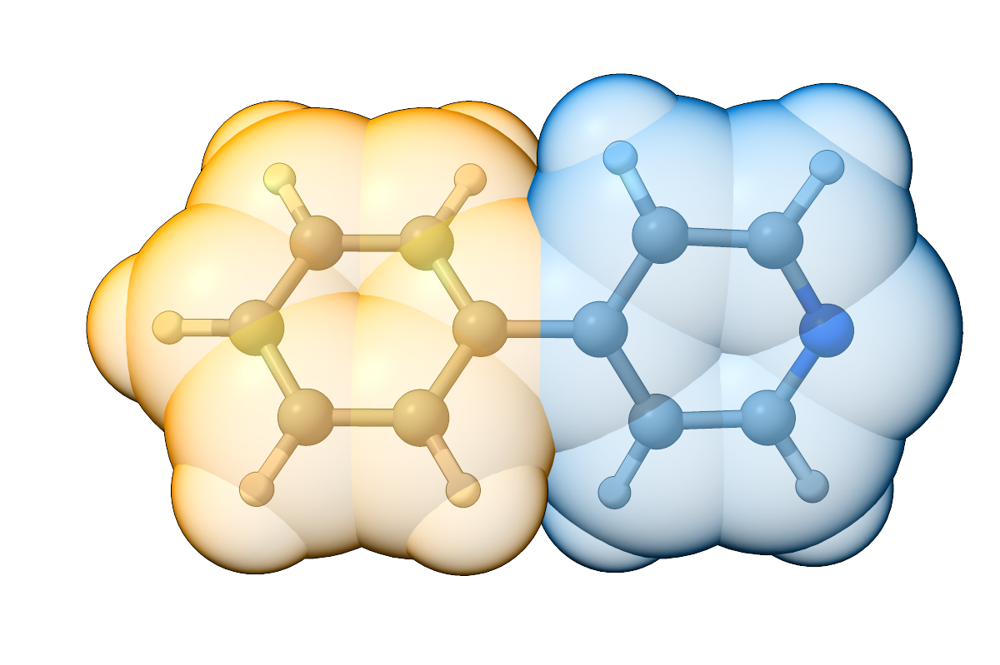
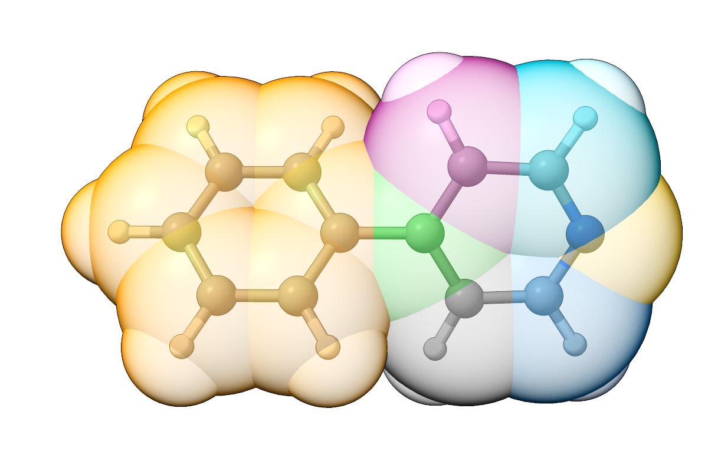

# Automated Fragmentation

ORCA features a very versatile fragmentation algorithm called [Fragmentator](https://www.faccts.de/docs/orca/6.1/manual/contents/essentialelements/fragmentation.html?q=fragmentation&amp;n=3#automatic-fragmentation). Even though it is mainly designed for treating large biochemical systems like proteins, the user has full control over the fragmentation schemes. In this context, custom fragment libraries can be defined or native libraries and fragmentation procedures can be used.

The fragmentation can be controlled via the `%frag` block and a respective fragmentation procedure is defined via `FragProc`. `StoreFrags true` can be used to save the generated fragments in XYZ format in a `basename.fragments.xyz` file.

```text
%frag
   FragProc Connectivity
   StoreFrags true
end
```

> **Note**
> Some native libraries may be too specialized for general use, therefore it is typically recommended to tailor the fragment library to any specific requirements.

> **Hint**
> If you want to only check the fragments, a full SCF calculation can be avoided by additionally defining `DryRun true` within the `%scf` block.

## Example 1: Sulfociprofloxacin

Ciprofloxacin is a potent broad-spectrum antibiotic belonging to the fluoroquinolone group. In this example, we will employ the automatic fragmentation tool of ORCA with a custom fragment library to the Ciprofloxacin derivative Sulfociprofloxacin (PubChem: 128781) which carries many different functional groups.

[](../images/128781_sulfociprofloxacin.png)

*Figure: Molecular structure of sulfociprofloxacin extracted from the PubChem database.*

### Fragmentation with Custom Library

First, we start to create our own tailored fragment library that can be used for similar compounds or substituent classes afterwards. For this, we use Avogadro 2 or any other molecular builder to extract the fragment geometries and create a library file `CustomLib.xyz`.

### CustomLib.xyz

```mol
title: fragmentator #2
theme: chem311
height: 360px
representation: ball-stick
--- xyz ---
32
CHARGE -1 MULT 1 NAME FLUORIDE
F     -0.9737000000    2.9130000000    0.3523000000
H     -4.3670000000   -1.7864000000    1.1175000000
H     -1.9500000000   -1.2974000000    1.3209000000
H     -2.4307000000   -1.6737000000   -0.3488000000
H     -4.0632000000   -0.1562000000    1.7575000000
H     -4.8159000000    1.5796000000   -1.4321000000
C     -2.7831000000    1.0384000000   -1.0418000000
C     -2.5149000000   -0.9311000000    0.4548000000
H     -4.3282000000    1.8214000000    0.2606000000
H     -2.7168000000    0.4608000000   -1.9729000000
N     -1.9899000000    0.3589000000   -0.0075000000
N     -4.7604000000   -0.1973000000   -0.2496000000
C     -4.2405000000    1.1536000000   -0.6044000000
C     -3.9777000000   -0.7938000000    0.8694000000
H     -2.4094000000    2.0438000000   -1.2626000000
H      0.4734000000   -4.0509000000    0.0656000000
H      0.9294000000   -2.8692000000    1.3726000000
H      2.0343000000   -2.9655000000   -1.5480000000
C      2.1615000000   -2.7286000000   -0.4964000000
C      2.6590000000   -3.8213000000    0.3905000000
C      1.2259000000   -3.3823000000    0.4658000000
H      3.2982000000   -3.5739000000    1.2291000000
H      2.8686000000   -4.7831000000   -0.0614000000
S     -6.4630000000   -0.3132000000   -0.0993000000
O     -7.0642000000    0.4318000000   -1.1888000000
H     -6.5219000000    1.4414000000    1.2900000000
O     -6.7763000000    0.4890000000    1.2850000000
O     -6.8022000000   -1.7074000000    0.1135000000
H      7.3180000000    1.3880000000    0.7242000000
C      5.9638000000    0.2574000000   -0.0930000000
O      6.3428000000    1.2848000000    0.6964000000
O      6.7115000000   -0.4779000000   -0.7133000000
```

This file contains the Cartesian coordinates of the fragment in XYZ format, charge, multiplicity, and a name for the fragment. The correct assignment of charge and multiplicity is important for automated tasks like energy decomposition calculations that make use of the respective fragment definitions.

```mol
title: fragmentator #3
theme: chem311
height: 360px
representation: ball-stick
--- xyz ---
14
CHARGE -1 MULT 1 NAME FLUORIDE
F     -0.9737000000    2.9130000000    0.3523000000
H      0.4734000000   -4.0509000000    0.0656000000
H      0.9294000000   -2.8692000000    1.3726000000
H      2.0343000000   -2.9655000000   -1.5480000000
C      2.1615000000   -2.7286000000   -0.4964000000
C      2.6590000000   -3.8213000000    0.3905000000
C      1.2259000000   -3.3823000000    0.4658000000
H      3.2982000000   -3.5739000000    1.2291000000
H      2.8686000000   -4.7831000000   -0.0614000000
S     -6.4630000000   -0.3132000000   -0.0993000000
O     -7.0642000000    0.4318000000   -1.1888000000
H     -6.5219000000    1.4414000000    1.2900000000
O     -6.7763000000    0.4890000000    1.2850000000
O     -6.8022000000   -1.7074000000    0.1135000000
```

Now we can start the fragmentation of our example molecule using the `%frag` block. As we want to use our customized fragment library, we define `FragProc Extlib` and provide the name of our library file via `XZYFRAGLIB "CustomLib.xyz"`. To not perform a full DFT calculation, we make use of the `DryRun true` setting within the `%scf` block.

```orcainput
!PBE def2-SVP

%scf
   DryRun true
end

%frag
   PrintLevel      3
   StoreFrags      true
   FragProc        Extlib
   XZYFRAGLIB      "CustomLib.xyz"
end

*xyzfile 0 1 sulfociprofloxacin.xyz
```

By setting `StoreFrags true`, we saved all identified fragments in a multixyz file `basename.fragments.xyz`. Further, all identified fragments are documented in the ORCA output file `basename.out`.

```text
================================================================================
 STARTING AUTOMATIC FRAGMENTATION:
===================================================
  PrintLevel: 3
  XZYFragLib: CustomLib.xyz,
  Inter. Frag. Bonds: NO
  BoxSize: 10.00 a.u.
  DistCutOff:  5.00 a.u.
  Fragmentation Procedure: Orca_input,
                           Ext_lib,
                           Not_assigned
===================================================

===================================================
Tfragmentator: Fragmenting by Orca_input
===================================================
 No New Fragments Assigned

 Orca_input fragmentation done in            0.000 Sec.
===================================================
Tfragmentator: Fragmenting by Ext_lib
===================================================
****
**** There are 5 Ref structures found in file CustomLib.xyz
****

------------------------------------------
 Match: 1, Assigned Fragment: 1
------------------------------------------
  Name:  FLUORIDE Method: Ext_lib
[...]
```

We can now visualize our fragments file with ChimeraX to get a visual picture of the identified fragments. Note that the fragmentation algorithm grouped the central aromatic moiety as it did not match any predefind fragment.

[](../images/128781_sulfociprofloxacin_fragments.png)

*Figure: Overlay of sulfociprofloxacin and the identified fragments (space-filling model).*

### ORCA Input from Fragmentation Run - `PrintInputFrags`

Sometimes, it is useful to automatically generate a native ORCA fragmentation input from a previous run so that assignments can be modified more flexibly, for example if identical groups should be assigned to different fragments. For this, the `PrintInputFrags` keyword within the `%frag` block can be used.

```orcainput
!PBE def2-SVP

%scf
   DryRun true
end

%frag
   PrintLevel      3
   StoreFrags      true
   FragProc        Extlib
   XZYFRAGLIB      "CustomLib.xyz"
   PrintInputFrags true
end

*xyzfile 0 1 sulfociprofloxacin.xyz
```

After adding the respective keyword to the input used before, ORCA will print a working `%frag` block input with the used fragment assignments. This input block can now be modified at will and be used for new ORCA calculations.

```orca
===================================================
Orca input for fragment definitions in this run:
===================================================
%frag
 Definition
 1 { 1} end
 2 { 9:10 17:18 21:22 34:37 39:42} end
 3 { 11:13 28:32} end
 4 { 0 3:5 44} end
 5 { 6:7 27 45} end
 6 { 2 8 14:16 19:20 23:26 33 38 43} end
 end
end
```

## Example 2: Fragmentation Procedures

### Mixing `FragProc`s

To show the transferability of our custom fragment library created in [Example 1](#sec-fragmentator-example1), we will now employ it to an arbitrarily substituted benzene coordinated by a DMSO solvent molecule.

[](../images/arbitrary.png)

*Figure: Molecular structure of an arbitrary benzene derivative with DMSO solvent.*

Within the Fragmentator it is possible to mix various fragmentation procedures. In this case we also want to create a fragment for the non-covalently bound solvent DMSO molecule. Therefore, we will add the native `FragProc Solvents` that covers most common solvent molecules.

```orcainput
!PBE def2-SVP

%scf
   DryRun true
end

%frag
   PrintLevel 3
   StoreFrags true
   FragProc Extlib, Solvents
   XZYFRAGLIB "CustomLib.xyz"
end

*xyzfile 0 1 structure.xyz
```

We can now see that the Fragmentator successfully created the fragments previously defined in our custom fragment library and also identifies the DMSO solvent molecule as individual fragment.

[](../images/arbitrary_fragments.png)

*Figure: Overlay of the arbitrary benzene derivative and the identified fragments (space-filling model).*

### Advanced Procedures with `Delete`

To create more complex fragmentation cascades, it is useful to remove previously defined fragmentation procedures so that fragments can be reassigned using a different procedure. This can be achieved with the `Delete` feature. To demonstrate its functionality, we will fragment 2-phenylpyridine in two different ways.

First, we define an external fragment library, `ExtLib.xyz`, that contains the pyridinyl fragment.

### ExtLib.xyz (Pyridinyl)

```mol
title: fragmentator #6
theme: chem311
height: 360px
representation: ball-stick
--- xyz ---
10
Pyridinyl
C      3.7113461078   -0.0665264625   -0.7134285478
H      4.4464921087   -0.8610296508   -0.7043954444
N      4.0987303454    1.0607771523   -1.2862419056
C      3.2330917583    2.0596719946   -1.3234737654
H      3.5877220968    2.9657931831   -1.7982824726
C      1.9542242281    1.9857344791   -0.7987742600
H      1.2944115814    2.8388432375   -0.8418093938
C      1.5422118718    0.7993520936   -0.1927065184
H      2.1890077841   -1.1993344219    0.2852308889
C      2.4582919972   -0.2512916802   -0.1549004891
```

Next, we use this external library within a fragmentation procedure that:

1. Protects the pyridinyl fragment (`ExtLib`).
2. Applies `FragProc FunctionalGroups`, which detects the phenyl fragment.
3. Applies `FragProc Atomic`, which now has no effect because both the pyridinyl and phenyl fragments have already been assigned.

```text
!PBE def2-SVP

%scf
   DryRun true
end

%frag
   StoreFrags true
   FragProc ExtLib, FunctionalGroups, Atomic
   XZYFragLib "ExtLib.xyz"
end

*xyzfile 0 1 struc.xyz
```

[](../images/fragmentator_2-phenylpyridine_nodelete.png)

*Figure: Overlay of 2-phenylpyridine and the assigned fragments (space-filling model).*

Now, we add `FragProc DelExtLib` after `FragProc FunctionalGroups` to remove the protection of the pyridinyl group and make it accessible to the subsequent `FragProc Atomic`.

```text
!PBE def2-SVP

%scf
   DryRun true
end

%frag
   StoreFrags true
   FragProc ExtLib, FunctionalGroups, DelExtLib, Atomic
   XZYFragLib "ExtLib.xyz"
end

*xyzfile 0 1 struc.xyz
```

As shown below, the pyridinyl group is now completely fragmented into individual atoms.

[](../images/fragmentator_2-phenylpyridine_delete.png)

*Figure: Overlay of 2-phenylpyridine and the assigned fragments (space-filling model) using the `Delete` feature.*

## Structures

### Sulfociprofloxacin

```mol
title: fragmentator #9
theme: chem311
height: 360px
representation: ball-stick
--- xyz ---
46
structure
S     -6.46300     -0.31320      -0.09930
F     -0.97370      2.91300       0.35230
O      4.03730      2.44680       0.24200
O     -6.77630      0.48900       1.28500
O     -6.80220     -1.70740       0.11350
O     -7.06420      0.43180      -1.18880
O      6.34280      1.28480       0.69640
O      6.71150     -0.47790      -0.71330
N      2.60110     -1.33080      -0.29570
N     -1.98990      0.35890      -0.00750
N     -4.76040     -0.19730      -0.24960
C      2.16150     -2.72860      -0.49640
C      2.65900     -3.82130       0.39050
C      1.22590     -3.38230       0.46580
C      1.66580     -0.26930      -0.13230
C      3.95490     -1.05720      -0.26770
C      2.13540      1.04880       0.05570
C     -2.78310      1.03840      -1.04180
C     -2.51490     -0.93110       0.45480
C     -0.61020      0.59290       0.01320
C      0.27660     -0.47490      -0.14990
C     -4.24050      1.15360      -0.60440
C     -3.97770     -0.79380       0.86940
C      4.50400      0.15170      -0.09600
C      3.59790      1.31490       0.08180
C     -0.12700      1.88530       0.19670
C      1.24570      2.11790       0.21880
C      5.96380      0.25740      -0.09300
H      2.03430     -2.96550      -1.54800
H      3.29820     -3.57390       1.22910
H      2.86860     -4.78310      -0.06140
H      0.47340     -4.05090       0.06560
H      0.92940     -2.86920       1.37260
H      4.57120     -1.94010      -0.40750
H     -2.71680      0.46080      -1.97290
H     -2.40940      2.04380      -1.26260
H     -1.95000     -1.29740       1.32090
H     -2.43070     -1.67370      -0.34880
H     -0.12370     -1.46130      -0.35300
H     -4.32820      1.82140       0.26060
H     -4.81590      1.57960      -1.43210
H     -4.36700     -1.78640       1.11750
H     -4.06320     -0.15620       1.75750
H      1.60270      3.13370       0.36330
H     -6.52190      1.44140       1.29000
H      7.31800      1.38800       0.72420
```

### Arbitrary Benzene Derivative

```mol
title: fragmentator #10
theme: chem311
height: 360px
representation: ball-stick
--- xyz ---
36
structure
H    -13.0686889723   -0.9434846464    6.0180851427
H    -13.8685756481    0.2693485667    4.9631812689
C    -13.1380563067    2.6966839218    5.7410093060
H     -9.3019539584   -1.3371877737   -1.0096195582
C     -8.9788435881    1.6410218320   -0.1248144693
C     -9.9089550919    0.4844549262   -0.0392353449
H    -11.4815073687   -1.8670479483   -2.0302730311
C    -10.6992957181    0.2413936398    1.2107345135
O     -8.8485315536    4.5247099101   -1.0342640952
C    -10.6283246422    1.2783250667    2.2698859533
H    -11.1228576828    1.0837727773    3.2466919505
C     -9.9304842330    2.5259682238    2.0269258338
F     -9.9311372810    3.4552310173    3.0033645443
C     -9.1515459434    2.7532488001    0.8267611337
H     -9.5114960947    5.2430883587   -1.1120434974
S     -8.5438187095    4.3454257614    0.5411613466
O     -9.3831307483    5.3629709982    1.1443706739
O     -7.1057627293    4.3984649689    0.7061096393
H    -11.2821615331   -2.8326872713    1.8043529600
C    -11.4393892262   -0.9910440265    1.4464747127
O    -12.6845486877   -0.8933223502    1.4677005114
O    -10.6690554197   -2.1000527908    1.6394394697
C     -9.9793094982   -0.4973402533   -1.1383759236
C    -10.2908906274   -0.0450802304   -2.5490681557
C    -11.3065658740   -0.8267492781   -1.7821314774
H    -12.1962790269   -0.3225490797   -1.4210004503
H     -9.7793807908   -0.5472683993   -3.3614166112
H    -10.5191486985    0.9969896837   -2.7368696121
S    -12.3635812146    1.2873574776    6.5775800227
H    -13.3555010589    2.4883524130    4.6913444284
C    -13.5366398071    0.0429801931    5.9750572441
H    -14.4081370479    0.0517389274    6.6338947126
O    -11.2447114456    0.9976135570    5.4427467788
H    -12.4701918539    3.5583060336    5.8170697266
H    -14.0732146101    2.9304699490    6.2553595541
I     -7.1796288107    1.4310540767   -1.2192191505
```

### 2-Phenylpyridine

```mol
title: fragmentator #11
theme: chem311
height: 360px
representation: ball-stick
--- xyz ---
21
structure
C      0.0088164455   -0.0089224854    1.5893935289
H      0.8626550987   -0.4109847594    2.1153633842
C      0.1970996005    0.6608240797    0.3826338567
C     -0.9110384238    1.1958427758   -0.2698780553
H     -0.7806170569    1.7014139894   -1.2157327020
C     -2.1764409880    1.0590458110    0.2696255514
H     -3.0286399078    1.4724523123   -0.2494892185
C     -2.3529189719    0.3941156133    1.4716690295
H     -1.3886242650   -0.6528815251    3.0707506708
C     -1.2567515421   -0.1370968901    2.1306207506
C      3.7113461078   -0.0665264625   -0.7134285478
H      4.4464921087   -0.8610296508   -0.7043954444
N      4.0987303454    1.0607771523   -1.2862419056
C      3.2330917583    2.0596719946   -1.3234737654
H      3.5877220968    2.9657931831   -1.7982824726
C      1.9542242281    1.9857344791   -0.7987742600
H      1.2944115814    2.8388432375   -0.8418093938
C      1.5422118718    0.7993520936   -0.1927065184
H      2.1890077841   -1.1993344219    0.2852308889
C      2.4582919972   -0.2512916802   -0.1549004891
H     -3.3415084773    0.2905449427    1.8938520027
```
