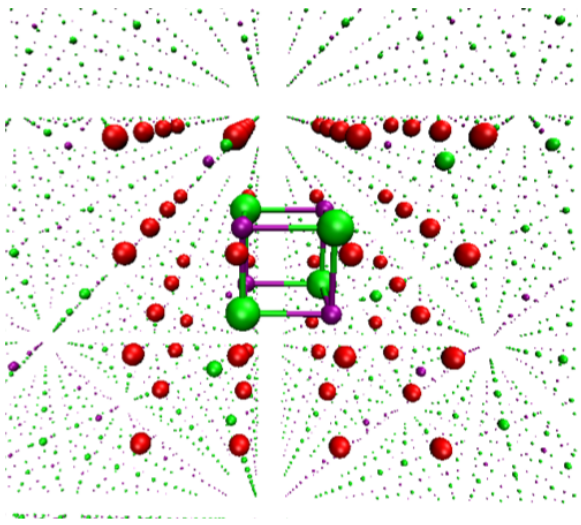
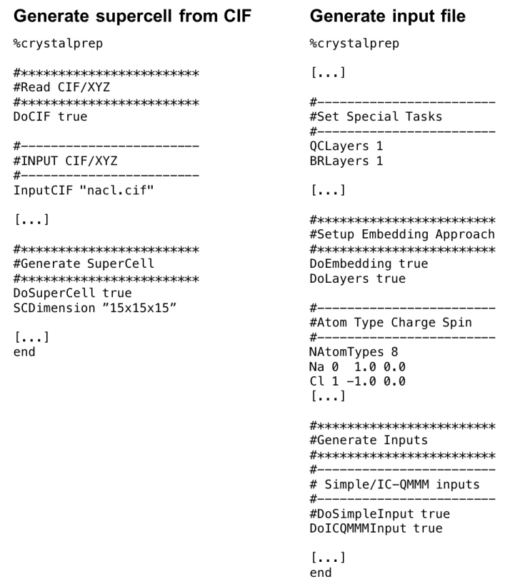
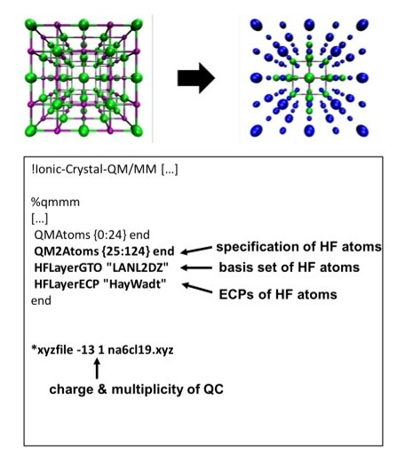

# Ionic-Crystal-QM/MM

Modeling ionic inorganic crystals is challenging, especially when accuracy is required. Periodic calculations often rely on density-based approaches, which may lack the precision required for certain properties. Electrostatic embedding approaches such as Ionic-Crystal-QM/MM overcome this by integrating advanced quantum mechanical (QM) methods into solid-state modeling.

The Ionic-Crystal-QM/MM model embeds a quantum domain in a classical environment of point charges, allowing accurate and efficient modeling of solid-state systems. It extends the capabilities of all molecular level QM methods within ORCA to the study of crystalline materials, providing detailed insight into both ground and excited states.

In this tutorial we will explore the Ionic-Crystal-QM/MM model and guide you through its use in ORCA.

## General structure of Ionic-Crystal-QM/MM models

The Ionic-Crystal-QM/MM model consists of a large supercell representing the crystal. This is illustrated for sodium chloride in the figure below.

[](../images/ionic_crystal_nacl.png)

*Figure: Electrostatic embedded cluster model for NaCl with the QC (quantum cluster: atomic structure in the center, green: Cl and purple: Na), the BR (boundary region, red), and the PC (point charge field, small dots) field.*

At the center of the supercell is a central cluster of atoms treated quantum mechanically, known as the **quantum cluster (QC)**. The QC is the focus of the calculation, so it must be large enough to capture the desired properties and preserve important features of the crystal structure. More details on how to choose its size will be shown below.

However, QC alone cannot account for long-range electrostatic effects, which are critical for modeling solid-state bulk properties. To address this, the model introduces a **point charge (PC) field** around the QC. These PCs simulate the surrounding crystal lattice and ensure that the QC behaves as if it were in the bulk of the crystal.

To accurately reflect the electrostatic properties of the crystal, the PC field must satisfy three key conditions:

1. Preserve the Madelung constant: The PCs must be numerous and well positioned to ensure that the QC atoms experience the correct electrostatic environment.
2. Ensure homogeneous charge distribution: The charges of the PCs must match the ions they represent in the crystal lattice, maintaining a uniform charge distribution throughout the model.
3. Conserve charge neutrality: The total charge of the QC and PCs combined must be zero, which may require adjusting the PC charges, especially at the edges of the PC field, to avoid unwanted effects on the QC.

Additionally, a **boundary region (BR)** of **electrostatic core potentials (ECPs)** is introduced between the QC and PCs. This BR helps reduce surface or interface effects caused by unsaturated bonds at the QC’s surface, preserves local orbital symmetries that might otherwise be disrupted, and prevents artificial charge transfer between the QC and PCs, preventing over-delocalization of the QC charge.

In the following sections, this tutorial will guide you through setting up such a model in ORCA, whether manually or using the ORCA_CrystalPrep utility, and explain the computational protocols necessary to run Ionic-Crystal-QM/MM calculation within ORCA.

## Creating electrostatic embedded cluster models manually and with ORCA_CrystalPrep

The electrostatically embedded cluster model of a crystal is built from its supercell, which serves as the foundation for the QC, BR, and PC field. The first step is to create an appropriate supercell, which can be derived from the experimental structure of a unit cell typically stored in a Crystallographic Information File (CIF). You can convert this CIF into a supercell using crystallographic or chemical software like VESTA, MERCURY, or CRYSTAL.

Once you have the supercell, the QC and BR are defined by cutting a portion from its center. This step can be performed using molecular modeling software such as AVOGADRO, Jmol, or CHIMERA. The remaining atoms that are not part of the QC or BR are assigned to the PC field. The final model can be saved as Cartesian coordinates in an .xyz file, which can be integrated into an ORCA input file for further calculations. The process is visualized in the figure below.

[](../images/supercell_to_model.png)

*Figure: Schematic protocol for the creation of an electrostatic embedded cluster model using data from a CIF to create a supercell and the resulting QC, BR, and PC field.*

Alternatively, the ORCA_CrystalPrep tool can automate this process. ORCA_CrystalPrep constructs the supercell, creates the QC, BR, and PC field, and generates the corresponding input files for ORCA. To explore its basic functions, you can use the command:

```text
ORCA_crystalprep
```

To generate a template input file, use:

```text
ORCA_crystalprep nacl.inp -geninput
```

This command will create an input template, here we named it exemplarily "nacl.inp" as we model sodium chloride as an example, suggesting basic keyword options that can be customized for your needs. The input file to generate the model can be run using ORCA_CrystalPrep as shown below:

```text
ORCA_crystalprep nacl.inp
```

The template input file includes instructions for generating the supercell and specifying the electrostatic embedding model. For example, you can specify that the crystal data is read from a CIF and define the supercell size with keywords like DoCIF true and SCDimension "15x15x15". The important parts of the template are shown in the subsequent figure.

[](../images/input_crystalprep.png)

*Sample excerpts from a possible input file for ORCA_CrystalPrep, generated via "geninput" with ORCA_CrystalPrep and modified accordingly.*

To create an electrostatically embedded cluster model from the supercell, you need to define the atom types (e.g., Na and Cl), their charges, and spins in the ORCA_CrystalPrep input file, along with enabling the DoEmbedding true keyword (see template above). The QC and BR are defined based on layers of atoms surrounding the center of the supercell. The first layer of atoms defines the QC, while the second layer forms the BR. This is the default setting in ORCA_CrystalPrep, but you can also select the QC and BR by volume or specific atom selection.

Any atoms not assigned to the QC or BR are automatically assigned to the PC field. ORCA_CrystalPrep generates separate .xyz files for each region, which can then be used to create ORCA input files for either a "simple" embedding approach or an Ionic-Crystal-QM/MM calculation. The keywords DoSimpleInput true and DoICQMMInput true activate these options, respectively. The simple input uses the default ORCA input file structure, while Ionic-Crystal-QM/MM leverages ORCA's QM/MM module. In this tutorial, we will guide you through the manual creation of the latter type of input files, as they represent the state-of-the-art approach.

## Creating Ionic-Crystal-QM/MM input files

The Ionic-Crystal-QM/MM input structure uses ORCA's QM/MM environment to calculate electrostatically embedded clusters. We need three different input files: the ORCA input file, the supercell structure file, and a force field file. This will be explained later.

[](../images/input_ionic_crystal.png)

*Figure: Example input file (top), corresponding xyz file (bottom left), and force field file (bottom right) for an electrostatically embedded cluster calculation using Ionic-Crystal-QM/MM in ORCA for the example of an  [$\mathrm{Cl}_{4}$]^0 cluster.*

We start with the xyz file of the supercell. You either got this from your previous ORCA_CrystalPrep run or you created it manually as defined above. When using ORCA_CrystalPrep to create the Ionic-Crystal-QM/MM input file, explicit selection and definition of QC and BR coordinates is not required. So you can just use it as it is. However, it is often advisable to define the QC beforehand, ideally placing the corresponding coordinates at the top of the supercell xyz file for clarity.

Since we are using the QM/MM environment, we need a force field file that defines the charges at each lattice point. Thus, a force field defining the charges at each lattice point is created for the supercell structure xyz file. The ORCA_MM utility is used to create this force field file with the following command:

```text
ORCA_mm -makeff na4cl4.xyz -CEL Na 1.0 -CEL Cl -1.0
```

This command creates a force field file (e.g. "na4cl4.ORCAFF.prms") that contains all the necessary information for the following steps.

In the ORCA input file, the keyword Ionic-Crystal-QMMM is used to specify that a crystal calculation is to be performed, invoking the QM/MM engine. The locations of the force field file and the xyz file must be clearly specified in the input file. The QC is defined by the keyword QMAtoms {...}, where the atoms to be treated quantum mechanically (i.e. the QC) are specified by their positions in the force field and xyz files. Alternatively, the QC can be defined by layers using the keyword QMLayers followed by an integer specifying the number of layers. This automatic layer-based definition is particularly useful for large clusters or initial calculations.

The BR can also be defined by specific atoms using the keyword ECPLayerAtoms {...} or by layers using the keyword ECPLayers and an integer. Typically, the BR is defined by layers rather than individual atoms, unless the QC is highly asymmetric or specific atoms within the QC need to be replaced by ECPs. The default ECP type is SDD, which can be changed with the ECPLayerECP keyword.

With Ionic-Crystal-QM/MM, the charges of the ECPs and PCs can be automatically optimized through an iterative process based on CHELPG charges. This automated charge optimization simplifies the workflow and reduces potential sources of error. Keywords such as Conv_Charges, Conv_Charges_Maxncycles, and Conv_Charges_Convtresh are used to specify the charges to optimize, the maximum number of optimization cycles, and the convergence threshold, respectively.

The EnforceTotalCharge keyword imposes a total charge on the model, where Charge_Total specifies the value of the charge. Typically, the total charge is set to zero to maintain overall neutrality, although other values may be appropriate for specific calculations such as ionic potentials or electron affinities. The keyword OuterPCLayers, together with an integer, defines the outer layers of the PC field, which can be adjusted to neutralize the total charge, especially in cases where there is an imbalance in the charge distribution.

Overall, Ionic-Crystal-QM/MM streamlines the process of electrostatic embedding by automating charge optimization and neutralization, making it a robust and efficient approach to computing embedded clusters.

## How to choose the quantum cluster (QC)

To determine what makes a good quantum cluster (QC) for a calculation, it's important to first understand the purpose of the QC. The QC is the part of the model where quantum mechanical properties are calculated, so it must accurately represent the crystal structure and, more importantly, the specific property of interest. The QC may need to include all relevant types of atoms, bonds, and symmetry elements, depending on the property of interest. For local properties, a smaller QC may be sufficient, while more extensive, long-range, or delocalized properties typically require a larger QC. If the property depends on the local point group of a particular atomic site within the crystal, the QC must preserve the symmetric environment of that atom, which is especially critical in covalent systems.

[](../images/nacl_SCe_SCl.png)

*Figure: Different QC sizes of NaCl (rock salt structure) for the supercell approach (SCe) and spherical cluster approach (SCl).*

Using the NaCl system as an example, two main approaches to constructing a QC can be identified: the supercell or unit cell approach (SCe) and the spherical cluster or ligand field approach (SCl). In the SCe approach, the QC is built from an increasing number of NaCl building blocks to form a complete unit cell or supercell. This method ensures that the model is either charge neutral or near neutral, which can be advantageous. However, a potential drawback of the SCe approach is that it can disrupt essential bonds in structures with local symmetry elements.

The SCl approach preserves the coordination environment around a particular center, thus maintaining key symmetry elements within the QC. For example, in the NaCl system, the octahedral environment around a Na^+ ion is preserved. This approach is particularly useful when the point group of a center is critical for properties such as spectroscopic properties or when studying the influence of local symmetry. However, SCl clusters tend to be highly charged, which can be challenging. The reverse of the SCl models can also be created, such as [Na_6Cl]^5+ instead of [NaCl_6]^5-.

Both the SCe and SCl approaches generally yield similar results for most properties when modeled carefully, but one method may converge faster than the other. For example, when calculating the HOMO-LUMO gap for NaCl, both SCe and SCl approaches converge to the same value, but the SCe approach may do so with a smaller QC.

[](../images/nacl_HL.png)

*Convergence of the energy of the HOMO-LUMO gap for increasing SCe (red) and SCl (blue) NaCl clusters with (solid line) and without (dashed line) electrostatic embedding environment.*

In some cases a "hybrid" QC model may be advantageous. This approach allows a specific selection of atoms within the QC to be calculated at a higher level of theory, while the rest of the cluster is calculated using a more economical method such as Hartree-Fock (HF) with a small basis set and core potentials. This hybrid model can be particularly useful when the QC needs to be large, or when high accuracy is required for only a subset of atoms. In addition, a "QC + HF" model can smooth the transition from the QC to the electrostatic environment, reduce interfacial effects, and account for bonds on the QC surface, which is particularly relevant for more covalent systems.

[](../images/nacl_HF_layer.jpg)

*Construction of a "QC + HF" cluster model with [$\mathrm{Cl}_{19}$]^13– as the QC, extended to [$\mathrm{Cl}_{62}$]^+ with HF layers, and corresponding ORCA input files for Ionic-Crystal-QM/MM. Color code: Part of QC treated with HF (blue).*

The structure of the HF cluster can vary depending on the purpose of the calculation and can be defined by selecting specific atoms or by layers, as is possible with Ionic-Crystal QM/MM. ORCA_CrystalPrep can predefine the HF structure, integrating the QC into the broader model. An example in the NaCl system shows an SCl geometry for the QC, with HF-calculated atoms extending this to an SCe structure, combining the advantages of both approaches. This hybrid approach ensures that the entire QC is approximately charge neutral, while preserving the essential point group for accurate property calculations.
