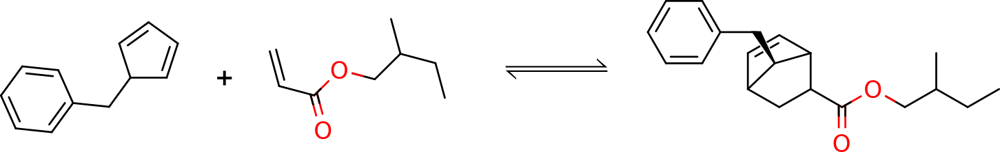
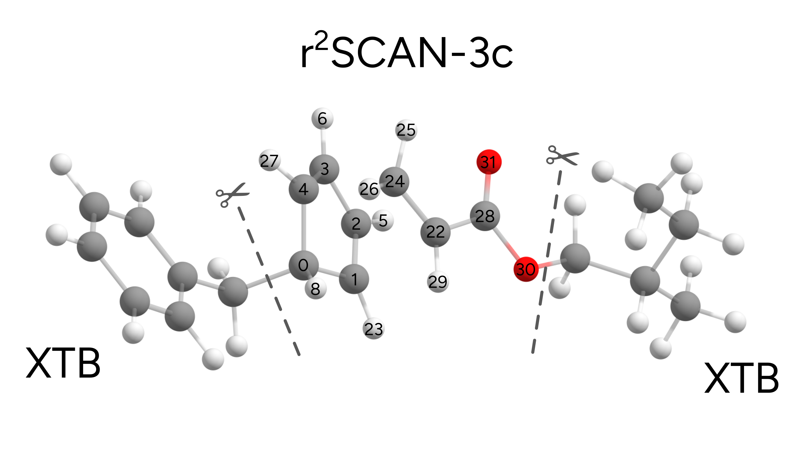
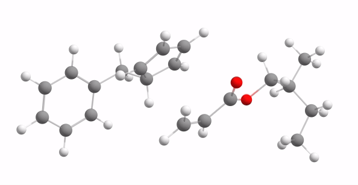
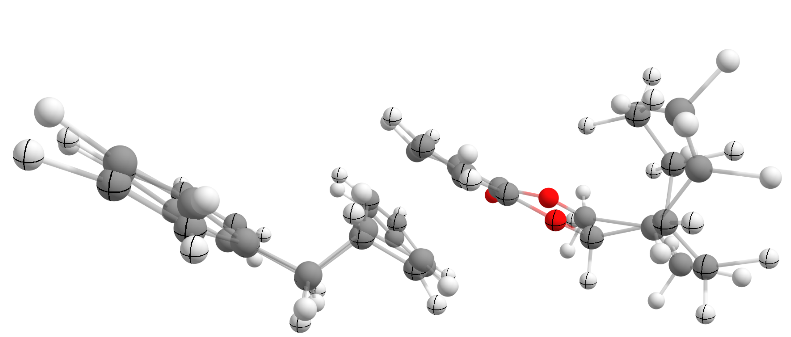
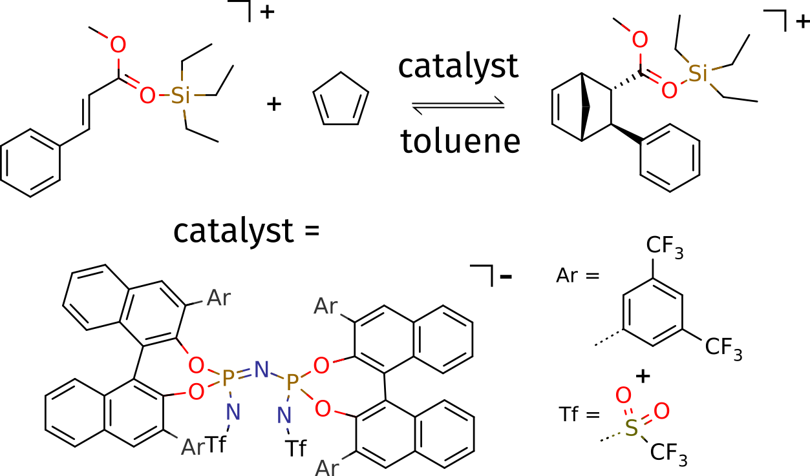
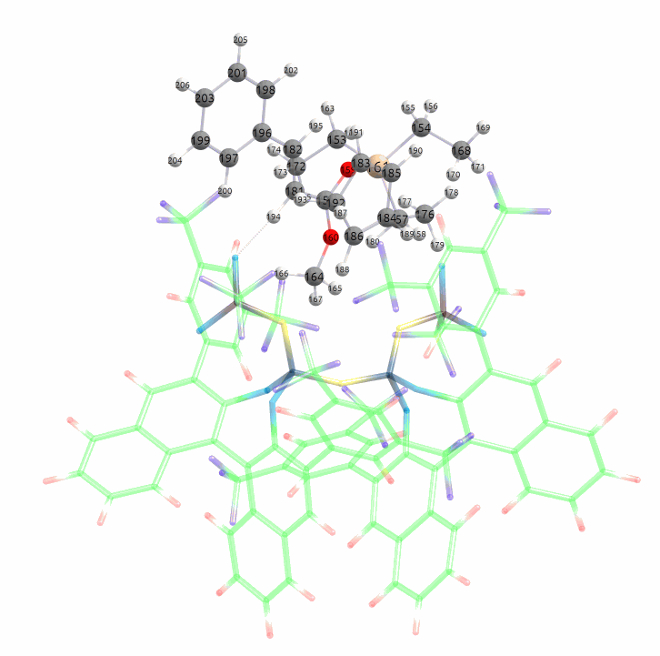

# Multiscale NEB-TS for transition states

Now let us go for an even more advanced use of the multilevel methods and combine it with another important ORCA feature: the NEB-TS method to automatically find transitions states. Please check the previous tutorial "[Finding Transition States with NEB-TS](../react/nebts.md#nebts)" if still don't know what that is, from now on we will assume it is already understood.

In this tutorial we will find the transition state **and** compute its energy barrier using a mixture of regular r^2SCAN-3c and XTB. To try to make things not so simple and a little bit more interesting: our target reaction will be the Diels-Alder reaction presented below:

[](../images/reaction1.png)

The r2SCAN-3c is another recent "3c" method developed by the group of Stefan Grimme, based on the meta-GGA functional r^2SCAN, which is already implemented in ORCA and has shown some really good benchmark results [[Grimme2021]](../bib.md#grimme2021).

## Preparing our input for the NEB-TS calculation

In order to run the NEB-TS, we need the reactant and product, preferably already optimized using some method. One can take the structures from the end of the page and optimize with:

```text
!R2SCAN-3C OPT FREQ
* XYZ 0 1
```

and they should converge after a few steps. The whole optimization plus frequencies here took only about 25 minutes for each using !PAL16.

So we have the reactants, positioned as an educt, and the product. As shown before, the first challenge on a successful ONIOM calculation is the choice of the QM1 and QM2 regions. Since our reaction occurs between the diene and the dienophile, it is reasonable to include both in the higher level r^2SCAN-3c region. Here is a 3D image showing the ORCA numbering for one of these:

[](../images/split.png)

Please notice that here we are also including the ester electron withdrawing-group bound to the ethene subunit. There is a strong electronic connection between them and removing it from the main QM1 region would not be a smart decision in this case.

## Running a NEB-TS with ONIOM

The ORCA input for the NEB-TS is then simple as always, except that the *%QMATOMS* must be explicitly assigned:

```text
!QM/XTB R2SCAN-3C NEB-TS NUMFREQ
%QMMM QMATOMS {0:6 8 22:31} END END
%NEB PREOPT TRUE PRODUCT "product.xyz" END
* XYZFILE 0 1 reactant.xyz
```

Some important remarks here:

> 1. We have to use NUMFREQ, for there is no analytic Hessian with the ONIOM method in ORCA yet, and we want to compute the frequencies in the end to confirm that we have found a transition state.
> 2. Our reactant/product structures were optimized using pure r^2SCAN-3c. Since now we are using ONIOM, which represents a different potential energy surface, it makes sense to reoptimize these before the NEB, thus we set *PREOPT TRUE*.

The complete calculation, using !PAL8 and including the numerical frequencies took only about 1h and 20 mins, which is impressively fast for such a calculation all the way from finding the transition state to computing frequencies. Finally, the transition state was found with a single negative frequency of $-358.36$ $cm^{-1}$.

Here is an animated version of the Minimum Energy Path (MEP) found:

[](../images/MEP.gif)

and also the vibrational mode with the imaginary frequency, clearly indicating the expected coordinate for the Diels-Alder reaction:

[](../images/vib.gif)

As part of the output of the NEB-TS, together with the energy of the MEP we get the reaction energy, which in this case is $E_{barrier}^{ONIOM}=9.37$ $kcal/mol$:

```text
                      PATH SUMMARY FOR NEB-TS
---------------------------------------------------------------
All forces in Eh/Bohr. Global forces for TS.

Image     E(Eh)   dE(kcal/mol)  max(|Fp|)  RMS(Fp)
  0    -495.04184     0.00       0.00007   0.00003
  1    -495.04118     0.41       0.00204   0.00031
  2    -495.03976     1.31       0.00375   0.00057
  3    -495.03781     2.53       0.00454   0.00071
  4    -495.03476     4.44       0.00318   0.00052
  5    -495.02943     7.78       0.00166   0.00032
  6    -495.02579    10.07       0.00173   0.00033 <= CI
 TS    -495.02690     9.37       0.00063   0.00009 <= TS
  7    -495.03697     3.06       0.00168   0.00046
  8    -495.07669   -21.87       0.00524   0.00143
  9    -495.08248   -25.50       0.00009   0.00002
```

## Comparison with the full DFT result

We can also compare the ONIOM results with the full DFT result just for checking:

```text
!R2SCAN-3C NEB-TS FREQ
%NEB PRODUCT "product.xyz" END
* XYZFILE 0 1 reactant.xyz
```

After the NEB convergence, the transition state is found and an energy barrier of $E_{barrier}^{ONIOM}=10.25$ $kcal/mol$ is found. This means our ONIOM presented only a 10 % error with respect to the full calculation in this case.

Taking these ONIOM structures and recomputing the DFT energies results in a barrier of $E_{barrier}^{DFT/ONIOM}=10.63$ $kcal/mol$, which is then quite close to the exact result.

Overlaying both structures of the transition states found also show that the results are quite similar:

[](../images/overlay.png)

To conclude this section, the full DFT frequency found for the transition state is $-370.80$ $cm^{-1}$, also in agreement with the previous result found using multiscale.

## A large example from literature

In order to show how the multiscale would perform on a very large system, let's take as an example a recent paper from a collaboration of the group of Prof. Frank Neese and Prof. Benjamin List (the 2022 Chemistry Nobel prize winner!).

The group from Prof. List is known for their reactions using organic molecules as catalysts, and one of these reactions is the stereoselective Diels-Alder reaction below [[Bistoni2020]](../bib.md#bistoni2020):

[](../images/list.png)

The article describes the study of this reaction using DFT and DLPNO-CCSD(T) in great detail. We will **not** try to reproduce any of its results, but simply show how one could use NEB-TS together with ORCA's ONIOM, to find the transition state of this 206-atom large system.

As always, for NEB-TS we need a reactant and a product. These structures, kindly provided by the authors, were pre-optimized and the starting structures are printed by the end of this page.

### Setting up our more complex input - the charges

Now we can run a NEB-TS calculation to find the transition state involved in this reaction. Using the QM/XTB approach and a PBE/def2-SVP as QM method, the input looks like:

```text
! QM/XTB PBE D3BJ def2-SVP NEB-TS NUMFREQ
%NEB
 product "product.xyz"
 preopt true
END
%QMMM
 QMAtoms { 151:205 } end
 Charge_Total 0
END
* XYZFILE 1 1 reactant.xyz
```

Which corresponds to a division of regions as shown in the image below, with the solid balls representing the higher-level DFT region:

[](../images/rot.gif)

Some important points here:

> 1. We use !NEB-TS together with `!NUMFREQ?`, so that the frequencies are calculated in the end to verify the transition state. Remember that ORCA currently can only do numerical frequencies for multiscale calculations.
> 2. It is recommended to use `PREOPT TRUE`, in order to preoptimize the reactant and product since they were previously optimized using a different method.

Please note that now, after the *QMAtoms*, we also have *Charge_Total 0*. This is the charge of the **total system (QM1 + QM2, or DFT + XTB)**, which in this case is neutral. On the Lewis structure above, it is shown that the reactant is actually a cation and the catalyst is an anion.

The total charge is zero, however since we chose the reactant educt as the higher-level QM region, the charge given at the end of the input, after *xyzfile* has to be +1. There one has to add the **total charge of the higher-level QM system**, and the charge of the lower-level XTB will be deduced from that and the *Charge_Total*.

> **Important**
> The charge that goes together with the multiplicity in the coordinate section, **is always the one of the highest-level region**. The same applies to the multiplicity, which can be set for the total system using *Mult_Total* under *%QMMM*, and has to be also set for the higher-level system.

> **Note**
> If no *Charge_Total* or *Mult_Total* is given, a neutral system with all paired electrons is assumed.

Using !PAL16 for 16 cores, this calculation took 15 hours and only one negative frequency was found, of $-384.94$ $cm^{-1}$. The overall result for the NEB-TS is:

```text
---------------------------------------------------------------
                      PATH SUMMARY FOR NEB-TS
---------------------------------------------------------------
All forces in Eh/Bohr. Global forces for TS.

Image     E(Eh)   dE(kcal/mol)  max(|Fp|)  RMS(Fp)
  0   -1627.03519     0.00       0.00012   0.00002
  1   -1627.03314     1.29       0.00380   0.00030
  2   -1627.03058     2.90       0.00195   0.00026
  3   -1627.02792     4.56       0.00318   0.00036
  4   -1627.02388     7.10       0.00578   0.00058
  5   -1627.01743    11.15       0.00186   0.00027 <= CI
 TS   -1627.02210     8.22       0.00009   0.00001 <= TS
  6   -1627.02306     7.62       0.00419   0.00055
  7   -1627.03571    -0.32       0.01194   0.00094
  8   -1627.05101    -9.93       0.00263   0.00029
  9   -1627.05229   -10.73       0.00009   0.00001
```

with a predicted electronic energy barrier of $E_{barrier}^{ONIOM}=8.22$ $kcal/mol$. The minimum energy path, saved as *basename_MEP_trj.xyz* is shown below:

[](../images/list_MEP_fullactive.gif)

### Reducing the size of the active region

You can see from the MEP above, that most of the action in practice occurs very close to the reactant educt. That is expected, since the catalyst in this case is only there to bring together and properly position the reactants. One could go one step further in terms of approximations and also limit the *Active Region* of this optimization.

By *Active Region* here we mean the parts of the molecule/system that will actually move and be optimized. For larger systems with localized bond breaking/forming, we could essentially ignore the surroundings in terms of the geometry optimization and only take the central relevant part into the NEB-TS.

In order to do it, the following input has to be used:

```text
! QM/XTB PBE D3BJ def2-SVP NEB-TS NUMFREQ
%NEB
 product "product.xyz"
 preopt true
END
%QMMM
 QMAtoms { 151:205 } end
 ActiveAtoms {151:205} end
 Charge_Total 0
END
* XYZFILE 1 1 reactant.xyz
```

which is essentially the same, except that now there is also a list of *ActiveAtoms*. In this case, we chose it to be the same as the higher-level DFT, but in principle it can be anything. Now, looking back to the final part of the QMMM output:

```text
Size of region for optimizer           ... 59
        optimized atoms = activeRegion ... 55
        fixed atoms (distance cutoff)  ... 4 ( 1.0)
Composition of different systems (atoms start counting at 0):
QM1 Subsystem                          ... 151 152 153 154 155 156 157 158 159 160
                                           161 162 163 164 165 166 167 168 169 170
                                           171 172 173 174 175 176 177 178 179 180
                                           181 182 183 184 185 186 187 188 189 190
                                           191 192 193 194 195 196 197 198 199 200
                                           201 202 203 204 205
Active atoms                           ... 151 152 153 154 155 156 157 158 159 160
                                           161 162 163 164 165 166 167 168 169 170
                                           171 172 173 174 175 176 177 178 179 180
                                           181 182 183 184 185 186 187 188 189 190
                                           191 192 193 194 195 196 197 198 199 200
                                           201 202 203 204 205
Fixed atoms used in optimizer          ... 104 106 109 143
```

You can see that the number of *Active atoms* correspond to what we chose, but another 4 *Fixed atoms* will be added to the optimizer. These are selected based on their distance to the active atoms, and are important to stabilize the geometry optimization. They are just atoms for which the Cartesian coordinates will be fully constrained.

In principle, these four extra atoms won't make much of a difference, in some cases it could be even much more, but they are really necessary to avoid having the *Active atoms* moving to a region of space were the ignored atoms are. There is no need to play around with these, but more information can be found on the [ORCA manual](https://www.faccts.de/docs/orca/6.0/manual).

This calculation with 16 cores now takes only about three hours, including the frequencies! The imaginary mode is essentially the same, with $-372.29$ $cm^{-1}$ and the MEP is shown below:

[](../images/list_MEP_reducedactive.gif)

The summary for the NEB-TS is:

```text
---------------------------------------------------------------
                      PATH SUMMARY FOR NEB-TS
---------------------------------------------------------------
All forces in Eh/Bohr. Global forces for TS.

Image     E(Eh)   dE(kcal/mol)  max(|Fp|)  RMS(Fp)
  0   -1626.95773     0.00       0.05123   0.00546
  1   -1626.95627     0.92       0.05121   0.00547
  2   -1626.95362     2.58       0.05120   0.00548
  3   -1626.95029     4.67       0.05113   0.00549
  4   -1626.94563     7.59       0.05094   0.00552
  5   -1626.94303     9.23       0.05056   0.00547 <= CI
 TS   -1626.94483     8.10       0.05053   0.00547 <= TS
  6   -1626.94614     7.27       0.05034   0.00547
  7   -1626.95464     1.94       0.05001   0.00563
  8   -1626.97407   -10.25       0.04976   0.00564
  9   -1626.97568   -11.26       0.04984   0.00541
```

with an electronic barrier of $E_{barrier}^{ONIOM, reduced}=8.10$ $kcal/mol$, which is extremely close to the one we found using the whole molecule as the active region.

> **Important**
> Choosing the active region might be crucial for a good result in you calculation. If it makes sense to reduce it, there is no reason why not to do it as long as you keep being critical.

### Structures

### Reactant - first reaction

```mol
title: oniom-nebts #10
theme: chem311
height: 360px
representation: ball-stick
--- xyz ---
48
structure
C     -0.959170    1.357710    0.849530
C     -1.209220   -0.099150    1.125410
C     -1.020360   -0.792050   -0.010410
C     -0.447780    0.072990   -1.016570
C     -0.282210    1.295860   -0.498460
H     -1.152820   -1.853560   -0.134070
H     -0.116330   -0.245620   -1.990700
C     -2.339380    1.987020    0.683280
H     -0.337470    1.847770    1.611490
C     -2.248950    3.395110    0.185170
H     -2.901170    1.934260    1.623080
H     -2.928910    1.405700   -0.041820
C     -2.186770    3.649880   -1.194570
C     -2.053620    4.950230   -1.656980
C     -1.998930    5.997850   -0.741190
C     -2.152360    4.441550    1.097760
C     -2.042890    5.744340    0.631740
H     -1.992580    5.140040   -2.724560
H     -1.917590    7.018790   -1.098690
H     -2.206360    2.826900   -1.909090
H     -2.160560    4.236900    2.165340
H     -1.991120    6.561960    1.342860
C      1.758570   -0.240400    1.806570
H     -1.508010   -0.494900    2.085180
C      2.254780    0.581810    0.876060
H      2.513270    0.204680   -0.110980
H      2.256010    1.655530    1.023140
H      0.218730    2.134490   -0.964520
C      1.617970   -1.679900    1.488880
H      1.369350    0.120320    2.750720
O      1.135080   -2.286530    2.601380
O      1.969400   -2.213850    0.460030
C      1.347740   -3.701960    2.651880
C      2.037140   -4.011320    3.987890
H      1.958980   -4.073300    1.820920
H      0.366660   -4.185080    2.584810
C      3.565200   -3.787240    3.937590
C      3.998870   -2.361970    3.631780
H      4.014530   -4.457460    3.194300
H      3.992120   -4.063440    4.908950
H      3.818310   -2.111390    2.586420
H      5.075790   -2.248480    3.785800
H      3.481960   -1.639680    4.271050
C      1.750940   -5.457390    4.388300
H      1.624820   -3.351270    4.763030
H      0.674370   -5.616750    4.511420
H      2.234130   -5.700050    5.339940
H      2.114640   -6.157110    3.628730
```

### Product - first reaction

```mol
title: oniom-nebts #11
theme: chem311
height: 360px
representation: ball-stick
--- xyz ---
48
structure
C     -0.737196    1.403177    0.989584
C     -0.618249   -0.085793    1.354168
C     -0.852079   -0.732487    0.014079
C     -0.351356    0.075705   -0.910834
C      0.225931    1.272089   -0.203167
H     -1.288752   -1.705720   -0.115453
H     -0.282193   -0.088821   -1.970037
C     -2.152823    1.873670    0.651875
H     -0.326752    2.050689    1.768333
C     -2.127122    3.294013    0.165082
H     -2.767493    1.799866    1.552333
H     -2.580061    1.222755   -0.112145
C     -2.087052    3.576779   -1.194068
C     -2.020960    4.884301   -1.641606
C     -1.993421    5.928815   -0.733499
C     -2.098809    4.349545    1.067753
C     -2.033976    5.658002    0.623515
H     -1.991462    5.089395   -2.702015
H     -1.942930    6.949926   -1.081887
H     -2.111239    2.763534   -1.905541
H     -2.133469    4.143325    2.128542
H     -2.016305    6.468786    1.337510
C      0.919141   -0.179358    1.598814
H     -1.216246   -0.455788    2.183181
C      1.492793    0.746289    0.513478
H      2.136317    0.190920   -0.168157
H      2.062566    1.565946    0.949390
H      0.391014    2.160114   -0.807510
C      1.382635   -1.613838    1.482688
H      1.146808    0.167446    2.608645
O      1.032440   -2.295373    2.575254
O      1.972282   -2.085265    0.545235
C      1.361068   -3.682967    2.649381
C      2.048610   -4.001062    3.982150
H      1.995994   -3.945721    1.797590
H      0.417620   -4.234230    2.572749
C      3.564854   -3.782141    3.926193
C      3.971075   -2.349291    3.600810
H      3.994093   -4.457226    3.182191
H      3.981519   -4.055042    4.898803
H      3.727461   -2.094270    2.573290
H      5.044497   -2.227649    3.728709
H      3.464743   -1.648481    4.261491
C      1.746479   -5.443895    4.383874
H      1.622991   -3.326413    4.732911
H      0.676972   -5.596645    4.506155
H      2.235620   -5.683831    5.324523
H      2.109242   -6.131980    3.623461
```

### Reactant - second reaction

```mol
title: oniom-nebts #12
theme: chem311
height: 360px
representation: ball-stick
--- xyz ---
206
structure
P   0.916540   -1.446915    -0.319940
O   2.371689   -0.759534     0.092738
O   0.757312   -2.624241     0.830064
C   3.424107   -1.513413     0.600201
C   4.601756   -1.616396    -0.198660
C   5.654349   -2.382135     0.279295
C   5.574035   -3.072225     1.519527
C   6.644233   -3.895980     1.976074
C   6.542851   -4.603066     3.163608
C   5.353751   -4.519092     3.933852
C   4.300040   -3.714908     3.523431
C   4.381496   -2.952449     2.320644
C   3.309095   -2.106095     1.858576
C   2.086336   -1.901706     2.682513
C   2.149623   -1.371833     4.020418
C   3.357817   -0.872255     4.590832
C   3.377330   -0.354237     5.878000
C   2.197907   -0.343563     6.669067
C   1.005220   -0.811527     6.138662
C   0.939076   -1.301039     4.800643
C   -0.29459    -1.71597      4.22743
C   -0.37893    -2.16984      2.91371
C   0.834583   -2.225332     2.158796
C   4.710423   -0.920983    -1.507929
H   6.573936   -2.466560    -0.319659
H   7.551361   -3.968163     1.356325
H   7.373611   -5.239805     3.502683
H   5.262066   -5.102616     4.862336
H   3.381935   -3.672022     4.124449
H   4.276104   -0.882571     3.989665
H   4.316741    0.048319     6.284977
H   2.231999    0.042133     7.699243
H   0.081163   -0.799654     6.735099
H   -1.20194    -1.68274      4.84936
C   -1.66996    -2.64261      2.35073
C   4.650292    0.482034    -1.582299
C   4.830403    1.135713    -2.813629
C   5.054553    0.401861    -3.984779
C   5.080086   -1.001951    -3.917445
C   4.919055   -1.661606    -2.691409
C   -2.86470    -1.94773      2.62676
C   -4.10108    -2.46212      2.20367
C   -4.16805    -3.66753      1.48952
C   -2.98138    -4.35769      1.20172
C   -1.74308    -3.84912      1.62007
H   4.470387    1.065209    -0.668426
H   5.182774    0.918236    -4.945377
H   4.907411   -2.758422    -2.648989
H   -2.82717    -0.99836      3.18032
H   -5.13604    -4.07516      1.17340
H   -0.82670    -4.41393      1.40619
N   -0.13760    -0.30734     -0.10383
P   -1.11716     0.84307     -0.52955
O   -0.86292     2.21936      0.36552
O   -2.57781     0.33507      0.05903
C   -0.99952     2.14893      1.74493
C   0.187340    2.254363     2.537791
C   0.059383    2.089838     3.914637
C   -1.19602     1.81551      4.52419
C   -1.30988     1.61067      5.93106
C   -2.52824     1.28457      6.50764
C   -3.68590     1.15709      5.69466
C   -3.61931     1.40154      4.33045
C   -2.38345     1.75042      3.70931
C   -2.27530     1.99194      2.29410
C   -3.47851     2.08063      1.42171
C   -4.51475     3.05388      1.66124
C   -4.43717     4.03015      2.69741
C   -5.46126     4.94562      2.89566
C   -6.61363     4.93236      2.06746
C   -6.70810     4.01382      1.03394
C   -5.66792     3.06852      0.79414
C   -5.73701     2.16335     -0.30057
C   -4.71616     1.26354     -0.57110
C   -3.59436     1.24775      0.31211
C   1.497070    2.633715     1.943844
H   0.948307    2.186260     4.556414
H   -0.40307     1.70365      6.54660
H   -2.59970     1.11782      7.59310
H   -4.64531     0.86440      6.14649
H   -4.51949     1.30450      3.70928
H   -3.54674     4.06077      3.33952
H   -5.37453     5.69262      3.69908
H   -7.42132     5.65978      2.23806
H   -7.58590     4.00681      0.36940
H   -6.62166     2.18859     -0.95500
C   -4.74641     0.37537     -1.75661
C   1.587359    3.721436     1.044844
C   2.835496    4.184339     0.608214
C   4.018065    3.557099     1.034349
C   3.934033    2.469870     1.913820
C   2.685175    2.007033     2.365504
C   -5.04627     0.89481     -3.03265
C   -5.04801     0.05656     -4.15897
C   -4.74087    -1.30622     -4.03597
C   -4.42670    -1.81895     -2.77042
C   -4.43782    -0.99326     -1.63800
H   0.675241    4.231162     0.709859
H   4.994598    3.919111     0.688111
H   2.634057    1.154539     3.057707
H   -5.22010     1.97400     -3.14419
H   -4.71726    -1.95250     -4.92191
H   -4.18767    -1.41095     -0.65409
N   0.873504   -2.167366    -1.757367
N   -1.09279     1.26973     -2.07667
S   1.808817   -3.398539    -2.225292
O   2.092018   -3.259925    -3.678636
O   2.928958   -3.743659    -1.317722
S   -1.75776     2.59220     -2.73710
O   -1.68433     2.45266     -4.21201
O   -3.02132     3.05419     -2.11734
C   -0.52341     3.99163     -2.33414
C   0.644415   -4.882681    -2.101455
F   0.729296    3.514442    -2.290286
F   -0.60864     4.92727     -3.29108
F   -0.83052     4.55556     -1.16036
F   -0.45331    -4.69511     -2.84683
F   0.288702   -5.064743    -0.823796
F   1.291438   -5.968586    -2.540237
C   5.192754    1.796225     2.408800
C   2.934804    5.460725    -0.200433
C   4.721390    2.641232    -2.852077
C   5.234315   -1.781031    -5.203879
F   5.206130    1.701634     3.762311
F   6.309693    2.455705     2.034292
F   5.302189    0.524016     1.931633
F   3.076358    6.529362     0.627439
F   1.833844    5.688669    -0.950334
F   4.006422    5.459748    -1.025178
F   3.460905    3.044032    -2.523146
F   4.992896    3.152663    -4.075670
F   5.563898    3.224405    -1.967565
F   4.215300   -1.499275    -6.066313
F   6.382445   -1.451951    -5.845450
F   5.238364   -3.113368    -5.006944
C   -3.02552    -5.69794      0.49584
C   -5.36705    -1.70698      2.53462
C   -3.97906    -3.24648     -2.59146
C   -5.30714     0.66172     -5.51911
F   -5.33625    -0.27572     -6.49940
F   -6.48519     1.32707     -5.55472
F   -4.34016     1.55585     -5.85334
F   -4.74679    -3.91115     -1.69246
F   -4.01076    -3.95377     -3.75008
F   -2.70307    -3.28314     -2.12987
F   -5.49414    -0.58164      1.77722
F   -6.47562    -2.44985      2.32760
F   -5.38043    -1.30188      3.83003
F   -4.29137    -6.15315      0.35700
F   -2.33063    -6.62953      1.19617
F   -2.47472    -5.64864     -0.73929
C   1.155646    0.166147    -5.793662
C   2.721219    2.452084    -8.138136
C   -0.41783     2.72241     -8.42839
H   -0.60514     1.77909     -8.94466
H   -0.15917     3.44935     -9.19924
C   1.010667    3.674443    -5.732567
H   0.036290    3.566447    -5.254043
O   0.813838    0.848100    -6.820561
O   1.508592    0.873232    -4.748569
Si  1.038945    2.501060    -7.217859
H   2.976447    3.453654    -8.483171
H   2.639880    1.830136    -9.031107
C   1.646025    0.286420    -3.465817
H   0.669869   -0.023013    -3.092706
H   2.322221   -0.567760    -3.472660
H   2.025061    1.075376    -2.822243
C   -1.70568     3.17588     -7.73771
H   -2.53448     3.17848     -8.44248
H   -1.96035     2.52627     -6.90597
H   -1.59330     4.18195     -7.34479
C   3.864246    1.922008    -7.274127
H   3.648258    0.906989    -6.945738
H   4.794725    1.905611    -7.838628
H   4.005370    2.554371    -6.401758
C   1.233311    5.141535    -6.099683
H   2.228596    5.291075    -6.511106
H   0.507994    5.472241    -6.837522
H   1.129038    5.766357    -5.216856
H   1.752137    3.385937    -4.986940
C   1.249962   -1.251680    -5.902304
C   0.908114   -1.820168    -7.137152
C   -1.51427    -2.31699     -6.73757
C   -1.70407    -0.47019     -5.35988
C   -1.91187    -0.99093     -6.69137
C   -1.23208    -1.49189     -4.55096
H   -2.05199    -3.41513     -4.99108
H   -1.00323    -1.43925     -3.47532
H   -1.86082     0.57669     -5.04595
H   -2.28337    -0.39909     -7.53878
H   -1.60264    -2.99563     -7.59713
C   -1.21260    -2.76653     -5.33724
H   -0.30867    -3.38863     -5.18320
H   1.617135   -1.859476    -5.052770
H   0.564628   -1.132627    -7.928863
C   1.241506   -3.174011    -7.575174
C   1.838539   -4.115887    -6.730312
C   1.052550   -3.496709    -8.924919
C   2.264638   -5.326977    -7.239584
H   1.996561   -3.893845    -5.687836
C   1.483944   -4.707408    -9.424893
H   0.584062   -2.776219    -9.580217
C   2.099227   -5.623783    -8.584070
H   2.741592   -6.039624    -6.584255
H   1.353008   -4.938006   -10.471775
H   2.449888   -6.565802    -8.977882
```

### Product - second reaction

```mol
title: oniom-nebts #13
theme: chem311
height: 360px
representation: ball-stick
--- xyz ---
206
structure
P   0.916540    -1.446915    -0.319940
O   2.371689    -0.759534     0.092738
O   0.757312    -2.624241     0.830064
C   3.424107    -1.513413     0.600201
C   4.601756    -1.616396    -0.198660
C   5.654349    -2.382135     0.279295
C   5.574035    -3.072225     1.519527
C   6.644233    -3.895980     1.976074
C   6.542851    -4.603066     3.163608
C   5.353751    -4.519092     3.933852
C   4.300040    -3.714908     3.523431
C   4.381496    -2.952449     2.320644
C   3.309095    -2.106095     1.858576
C   2.086336    -1.901706     2.682513
C   2.149623    -1.371833     4.020418
C   3.357817    -0.872255     4.590832
C   3.377330    -0.354237     5.878000
C   2.197907    -0.343563     6.669067
C   1.005220    -0.811527     6.138662
C   0.939076    -1.301039     4.800643
C   -0.29459     -1.71597      4.22743
C   -0.37893     -2.16984      2.91371
C   0.834583    -2.225332     2.158796
C   4.710423    -0.920983    -1.507929
H   6.573936    -2.466560    -0.319659
H   7.551361    -3.968163     1.356325
H   7.373611    -5.239805     3.502683
H   5.262066    -5.102616     4.862336
H   3.381935    -3.672022     4.124449
H   4.276104    -0.882571     3.989665
H   4.316741     0.048319     6.284977
H   2.231999     0.042133     7.699243
H   0.081163    -0.799654     6.735099
H   -1.20194     -1.68274      4.84936
C   -1.66996     -2.64261      2.35073
C   4.650292     0.482034    -1.582299
C   4.830403     1.135713    -2.813629
C   5.054553     0.401861    -3.984779
C   5.080086    -1.001951    -3.917445
C   4.919055    -1.661606    -2.691409
C   -2.86470     -1.94773      2.62676
C   -4.10108     -2.46212      2.20367
C   -4.16805     -3.66753      1.48952
C   -2.98138     -4.35769      1.20172
C   -1.74308     -3.84912      1.62007
H   4.470387     1.065209    -0.668426
H   5.182774     0.918236    -4.945377
H   4.907411    -2.758422    -2.648989
H   -2.82717     -0.99836      3.18032
H   -5.13604     -4.07516      1.17340
H   -0.82670     -4.41393      1.40619
N   -0.13760     -0.30734     -0.10383
P   -1.11716      0.84307     -0.52955
O   -0.86292      2.21936      0.36552
O   -2.57781      0.33507      0.05903
C   -0.99952      2.14893      1.74493
C   0.187340     2.254363     2.537791
C   0.059383     2.089838     3.914637
C   -1.19602      1.81551      4.52419
C   -1.30988      1.61067      5.93106
C   -2.52824      1.28457      6.50764
C   -3.68590      1.15709      5.69466
C   -3.61931      1.40154      4.33045
C   -2.38345      1.75042      3.70931
C   -2.27530      1.99194      2.29410
C   -3.47851      2.08063      1.42171
C   -4.51475      3.05388      1.66124
C   -4.43717      4.03015      2.69741
C   -5.46126      4.94562      2.89566
C   -6.61363      4.93236      2.06746
C   -6.70810      4.01382      1.03394
C   -5.66792      3.06852      0.79414
C   -5.73701      2.16335     -0.30057
C   -4.71616      1.26354     -0.57110
C   -3.59436      1.24775      0.31211
C   1.497070     2.633715     1.943844
H   0.948307     2.186260     4.556414
H   -0.40307      1.70365      6.54660
H   -2.59970      1.11782      7.59310
H   -4.64531      0.86440      6.14649
H   -4.51949      1.30450      3.70928
H   -3.54674      4.06077      3.33952
H   -5.37453      5.69262      3.69908
H   -7.42132      5.65978      2.23806
H   -7.58590      4.00681      0.36940
H   -6.62166      2.18859     -0.95500
C   -4.74641      0.37537     -1.75661
C   1.587359     3.721436     1.044844
C   2.835496     4.184339     0.608214
C   4.018065     3.557099     1.034349
C   3.934033     2.469870     1.913820
C   2.685175     2.007033     2.365504
C   -5.04627      0.89481     -3.03265
C   -5.04801      0.05656     -4.15897
C   -4.74087     -1.30622     -4.03597
C   -4.42670     -1.81895     -2.77042
C   -4.43782     -0.99326     -1.63800
H   0.675241     4.231162     0.709859
H   4.994598     3.919111     0.688111
H   2.634057     1.154539     3.057707
H   -5.22010      1.97400     -3.14419
H   -4.71726     -1.95250     -4.92191
H   -4.18767     -1.41095     -0.65409
N   0.873504    -2.167366    -1.757367
N   -1.09279      1.26973     -2.07667
S   1.808817    -3.398539    -2.225292
O   2.092018    -3.259925    -3.678636
O   2.928958    -3.743659    -1.317722
S   -1.75776      2.59220     -2.73710
O   -1.68433      2.45266     -4.21201
O   -3.02132      3.05419     -2.11734
C   -0.52341      3.99163     -2.33414
C   0.644415    -4.882681    -2.101455
F   0.729296     3.514442    -2.290286
F   -0.60864      4.92727     -3.29108
F   -0.83052      4.55556     -1.16036
F   -0.45331     -4.69511     -2.84683
F   0.288702    -5.064743    -0.823796
F   1.291438    -5.968586    -2.540237
C   5.192754     1.796225     2.408800
C   2.934804     5.460725    -0.200433
C   4.721390     2.641232    -2.852077
C   5.234315    -1.781031    -5.203879
F   5.206130     1.701634     3.762311
F   6.309693     2.455705     2.034292
F   5.302189     0.524016     1.931633
F   3.076358     6.529362     0.627439
F   1.833844     5.688669    -0.950334
F   4.006422     5.459748    -1.025178
F   3.460905     3.044032    -2.523146
F   4.992896     3.152663    -4.075670
F   5.563898     3.224405    -1.967565
F   4.215300    -1.499275    -6.066313
F   6.382445    -1.451951    -5.845450
F   5.238364    -3.113368    -5.006944
C   -3.02552     -5.69794      0.49584
C   -5.36705     -1.70698      2.53462
C   -3.97906     -3.24648     -2.59146
C   -5.30714      0.66172     -5.51911
F   -5.33625     -0.27572     -6.49940
F   -6.48519      1.32707     -5.55472
F   -4.34016      1.55585     -5.85334
F   -4.74679     -3.91115     -1.69246
F   -4.01076     -3.95377     -3.75008
F   -2.70307     -3.28314     -2.12987
F   -5.49414     -0.58164      1.77722
F   -6.47562     -2.44985      2.32760
F   -5.38043     -1.30188      3.83003
F   -4.29137     -6.15315      0.35700
F   -2.33063     -6.62953      1.19617
F   -2.47472     -5.64864     -0.73929
C   1.141889     0.131145    -5.786190
C   2.713551     2.443019    -8.133458
C   -0.41688      2.71408     -8.42594
H   -0.60740      1.77839     -8.95444
H   -0.14737      3.44707     -9.18712
C   1.006055     3.661088    -5.734153
H   0.032637     3.558995    -5.253286
O   0.771942     0.823170    -6.811350
O   1.595724     0.850478    -4.774151
Si  1.032906     2.470258    -7.208538
H   2.958554     3.449220    -8.473849
H   2.636708     1.826117    -9.030304
C   1.671368     0.289183    -3.477331
H   0.678125     0.010405    -3.125420
H   2.323107    -0.583753    -3.447224
H   2.050708     1.078516    -2.834933
C   -1.70496      3.17165     -7.73953
H   -2.53320      3.17684     -8.44519
H   -1.96193      2.52374     -6.90705
H   -1.58981      4.17761     -7.34734
C   3.862498     1.919605    -7.273819
H   3.651734     0.903918    -6.945663
H   4.792115     1.908999    -7.840013
H   4.000709     2.551715    -6.400830
C   1.229923     5.126886    -6.107408
H   2.225624     5.275880    -6.517963
H   0.505323     5.457320    -6.846272
H   1.125640     5.754911    -5.226303
H   1.748089     3.376573    -4.987987
C   1.039692    -1.269981    -5.814425
C   0.493261    -1.897043    -7.055037
C   -1.10705     -2.23921     -6.80226
C   -1.72802     -0.46808     -5.40818
C   -1.83893     -0.95365     -6.70276
C   -1.07065     -1.46633     -4.61626
H   -2.08839     -3.27912     -5.15728
H   -0.88673     -1.40709     -3.53016
H   -1.96686      0.55345     -5.05936
H   -2.24083     -0.39216     -7.55665
H   -1.43992     -2.93808     -7.59118
C   -1.12471     -2.76034     -5.35603
H   -0.31741     -3.46601     -5.08773
H   1.560507    -1.880683    -5.053891
H   0.514749    -1.171637    -7.892292
C   1.134126    -3.191265    -7.549291
C   1.779904    -4.098173    -6.720714
C   1.014883    -3.490317    -8.904583
C   2.271965    -5.287102    -7.236108
H   1.924464    -3.891685    -5.673537
C   1.503691    -4.678257    -9.416381
H   0.534383    -2.785436    -9.568955
C   2.124281    -5.589447    -8.578538
H   2.767662    -5.983446    -6.576870
H   1.395670    -4.896729   -10.469020
H   2.491749    -6.526037    -8.971060
```
