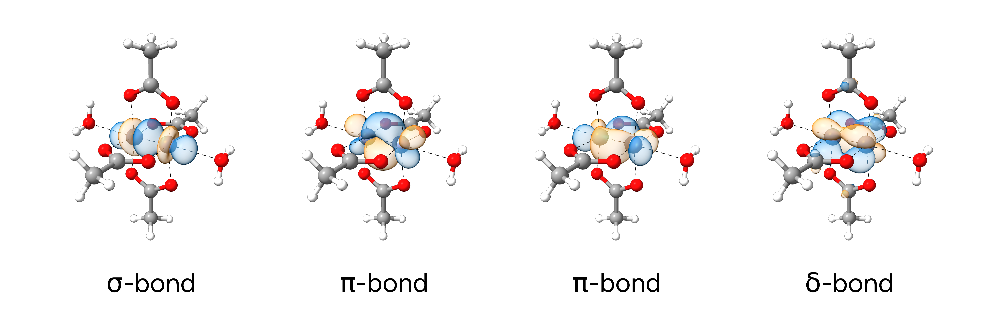

# Bond Analysis

Analysis of chemical bonding is crucial to understand the reactivity and properties of any compound. ORCA provides various tools to investigate and visualize chemical bonds based on quantum chemical methods.

## Localized Orbitals

While canonical molecular orbitals yield valuable information, they can be difficult to interpret due to their delocalized nature. This is particularly the case for large molecules.
A more convenient alternative is localizing the molecular orbitals to identify bonding overlaps in line with chemically established bonding concepts. The most prominent localization
techniques are Foster-Boys (FB) and Pipek-Mezey (PM) localizations.

### Example 1: Cr-Cr Bonding in Dichromium Tetraacetate Dihydrate

In this tutorial we will use a Pipek-Mezey localization to study the bonding situation in dichromium tetraacetate dihydrate, a well-known textbook example of a metal-metal quadruple bond.

```mol
title: Dichromium tetraacetate dihydrate
theme: chem311
height: 360px
representation: ball-stick
--- xyz ---
36
structure
  Cr          3.63292803675582      4.78285607739625     -0.63639358256050
  O           2.34785749491859      4.48652278178970     -2.12009832625825
  O           5.13493229672345      5.30466992720158      0.58344087799744
  O           4.73076207322555      3.26794262826257     -1.29923843647248
  O           2.73716250606921      6.52977972635174     -0.24223293301648
  C           1.34714372264977      3.77755038643592     -1.79342034446331
  C           0.28882874973655      3.46634459556225     -2.81104036856054
  C           4.49276620679543      2.16989237310360     -0.70883979137882
  C           5.25046716873396      0.93386548365656     -1.09583669544289
  Cr          2.72281835907000      3.84276439529425      0.61069113865845
  O           4.00842988963071      4.13941356801647      2.09374138676694
  O           1.22096071474473      3.32092019482001     -0.61027879254538
  O           1.62460073626451      5.35790230455260      1.27270500588077
  O           3.61876789645852      2.09613885710674      0.21605424661246
  C           5.00922985477937      4.84802707447584      1.76669231158828
  C           6.06814229046835      5.15890455396898      2.78377912360696
  C           1.86247448824412      6.45579094664928      0.68192448021066
  C           1.10332879431268      7.69141916931006      1.06747861321807
  H           0.53643199444775      3.91479455350269     -3.77316600096031
  H           0.19363516930407      2.38162440858367     -2.91892115129840
  H          -0.67646851589299      3.84412291439512     -2.46031116829040
  H           5.82036413122407      0.57284519899174     -0.23393409530863
  H           4.54651848337104      0.14401323934197     -1.37402597678676
  H           7.03354834642659      4.78268981767564      2.43171518212094
  H           6.16212212277575      6.24359469909520      2.89312979871985
  H           5.82180818584082      4.70895962627934      3.74553075821521
  H           5.92625733753088      1.14156035056277     -1.92544044162556
  H           0.42730948584067      7.48388311065848      1.89692409507629
  H           1.80630411261855      8.48232991810399      1.34513931752921
  H           0.53353311936446      8.05099140285292      0.20489050593958
  O           1.41030940144609      2.25034914090934      2.03754830017122
  H           0.69456507333094      2.16354974421073      1.39521339423714
  O           4.95323562321733      6.38396944730196     -2.06427896840346
  H           4.37901353165716      7.13631180534098     -1.87274555994989
  H           5.66469043982413      6.46222396268224     -1.41594550916286
  H           1.98371067809123      1.49606161555666      1.85174960593545
```

The PM localization on the previously [optimized](../prop/geoopt.md) geometry of the complex is envoked by:

```text
!r2SCAN-3c

%LOC
 LOCMET PM
END

*XYZFILE 0 1 structure.xyz
```

In the output file the details of the localization will be printed after

```text
------------------------------------------------------------------------------
                           ORCA ORBITAL LOCALIZATION
------------------------------------------------------------------------------
```

and the summary of the localized molecular orbitals (LMOs) is given. Further, the localized orbitals are stored in the `basename.loc` file.

```text
--------------------------------------------------------------------------------
                    LOCALIZED MOLECULAR ORBITAL COMPOSITIONS
--------------------------------------------------------------------------------

The Mulliken populations for each LMO on each atom are computed
The LMO`s will be ordered according to atom index and type
  (A) Strongly localized MO`s have populations of >=0.950 on one atom
  (B) Two center bond orbitals have populations of >=0.850 on two atoms
  (C) Other MO`s are considered to be `delocalized`

FOUND  -  20 strongly local MO`s
       -  48 two center bond MO`s
       -   0 significantly delocalized MO`s

Rather strongly localized orbitals:
MO  47:  32O  -   0.964883
[...]
MO  28:   0Cr -   1.014036
Bond-like localized orbitals:
MO  95:  35H  -   0.340608  and  30O  -   0.658898
[...]
MO  66:  12O  -   0.869229  and   9Cr -   0.109159
MO  65:  11O  -   0.876956  and   9Cr -   0.092742
MO  64:  11O  -   0.587896  and   5C  -   0.415626
MO  63:  11O  -   0.793870  and   5C  -   0.182382
MO  62:  10O  -   0.869257  and   9Cr -   0.109543
MO  61:   9Cr -   0.488121  and   0Cr -   0.526559
MO  60:   9Cr -   0.472239  and   0Cr -   0.471944
MO  59:   9Cr -   0.541468  and   0Cr -   0.525393
MO  58:   9Cr -   0.541872  and   0Cr -   0.524219
MO  57:   8C  -   0.463590  and   7C  -   0.609424
[...]
MO  48:   1O  -   0.869095  and   0Cr -   0.109446
Localized MO's were stored in: orca.loc
```

From this output, we can see that ORCA identified 4 "bond-like" LMOs between the two chromium atoms with
almost 50/50 electron populations. This indicates four relevant bonding contributions in line with
the expected σ-, 2×π-, and δ-bonds. To visualize these bonds after successful calculation, we can utilize `orca_plot`. To do so, we rename the `basename.loc` file to `loc.gbw` and
call `orca_plot` in its interactive mode (`-i`).

```text
orca_plot loc.gbw -i
```

We can now plot the LMOs like normal MOs by choosing the respective orbital number via option `2 - Enter no of orbital to plot` (for high-quality plots, we adjusted the number of grid intervals to *100* via `4 - Enter number of grid intervals`). The obtained `.cube` files can now be visualized with [ChimeraX](../first_steps/GUI.md) or any other program of choice.

[](../images/cracetate-locbonds.png)

*Figure: Localized Molecular Orbitals of the Cr-Cr quadruple bond.*

We see, that the visualized LMOs perfectly match our expectations.
