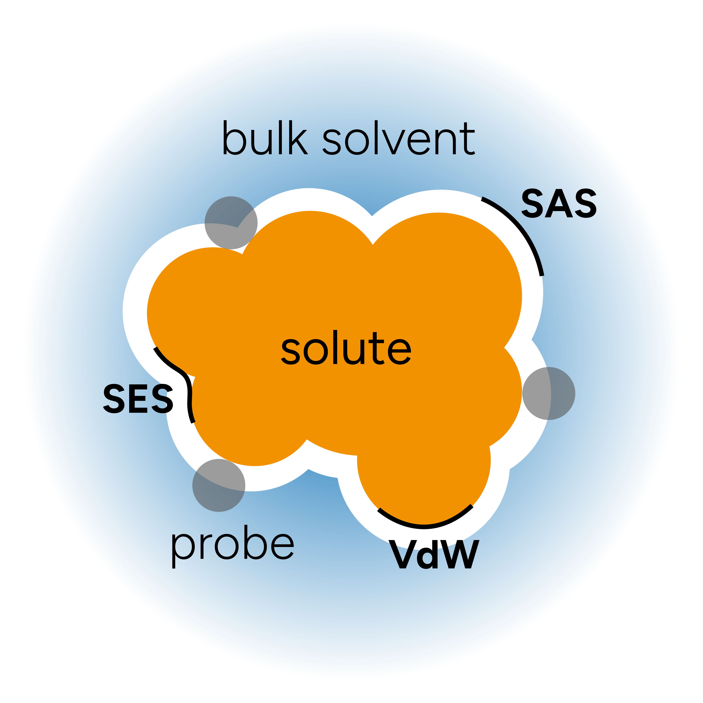
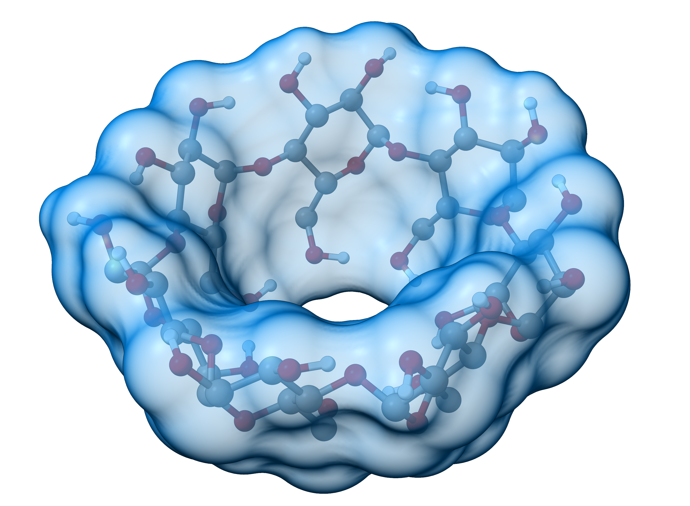
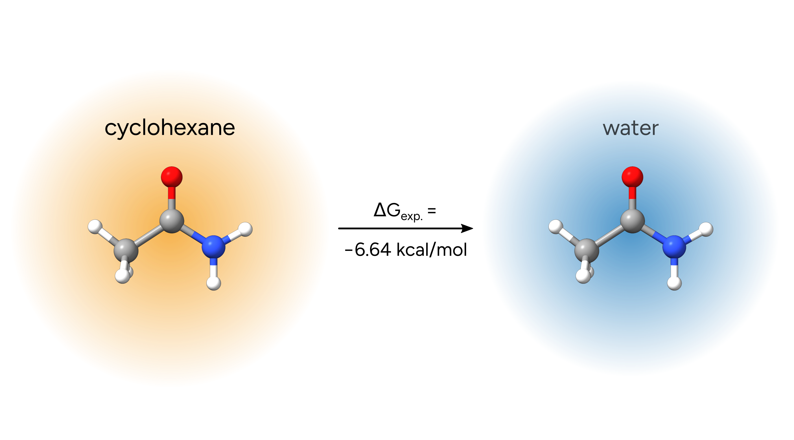

# Implicit Solvation Models

One aproach to include solvent effects on your calculation is through the so-called "implicit solvent models", and here we will discuss two main options available in ORCA.

## Overview

In these models, the solute is placed in a cavity of roughly molecular shape. The solvent is described by a continuum that interacts with the charges on the cavity surface, which are in turn determined by the solute and the problem is solved iteratively (see [[Cammi2005]](../bib.md#cammi2005) for a good review on the subject).

The general picture of the method can be depicted as:

[](../images/surfaces_v2.png)

where the "probe" is an ideal solvent molecule and the molecular cavities are defined from:

> - "Van der Waals surface" (vdW), built from the Van der Waals radii (the default in ORCA);
> - "Solvent-Accessible Surface" (SAS), defined by the center of the probe;
> - or the "Solvent-Excluded Surface" (SES), obtained if you follow the inward part of the solvent probe sphere rolling over vdW surface.

An exemplary visualization of the SES for a cyclodextrine molecule is shown below:

[](../images/cyclodex-ses-transparency40.png)

*Figure: SES for a cyclodextrine molecule.*

The solvation energy is then decomposed in two main terms, electrostatic ($\Delta G_{ENP}$) and cavity-dispersion ($\Delta G_{CDS}$):

$$
\Delta G_{solv}^o = \Delta G_{ENP} + \Delta G_{CDS}
$$

and the methods differ on how to compute these terms.

## Transition from Gas to Liquid phase

Depending on the desired reference state of your molecule, an additional term to the solvation free energy has to be included:

$$
\Delta G_{solv}^o = \Delta G_{ENP} + \Delta G_{CDS} + \Delta G^o_{conc}
$$

This term arises when going from gas phase at $1 atm$ and $298 K$ (which is how the $G^o$ is calculated when using `FREQ` by default) to a solution phase at $1 molL^{-1}$.
The corresponding correction [[Cramer2004]](../bib.md#cramer2004) is:

$$
\Delta G^o_{conc}= RTln(24.5) = 1.89 \ \mathrm{kcal/mol}.
$$

> **Warning**
> Do not forget to add this term to your $G^o$ when predicting solution thermodynamics. The absence of this correction can lead to large errors!

## Conductor-like Polarizable Continuum Model (CPCM)

In the CPCM method [[Cossi1998]](../bib.md#cossi1998), the bulk solvent is treated as a conductor-like polarizable continuum and the main parameters to define the method are the **refractive index** and the **dielectric constant** of the medium.

The electrostatic contribution ($\Delta G_{ENP}$) that arises from the interaction of the medium and the molecular surface charges is included in the SCF calculation - so that you even get "solvated" orbitals - and the cavity term ($\Delta G_{CDS}$) can be obtained from more complicated schemes.

ORCA has a list of predefined solvents that can be called by using:

```text
!CPCM(solvent)
```

A full list of [available solvents](#availablesolvents) is given in the end of this tutorial.

If you want to include any other solvent, one can always input these parameters manually using:

```text
%CPCM       EPSILON      80.4
            REFRAC       1.33
END
```

More options and details can be found on the [ORCA manual](https://www.faccts.de/docs/orca/6.0/manual). One example for the single-point calculation of an Aspirin molecule in water is:

```text
!B97M-V DEF2-SVP CPCM(WATER)
* XYZFILE 0 1 aspirin.xyz
```

```mol
title: Aspirin
theme: chem311
height: 360px
representation: ball-stick
--- xyz ---
21
structure
C         -2.64076        2.23326        0.00014
C         -3.28499        1.00146       -0.00001
C         -2.53276       -0.17323       -0.00006
C         -1.24586        2.29692        0.00023
C         -0.48687        1.12113        0.00013
C         -1.12591       -0.13504        0.00002
C         -0.44272       -1.46662       -0.00003
O         -1.06358       -2.51853       -0.00017
O          0.90426       -1.44815        0.00010
O          0.94078        1.15087        0.00026
C          1.78023        2.27870       -0.00045
O          1.43411        3.44948       -0.00130
C          3.21351        1.83099        0.00005
H          3.28673        0.73990       -0.00017
H          3.70751        2.20906        0.89847
H          3.70821        2.20936       -0.89786
H          1.28154       -0.55226        0.00027
H         -3.22416        3.15173        0.00019
H         -4.37149        0.95196       -0.00007
H         -0.79315        3.28276        0.00040
H         -3.05624       -1.12937       -0.00015
```

> **Note**
> Both the analytic gradients and Hessians are available for the CPCM, so that can be used together with the `OPT` and `FREQ` keywords as well!

Then, before the SCF, a header with all the CPCM-related information is printed:

```text
--------------------                               
CPCM SOLVATION MODEL
--------------------
CPCM parameters:
  Epsilon                                         ...      80.1510
  Refrac                                          ...       1.3328
  Rsolv                                           ...       1.3000
  Surface type                                    ... GAUSSIAN VDW
  Discretization scheme                           ... Constant charge density
    Threshold for H atoms                         ...       5.0000 (charges/Ang^2)
    Threshold for non-H atoms                     ...       5.0000 (charges/Ang^2)
  Epsilon function type                           ...         CPCM
Solvent:                                          ... WATER
Radii:
  Scheme                                          ... Element-dependent radii
  Radius for C  used is    3.8550 Bohr (=   2.0400 Ang.)
  Radius for O  used is    3.4469 Bohr (=   1.8240 Ang.)
  Radius for H  used is    2.4944 Bohr (=   1.3200 Ang.)
Calculating surface                               ...        done! (  0.0s)
Cavity surface points                             ...         2001
Cavity Volume                                     ...    1411.7200
Cavity Surface-area                               ...     764.1268
Calculating surface distance matrix               ...        done! (  0.0s)
Performing Cholesky decomposition & store         ...        done! (  0.1s)
Overall time for CPCM initialization              ...                 0.1s
```

after the SCF calculation ends, there will be a the summary of the CPCM-related information:

```text
----------------
TOTAL SCF ENERGY
----------------

Total Energy       :       -648.14295834055463 Eh          -17636.86654 eV

Components:
Nuclear Repulsion  :        765.01084602209096 Eh           20817.00344 eV
Electronic Energy  :      -1413.49491093482038 Eh          -38463.15196 eV
One Electron Energy:      -2400.15868861270292 Eh          -65311.63830 eV
Two Electron Energy:        986.66377767788265 Eh           26848.48634 eV
CPCM Dielectric    :         -0.02002640002963 Eh              -0.54495 eV
[...]
CPCM Solvation Model Properties:
Surface-charge          :         -0.01495190657874
Corrected charge        :          0.00000000000000
Outlying charge corr.   :          0.00001461700770 Eh               0.00040 eV
Free-energy (cav+disp)  :  This term is not implemented in the current solvation scheme
```

As one can see, **dielectric contribution** to the energy, the solute **net charge**, the **charge** and **cavity corrections** are printed separately (the latter in this case is not calculated). The `Charge-correction` term is not included in the SCF energy, and is just printed for information purposes.

The *FINAL SINGLE POINT ENERGY* now already includes all computed solvation terms. In terms of the equations shown above, $\Delta G_{ENP}$ corresponds to `CPCM Dielectric` and $\Delta G_{CDS}$ to the `Free-energy (cav+disp)`.

> **Important**
> There is an important difference with respect to previous ORCA versions. Now the cavity term is **not** calculated or added for regular CPCM by default.

> **Note**
> For more information on cavity terms and CPCM, please consult the [ORCA manual](https://www.faccts.de/docs/orca/6.0/manual).

## CPCM and COSMO

ORCA does **not** have any COSMO implementation, but one can use the COSMO epsilon function by using the `CPCMC(solvent)` keyword, with an extra "C":

```text
!B97M-V DEF2-SVP CPCMC(WATER)
```

### Combining DFT with post-HF methods

Since the HF density is of lower quality than those obtained from DFT, so is the CPCM correction obtained from HF calculations.

What one usually can do is to take the $\Delta G_{ENP}$ (*CPCM Dielectric*) and $\Delta G_{CDS}$ (*Free-energy (cav+disp)*) from some calculation like DFT and add that to the total energy obtained with that method, e.g. if you want to combine CPCM with DLPNO-CSSD.

### Gaussian point charges

The usual point charge scheme might lead to instabilities in the energy, e.g. if two points end up too close. In ORCA, we use a smeared Gaussian charge to obtain a smoother potential energy surface [[Karplus1999]](../bib.md#karplus1999) [[Neese2020]](../bib.md#neese2020) instead. From ORCA 5, the default is:

```text
%CPCM SURFACETYPE VDW_GAUSSIAN END
```

But a SES surface can also be chosen with:

```text
%CPCM SURFACETYPE GEPOL_SES_GAUSSIAN END
```

For more detailed information, please consult the [ORCA manual](https://www.faccts.de/docs/orca/6.0/manual).

## Universal Solvation Model (SMD)

The SMD method [[Truhlar2009]](../bib.md#truhlar2009) can be thought as an improvement over the CPCM, since it uses the full solute electron density to compute the cavity-dispersion contribution instead of the area only.

This method requires more parameters, which makes it less flexible for unknown solvents ([List of available solvents](#availablesolvents))! SMD can be requested similar to CPCM via simple input `SMD(Solvent)`:

```text
!B97M-V DEF2-SVP SMD(WATER)

* XYZFILE 0 1 aspirin.xyz
```

The initial output is similar to CPCM, except that one now has the SMD descriptors:

```text
--------------------
CPCM SOLVATION MODEL
--------------------
[...]
SMD-CDS solvent descriptors:
  Soln                                       ...    1.3328
  Soln25                                     ...    1.3323
  Sola                                       ...    0.0000
  Solb                                       ...    0.0000
  Solg                                       ...    0.0000
  Solc                                       ...    0.0000
  Solh                                       ...    0.0000
```

and the output before the the *TOTAL SCF ENERGY* header has:

```text
----------------
TOTAL SCF ENERGY
----------------                                  
[...]
CPCM Dielectric    :         -0.03176518706751 Eh              -0.86437 eV
SMD CDS (Gcds)     :          0.01088483110166 Eh               0.29619 eV
```

One can use this $\Delta G_{CDS}$ (*Gcds*) term, together with the $\Delta G_{ENP}$ (*CPCM Dielectric*) to correct energies from further calculations.

> **Note**
> With ORCA 6, analytic gradients became available also for SMD!

## Dynamic Radii Adjustment for Continuum Solvation (DRACO)

All these solvation models depend on a physically sound representation of the solvent accessible surface area (SASA). Nevertheless, the typically employed methods use a predefined
set of element specific atomic radii to construct it. This does not account for the molecular environment of specific atoms for which the effective radii may differ depending on the respective local
electron density, e.g., if one compares neutral and negatively charged oxygen atoms. A recent approach to make these radii environment adaptive is the DRACO model by Grimme and co-workers [[Grimme2024]](../bib.md#grimme2024). It uses an atoms-in-molecules-like approach based on atomic partial charges and fractional coordination numbers to scale the default radii for each atom independently. By doing so, specifically
the description of charged systems can be improved.

DRACO is currently available for CPCM and SMD within ORCA and is parameterized for the solvents water, acetonitrile, DMSO, and methanol. DRACO can be envoked by a simple input keyword in addition to the
respective solvation method:

```text
! CPCM(solvent) DRACO
```

or

```text
! SMD(solvent) DRACO
```

Alternatively, it can also be requested in the `%cpcm` block:

```text
%cpcm
DRACO true
end
```

In ORCA, the default scheme to calculate the partial charges used within DRACO is the electronegativity-equilibration (EEQ) charge model as it is also used in the D4 dispersion correction.
However, one can also request the recent Charge Extended Hückel (CEH) model.[[Grimme2023]](../bib.md#grimme2023) The charge scheme within DRACO is controlled by the following tag
in the `%cpcm` block:

```text
%cpcm
draco_charges ceh  # default = eeq
end
```

If CEH charges are requested, ORCA generates them via its interface to the xtb program.

> **Note**
> At this point, DRACO can only be used in single-point energy calculations. Gradients for DRACO will be implemented in the future.

## Example 1: Octanol/water partition coefficient

We will use SMD and try to predict the octanol/water partition coefficient ($P_{o/w}$) for the drug Diazepam:

$$
P_{o/w} = \frac {[solute]_{octanol}} {[solute]_{water}}
$$

```mol
title: Diazepam
theme: chem311
height: 360px
representation: ball-stick
--- xyz ---
33
structure
C         -2.76533       -0.90855        1.85461
C         -4.10278       -0.72362        2.22052
C         -5.02528       -0.30117        1.27344
C         -4.62706       -0.08566       -0.04023
C         -3.28690       -0.29486       -0.41749
C         -2.32208       -0.67243        0.53842
Cl        -6.66626       -0.05897        1.72353
N         -0.93200       -0.82351        0.23569
C         -0.24076       -0.01864       -0.67861
C         -1.02949        1.08452       -1.37013
C         -2.96608       -0.16369       -1.86911
N         -1.95301        0.48903       -2.32972
H         -0.32054        1.71528       -1.91810
H         -1.52297        1.73752       -0.64155
O          0.97434       -0.13069       -0.86774
C         -0.12886       -1.74693        1.02668
H          0.21402       -1.23663        1.93228
H          0.75039       -2.08063        0.46656
H         -0.70989       -2.63829        1.28413
C         -3.87195       -0.81596       -2.86776
C         -4.45465       -2.06403       -2.61294
C         -4.11329       -0.17301       -4.08765
C         -5.29672       -2.64689       -3.56241
C         -5.55029       -1.99264       -4.76807
C         -4.95622       -0.75907       -5.03306
H         -3.64497        0.78461       -4.30431
H         -4.24920       -2.60250       -1.69208
H         -5.74819       -3.61652       -3.36692
H         -6.20254       -2.45023       -5.50807
H         -5.14291       -0.25572       -5.97837
H         -5.36297        0.23683       -0.77401
H         -4.40857       -0.89624        3.24980
H         -2.07050       -1.19831        2.63954
```

That can be obtained from the relationship between the equilibrium constant and the Gibb's free energy difference between the solute in octanol and water $\Delta G^o_{o/w} = \Delta G^o_{o} - \Delta G^o_{w}$ as [[Truhlar2009]](../bib.md#truhlar2009):

$$
logP_{o/w} = \frac {-\Delta G^o_{o/w}} {2.303RT}
$$

First, we optimize both geometries in each solvent, for instance using:

```text
!B3LYP DEF2-SVP OPT NUMFREQ D4
%CPCM SMD TRUE
      SMDSOLVENT "1-OCTANOL"
END
* XYZFILE 0 1 diazepam.xyz
```

or:

```text
!B3LYP DEF2-SVP OPT NUMFREQ D4
%CPCM SMD TRUE
      SMDSOLVENT "WATER"
END
* XYZFILE 0 1 diazepam.xyz
```

to get the Gibbs free energy of each solvated compound and its geometry.

After making the calculations, one obtains an energy difference of $3.41 \ \mathrm{kcal/mol}$, that corresponds to a $logP_{o/w}=2.50$, which is not far from the experimental value of $logP_{o/w}^{exp}=2.99$, considering the simplicity of the method.

> **Note**
> Since there are no analytic frequencies using the SMD model yet, we are using !NUMFREQ. It might take long if you do not parallelization here.

## openCOSMO-RS

ORCA is interfaced to openCOSMO-RS,[[Gerlach2022]](../bib.md#gerlach2022) an open source implementation of the
COSMO-RS model.[[Klamt1995]](../bib.md#klamt1995) This model is widely used in both academia and industry
to predict fluid phase thermodynamics.

The openCOSMO-RS calculation requires several single-point energy (SPE) evaluations within ORCA:

1. SPE calculation of the **solute** in the **gas-phase**
2. SPE calculation of the **solute** in a **conductor** ($\epsilon = \infty$)
3. SPE calculation of the **solvent** in a **conductor** ($\epsilon = \infty$)
4. Do COSMO-RS via the openCOSMO-RS executable and compute solvation properties

Points 1 to 3 employ the BP86/def2-TZVPD level that was also used to parameterize COSMO-RS for ORCA 6.0.

> **Warning**
> Any changes to the DFT level are possible but is strongly discouraged. For details on available settings
> see the [ORCA manual](https://www.faccts.de/docs/orca/6.0/manual).

COSMO-RS calculations in ORCA are controlled either via simple keyword `COSMORS(Solvent)` or through the `%cosmors` block. When called via simple keyword, the solvent
structure is read from a database included in ORCA. This is generally recommended. However, individual solvents can be defined via the `%cosmors` block. In this case, a respective
structure file `Solvent.cosmorsxyz` must be provided. Otherwise, only the solute structure is required. Corresponding inputs look like:

```text
!COSMORS(Solvent)
```

for using the simple keyword and the solvent from the database. And like:

```text
%cosmors
solvent "Solvent"
end
```

when the solvent is defined individually.

## Example 2: Cyclohexane to water transfer of acetamide

As an example, we will calculate the free-energy change of the transfer of acetamide from cyclohexane into water.

[](../images/acetamide-ctow.png)

```mol
title: Acetamide
theme: chem311
height: 360px
representation: ball-stick
--- xyz ---
9
structure
  C       0.03376875735606      0.11863667646978      0.00007971525188
  C      -1.38895738873537     -0.40815378292582      0.00073395653376
  O       0.30448472971793      1.30795933448501     -0.00094554067961
  N       1.00134723494097     -0.84772818347762      0.00045966276690
  H      -2.07609613647844      0.43734414878230      0.00311440104423
  H      -1.57575950037091     -1.02364915793043     -0.88606618799168
  H      -1.57403464730113     -1.02748224372305      0.88521351042739
  H       0.77976379331123     -1.82795867908554      0.00113804977546
  H       1.96698315755967     -0.56336811259461     -0.00042756712832
```

Even though electronic energies and thermostatistical contributions
will cancel out in the end for this specific example, we will perform all calculations that would be needed to obtain a full free-energy in solution for acetamide in both solvents.
In general, the full free energy of any compound in solution is calculated as the sum of electronic energy ($E_{el.}$) in gas-phase, the thermostatistical free-energy correction ($G_{RRHO}$)
that is typically obtained from a rigid-rotor-harmonic-oscillator (RRHO) approximation, and the solvation free-energy that can be calculated with openCOSMO-RS ($\delta G_{solv.}$)

$$
G_{solv.} = E_{el.} + G_{RRHO} + \delta G_{solv.}
$$

> **Note**
> Note that for DFT calculations, a [London dispersion correction](../prop/disp.md) should be added to the electronic energy!

To obtain the corresponding contributions, we will first optimize the geometry of acetamide in the gas-phase and will perform a vibrational frequency calculation to compute thermostatistical contributions:

```text
!r2SCAN-3c TIGHTOPT FREQ

*XYZFILE 0 1 acetamide_unpotimized.xyz
```

The optimized geometry is stored in `basename.xyz` and the frequency calculation as well as the thermostatistical corrections can be found in the `basename.out` output file:

```text
-------------------
GIBBS FREE ENERGY
-------------------

The Gibbs free energy is G = H - T*S
  
Total enthalpy                    ...   -209.09952655 Eh 
Total entropy correction          ...     -0.03087478 Eh    -19.37 kcal/mol
-----------------------------------------------------------------------
Final Gibbs free energy         ...   -209.13040133 Eh
     
For completeness - the Gibbs free energy minus the electronic energy
G-E(el)                           ...      0.04630314 Eh     29.06 kcal/mol
```

The `Final Gibbs free energy` value includes the electronic energy and all contribution and corrections to the free-energy ($E_{el.}$ and $G_{RRHO}$).
Now we need to calculate the solvation free-energy corrections with openCOSMO-RS. To do so, we perform two calculations for acetamide, one in cyclohexane and one in water.

In this example, we will use the solvents from the database with the corresponding inputs

```text
!COSMORS(Cyclohexane)

*XYZFILE 0 1 acetamide.xyz
```

and

```text
!COSMORS(Water)

*XYZFILE 0 1 acetamide.xyz
```

From these calculations we will obtain the openCOSMO-RS output that shows the final solvation free-energy correction as well as the energy of the solute in gas-phase,
the energy of the solute in solution, and that of the solvent in solution:

```text
----------------------------------------------
Single Point Calculation (solute / gas-phase)
----------------------------------------------
Output single point calculation redirected to >cosmors.solute_vac.lastout

FINAL SINGLE POINT ENERGY (Solute-gas-phase)     -209.312701693624

----------------------------------------------
Single Point Calculation (solute / CPCM)
----------------------------------------------
Output single point calculation redirected to >cosmors.solute_cpcm.lastout

FINAL SINGLE POINT ENERGY (Solute-CPCM)     -209.328833397120

----------------------------------------------
Single Point Calculation (solvent / CPCM)
----------------------------------------------
Output single point calculation redirected to >cosmors.solvent_cpcm.lastout

FINAL SINGLE POINT ENERGY (Solvent-CPCM)     -235.952716268645

----------------------
SOLVATION DATA
----------------------
Reference temperature              :                 298.15 K
Free energy of solvation (dGsolv)  :       -0.005754344722 Eh             -3.610907 kcal/mol
```

For acetamide in water the corresponding output looks like:

```text
----------------------------------------------
Single Point Calculation (solute / gas-phase)
----------------------------------------------
Output single point calculation redirected to >cosmors.solute_vac.lastout

FINAL SINGLE POINT ENERGY (Solute-gas-phase)     -209.312701693624

----------------------------------------------
Single Point Calculation (solute / CPCM)
----------------------------------------------
Output single point calculation redirected to >cosmors.solute_cpcm.lastout

FINAL SINGLE POINT ENERGY (Solute-CPCM)     -209.328833397120

----------------------------------------------
Single Point Calculation (solvent / CPCM)
----------------------------------------------
Output single point calculation redirected to >cosmors.solvent_cpcm.lastout

FINAL SINGLE POINT ENERGY (Solvent-CPCM)      -76.479236610833

----------------------
SOLVATION DATA
----------------------
Reference temperature              :                 298.15 K
Free energy of solvation (dGsolv)  :       -0.015783182256 Eh             -9.904099 kcal/mol
```

From these calculations we can now calculate the free-energy of the cyclohexane-water-transfer of acetamide ($\Delta G_{c\rightarrow w}$).
As all other contributions cancel out for this specific example, we can simplify the calculation as the difference of the solvation free-energy corrections:

$$
\Delta G_{c\rightarrow w} = \delta G_{solv., water} - \delta G_{solv., cyclohexane} = -6.29 \ \mathrm{kcal/mol}
$$

The result is in excellent agreement with the experimental value of $-6.64 \ \mathrm{kcal/mol}$.

## Available Solvents

| Solvent | CPCM | + DRACO | SMD | + DRACO | COSMO-RS |
| --- | --- | --- | --- | --- | --- |
| 1,1,1-trichloroethane | ✓ |  | ✓ |  |  |
| 1,1,2-trichloroethane | ✓ |  | ✓ |  |  |
| 1,2,4-trimethylbenzene | ✓ |  | ✓ |  |  |
| 1,2-dibromoethane | ✓ |  | ✓ |  | ✓ |
| 1,2-dichloroethane | ✓ |  | ✓ |  | ✓ |
| 1,2-ethanediol | ✓ |  | ✓ |  |  |
| 1,4-dioxane / dioxane | ✓ |  | ✓ |  | ✓ |
| 1-bromo-2-methylpropane | ✓ |  | ✓ |  |  |
| 1-bromooctane / bromooctane | ✓ |  | ✓ |  | ✓ |
| 1-bromopentane | ✓ |  | ✓ |  |  |
| 1-bromopropane | ✓ |  | ✓ |  |  |
| 1-butanol / butanol | ✓ |  | ✓ |  | ✓ |
| 1-chlorohexane / chlorohexane | ✓ |  | ✓ |  | ✓ |
| 1-chloropentane | ✓ |  | ✓ |  |  |
| 1-chloropropane | ✓ |  | ✓ |  |  |
| 1-decanol / decanol | ✓ |  | ✓ |  | ✓ |
| 1-fluorooctane | ✓ |  | ✓ |  | ✓ |
| 1-heptanol / heptanol | ✓ |  | ✓ |  | ✓ |
| 1-hexanol / hexanol | ✓ |  | ✓ |  | ✓ |
| 1-hexene | ✓ |  | ✓ |  |  |
| 1-hexyne | ✓ |  | ✓ |  |  |
| 1-iodobutane | ✓ |  | ✓ |  |  |
| 1-iodohexadecane / hexadecyliodide | ✓ |  | ✓ |  | ✓ |
| 1-iodopentane | ✓ |  | ✓ |  |  |
| 1-iodopropane | ✓ |  | ✓ |  |  |
| 1-nitropropane | ✓ |  | ✓ |  |  |
| 1-nonanol / nonanol | ✓ |  | ✓ |  | ✓ |
| 1-octanol / octanol | ✓ |  | ✓ |  | ✓ |
| 1-pentanol / pentanol | ✓ |  | ✓ |  | ✓ |
| 1-pentene | ✓ |  | ✓ |  |  |
| 1-propanol / propanol | ✓ |  | ✓ |  | ✓ |
| 2,2,2-trifluoroethanol | ✓ |  | ✓ |  |  |
| 2,2,4-trimethylpentane / isooctane | ✓ |  | ✓ |  | ✓ |
| 2,4-dimethylpentane | ✓ |  | ✓ |  |  |
| 2,4-dimethylpyridine | ✓ |  | ✓ |  |  |
| 2,6-dimethylpyridine | ✓ |  | ✓ |  | ✓ |
| 2-bromopropane | ✓ |  | ✓ |  |  |
| 2-butanol / secbutanol | ✓ |  | ✓ |  | ✓ |
| 2-chlorobutane | ✓ |  | ✓ |  |  |
| 2-heptanone | ✓ |  | ✓ |  |  |
| 2-hexanone | ✓ |  | ✓ |  |  |
| 2-methoxyethanol / methoxyethanol | ✓ |  | ✓ |  | ✓ |
| 2-methyl-1-propanol / isobutanol | ✓ |  | ✓ |  | ✓ |
| 2-methyl-2-propanol | ✓ |  | ✓ |  |  |
| 2-methylpentane | ✓ |  | ✓ |  |  |
| 2-methylpyridine / 2methylpyridine | ✓ |  | ✓ |  | ✓ |
| 2-nitropropane | ✓ |  | ✓ |  |  |
| 2-octanone | ✓ |  | ✓ |  |  |
| 2-pentanone | ✓ |  | ✓ |  |  |
| 2-propanol / isopropanol | ✓ |  | ✓ |  | ✓ |
| 2-propen-1-ol | ✓ |  | ✓ |  |  |
| e-2-pentene | ✓ |  | ✓ |  |  |
| 3-methylpyridine | ✓ |  | ✓ |  |  |
| 3-pentanone | ✓ |  | ✓ |  |  |
| 4-heptanone | ✓ |  | ✓ |  |  |
| 4-methyl-2-pentanone / 4methyl2pentanone | ✓ |  | ✓ |  | ✓ |
| 4-methylpyridine | ✓ |  | ✓ |  |  |
| 5-nonanone | ✓ |  | ✓ |  |  |
| acetic acid / aceticacid | ✓ |  | ✓ |  | ✓ |
| acetone | ✓ |  | ✓ |  | ✓ |
| acetonitrile / mecn / ch3cn | ✓ | ✓ | ✓ | ✓ | ✓ |
| acetophenone | ✓ |  | ✓ |  | ✓ |
| ammonia | ✓ |  |  |  | ✓ |
| aniline | ✓ |  | ✓ |  | ✓ |
| anisole | ✓ |  | ✓ |  | ✓ |
| benzaldehyde | ✓ |  | ✓ |  | ✓ |
| benzene | ✓ |  | ✓ |  | ✓ |
| benzonitrile | ✓ |  | ✓ |  | ✓ |
| benzyl alcohol / benzylalcohol | ✓ |  | ✓ |  | ✓ |
| bromobenzene | ✓ |  | ✓ |  | ✓ |
| bromoethane | ✓ |  | ✓ |  | ✓ |
| bromoform | ✓ |  | ✓ |  | ✓ |
| butanal | ✓ |  | ✓ |  |  |
| butanoic acid | ✓ |  | ✓ |  |  |
| butanone | ✓ |  | ✓ |  | ✓ |
| butanonitrile | ✓ |  | ✓ |  |  |
| butyl ethanoate / butyl acetate / butylacetate | ✓ |  | ✓ |  | ✓ |
| butylamine | ✓ |  | ✓ |  |  |
| n-butylbenzene / butylbenzene | ✓ |  | ✓ |  | ✓ |
| sec-butylbenzene / secbutylbenzene | ✓ |  | ✓ |  | ✓ |
| tert-butylbenzene / tbutylbenzene | ✓ |  | ✓ |  | ✓ |
| carbon disulfide / carbondisulfide / cs2 | ✓ |  | ✓ |  | ✓ |
| carbon tetrachloride / ccl4 | ✓ |  | ✓ |  | ✓ |
| chlorobenzene | ✓ |  | ✓ |  | ✓ |
| chloroform / chcl3 | ✓ |  | ✓ |  | ✓ |
| a-chlorotoluene | ✓ |  | ✓ |  |  |
| o-chlorotoluene | ✓ |  | ✓ |  |  |
| conductor | ✓ |  |  |  |  |
| m-cresol / mcresol | ✓ |  | ✓ |  | ✓ |
| o-cresol | ✓ |  | ✓ |  |  |
| cyclohexane | ✓ |  | ✓ |  | ✓ |
| cyclohexanone | ✓ |  | ✓ |  | ✓ |
| cyclopentane | ✓ |  | ✓ |  |  |
| cyclopentanol | ✓ |  | ✓ |  |  |
| cyclopentanone | ✓ |  | ✓ |  |  |
| decalin | ✓ |  | ✓ |  | ✓ |
| cis-decalin | ✓ |  | ✓ |  |  |
| n-decane / decane | ✓ |  | ✓ |  | ✓ |
| dibromomethane | ✓ |  | ✓ |  |  |
| dibutylether | ✓ |  | ✓ |  | ✓ |
| o-dichlorobenzene / odichlorobenzene | ✓ |  | ✓ |  | ✓ |
| e-1,2-dichloroethene | ✓ |  | ✓ |  |  |
| z-1,2-dichloroethene | ✓ |  | ✓ |  |  |
| dichloromethane / ch2cl2 / dcm | ✓ |  | ✓ |  | ✓ |
| diethyl ether / diethylether | ✓ |  | ✓ |  | ✓ |
| diethyl sulfide | ✓ |  | ✓ |  |  |
| diethylamine | ✓ |  | ✓ |  |  |
| diiodomethane | ✓ |  | ✓ |  |  |
| diisopropyl ether / diisopropylether | ✓ |  | ✓ |  | ✓ |
| cis-1,2-dimethylcyclohexane | ✓ |  | ✓ |  |  |
| dimethyl disulfide | ✓ |  | ✓ |  |  |
| n,n-dimethylacetamide / dimethylacetamide | ✓ |  | ✓ |  | ✓ |
| n,n-dimethylformamide / dimethylformamide / dmf | ✓ |  | ✓ |  | ✓ |
| dimethylsulfoxide / dmso | ✓ | ✓ | ✓ | ✓ | ✓ |
| diphenylether | ✓ |  | ✓ |  | ✓ |
| dipropylamine | ✓ |  | ✓ |  |  |
| n-dodecane / dodecane | ✓ |  | ✓ |  | ✓ |
| ethanethiol | ✓ |  | ✓ |  |  |
| ethanol | ✓ |  | ✓ |  | ✓ |
| ethyl acetate / ethylacetate / ethanoate | ✓ |  | ✓ |  | ✓ |
| ethyl methanoate | ✓ |  | ✓ |  |  |
| ethyl phenyl ether / ethoxybenzene | ✓ |  | ✓ |  | ✓ |
| ethylbenzene | ✓ |  | ✓ |  | ✓ |
| fluorobenzene | ✓ |  | ✓ |  | ✓ |
| formamide | ✓ |  | ✓ |  |  |
| formic acid | ✓ |  | ✓ |  |  |
| furan / furane |  |  |  |  | ✓ |
| n-heptane / heptane | ✓ |  | ✓ |  | ✓ |
| n-hexadecane / hexadecane | ✓ |  | ✓ |  | ✓ |
| n-hexane / hexane | ✓ |  | ✓ |  | ✓ |
| hexanoic acid | ✓ |  | ✓ |  |  |
| iodobenzene | ✓ |  | ✓ |  | ✓ |
| iodoethane | ✓ |  | ✓ |  |  |
| iodomethane | ✓ |  | ✓ |  |  |
| isopropylbenzene | ✓ |  | ✓ |  | ✓ |
| p-isopropyltoluene / isopropyltoluene | ✓ |  | ✓ |  |  |
| mesitylene | ✓ |  | ✓ |  | ✓ |
| methanol | ✓ | ✓ | ✓ | ✓ | ✓ |
| methyl benzoate | ✓ |  | ✓ |  |  |
| methyl butanoate | ✓ |  | ✓ |  |  |
| methyl ethanoate | ✓ |  | ✓ |  |  |
| methyl methanoate | ✓ |  | ✓ |  |  |
| methyl propanoate | ✓ |  | ✓ |  |  |
| n-methylaniline | ✓ |  | ✓ |  |  |
| methylcyclohexane | ✓ |  | ✓ |  |  |
| n-methylformamide / methylformamide | ✓ |  | ✓ |  | ✓ |
| nitrobenzene / phno2 | ✓ |  | ✓ |  | ✓ |
| nitroethane | ✓ |  | ✓ |  | ✓ |
| nitromethane / meno2 | ✓ |  | ✓ |  | ✓ |
| o-nitrotoluene / onitrotoluene | ✓ |  | ✓ |  |  |
| n-nonane / nonane | ✓ |  | ✓ |  | ✓ |
| n-octane / octane | ✓ |  | ✓ |  | ✓ |
| n-pentadecane / pentadecane | ✓ |  | ✓ |  | ✓ |
| octanol(wet) / wetoctanol / woctanol |  |  |  |  |  |
| pentanal | ✓ |  | ✓ |  |  |
| n-pentane / pentane | ✓ |  | ✓ |  | ✓ |
| pentanoic acid | ✓ |  | ✓ |  |  |
| pentyl ethanoate | ✓ |  | ✓ |  |  |
| pentylamine | ✓ |  | ✓ |  |  |
| perfluorobenzene / hexafluorobenzene | ✓ |  | ✓ |  | ✓ |
| phenol | ✓ |  |  |  | ✓ |
| propanal | ✓ |  | ✓ |  |  |
| propanoic acid | ✓ |  | ✓ |  |  |
| propanonitrile | ✓ |  | ✓ |  |  |
| propyl ethanoate | ✓ |  | ✓ |  |  |
| propylamine | ✓ |  | ✓ |  |  |
| pyridine | ✓ |  | ✓ |  | ✓ |
| tetrachloroethene / c2cl4 | ✓ |  | ✓ |  | ✓ |
| tetrahydrofuran / thf | ✓ |  | ✓ |  | ✓ |
| tetrahydrothiophene-s,s-dioxide / | ✓ |  | ✓ |  |  |
| / tetrahydrothiophenedioxide / sulfolane | ✓ |  | ✓ |  |  |
| tetralin | ✓ |  | ✓ |  | ✓ |
| thiophene | ✓ |  | ✓ |  |  |
| thiophenol | ✓ |  | ✓ |  |  |
| toluene | ✓ |  | ✓ |  | ✓ |
| trans-decalin | ✓ |  | ✓ |  |  |
| tributylphosphate | ✓ |  | ✓ |  | ✓ |
| trichloroethene | ✓ |  | ✓ |  |  |
| triethylamine | ✓ |  | ✓ |  | ✓ |
| n-undecane / undecane | ✓ |  | ✓ |  | ✓ |
| water / h2o | ✓ | ✓ | ✓ | ✓ | ✓ |
| xylene | ✓ |  | ✓ |  |  |
| m-xylene | ✓ |  | ✓ |  |  |
| o-xylene | ✓ |  | ✓ |  |  |
| p-xylene | ✓ |  | ✓ |  |  |

## Selected Dielectric Constants

| Solvent | Dielec. Const. | Refrac. Index |
| --- | --- | --- |
| Water | 80.4 | 1.33 |
| Acetone | 20.7 | 1.359 |
| Acetonitrile | 36.6 | 1.344 |
| Ammonia | 22.4 | 1.33 |
| Benzene | 2.28 | 1.501 |
| CCl4 | 2.24 | 1.466 |
| CH2Cl2 | 9.08 | 1.424 |
| Chloroform | 4.9 | 1.45 |
| Cyclohexane | 2.02 | 1.425 |
| DMF | 38.3 | 1.430 |
| DMSO | 47.2 | 1.479 |
| Ethanol | 24.3 | 1.361 |
| Hexane | 1.89 | 1.375 |
| Methanol | 32.63 | 1.329 |
| Octanol | 10.3 | 1.421 |
| Pyridine | 12.5 | 1.510 |
| THF | 7.25 | 1.407 |
| Toluene | 2.4 | 1.497 |
