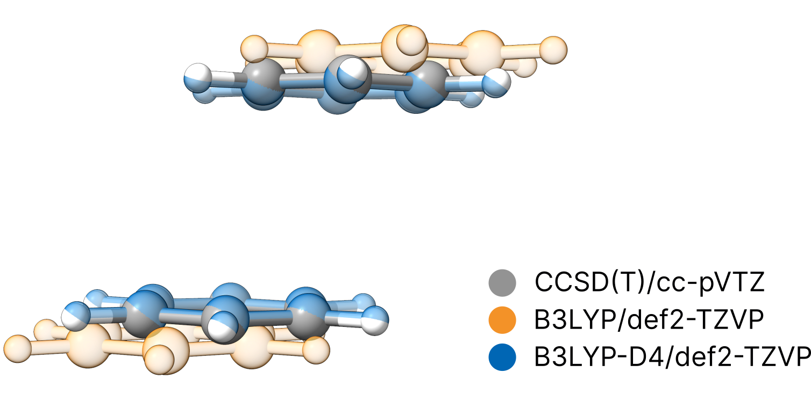

# Dispersion corrections

A well-know weakness of conventional density functional theory (and Hartee-Fock) is the lacking description of long-range correlation effects.
These include London dispersion, the attractive component of the van-der-Waals interaction. Nevertheless, there are several
well-established dispersion-corrections available to largely correct for this shortcoming. Within ORCA various options are
available that include Grimme's D3 [[Goerigk2011]](../bib.md#goerigk2011) and the more recent D4 [[Grimme2017]](../bib.md#grimme2017) corrections
as well as the non-local variant of VV10 (NL, [[Grimme2011b]](../bib.md#grimme2011b)) are available.

Most commonly, these corrections are applied post-SCF as a correction to the obtained energy. These corrections can easily envoked by the respective simple keywords:

```text
!B3LYP D4 DEF2-TZVP
```

or

```text
!B3LYP NL DEF2-TZVP
```

For NL, a self-consistent treatment is also available that can be envoked by:

```text
!B3LYP SCNL DEF2-TZVP
```

As the lack of London dispersion is a very systematic shortcoming of conventional DFT and Hartree-Fock, we generally recommend to use such corrections in any optimization or energy calculation with such methods.

> **Note**
> As these corrections are of semi-empirical nature, matching parameters must be available for the functional of choice. If these are not available per default, you can provide or adjust them
> via the ORCA input as described in the [ORCA manual](https://www.faccts.de/docs/orca/6.0/manual).

## Example: the benzene dimer

Let us test the impact of London dispersion on the geometry of the benzene dimer. To do so, we optimize the geometry at the B3LYP/def2-TZVP
level once without correction:

```text
!B3LYP DEF2-TZVP OPT
* XYZFILE 0 1 benzene-dimer.xyz
```

and once with activated D4 dispersion correction:

```text
!B3LYP D4 DEF2-TZVP OPT
* XYZFILE 0 1 benzene-dimer.xyz
```

Finally, we compare the structures to a reference geometry obtained at the correlated CCSD(T)/cc-pVTZ level ([[Xantheas2022]](../bib.md#xantheas2022)) that intrinsically covers dispersion effects.

[](../images/benzene-dimer.png)

```mol
title: Benzene dimer (CCSD(T)/cc-pVTZ)
theme: chem311
height: 360px
representation: ball-stick
--- xyz ---
24
structure
C 1.275754 -1.235450 0.698770
C 1.275754 -1.235450 -0.698770
C -1.275754 1.235450 0.698770
C -1.275754 1.235450 -0.698770
C 0.276643 -1.918543 1.397540
C 0.276643 -1.918543 -1.397540
C -0.276643 1.918543 1.397540
C -0.276643 1.918543 -1.397540
C -0.722468 -2.601635 0.698770
C -0.722468 -2.601635 -0.698770
C 0.722468 2.601635 0.698770
C 0.722468 2.601635 -0.698770
H 2.050091 -0.706035 1.240335
H 2.050091 -0.706035 -1.240335
H -2.050091 0.706035 1.240335
H -2.050091 0.706035 -1.240335
H 0.276643 -1.918543 2.480670
H 0.276643 -1.918543 -2.480670
H -0.276643 1.918543 2.480670
H -0.276643 1.918543 -2.480670
H -1.496806 -3.131050 1.240335
H -1.496806 -3.131050 -1.240335
H 1.496806 3.131050 1.240335
H 1.496806 3.131050 -1.240335
```

We clearly see, that only the dispersion corrected calculation gives reasonable agreement with the high-level method. This underlines the high importance of dispersion corrections even for such small structures.As these dispersion corrections are coming at virtually no relevant additional cost, we strongly recommend to always use a dispersion correction.
