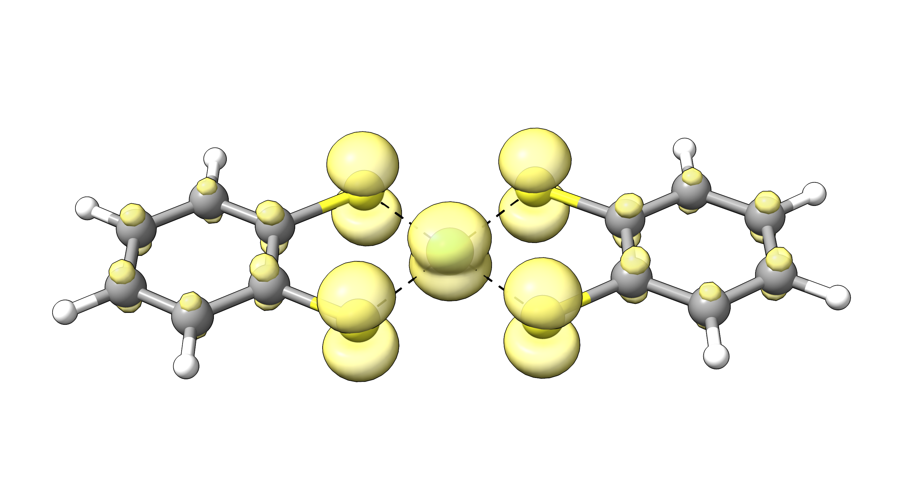

# Fractional occupation density (FOD)

Most conventional DFT and many wave-function-theory (WFT) methods are single-reference methods and thus do not cover static electron correlation effects. Cases with strong static electron correlation typically
can not be described by a single Slater determinant and are thus often referred to as "multi-reference" (MR) cases. For example, transition metal complexes and specifically those including 3*d* metals, are
known to be prone to static electron correlation and therefore single-reference methods may not be suitable to describe them correctly. There are many MR diagnostics described in the literature with individual strengths
and weaknesses. Nevertheless, the fractional occupation density (FOD) [[Grimme2015]](../bib.md#grimme2015) is a very simple yet powerful analytic tool to even visualize potential MR situations that is available in ORCA.

The default FOD analysis in ORCA employs the TPSS/def2-TZVP method with a electronic temperature of 5000K to "smear" static correlation prone electrons. It is simply envoked by:

```text
!FOD

* XYZFILE 0 1 structure.xyz
```

> **Note**
> In principle, the FOD analysis can be performed with any functional. Nevertheless, the electronic temperature has to be adjusted to match the functional,
> and specifically the amount of Fock-exchange included if a hybrid is used. How to change the method and the electronic temperature is documented in the
> [ORCA manual](https://www.faccts.de/docs/orca/6.0/manual).

## Example: Ni(bis-dithiolene)

Let us do the FOD analysis for the potential electrocatalyst NiBDT.

```mol
title: NiBDT
theme: chem311
height: 360px
representation: ball-stick
--- xyz ---
25
structure
Ni   -1.6002067    0.2502065   -0.0003481
S    -3.3823931    1.5039617   -0.0004815
S    -2.8019519   -1.5676128   -0.0007147
S    -0.3984619    2.0680264    0.0001148
S     0.1819779   -1.0035478    0.0002019
C    -4.7231842    0.3779025   -0.0008076
C    -4.4612846   -1.0082869   -0.0009494
C    -5.5353290   -1.9121780   -0.0003737
C    -6.8432986   -1.4529365    0.0003963
C    -7.1032240   -0.0766964    0.0004724
C    -6.0528479    0.8279006   -0.0002736
H    -8.1278403    0.2859146    0.0010614
H    -6.2454603    1.8978057   -0.0007489
H    -5.3245999   -2.9786641   -0.0003748
H    -7.6651706   -2.1641627    0.0009913
C     1.2608705    1.5087009    0.0005736
C     2.3349151    2.4125919    0.0003679
C     3.6428850    1.9533503   -0.0001444
C     3.9028088    0.5771099   -0.0001854
C     2.8524327   -0.3274871    0.0004449
C     1.5227693    0.1225114    0.0006544
H     2.1241862    3.4790779    0.0008070
H     4.4647574    2.6645759   -0.0005403
H     4.9274249    0.2144984   -0.0009591
H     3.0450448   -1.3973923    0.0008155
```

```text
!FOD

* XYZFILE 0 1 nibdt.xyz
```

After a successful calculation, ORCA will write the N_FOD value to the output. This value is a first indication for MR situations. In this case N_FOD is very high for a normal closed-shell
complex:

```text
N_FOD =  1.877046
```

> **Note**
> Note that the N_FOD value is not size-consistent and may be devided by the number of electrons if complexes of different sizes are compared.

Further, ORCA stores the FOD density in the `basename.densities` container which can be visualized with the `orca_plot` tool that is delivered with ORCA. Its interactive interface can be used via the command line input:

```text
orca_plot basename.gbw -i
```

```text
PlotType       ... MO-PLOT
MO/Operator    ... 0 0
Output file    ... (null)
Format         ... Grid3D/Binary
Resolution     ... 40 40 40
Boundaries     ...   -22.359392    16.311484 (x direction)
                     -12.628859    13.574504 (y direction)
                      -7.001812     7.002006 (z direction)

       1 - Enter type of plot
       2 - Enter no of orbital to plot
       3 - Enter operator of orbital (0=alpha,1=beta)
       4 - Enter number of grid intervals
       5 - Select output file format
       6 - Plot CIS/TD-DFT difference densities
       7 - Plot CIS/TD-DFT transition densities
       8 - Set AO(=1) vs MO(=0) to plot
       9 - List all available densities
      10 - Perform Density Algebraic Operations

      11 - Generate the plot
      12 - exit this program
Enter a number: 
```

Now we enter `1` to choose the type of plot we need:

```text
     1 -   molecular orbitals                          
     2 -   (scf) electron density                              ......  (scfp                     )  => AVAILABLE
     3 -   (scf) spin density                                  ......  (scfr                     )  - NOT AVAILABLE
     4 -   natural orbitals                               
     5 -   corresponding orbitals                         
     6 -   atomic orbitals                                
     7 -   mdci electron density                               ......  (mdcip                    )  - NOT AVAILABLE
     8 -   mdci spin density                                   ......  (mdcir                    )  - NOT AVAILABLE
[...]
    42 -   LFT QDPT unrelaxed transition AO density            ......  (Tdens-LFTQDSOC           )  - NOT AVAILABLE
Enter Type: 
```

Here, we choose `2` for `(scf) electron density`. The interface will now ask, which density should be plotted. The default electron density file is `basename.scfp` but as we want to plot `basename.scfp_fod` we change the chosen density file.

`orca_plot` will ask you if the default density file is the one you want to plot:

```text
The default name of the density would be: basename.scfp
Is this the one you want (y/n)?
```

This can be denied by entering `n`. Now you can enter the filename of the desired FOD density file `basename.scfp_fod`:

```text
Enter the FileName: basename.scfp_fod
```

As you successfully changed the density file that will be used for plotting, we can choose the desired output format via `5 - Select output file format`, e.g., Gaussian cube, and finally generate the file `basename.eldens.cube` to process
with the visualization program of choice via `11 - Generate the plot`. To visualize the FOD, an iso surface value of 0.005 a.u. is recommended. For our example, NiBDT, the FOD plot looks like:

[](../images/fod.png)

*Figure: FOD plot for NiBDT at an isosurface value of 0.005 a.u.*

The plot shows a significant delocalization of FOD over the whole molecule indicating strong static electron correlation.

For very large structures or high-throughput screening it may be further useful to use the xtb-based FOD anaylsis via ORCA.
To do so, you can call xtb to do the FOD analysis via ORCAs interface to xtb:

```text
!XTB2

%xtb
  XTBINPUTSTRING  "--fod" # string passed on to XTB call
  ETemp           5000
end

%output 
  print[p_xtb_prop] 1 
end

* XYZFILE 0 1 nibdt.xyz
```

For our NiBDT example, this will print the N_FOD value to the ORCA printout and will write a plottable `fod.cub` file in Gaussian cube format.

```text
NFOD :     2.4882
```

> **Warning**
> Even though the FOD is intuitive and easy-to-use, it is not a 100% safe diagnostic for MR character and should only be used as a first indication. We recommend to always combine the FOD analysis with
> more sophisticated multi-reference diagnostics.
