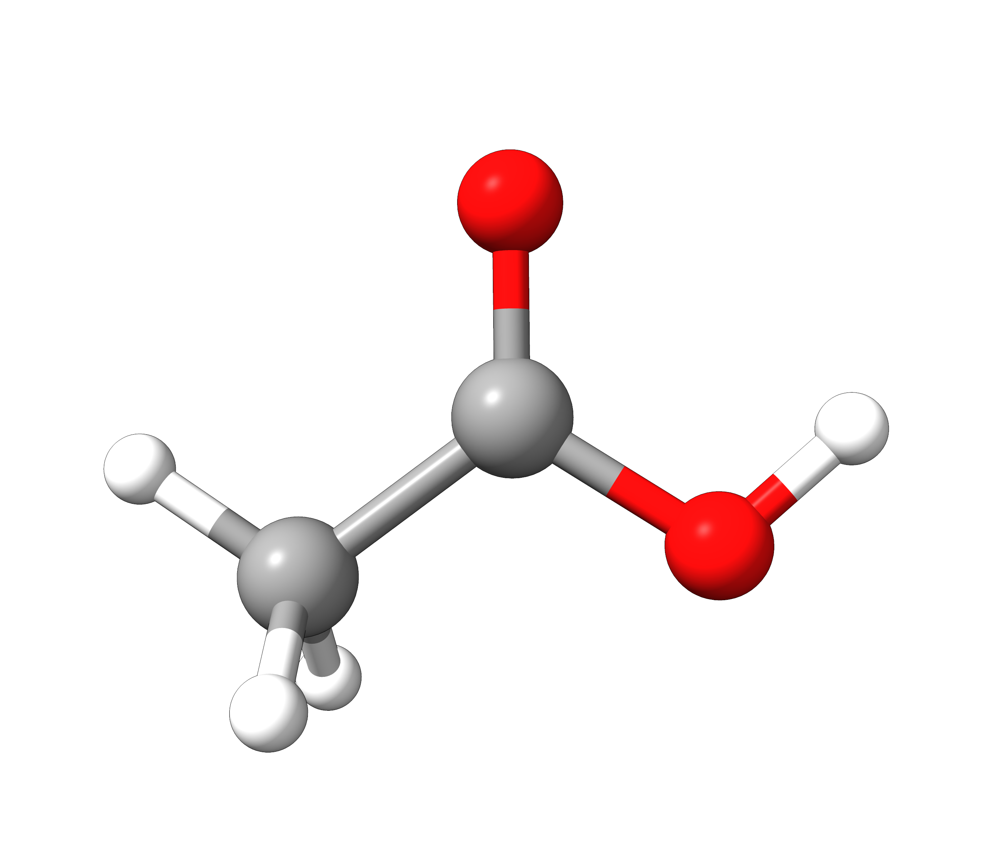
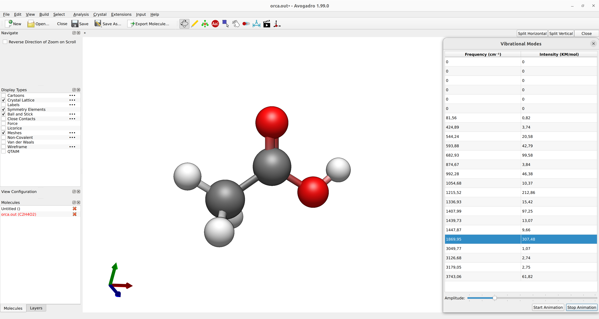
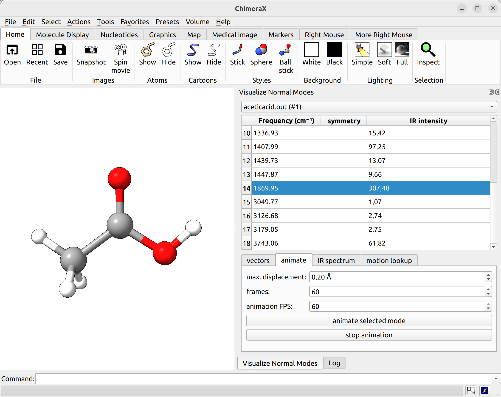
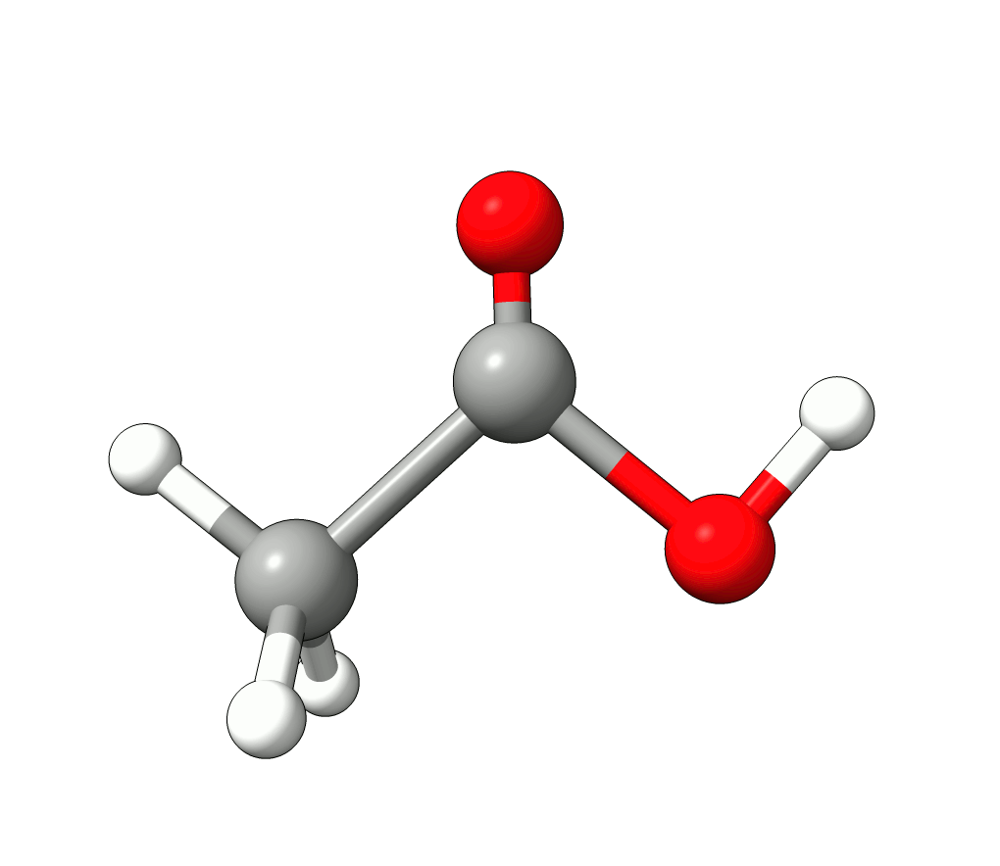
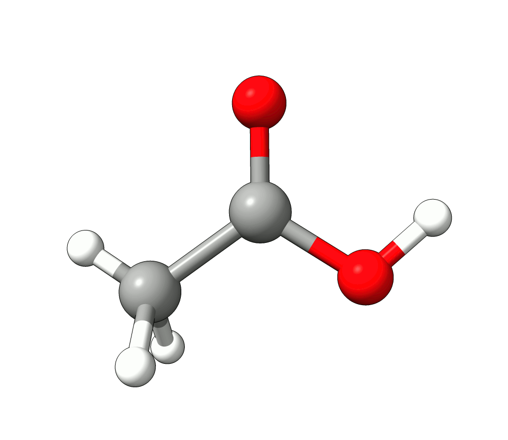
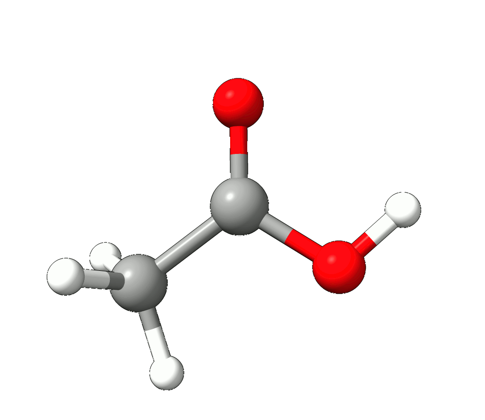

# Vibrational frequencies

After performing a [Geometry optimization](../prop/geoopt.md#geoopt), you might want to compute the vibrational frequency of your system and plot normal mode animations. Here is how to do it, using the acetic acid as an example:

[](../images/aceticacid.png)

*Figure: Molecular structure of acetic acid.*

## Frequencies

In order to first compute the frequencies, e.g. using DFT and the B3LYP functional use:

```mol
title: freq #1
theme: chem311
height: 360px
representation: ball-stick
--- xyz ---
8
structure
C         -0.81589       -0.51571       -0.02512
C          0.30690        0.49327       -0.06114
H         -0.42809       -1.56713       -0.28060
H         -1.26914       -0.51520        1.06962
H         -1.64631       -0.14518       -0.75104
O          0.16587        1.68279       -0.21470
O          1.51380       -0.07303        0.21899
H          2.16801        0.64625        0.13143
--- input ---
!B3LYP D4 DEF2-SVP FREQ
* XYZ 0 1
C         -0.81589       -0.51571       -0.02512
C          0.30690        0.49327       -0.06114
H         -0.42809       -1.56713       -0.28060
H         -1.26914       -0.51520        1.06962
H         -1.64631       -0.14518       -0.75104
O          0.16587        1.68279       -0.21470
O          1.51380       -0.07303        0.21899
H          2.16801        0.64625        0.13143
*
```

or one can also do that immediately after an optimization run using:

```text
!B3LYP D4 DEF2-SVP OPT FREQ
* XYZFILE 0 1 aceticacid.xyz
```

and a geometry optimization will be performed. In case of success, it will be followed by the frequency calculation. When the computation of the Hessian matrix starts, a header will be printed:

```text
-------------------------------------------------------------------------------
                               ORCA SCF HESSIAN
-------------------------------------------------------------------------------

Hessian of the Kohn-Sham DFT energy:
Kohn-Sham wavefunction type                      ... RKS
Hartree-Fock exchange scaling                    ...    0.200
Number of operators                              ...    1
Number of atoms                                  ...    8
Basis set dimensions                             ...   76
Integral neglect threshold                       ... 2.5e-11
Integral primitive cutoff                        ... 2.5e-12
```

followed by the calculation of all of the necessary terms. After it is completed, one will directly see the vibrational frequencies in $cm^{-1}$:

```text
-----------------------
VIBRATIONAL FREQUENCIES
-----------------------

Scaling factor for frequencies =  1.000000000  (already applied!)

0:         0.00 cm**-1
1:         0.00 cm**-1
2:         0.00 cm**-1
3:         0.00 cm**-1
4:         0.00 cm**-1
5:         0.00 cm**-1
6:        82.29 cm**-1
7:       424.53 cm**-1
8:       544.40 cm**-1
9:       593.63 cm**-1
[...]
```

The first few frequencies are always zero, for they correspond to the rotational and translational modes. They should be five for linear molecules and six for non-linear molecules, the rest are corresponding to actual vibrational modes.

### Scaling frequencies

In case you want to multiply all your frequency values by some number after the thermodynamic functions are computed, you can use:

```text
%FREQ SCALFREQ 1.035 END
```

and all frequencies would be multiplied by 1.035.

### Visualizing normal modes

The vibrational modes can be animated [using a suitable GUI](../first_steps/GUI.md). With Avogadro or Avogadro 2, simply open the `basename.out` file, and you should see a panel on the right, such as:

[](../images/aceticacid-avogadro2.png)

*Figure: ORCA output visualized with Avogadro 2.*

In ChimeraX (with SEQCROW plugin installed), you can do so as well and navigate to `Tools` → `Quantum Chemistry` → `Visualize Normal Modes`

[](../images/aceticacid-chimerax.png)

*Figure: ORCA output visualized with ChimeraX.*

There you can select a frequency and use the given animation option to see how exactly is the mode that corresponds to that frequency. If one clicks at the mode at about $\sim 1800 cm^{-1}$, which is expected to be a C=O stretching mode from classical organic chemistry, one sees:

[](../images/aceticacid-1800.gif)

*Animation: Normal mode at $1869.95 \ \mathrm{cm}^{-1}$.*

which corresponds to the classical prediction. The same applies for the other modes, e.g, the one at $\sim 3150 cm^{-1}$, normally assigned as C-H stretchings:

[](../images/aceticacid-3100.gif)

*Animation: Normal mode at $3126.68 \ \mathrm{cm}^{-1}$.*

## Removing negative frequencies

After your calculation, if there is one or more negative frequencies, that means your structure is not a minimum on the given potential energy surface. These negative frequencies are also called *imaginary modes* and are specifically highlighted in the output file. Any movement along the direction of that mode **reduces** the energy of the molecule:

```text
-----------------------
VIBRATIONAL FREQUENCIES
-----------------------

Scaling factor for frequencies =  1.000000000  (already applied!)

     0:       0.00 cm**-1
     1:       0.00 cm**-1
     2:       0.00 cm**-1
     3:       0.00 cm**-1
     4:       0.00 cm**-1
     5:       0.00 cm**-1
     6:     -83.22 cm**-1 ***imaginary mode***
     7:     435.79 cm**-1
     8:     544.50 cm**-1
     9:     592.38 cm**-1
```

> **Important**
> If possible, it is generally recommended to check your structures for imaginary modes even after an optimization run. In rare cases geometry optimizations can also converge to a non-minimum structure, e.g. a saddle-point on the potential energy surface. If your geometry is a minimum, there should be no negative frequencies. If it is a transition state, there must be only one!

In this case, the imaginary mode refers to a rotation of the methyl group.

[](../images/aceticacid-imag.gif)

*Animation: Imaginary mode at $-83.22 \ \mathrm{cm}^{-1}$.*

To remove such imaginary modes and converge to a minimum structure one can either try to tighten the convergence thresholds of the optimization by the `TightOPT` or `VeryTightOPT` keywords. Sometimes tightening the numerical integration grid to `DEFGRID3` can also help to remove imaginary modes. If such measures fail, displacing the respective mode manually and restart the optimization can help:

```text
!B3LYP D4 DEF2-SVP TIGHTOPT DEFGRID3 FREQ
* XYZFILE 0 1 aceticacid.xyz
```

## Numerical Frequencies

The computation of the Hessian matrix is not available for all methods in ORCA, but one can always do a **numerical Hessian** calculation, using the `NUMFREQ` keywords, such as:

```text
!RI-B2PLYP DEF2-SVP DEF2-SVP/C NUMFREQ
```

and the Hessian will be computed by the central differences approach, after $6N$ displacements, where $N$ is the number of atoms in your system. This can be fully parallelised and sometimes is actually a better option than the analytical FREQ calculation, depending on your memory.

### Restarting NUMFREQ calculations

These calculations can take a long time if one has a large system or a heavier method. In case anything happens and the calculation ends, it can be restarted using:

```text
!RI-B2PLYP DEF2-SVP DEF2-SVP/C NUMFREQ
%FREQ RESTART TRUE END
```

If the `basename.hess` file is present on the same folder as the input, the computation will be restarted from where stopped.

> **Important**
> There are many extra options for `%FREQ`, please check the [ORCA manual](https://www.faccts.de/docs/orca/6.0/manual) for more info.
