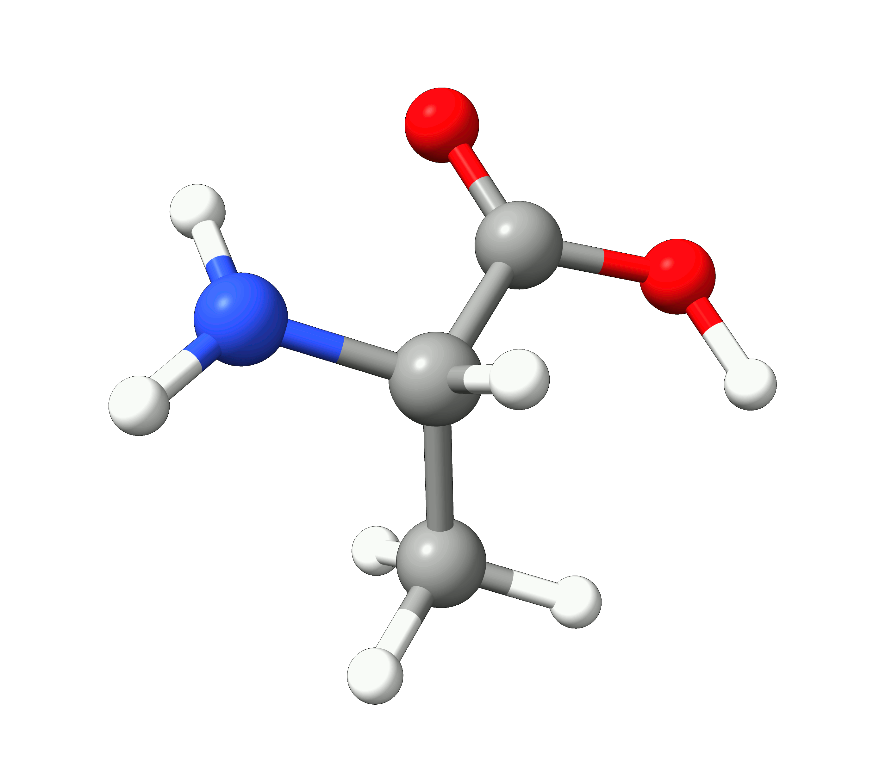

# Geometry optimization

## Basic usage

Optimizing a geometry means finding the geometry that minimizes the total energy for a given method.

Now, suppose you want to calculate the optimized geometry of the amino acid **alanine** for a given method. The first step is to have some kind of guess geometry. You can use [Avogadro 2](../first_steps/GUI.md) to draw its structure and run the Open Babel optimizer (via `Extensions`$\rightarrow$`Open Babel`$\rightarrow$`Optimize Geometry`) to get a reasonable atom arrangement:


*Figure: Creation of the input structure in Avogadro.*

and with those coordinates, you can already set up your ORCA input!

> **Note**
> One can use Avogadro itself to make the input, save the molecule as a .xyz and read it (see [Reading from external file](../first_steps/input_output.md#reading-external), or add the coordinates directly to the [Structure section](../first_steps/input_output.md#geo-sec) of the input using the "xyz" flag.

If you want to optimize the geometry, for instance using DFT, all you have to do is to choose a functional and a basis set and add OPT to the main input:

```mol
title: geoopt #1
theme: chem311
height: 360px
representation: ball-stick
--- xyz ---
13
structure
N         -0.83911        0.76325       -0.31843
C          0.61442        0.72014       -0.25075
C          1.01669       -0.56167        0.49740
O          0.20095       -1.36984        0.93753
H         -1.37884        0.05803        0.17605
H          1.00414        0.66192       -1.27362
C          1.17285        1.95192        0.45211
H          0.87124        2.87150       -0.05988
H          0.81191        2.01288        1.48492
H          2.26726        1.92903        0.48485
H         -1.30551        1.57618       -0.71069
O          2.33980       -0.77979        0.66176
H          3.04559       -0.08055        0.28096
--- input ---
!PBE D4 DEF2-SVP OPT
* xyz 0 1
N         -0.83911        0.76325       -0.31843
C          0.61442        0.72014       -0.25075
C          1.01669       -0.56167        0.49740
O          0.20095       -1.36984        0.93753
H         -1.37884        0.05803        0.17605
H          1.00414        0.66192       -1.27362
C          1.17285        1.95192        0.45211
H          0.87124        2.87150       -0.05988
H          0.81191        2.01288        1.48492
H          2.26726        1.92903        0.48485
H         -1.30551        1.57618       -0.71069
O          2.33980       -0.77979        0.66176
H          3.04559       -0.08055        0.28096
*
```

> **Important**
> Plain DFT and HF are known to perform poorly for intermolecular or weak interactions.
> In general it is advisable to use a dispersion correction like Grimme's D4 [[Grimme2017]](../bib.md#grimme2017) correction, this will correct both the energies and gradients and lead to much better results.
> For an example, see the [dispersion corrections tutorial](../prop/disp.md).

If everything is right, you should first see on the output, after the main header:

```text
*****************************
                       * Geometry Optimization Run *
                       *****************************

Geometry optimization settings:
Update method            Update   .... BFGS
Choice of coordinates    CoordSys .... (2022) Redundant Internals
Initial Hessian          InHess   .... Almloef's Model
Max. no of cycles        MaxIter  .... 50  

Convergence Tolerances:  
Energy Change            TolE     ....  5.0000e-06 Eh  
Max. Gradient            TolMAXG  ....  3.0000e-04 Eh/bohr    
RMS Gradient             TolRMSG  ....  1.0000e-04 Eh/bohr
Max. Displacement        TolMAXD  ....  4.0000e-03 bohr
RMS Displacement         TolRMSD  ....  2.0000e-03 bohr
Strict Convergence                .... False
[...]
```

where some of the parameters for the optimization are written.

Then the SCF runs, followed by the calculation of a gradient and information related the current step is given:

```text
                                .--------------------.
          ----------------------|Geometry convergence|-------------------------
          Item                value                   Tolerance       Converged
          ---------------------------------------------------------------------
          RMS gradient        0.0111840906            0.0001000000      NO
          MAX gradient        0.0602175515            0.0003000000      NO
          RMS step            0.0320147074            0.0020000000      NO
          MAX step            0.1623430770            0.0040000000      NO
          -------------------------------------------------------------------------
          ........................................................
          Max(Bonds)      0.0859      Max(Angles)    4.45
          Max(Dihed)        2.73      Max(Improp)    0.00
          ---------------------------------------------------------------------

The optimization has not yet converged - more geometry cycles are needed
```

Since the guess geometry was far from good, none of the criteria for convergence are achieved on the first step. The geometry is then modified according to the default algorithm (a quasi-Newton method) and you can see the changes in geometry next:

```text
    ---------------------------------------------------------------------------
                         Redundant Internal Coordinates
                            (Angstroem and degrees)

        Definition                    Value    dE/dq     Step     New-Value
    ----------------------------------------------------------------------------
     1. B(C   1,N   0)                1.4557  0.012562 -0.0153    1.4404
     2. B(C   2,C   1)                1.5377  0.001421 -0.0031    1.5347
     3. B(O   3,C   2)                1.2297  0.028017 -0.0145    1.2152
     4. B(H   4,N   0)                1.0164  0.000572 -0.0004    1.0160
     5. B(H   4,O   3)                2.2615  0.001277 -0.0100    2.2515
[...]
```

and the process is repeated until the criteria are met:

```text
.--------------------.
          ----------------------|Geometry convergence|-------------------------
          Item                value                   Tolerance       Converged
          ---------------------------------------------------------------------
          Energy change      -0.0000017309            0.0000050000      YES
          RMS gradient        0.0000411287            0.0001000000      YES
          MAX gradient        0.0001226561            0.0003000000      YES
          RMS step            0.0004552473            0.0020000000      YES
          MAX step            0.0014707390            0.0040000000      YES
          -------------------------------------------------------------------------
          ........................................................
          Max(Bonds)      0.0008      Max(Angles)    0.03 
          Max(Dihed)        0.08      Max(Improp)    0.00 
          ---------------------------------------------------------------------
    
                    ***********************HURRAY********************
                    ***        THE OPTIMIZATION HAS CONVERGED     ***
                    *************************************************
```

> **Warning**
> Always check for the `HURRAY` message for full convergence of your geometry optimization. If the geometry optimization is close to but not fully converged this message will be missing even though ORCA
> may state that the run was successful! If this is the case you should consider restarting the optimization to reach full convergence.

Here you can see how the geometry changes during the optimization:

[](../images/opt.gif)

*Figure: Optimization of alanine.*

Although the initial guess appeared to be good, as one can see, the B3LYP functional predicts the geometry somewhat different from the input given. The initial guess had the amine group in a more planar configuration that was fixed by the optimization, along with corrections in the bond lengths.

> **Important**
> After a geometry optimization run, a file named `basename.xyz` is printed with the final geometry coordinates that can be later used in following calculations. The optimization trajectory is also stored in `basename_trj.xyz`.

You can find a table of the optimization energies by opening the `basename.out` file with Avogadro 2 and navigate to `Analysis`$\rightarrow$`Properties`$\rightarrow$`Conformer Properties...`.

We see that the energy of the molecule goes down as the optimization progresses, leaning towards convergence:

[](../images/enconv.png)

*Figure: Energy convergence for the optimization of alanine.*

## Is this a real minimum?

How can one know if this is a real minimum? The norm of the gradient is also zero at saddle points, or maybe the gradient was low, but not sufficiently low.

It is possible to check that by calculating the [vibrational frequencies](../prop/freq.md) on the final geometry, adding a `FREQ` keyword on the main input:

```text
!PBE D4 DEF2-SVP FREQ
*XYZFILE 0 1 optimized_structure.xyz
```

Then, after computing the exact Hessian, the frequencies will be printed:

```text
-----------------------
VIBRATIONAL FREQUENCIES
-----------------------

Scaling factor for frequencies =  1.000000000  (already applied!)

     0:       0.00 cm**-1
     1:       0.00 cm**-1
     2:       0.00 cm**-1
     3:       0.00 cm**-1
     4:       0.00 cm**-1
     5:       0.00 cm**-1
     6:      63.32 cm**-1
     7:     224.15 cm**-1
     8:     238.66 cm**-1
     9:     254.16 cm**-1
    10:     313.45 cm**-1
[...]
```

and you can see, all frequencies besides the first translations and rotations are positive, that means we do have a true minimum.

> **Important**
> All positive frequencies guarantee a **local** minimum, but not necessarily a **global** minimum!
> You can use [GOAT](../prop/goat.md) to automatically search for the global minimum and the conformer ensemble.

## Numerical Gradients

The quality of the final geometry depends on the quality of the method you choose. In case you want to optimize the geometry for a method to which there is currently no analytical gradient, you can ask for the numerical gradient using the `NUMGRAD` flag:

```text
!DLPNO-CCSD(T) cc-pVTZ cc-pVTZ/C OPT NUMGRAD
```

> **Warning**
> Take care when using numerical gradients, the calculation will take **much** longer if the system is large.

## How to remove negative frequencies?

It is not uncommon that, after a geometry optimization run, you end up with one or more negative frequencies, notably if your system has weak intermolecular interactions. It might be that you are stuck on a saddle point or that the optimization criteria was just not good enough.

If you have many small negative frequencies, you probably just need a tighter convergence:

```text
!TIGHTOPT
```

or, in drastic cases:

```text
!VERYTIGHTOPT
```

and it should do it.

If your system has one large negative frequency, it might be closer to a saddle point than a minimum. Then, the best solution would be to take your final structure and displace it in the direction of that mode. For more info check [Removing negative frequencies](../prop/freq.md#negative-freq).

## Optimization of Hydrogen atoms

In some cases, it can be useful to only optimize the positions of the hydrogen atoms. To do so, we can
add the `optimizehydrogens true` to the `%geom` block:

```text
!r2SCAN-3c OPT

%geom 
 optimizehydrogens true
end

*XYZFILE 0 1 structure.xyz
```
