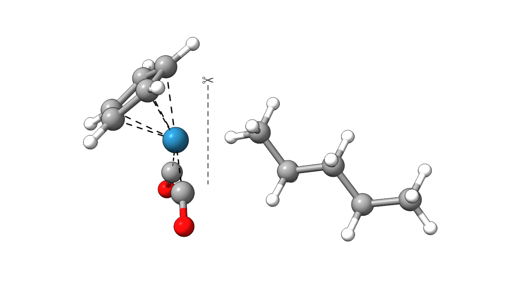
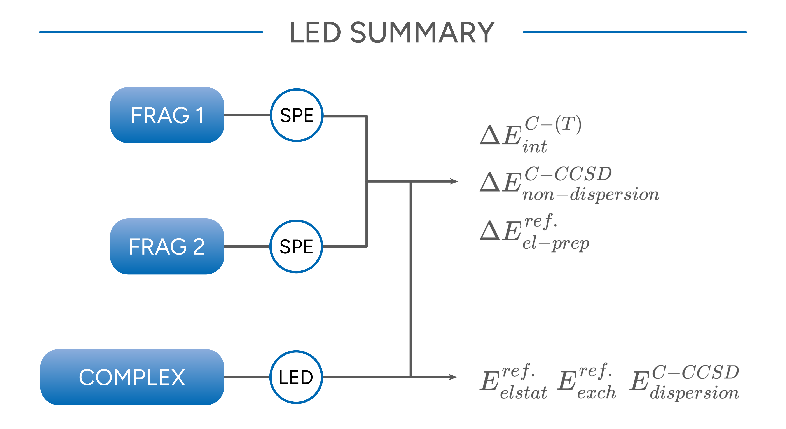

# Local Energy Decomposition (LED)

Decomposition of interaction energies in physically motivated components can be very useful to understand and control interaction patterns of different molecules.
The local energy decomposition (LED) approach based on DLPNO-CCSD(T) interaction energies available within ORCA is one of the most sophisticated ones available.

$$
\Delta E_{int.} = \Delta E_{el-prep}^{ref.} + E_{elstat}^{ref.} + E_{exch}^{ref.}
           + \Delta E^{C-CCSD}_{non-dispersion} + E^{C-CCSD}_{dispersion}
           + \Delta E^{C-(T) }_{int}
$$

Often, the geometry relaxation upon coordination is additionally considered as $\Delta E_{geo-prep}$. This contribution is also known as *strain*. For more information
on the interpretation and physical meaning of the LED contributions refer to the [ORCA manual](https://www.faccts.de/docs/orca/6.0/manual) and refs.
[[Bistoni2020c]](../bib.md#bistoni2020c)[[Bistoni2021]](../bib.md#bistoni2021).

## Example: Alkane coordination in CpRe(CO)_2(*n*-pentane)

As an example, we will decompose the interaction energy of *n*-pentane in CpRe(CO)_2(*n*-pentane).

[](../images/re-complex.png)

*Figure: Molecular structure of CpRe(CO)_2(*n*-pentane).*

```mol
title: CpRe(CO)₂(n-pentane)
theme: chem311
height: 360px
representation: ball-stick
--- xyz ---
28
structure
C -4.04623 -0.94060 -0.87986
C -3.23056 -2.00842 -0.35445
C -3.13403 -1.81280 1.05377
C -3.91155 -0.67695 1.43080
H -4.06405 -0.30844 2.43482
H -2.55793 -2.42869 1.73308
H -2.78231 -2.81070 -0.92293
H -4.33874 -0.81051 -1.91193
H -5.12295 0.73363 0.15767
Re -2.25459 0.06030 -0.00431
C -2.28573 1.94921 0.30847
O -2.41945 3.09516 0.50242
C -1.42081 0.35728 -1.70388
C 1.36998 0.37687 0.48298
C 2.65689 -0.45514 0.51279
C 3.88944 0.33865 0.06397
C 5.17382 -0.49523 0.09209
H 6.03818 0.09339 -0.23266
H -0.71033 0.32056 1.08127
H -0.03361 -1.27625 0.26666
H 0.26149 -0.82286 1.95167
H 1.48316 1.25742 1.12785
H 1.19312 0.75113 -0.53133
H 2.53534 -1.33457 -0.13562
H 2.82276 -0.83988 1.52947
H 4.00603 1.21834 0.71103
H 3.71924 0.72157 -0.95085
H 5.09141 -1.36476 -0.57032
```

The LED analysis can be envoked by the simple input keyword `LED`. Further, the fragments CpRe(CO)_2 (1) and *n*-pentane (2) can be defined in
the input file:

```text
!DLPNO-CCSD(T) DEF2-SVP DEF2-SVP/C DEF2/J RIJCOSX VERYTIGHTSCF TIGHTPNO LED

*XYZ 0 1
C(1) -4.46463 -0.12110 0.22162
[...]
O(1) -0.99391 0.49487 -2.78478
C(2) 0.15487 -0.43421 0.93360
[...]
H(2) 5.37983 -0.86517 1.10337
*
```

> **Important**
> Note that in practice, basis sets of triple-zeta quality or larger are recommended.

This calculation will give you a summary of the LED analysis with all energies in atomic units:

```text
-------------------------------------------------
FINAL SUMMARY DLPNO-CCSD ENERGY DECOMPOSITION (Eh)
------------------------------------------------- 

Intrafragment REF. energy:    
Intra fragment   1 (REF.)              -494.831830000
Intra fragment   2 (REF.)              -196.014013871     

Interaction of fragments  2 and  1:
Electrostatics (REF.)                  -0.191884228
Exchange (REF.)                        -0.064166273
Dispersion (strong pairs)              -0.015681646 
Dispersion (weak pairs)                -0.001188732

Sum of non dispersive correlation terms:
Non dispersion (strong pairs)          -2.466925458  
Non dispersion (weak pairs)            -0.001535283
```

From this output, we can directly extract three of the contributions:

$$
E_{elstat}^{ref.} = \text{Electrostatics (REF.)} = -0.191884228
$$

$$
E_{exch}^{ref.} = \text{Exchange (REF.)} = -0.064166273
$$

$$
E^{C-CCSD}_{dispersion} = \text{Dispersion (strong pairs)} + \text{Dispersion (weak pairs)} =  −0.016870378
$$

For the other three terms, we need additional calculations at the same level for the isolated fragments in the complex geometry.

For CpRe(CO)_2 (1):

```text
!DLPNO-CCSD(T) DEF2-SVP DEF2-SVP/C DEF2/J RIJCOSX VERYTIGHTSCF TIGHTPNO

*XYZ 0 1
C(1) -4.46463 -0.12110 0.22162
[...]
O(1) -0.99391 0.49487 -2.78478
```

and for *n*-pentane (2):

```text
!DLPNO-CCSD(T) DEF2-SVP DEF2-SVP/C DEF2/J RIJCOSX VERYTIGHTSCF TIGHTPNO

*XYZ 0 1
C(2) 0.15487 -0.43421 0.93360
[...]
H(2) 5.37983 -0.86517 1.10337
*
```

These calculations will give you essential parts needed to calculate the remaining contributions: `E(0)`, `E(CORR)(corrected)`, and `Triples Correction (T)`:

The respective parts of the output for CpRe(CO)_2 (1) look like:

```text
E(0)                                       ...   -494.901127802
E(CORR)(strong-pairs)                      ...     -1.652880182
E(CORR)(weak-pairs)                        ...     -0.001184997
E(CORR)(corrected)                         ...     -1.654065179
E(TOT)                                     ...   -496.555192980
```

```text
Triples Correction (T)                     ...     -0.071314179
Final correlation energy                   ...     -1.725379358
E(CCSD)                                    ...   -496.555192980
E(CCSD(T))                                 ...   -496.626507159
```

and for *n*-pentane (2) like:

```text
E(0)                                       ...   -196.190109425
E(CORR)(strong-pairs)                      ...     -0.806037106
E(CORR)(weak-pairs)                        ...     -0.000302982
E(CORR)(corrected)                         ...     -0.806340087
E(TOT)                                     ...   -196.996449513
```

```text
Triples Correction (T)                     ...     -0.022482469
Final correlation energy                   ...     -0.828822556
E(CCSD)                                    ...   -196.996449513
E(CCSD(T))                                 ...   -197.018931981
```

With these data, we can now calculate the missing LED contributions:

$$
\begin{split} 
\begin{split} 
\Delta E_{el-prep}^{ref.} & =  [\text{Intra fragment   1 (REF.)} - \text{E(0)}_{frag 1}] + [\text{Intra fragment   2 (REF.)} - \text{E(0)}_{frag 2}] \\
 & = 0.245393356
\end{split}
\end{split}
$$

$$
\begin{split} 
\begin{split}
\Delta E^{C-CCSD}_{non-dispersion} & = (\text{non-dispersion (strong pairs)} + \text{non-dispersion (weak pairs)}) \\
& - (\text{E(CORR)(corrected)}_{frag 1} + \text{E(CORR)(corrected)}_{frag 2}) \\
& = -0.008055475 
\end{split}
\end{split}
$$

$$
\begin{split} 
\begin{split}
\Delta E^{C-(T) }_{int} & = \text{Triples Correction (T)}_{complex} \\ 
& - (\text{Triples Correction (T)}_{frag 1} + \text{Triples Correction (T)}_{frag 2}) \\
& = -0.002667349 
\end{split}
\end{split}
$$

Now, we have all components of the LED analysis of the interaction energy of the fragments:

| $\Delta E_{int.}$ | $\Delta E_{el-prep}^{ref.}$ | $E_{elstat}^{ref.}$ | $E_{exch}^{ref.}$ | $\Delta E^{C-CCSD}_{non-disp.}$ | $E^{C-CCSD}_{disp.}$ | $\Delta E^{C-(T)}_{int}$ | Sum |
| --- | --- | --- | --- | --- | --- | --- | --- |
| a.u. | 0.24539 | -0.19188 | -0.06417 | -0.00806 | -0.01687 | -0.00267 | -0.03825 |
| kcal/mol | 153.99 | -120.41 | -40.26 | -5.05 | -10.59 | -1.67 | -24.00 |

All six contributions sum up to the overall interaction energy that is also obtained from subtracting the total energies of the fragments from that of the complex. The following graphics
summarizes the steps that have to be performed and from which calculation data are needed to calculate the individual components.

[](../images/led-summary.png)

*Figure: Schematic summary of a LED analysis.*

## Dispersion Interaction Density (DID)

Since London dispersion interactions are a crucial component of the interaction energy, understanding and controlling them became an integral part of modern compound design. For example, the
concept of dispersion-energy-donors (DED).[[Grimme2006]](../bib.md#grimme2006)[[Grimme2011c]](../bib.md#grimme2011c)[[Schreiner2015]](../bib.md#schreiner2015) became particularly useful in this context.
One way to visualize the London dispersion component of the LED analysis is the Dispersion Interaction Density (DID) plot.[[Mata2016]](../bib.md#mata2016)[[Bistoni2019]](../bib.md#bistoni2019)

To obtain the DID, you can simply add `%mdci DoDIDplot true end` to your LED input and run the calculation as described before.

After a successful calculation, the DID will be stored in the `basename.densities` container as `basename.ded21`.

We can now use `orca_plot` to create a plotable datafile from the DID. To open the interactive interface call

```text
orca_plot basename.gbw -i
```

Here, we now choose `1 - Enter type of plot` to decide what to plot

```text
PlotType       ... MO-PLOT
MO/Operator    ... 0 0
Output file    ... (null)
Format         ... Grid3d/Cube
Resolution     ... 40 40 40
Boundaries     ...   -16.680972    18.410507 (x direction)
                     -12.311453    12.849005 (y direction)
                     -12.262472    11.601143 (z direction)

       1 - Enter type of plot
       2 - Enter no of orbital to plot
       3 - Enter operator of orbital (0=alpha,1=beta)
       4 - Enter number of grid intervals
       5 - Select output file format
       6 - Plot CIS/TD-DFT difference densities
       7 - Plot CIS/TD-DFT transition densities
       8 - Set AO(=1) vs MO(=0) to plot
       9 - List all available densities
      10 - Perform Density Algebraic Operations

      11 - Generate the plot
      12 - exit this program
Enter a number: 
```

From the given list, we now chose `15 - LED dispersion interaction density (ded21)` which is also highlighted as `available`

```text
     1 -   molecular orbitals                          
     2 -   (scf) electron density                              ......  (scfp                     )  => AVAILABLE
     3 -   (scf) spin density                                  ......  (scfr                     )  - NOT AVAILABLE
     4 -   natural orbitals                               
     5 -   corresponding orbitals                         
     6 -   atomic orbitals                                
     7 -   mdci electron density                               ......  (mdcip                    )  - NOT AVAILABLE
     8 -   mdci spin density                                   ......  (mdcir                    )  - NOT AVAILABLE
     9 -   OO-RI-MP2 density                                   ......  (pmp2re                   )  - NOT AVAILABLE
    10 -   OO-RI-MP2 spin density                              ......  (pmp2ur                   )  - NOT AVAILABLE
    11 -   MP2 relaxed density                                 ......  (pmp2re                   )  - NOT AVAILABLE
    12 -   MP2 unrelaxed density                               ......  (pmp2ur                   )  - NOT AVAILABLE
    13 -   MP2 relaxed spin density                            ......  (rmp2re                   )  - NOT AVAILABLE
    14 -   MP2 unrelaxed spin density                          ......  (rmp2ur                   )  - NOT AVAILABLE
    15 -   LED dispersion interaction density                  ......  (ded21                    )  => AVAILABLE
[...]
    42 -   LFT QDPT unrelaxed transition AO density            ......  (Tdens-LFTQDSOC           )  - NOT AVAILABLE
Enter Type: 
```

Now, the program will ask you if the suggested default `basename.ded21`density file is the correct one, which we confirm

```text
The default name of the density would be: led.ded21
Is this the one you want (y/n)? y
```

Via the options `5 - Select output file format` we can further choose the format of the output file, in this case `Gaussian cube`,
and via `4 - Enter number of grid intervals` and the number of grid points that may be included. `11 - Generate the plot` will then
create the `basename.eldens.cube` file. This file now containes the data of the DID that finally may be rendered onto the simple
electron density. The respective electron density can be created in the same way by simply choosing `2 - (scf) electron density` instead.

These files can now be used to render the DID plot, for example with ChimeraX. On the left, you see the DID (isovalue = 0.12 kJ/mol/bohr^3)
and on the right the DID mapped to the electron density.

[](../images/re-complex-led.png)

*Figure: Left: direct DID plot (isovalue = 0.12 kJ/mol/bohr^3); right: DID mapped to the electron density.*

From the DID plot, we can easily see which parts of the fragments contribute most to the dispersion component of the interaction energy.
