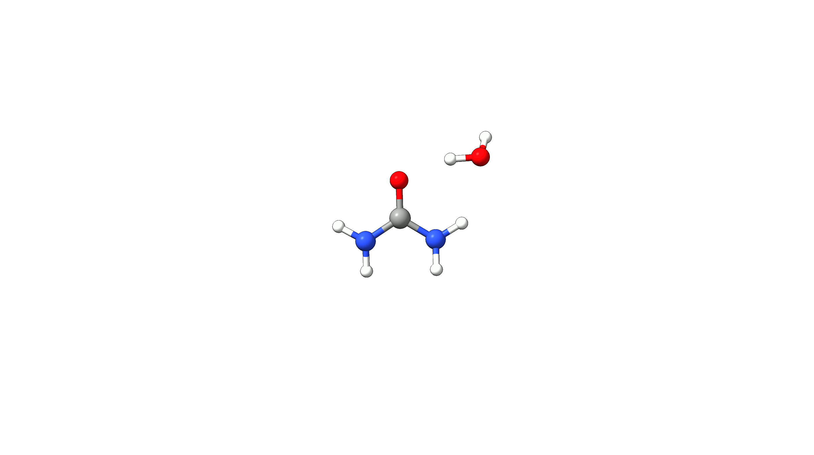
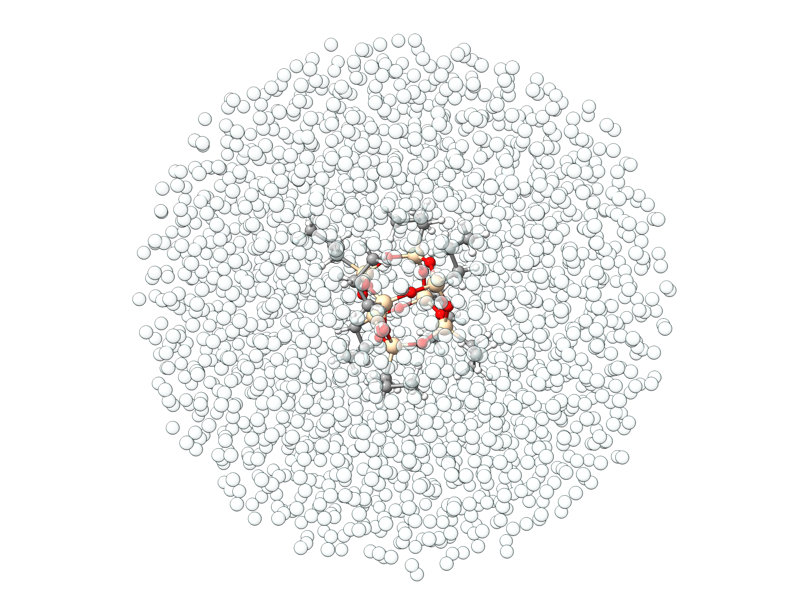

# Explicit Solvation (SOLVATOR)

[Implicit solvation models](../prop/cpcm.md) are an efficient way to model solvation effects. However, if the solute stronlgy interacts with the solvent or the solute acts as a reactant, an explicit
treatment of solvent molecules in needed. The SOLVATOR is an algorithm for fully automatic inclusion of explicit solvent molecules and generation of solvation shells. It can be easily requested
via the `%solvator` block:

```text
! XTB ALPB(WATER)

%solvator
nsolv 30 
end

* XYZFILE 0 1 solute.xyz
```

> **Note**
> Without any further input, the SOLVATOR can use all solvents available for ALPB. Nevertheless, custom solvents can be defined via the input.

If a large number of solvent molecules is to be added, the *stochastic mode* within the SOLVATOR may be used to massively speed up the procedure at the cost of accuracy.

```text
! XTB ALPB(WATER)

%SOLVATOR 
    NSOLV       100 
    CLUSTERMODE STOCHASTIC
END
*XYZFILE 0 1 solute.xyz
```

## Example 1: Explicit Solvation of Urea

As an example, we will solvate an urea molecule with 30 water molecules. To do so, we can use the input shown above and the corresponding output will look like:

```mol
title: Urea
theme: chem311
height: 360px
representation: ball-stick
--- xyz ---
8
structure
H     2.01822    0.20187   -0.06397
H     0.83499    1.40748   -0.41061
H    -1.39434    0.89498   -0.21940
H    -1.88388   -0.75647   -0.13275
O     0.40675   -1.67285    0.11342
C     0.11861   -0.48803   -0.06584
N     1.05605    0.49217   -0.06005
N    -1.15640   -0.07915   -0.28146
```

```text
*****************
                       * ORCA Solvator *
                       *****************

Solvent chosen:                                WATER
Solvent radius:                                .... 1.69 Angs
Solvent max dimensions (x,y,z):                .... 2.73, 2.32, 1.52 Angs
Number of solvent molecules to be added:       .... 30 molecules
Method used to add the solvent:                .... docking
Number of atoms of solvent molecule:           .... 3 atoms
Coordinates of solvent in Angstroem:           

   O   -0.000006   0.397814  -0.000000
   H    0.763472  -0.198901   0.000000
   H   -0.763466  -0.198913   0.000000

Solute radius:                                 .... 2.93 Angs
Ellipsoid potential radii:                     .... 6.33, 5.88, 4.58 Angs
Adding solvent molecules to the solute         .... 

      Iter       Energy      Einter          dE          Time
                  (Eh)     (kcal/mol)    (kcal/mol)     (min)
      -------------------------------------------------------
         1    -19.210306    -4.659502     -4.659502      0.21
         2    -24.302552    -4.533387      0.126115      0.25
         3    -29.394688    -4.464434      0.068952      0.29
[...]
        24    -136.308378    -1.936280      4.656513      5.53
        25    -141.398670    -3.272224     -1.335945      6.09
        26    -146.487932    -2.627486      0.644738      6.47
Wall size increased by factor 1.05.
        27    -151.580491    -4.663392     -2.035905      7.87
        28    -156.682343    -4.840764     -0.177372      9.33
        29    -161.768524    -0.720711      4.120053      8.96
        30    -166.856255    -1.699958     -0.979247      10.30

Final radius after microsolvation:             .... 5.55 Angs
Time needed for microsolvation   :             .... 5511.52 s
Final structured saved to        :             basename.solvator.xyz

		****ORCA-SOLVATOR TERMINATED NORMALLY****
```

From this, we can see the iterative addition of water molecules, their respective interaction energies, and the overall energy change upon coordination. The structure of the solvated urea molecule
is stored in the `basename.solvator.xyz` file and the cluster growth looks like:

[](../images/urea-30water.gif)

## Example 2: Custom Solvents - Helium Droplet

SOLVATOR is not restricted to predefined solvents. You can easily define any custom solvent via the `%SOLVATOR` block. In this example, we will use the `STOCHASTIC` and `DROPLET` modes to
spherically  solvate a sesqui-siloxane with 2000 Helium atoms. In this case our custom
solvent is a neutral singlet Helium atom that we define in a `he.xyz` file. Charge and
multiplicity are given via the second line in the `.xyz` file.

```mol
title: Helium
theme: chem311
height: 360px
representation: ball-stick
--- xyz ---
1
0 1
He 0 0 0
```

```mol
title: Sesqui-siloxane
theme: chem311
height: 360px
representation: ball-stick
--- xyz ---
100
structure
Si 2.30883927191187021677 -1.51404107261898013270 -0.06479458802821000396
Si 0.69844495028425856997 2.53054881818156962581 -0.57025875838537964935
Si 1.76968132551996903956 0.88645731306134989413 1.81815072089804852240
Si 1.24023679693334010210 0.12887051433739010742 -2.45462644723449940898
O  1.47797606920943969122 2.09710588445933909796 0.78327428664550924342
O  2.47037162112476949005 -0.36267740860083069743 1.06318958760345028125
O  2.14724279926403971430 -0.84019824205737059231 -1.52811718998416923299
O  1.17449611044826007777 1.61711183569708993879 -1.81868142591142012421
O  0.39950516912156014415 0.41014517960417962161 2.53909316241434979133
O  1.03577796006599931466 -2.45939073017393816656 0.26658822054469016871
C  3.86064736032040034530 -2.60084865441333024094 -0.09415481382276005839
C  1.14364000674242949351 4.33130288798302132136 -0.95831926241946008282
C  2.95427276296586960314 1.52116262557503967301 3.14908160016116855928
C  2.06043263801967002635 0.24730786165735027526 -4.15902291357893094670
C  3.90575117563901885731 -3.65841588533059125510 1.01113071648778030109
C  1.03633523105185809676 4.69271580225670970066 -2.44175622400742931006
C  2.42612388212526886022 2.75762877421782803822 3.87739875337951023226
C  2.76895479629271035193 -1.03630441656062011191 -4.59817790597404041364
C  3.99617575306170946803 -3.03554304523522056058 2.39737038341486030646
C  -0.38978418583185003854 4.56868838311114000561 -2.95899800040501936849
C  3.40223083440897999807 3.25170654911326062475 4.93973454914741871846
C  1.79904320713196952397 -2.19849925304276050397 -4.75739565686958876256
Si -2.16923648489345977097 1.45426783117045044236 -0.01870960599793020790
Si -0.56318192368503949830 -2.58406051784629031687 0.49418191599628003008
Si -1.63152308951002988913 -0.93828528229811991590 -1.90091815923119988874
Si -1.09893107745471896308 -0.18602740921880953073 2.37739116950383966298
O  -1.34685273353240986260 -2.13973745660979997041 -0.85332000914464001262
O  -2.33456025887852014478 0.32000944971483041845 -1.16296686079512978651
O  -2.00281184230103015409 0.77767883065566023593 1.44192675840557971156
O  -1.03318807002326851219 -1.67816481400793904299 1.75111237908015970888
O  -0.25591078342145984204 -0.47104763472030986016 -2.61742643815765951842
O  -0.90165733572753015146 2.40762179951717092408 -0.34545383340373003733
C  -3.73428050087115925848 2.51603829101419851355 -0.01815659898138005657
C  -1.01235827566696867663 -4.38784603836863862369 0.86651868482533955795
C  -2.80604844640132977673 -1.59380669992410939351 -3.23072457802342949407
C  -1.92219349146365003911 -0.29101512884843022677 4.08107501501395031340
C  -4.01896736325925019173 3.15358491116559047640 -1.37854494362718993372
C  -0.96828017732090965186 -4.75078626933027869939 2.35290323022157021882
C  -2.28944557534834869372 -2.86499709299084015512 -3.90555810015316007267
C  -2.63016186476952018580 0.99701470478872022962 4.50870889568977872841
C  -5.29465505813576875482 3.98863268133149162509 -1.36009570325191009310
C  0.43400029910372006636 -4.62639632611979045862 2.93113716048616979037
C  -3.26303206554563995923 -3.38698577510639875499 -4.95678581013346875039
C  -1.65879639885883878314 2.15844255245909044660 4.66558459805101932716
H  3.91951010594626980676 -3.10369193013083144450 -1.05973816979330970334
H  4.75013834211284891040 -1.97537461313113049677 -0.01669722396988995369
H  0.50054673213437972379 5.00161909257629133663 -0.38768802597859025605
H  2.16371909638209958260 4.52455437533658066940 -0.62639764452651036652
H  3.14542544271343915696 0.73649492147874962011 3.88167628963121913444
H  3.91736932797826975516 1.76343870330954977099 2.69946537333993008545
H  1.31470770815672022280 0.50997254094894017840 -4.90954460832408035031
H  2.78771120244437087266 1.05905880843276056780 -4.14858700990401718656
H  3.00534986598125808399 -4.26938181753094614379 0.94907211175572059325
H  4.76954135253091848767 -4.30990703001076802536 0.85218243687316996837
H  1.38666197667096047219 5.71820642646272947474 -2.58893781604851058731
H  1.68322554092942966442 4.02803417397333074490 -3.01448664696216894754
H  2.24529627004391851841 3.54810008489985984070 3.14851734744065980820
H  1.47103305153703978192 2.51523697374575938568 4.34312230329484982860
H  3.28025904039187032879 -0.85902566957414994153 -5.54847977452326901471
H  3.52024789644420854628 -1.29657705457920746639 -3.85253639854650931085
H  3.14668902674270967168 -2.38151877517681098695 2.56756735695418880638
H  4.00711771561967999844 -3.80743850933508198864 3.16405351573453952341
H  4.90391151558519844400 -2.44338553454369744600 2.48795323727609973830
H  -1.05324373529086856571 5.22214434287834716741 -2.39667419157567884724
H  -0.44200202603668981016 4.84521860375389046283 -4.01000508779899966783
H  -0.73701094612906004055 3.54566058125262006939 -2.84625863873755013955
H  4.35534625093372707028 3.51721477088752942919 4.48791970564398479127
H  3.00657477635410019801 4.12858427786754766942 5.44703648328616019114
H  3.58131708538499937688 2.47712734176321003332 5.68211170546796928704
H  1.03844542603209943898 -1.95635206821307017222 -5.49622938457011755986
H  2.32358818936812072664 -3.09454422193371092575 -5.08274073080039912043
H  1.30688236711312022464 -2.40240917758488015110 -3.81083588856759947205
H  -4.59223453559549987801 1.90833280028286011998 0.27062566445760011247
H  -3.64938883216220988359 3.30502599627088056167 0.72956950004708975843
H  -2.01598654557988021807 -4.58643944548276127904 0.49028182462367042582
H  -0.34183817421683959648 -5.05453229314074103939 0.32361826110324021233
H  -3.78165341186373016313 -1.80188256932753954054 -2.79109577346592052649
H  -2.96783654511175898350 -0.83203933706014954197 -3.99365066659321898968
H  -2.65051356366059964742 -1.10204911215061041041 4.07548184529990020764
H  -1.17845880359745991406 -0.54880046191694031865 4.83545608005379978778
H  -3.17425636671041999648 3.78197656898877099252 -1.66011213965578030560
H  -4.10692092972908895376 2.36599151951094821555 -2.12723450018604065548
H  -1.63934897095727949434 -4.08680248081823105366 2.89789727201267988121
H  -1.32445903563647049417 -5.77641257499842097900 2.48397765013837013015
H  -1.32689939382206967267 -2.65448661718140055399 -4.37123161520532033109
H  -2.12644275071908905872 -3.62858778509852974992 -3.14480528099144907017
H  -3.37716247278667047738 1.25474422738565971613 3.75776950622156791226
H  -3.14626184984560808289 0.82641495329852054930 5.45761245326638899655
H  -5.21798740459044019246 4.78539784652138067145 -0.62389997330403046405
H  -5.47423288763323778738 4.43751329567928198827 -2.33428761593805722541
H  -6.15154417304282752355 3.36977611319346692653 -1.10419104363117792644
H  0.78936333102788935889 -3.60641984220516942372 2.82136714407547994909
H  0.43857927461324219820 -4.88989719753061091723 3.98666481754406865079
H  1.12048236632775966015 -5.28809174614212196275 2.40800635183417766072
H  -3.42531384075182909754 -2.64005312060207009139 -5.73034451244428932881
H  -2.87535577178886736505 -4.28811600615014931748 -5.42588319013786701817
H  -4.22334594297450838241 -3.62187340364976950724 -4.50377181308966800799
H  -1.16165677135020972699 2.35565262654516871521 3.72022806433342889676
H  -2.18360718306651824250 3.05749725542114125787 4.98250872245835818575
H  -0.90240043070232012212 1.92008284489281999541 5.41019438066246038943
```

We now run the SOLVATOR and obtain a spherical Helium droplet around our sesqui-siloxane molecule.

```text
!XTB

%SOLVATOR
    SOLVENTFILE "he.xyz"
    NSOLV       2000
    CLUSTERMODE STOCHASTIC
    DROPLET     true
END

* XYZFILE 0 1 solute.xyz
```

[](../images/helium-droplet.png)

*Figure: Spherical Helium droplet of 2000 He atoms around a sesqui-siloxane molecule.*
