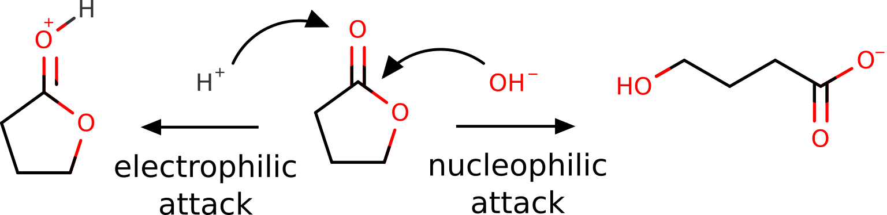
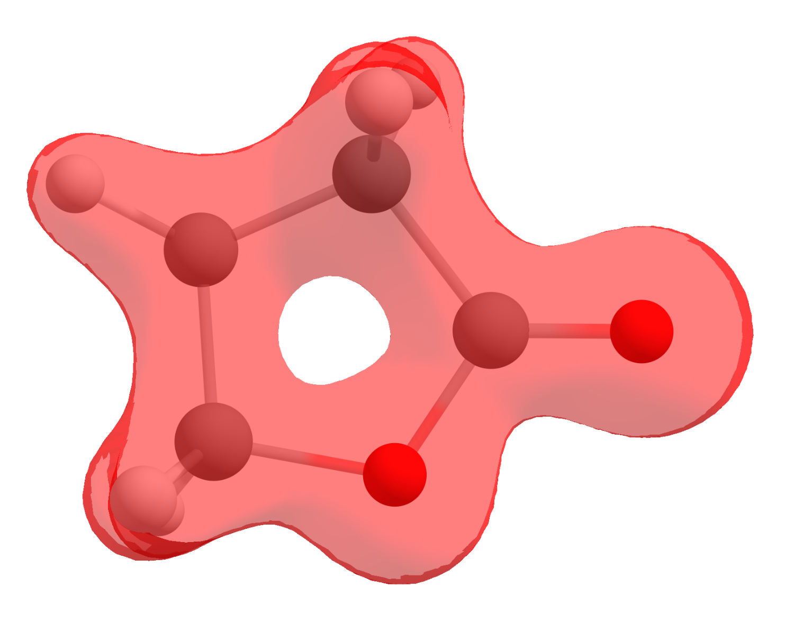
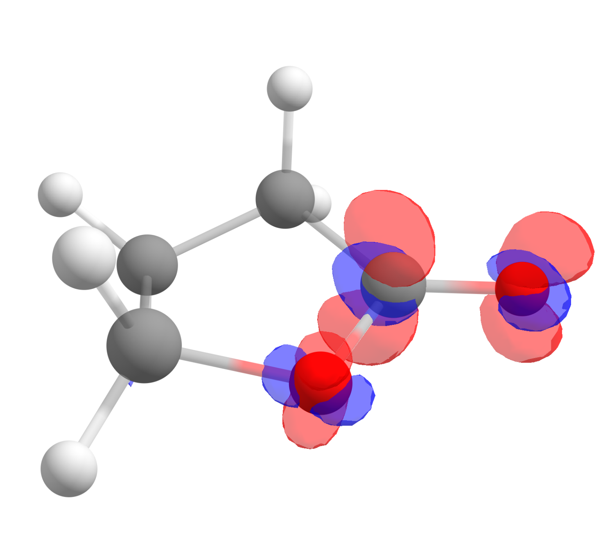
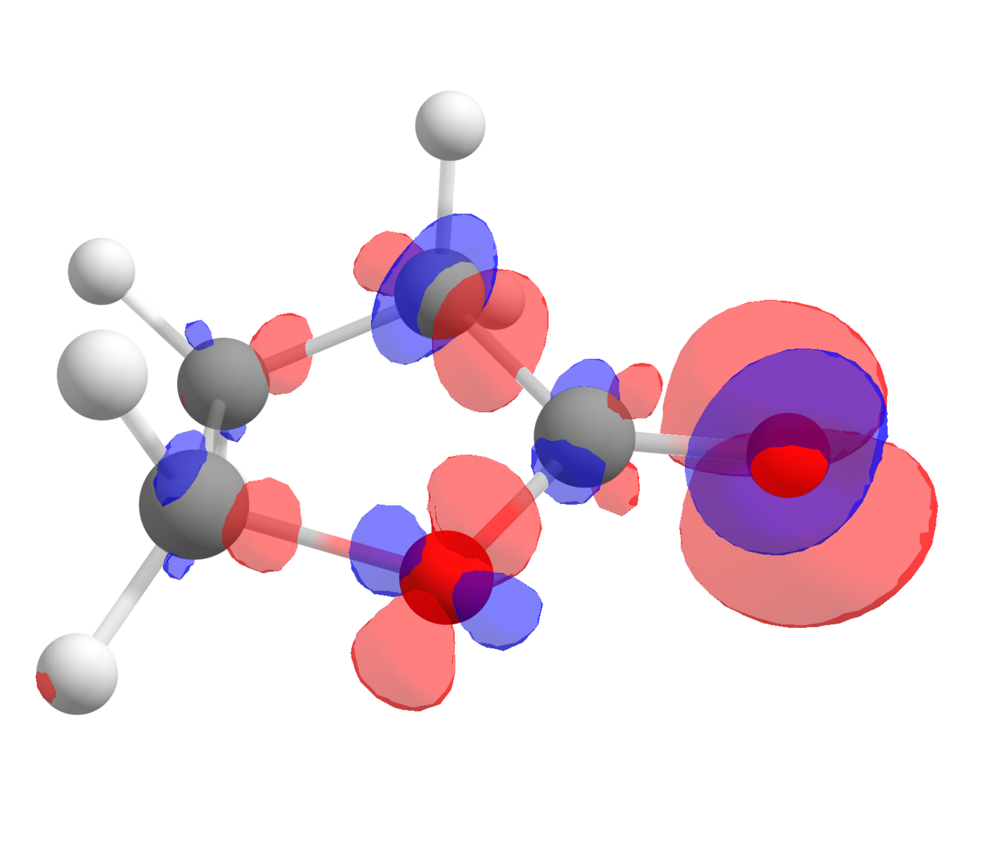
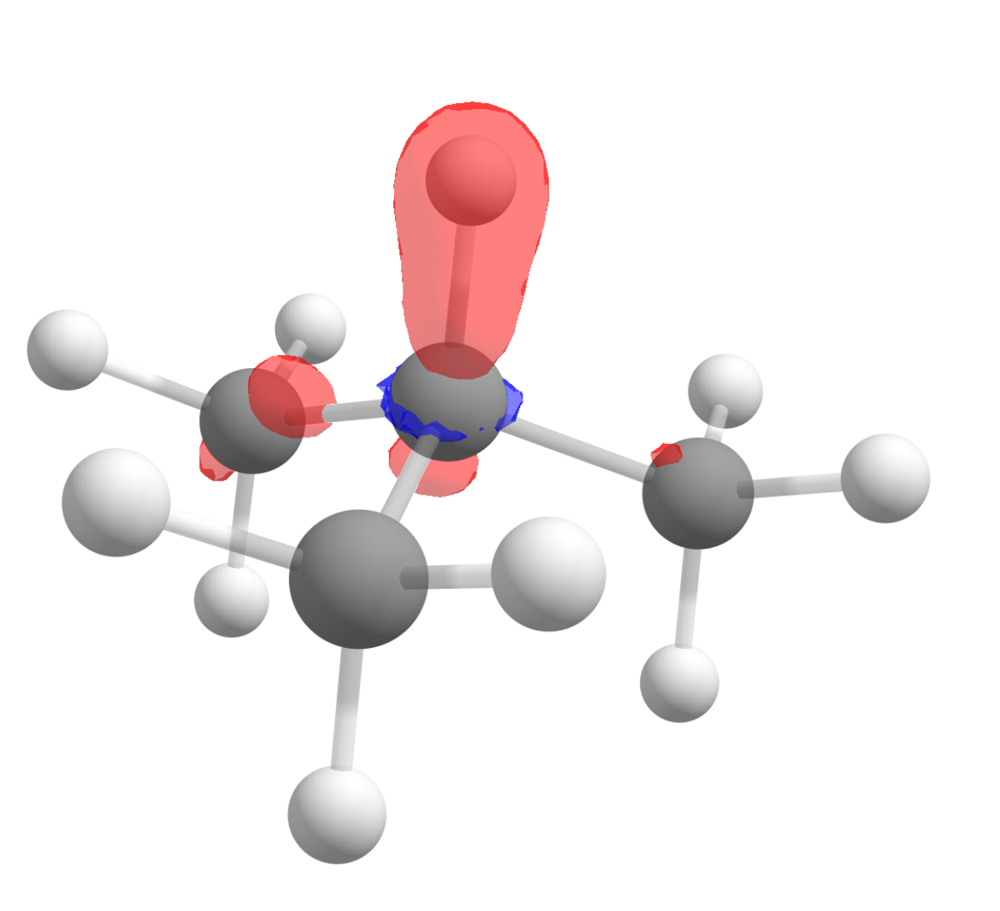

# Plotting Fukui functions

Among the many descriptors of chemical reactivity such as electronegativity and the "hard and soft" acid/base theory from Pearson, the "Fukui function" (FF) as defined by Parr and Yang [[Yang1984]](../bib.md#yang1984) is one of the most used within Density Functional Theory (DFT).

From arguments related to DFT and a finite differences approach to energy derivatives, the Fukui concept can be divided into actually three functions. One is related to reactivity towards nucleophiles ($f^+$), and it is given by:

$$
f^+(\mathbf r) = \rho_{N + 1}(\mathbf r) - \rho_{N}(\mathbf r)
$$

Here, $\rho$ is the electronic density and $N$ is the number of electrons, meaning that $\rho_{N + 1}(\mathbf r)$ is the density of the anion generated from adding one electron to $\rho_N(\mathbf r)$.

High, positive values of this function would indicate which parts of a molecule are most likely to be attacked by a nucleophile, and indeed there are correlations between these, from organic chemistry to metabolites [[Beck2005]](../bib.md#beck2005).

The other two remaining functions are related to electrophilic ($f^-$) or radical ($f^0$) attacks, and are defined as:

$$
f^-(\mathbf r) = \rho_{N}(\mathbf r) - \rho_{N - 1}(\mathbf r)
$$

or

$$
f^0(\mathbf r) = 1/2[\rho_{N + 1}(\mathbf r) - \rho_{N - 1}(\mathbf r)]
$$

Let's compute and plot this functions using ORCA, together with the [Chemcraft](https://www.chemcraftprog.com/) software for visualization.

## The Fukui functions for Butyrolactone

Butyrolactone, as other lactones, are known to suffer a nucleophilic attack at the carbon atom of the carbonyl group. It can also be protonated or coordinate through the oxygen of that group, during an "electrophilic attack" [[Gazquez1994]](../bib.md#gazquez1994):

[](../images/lactone.png)

```mol
title: butyrolactone
theme: chem311
height: 360px
representation: ball-stick
--- xyz ---
12
structure
C         -2.19840        3.00305       -0.20666
C         -2.50179        1.55642        0.08284
O         -1.29812        0.85411       -0.22491
H         -3.31949        1.17786       -0.53711
H         -2.74629        1.38587        1.13674
C         -0.73652        3.10508        0.14798
H         -2.83435        3.69747        0.34848
H         -2.33068        3.20260       -1.27718
C         -0.24607        1.72326       -0.16280
H         -0.58903        3.30540        1.21300
H         -0.22545        3.85317       -0.46203
O          0.92223        1.40071       -0.30020
```

Of course, this is all known from basic organic chemistry, but we want to show it could also be predicted from first principles using the FF.

The first step is optimizing the target molecule, in this case, the neutral form of the lactone, e.g. using B3LYP:

```text
!B3LYP D3 DEF2-SVP OPT KEEPDENS
* XYZFILE 0 1 butyrolactone_guess.xyz
```

Here the KEEPDENS flag was added to keep the basename.scfp density file, which will later be used to plot the density.

After having the optimized geometry and density, our $\rho_{N}(\mathbf r)$, we need the densities of the respective anion $\rho_{N + 1}(\mathbf r)$ and cation $\rho_{N -1}(\mathbf r)$, **at the same geometry** of the neutral density. That can be done simply with:

```text
!B3LYP D3 DEF2-SVP KEEPDENS
* XYZFILE -1 2 butyrolactone_optimized.xyz
```

and:

```text
!B3LYP D3 DEF2-SVP KEEPDENS
* XYZFILE 1 2 butyrolactone_optimized.xyz
```

Note that the multiplicity is now two, for there is one unpaired electron on each case, and the OPT flag was removed.

## Generating a .cube file

To turn the calculated density into an image, one can use the ORCA_PLOT module that comes together with the ORCA software. Its usage is simple, just have the basename.gbw and basename.scfp in the same folder and run:

```text
./orca_plot basename.gbw -i
```

or, if using Windows:

```text
orca_plot basename.gbw -i
```

The *-i* flag indicates that an interactive menu should appear:

```text
Current-settings:

PlotType       ... MO-PLOT
MO/Operator    ... 0 0
Output file    ... (null)
Format         ... Grid3D/Binary
Resolution     ... 40 40 40
Boundaries     ...   -16.609820     3.250952 (x direction)
                      -9.340979    12.515542 (y direction)
                      -9.284442     9.293555 (z direction)

       1 - Enter type of plot
       2 - Enter no of orbital to plot
       3 - Enter operator of orbital (0=alpha,1=beta)
       4 - Enter number of grid intervals
       5 - Select output file format
       6 - Plot CIS/TD-DFT difference densities
       7 - Plot CIS/TD-DFT transition densities
       8 - Set AO(=1) vs MO(=1) to plot
       9 - List all available densities

      10 - Generate the plot
      11 - exit this program
Enter a number:
```

Then choose 1 for the *type of plot* and choose 2 for *electron density*. If the software asks for the name of the density file, choose *y* or give a different name than basename.scfp.

After that, choose 5 for *file format* and 7 for *3D Gaussian cube* - that is the type of file the we will later open. One can also choose 4 to increase the *number of grid intervals* and make the image with a higher resolution. The option number 10 then will generate our basename.eldens.cube file.

Repeat that for the cation and anion densities, and you are ready to obtain the Fukui functions.

> **Note**
> It is worthy to navigate the menu and see which other options are available there!

> **Important**
> The sizes of these files can grow significantly with the `Resolution`. Usually a number aroung 100 is good enough for publication, and any number above 200 is hardly necessary!

## Computing the FF

To read the density files and perform the necessary operations on them, now open [Chemcraft](https://www.chemcraftprog.com/). In order to compute the $f^+(\mathbf r)$ function, first open the **anion** cube file clicking "File", then "Open" to select the basename.eldens.cube.

> **Important**
> Take care to not get confused with the equations! In $\rho_{N + 1}(\mathbf r)$, $N$ refers to the number of electrons and the $N+1$ does not mean a cation, but an anion where one extra electron was added.

If you click now on "Show isosurface" and "Both-signed", you should see the electron density as:

[](../images/lac_dens.png)

However, that is not what we are after, we sought to obtain a FF that is actually a *mathematical operation* between densities. Here is were the software helps: click on "Multiple cubes operations...", then select "Add cube(s)" and open the neutral cube file.

You will have now two files with the same name "Total electron density", that actually represent different physical quantities: the first is that of the anion, and the second of the neutral.

To actually plot $f^+(\mathbf r)$, the operation $\rho_{N + 1}(\mathbf r) - \rho_{N}(\mathbf r)$ can be done by clicking again on "Multiple cubes operations...", then on "Perform operation on two cubes (subtract, etc.)". The first cube and second cube must be selected accordingly and the option should be "Subtract".

After clicking "OK", a third file will show up as the difference of those two, and it corresponds exactly to $f^+(\mathbf r)$. Click on "Show isosurface" and "Both-signed" to see the image:

[](../images/lac_fplus.png)

The red color means positive $f^+(\mathbf r)$ and blue, negative. One also might want to change the "Contour value" to a different number to better visualize these plots. As you can see, even if somewhat distributed, the largest value is on the carbon atom of the carbonyl, just what is expected from basic organic chemistry.

The corresponding $f^-(\mathbf r)$ function, calculated using the same approach is:

[](../images/lac_fminus.png)

which shows that the highest value is around the oxygen of the carbonyl, the one that should interact stronger with electrophilic species, again as predictable from experience.

## The case of radical reactions

Although these reactions are not completely straightforward, the position in a molecule most susceptible to a radical attack can also be investigated using the $f^0(\mathbf r)$ function.

Let us take the example of 2-methylpropane. The hydrogen atom from the tertiary carbon is known to be much more reactive towards radicals that the terminal methyl groups.

[](../images/tbut.png)

```mol
title: 2-methylpropane
theme: chem311
height: 360px
representation: ball-stick
--- xyz ---
14
structure
C         -2.00101        1.13154       -0.01481
C         -0.74766        0.35180       -0.40610
H         -2.03259        2.09886       -0.52726
H         -2.03355        1.31857        1.06399
H         -2.90487        0.57775       -0.28989
C          0.50935        1.14534       -0.05653
H          0.51275        2.11333       -0.56869
H          1.40954        0.60194       -0.36262
H          0.57626        1.33191        1.02076
C         -0.72878       -1.01302        0.27864
H         -0.76482        0.19312       -1.49129
H          0.15463       -1.58631       -0.02178
H         -1.61458       -1.59659        0.00638
H         -0.71202       -0.91168        1.36919
```

After following the same steps, and subtracting the density of the anion from the cation to get $f^0(\mathbf r)$, the image we get is:

[](../images/tbut_fzero.png)

Again in accordance to what is observed experimentally!
