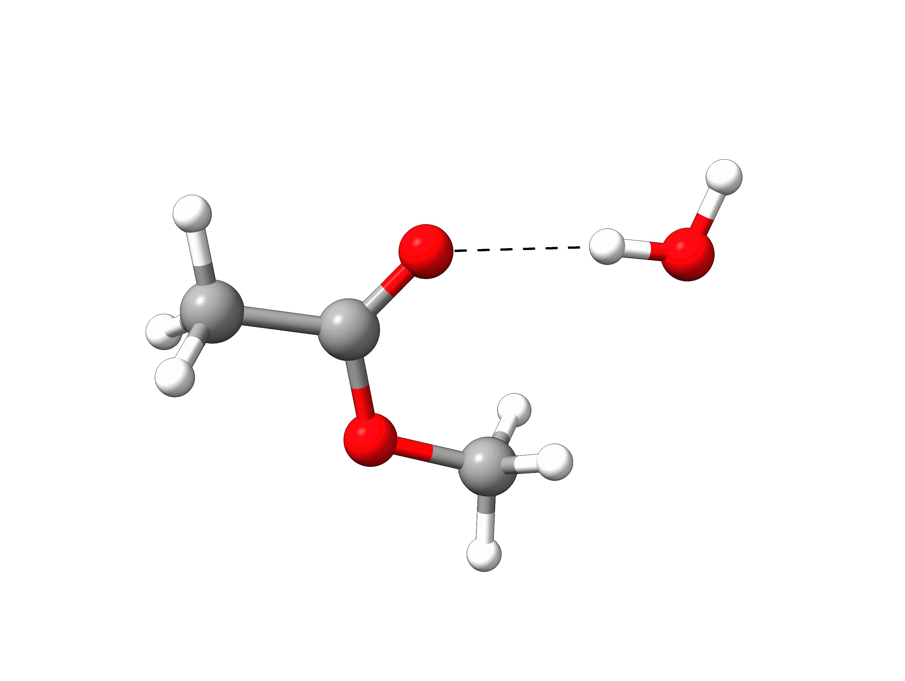
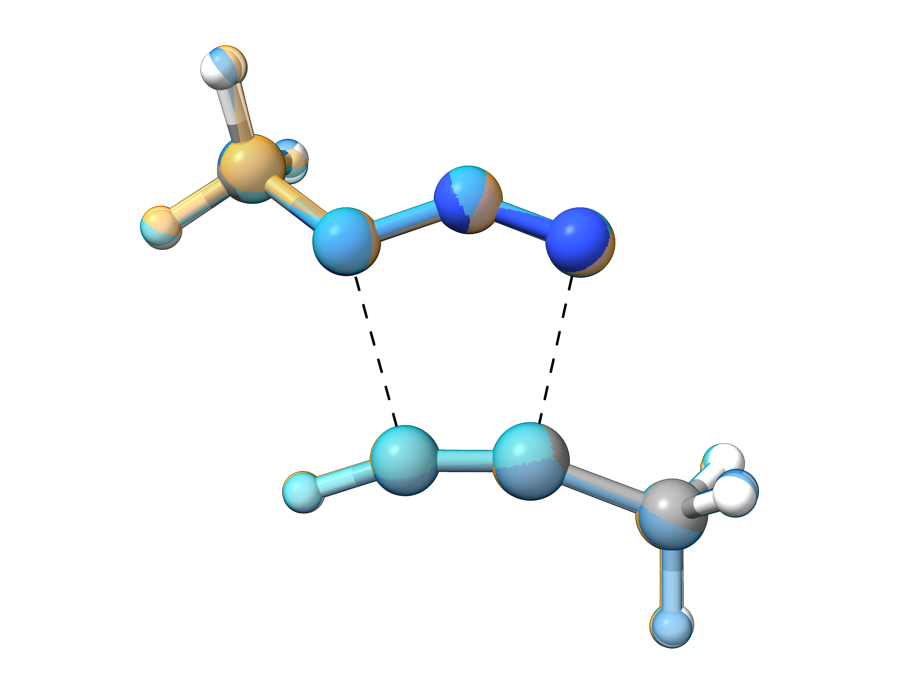

# Finding Transition States with NEB-TS

Suppose you wanted to predict the transition state (TS) for the hydrolysis of methyl-acetate into acetic acid and methanol:

[](../images/react_2d.png)

*Figure: Hydrolysis reaction of methyl-acetate.*

Maybe you need to investigate the mechanism, or even to compute the $\Delta G^\ddagger$ and try to predict reaction rates. How could one do that using theory?

In ORCA there is a black box method called NEB-TS (from Nudged Elastic Band with TS optimization), that can find the TS structure only from the geometries of the reactants and products!

## Defining your reactants and products

So the first step is to [optimize](../prop/geoopt.md) the "reactants" and "products".

> **Important**
> Please, have in mind that reactants and products means everything that is left and right of the arrow.
> Accordingly, the encounter complex of the reacting molecules has to be provided in one single structure file.
> The same is required for the products.

> **Hint**
> Reasonably pre-oriented encounter complexes significantly increase the probability of a successful TS search.

In this example we will use Grimme's efficient PBEh-3c composite method. The corresponding input looks like:

```text
!PBEh-3c OPT
```

[](../images/reac-prod.png)

*Figure: Optimized reactants and products.*

```mol
title: reactant hydrolysis
theme: chem311
height: 360px
representation: ball-stick
--- xyz ---
14
structure
C          -3.91182471867804     -0.29740337562449     -0.08146991239299
C          -2.55541244064569      0.30686965486155      0.14448997964370
H          -4.04778109653590     -1.17478518607501      0.55114544766598
H          -4.01760096751969     -0.62864793467515     -1.11447676001953
H          -4.68756038254056      0.42811501690492      0.14372689072078
O          -1.58890277145472     -0.55120693780504     -0.15332142945001
C          -0.24124898702283     -0.11849073979619      0.01881053299661
H          -0.00551048853087      0.73223540459326     -0.62014731745322
H           0.37809289862192     -0.96512901217128     -0.26312407178767
H          -0.03357349341397      0.15523590534200      1.05285605881498
O          -2.36577790365828      1.42614928705777      0.54645130784169
O           0.16419926236366      2.97730296461285      1.12447893057070
H          -0.05730841690068      3.84720465678396      1.45600240984125
H          -0.68288049408434      2.54915029599085      0.96617793300773
```

```mol
title: product hydrolysis
theme: chem311
height: 360px
representation: ball-stick
--- xyz ---
14
structure
C          -2.95446510188526     -0.23525275443810     -0.10550187831397
C          -2.20930026825989      0.97989509541554      0.35668736033914
H          -3.59995668590411     -0.60519475737244      0.69227878475167
H          -2.26734074134479     -1.04298213356273     -0.35902842132034
H          -3.56563817887517      0.01067253660282     -0.96824180822463
O           0.06594033182687     -1.89635100025044      0.33206273764187
C           0.96141448329986     -1.23467580278127     -0.52101365975636
H           0.50574570186175     -0.39870488204523     -1.06652943738273
H           1.30859855820204     -1.95448015263317     -1.26125442630102
H           1.84593979621532     -0.84847254373077     -0.00020954863231
O          -2.31618373645267      2.08782431296547     -0.08278492123435
O          -1.36964775834650      0.69085118655374      1.37267097866883
H          -0.93013901170627      1.50922486419084      1.64014730723366
H          -0.23867738863116     -1.26789396891424      0.99098693253054
```

> **Important**
> In order for the NEB-TS to work, the **atom numbering** in both reactant and product geometries **must be the same**. Which means that a given carbon on the reactant, should have the same order in the xyz table in the product. The best way to guarantee this is to start from one geometry, make a copy and move the atoms to draw the next structure.

> **Note**
> If using Avogadro, you have to disable the `Adjust Hydrogen` feature, otherwise atoms will be automatically placed when a bond is broken, and not necessarily where you want them to be.

## The NEB-TS input

With the optimized reactants and products at hand, we can create the NEB-TS input which is quite simple. NEB-TS is requested via the `NEB-TS` keyword and all other settings are defined in the
`%NEB` block. To verify that our probably found TS is reasonable we also request a final [vibrational frequencies](../prop/freq.md) calculation.

```text
!PBEh-3c NEB-TS FREQ

%NEB 
 NEB_END_XYZFILE "product.xyz" 
END

*XYZFILE 0 1 reactant.xyz
```

In case you have a guess structure for a potential TS as well, that can be included as:

```text
!PBEh-3c NEB-TS FREQ

%NEB 
 NEB_END_XYZFILE "product.xyz"
 NEB_TS_XYZFILE "guessTS.xyz"
END

* XYZFILE 0 1 reactant.xyz
```

> **Important**
> Please make sure that product and reactant structures are optimized at the same level as chosen for the NEB-TS run. This can be done by subsequent `!OPT` runs or by setting `%NEB PREOPT TRUE END` inside the `%NEB` block. Alternatively, `%NEB FREE_END TRUE END` can be used to perform a free-end NEB-TS calculation.

> **Important**
> Note that by default ORCA will make use of an approximated Hessian for the subsequent TS optimization! This can cause issues for more complex TS situations and calculating an exact Hessian may be necessary. This can be done by adding `%GEOM CALC_HESS TRUE` to the input.

## Running the NEB-TS

With our input being set up, we can start the NEB-TS calculation. The first output contains some details of the method.

```text
----------------------
NEB settings
----------------------
Method type                             ....  climbing image
Threshold for climbing image            ....  2.00e-02 Eh/Bohr
Free endpoints                          ....  off
Tangent type                            ....  improved
Number of intermediate images           ....  8
Number of images free to move           ....  8
Spring type for image distribution      ....  distance between adjacent images
Spring constant                         ....  energy weighted (0.0100 -to- 0.1000) Eh/Bohr^2
Spring force perp. to the path          ....  none
Generation of initial path              ....  image dependent pair potential
Initial path via TS guess               ....  off
[...]
```

Then, comes the construction of a initial path:

```text
Generation of  the initial path:
Two fragments detected in initial structure. Preparing initial structure... Done
Minimize RMSD between reactant and product configurations     .... done
       RMSD before minimization         ....  2.1833 Bohr
       RMSD after minimization          ....  1.7369 Bohr
Performing linear interpolation         ....  done
Fragment preparation                           ....  true
Bond cutoff factor                             ....  1.200e+00
Max. fragment distance                         ....  3.500e+00 Ang.
Interpolation using                            ....  IDPP (Image Dependent Pair Potential)
IDPP-Settings:
       Initial path for IDPP optimization      ....  Linear interpolation
       Pairwise distance interpolation         ....  Linear
       Remove global transl. and rot.          ....  true
       Convergence tolerance                   ....  0.0100 1/Ang.^3
       Max. number of iterations               ....    7000
       Spring constant                         ....  1.0000 1/Ang.^4
       Time step                               ....  0.0100 fs
       Max. movement per iteration             ....  0.0500 Ang.
       Full print                              ....  false
idpp initial path generation successfully converged in 130 iterations
Displacement along initial path:             12.1839 Bohr
Writing initial trajectory to file      ....  nebts_initial_path_trj.xyz
```

The initial path is saved in `basename_initial_path_trj.xyz`, and it is recommended to check if that makes sense. In this case, we get the following sequence of eight "images":



*Animation: Initial path images from NEB-TS.*

which looks reasonable, with the proton being transferred from the water to the methanol as it leaves.

> **Note**
> Trajectory files are simply multixyz files containing several structures one after the other. Chemcraft, Molden and some other software can open those directly. Avogadro requires going to "Extensions" -> "Animation..." and the file can be opened and even animated.

Then, the iterative process starts:

```text
Starting iterations:

Optim.  Iteration  HEI  E(HEI)-E(0)  max(|Fp|)   RMS(Fp)    dS 
Switch-on CI threshold               0.020000
   LBFGS     0      5    0.372340    0.129615   0.029150  12.1839
   LBFGS     1      5    0.352980    0.104320   0.024586  12.1349       
   LBFGS     2      5    0.340743    0.140351   0.026619  12.1315
   LBFGS     3      5    0.326472    0.097524   0.019838  12.1426
[...]
```

and after some convergence, a "climbing image" (CI) is found:

```text
Image  6 will be converted to a climbing image in the next iteration (max(|Fp|) < 0.0200)

Optim.  Iteration  CI   E(CI)-E(0)   max(|Fp|)   RMS(Fp)    dS     max(|FCI|)   RMS(FCI)
Convergence thresholds               0.020000   0.010000            0.002000    0.001000
   LBFGS    49      6    0.130964    0.016940   0.003526  15.3056    0.017426    0.005167
   LBFGS    50      6    0.129316    0.045416   0.007419  15.4226    0.040132    0.010358
   LBFGS    51      6    0.126481    0.067751   0.011014  15.6647    0.050468    0.013683
   LBFGS    52      6    0.124766    0.022067   0.004391  15.6905    0.022698    0.006567
[...]
```

This is our first guess to the TS final structure.

## Optimization of the TS

After some iterations, the NEB-CI converges:

```text
.--------------------.
          ----------------------| CI-NEB convergence |-------------------------
          Item                value                   Tolerance       Converged 
          ---------------------------------------------------------------------
          RMS(Fp)             0.0013467524            0.0100000000      YES
          MAX(|Fp|)           0.0142691584            0.0200000000      YES
          RMS(FCI)            0.0006034194            0.0010000000      YES
          MAX(|FCI|)          0.0016044259            0.0020000000      YES
          ---------------------------------------------------------------------  

The elastic band and climbing image have converged successfully to a MEP in 102 iterations!

                    *********************H U R R A Y*********************
                    ***        THE NEB OPTIMIZATION HAS CONVERGED     ***
                    *****************************************************
```

and a transition state optimization starts. First, a guess Hessian matrix is built using information from the previous NEB and a saddle point search is initiated.

If the TS is fully optimized, a summary for the whole NEB-TS is printed:

```text
***********************HURRAY************************
                    ***        THE TS OPTIMIZATION HAS CONVERGED      ***
                    *****************************************************

          
          
---------------------------------------------------------------
                      PATH SUMMARY FOR NEB-TS             
---------------------------------------------------------------
All forces in Eh/Bohr. Global forces for TS.

Image     E(Eh)   dE(kcal/mol)  max(|Fp|)  RMS(Fp)
  0    -344.08225     0.00       0.00014   0.00003
  1    -344.07675     3.45       0.00232   0.00071 
  2    -344.07387     5.26       0.01427   0.00363
  3    -344.07067     7.27       0.00282   0.00105
  4    -344.04841    21.23       0.00130   0.00058
  5    -344.01506    42.16       0.00124   0.00056
  6    -343.99728    53.32       0.00150   0.00060 <= CI
 TS    -343.99864    52.47       0.00013   0.00005 <= TS
  7    -344.03091    32.22       0.00151   0.00061 
  8    -344.06788     9.02       0.00179   0.00073
  9    -344.07676     3.45       0.00026   0.00009
```

and the frequencies of the TS are computed, to verify if that has only one negative frequency. The result for this case is:

```text
-----------------------
VIBRATIONAL FREQUENCIES
-----------------------

Scaling factor for frequencies =  1.000000000  (already applied!)

     0:       0.00 cm**-1
     1:       0.00 cm**-1
     2:       0.00 cm**-1
     3:       0.00 cm**-1 
     4:       0.00 cm**-1
     5:       0.00 cm**-1
     6:   -1192.35 cm**-1 ***imaginary mode***   
     7:      40.41 cm**-1
     8:     136.38 cm**-1
     9:     209.70 cm**-1
[...]
```

proving that the optimized TS structure is indeed a saddle point.

The final trajectory from the reactants to products can be read from `basename_MEP_trj.xyz`, and the final transition state geometry, saved in `basename_NEB-TS_converged.xyz` is:

[](../images/ts1.png)

*Figure: Optimized transition state structure.*

One can see that the TS has a tetrahedral carbon atom, as expected from the experimental mechanism, and there is a concerted transfer of proton to the leaving methoxy group.

> **Note**
> This calculation was run in gas phase to simplify the explanation. If one includes the solvent, the mechanism will be more complex and the proton transfer can occur, possibly, through an external water molecule.

## Possible intermediates

During the NEB-CI process, the following message could appear:

```text
Possible intermediate minimum found at image(s): 7
  => have a look at the .interp file.
  => it is often a good idea to divide the path calculation into smaller fragments.
```

This message indicates that a local minimum was detected along the reaction path. Actually, there could be even more than one. If this is the case as demonstrated in the exemplary reaction diagram below, one
should consider to further optimize these intermediates and rerun NEB-TS to localize their connecting transition states to obtain the full picture of the reaction mechanism.

[](../images/interp-2.png)

*Figure: Exemplary reaction path with two intermediates.*

## NEB Variants

Even though the default NEB-TS is a good and robust choice for most tasks, there are some variants implemented in ORCA that may help with more special challenges or efficiency requirements:

- **`FAST-NEB-TS`**

  - Option for very fast screening, typically sufficient for well-defined transitions and relatively high barriers.
- **`LOOSE-NEB-TS`**

  - Option using default convergence criteria from NEB-TS paper.
- **`TIGHT-NEB-TS`**

  - Option with tighter convergence criteria (good for flat transition states).
- **`ZOOM-NEB-TS`**

  - Automatic two-step procedure that is good for steep/spiky transition states: 1. CI-NEB calculation for roughly converged MEP and creation of new set of images around energy maximum, 2. Free-end CI-NEB calculation from this new path.

To compare these flavors of NEB-TS, we can look at a [azide-alkyne Huisgen cycloaddition](https://en.wikipedia.org/wiki/Azide-alkyne_Huisgen_cycloaddition) using the following input with the different NEB-TS options.

```text
!r2SCAN-3c FAST-NEB-TS FREQ PAL4

%NEB 
 NEB_END_XYZFILE "product.xyz" 
END

*XYZFILE 0 1 reactant.xyz
```

```mol
title: reactant Huisgen cycloaddition
theme: chem311
height: 360px
representation: ball-stick
--- xyz ---
14
structure
N          -1.14346110096689      0.50116480655462      0.91141647055235
N           0.06911542015431      0.47459932328925      0.75161037575465
N           1.20525581883840      0.42822863452117      0.72590428949488
C          -1.95283194677139      0.35529952593245     -0.31606475238963
H          -1.73277196311495     -0.59193662680300     -0.82438944122805
H          -2.99723343711262      0.35970799491328     -0.00263315163949
H          -1.78684038604877      1.19154452356692     -1.00722240394814
C          -0.62594916519367     -2.87268209959617      0.67069727182037
C           0.46629082151838     -2.85717147445571      0.16332578805722
H          -1.58061802724523     -2.87214331269831      1.13816431353644
C           1.78485933175982     -2.84510056683519     -0.43784052822072
H           2.54348404200474     -3.14953961836553      0.29055540880420
H           1.83558186280726     -3.52837928179351     -1.29184593031030
H           2.04397377077063     -1.83870071923024     -0.78234038558379
```

```mol
title: product Huisgen cycloaddition
theme: chem311
height: 360px
representation: ball-stick
--- xyz ---
14
structure
N          -0.92586823552493     -0.10069433632158     -0.11899662289894
N           0.19408753279655      0.60558138495038     -0.35980123595515
N           1.19815186914064     -0.22531751256977     -0.32838839167046
C          -2.21948847916704      0.55737137779614     -0.09066384558336
H          -2.88057374866644      0.13811352279228     -0.85598195571335
H          -2.68594258361546      0.44699067517436      0.89372717927794
H          -2.05256190946873      1.61627648028350     -0.29546147502317
C          -0.63127031270948     -1.41215051290495      0.07042659924314
C           0.73717006700411     -1.48379997945437     -0.06583241126031
H          -1.38683998332593     -2.15552751365918      0.27758097755181
C           1.65115285739964     -2.65579748695372      0.03231269785265
H           2.38112162665496     -2.51197066739300      0.83535425809547
H           1.09146364401807     -3.57256735850174      0.23418107893136
H           2.21033422346404     -2.78909902003832     -0.89920507904762
```

For this reaction, all NEB-TS variants successfully located and optimized the transition state, with the final structures being nearly identical. This is further confirmed by the similar imaginary frequency obtained for all structures.

In terms of computational time, `FAST-NEB-TS` is significantly faster than the other methods; however, this comes at the cost of reduced robustness for more complex systems. For this specific reaction, `ZOOM-NEB-TS` required slightly less computational time than `LOOSE-NEB-TS`, but due to its specialized workflow, it is expected to offers a higher probability of successfully optimizing the transition state, even for challenging systems with steep transition state regions. Please be aware, that the relative computation times may differ depending on the nature of the investigated reaction and the corresponding TS optimization.

[](../images/nebts_flavors_ts.png)

*Figure: Overlay of optimized transition states obtained from the different NEB-TS variants.*

| Method | TS optimized | imag. mode / cm$^{-1}$ | comp. time / min |
| --- | --- | --- | --- |
| `FAST-NEB-TS` | ✓ | -412.21 | 7.3 |
| `LOOSE-NEB-TS` | ✓ | -410.02 | 22.3 |
| `TIGHT-NEB-TS` | ✓ | -413.41 | 47.3 |
| `ZOOM-NEB-TS` | ✓ | -415.35 | 18.6 |

## NEB for excited states

The NEB and NEB-TS algorithm can also be used for excited states in combination with TD-DFT. To do so, simply add the respective `%tddft`block to your input:

```text
! NEB-TS

%NEB
 PRODUCT "product.xyz"
END
%TDDFT
 NROOTS 1
 IROOT 1
END
```
