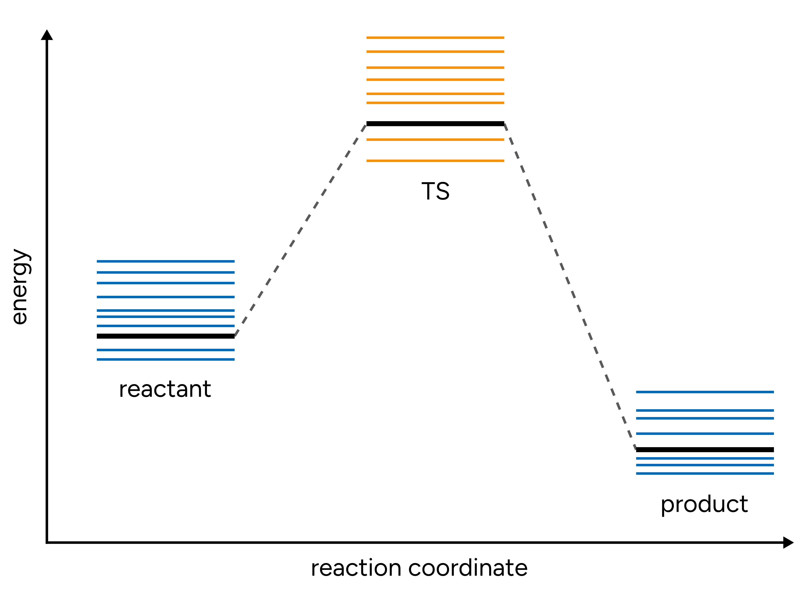
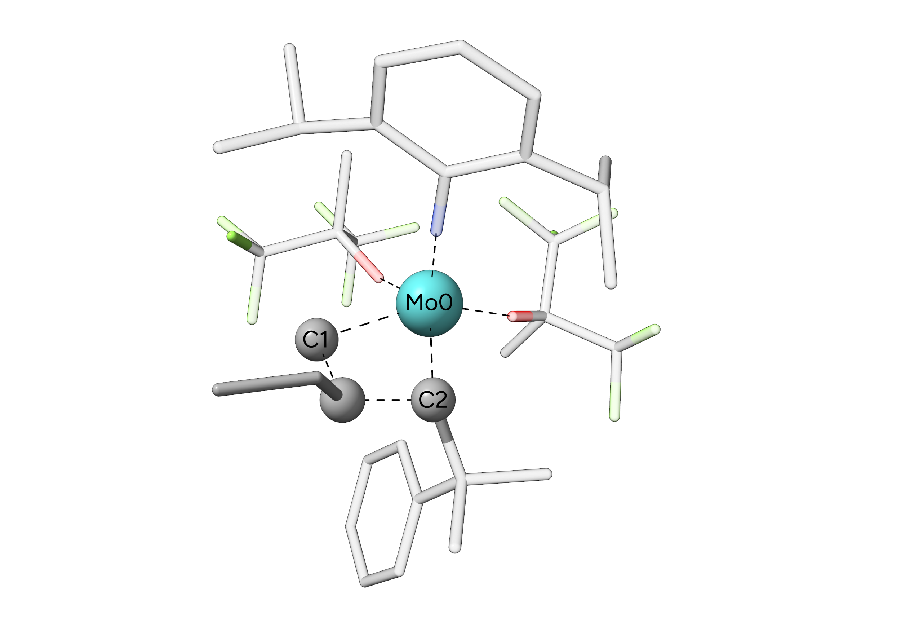
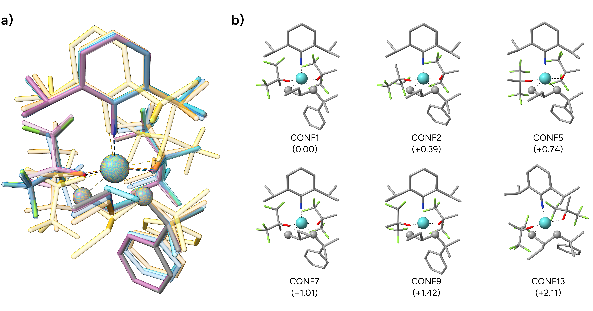

# Transition State Conformers

After we successfully [searched for a TS with NEB-TS](../react/nebts.md), we should consider its conformational flexibility via a fully automatic conformer search with [GOAT](../prop/goat.md).
This is important as the conformation of the TS structure can influence the resulting reaction barrier significantly. Often, the TS is even more affected than minimum structures of the reactants and products
due to the sterically crowded situation of adjacent substituents and ligands.

[](../images/ts-diagram.png)

*Figure: Schematic energy diagram of the conformational space of reactant, TS, and product.*

Per default, GOAT would search for the relaxed global minimum structures and respective conformers. For a TS conformer search, we typically want to keep the atoms fixed that are directly
involved in the chemical transformation. To do so, we can use the constraint functionality within ORCA to modify our GOAT procedure.

```text
!XTB GOAT

%GEOM 
 Constraints
  {C 0 C}         # Constrain Cartesian coordinate of atom 0 
  {B 0 1 C}       # Constrain bond of atoms 0 and 1
  {A 0 1 2 C }    # Constrain angle between atoms 0, 1, and 2
  {D 0 1 2 3 C }  # Constrain dihedral angle between atoms 0, 1, 2, and 3
 END
END

*XYZFILE 0 1 ts.xyz
```

> **Warning**
> Note, that ORCA starts counting at 0! Therefore, the first atom in your XYZ file will be atom 0.

## Example: Olefin Metathesis

In this example, we will search for conformers of the transition state of a olefin metathesis reaction by a Schrock metathesis catalyst.

[](../images/ts2.png)

*Figure: TS of an olefin metathesis at a Schrock catalyst. Hydrogens are omitted for clarity.*

```mol
title: Olefin metathesis TS
theme: chem311
height: 360px
representation: ball-stick
--- xyz ---
93
structure
Mo     0.06370   -0.28863    0.17017
C      0.84164    1.72537    0.43582
C      1.52344    0.27689   -1.34600
N     -1.30128    0.25044   -0.75171
H     -0.26969   -1.66376   -2.17422
H     -0.65136   -2.81825   -3.45835
O     -0.13617   -0.25848    2.24034
O      0.24700   -2.21112    0.37092
C      0.29419   -3.38192    1.05902
C     -0.87377    0.21756    3.27512
C      0.73152   -4.53803    0.11457
C      1.24180   -3.35491    2.26679
C     -1.16124   -3.71156    1.51808
C     -0.62468   -0.73377    4.47753
C     -0.33212    1.61191    3.70153
C     -2.38966    0.31326    3.01714
F      0.67837   -0.84486    4.76724
F     -1.24454   -0.36792    5.60296
F     -1.05256   -1.97058    4.20136
F      0.99985    1.62713    3.79032
F     -0.67075    2.56002    2.81769
F     -0.80967    2.02886    4.88113
F      2.05670   -4.54676   -0.07838
F      0.42022   -5.73790    0.61587
F      0.17337   -4.44442   -1.09317
F     -1.85881   -4.38139    0.59326
F     -1.22045   -4.43558    2.63398
F     -1.83646   -2.57517    1.73710
H      2.26257   -3.19419    1.92236
H      0.95694   -2.53229    2.91766
H      1.18788   -4.28984    2.81931
H     -2.95262   -0.12159    3.83922
H     -2.69463    1.34778    2.89170
H     -2.60955   -0.23578    2.10094
C     -2.30522    0.64608   -1.56169
C     -2.31329   -1.58274   -2.87226
C     -2.75620    2.63558   -0.04011
C     -2.96097    1.88302   -1.33234
C     -3.85714    2.37242   -2.26668
H     -4.33254    3.32585   -2.09507
C     -4.15679    1.66152   -3.41221
H     -4.83839    2.06440   -4.14567
C     -3.61326    0.40151   -3.58016
H     -3.90384   -0.18780   -4.43836
C     -2.71552   -0.13773   -2.67274
H     -2.84186   -1.93794   -3.76512
C     -0.82057   -1.80188   -3.10903
C     -2.79413   -2.41636   -1.68345
C     -4.06179    2.62612    0.76321
H     -1.98947    2.10961    0.53954
C     -2.29648    4.07621   -0.27085
H     -4.39467    1.60668    0.94350
H     -3.91592    3.12527    1.71875
H     -4.84819    3.14963    0.22481
H     -3.09495    4.67580   -0.70105
H     -2.00545    4.52545    0.67577
H     -1.44668    4.10489   -0.94580
H     -3.87192   -2.32720   -1.56684
H     -2.54386   -3.46388   -1.83112
H     -2.31650   -2.06604   -0.76688
H     -0.44616   -1.10623   -3.85768
C      2.90286   -0.41337   -1.43789
H      1.11942    0.27361   -2.36973
C      4.99218   -0.19037    0.01947
C      2.72448   -1.89144   -1.82100
C      3.72866    0.24932   -2.55423
H      1.79980   -0.67614    1.01812
H      5.60296   -0.06676   -0.85992
H      2.32668   -1.97495   -2.83053
H      3.67714   -2.41650   -1.78103
H      2.03568   -2.38298   -1.13777
H      4.02883    1.25820   -2.28477
H      4.61939   -0.33310   -2.77684
H      3.13481    0.30194   -3.46420
C      3.61561   -0.36095   -0.09696
C      2.88995   -0.53016    1.07701
C      3.49166   -0.50057    2.32164
H      2.89321   -0.60913    3.21405
C      4.86110   -0.31730    2.41675
H      5.33886   -0.28974    3.38379
C      5.60582   -0.16932    1.26054
H      6.67517   -0.03056    1.32166
C      1.64388    1.74157   -0.87132
H      0.16714    2.58408    0.46987
H      1.52579    1.85802    1.28502
C      1.08544    2.72374   -1.90384
H      2.69155    2.00572   -0.68020
H      1.53608    2.51791   -2.87835
H      0.00676    2.55991   -1.99439
C      1.37514    4.17570   -1.53620
H      2.44819    4.35624   -1.53117
H      0.91955    4.85121   -2.25671
H      0.98893    4.41339   -0.54860
```


The transition state of this reaction was found and optimized using the [NEB-TS procedure](../react/nebts.md) with the GFN2-xTB method. In this case, the important atoms that are involved
in our reaction are the central molybdenum and the adjacent carbon atoms of the previous carbene ligand and the attacking alkene. We could also also include the $\beta$-carbon atom of the alkene
but in this case, constraining three atoms will be sufficient. We now set-up our constraints via the ORCA input file:

```text
!XTB GOAT

%PAL 
 NPROCS 16 
END

%GEOM 
 Constraints
  { C 0 C }
  { C 1 C }
  { C 2 C }
 END
END

*XYZFILE 0 1 ts.xyz
```

> **Note**
> Note, that we increased the number of processing cores to 16 to benefit from the high parallelity of the GOAT approach. Conformational searches for large, flexible molecules can be
> very time consuming. Therefore, a combination of fast semi-empirical methods like GFN2-xTB and an increased number of cores is recommended.

We now run the GOAT conformer search with constrained Cartesian coordinates of the respective atoms Mo0, C1, and C2. After a successful GOAT run, it will give us a list of generated conformers ordered
by increasing energy with respect to the newly found global minimum structure.

```text
               Global minimum found!
                Writing structure to orca.globalminimum.xyz

                # Final ensemble info #
                Conformer     Energy     Degen.   % total   % cumul.
                              (kcal/mol)
                ------------------------------------------------------
                        0     0.000          1      24.18      24.18
                        1     0.390          1      12.52      36.70
                        2     0.440          1      11.51      48.21
                        3     0.457          1      11.18      59.40
                        4     0.595          1       8.86      68.26
                        5     0.743          1       6.90      75.15
                        6     0.838          1       5.88      81.03
                        7     1.007          1       4.42      85.45
                        8     1.186          1       3.26      88.72
                        9     1.423          1       2.19      90.91
                       10     1.640          1       1.52      92.43
                       11     1.649          1       1.50      93.92
                       12     1.867          1       1.03      94.96
                       13     2.105          1       0.69      95.65
                       14     2.205          1       0.59      96.23
[...]
```

> **Important**
> As we employed constraints in our GOAT run, the produced conformers are no fully optimized transition state structures! In any case, they should be finally optimized using the `OptTS` keyword.
> This will also influence the energetic ranking. In general, the conformer ensemble should be refined afterwards using more accurate DFT or WFT methods to obtain more reliable results.

We can now visualize a selection of generated conformers that are stored in the `basename.finalensemble.xyz` file, and we see that the constrained atoms were perfectly kept in place during the GOAT run.

[](../images/ts-conformers.png)

*Figure: a) Overlay of selected conformers. b) Structures of selected conformers with their respective relative energies in $\mathrm{kcal \cdot mol}^{-1}$.*

If we compare the energy of the yet unoptimized transition state conformers from our GOAT run with that of the input TS, we see that the new global minimum structure is **$6.44 \ \mathrm{kcal \cdot mol}^{-1}$ lower**
in energy even without further optimization! The respective absolute energies can be found in the second lines of the `basename.xyz` (starting structure) and the `basename.globalminimum.xyz` files.
