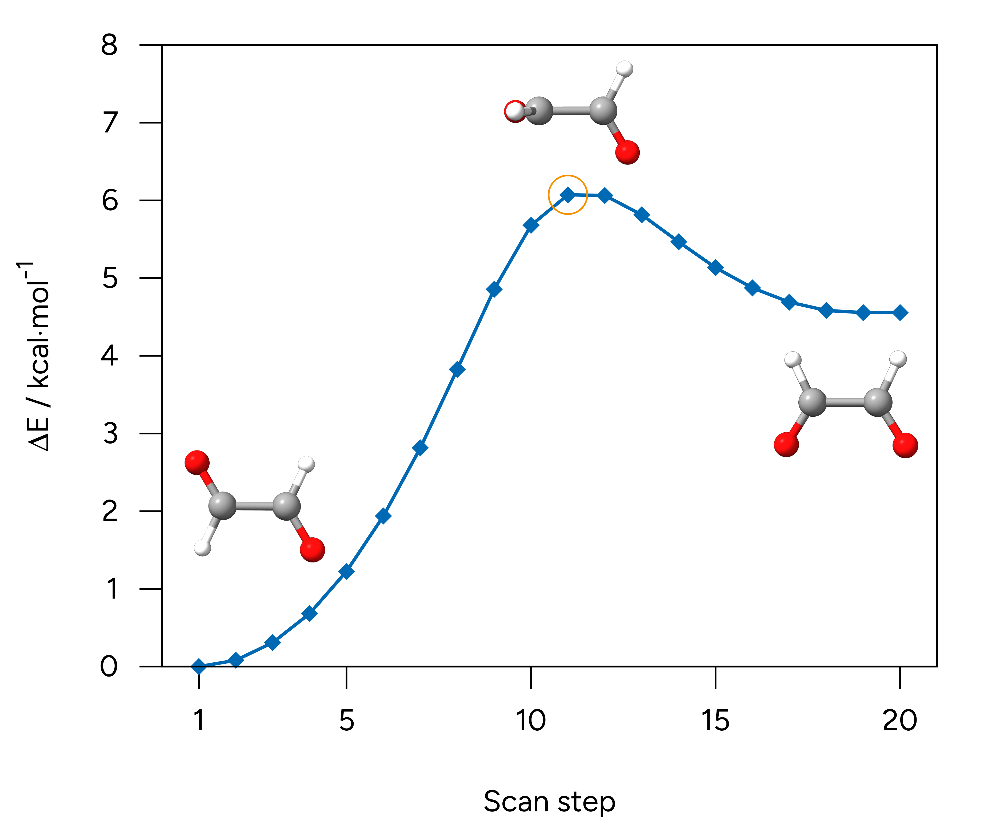
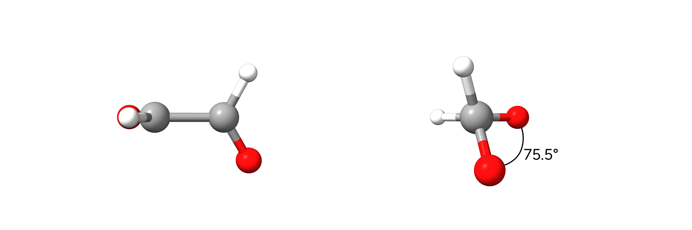

# Transition State Optimization

There are various ways to obtain a valid guess for a transition state (TS) structure like relaxed potential energy surface scans or NEB simulations. To only optimize a given transition state guess without using automated procedures like [NEB-TS](../react/nebts.md), the `!OptTS` keyword can be used. In the following tutorial, we will setup a relaxed surface scan to obtain a guess for the TS of the *cis*-*trans*-isomerization of glyoxal and subsequently optimize the transition state with `!OptTS`.

## Example: *cis*-*trans*-Isomerization of Glyoxal

### Relaxed Surface Scan

After obtaining a valid start structure for glyoxal with, e.g. [Avogadro 2](../first_steps/GUI.md), a relaxed surface scan around the O-C-C-O dihedral angle can be setup using the `!Opt` simple keyword and the respective scan definition inside the `%geom` block. In this example, we will perform the scan with the r²SCAN-3c composite DFT method.

```mol
title: tsopt #1
theme: chem311
height: 360px
representation: ball-stick
--- xyz ---
6
structure
  O          -1.80011949735812      0.99666410862853     -0.00003868102245
  C          -1.27328664864401     -0.08847334375096     -0.00001219100927
  C           0.24492627868679     -0.23050598341765     -0.00002272454655
  O           0.77147537164033     -1.31579795317196     -0.00003090426569
  H          -1.83500409491985     -1.04822924700392      0.00001280906050
  H           0.80714603899486      0.72893993091597     -0.00002459971653
--- input ---
!r2SCAN-3c Opt

%geom
   Scan D 0 1 2 3  = 180, 360, 19 end # Scan of the dihedral angle defined by atoms 0, 1, 2, and 3 from 180° to 360° in 19 steps.
end

*xyz 0 1
  O          -1.80011949735812      0.99666410862853     -0.00003868102245
  C          -1.27328664864401     -0.08847334375096     -0.00001219100927
  C           0.24492627868679     -0.23050598341765     -0.00002272454655
  O           0.77147537164033     -1.31579795317196     -0.00003090426569
  H          -1.83500409491985     -1.04822924700392      0.00001280906050
  H           0.80714603899486      0.72893993091597     -0.00002459971653
```

> **Important**
> Note that ORCA starts counting atoms from 0, thus atom 1 has the identifier 0.

> **Tip**
> Make sure that the starting angle is not too far from that of your initial structure to avoid some artifacts.

After running this scan we obtain a smooth energy curve from which we can pick the structure with the highest energy as TS guess.

[](../images/fig_scan.png)

*Figure: Relaxed scan of the O-C-C-O dihedral angle of glyoxal.*

### TS Optimization with `!OptTS`

The most common procedures starting from a TS guess are now:

1. Run a direct `!OptTS` calculation using a less accurate approximate Hessian (**not recommended**).
2. Run a direct `!OptTS` calculation requesting a prior exact Hessian calculation (**recommended**).
3. Run a exact Hessian calculation with [`!Freq`](../prop/freq.md), check the imaginary mode of the TS, and run `!OptTS` with reading the `.hess` file from the previous frequency calculation.

> **Warning**
> Using the approximate Hessian by simply running `!OptTS` can cause troubles with the TS localization. We generally recommend to use an exact Hessian to start the TS optimization.

> **Tip**
> By adding the `!Freq` simple input keyword aside `!OptTS`, a frequency calculation **after** the TS optimization is requested. This is useful to verify that the optimization yielded a transition state that is characterized by presence of exactly one imaginary frequency.

> **Tip**
> The transition state optimization can be customized in many ways to either improve efficiency or to handly difficult transition states, e.g., for very small barriers. Therefore, we recommend to read the respective sections of the [ORCA manual](https://www.faccts.de/docs/orca/manual/). Note that the convergence thresholds for `!OptTS` are controlled by the existing keywords for normal optimizations like `!TightOpt`.

#### `!OptTS` with Approximate Hessian

An input for a TS optimization with approximate Hessian looks like

```text
!r2SCAN-3c OptTS

*xyzfile 0 1 tsguess.xyz
```

The use of the approximate Almlöf Hessian is indicated in the `.out` file.

```text
Evaluating the initial hessian          ...  (Almloef) done
[...]
Evaluating the initial hessian          ....  (Almloef) done
```

#### `!OptTS` with Exact Hessian

To calculate the exact Hessian for the TS optimization, the respective `Calc_Hess true` must be defined in the `%geom` block.

```text
!r2SCAN-3c OptTS

%geom
   Calc_Hess true
end

*xyzfile 0 1 tsguess.xyz
```

The calculation of the exact Hessian prior the TS optimization is indicated in the `.out` file.

```text
Evaluating the initial hessian          ...  (Is done on the fly) done
[...]
Evaluating the initial hessian          ....  (read)
```

#### `!OptTS` with Read-In Hessian

To read a previously computed Hessian, the `inhess read` keyword can be used within the `%geom` block, providing the name of the Hessian file via `InHessName "name.hess"`.

```text
!r2SCAN-3c OptTS

%geom
  inhess   Read                   # this command comes with:
  InHessName "tsguess.hess"       # filename of Hessian input file
end

*xyzfile 0 1 tsguess.xyz
```

If the `.hess` file has been read successfully, it is indicated in the `.out` file:

```text
Evaluating the initial hessian          ... (Reading Exact Hessian)...
[...]
Evaluating the initial hessian          ....  (read)
```

### TS Verification

As with conventional geometry optimizations, proper convergence must be achieved for the transition state optimization. TS optimization convergence is highlighted in the `.out` file. For this example, both options with exact and approximate Hessian worked and yield converged transition states with an O-C-C-O dihedral angle of ~75.5°.

```text
***********************HURRAY********************
                    ***        THE OPTIMIZATION HAS CONVERGED     ***
                    *************************************************
```

[](../images/ts3.png)

*Figure: Optimized TS of the *cis*-*trans*-isomerization of glyoxal.*

However, it is further important to check if the optimized structure is a minimum or a saddle point (TS) on the potential energy surface. The latter is characterized by exactly one imaginary frequency in the frequency calculations on the finally optimized TS geometry. This imaginary frequency must further represent the structural transition of interest, in this case the rotation around the C-C bond. Such frequency calculation is either requested by simply adding the `!Freq` simple input keyword aside `!OptTS` which requests a frequency calculation **after** the TS optimization.
Alternatively, a separate calculation on the optimized geometry using `!Freq` can be performed.

> **Important**
> Note that the frequency calculation must be performed at the same level of theory as the geometry optimization!

A full input performing an exact Hessian calculation for the TS optimization input, the TS optimization, and subsequent frequency calculation for verification in one is given below.

```text
!r2SCAN-3c OptTS Freq

%geom
   Calc_Hess true
end

*xyzfile 0 1 tsguess.xyz
```

For the optimized TS of the *cis*-*trans*-inversion of glyoxal, only one imaginary frequency corresponding to the rotation of the C-C bond is obtained, thus verifying a successful TS optimization for this example. The respective vibration can be visualized with various tools like Avogadro 2 or ChimeraX (cf. [Graphical User Interfaces](../first_steps/GUI.md) and the [Infrared and Raman Spectroscopy](../spec/IR.md) sections).

```text
-----------------------
VIBRATIONAL FREQUENCIES
-----------------------

Scaling factor for frequencies =  1.000000000  (already applied!)

     0:       0.00 cm**-1
     1:       0.00 cm**-1
     2:       0.00 cm**-1
     3:       0.00 cm**-1 
     4:       0.00 cm**-1
     5:       0.00 cm**-1
     6:    -189.59 cm**-1  ***imaginary mode***  
     7:     277.42 cm**-1
```

### Structures

### TS Guess

```mol
title: tsopt #11
theme: chem311
height: 360px
representation: ball-stick
--- xyz ---
6
structure
 O     -1.83324      0.62772      -0.77785
 C     -1.27709     -0.09000       0.01396
 C      0.24881     -0.22901       0.01383
 O      0.80483     -0.94688      -0.77793
 H     -1.83538     -0.69931       0.76395
 H      0.80720      0.38008       0.76393
```

### Optimized TS

```mol
title: tsopt #12
theme: chem311
height: 360px
representation: ball-stick
--- xyz ---
6
structure
  O          -1.84421679351156      0.59484103960635     -0.80568139753757
  C          -1.27714789879691     -0.08950826948560      0.00706950134558
  C           0.24885835929743     -0.22962545826381      0.00700905374646
  O           0.81586625296348     -0.91394186131928     -0.80581207877593
  H          -1.82442938469100     -0.65567049798748      0.79869194748586
  H           0.79619946473857      0.33650504744981      0.79861297373560
```
