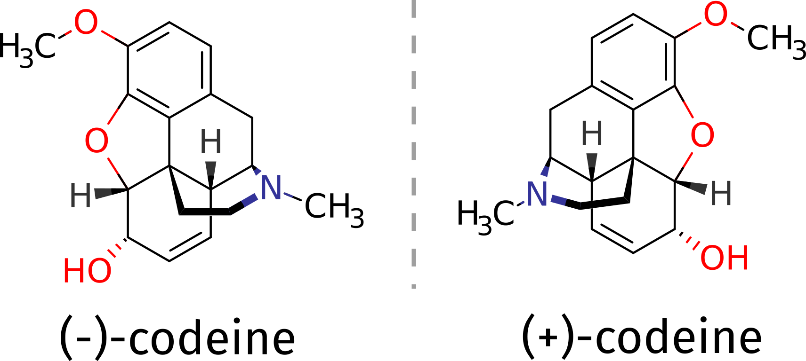
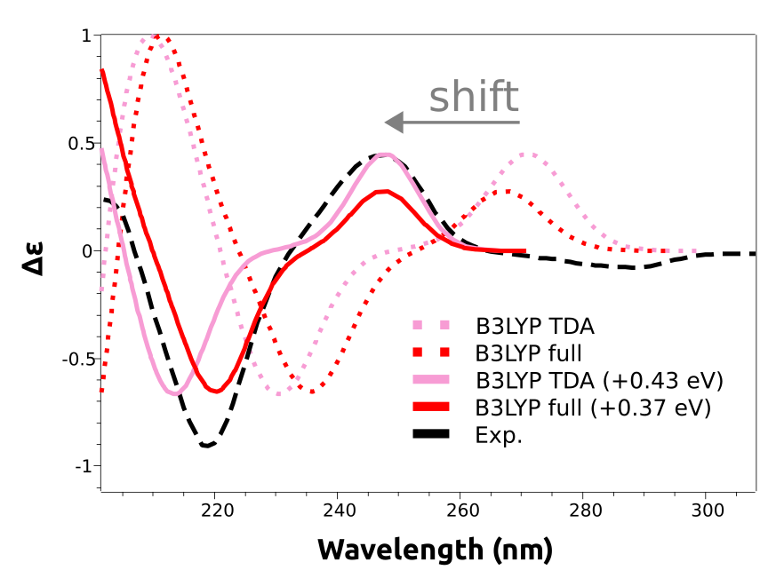

# Electronic Circular Dichroism (ECD)

Electronic circular dichroism (ECD) is a method closely related to UV/Vis spectroscopy that makes use of circular polarized light instead of "regular" unpolarized light, and that is extremely helpful to identify chiral compounds.

As an example, suppose you need to determine the absolute configuration of a compound such as the opioid codeine. It can be obtained as a (+) or (-) isomer, and suppose there is no other structural proof of it, what could one do?

[](../images/cod_struct.png)

```mol
title: (-)-Codeine
theme: chem311
height: 360px
representation: ball-stick
--- xyz ---
44
structure
C          0.27861       -2.51771       -1.18929
C          1.62027       -2.60915       -0.76912
C          2.22334       -1.60792        0.00987
O          3.54007       -1.82025        0.28510
C          1.43672       -0.52943        0.36578
O          1.82325        0.61959        1.00916
C          0.09858       -0.48519        0.01418
C         -0.55354        0.74611        0.55554
C          0.72840        1.57467        0.78794
C          1.08903        2.56775       -0.35541
O          2.47118        2.53561       -0.68410
C          0.30918        2.41405       -1.62915
C         -0.90175        1.83953       -1.69766
C         -1.56787        1.27202       -0.47255
C         -2.56293        0.10674       -0.76050
N         -3.31366       -0.16885        0.56397
C         -4.50113       -1.08483        0.41229
C         -2.41884       -0.59039        1.70688
C         -1.27044        0.40261        1.87918
C         -1.88442       -1.17437       -1.33429
C         -0.50047       -1.42947       -0.80310
C          4.17091       -0.93416        1.20079
H         -0.12034       -3.29174       -1.84231
H          2.21941       -3.46198       -1.08750
H          0.64670        2.15619        1.71529
H          0.88257        3.58363        0.00417
H          2.81653        1.66581       -0.40960
H          0.75014        2.85301       -2.52332
H         -1.42425        1.82856       -2.65248
H         -2.13625        2.10396       -0.03138
H         -3.34042        0.44534       -1.45658
H         -5.10054       -0.72966       -0.42961
H         -5.08559       -1.02485        1.33453
H         -4.15126       -2.10599        0.24932
H         -2.06881       -1.60774        1.50636
H         -3.03858       -0.61066        2.61016
H         -1.66742        1.32913        2.31529
H         -0.56791       -0.00565        2.61746
H         -2.50583       -2.06189       -1.18461
H         -1.78792       -1.03545       -2.41928
H          5.17371       -1.32388        1.40176
H          3.63531       -0.89593        2.15499
H          4.28807        0.06211        0.76383
H         -3.72689        0.73229        0.84204
```

- The (+)-codeine is obtained by reflection!

The (-) isomer is the one that has important medical applications, and one might need be sure about which compound corresponds to which 3D structure. That problem can be tackled with the aid of theory using ORCA, if the ECD spectrum of a pure compound is measured and compared to predicted one.

## Predicting ECD spectra

Let's try to predict the ECD spectra in water for both enantiomers using TD-DFT, starting from the (-)-codeine, which was already studied in the recent literature [[Horváth2016]](../bib.md#horvath2016).

> **Important**
> The main steps to obtain the ECD spectra from TD-DFT are the same as those for UV/Vis. Please read the related [UVVis Spectroscopy (UV/Vis)](../spec/UVVis.md#uvvis) section before going any further. From now on that will be assumed as known.

The first step is to draw and optimize the correct geometry for this molecule:

```text
!B3LYP DEF2-TZVP D4 OPT FREQ CPCM(WATER)
* XYZFILE 1 1 minuscodeine_guess.xyz
```

Here we are using a charge +1, we want to reproduce the spectra of this alkaloid in water, and its pKa is about 8. It is necessary to add a proton to the nitrogen group of the structures above to account for protonation at pH 7.

The ECD spectra is computed automatically when a TD-DFT is requested, so the input follows the same principles:

```text
!B3LYP DEF2-TZVP CPCM(WATER)
%TDDFT
      NROOTS  25
END
* XYZFILE 1 1 codeine_optimized.xyz
```

As a [solvation model](../prop/cpcm.md) to account for the effect of water on the electronic structure, we will use the CPCM model for the ground state, and the LR-CPCM for the excited state (which is automatically selected together with !CPCM).

> **Note**
> Polar solvents can have a large impact on excited states of a charged molecule, don't forget to consider these in such cases!

Since the ECD is particularly sensitive to the predicted intensities of the transitions, we will also do the calculation using the full TD-DFT instead of the default TDA approximation. In general, the TDA is more stable and gives reliable results, but the prediction of ECD is often better when using the full TD-DFT. The input then is:

```text
!B3LYP DEF2-TZVP CPCM(WATER)
%TDDFT
      NROOTS  25
      TDA     FALSE
END
* XYZFILE 1 1 codeine_optimized.xyz
```

where now TDA FALSE has been added to suppress it.

The output is exactly how it was shown for UV-Vis before, and in the end the ECD "spectrum" is printed:

```text
-------------------------------------------------------------------
                             CD SPECTRUM
-------------------------------------------------------------------
State  Energy     Wavelength     R         MX        MY        MZ
       (cm-1)       (nm)     (1e40*cgs)   (au)      (au)      (au)
-------------------------------------------------------------------
   1   38539.1    259.5     -7.97318  -0.08936  -0.09057   0.28910
   2   39977.7    250.1     32.07887   0.18900  -0.02049  -0.22614
   3   43324.1    230.8     12.30861  -0.09352  -0.02155   0.30521
   4   44246.4    226.0    -85.09304   0.38524   0.23404  -0.59099
   5   46657.1    214.3     50.33474   0.08844  -0.07182   0.09990
```

As you can see, the excited states are followed by their energies, the R value for the excitation (which is proportional to the ECD intensity) and the components of the magnetic dipole. A more detailed description of these states can be obtained from an [Analysis of the Excited States](../spec/UVVis.md#tddftesanalysis).

## Shifting the predicted spectra

After completion, the spectrum can be plotted in an analogous way to what is described in [Plotting the calculated spectrum](../spec/UVVis.md#plotuvspec), except that "CD" has to be selected on the left drop-down menu. And the result is:

[](../images/b3lyp.png)

As you can see, the main features are reproduced, except that the calculated spectra are shifted to the right. That is a common situation with these predictions and is due to the expected error in the calculated excited state energies. These errors are usually rather systematic, and can be eliminated by doing a counter-shift on the prediction:

[](../images/b3lyp_shifted.png)

And now both peaks at about 250 nm and 220 nm are coherent with the experimental result.

> **Important**
> The shift is not given in nanometers, but in energy units, because the wavelength is not directly proportional to the energy. However common in the literature, there is not much sense to apply a shift in wavelength scale, since the energy correction would be different for each peak!

## Comparing functionals

A closer look at the predicted spectra will reveal that they are missing the negative lower energy band, that gives rise to the (-) on the name of that stereoisomer.  This is an error caused by the B3LYP functional, that can not be known *a priori*.

What we can do is to use a higher level unparametrized methods such as the [DLPNO-STEOM](../spec/UVVis.md), or a different functional, which is what we will do here. Following the reference by [[Horváth2016]](../bib.md#horvath2016), range-separated functionals should work better on this case. We can then try the modern wB97x functional using:

```text
!wB97X DEF2-TZVP CPCM(WATER)
%TDDFT
      NROOTS  25
END
* XYZFILE 1 1 codeine_optimized.xyz
```

both using TDA and full TD-DFT. The results, already including the necessary shifts are in much better agreement:

[](../images/wb_shifted.png)

As one can see, the lower energy band now is predicted accordingly. We even plotted the calculated spectrum for the other stereoisomer, (+)-codeine, which has a simulated spectrum that is indeed almost a mirror image of the one from (-)-codeine, in accordance to the experimental results.

> **Note**
> There is no need to reoptimize the geometry when looking for stereoisomers. These can be easily generated by choosing one axis, e.g the z, and multiplying all components of the coordinates along that by -1. That is equivalent to a reflection over the xy plane, which generates the "mirror image" of our target molecule.

> **Important**
> ECD spectra are very sensitive to minor geometrical changes! Usually we can only get results close to the experiment by computing the lower energy conformers and making a Boltzmann sum. In this case, the molecule is rather rigid and the problem was minimized, however that is not the usual case.
