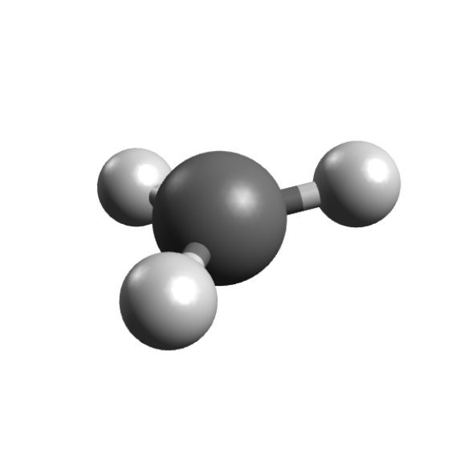

# Electron Paramagnetic Resonance (EPR)

Here we will demonstrate the basics on how to predict EPR properties and spectra using ORCA, that can even include many of the complications involved such as spin-orbit coupling and other relativistic effects.

## The $CH_3$ Radical

The methyl radical is a planar molecule, and its planarity was in part confirmed by EPR spectroscopy. It has a $g$ of $2.0025$ [[Gordy1966]](../bib.md#gordy1966) and hyperfine couplings (HFC) $A_{xx} = -31.4, A_{yy} = -93.7   ,$ and $A_{zz} = -60.30$ MHz [[Dmitriev2004]](../bib.md#dmitriev2004), let's try to predict that from first principles!

First, the geometry can be optimized using:

```mol
title: EPR #1
theme: chem311
height: 360px
representation: ball-stick
--- xyz ---
4
structure
C   3.20276693914010      2.91777006829308     -1.46614904250634
H   4.21682401439677      3.22254500904168     -1.25560882817865
H   2.69109288861722      3.31313693290047     -2.33037576806431
H   2.69057615784592      2.24676798976475     -0.79431636125068
--- input ---
!B3LYP DEF2-TZVP OPT
* xyz 0 2
C   3.20276693914010      2.91777006829308     -1.46614904250634
H   4.21682401439677      3.22254500904168     -1.25560882817865
H   2.69109288861722      3.31313693290047     -2.33037576806431
H   2.69057615784592      2.24676798976475     -0.79431636125068
*
```

and you get the trigonal planar coordinates, as expected:

[](../images/ch3.png)

The next step is then to calculate the EPR properties, and that can be done by setting the `%EPRNMR` options.

> **Important**
> These are the only options on the ORCA input that should come **after** the geometry section, and never before.

An input to compute the *g*-tensor and HFCs for the hydrogen atoms, using the B3LYP functional could be:

```text
!B3LYP EPR-II AUTOAUX
* XYZFILE 0 2 CH3_opt.xyz
%EPRNMR
        GTENSOR   TRUE
        NUCLEI    = ALL H {AISO, ADIP, AORB}
END
```

and it should be given with some comments:

- The `GTENSOR` flag must be set to TRUE in order to compute it, the default is `FALSE`.
- The `NUCLEI` defines the atoms for the HFC calculation. ALL H calculates the HFC on all hydrogens, or use ALL N, ALL C and so on for different atoms. You can also use `NUCLEI = 1,5,8`, to give one list **per atom type** with the atom numbering staring from 1.
- The `AISO`, `ADIP`. and `AORB` flags request the isotropic part of the HFC, its dipolar part and 2nd order contribution from SOC respectively.
- The `AORB` term is costly, but contributes very little to organic molecules without heavy atoms and could be neglected in those cases.
- A large basis is recommended for EPR properties. Here we used the special basis EPR-II, for more info one can check the [ORCA manual](https://www.faccts.de/docs/orca/manual).
- The spin-orbit coupling integrals are calculated using the SOMF(1X) [[Neese2005]](../bib.md#neese2005) method by default, but more efficient options are also available.

> **Warning**
> If you are using a list of atoms, like NUCLEI = 1,5,8, there should be one list for each atom type!

### The Output File

After a successful single point calculation, the first step is the computation of the integrals used for the SOC treatment:

```text
------------------------------------------------------------------------------
                      ORCA SPIN-ORBIT COUPLING CALCULATION
------------------------------------------------------------------------------

GBW file                                    ... epr.gbw
Input density                               ... epr.scfp
Output integrals                            ... epr
Operator type                               ... Mean-field/Effective potential
   One-Electron Terms                       ... 1
   Coulomb Contribution                     ... 2
   Exchange Contribution                    ... 3
   Correlation Contribution                 ... 0
   Maximum number of centers                ... 4
```

and then comes the:

```text
------------------------------------------------------------------------------
                              ORCA EPR/NMR CALCULATION
------------------------------------------------------------------------------

GBWName                      ... epr.gbw
Electron density file        ... epr.scfp
Spin density file            ... epr.scfr
Spin-orbit integrals         ... epr
Origin for angular momentum  ... Center of electronic charge
Coordinates of the origin    ...    6.05064281    5.51881078   -2.76743570 (bohrs)
```

Please notice that the `Origin for angular momentum` here is `Center of electronic charge`, and that means these results are **not** gauge-invariant and can change depending on your coordinates.

Usually, with a sufficiently large basis, the results should be almost invariant, but if one wants the exact results, gauge-invariant atomic orbitals (GIAOs) are needed [[Ditchfield1973]](../bib.md#ditchfield1973), [[Pulay1990]](../bib.md#pulay1990). These can be constructed from all basis sets, and to use them, just add `ORI GIAO` to the %EPRNMR section:

```text
%EPRNMR
        GTENSOR   TRUE
        NUCLEI    = ALL H {AISO, ADIP, AORB}
        ORI       GIAO
END
```

> **Note**
> The calculation of the integrals involving GIAOs is much more costly than the regular ones, so be prepared for longer calculation times.

### *g* Ttensor

If the following CP-SCF converges, you will get the *g*-tensor matrix:

```text
-------------------
ELECTRONIC G-MATRIX
-------------------

      The g-matrix:
                   2.0027537    0.0001534    0.0001065
                   0.0001534    2.0024625   -0.0002479
                   0.0001065   -0.0002479    2.0026476

      gel          2.0023193    2.0023193    2.0023193
      gRMC        -0.0001271   -0.0001271   -0.0001271
      gDSO(tot)    0.0000289    0.0000680    0.0000680
      gPSO(tot)    0.0000034    0.0005594    0.0005595
                  ----------   ----------   ----------
      g(tot)       2.0022245    2.0028196    2.0028196 iso=  2.0026213
      Delta-g     -0.0000948    0.0005003    0.0005004 iso=  0.0003020
```

Here the components of the *g*-tensor are specified (see [[Neese2001]](../bib.md#neese2001)) and the total components for the x, y and z directions are printed after `g(tot)`, with the isotropic value afterwards. The `Delta-g` shown is the difference from the free-electron g value.

As you can see, the predicted value is already quite close to the experimental value, considering we completely ignored any matrix effects and its largest deviation from the free-electron comes due to SOC effects, as suggested by Gordy [[Gordy1966]](../bib.md#gordy1966).

### Hyperfine Couplings

After the *g*-tensor calculation, comes the HFC for each atom:

```text
-----------------------------------------
ELECTRIC AND MAGNETIC HYPERFINE STRUCTURE
-----------------------------------------

-----------------------------------------------------------
Nucleus   1H : A:ISTP=    1 I=  0.5 P=533.5514 MHz/au**3
               Q:ISTP=    2 I=  1.0 Q=  0.0029 barn
-----------------------------------------------------------
Solving for nuclear perturbation:
Forming RHS of the CP-SCF equations         ...
```

Here `I=` indicates the spin of that given atom and `P=` is the proportionality factor $\mu_e \mu_N \beta_e \beta_N$ used. After that, another CP-SCF solution is requested and the HFC information is printed:

```text
Raw HFC matrix (all values in MHz):
-----------------------------------
              -30.0552              10.8247               7.4998
               10.8247             -77.0049              20.6090
                7.4998              20.6090             -92.4037

A(FC)         -66.5005             -66.5005             -66.5005
A(SD)          41.0835              -0.8524             -40.2311
A(ORB+DIA)      0.0114              -0.0006               0.0271    A(PC) =   0.0126
A(ORB)          0.0065               0.0006               0.0258    A(PC) =   0.0109
A(DIA)          0.0050              -0.0012               0.0013    A(PC) =   0.0017
            ----------           ----------           ----------
A(Tot)        -25.4056             -67.3536            -106.7045    A(iso)=  -66.4879
```

Again, the individual components are printed and the `A(iso)` is shown in the end. As you can see, the results are in quite good agreement with the experimental data.

At the very end, the ORCA EULER output is printed, with information about the relative angle between the g-tensor and the HFCs, which have an arbitrary relationship from the calculation:

```text
-------------------------------------------------------------------------
          Euler rotation of hyperfine tensor to g-tensor
-------------------------------------------------------------------------

-------------------------------------------------------------------
 Atom  |   Alpha    Beta    Gamma   |   Ax       Ay       Az
       |          [degrees]         |           [MHz]
-------------------------------------------------------------------
  1H      -90.1     42.7     89.9     -67.35   -25.41  -106.70
  2H       90.0     17.4    -90.0     -67.36   -25.41  -106.71
  3H      -90.1     12.7     90.0     -67.36  -106.72   -25.42
-------------------------------------------------------------------
```

You can use the `orca_euler` software later if you want to rotate any of these for any specific application.

### Comparison to experiment

To summarize our results, here is a table comparing the calculated and predicted data:

| Property | Exper. | Theor. |
| --- | --- | --- |
| $g$ | 2.0025 | 2.0026 |
| $A_{xx}$ | -31.4 | -25.4 |
| $A_{yy}$ | -93.7 | -106.7 |
| $A_{zz}$ | -60.3 | -67.3 |
| $A_{iso}$ | -61.8 | -66.5 |

With these, one can use tools such as [EasySpin](http://easyspin.org/easyspin/documentation/orca.html), which already has a specific function for reading orca outputs and simulate the EPR spectrum. The comparison between the theory prediction and an EPR spectra taken at 4K in a $CH_4$ matrix is:

[](../images/ch3_eprspec.png)

Of course differences here are expected due to impurities and matrices effects and the graphic was displaced to match the $g$.

> **Important**
> The HFCs are quite sensitive to the geometry of the molecules! Be sure to have a good one before computing them.

## Another example, the naphthalene anion radical

In aprotic solvents and in the presence of alkali metals, polyaromatics such as naphthalene can reduce to form radical anions [[Garst1971]](../bib.md#garst1971), such as:

[](../images/NAP_anion.png)

These will present nice EPR spectra, with two sets of four protons and thus more complex lines. To predict its spectrum, again one can start by optimizing the geometry of the anion:

```text
!RI-B2PLYP DEF2-TZVP DEF2-TZVP/C TIGHTOPT
* XYZFILE -1 2 nap.xyz
```

We used a double-hybrid functional to add RI-MP2 correlation and get a better density and `TIGHTOPT` to obtain a good symmetrical geometry.

Now we run an EPR calculation, with the specialized EPR-III basis and RI-SOMF(1X) to speed-up the calculation of the integrals for the SOC part:

```text
!RI-B2PLYP EPR-III AUTOAUX RI-SOMF(1X)
* XYZFILE -1 2 nap_optimized.xyz
%eprnmr
        gtensor true
        nuclei = all H {aiso, adip, aorb}
end
```

One can average the two sets of similar $H_{\alpha}$ and $H_{\beta}$ couplings (calculated from the MP2 relaxed density) and use again some software like [EasySpin](http://easyspin.org/easyspin/documentation/orca.html) to compute the predicted spectrum and compare it to the experiment. This will look like:

[](../images/NAP_spec.png)

## Visualizing the *g*-Tensor Orientation

You can use Avogadro 2 to visualize the orientation of the *g*-tensor. Here is how it works: ORCA prints `basename.gori_*.xyz` files, where dummy atoms are used to represent the g-tensor vectors. Note that by default, ORCA orders the g-tensor orientations according to the size of the components and sets He as origin, $g_{min}$ to the He-Ne axis, $g_{mid}$ to He-Ar, and $g_{max}$ to He-Kr. The ORCA output clarifies that by default, $g_{min}$ corresponds to $g_{x}$, $g_{mid}$ to $g_{y}$, and $g_{max}$ to $g_{z}$:

```text
g-tensor ordering              ...  |g_min> --> |gx>
                                    |g_mid> --> |gy>
                                    |g_max> --> |gz>
```

In this example, we will use the output for the relaxed MP2 density, that is stored in `basename.gori_MP2.mult2.deribgiaoX.re.spin..AO.xyz`. The further procedure in Avogadro 2 is the following:

1. Open this file and select the `Align` option.
2. Now select the He-Ne bond and align the x axis (red) and repeat in order for the y (He-Ar, green) and z (He-Kr, blue) axis.
3. Click on "Reference Axes", the first option of the `Display Types` on the left. Here it is!
4. Delete the noble gas atoms if you like.

[](../images/naphthalin_epr_tensor_withrgatoms.png)

## Zero-field Splitting (ZFS)

If you have systems with $S>1/2$, you might be interested in ZFS values. The `ORCA_EPRNMR` module can also be used to predict those. Let's try the example of cyclopentadienylidene carbene, which has known D value of $0.408 cm^{-1}$ and a $E/D$ ratio of $0.046$ [[Kirmse1971]](../bib.md#kirmse1971). First, the geometry is optimized using:

```text
!B3LYP DEF2-TZVP OPT
* XYZFILE 0 3 carb.xyz
```

to get the planar carbene:

[](../images/carbene.png)

The ZFS can then be computed on simple DFT level using:

```text
!B3LYP EPR-II AUTOAUX UNO
* XYZFILE 0 3 carb_optimized.xyz
%EPRNMR DTENSOR SSANDSO
        DSS     UNO
        DSOC    CP
END
```

The `DTENSOR` flag asks to include the spin-spin and the spin-orbit components of the $D$ (`SSANDSO`), and the `DSS` and `DSOC` control the specific algorithms. For more information, consult the
[ORCA manual](https://www.faccts.de/docs/orca/manual).

After the calculation of the SOC-related integrals, one should see the header:

```text
------------------------------------------------------------------------------
                                ORCA EPR/NMR CALCULATION
------------------------------------------------------------------------------

GBWName                      ... ZFS.gbw
Electron density file        ... ZFS.scfp
Spin density file            ... ZFS.scfr
Spin-orbit integrals         ... ZFS
Multiplicity                 ... 3
g-tensor                     ... 0
NMR chemical shifts          ... 0
D-tensor                     ... spin-spin and spin-orbit
D(SS)-algorithm              ... spin-density from UNOs
D(SOC)-algorithm             ... CP (=Coupled-perturbed)
```

explaining the details of the calculation. The actual result is below the CP-SCF:

```text
D   =     0.425943  cm**-1
E/D =     0.015874
```

which is again close to the experiment, considering that we are using DFT and a single-reference method.

> **Important**
> This was intended to be a simple demonstration. In general, much better results for ZFS can be obtained from multi-reference theories such as CASSCF or MRCI. Nonetheless, it is still quite good and is easily applicable to large systems.

## Structures

### Napthalenide Input

```mol
title: EPR #17
theme: chem311
height: 360px
representation: ball-stick
--- xyz ---
18
structure
C          2.41963        0.74477        0.00000
C          2.44765       -0.64677       -0.00000
C          1.25295       -1.36872        0.00000
C          0.01423       -0.70692        0.00000
C         -0.01423        0.70692       -0.00000
C          1.19684        1.41804       -0.00000
C         -1.25295        1.36871        0.00000
C         -2.44765        0.64677       -0.00000
C         -2.41963       -0.74477        0.00000
C         -1.19684       -1.41804       -0.00000
H          3.34913        1.30792       -0.00000
H          3.39906       -1.17205        0.00000
H          1.29505       -2.45547       -0.00000
H          1.19516        2.50560        0.00000
H         -1.29505        2.45547       -0.00000
H         -3.39906        1.17205        0.00000
H         -3.34913       -1.30792       -0.00000
H         -1.19516       -2.50561        0.00000
```

### Napthalenide Optimized

```mol
title: EPR #18
theme: chem311
height: 360px
representation: ball-stick
--- xyz ---
18
structure
C           2.44849761146892      0.74315010835023      0.00000642647849
C           2.47642356332595     -0.64398771559183     -0.00000409695304
C           1.27464183435983     -1.37205073931180     -0.00000815308077
C           0.01456359767340     -0.72320735552508      0.00000140553888
C          -0.01456417827701      0.72320572702380      0.00000244096960
C           1.21835930331016      1.42224984223440      0.00000548054002
C          -1.27464208650547      1.37204918341938     -0.00000362072933
C          -2.47642352292680      0.64398504763604     -0.00000674237390
C          -2.44849751298556     -0.74315249799282      0.00000899743181
C          -1.21835914212065     -1.42225248901015      0.00000755118515
H           3.37570954083871      1.30686821014789      0.00001119029674
H           3.42556924575509     -1.16994207183959     -0.00001023505141
H           1.29787534146066     -2.45750547862698     -0.00001603840844
H           1.19791026467988      2.50775980371031      0.00000709572992
H          -1.29787684947279      2.45750473809228     -0.00000824918241
H          -3.42556972453278      1.16993775718460     -0.00001606690192
H          -3.37571011247593     -1.30686976069713      0.00000967382773
H          -1.19790717357561     -2.50776230920355      0.00001294068287
```

### Cyclopentadienylidene Carbene

```mol
title: EPR #19
theme: chem311
height: 360px
representation: ball-stick
--- xyz ---
9
structure
C         -1.73238        3.09526        0.00000
C         -2.43358        1.94496       -0.00000
C         -0.30953        2.77063        0.00000
C         -0.17373        1.43249       -0.00000
C         -1.48252        0.90001       -0.00000
H         -2.13310        4.09634        0.00000
H         -3.50614        1.82921       -0.00000
H          0.48447        3.50033        0.00000
H          0.74363        0.86480       -0.00000
```
