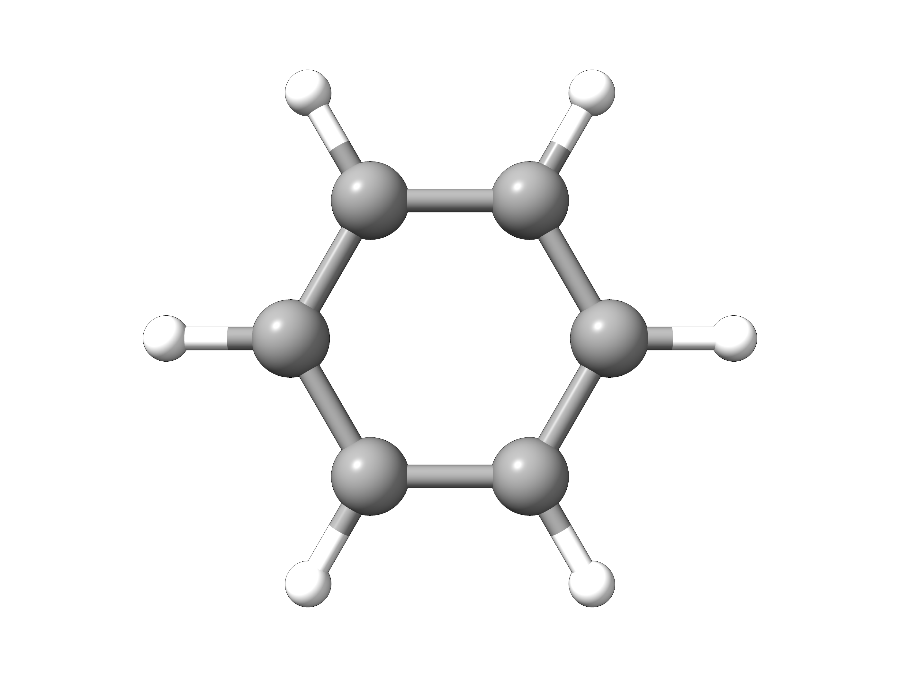
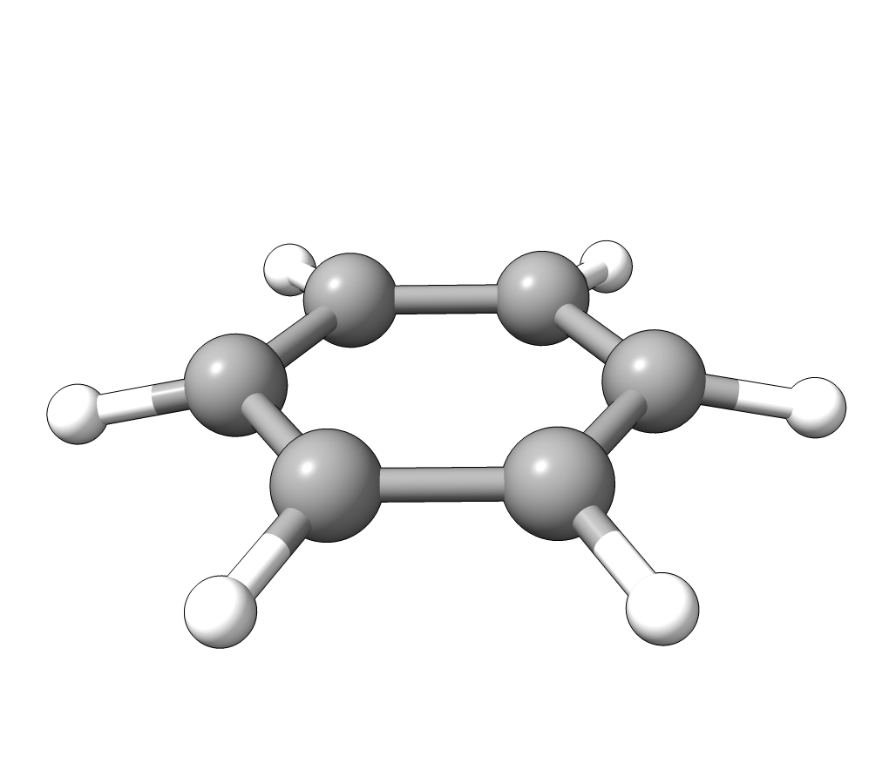

# Infrared and Raman

The prediction of infrared (IR) and (non-resnonant) Raman spectra are nowadays a straightforward task in computational chemistry. Let us use ORCA
to predict the fundamental frequencies and intensities for benzene.

[](../images/benzene.png)

*Figure: $D_{6h}$ symmetric structure of benzene.*

```mol
title: Benzene (D6h)
theme: chem311
height: 360px
representation: ball-stick
--- xyz ---
12
structure
H       -1.242909   -2.152782    0.000000
C       -0.695566   -1.204756    0.000000
C        0.695566   -1.204756    0.000000
H        1.242909   -2.152782    0.000000
C        1.391133    0.000000    0.000000
H        2.485819    0.000000    0.000000
C        0.695566    1.204756    0.000000
H        1.242909    2.152782    0.000000
C       -0.695566    1.204756    0.000000
H       -1.242909    2.152782    0.000000
C       -1.391133    0.000000    0.000000
H       -2.485819    0.000000    0.000000
```

Because of its symmetry, the selection rules predict that these bands are mutually exclusive, with $A_{2u}$ and $E_{1u}$ modes being the most IR active ($B_{1u}, B_{2u}$ and $E_{2u}$ modes are less intense), while the $A_{1g}, E_{1g}$ and $E_{2g}$ are Raman active. For comparison, the complete set of experimental values can be found on [NIST's website](https://webbook.nist.gov/cgi/cbook.cgi?ID=C71432&amp;Mask=800#Electronic-Spec).

## Predicting infrared spectra

The optimization of the molecular structure and subsequent calculation of the vibrational
frequencies, e.g. with DFT can be envoked via simple keywords `OPT` and `FREQ`:

```text
!BP86 DEF2-SVP OPT FREQ

*XYZFILE 0 1 structure.xyz
```

For Grimme's efficient r^2SCAN-3c composite DFT method the respective input is:

```text
!r2SCAN-3c OPT FREQ
```

If no analytical Hessian is available for the chosen method, the `NUMFREQ` keyword can be used to request a numerical Hessian calculation.

After the successful calculation, the vibrational frequencies will be printed:

```text
-----------------------
VIBRATIONAL FREQUENCIES
-----------------------

Scaling factor for frequencies =  1.000000000  (already applied!)

     0:       0.00 cm**-1
     1:       0.00 cm**-1
     2:       0.00 cm**-1
     3:       0.00 cm**-1
     4:       0.00 cm**-1
     5:       0.00 cm**-1
     6:     405.17 cm**-1
     7:     405.28 cm**-1
     8:     626.34 cm**-1
     9:     626.55 cm**-1
[...]
```

followed by the vibrational modes and the IR spectrum.

```text
-----------
IR SPECTRUM
-----------

 Mode   freq       eps      Int      T**2         TX        TY        TZ
       cm**-1   L/(mol*cm) km/mol    a.u.
----------------------------------------------------------------------------
  6:    405.17   0.000000    0.00  0.000000  ( 0.000000  0.000000 -0.000000)
  7:    405.28   0.000000    0.00  0.000000  ( 0.000000 -0.000000  0.000109)
  8:    626.34   0.000000    0.00  0.000000  ( 0.000000  0.000000  0.000000)
  9:    626.55   0.000000    0.00  0.000000  (-0.000000  0.000000 -0.000000)
 10:    676.63   0.025862  130.70  0.011928  (-0.000000  0.000000 -0.109214)
[...]
```

where the dipole derivatives necessary to compute the IR intensities are printed after each frequency.

> **Tip**
> If you specify `!UseSym` in the input, normal modes will be automatically labelled according to the irreducible representation they belong to in the detected point group.

### Plotting the IR spectrum

The IR spectrum can then be immediately generated with any suitable [GUI](../first_steps/GUI.md)
like Avogadro 2. Just open the saved output file `basename.out` and click on `Analysis` → `Plot Spectra...` to open a new window were the IR spectrum will be plotted:

[](../images/irspectrum-avogadro2.png)

*Figure: IR spectrum plotted with Avogadro 2.*

### Visualizing modes

In order to have a better assignment of the IR peaks, one can click on the corresponding frequency in the main Avogadro window and then on `Start Animation` to make a small movie of the mode displacement.

As an example, if one chooses the $A_{2u}$ IR active mode at $668 cm^{-1}$, that in textbooks is commonly assigned as an out-of-plane C-H bending, one gets:

[](../images/benzene.gif)

*Animation: $A_{2u}$ IR active mode of benzene.*

exactly as expected. The symmetry breaking creates a temporary dipole one the benzene molecule, and that allows for intensity on a IR transition.

> **Note**
> The line broadening must be included *ad hoc* here because it is related to the lifetimes of vibrational excited states and structural parameters that were not accounted for in the calculation and might vary depending on the experimental conditions.

> **Important**
> Be aware that we are predicting only fundamental transitions, so no overtones and combination bands are included!

Here is a table comparing the calculated and [experimental](https://webbook.nist.gov/cgi/cbook.cgi?ID=C71432&amp;Mask=800#Electronic-Spec) values for the IR fundamentals:

| Mode | Experiment / $\mathrm{cm}^{-1}$ | Predicted / $\mathrm{cm}^{-1}$ |
| --- | --- | --- |
| $E_{2u}$ Ring deform | 410 | 405 |
| $A_{2u}$ C-H bend | 673 | 676 |
| $B_{1u}$ Ring deform | 1010 | 1005 |
| $E_{1u}$ C-H bend | 1038 | 1037 |
| $B_{2u}$ C-H bend | 1150 | 1180 |
| $E_{1u}$ C=C str | 1486 | 1511 |
| $B_{1u}$ C-H str | 3068 | 3179 |
| $E_{1u}$ C-H str | 3063 | 3116 |

## Predicting Raman spectra

In a similar way, the non-resonant Raman spectra composed of fundamental transitions can be predicted. The main difference here is that the derivatives of the polarizability have to be computed numerically, so that the !NUMFREQ flag has to be used, together with a keyword under %ELPROP to request the calculation of polarizabilties:

```text
!r2SCAN-3c OPT FREQ

%ELPROP
   POLAR 1
END

*XYZFILE 0 1 structure.xyz
```

> **Note**
> Since ORCA 6.1, Raman spectra may be calculated using analytical polarizability derivatives for HF and DFT methods. In previous versions of ORCA or for methods where the analytical derivative is not available, the (much slower) numerical differentiation procedure has to be invoked via `!NUMFREQ`.

Here `POLAR 1` means that the polarizability is computed analytically, by solving the CP-SCF equations. However, this option is only available for regular DFT and HF. Please check the [ORCA manual](https://www.faccts.de/docs/orca/6.0/manual) for all available options.

After successful termination the Raman spectrum is printed after the IR section and the Raman spectrum can be plotted with Avogadro analogous to the IR spectrum.

```text
--------------
RAMAN SPECTRUM
--------------

 Mode    freq (cm**-1)   Activity   Depolarization
-------------------------------------------------------------------
   6:       405.17      0.000000      0.000000
   7:       405.29      0.000000      0.000000
   8:       626.30      6.040566      0.749994
   9:       626.51      6.007768      0.750000
  10:       676.71      0.000000      0.000000
  11:       720.26      0.001076      0.750000
  12:       858.46      3.005071      0.750000
  13:       859.04      3.135090      0.750000
[...]
```

> **Tip**
> If you specify `!UseSym` in the input, normal modes will be automatically labelled according to the irreducible representation they belong to in the detected point group.

It is important to say the Raman intensities are a more complicated subject than those of IR and are much more dependent on the experimental setup, that is why we print here the so-called "Raman Activity" instead [[Hess2002]](../bib.md#hess2002), because it is setup invariant.

Again, we can compile a table comparing the calculated and [experimental](https://webbook.nist.gov/cgi/cbook.cgi?ID=C71432&amp;Mask=800#Electronic-Spec) values for the Raman fundamentals:

| Mode | Experiment / $\mathrm{cm}^{-1}$ | Predicted / $\mathrm{cm}^{-1}$ |
| --- | --- | --- |
| $E_{2g}$ Ring deform | 606 | 620 |
| $E_{1g}$ C-H bend | 849 | 859 |
| $A_{1g}$ Ring str | 992 | 977 |
| $E_{2g}$ C-H bend | 1178 | 1197 |
| $A_{2g}$ C-H bend | 1326 | 1374 |
| $E_{2g}$ Ring str | 1606/1585 | 1630 |
| $E_{2g}$ C-H str | 3047 | 3177 |
| $A_{1g}$ C-H str | 3062 | 3186 |

## Scaling frequencies

Please also note the `Scaling factor for frequencies` printed in the output just before the frequency
values. These are empirical factors that can be used to multiply all frequencies and correct for
errors from theory [[Martin2014]](../bib.md#martin2014). It can be controlled by setting the `SCALFREQ` flag under `%FREQ`. For example, the previous reference suggest a scaling factor of 0.9956 for BP86/DEF2-SVP.

```text
!BP86 DEF2-SVP FREQ
%FREQ
   SCALFREQ 0.9956
END
* XYZFILE 0 1 structure.xyz
```

> **Note**
> If one is using Avogadro, these scaling factor can be added later by setting the "Scale Factor" on the "Infrared Spectra Settings" tab shown before.

> **Warning**
> Negative frequencies mean that your system is not in real minimum! Please check the [Removing negative frequencies](../prop/freq.md#negative-freq) section for more info on that.
