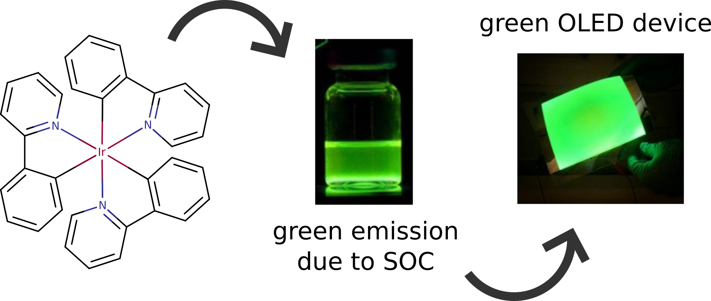
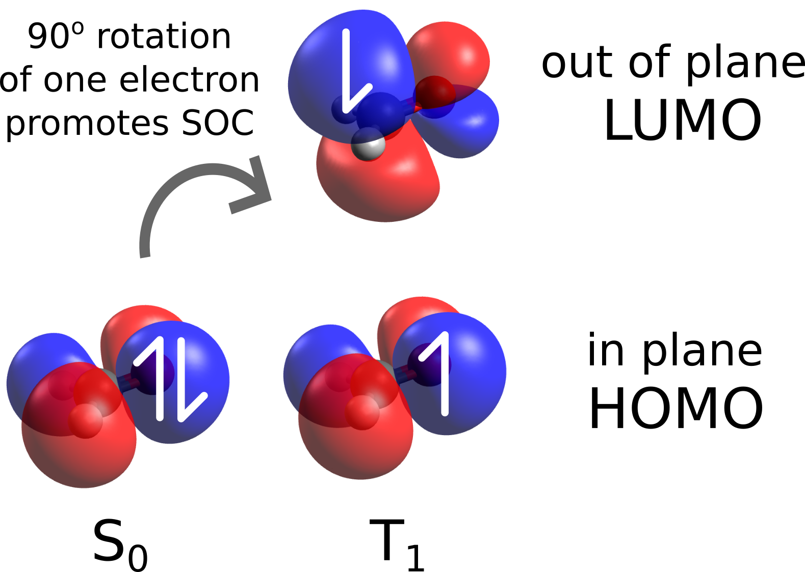
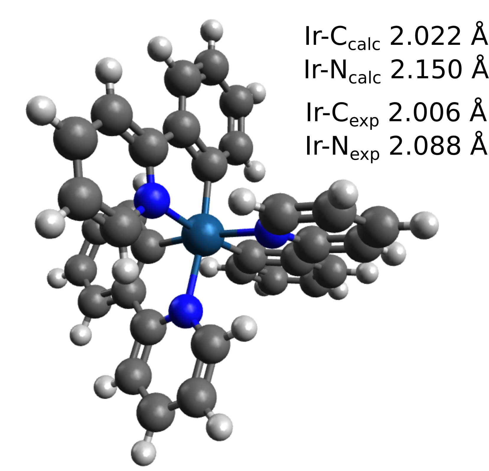

# Spin-Orbit Coupling

Spin-orbit coupling (SOC) is the relativistic effect that mixes states with different multiplicities, e.g. singlets and triplets. In Dirac's equation framework - which is closest to the real physics since it accounts for relativity in quantum mechanics - there is no differentiation between spin and regular angular momentum, so there is no such a thing as pure spin states in practice.

Usually, this is an effect that mostly affects systems containing heavy atoms, so it does not need to be included in each and every calculation. Nonetheless, there are many experimental phenomena that stem from that, such as phosphorescence, the intersystem crossing between excited states, TADF, and even some reactivity through unconventional spin states.

As an example, let's try to predict the phosphorescence lifetime and color of the Ir(ppy)_3 complex in solution. That is a yellow-green emitter, part of an important family of compounds used in the fabrication of OLEDs:

[](../images/Ir.png)

## SOC with TD-DFT

In ORCA, there are many ways to include SOC in your calculations at various levels of theory, and maybe the simplest one is using [TD-DFT](../spec/UVVis.md#tddft) [[Iszak2019c]](../bib.md#iszak2019c). From now on, we will assume that everything related to that section is known and we will only discuss the new aspects related to SOC.

However, before jumping into the more complicated Iridium(III) complex, let us start with something simpler: formaldehyde. This is a molecule that presents a quite strong SOC besides being an organic molecule.

That is because the $\pi-\pi^*$ and $n-\pi^*$ excited states can be orthogonal to others, and a change in spin can be compensated by a change in angular momentum caused be the "rotation" of the electrons during the transition (more on that later) [[Turro2010]](../bib.md#turro2010). In order to compute the excited states and its SOC just run, e.g. with B3LYP:

```mol
title: SOC #1
theme: chem311
height: 360px
representation: ball-stick
--- xyz ---
4
structure
   O      0.000000    0.000000    0.601105
   C     -0.000000    0.000000   -0.598757
   H      0.000000   -0.944973   -1.202781
   H      0.000000    0.944973   -1.202781
--- input ---
!B3LYP DEF2-SVP
 %TDDFT  NROOTS  5
         DOSOC   TRUE
 END
 * xyz 0 1
   O      0.000000    0.000000    0.601105
   C     -0.000000    0.000000   -0.598757
   H      0.000000   -0.944973   -1.202781
   H      0.000000    0.944973   -1.202781
*
```

As you can see, the only extra input needed is the DOSOC TRUE under %TDDFT. The output will present some other information now, starting with the computation not only of the singlet excited states, but also of the triplets:

```text
********************************
* Entering triplet calculation *
********************************

[...]

     ****Iteration    0****
<<< Triplet sigma vectors requested >>>

Memory handling for direct AO based CIS:
Memory per vector needed      ...     1 MB
Memory needed                 ...     0 MB
Memory available              ...   512 MB
Number of vectors per batch   ...   512
Number of batches             ...     1
[...]
```

The [printing of the excited state](../spec/UVVis.md) is also done in an analogous way, with the contribution of the excitations to each state printed:

```text
------------------------------------
TD-DFT/TDA EXCITED STATES (TRIPLETS)
------------------------------------

the weight of the individual excitations are printed if larger than 1.0e-02

STATE  1:  E=   0.123186 au      3.352 eV    27036.2 cm**-1 <S**2> =   2.000000
     7a ->   8a  :     0.996653 (c=  0.99832517)

STATE  2:  E=   0.219375 au      5.969 eV    48147.2 cm**-1 <S**2> =   2.000000
     6a ->   8a  :     0.993680 (c= -0.99683484)
```

After having both singlets and triplets, comes the SOC-specific part:

```text
------------------------------
TD-DFT/TDA SPIN-ORBIT COUPLING
------------------------------

[...]
------------------------------------------------------------------------------
                         ORCA SPIN-ORBIT COUPLING CALCULATION
------------------------------------------------------------------------------

GBW file                                    ... form.gbw
Input density                               ... form.cisp0
Output integrals                            ... form.cis
Operator type                               ... Mean-field/Effective potential
   One-Electron Terms                       ... 1
   Coulomb Contribution                     ... 2
   Exchange Contribution                    ... 3
   Correlation Contribution                 ... 0
   Maximum number of centers                ... 4
[...]
```

Here, the integrals necessary to compute the coupling are calculated first. There are many algorithms in ORCA for how to do that, and the complete details can be found in the
[ORCA manual](https://www.faccts.de/docs/orca/6.0/manual), however the defaults can be trusted for the vast majority of cases.

> **Note**
> The calculation of these integrals can take some time. For larger systems, one can use the RI-SOMF(1X) on the main input, that will invoke the use of RI for the Coulomb part. This will accelerate the calculation significantly with only a small error associated [[Neese2005]](../bib.md#neese2005).

## Analysing the SOC-TD-DFT Output

If everything succeeds, first the matrix elements $\langle T_n | \widehat{H}_{s}|S_n \rangle$ will be printed on a Cartesian basis:

```text
--------------------------------------------------------------------------------
                CALCULATED SOCME BETWEEN TRIPLETS AND SINGLETS
--------------------------------------------------------------------------------
     Root                          <T|HSO|S>  (Re, Im) cm-1
   T      S             Z                     X                     Y
--------------------------------------------------------------------------------
   1      0    (   0.00 ,   59.19 )    (   0.00 ,    0.00 )    (  -0.00 ,    0.00 )
   1      1    (   0.00 ,   -0.00 )    (   0.00 ,   -0.00 )    (  -0.00 ,    0.00 )
   1      2    (   0.00 ,    0.00 )    (   0.00 ,   -0.00 )    (  -0.00 ,    7.52 )
   1      3    (   0.00 ,   -0.00 )    (   0.00 ,  -49.15 )    (  -0.00 ,    0.00 )
```

and one can immediately see that the coupling between the first excited triplet ($T_1$) and the ground singlet ($S_0$) is quite strong through the $z$ component of the SOC operator.

This is expected from the analysis of the components of these states. The $T_1$ is mostly composed of a HOMO-LUMO transition, which makes it a $n-\pi^*$ excited state. A transition from that to the ground state involves a change of angular momentum, which then facilitates the change of spin state by increasing the SOC [[Turro2010]](../bib.md#turro2010):

[](../images/form.png)

The next part is the stabilization energy of the ground state cause by the SOC and a list of energies of the new mixed SOC-states:

```text
SOC stabilization of the ground state:  -0.2024 cm-1
Eigenvalues of the SOC matrix:

State:        cm-1         eV
  0:          0.00         0.0000
  1:      27036.26         3.3521
  2:      27036.27         3.3521
  3:      27036.45         3.3521
  4:      32861.46         4.0743
```

Followed by their composition, which are now mixtures of singlets and triplets:

```text
            E(cm-1)  Weight      Real         Imag     : Root  Spin  Ms
STATE  0:      0.00
                     0.99999     -0.00683     -0.99997 : 0     0     0
STATE  1:  27036.26
                     0.50000      0.00000     -0.70710 : 1     1    -1
                     0.50000      0.00000     -0.70710 : 1     1     1
STATE  2:  27036.27
                     0.50000     -0.00000      0.70710 : 1     1    -1
                     0.50000      0.00000     -0.70710 : 1     1     1
STATE  3:  27036.45
                     0.99999      0.99994      0.01093 : 1     1     0
STATE  4:  32861.46
                     0.99999     -0.99938      0.03514 : 1     0     0
```

Here ORCA computed, for instance, that the ground SOC state is 99.99% equal to the DFT ground state, which is expected since there is a quite large energy difference between $S_0$ and the higher energy ones.

The second SOC state now, is a mixture of two spin sublevels of the first triplet (*Root 1*), those with angular momentum -1 and +1 in spherical harmonics. The third state is a similar mixture, the fourth state is again basically the $S_1$, and so on.

In the end, the "spectrum" is also printed:

```text
---------------------------------------------------------------------------------
SPIN ORBIT CORRECTED ABSORPTION SPECTRUM VIA TRANSITION ELECTRIC DIPOLE MOMENTS
---------------------------------------------------------------------------------
  States    Energy  Wavelength   fosc         T2         TX        TY        TZ
            (cm-1)    (nm)                  (au**2)     (au)      (au)      (au)
---------------------------------------------------------------------------------
   0   1   27036.3    369.9   0.000000002   0.00000   0.00000   0.00016   0.00000
   0   2   27036.3    369.9   0.000000001   0.00000   0.00010   0.00000   0.00000
   0   3   27036.5    369.9   0.000000132   0.00000   0.00000   0.00000   0.00127
   0   4   32861.5    304.3   0.000000000   0.00000   0.00000   0.00000   0.00000
   0   5   48147.4    207.7   0.000000000   0.00000   0.00000   0.00001   0.00000
   0   6   48147.4    207.7   0.000000000   0.00000   0.00000   0.00000   0.00000
```

Note that now even the triplets are included in the spectrum, as in fact, all SOC states have components of both singlets and triplets and will have some intensity. In this case, the SOC is just not strong enough to make the triplet to ground state transition really bright.

## SOC on a Iridium(III) complex

Now let's come back to the aforementioned example of a phosphorescent Iridium(III) complex. That is a case when the SOC is so strong that there are no clear singlets or triplets anymore, and the excited change change drastically due to coupling.

The first step is to optimize this heavy metal complex. We will look after the *fac*-$Ir(ppy)_3$, for we have plenty of experimental data to compare with for that isomer. The optimization can be done running:

```text
!B3LYP DEF2-TZVP OPT CPCM(CH2CL2) D4
* XYZFILE 0 1 fac-Irppy_guess.xyz
```

Here we use the B3LYP functional with the DEF2-TZVP basis, which in practice uses a pseudo-potential for heavy atoms such as Ir. This helps to accelerate the calculation and also somewhat accounts for the relativistic effects on the geometry, since the pseudo-potential are fitted to relativistic calculations.

We also use larger grids, which is important and such heavy atoms are present, together with CPCM for a solvation correction and the D4 for the dispersion interaction. The result is:

[](../images/Ir_struc.png)

which shows good agreement with the average experimental bond length values found at the CCDB [[Yersin2005]](../bib.md#yersin2005). After optimizing, the SOC-TD-DFT can be called again with:

```text
!B3LYP ZORA ZORA-DEF2-TZVP SARC/J CPCM(CH2CL2) RI-SOMF(1X)
%TDDFT  NROOTS  25
        DOSOC   TRUE
        TDA     FALSE
END
%BASIS  NEWGTO  IR      "SARC-ZORA-TZVP" END
END
* XYZFILE 0 1 fac-Irppy_optimized.xyz
```

Now we do a full calculation with [Relativistic corrections](../prop/relativistic.md#relcorr), using ZORA and its required basis. Note that we also need to specify the SARC-ZORA-TZVP basis for the Ir, as there is no simple ZORA-DEF2-TZVP for that. Here we added the RI-SOMF(1X) to accelerate the SOC integrals and choose the TDA FALSE to compute a full TD-DFT calculation, for later comparison.

In contrast to the formaldehyde, that had no heavy atom, the SOC matrix elements are much larger now:

```text
--------------------------------------------------------------------------------
                CALCULATED SOCME BETWEEN TRIPLETS AND SINGLETS
--------------------------------------------------------------------------------
     Root                          <T|HSO|S>  (Re, Im) cm-1
   T      S             Z                     X                     Y
--------------------------------------------------------------------------------
   1      0    (   0.00 , -178.70 )    (   0.00 ,  -14.24 )    (  -0.00 ,  -17.11 )
   1      1    (   0.00 ,    2.90 )    (   0.00 ,  -12.51 )    (  -0.00 ,  -17.41 )
   1      2    (   0.00 ,    3.48 )    (   0.00 , -107.34 )    (  -0.00 ,   26.81 )
   1      3    (   0.00 ,    0.93 )    (   0.00 ,   24.18 )    (  -0.00 ,  116.53 )
   1      4    (   0.00 ,   17.00 )    (   0.00 ,  351.96 )    (  -0.00 , -883.26 )
   1      5    (   0.00 ,  -16.51 )    (   0.00 , -869.91 )    (  -0.00 , -351.62 )
   1      6    (   0.00 ,  -91.84 )    (   0.00 ,   -5.33 )    (  -0.00 ,   19.66 )
   1      7    (   0.00 ,   -2.39 )    (   0.00 , -141.03 )    (  -0.00 ,  -70.48 )
```

and the states are much more mixed:

```text
            E(cm-1)  Weight      Real         Imag     : Root  Spin  Ms
STATE  0:      0.00
                     0.99610      0.94204      0.32965 : 0     0     0
STATE  1:  20774.54
                     0.64085      0.35966      0.71519 : 1     1     0
                     0.01154     -0.04825     -0.09595 : 4     1     0
                     0.01206      0.04933      0.09810 : 9     1     0
                     0.03186      0.16645      0.06448 : 2     1    -1
                     0.03295     -0.05381      0.17335 : 3     1    -1
                     0.03337     -0.10929     -0.14639 : 5     1    -1
                     0.03657     -0.15165      0.11650 : 6     1    -1
                     0.01374      0.11174      0.03540 : 7     1    -1
                     0.01194     -0.03024      0.10500 : 8     1    -1
                     0.03186      0.04749     -0.17207 : 2     1     1
                     0.03295     -0.17125     -0.06018 : 3     1     1
                     0.03337      0.05234      0.17502 : 5     1     1
                     0.03657     -0.18395      0.05227 : 6     1     1
                     0.01374      0.03821     -0.11081 : 7     1     1
                     0.01194     -0.10233     -0.03833 : 8     1     1
```

The ground SOC state is still essentially the DFT ground state, as the energy differences are still high. However, the first SOC state is already a hybrid of many. It is not a simple triplet, but a mixture of $T_1$ to $T_9$, with various amounts and spin components. That shows the impact of the SOC on these cases!

The closest state to a singlet now is the SOC state 10:

```text
STATE 10:  21813.90
                     0.34904      0.07012      0.58662 : 1     0     0
                     0.02377      0.01830      0.15309 : 6     0     0
                     0.06868     -0.26022      0.03111 : 4     1     0
                     0.02809     -0.16640      0.01989 : 9     1     0
                     0.01415      0.05254      0.10672 : 2     1    -1
                     0.01493     -0.10540      0.06177 : 3     1    -1
                     0.08208      0.11662      0.26169 : 5     1    -1
                     0.08432      0.26221     -0.12478 : 6     1    -1
                     0.03076     -0.11179     -0.13513 : 7     1    -1
                     0.02740      0.12544     -0.10801 : 8     1    -1
                     0.01415     -0.02591      0.11610 : 2     1     1
                     0.01493      0.11699      0.03518 : 3     1     1
                     0.08208     -0.05165      0.28180 : 5     1     1
                     0.08432     -0.28423     -0.05945 : 6     1     1
                     0.03076      0.07679     -0.15768 : 7     1     1
                     0.02740     -0.14737     -0.07540 : 8     1     1
```

which has 34% of $S_1$ and 2% of $S_6$, but there is nothing like a pure state anymore.

## ZFS and phosphorescence lifetime

This strong mixing is now reflected in the spectrum as well:

```text
---------------------------------------------------------------------------------
SPIN ORBIT CORRECTED ABSORPTION SPECTRUM VIA TRANSITION ELECTRIC DIPOLE MOMENTS
---------------------------------------------------------------------------------
  States    Energy  Wavelength   fosc         T2         TX        TY        TZ
            (cm-1)    (nm)                  (au**2)     (au)      (au)      (au)
---------------------------------------------------------------------------------
   0   1   20774.5    481.4   0.000013163   0.00021   0.00153   0.00311   0.01402
   0   2   20836.2    479.9   0.003033212   0.04792   0.16473   0.14418   0.00118
   0   3   20844.5    479.7   0.003563760   0.05629   0.15169   0.18239   0.00281
   0   4   20990.7    476.4   0.000283714   0.00445   0.03702   0.05532   0.00437
   0   5   20993.2    476.3   0.000109527   0.00172   0.01850   0.02990   0.02194
   0   6   21011.1    475.9   0.000366203   0.00574   0.06107   0.04481   0.00074
```

and the previous "triplets" - now SOC states - have actually very bright transitions with the ground state.

The approximate zero-field splitting (ZFS), obtained as the energy difference between SOC state 3 and SOC state 1 is of about $70 cm^{-1}$, in quite good agreement with the experimental value of $85-170 cm^{-1}$ [[Wang2014]](../bib.md#wang2014).

From the oscillator strengths it is also possible to predict the phosphorescence lifetime for these complexes, and the calculated value using Eq. 4 from the same reference, is about $1.17 \mu s$, also close to the $1.6-1.8 \mu s$ from measurements.

Using a very simplistic approach, if one takes the energy difference from the $S_1$ to the ground state and assumes a ZPE difference of $2000 cm^{-1}$, the expected emission color would be blue. Even using the $T_1$ energy alone, it would be green, but not yellow enough. Now using the SOC state 1, the color at about $532 nm$ matches the yellow-green emission color of this complex quite well:

[](../images/colors.png)

## SOC with other methods

The inclusion of SOC can be done through ORCA in many other theory levels such as CASSCF, ROCIS, STEOM and MRCI. The input is somewhat different, depending on the method, but the output in general is the same. For more detailed information on these other methods, please check the [ORCA manual](https://www.faccts.de/docs/orca/6.0/manual).

## Structures

### fac-Ir(ppy)3- C3 symmetry

```mol
title: SOC #15
theme: chem311
height: 360px
representation: ball-stick
--- xyz ---
61
structure
C        3.393895879     -0.289566719      2.776304932
C        4.076284431     -1.374299959      2.244246939
C        3.562788518     -2.026286944      1.144617313
C        2.365194919     -1.600441421      0.563698783
C        1.656920791     -0.490717084      1.087023288
C        2.209908242      0.138316955      2.204838066
C        1.779556093     -2.262575837     -0.593808565
C        2.310998596     -3.397126504     -1.214621244
C        1.678633212     -3.946679457     -2.310344980
C        0.513725976     -3.353425417     -2.779039051
C        0.041132843     -2.238327622     -2.115943483
N        0.643735830     -1.703611386     -1.062120264
C       -3.228320892     -2.843015891      2.244246939
C       -1.947720074     -2.794416690      2.776304932
C       -0.985168124     -1.982995155      2.204838066
C       -1.253433856     -1.189576955      1.087023288
C       -2.568620388     -1.248098174      0.563698783
C       -3.536210228     -2.072321893      1.144617313
C       -2.849226199     -0.409852865     -0.593808565
N       -1.797238653      0.294314111     -1.062120264
C       -1.959015004      1.083541724     -2.115943483
C       -3.161014589      1.231812963     -2.779039051
C       -4.257241276      0.519600723     -2.310344980
C       -4.097497151     -0.302820240     -1.214621244
C       -0.403486935      1.680294039      1.087023288
C       -1.224740118      1.844678200      2.204838066
C       -1.446175805      3.083983409      2.776304932
C       -0.847963539      4.217315849      2.244246939
C       -0.026578290      4.098608837      1.144617313
C        0.203425469      2.848539595      0.563698783
C        1.069670107      2.672428702     -0.593808565
C        1.786498555      3.699946745     -1.214621244
C        2.578608064      3.427078734     -2.310344980
C        2.647288613      2.121612454     -2.779039051
C        1.917882161      1.154785898     -2.115943483
N        1.153502823      1.409297275     -1.062120264
Ir       0.000000000      0.000000000      0.043448572
H        3.792342787      0.222162593      3.641507453
H        5.002872009     -1.707739869      2.689139743
H        4.102575829     -2.869480849      0.738507580
H        1.696641422      0.983426029      2.641159087
H        3.213678708     -3.847263406     -0.836341679
H        2.081671478     -4.823466100     -2.794933558
H       -0.013921102     -3.747584685     -3.633027960
H       -0.865398626     -1.751267403     -2.451342694
H       -3.980382114     -3.478744318      2.689139743
H       -1.703772945     -3.395346490      3.641507453
H        0.003351213     -1.961047587      2.641159087
H       -4.536331226     -2.118194464      0.738507580
H       -1.083942747      1.625090897     -2.451342694
H       -3.238542989      1.885848371     -3.633027960
H       -5.218079916      0.608952668     -2.794933558
H       -4.938667199     -0.859495698     -0.836341679
H       -1.699992635      0.977621558      2.641159087
H       -2.088569843      3.173183897      3.641507453
H       -1.022489895      5.186484186      2.689139743
H        0.433755396      4.987675313      0.738507580
H        1.724988490      4.706759104     -0.836341679
H        3.136408438      4.214513433     -2.794933558
H        3.252464091      1.861736314     -3.633027960
H        1.949341373      0.126176507     -2.451342694
```
