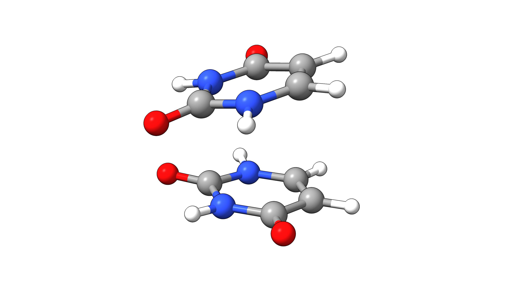

# Extrapolation Techniques

Various techniques to extrapolate energies or properties to converged results are available in the literature. Frequently used examples are complete-basis-set (CBS) or complete-PNO-space (CPS)
extrapolations of DLPNO-CCSD(T) energies. Such extrapolation techniques can improve the accuracy of the calculated property whenever quasi-converged technical settings are not feasible anymore.
As these extrapolations typically require several calculations with different settings and a subsequent evaluation, they are an ideal case for automatization within Compound jobs. Many more compound scripts of frequently used tasks are available from the official [GitHub repository](https://github.com/ORCAQuantumChemistry/CompoundScripts).

> **Important**
> Note that converging the CPS space alone may not be sufficient to obtain the most accurate results. It may be recommendably to also perform CBS extrapolation.

## Example 1: CPS extrapolation

Complete-PNO-space extrapolation [[Bistoni2020b]](../bib.md#bistoni2020b) is useful for any DLPNO method including DLPNO-CCSD(T), DLPNO-MP2, or even DLPNO-double hybrid DFT [[Bursch2023]](../bib.md#bursch2023).
In this case, the extrapolated correlation energy (E_CORR, CPS) is calculated as:

$$
E_{CORR,CPS} = E^{X}+F \cdot (E^{Y}-E^{X})
$$

We will employ a the Compound script `extrapolate_PNO.cmp` from the [GitHub repository](https://github.com/ORCAQuantumChemistry/CompoundScripts) to perform a CPS extrapolation for the π-stacked Uracil dimer and its monomer fragments at the DLPNO-CCSD(T1)/cc-pVTZ level.

[](../images/uracil.png)

*Figure: Molecular structure of the uracil dimer.*

Let us explain the script! First, all desired variables for a CPS(6,7) extrapolation are defined:

```text
%compound
%maxcore 8000

# ---------------------------------------------------------------
# --------------------  Variables  ------------------------------                
# ----------   Variables that could be adjusted using 'with'-----
variable molecule      = "mymol.xyz";
variable charge        = 0;
variable mult          = 1;
variable method        = "DLPNO-CCSD(T1)";
variable basis         = "cc-pVTZ";
variable restOfInput   = "TightPNO cc-pVQZ/C VeryTightSCF";
variable loose_TCutPNO = "1e-6";                   # Loose TCutPNO value
variable tight_TCutPNO = "1e-7";                   # Tight TCutPNO value
variable F             = 1.5;                      # The mulitplier
# -----------------  Rest of variables --------------------------
variable E_HF;                                     # The SCF energy
variable ECORR_X, ECORR_Y, ECORR_CPS;              # The correlation energies
variable ETOT_X, ETOT_Y, ETOT_CPS;                 # The total energies
```

Now, the first calculation with the less accurate TCutPNO parameter 1e-6 is set up and the resulting Hartee-Fock reference energy (`E_HF`) and the correlation energy using this threshold (`E_X`) are read:

```text
#---------------------------------------------------------------------------------------------
# (Calculation 1)
# The calculation with the loose TCutPNO
#---------------------------------------------------------------------------------------------
  !&{method} &{basis} &{restOfInput}
  *xyzfile &{charge} &{mult} &{molecule}
  %MDCI
    TCutPNO &{loose_TCutPNO} 
  End
  # % BASIS auxc "autoaux" autoauxlmax true END
Step_End
E_HF.ReadProperty(propertyName="MDCI_REF_ENERGY");   
ECORR_X.ReadProperty(propertyName="MDCI_CORR_ENERGY");  
ETOT_X = E_HF + ECORR_X;
```

The next part of our Compound job is the second calculation with tighter threshold 1e-7:

```text
#----------------------------------------------------------------------------------------------
# (Calculation 2)
# The calculation with the tight TCutPNO
#----------------------------------------------------------------------------------------------
New_Step
  !&{method} &{basis} &{restOfInput}
  %MDCI
    TCutPNO &{tight_TCutPNO} 
  End
  # % BASIS auxc "autoaux" autoauxlmax true END
Step_End
ECORR_Y.readProperty(propertyName="MDCI_CORR_ENERGY");    
ETOT_Y = E_HF + ECORR_Y;
```

Finally, the CPS-extrapolated correlation energy (`ECORR_CPS`) is computed and summed up with the HF reference energy (`E_HF`) to obtain the final energy (`ETOT_CPS`). The detailed results are finally printed:

```text
ECORR_CPS = ECORR_X + 1.5*(ECORR_Y - ECORR_X);
ETOT_CPS = E_HF + ECORR_CPS;        
#
print("\n\n================================================================================\n");
print("=========================== SUMMARY OF ENERGIES (Eh) ===========================\n");
print("================================================================================\n\n");
print(" Molecule         : %s\n", molecule);
print(" Charge           : %-18d\n", charge);
print(" Mult             : %-18d\n", mult);
print(" Method           : %s\n", method);
print(" Basis set        : %s\n", basis);
print(" Rest of input    : %s\n", restOfInput);
print(" SCF Energy       : %-22.8lf\n", E_HF);
print(" \n");
print("                      Loose TCutPNO         Tight TCutPNO              CPS\n");
print("                      -------------         -------------         -------------\n");
print("Correlation Energy %14.8lf %21.8lf %21.8lf \n", ECORR_X, ECORR_Y, ECORR_CPS);
print("Total Energy %20.8lf %21.8lf %21.8lf \n", ETOT_X, ETOT_Y, ETOT_CPS);
#
End
```

The full Compound script can be found in the dropdown:

### Compound script - CPS extrapolation

```text
%compound
%maxcore 8000
# Creator: Ahmet Altun
#
# *************************************** DESCRIPTION ********************************************************
# This script is for automating two point "Complete PNO Space (CPS)" extrapolation [1] of 
# DLPNO-CCSD(T)/TightPNO energies. 
# 
# The CPS extrapolation is applied on correlation energies from two separate calculations performed 
# exactly the same settings except TCutPNO values, set to A*10^-X and A*10^-Y, where A is a common
# prefactor in both TCutPNO values, and Y = X + 1. The two-point CPS(X/Y) extrapolation formula 
# on top of the corresponding correlation energies is then as follows: 
#
#                      E(CPS) =E(X)+F*(E(Y)-E(X))
# 
# where E(X) and E(Y) are the correlation energies obtaind with the loose and tight TCutPNO thresholds, 
# respectively (e.g., TCutPNO = 3e-6 and TCutPNO= 3e-7, respectively). E(CPS) is the CPS(X/Y)-extrapolated
# correlation energy. 
#
# Optimal value of F was found as 1.5 on a wide range of diverse interactions in the GMTKN55 superset [1], 
# and thus it should NOT be changed.

# With the combination of 1e-5/1e-6, i.e., with CPS(5/6), the paper reports MAE between 0.2 and 0.3 kcal/mol 
# for relative energies on a variety of datasets of GMTKN55 superset.
# 
# The combination 1e-6/1e-7, i.e., CPS(6/7), provides MAEs between 0.08 to 0.27 kcal/mol for the same set of 
# molecules.
#
# The CPS scheme eliminates largely the system size depenence of the correlation energies, and thus provides
# accurate results also for very large molecular systems [2].
#
# *************************************** LITERATURE  *********************************************************
#
# [1] A. Altun, F. Neese, G. Bistoni, JCTC 2020, 16, 10, 6142–6149
# [2] A. Altun, S. Ghoush, C. Riplinger F. Neese, G. Bistoni, JPC A 2021, 125, 9932–9939
#
# ***************************************   DETAILS   *********************************************************
#
# In Step 1, a calculation with a loose TCutPNO value is performed.
# In Step 2, a calculation with a tight TCutPNO value is performed.
# 
# Then, the results from Steps 1 and 2 are used to get the extrapolated correlation energy.
# Finally, a summary table of unextrapolated and extrapolated energies are printed out in the output file.
#
# ******************************************   NOTES   *******************************************************
# 
# NOTE 1: One can use different TCutPNO values and basis set than those used in this script.
# NOTE 2: The exponents of TCutPNO values must be consecutive (e.g. 6/7, 7/8, etc.). 
#         Here we use 6 and 7.
# NOTE 3: Here we use the cc-pVTZ and the corresponding "/C" bases.
# NOTE 4: To use autoaux module instead of the "/C" basis specified in the simple input line, take the lines
# 	  involving the BASIS block out of the comment for both Calculations 1 and 2.
# NOTE 5: Do not change the F value.
#
# ******************************************  METHOD   *******************************************************
#
# ---------------------------------------------------------------
# --------------------  Variables  ------------------------------                
# ----------   Variables that could be adjusted using 'with'-----
variable molecule      = "mymol.xyz";
variable charge        = 0;
variable mult          = 1;
variable method        = "DLPNO-CCSD(T1)";
variable basis         = "cc-pVTZ";
variable restOfInput   = "TightPNO cc-pVQZ/C VeryTightSCF";
variable loose_TCutPNO = "1e-6";                   # Loose TCutPNO value
variable tight_TCutPNO = "1e-7";                   # Tight TCutPNO value
variable F             = 1.5;                      # The mulitplier
# -----------------  Rest of variables --------------------------
variable E_HF;                                     # The SCF energy
variable ECORR_X, ECORR_Y, ECORR_CPS;              # The correlation energies
variable ETOT_X, ETOT_Y, ETOT_CPS;                 # The total energies
#
#
#----------------------------------------------------------------------------------------------
# (Calculation 1)
# The calculation with the loose TCutPNO
#----------------------------------------------------------------------------------------------
New_Step
  !&{method} &{basis} &{restOfInput}
  *xyzfile &{charge} &{mult} &{molecule}
  %MDCI
    TCutPNO &{loose_TCutPNO} 
  End
  # % BASIS auxc "autoaux" autoauxlmax true END
Step_End
E_HF.ReadProperty(propertyName="MDCI_REF_ENERGY");   
ECORR_X.ReadProperty(propertyName="MDCI_CORR_ENERGY");  
ETOT_X = E_HF + ECORR_X;

#---------------------------------------------------------------------------------------------
# (Calculation 2)
# The calculation with the tight TCutPNO
#---------------------------------------------------------------------------------------------
New_Step
  !&{method} &{basis} &{restOfInput}
  %MDCI
    TCutPNO &{tight_TCutPNO} 
  End
  # % BASIS auxc "autoaux" autoauxlmax true END
Step_End
ECORR_Y.readProperty(propertyName="MDCI_CORR_ENERGY");    
ETOT_Y = E_HF + ECORR_Y;

#---------------------------------------------------------------------------------------------
ECORR_CPS = ECORR_X + 1.5*(ECORR_Y - ECORR_X);
ETOT_CPS = E_HF + ECORR_CPS;        
#
print("\n\n================================================================================\n");
print("=========================== SUMMARY OF ENERGIES (Eh) ===========================\n");
print("================================================================================\n\n");
print(" Molecule         : %s\n", molecule);
print(" Charge           : %-18d\n", charge);
print(" Mult             : %-18d\n", mult);
print(" Method           : %s\n", method);
print(" Basis set        : %s\n", basis);
print(" Rest of input    : %s\n", restOfInput);
print(" SCF Energy       : %-22.8lf\n", E_HF);
print(" \n");
print("                      Loose TCutPNO         Tight TCutPNO              CPS\n");
print("                      -------------         -------------         -------------\n");
print("Correlation Energy %14.8lf %21.8lf %21.8lf \n", ECORR_X, ECORR_Y, ECORR_CPS);
print("Total Energy %20.8lf %21.8lf %21.8lf \n", ETOT_X, ETOT_Y, ETOT_CPS);
#
End
#
```

We now use this compound script to calculated extrapolated energies for the uracil dimer and its monomers and compare them:

| Method | Threshold | ΔE |
| --- | --- | --- |
| DLPNO-CCSD(T1)/cc-pVTZ | 10^-6 | -9.37 |
| DLPNO-CCSD(T1)/cc-pVTZ | 10^-7 | -10.33 |
| DLPNO-CCSD(T1)/cc-pVTZ | CPS(6,7) | -10.59 |

> **Important**
> Note that for CPS extrapolation, it is recommended to keep all other DLPNO thresholds the same. In this example `TightPNO` thresholds were used and only `TCutPNO` was varied.
> For details on the other thresholds, see the [ORCA manual](https://orcaforum.kofo.mpg.de/app.php/dlext/?view=detail&amp;df_id=186).

## Example 2: two-point CBS extrapolation (EP1)

For comparison, a typical two-point EP1 extrapolation can be found in the dropdown below:

### Compound script - EP1 CBS(DZ/TZ) extrapolation

```text
%maxcore 8000
%compound
# Author: Dimitrios Liakos
# Date  : May of 2024
#
#
#   This protocol estimates the complete basis limit (CBS) extrapolated electronic energy.
# It extrapolates separately the SCF part and the correlation part. 
# For the correlation part by default the script uses single reference methods 
# (e.g. DLPNO-CCSD, CCSD(T), CEPA ...etc.). 
#
#
# A description of the notation we use here             : J. Phys. Chem. A 2012, 116, 19, 4801-4816
# The exponents used for the extrapolations             : J. Chem. Theory Comput., 7, 33-43 (2011) 
# Original formulation of the SCF extrapolation         : J. Chem. Phys. 2008, 129, 184116
# Original formulation of the correlation extrapolation : J. Chem. Phys. 1997, 106, 9639
#
#
#
#  In the current implementation we perform the following steps:
#
# Step 1. Use cardinal numbers to evaluate intermeidate quatities eX and eY
#
# Step 2. Perform a calculation with basis set X (default: cc-pVDZ).
#         Read SCF_X and corr_X
#
# Step 3. Perform a calculation with basis set Y (default: cc-pVTZ).
#         Read SCF_Y and corr_Y
#
# Step 4. Extrapolate SCF energy
#
#              CBS_SCF = (SCF_X*eY - SCF_Y*eX)/(eY-eX)
#
#         Extrapolate correlation energy
#
#              CBS_corr = (X^beta*corr_X - Y^beta*corr_Y)/(X^beta-Y^beta)
#
#         Sum up to get totall extrapolated energy
#
#              CBS_Total = CBS_SCF + CBS_corr
#
# Step 5. Print the results
#
#
# NOTE 1. For SCF we use the function:
#  
#                   SCF(X) = SCF(CBS)+Aexp(-a*SQRT(X))
#
# NOTE 2. For correlation we use the equation:
#   
#             CBS(Corr)=(X^b*E_Corr(X))-(Y^b*E_Corr(Y))/(X^b-Y^b):
#
# 
# NOTE 3: If the basis sets change, please make sure to adjust the  'alpha', 'beta' and 'cardinalValues'  
#         accordingly.
#
# NOTE 4: The values of the variables can also be adjusted using the 'with' command in the ORCA input.
#         In this case if one want to experiment just with the exponents the values to be adjusted are:
#            alpha
#            beta
#         In case the same method is used but different basis sets, then the the values to adjust are:
#            basisSets
#            cardinalNumbers
#            alpha
#            beta 
#         In case the method is changed then potentially also the reading properties should change
#            method
#            RefEnergy_prop
#            CorrEnergy_prop
#
# ---------------------------------------------------------------
# --------------------  Variables  ------------------------------                
# ----------   Variables that could be adjusted using 'with'-----
Variable molecule         = "mymol.xyz";
Variable charge           = 0;
Variable mult             = 1;
Variable method           = "CCSD(T) VeryTightSCF";
Variable RefEnergy_prop   = "MDCI_Ref_Energy";
Variable CorrEnergy_prop  = "MDCI_Corr_Energy";
Variable basisSets        = {"cc-pVDZ", "cc-pVTZ"};
Variable cardinalNumbers  = {2,3};
Variable alpha            = 4.420; #based on F. Neese et al. JCTC, 7,33-43 (2011)
Variable beta             = 2.460;
# -----------------  Rest of variables --------------------------
Variable  X, Y;                #The cardinal numbers
Variable  SCF_X, SCF_Y;        #The SCF energies
Variable  eX, eY;              #Useful temporary intermediates
Variable  corr_X, corr_Y;      #The correlation energies
Variable  CBS_SCF, CBS_corr;   #The extrapolated components
Variable  CBS_Total;           #The extrapolated total energy
Variable  res = -1;

# -------------------------------------------------
# Use X and Y cardinal numbers to evaluate 
#   intermediate eX and eY values
# -------------------------------------------------
X  = cardinalNumbers[0];
Y  = cardinalNumbers[1];
eX = exp(-alpha*sqrt(X));
eY = exp(-alpha*sqrt(Y));

# -------------------------------------------------
# Calculation with small basis set
# -------------------------------------------------
New_Step
  !&{method} &{basisSets[0]} 
  *xyzfile &{charge} &{mult} &{molecule}
Step_End
SCF_X.readproperty(propertyname=RefEnergy_prop);   
corr_X.readproperty(propertyname=CorrEnergy_prop);  

# -------------------------------------------------
# Calculation with big basis set
# -------------------------------------------------
New_Step
  !&{method} &{basisSets[1]}
Step_End
res = SCF_Y.readproperty(propertyname=RefEnergy_prop);    
res = corr_Y.readproperty(propertyname=CorrEnergy_prop);  

# -------------------------------------------------
# Evaluate the extrapolate quatities
# -------------------------------------------------
#          Extrapolate the SCF energy
CBS_SCF = (SCF_X*eY - SCF_Y*eX)/(eY-eX);    

#       Extrapolate the correlation energy
CBS_corr = (X^beta*corr_X - Y^beta*corr_Y)/(X^beta-Y^beta);  

#                   Sum up
CBS_Total = CBS_SCF + CBS_corr;          

# -------------------------------------------------
# Print the results
# -------------------------------------------------
print("\n\n------------------------------------------------------------------------------------\n");
print("------------------------------------------------------------------------------------\n");
print("                            Extrapolation Scheme EP1  \n");
print("                           (All energies in Hartrees)\n");
print("Description of the notation              : J. Phys. Chem. A 2012, 116, 19, 4801-4816\n");
print("Used exponents                           : J. Chem. Theory Comput., 7, 33-43 (2011)\n"); 
print("Formulation of SCF extrapolation         : J. Chem. Phys. 2008, 129, 184116\n");
print("Formulation of correlation extrapolation : J. Chem. Phys. 1997, 106, 9639\n");
print("------------------------------------------------------------------------------------\n");
print("Molecule                                 : %s\n", molecule);
print("Charge                                   : %-d\n", charge);
print("Multiplicity                             : %-d\n", mult);
print("Computational method                     : %s\n", method);
print("Basis sets                               : %s/%s\n", basisSets[0], basisSets[1]);
print("Cardinal numbers                         : %d/%d\n", cardinalNumbers[0], cardinalNumbers[1]);
print("Alpha                                    : %-.4lf\n", alpha);
print("Beta                                     : %-.4lf\n", beta);
print("------------------------------------ SCF Part -------------------------------------\n");
print("SCF Energy with %-14s           : %-20.10lf\n", basisSets[0],SCF_X);
print("SCF Energy with %-14s           : %-20.10lf\n", basisSets[1],SCF_Y);
print("CBS SCF Energy                           : %-20.10lf\n", CBS_SCF);
print("-------------------------------- Correlation Part ---------------------------------\n");
print("Correlation Energy with %-14s   : %-20.10lf\n", basisSets[0],corr_X);
print("Correlation Energy with %-14s   : %-20.10lf\n", basisSets[1],corr_Y);
print("CBS Correlation Energy                   : %-20.10lf\n", CBS_Corr);
print("------------------------------------ Total ----------------------------------------\n");
print("Total CBS Energy                         : %-20.10lf\n", CBS_Total);
print("-----------------------------------------------------------------------------------\n");
print("-----------------------------------------------------------------------------------\n");
#Final end
EndRun
```

> **Note**
> Do not forget to choose a suitable auxiliary basis for your calculations.

### Structures

### Uracil dimer

```mol
title: extrapol #7
theme: chem311
height: 360px
representation: ball-stick
--- xyz ---
24
structure
N     1.3769011    0.8397475    1.0276159
H     1.0518124    1.3862238    1.8163466
C     1.3089827    1.4575298   -0.2276640
O     0.9205614    2.6110778   -0.3329857
N     2.0114229   -1.2132083    0.1949192
H     1.7272855    0.9908427   -2.3190046
C     2.0257369   -0.6971712   -1.0714064
H     2.2975170   -1.3910600   -1.8526543
C     1.7145123    0.5919378   -1.3194962
H     2.1294542   -2.2015209    0.3498201
C     1.6459450   -0.4852060    1.3117093
O     1.5611160   -0.9718164    2.4228000
N    -1.3769011   -0.8397475    1.0276159
H    -1.0518124   -1.3862238    1.8163466
C    -1.3089827   -1.4575298   -0.2276640
O    -0.9205614   -2.6110778   -0.3329857
N    -2.0114229    1.2132083    0.1949192
H    -1.7272855   -0.9908427   -2.3190046
C    -2.0257369    0.6971712   -1.0714064
H    -2.2975170    1.3910600   -1.8526543
C    -1.7145123   -0.5919378   -1.3194962
H    -2.1294542    2.2015209    0.3498201
C    -1.6459450    0.4852060    1.3117093
O    -1.5611160    0.9718164    2.4228000
```

### Uracil monomer A

```mol
title: extrapol #8
theme: chem311
height: 360px
representation: ball-stick
--- xyz ---
12
structure
N    -0.2707028    0.7632994    1.0276159
H    -0.5957915    1.3097757    1.8163465
C    -0.3386212    1.3810817   -0.2276640
O    -0.7270425    2.5346295   -0.3329857
N     0.3638189   -1.2896563    0.1949192
H     0.0796815    0.9143946   -2.3190044
C     0.3781329   -0.7736192   -1.0714063
H     0.6499130   -1.4675080   -1.8526542
C     0.0669084    0.5154897   -1.3194961
H     0.4818502   -2.2779688    0.3498201
C    -0.0016589   -0.5616540    1.3117092
O    -0.0864879   -1.0482643    2.4227999
```

### Uracil monomer B

```mol
title: extrapol #9
theme: chem311
height: 360px
representation: ball-stick
--- xyz ---
12
structure
N     0.2707028   -0.7632994    1.0276159
H     0.5957915   -1.3097757    1.8163465
C     0.3386212   -1.3810817   -0.2276640
O     0.7270425   -2.5346295   -0.3329857
N    -0.3638189    1.2896563    0.1949192
H    -0.0796815   -0.9143946   -2.3190044
C    -0.3781329    0.7736192   -1.0714063
H    -0.6499130    1.4675080   -1.8526542
C    -0.0669084   -0.5154897   -1.3194961
H    -0.4818502    2.2779688    0.3498201
C     0.0016589    0.5616540    1.3117092
O     0.0864879    1.0482643    2.4227999
```
