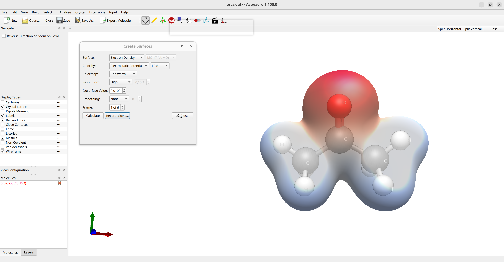
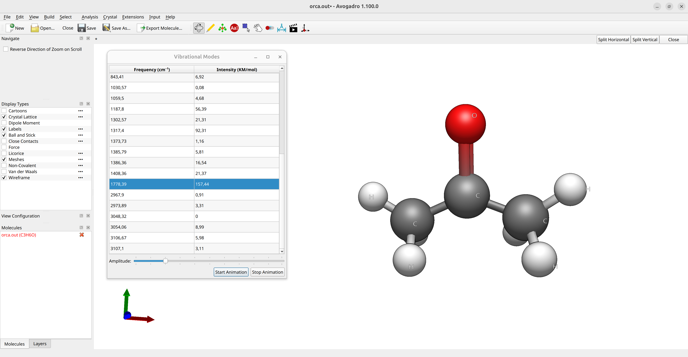

# 图形用户界面（GUI）

有多种程序可以读取 ORCA 输出文件。其中一些已被证明对 ORCA 输出可视化特别有用的程序有：

- [Avogadro 2](https://two.avogadro.cc/install/index.html)

> **警告**
> 本教程是使用 Avogadro 2 1.100.0 版本的 Linux AppImage 创建的！请确保您使用最新版本的 Avogadro 2，以保证兼容性！

- [ChimeraX](https://www.rbvi.ucsf.edu/chimerax/)（对于 ChimeraX，[SEQCROW 插件](https://github.com/QChASM/SEQCROW)非常有用。它可以从 `Tools/More Tools` 菜单下载。）
- [Avogadro](https://avogadro.cc)（ORCA 增强版）
- [Chemcraft](https://www.chemcraftprog.com/)
- [Gabedit](https://sites.google.com/site/allouchear/Home/gabedit/download)

借助这些程序，您可以可视化几何结构、电荷，绘制轨道、光谱等。

> **重要**
> 这些程序可能需要在输出中包含一些额外的打印选项（例如，为了生成轨道图）。在这种情况下，一种方法是在简单输入行中使用 `PRINTMOS` 和 `PRINTBASIS` 关键词：
>
>
> ```text
> !HF DEF2-SVP PRINTMOS PRINTBASIS
> ```
>
>
>
> 相应的打印设置也可以通过 `%output` 块来控制：
>
>
> ```text
> %output 
>    print[p_mos] 1
>    print[p_basis] 2
> end
> ```

由于 Avogadro 是最常用且通常免费提供的选项，我们将进一步重点介绍如何将 Avogadro 2 用作 ORCA 的图形用户界面。它可以用来搭建几何结构，甚至分析 ORCA 输出，而且 ORCA 团队开发了自己的版本，可以从 [ORCA 论坛](https://orcaforum.kofo.mpg.de/app.php/portal)下载（在 Windows 上可以通过 [Wine](https://www.winehq.org/) 使用）。不过，该版本在 ORCA 6 中已部分弃用！

> **警告**
> 不同版本的 Avogadro 之间的兼容性可能部分受限！

## 以 Avogadro 2 作为 GUI

### 绘制分子

打开 Avogadro 2 后，您会看到其主界面：


*图：Avogadro 2 的主界面。*

- 使用 `Draw` 工具（黄色铅笔符号），您可以绘制分子：左键单击创建原子，右键单击删除原子。
- 原子类型在 `Element` 下选择，`Adjust hydrogens` 勾选项可以自动修正分子的价态。
- `Navigation Tool` 可用于旋转分子，`Manipulation Tool`（白色手形符号）用于移动原子。
- 绘制出猜测结构后，点击选择 `Extensions`$\rightarrow$`Open Babel`$\rightarrow$`Optimize Geometry` 下拉工具来运行简单的分子力学（molecular mechanics）优化。

> **警告**
> Avogadro 2 中通过 `Extensions`$\rightarrow$`Optimize Geometry` 的另一个优化选项目前不可用！请按上述方式使用通过 Open Babel 的优化！

您可以通过 `Export Molecule...` 工具将几何结构保存为 `.xyz` 文件。

### 创建输入文件

绘制分子后，您可以使用 Avogadro 2 制作简单的 ORCA 输入文件。点击 `Input`$\rightarrow$`ORCA...`，将打开 ORCA 输入生成器窗口：


*图：在 Avogadro 2 中创建 ORCA 输入文件。*

在其中您可以选择所需的选项，并通过 `Save Input...` 保存输入文件。如果想生成轨道图，应勾选 `Print Molecular Orbitals` 复选框。

### 可视化输出

#### 轨道图

如果您使用 `!PRINTMOS` 和 `!PRINTBASIS`（或 ORCA 输入生成器中设置的轨道打印选项）运行了计算，并且[将输出保存到了文件](../first_steps/first_calc.md#output-to-file)，就可以通过在 Avogadro 中打开 `basename.out` 文件来可视化轨道。然后在 Molecular Orbitals 面板上选择要渲染的轨道，例如丙酮的 HOMO：


*图：Avogadro 2 中的分子轨道图。*

通过更改面板底部的 `Quality` 选项可以生成更高质量的图像。

> **提示**
> 如果轨道图像没有立即显示，请点击 `Render` 来生成图像。

#### 电子密度图

加载输出文件后，您也可以进入 `Analysis`$\rightarrow$`Create Surfaces...`。将出现一个新面板，您可以在其中选择 `Surface` 和 `Color by` 选项，将静电势（electrostatic potential，ESP）渲染到电子密度表面上：



*图：Avogadro 2 中的 ESP 图。*

这里蓝色表示正电荷，红色表示负电荷。您也可以随意更改这些表面的分辨率。

#### 振动模式与红外光谱

如果您的输出包含频率计算（参见[振动频率](../prop/freq.md#vibfreq)），例如通过在 Avogadro 2 的 ORCA 输入生成器中选择 `Calculation Type: Frequencies`，或简单地在简单输入行中添加 `FREQ` 关键词，那么在加载输出文件后可以对振动模式进行动画演示，并通过选择 `Analysis`$\rightarrow$`Vibrational Modes...` 绘制振动光谱（vibrational spectra）：



*动画：甲醛的振动模式。*

> **注意**
> [Chemcraft](https://chemcraftprog.com)、[ChimeraX](https://www.rbvi.ucsf.edu/chimerax/)（使用 SEQCROW 插件）和 [Gabedit](https://sites.google.com/site/allouchear/Home/gabedit/download) 软件也提供类似的功能。
