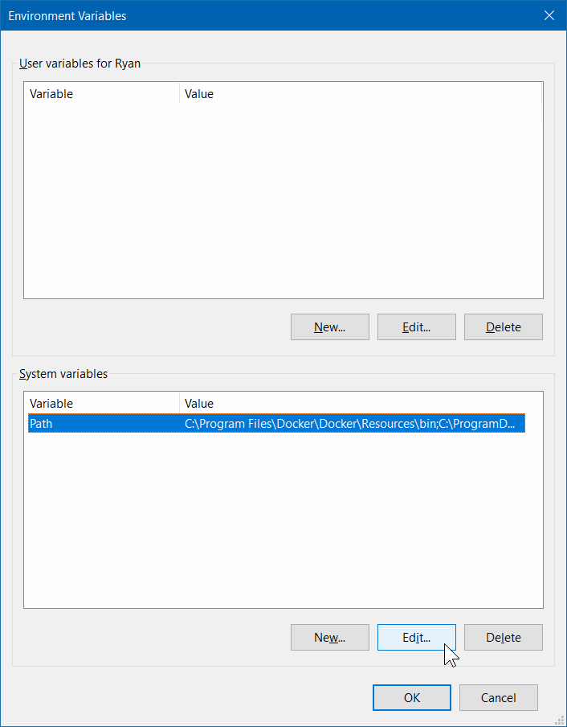

# 解决常见问题

## 修正文件名

如果您遇到如下错误：

```text
[file orca_main/run.cpp, line 9905]: Cannot open input file:
```

请检查您的文件类型，也许您调用的是 `input.inp`，但文件却被保存为 `input.inp.txt` 或其他名称。

在使用 Windows 时，我们建议使用 [Notepad++](https://notepad-plus-plus.org) 而不是普通的记事本（Notepad），以避免写入和读取时出现问题。

## 设置 PATH 变量

尝试运行 ORCA 时一个相当常见的初始错误来源是您的 PATH 变量未设置。PATH 和 LD_LIBRARY_PATH 是操作系统用来查找程序和库所在位置的变量。下面是一些关于如何正确设置它们的快速说明：

### Linux 和 MAC

输入以下命令，将正确的变量添加到 .bash_profile 文件中并 source 它。不会有任何输出，但如果一切正常，"orca" 现在就可以作为简单命令来调用了。

- **ORCA：**

```text
echo 'export PATH=path-to-ORCA:$PATH; export LD_LIBRARY_PATH=path-to-ORCA:$LD_LIBRARY_PATH'  >> ~/.bash_profile
source ~/.bash_profile
```

将 path-to-ORCA 替换为您系统上 orca 文件夹所在的位置，例如 /home/username/orca。

- **OpenMPI：**

```text
echo 'export PATH=path-to-MPI/bin:$PATH; export LD_LIBRARY_PATH=/path-to-MPI/lib:$LD_LIBRARY_PATH'  >> ~/.bash_profile
source ~/.bash_profile
```

将 path-to-MPI 替换为您系统上 OpenMPI 文件夹所在的位置，例如 /home/username/openmpi。

> **注意**
> MAC 安装程序默认将 ORCA 安装在 `/Users/<username>/Library/Orca/`。

### Windows 10

- **ORCA：** > Windows 安装程序会将 ORCA 文件夹放在 C:\orca，您需要在那里设置 PATH 才能找到它。具体操作请按照以下步骤进行： > > > 1. 点击搜索按钮或按 Windows/Super 键并输入 "PATH"：[](../images/path_1.png) > 2. 点击 "Environment Variables..." 按钮：[](../images/path_2.png) > 3. 找到 "Path" 所在的行并点击编辑：[](../images/path_3.png) > 4. 将打开一个新窗口，在其中点击 "New" 并添加 "C:\orca"：[](../images/path_4.png) > 5. 点击 OK，更改即被保存。现在在命令提示符中输入 "orca"，看看程序是否被调用（如果没有输入文件会返回错误消息）。
- **OpenMPI：** > 您可以按照 [ORCA 手册](https://www.faccts.de/docs/orca/6.0/manual)或 [OpenMPI](https://www.open-mpi.org/) 的说明进行安装。最好的解决方案或许是使用 [Cygwin](https://cygwin.com) 来模拟 Linux 环境并从中运行。 > > > > **重要** > > 不要忘记按照上述相同说明设置 PATH 和 LD_LIBRARY_PATH。

## 使用 OpenMPI

不要试图像其他软件那样运行：

```text
mpirun -np 4 orca
```

如果您设置了 [!PAL](../first_steps/parallel.md) 关键词，ORCA 会自行处理。

## 旧文件导致的错误

有时计算失败是因为文件夹中存在上一次 orca 运行留下的文件，orca 会尝试读取它们，但实际上您只是想开始一个全新的计算，因此必须事先手动删除这些文件！

## 仍然有问题？

- 检查 PATH 变量是否设置正确。
- 检查文件名是否正确。
- 前往 [ORCA 论坛](https://orcaforum.kofo.mpg.de)，查看以往的主题并提出您的问题 😉！
