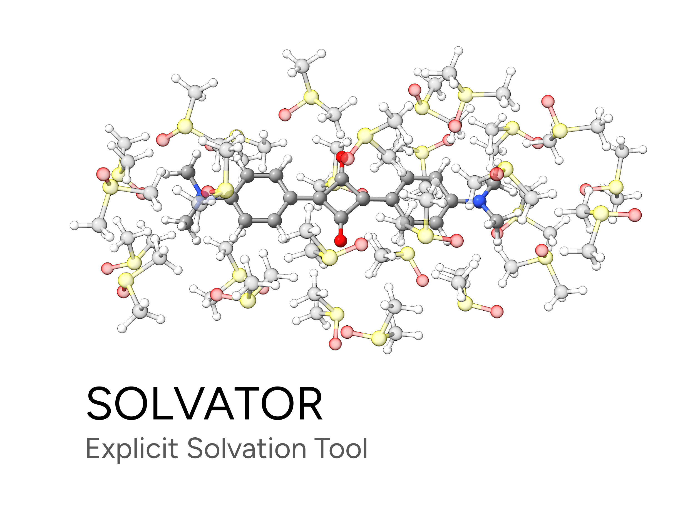
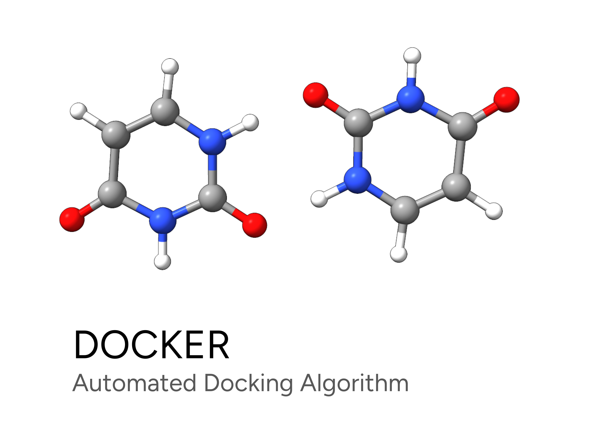

# ORCA 6.1 教程

在这里你可以找到关于如何使用 ORCA 进行计算的教程。这些教程面向新用户以及希望了解分子建模（molecular modeling）基础知识的读者。

如需更详细的文档，请参阅 [ORCA 手册](https://www.faccts.de/docs/orca/6.1/manual)。我们也推荐加入 [ORCA 论坛](https://orcaforum.kofo.mpg.de/app.php/portal)，
你可以在那里获得关于个别问题和已知问题的帮助。

## 亮点

## 入门

一些非常基础的信息。如果你以前从未使用过 ORCA，也许最好从这里开始，否则你可以直接跳过并进入后续章节。

- **如何开始？** [安装 ORCA](first_steps/install.md) | [Hello water！你的第一个 ORCA 计算](first_steps/first_calc.md)
- **如何处理文件？** [输入与输出](first_steps/input_output.md)
- **想更快一些？** [并行运行计算](first_steps/parallel.md)
- **需要可视化帮助？** [图形用户界面（GUI）](first_steps/GUI.md)
- **遇到问题？** [解决常见问题](first_steps/trouble_install.md)

性质（PROPERTIES）

- [单点能](prop/single_point.md)
- [几何优化](prop/geoopt.md)
- [振动频率](prop/freq.md)
- [热力学](prop/thermo.md)
- [隐式溶剂化模型](prop/cpcm.md)
- [显式溶剂化（SOLVATOR）](prop/solvator.md)
- [构象搜索（GOAT）](prop/goat.md)
- [相对论校正](prop/relativistic.md)
- [色散校正](prop/disp.md)
- [化学键分析](prop/bonds.md)
- [局域能量分解（LED）](prop/led.md)
- [分数占据密度（FOD）](prop/fod.md)
- [电荷模型](prop/charges.md)
- [静电势（ESP）](prop/esp.md)

反应性（Reactivity）

- [用 NEB-TS 寻找过渡态](react/nebts.md)
- [过渡态优化](react/tsopt.md)
- [过渡态构象](react/tsconf.md)
- [内禀反应坐标（IRC）](react/irc.md)
- [计算精确的能垒](react/actibar.md)
- [动力学同位素效应（KIE）](react/KIE.md)
- [绘制 Fukui 函数](react/FUKUI.md)
- [自动对接（DOCKER）](react/docker.md)

光谱（Spectroscopy）

- [红外与拉曼](spec/IR.md)
- [紫外-可见光谱（UV/Vis）](spec/UVVis.md)
- [电子圆二色（ECD）](spec/ECD.md)
- [振动圆二色（VCD）](spec/vcd.md)
- [核磁共振（NMR）](spec/NMR.md)
- [电子顺磁共振（EPR）](spec/EPR.md)
- [自旋-轨道耦合](spec/SOC.md)

多尺度方法（Multiscale methods）

- [多尺度模型入门 - QM/XTB ONIOM](multi/basics.md)
- [超越 QM/XTB 的 ONIOM 方法](multi/basics-otheroniom.md)
- [用于过渡态的多尺度 NEB-TS](multi/oniom-nebts.md)
- [离子晶体 QM/MM](multi/ionic_crystal.md)
- [自动分片](multi/fragmentator.md)

附录（Appendix）

- [索引](genindex.md)
