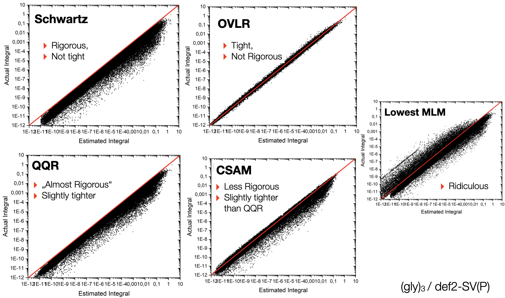
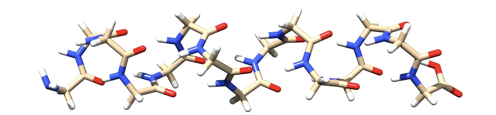
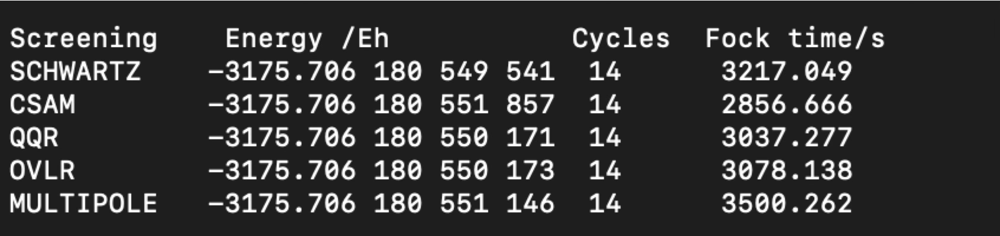

<a id="sec:essentialelements.integralhandling"></a>
# 积分处理（Integral Handling）

由于非零积分的数目增长非常快，在中等大小的分子中使用中等大小的基组时
就很容易达到数亿之多，因此存储所有积分通常是不可行的。这一困境曾长期
阻碍了较大分子的 SCF 计算，于是 Almlöf
[almloef1982comp,almloef1984advanced,almloef1995modern](../../bibliography.md) 提出了一个
富有洞见的建议：在*每一次 SCF 循环*中重复积分计算——这一步本来就是
主要开销——以解决存储问题。天真地看，人们会以为这将使计算工作量增加到
$n_{\text{iter} }t_{\text{integrals} }$（其中 $n_{\text{iter} }$ 是迭代次数，
$t_{\text{integrals} }$ 是生成非零积分所需的时间）。然而事实并非如此，
因为从一次迭代到下一次只需要 Fock 矩阵（Fock matrix）的*变化量*，
而不需要 Fock 矩阵本身。随着计算开始收敛，越来越多的积分可以被跳过。
积分计算时间仍会相当强烈地主导整个计算，因此显然需要设法减轻这一负担。
由于积分是按*批*（batch）[^1]计算的，给定壳层 $p, q, r, s$ 这一批的
求值代价可估计为：

$$
\text{cost}\approx n_{p} n_{q} n_{r} n_{s} \left({ 2l_{p} +1} \right)\left({ 2l_{q}
+1} \right)\left({ 2l_{r} +1} \right)\left({ 2l_{s} +1} \right)\qquad \text{(eqn:51)}
$$

这里 $n_{p}$ 是壳层 $p$ 所含的本原函数（primitives）数目，$l_{p}$ 是
该壳层的角动量。*大*积分也适合存储，因为与大积分相乘的密度的微小变化
很可能对 Fock 矩阵的变化给出非零贡献。

因此 ORCA 提供了两种积分处理方式，由变量 `SCFMode` 控制。在
`Conventional`（常规）模式下，所有高于给定阈值的积分都存储在磁盘上
（采用节省大量磁盘空间的压缩格式）。在 `Direct`（直接）模式下，
所有双电子积分都在每次迭代中重新计算。

另外两个变量也很重要：在 `Conventional` 模式下，程序可能向磁盘写入
海量数据。为确保这不超出限度，程序会先执行一次所谓的"统计运行"
（statistics run），对积分文件将有多大给出一个悲观的估计。
程序往往会把所需磁盘空间高估两倍或更多。允许积分文件占用的最大磁盘
空间由 `MaxDisk`（以兆字节计）给出。

另一方面，如果 `Conventional` 运行中的积分文件足够小、能够放进主内存，
这样做会更快，因为它避免了 I/O 瓶颈。以这种方式为积分分配的最大内存量
由 `MaxIntMem`（以兆字节计）指定。如果积分文件大于 `MaxIntMem`，
则不会把任何积分读入内存。

```orca
%scf
  MaxIter   100    # Max. no. of SCF iterations
  SCFMode Direct   # default, other choice: Conventional
  Thresh  1e-8     # Threshold for neglecting integrals / Fock matrix contributions
                   # Depends on the chosen convergence tolerance (in Eh).
  TCut    1e-10    # Threshold for neglecting primitive batches. If the prefactor
                   # in the integral is smaller than TCut, the contribution of the
                   # primitive batch to the total batch is neglected.
  DirectResetFreq 20   # default: 15
  MaxDisk  2500        # Max. amount of disk for 2 el. ints. (MB)
  MaxIntMem 400        # Max. amount of RAM for 2 el. ints. (MB)
end
```

`DirectResetFreq` 的值设定在 `Direct` SCF 计算中，程序在进行多少次增量
Fock 矩阵构建之后应执行一次完整的 Fock 矩阵构建。为防止递归构建的
Fock 矩阵中累积误差引起的数值不稳定，该值不应太大，否则会不利地影响
SCF 收敛。如果该值太小，程序会更频繁地更新，但计算将耗时明显更长，
因为完整的 Fock 矩阵构建比递归构建更昂贵。

阈值 `TCut` 和 `Thresh` 也值得更仔细地解释。`Thresh` 是决定何时忽略
双电子积分的阈值。如果给定积分小于 `Thresh` Eh，它将不被存储，
也不被用于 Fock 矩阵构建。此外，在 `Direct` SCF 中，小于 `Thresh` Eh
的 Fock 矩阵贡献也不会被计算。

显然，先计算一个积分、再发现它毫无用处因而丢弃，是很浪费的。
一个有用的特性是：能在积分*甚至尚未计算之前*就高效地估计其大小，
甚至给出一个作为该积分取值*严格上界*（rigorous upper bound）的估计。
Häser 和 Ahlrichs [haeser1989comp](../../bibliography.md) 最先认识到这样的上界其实
相当容易计算。他们证明了：

$$
\left|{ \left\langle { ij\left|{ kl} \right.} \right\rangle}
\right|\leq slant \sqrt{ \left\langle { ij\left|{ ij} \right.} \right\rangle}
\sqrt{ \left\langle { kl\left|{ kl} \right.} \right\rangle}\qquad \text{(eqn:52)}
$$

其中：

$$
\left\langle { ij\left|{ kl} \right.} \right\rangle=\in t{ \in t{ \phi_{i}
\left({ \vec{{r} }_{1} } \right)\phi_{j} \left({ \vec{{r} }_{1} }
\right)r_{12}^{-1} \phi_{k} \left({ \vec{{r} }_{2} } \right)\phi_{l} \left({\vec{{r} }_{2} } \right)d\vec{{r} }_{1} d\vec{{r} }_{2} } }\qquad \text{(eqn:53)}
$$

因此，要计算该积分的上界，只需知道这个方程的右端。它只涉及双指标量，
即双中心交换积分（two center exchange integrals）
$\left\langle { ij\left|{ ij} \right.} \right\rangle$ 的矩阵。这些积分
易于快速计算，而且全都 $\geq slant$0，因此开平方不成问题。
于是人们就有了一种避免计算小积分的强大手段。在实际计算中，
Schwartz 预筛选（Schwartz prescreening）不是在单个基函数的层面上使用，
而是在壳层批的层面上使用，因为积分总是按批计算的。为此，要找出给定
交换积分块中最大的交换积分，并把它的平方根存入所谓的*预筛选*
（pre-screening）矩阵 **K** 中（在 ORCA 中该矩阵存于磁盘）。
在 `Direct` SCF 中，该矩阵不在每个循环中重新计算，而是在需要时简单地
从磁盘读取。单个基函数层面上的交换积分矩阵在 `Conventional` 计算中
用于估计磁盘需求（即"统计"运行）。

一旦确定某个积分批能够"存活"，它就可以按下式计算：

$$
\left\langle { ij\left|{ kl} \right.} \right\rangle=\sum\limits_p { d_{pi}
\sum\limits_q { d_{qj} \sum\limits_r { d_{kr} \sum\limits_s { d_{sl}
\left\langle { i_{p} j_{q} \left|{ k_{r} l_{s} } \right.} \right\rangle} } }
}\qquad \text{(eqn:54)}
$$

其中求和 $p,q,r,s$ 遍历每个基函数 $i,j,k,l$ 中的本原 Gaussian，
$d$ 是收缩系数。ORCA 中也使用比这更强大的算法。不过，如果求和中
许多项可以跳过且总角动量较低，用这种直接方式计算收缩积分仍是值得的。
在公式 [Eq](#eqn:54) 中，每个本原积分批
$\left\langle { i_{p} j_{q} \left|{ k_{r} l_{s} } \right.} \right\rangle$
都含有一个前因子 $I_{Gaussians}$，它依赖于四个 Gaussian 的位置及其
轨道指数。由于收缩 Gaussian 的轨道指数通常分布范围相当宽，
显然这些本原积分批中有许多对最终积分值的贡献可以忽略。为减少开销，
引入了参数 `TCut`。如果公共前因子 $I_{pqrs}$ 小于 `TCut`，
就跳过该本原积分批。不过 $I_{pqrs}$ 并*不是*本原积分真实值的严格上界。
因此对 `TCut` 必须比对 `Thresh` 更保守。实践中发现选择
`TCut=0.01*Thresh` 能提供足够的精度，但如果怀疑积分所达到的精度不足，
建议用户自行确定 `TCut` 的影响。

!!! note "提示"
    -   如果直接 SCF 计算接近收敛却始终不能最终收敛，这可能与 Fock 矩阵
        更新流程的数值问题有关——更新过程累积的数值噪声阻碍了锐利收敛。
        这种情况下，请把 `Thresh` 和 `TCut` 调低，和/或让计算更频繁地
        重置 Fock 矩阵（`DirectResetFreq`）。

!!! note "注意"
    -   对于 `Direct` 计算，`Thresh` 不可能大于 `TolE`。如果 Fock 矩阵中
        的误差大于所请求的能量收敛判据，能量变化就永远无法达到 `TolE`。
        程序会对此进行检查。

    -   *所有*临时文件实际占用的磁盘空间可能轻松超过 `MaxDisk`。
        `MaxDisk` 只涉及双电子积分文件。其他磁盘需求目前程序不做检查，
        且看来并不关键。

[^1]: *批*（batch）是指由积分所涉及壳层的所有分量产生的一组积分。
    例如，一个 $\left\langle pp|pp \right\rangle$ 批由于四个壳层中
    $p_{x}$、$p_{y}$ 和 $p_{z}$ 函数的所有可能组合，
    会产生 $3 \times 3\times 3 \times 3 = 81$ 个积分。基于批的计算
    带来巨大的计算优势，因为 $\left\langle pp|pp \right\rangle$ 批中
    涉及的 81 个积分共享许多公共的中间量。

<a id="sec:essentialelements.integralhandling.compression"></a>
## 压缩与存储

数据压缩和存储选项值得稍作说明：在包括 RI-MP2、MDCI、CIS、
CIS 的 (D) 校正等在内的若干模块中，程序使用所谓的"矩阵容器"
（Matrix Containers）。这意味着待处理的数据以矩阵形式存储在文件中，
并通过双标签访问。一个典型的例子是交换算符
**K$^{ij }$**，其矩阵元为 $K^{ij}(a,b)=(ia|jb)$。
这里指标 $i$ 和 $j$ 指参考态的占据轨道，$a$ 和 $b$ 是参考态的空轨道。
这类数据可能变得相当大（形式上为 $N^4$ 标度）。以单精度存储数字可把
内存需求降低一半，而精度损失（通常）很小。对于较大的体系，
通过同时压缩数据（例如在磁盘上使用"打包"存储格式）也可能获得好处。
该选项会带来额外的打包/解包工作，增加一些开销。控制这一行为的简单
关键词见 [tab:essentialelements.integralhandling.keywords.simple](#tab:essentialelements.integralhandling.keywords.simple)。
对于小分子，`UCDOUBLE` 可能是最好的选择；而对于较大的分子，
`UCFLOAT` 或尤其是 `CFLOAT` 可能是最佳选择。对于较大的体系，
压缩并不一定会使计算变慢，因为总 I/O 负载可能大幅降低，
从而（由于 CPU 比磁盘快得多）打包和解包所花的时间比读取大得多的文件
还少（打包对较大体系可将磁盘需求降低约 4 倍，但迄今尚未做广泛测试）。
在这种情况下，有许多因素影响总的墙钟时间，包括系统的总负载。
因此可能需要一些试验才能确定程序用哪一组选项运行得最快。

!!! warning "警告"
    - `FLOAT` 可能导致不可接受的误差。因此在计算 MP2 或 RI-MP2 梯度
      或弛豫密度时，不推荐使用该选项。正因如此，默认值是 DOUBLE。
    - 如果你已确信 `FLOAT` 没问题，它可能在存储和 CPU 上都为你节省一半。

<a id="sec:essentialelements.integralhandling.prescreening"></a>
## 距离相关预筛选（Distance Dependent Pre-Screening）

"Direct" SCF 流程包括在每次 SCF 迭代中重新计算电子-电子排斥积分。
避免存储这些积分正是使大分子 SCF 计算成为可能的原因，因而是现代量子
化学的基石。只有在计算前就避开小到可忽略的积分，重算才能在合理的周转
时间内完成。因此，需要有一个计算代价合理低廉的积分估计，供程序依赖以
避免实际的积分计算。这就是预筛选（pre-screening）这一重要主题。
预筛选把待计算的积分数目从 O(N$^4$)（精确积分）或 O(N$^3$)（RI 积分）
降到 O(N$^2$)，因为在大分子中只有 O(N) 个显著的电荷分布（charge
distributions）。当然，如果积分估计能给出实际积分的严格上界就更好，
因为这样就能保证不会漏掉任何超过预设精度阈值的 Fock 或 Kohn-Sham
矩阵贡献。

迄今为止最流行的积分估计是 Häser 和 Ahlrichs 引入的 Schwartz 估计
（Schwartz estimator）：

$$
\left| (\mu\nu|\kappa\tau) \right|_{Schwartz} \leq \sqrt{\left( \mu\nu|\mu\nu \right)}\sqrt{\left( \kappa\tau|\kappa\tau \right)}
$$

因此，计算这一估计只需预筛选矩阵

$$
Q_{\mu\nu} = \sqrt{\left( \mu\nu|\mu\nu \right)}
$$

它计算廉价且不消耗内存。我们顺带指出，由于积分是涉及四个壳层按批计算的，
预筛选矩阵也是壳层收缩的，即取两个壳层各成员中的最大元作为实际的
预筛选元。推广到 RI 积分是平凡的，因此这里不再写出。

Schwartz 估计几乎用在每一个量子化学程序中。尽管它很成功，也有缺点。
通过考察给定电荷分布 $\mu\nu$ 具有多极结构（multipole structure），
这些缺点最容易理解。在足够远的距离上，分布 $\mu\nu$ 与 $\kappa\tau$
之间的相互作用因此具有依赖于两个分布多极结构的距离依赖性。
例如，单极-单极（monopole-monopole）相互作用按 R$^{-1}$ 衰减
（R 是两个分布中心之间的距离），偶极-偶极（dipole-dipole）相互作用
按 R$^{-3}$ 衰减，等等。显然，Schwartz 估计中没有距离依赖性，
因此它倾向于严重高估那些涉及不可忽略但相距较远的电荷分布的积分。

<a id="fig:integralhandling.distdepprescrI1"></a>


*演示 Schwartz 估计如何严重高估积分。红色轨迹是 Schwartz 估计，
黑色轨迹是两个单中心 fs 电荷分布的实际相互作用随距离的变化。*

历史上，在直接 SCF 的早期，另一种相关的估计曾很流行。
这就是重叠估计（overlap estimator，OVLR 估计）。考虑双电子积分：

$$
\left( \mu\nu \mid dle| \kappa\tau \right) = \in t_{}^{}{\in t_{}^{}{\frac{\mu(r_{1})\nu(r_{1})\kappa(r_{2})\tau(r_{2})}{\left| r_{1} - r_{2} \right|}dr_{1}dr_{2}}}
$$

并假设我们可以用两个电荷分布之间的有效距离来代替电子间距离的倒数：

$$
\left| r_{1} - r_{2} \right| \rightarrow R_{eff}
$$

在这种情况下，积分就简单地变为：

$$
\left( \mu\nu \mid dle| \kappa\tau \right) = \frac{S_{\mu\nu}S_{\kappa\tau}}{R_{eff}}
$$

其中 S 是重叠积分（overlap integral）。该估计随后通过取所涉壳层各成员
中重叠矩阵元的最大绝对值得到。

$$
\left| (\mu\nu|\kappa\tau) \right|_{OVLR} = \frac{{\widetilde{S}}_{\mu\nu}{\widetilde{S}}_{\kappa\tau}}{R_{eff}}
$$

有效距离为：

$$
R_{eff} = R_{\mu\nu,\kappa\tau} - {ext}_{\mu\nu} - {ext}_{\mu\nu,\kappa\tau}
$$

当满足

$$
R_{eff} > 1
$$

时应用该估计，否则退回 Schwartz 估计。在这个方程中
$R_{\mu\nu,\kappa\tau} = \left| R_{\mu\nu} - R_{\kappa\tau} \right|$
是两个电荷分布中心之间的距离
（$R_{\mu\nu} = \left\langle \mu \vee r \vee \nu \right\rangle$），
${ext}_{\mu\nu}$ 是电荷分布的范围（extent），在多极近似
（multipole approximations）一节中有详细讨论。简言之，
${ext}_{\mu\nu}$ 定义了一个半径，在该半径之外乘积 $\mu(r)\nu(r)$ 为零。
因此，条件 $R_{eff} > 1$ 就是多极可用性判据。若满足它，
电荷分布互不重叠，多极估计是收敛的。

基于这一认识，Ochsenfeld 及其同事开发了一系列旨在考虑这种距离依赖性的
积分估计。在最初的工作中，Lambrecht 和 Ochsenfeld 对电荷分布的多极结构
给出了简明的分析。经过一些试验后，他们最终提出 **QQR 估计**
（QQR-estimator），它在计算代价与消除小贡献的效率之间是一个很好的折中：

$$
\left| (\mu\nu|\kappa\tau) \right|_{QQR} = \frac{Q_{\mu\nu}Q_{\kappa\tau}}{R_{eff}}
$$

如上所述，当 $R_{eff} > 1$ 时应用。这一估计并非完全严格，但仍非常安全，
因为它假设两个电荷分布上具有单极矩。这里用 Schwartz 积分代替重叠积分，
以模拟电荷分布的多极结构。

由于经验表明 QQR 估计消除的积分并不比 Schwartz 估计多多少，
Thomson 和 Ochsenfeld 提出了一种改进的估计，他们称之为 "CSAM"。
它由下式给出：

$$
\left| (\mu\nu|\kappa\tau) \right|_{CSAM} = Q_{\mu\nu}Q_{\kappa\tau}\max\left( T_{\mu\kappa}T_{\nu\tau},T_{\mu\tau}T_{\nu\kappa} \right)
$$

其中 T 矩阵元是双中心 Coulomb 预筛选积分的壳层最大值：

$$
T_{\mu\kappa} = \frac{\sqrt{(\mu\mu|\kappa\kappa)}}{\sqrt{Q_{\mu\mu}Q_{\kappa\kappa}}}
$$

T 因子带来了被估计积分的距离依赖性。

最后，还有一种考虑每个电荷分布最低多极矩的多极估计
（multipole estimator）。

$$
\left| (\mu\nu|\kappa\tau) \right|_{multipole} = max\left( \frac{M_{Lmin,m}^{\mu\nu}M_{Lmin',m'}^{\kappa\tau}}{R^{Lmin + Lmin^{'} + 1}} \right)
$$

关于这些估计紧致程度的某些概念可以从下图看出：

<a id="fig:integralhandling.distdepprescrI2"></a>


*模型体系（glycine)$_3$ 在 def2-SVP 基组下各种积分估计的紧致程度。*

可以看到 Schwartz 估计是严格的，QQR 估计几乎严格但并不紧致多少。
OVLR 估计似乎是迄今为止最紧致的估计，但其值在正确值上下均匀散布。
CSAM 会导致积分值被低估一些，且似乎比 QQR 略紧。最低多极估计则很离谱，
质量不可用。

改进后的估计是否带来实际的计算节省，可以从（glycine)$_{15}$/def2-SVP
的模型计算中看出：

<a id="fig:integralhandling.distdepprescrI3"></a>



*在不同积分估计影响下（glycine)$_{15}$ 的实际计算时间与总 Hartree-Fock 能量。*

结果表明，只有 CSAM 带来约 10% 量级的节省，尽管代价是损失了一些精度
（在本例中约为 0.01 微 Eh）。节省有限的根源肯定与以下事实有关：
双中心电荷分布的最低多极矩等于两个分布之间的重叠积分。因此，
一旦两个基函数有重叠，它们就会有单极矩，而两个这样的电荷分布之间
相互作用的衰减仅为 R^-1^，衰减如此之慢，以至于在消除小积分方面
没有实际意义。

以下输入触发不同的估计：

```orca
%shark Prescreening Schwartz
 OVLR
 QQR
 CSAM
 Multipole
End
```

!!! note "注意"
    -   实践中 OVLR 和 Multipole 极不稳定，不推荐使用
    -   这些积分估计对 RI 积分尚不可用。

**相关论文（Relevant Papers）：**

1. [haeserahlrichsJCompChem1989](../../bibliography.md)
2. [LambrechtOchsenfeldJCP2005](../../bibliography.md)
3. [ThompsonOchsenfeldJCP2017](../../bibliography.md)

<a id="sec:essentialelements.integralhandling.bubblepole"></a>
## "BubblePole" 近似

ORCA 中 Fock 矩阵构建的算法已经优化到这样的程度：COSX 近似的标度
随体系大小呈线性，XC 积分也是如此。因此在非常大的体系中，
渐近地看是 Coulomb 项的二次标度主导着 Fock 矩阵的构建时间。
众所周知，把分层多极近似（hierarchical multipole approximations）
引入积分，可以把 Coulomb 项的标度降到线性或近线性。这就是快速多极法
（fast multipole method, FMM）近似的主题。FMM 近似已被引入 ORCA，
用于计算嵌入（embedding）计算中点电荷的贡献，并显著降低了执行时间。

虽然把 FMM 近似也引入量子-量子电荷相互作用看似诱人，
但 ORCA 的开发者走了另一条路。在 FMM 算法中，实空间被划分为分层的
盒子（boxes），然后在满足多极可用性判据的前提下计算盒子之间的
多极相互作用。

尽管多位作者已证明它可行，但在我们看来，装盒算法对化学而言并不十分自然，
并会带来一系列问题，我们希望在替代性的开发中避免这些问题。

Bubblepole（BUPO）近似基于一种不同的划分方式，它基于球体（"气泡"，
Bubbles）。这些气泡完全包住"量子对象"（quantum objects）的集合。
这些量子对象可以是壳层对、辅助基函数壳层，也可以是点电荷。
把若干这样的对象归为一组的判据是空间上的邻近性。由于壳层对和辅助壳层
是电荷分布，它们具有空间范围，在分组组装算法中必须加以考虑。
以壳层对为例，每个存活的壳层被赋予一个壳层对中心 $R_{\mu\nu}$
和一个范围 ${ext}_{\mu\nu}$。这些量的精确定义是 ORCA 所独有的，
文献中有充分讨论。

BUPO 算法随后使用 Kmeans 算法的一个变体，把预定义数量的对象
（例如 150 个）归入每个"底层"气泡。气泡中心是所有被包住对象的
算术平均值，气泡半径则调整到连同其范围一起把所有对象完全包住。
这确保了概率密度不会"泄漏"到每个气泡之外。

设置好底层气泡后，就创建一个气泡层级（bubble hierarchy），
其中多极矩从一个气泡层平移到下一层。超级气泡（super-bubbles）
包含较低层的气泡（通常约三个），直到顶层只剩下一个包住整个分子的
气泡。这在体系设置期间只发生一次。

在目前的 ORCA 实现中，BUPO 算法与 ORCA 最高效的 Coulomb 构建算法
——Split-RI-J 算法——相结合。在所得的 RI-BUPO-J 算法中，
近场用 Split-RI-J 方法处理，远场用分层构建处理。RI-J 方法一般包含
三个重要步骤

把密度"投影"到辅助基组上：

$$
g_{K} = \sum_{\mu\nu}^{}{P_{\mu\nu}\left( \mu\nu|K \right)}
$$

求解线性方程组得到辅助基密度：

$$
P_{K} = \sum_{L}^{}{\left( V^{- 1} \right)_{KL}g_{L}}
$$

组装 Coulomb 矩阵：

$$
J_{\mu\nu} = \sum_{K}^{}{P_{K}\left( \mu\nu|K \right)}
$$

第二步在计算上可以忽略，通过 Cholesky 分解（Cholesky decomposition）
进行得非常高效。它不是线性标度，但比其他步骤便宜约三到四个数量级，
因此对所有可处理的体系大小都无关紧要。在第一步中，多极近似被应用于
轨道基中的密度，因此气泡包含基组中的壳层对以及由在该基组中展开的
分子密度导出的多极矩。在第三步中，气泡包含辅助基壳层对以及由辅助基
密度导出的多极矩。由此构建产生的微妙之处在原始文献中有详细讨论。

数值结果表明，RI-BUPO-J 随体系大小渐近地呈线性标度。对于线性链，
与 Split-RI-J 算法的交叉点出现在大约 30–40 个甘氨酸单元处。
在三维体系中，这会明显更晚。因此，RI-BUPO/J 算法相对于 Split-RI-J
的真正优势只会在非常大的体系中出现。这并非 BUPO 构建的缺点，
而是 Split-RI-J 卓越效率的明证。

<a id="fig:integralhandling.distdepprescrI5"></a>


*常规 RI-J 算法、Split-RI-J 和 RI-BUPO-J 在线性甘氨酸链上的数值结果，
所用基组的质量依次提高。*

BUPO 有相当多的选项。不过我们*不*推荐更改默认值。这是专家领域。

```orca
Simple Keyword line:

! RI-BUPO/J

Detailed parameter definitions: 

%shark ExtentOpt Ext_SemiNumeric. # default: how to calculate the extents
Ext_analytic
Ext_Numeric
TSphere 1e-15     # shell pair extent cut-off
MP_LAbsMax_BAS 32 # Max L allowed in BAS multipoles
MP_LAbsMin_BAS 0  # Min L allowed in BAS multipoles
MP_Lmax_BAS 10    # Bottom level expansion length
MP_Lincr_BAS 4    # Expansion length increase for
                  # subsequent bubble levels
MP_Rallow_BAS 1.0 # Far field met if effective bubble
                  # distance larger than this (Bohrs)
MP_TScreen_BAS 1e-10  # Multipole elimination threshold
MP_ClusterDim_BAS 150 # Number of objects bottom level bubble
MP_ClusterDim2_BAS 3  # Number of bubbles in super-bubble
                      # in higher level of the hierarchy
MP_NLevels_BAS 15     # Max number of bubble levels in the
                      # hierarchy
# these parameters apply to the first step of RI-BUPO-J
# the same variables exist w.r.t. the auxbasis using the
# postfix \_AUX and apply to the second step of RI-BUPO-J
End
```

**相关论文（Relevant Papers）：**

1. [WHITE19948](../../bibliography.md)
2. [colinet2025fmm](../../bibliography.md)
3. [neese2025bupo](../../bibliography.md)

<a id="sec:essentialelements.integralhandling.angmomlimits"></a>
## 角动量上限（Angular Momentum Limits）

ORCA 现在（从 ORCA 6.1 开始）可以在轨道基组和辅助基组中做到 L=10 的
能量和梯度计算。注意命名法已改为公认的光谱学记号（spectroscopic
notation）：

| L=0  |  1  |  2  |  3  |  4  |  5  |  6  |  7  |  8  |  9  |  10 |
|------|-----|-----|-----|-----|-----|-----|-----|-----|-----|-----|
| S    |  P  |  D  |  F  |  G  |  H  |  I  |  K  |  L  |  M  |  N  |

!!! note "注意"
    -   没有 j 函数！程序会拒绝它。
    -   由于历史原因，L 被保留给 s、p 组合壳层。如果你想输入 L=8 的函数，
        只需使用符号 "8" 而不是 "L"

下面是在用户自定义基组的例子中如何使用角动量定义的示例：

```mol
title: structure 1
theme: chem311
height: 320px
representation: ball-stick
--- xyz ---
1
structure (0 1)
Ne            0            0            0
--- input ---
! RHF cc-pV6Z VeryTightSCF PrintBasis PModel
%basis

# Basis set for element : Ne
NewGTO Ne
S 11
  1 902400.0000000000 0.0000064569
  2 135100.0000000000 0.0000501790
  3 30750.0000000000 0.0002638325
  4 8710.0000000000 0.0011134543
  5 2842.0000000000 0.0040396234
  6 1026.0000000000 0.0130374676
  7 400.1000000000 0.0377405416
  8 165.9000000000 0.0967943419
  9 72.2100000000 0.2108241400
 10 32.6600000000 0.3586501519
 11 15.2200000000 0.3985795167
S 11
  1 902400.0000000000 -0.0000045125
  2 135100.0000000000 -0.0000351554
  3 30750.0000000000 -0.0001851517
  4 8710.0000000000 -0.0007804845
  5 2842.0000000000 -0.0028452422
  6 1026.0000000000 -0.0092079116
  7 400.1000000000 -0.0271417038
  8 165.9000000000 -0.0715447701
  9 72.2100000000 -0.1678190251
 10 32.6600000000 -0.3267206864
 11 15.2200000000 -0.4994236511
S 1
  1 7.1490000000 1.0000000000
S 1
  1 2.9570000000 1.0000000000
S 1
  1 1.3350000000 1.0000000000
S 1
  1 0.5816000000 1.0000000000
S 1
  1 0.2463000000 1.0000000000
P 5
  1 815.6000000000 0.0014608751
  2 193.3000000000 0.0126013201
  3 62.6000000000 0.0668956161
  4 23.6100000000 0.2559896696
  5 9.7620000000 0.7470043852
P 1
  1 4.2810000000 1.0000000000
P 1
  1 1.9150000000 1.0000000000
P 1
  1 0.8476000000 1.0000000000
P 1
  1 0.3660000000 1.0000000000
P 1
  1 0.1510000000 1.0000000000
D 1
  1 13.3170000000 1.0000000000
D 1
  1 5.8030000000 1.0000000000
D 1
  1 2.5290000000 1.0000000000
D 1
  1 1.1020000000 1.0000000000
D 1
  1 0.4800000000 1.0000000000
F 1
  1 10.3560000000 1.0000000000
F 1
  1 4.5380000000 1.0000000000
F 1
  1 1.9890000000 1.0000000000
F 1
  1 0.8710000000 1.0000000000
G 1
  1 8.3450000000 1.0000000000
G 1
  1 3.4170000000 1.0000000000
G 1
  1 1.3990000000 1.0000000000
H 1
  1 6.5190000000 1.0000000000
H 1
  1 2.4470000000 1.0000000000
I 1
  1 4.4890000000 1.0000000000
K 1
  1 3.0000000000 1.0000000000
# This would be L, but we cannot use the letter L
# because this is used for combined S-P shells
  8 1
  1 3.5000000000 1.0000000000
  M 1
1 2.0000000000 1.0000000000
  N 1
1 1.0000000000 1.0000000000
 end;
end

%shark FockFlag Force_SHARK
       end

* xyz 0 1
Ne 0 0 0
*
```

<a id="sec:essentialelements.integralhandling.keywords"></a>
## 关键词

<a id="tab:essentialelements.integralhandling.keywords.simple"></a>
!!! note "与积分处理相关的简单输入关键词"
    | 关键词 | 说明 |
    | --- | --- |
    | `Direct` | 选择积分直接计算 |
    | `Conv` | 选择积分常规计算 |
    | `CheapInts` | 在直接 SCF 计算中使用廉价积分特性 |
    | `NoCheapInts` | 关闭该特性 |
    | `KeepInts` | 在常规模式下计算后不从磁盘删除积分 |
    | `ReadInts` | 在常规模式下从先前计算读取已有的积分 |
    | `Float` | 把数字的存储格式设为单精度（SCF、RI-MP2、CIS、CIS(D)、MDCI） |
    | `Double` | 把数字的存储格式设为双精度（默认） |
    | `UCFloat` | 在矩阵容器中使用不带数据压缩的浮点存储 |
    | `CFloat` | 在矩阵容器中使用带数据压缩的浮点存储 |
    | `UCDouble` | 在矩阵容器中使用不带数据压缩的双精度存储 |
    | `CDouble` | 在矩阵容器中使用带数据压缩的双精度存储 |
