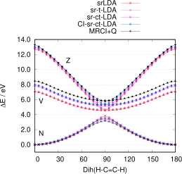
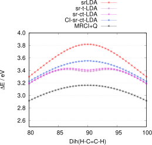

<a id="sec:modelchemistries.casdft"></a>
# CASSCF 与 DFT

完全活性空间自洽场（Complete Active Space Self-Consistent
Field，[CASSCF](CASSCF.md#sec:modelchemistries.casscf)）方法能有效描述静态相关（static
correlation）效应，这类效应出现在开壳层（open-shell）分子或共价键解离等情形中。
然而，CASSCF 不足以描述动态相关（dynamic correlation），在对能量和分子性质
进行实际预测时往往过于粗糙。

将 CASSCF 与密度泛函理论（Density Functional
Theory，[DFT](DensityFunctionalTheory.md#sec:modelchemistries.dft)）相结合的混合方法（hybrid
approach），已被开发出来作为传统二阶微扰理论方法（如
[NEVPT2](NEVPT2.md#sec:modelchemistries.nevpt2) 和 [CASPT2](caspt2.md#sec:modelchemistries.caspt2)）的替代方案。

自 ORCA 6.1 起，可用的混合 CASSCF-DFT 方法如下：
- 长程 CASSCF 短程 DFT（[srDFT](#sec:modelchemistries.casdft.general.srdft)）
- 多组态对密度泛函理论（[MCPDFT](#sec:modelchemistries.casdft.general.mcpdft)）

<a id="sec:modelchemistries.casdft.general"></a>
## 一般描述（General Description）

<a id="sec:modelchemistries.casdft.general.mcpdft"></a>
### 多组态对密度泛函理论（Multi-Configurational Pair Density Functional Theory）

MCPDFT 通过单体密度矩阵（one-body density matrix，$D_{pq}$）和双体密度矩阵
（two-body density matrix，$d_{pqrs}$）——两者均来自先前的 CASSCF 计算——来求算
Kohn-Sham DFT 能量

$$
E &= E^{1} + E^{\text{H}} + E^{\text{xc}}[\rho,\Pi] \\
  &= \sum_{pq} h_{pq} D_{pq} + \frac{1}{2} \sum_{pqrs} D_{pq} D_{rs} g_{pqrs} + E^{\text{xc}}[\rho,\Pi]
$$

为了在开壳层体系中考虑自旋极化（spin polarization）并总体上提高精度，
交换相关（exchange-correlation，xc）能量采用同位对密度（on-top pair
density）$\Pi(r)$

$$
\Pi = \sum_{pqrs} d_{pqrs} \, \phi_p(r) \, \phi_q(r) \, \phi_r(r) \, \phi_s(r)
$$

由此可计算出$\alpha$ 与$\beta$ 电子密度：

<a id="eqn:casdft-func-trans"></a>

$$
\rho_{\alpha/\beta} = \frac{1}{2} \left( \rho \pm \sqrt{ \rho^2 - 2 \Pi } \right)\qquad \text{(eqn:casdft-func-trans)}
$$

对于动态相关被抑制的空间点$r$（即$\rho^2 \ge 2\Pi$），
可直接通过式 [Eq](#eqn:casdft-func-trans) 应用单参考 DFT 中成熟的交换相关泛函。
该技术称为*泛函平移*（*functional translation*）[LiManni2014](../../bibliography.md)。

在原始 MCPDFT 方法中[LiManni2014](../../bibliography.md)，$\rho^2 < 2\Pi$ 的区域通过设$\rho_{\alpha/\beta} = \frac{1}{2}\rho$ 来近似。基于该近似的 MCPDFT 泛函以 `t` 为前缀，
例如平移 LDA 记作 `tLDA`。

然而在许多体系中，$\rho^2 < 2\Pi$ 的区域包含重要信息，不应被忽略或近似。由于在这些区域中$\rho_{\alpha/\beta}$ 变为复数，需要专门的交换相关泛函
及其泛函导数[Becke1995,Rodrigues2023](../../bibliography.md)。不做近似地使用式
[Eq](#eqn:casdft-func-trans) 称为*复泛函平移*（*complex functional
translation*）[Rodrigues2023](../../bibliography.md)。这些泛函以 `ct` 为前缀，例如 `ctLDA`。

在 ORCA 6.1 中可用的 MCPDFT 泛函如下：

<a id="tab:modelchemistries.casdft.general.mcpdft"></a>
!!! note "可用 MCPDFT 泛函列表。"
    | MCPDFT 泛函 | 说明                                                         |
    |:------------------|:--------------------------------------------------------------------|
    | tLDA              | 平移局域密度近似（translated local density approximation，默认取 VWN5） |
    | tPBE              | 平移 Perdew, Becke, Ernzerhofer（PBE）                         |
    | tPBE0             | 平移 PBE0，75% PBE 交换，25% 精确 HF 交换          |
    | ctLDA             | 复平移局域密度近似（complex translated local density approximation，默认取 VWN5） |
    | ctPBE             | 复平移 Perdew, Becke, Ernzerhofer（PBE）                 |
    | ctPBE0            | 复平移 PBE0，75% PBE 交换，25% 精确 HF 交换  |

!!! note
    原始的 MCPDFT 不是变分的。能够最小化 MCPDFT 能量的变分形式[Scott2024](../../bibliography.md) 目前在 ORCA 中尚未提供。

关于激发态 MCPDFT 方法，参见 [casdft.excited](#sec:modelchemistries.casdft.excited) 一节。

<a id="sec:modelchemistries.casdft.general.srdft"></a>
### 长程 CASSCF 短程 DFT（Long-Range CASSCF Short-Range DFT）

当电子彼此靠近时动态电子相关最为显著，因此它是一种短程现象。
srDFT 方法[Fromager2007](../../bibliography.md) 通过将 DFT 用于相互作用的短程部分、
将 CASSCF 用于长程（静态相关）部分来处理这一问题。

srDFT 能量表达式为：

$$
E = \langle0| \hat{H}^{\text{lr}} |0\rangle + E^{\text{sr-H}} + E^{\text{sr-xc}}
$$

其中$\hat{H}^{\text{lr}}$ 是以 CASSCF 波函数$|0\rangle$ 求值的长程哈密顿量，
$E^{\text{sr-H}}$ 和$E^{\text{sr-xc}}$ 分别为短程 Hartree 能量与短程交换相关能量。

对 CASSCF 与 DFT 的显式双电子相互作用进行范围分离（range separation）会影响两个量：
- **库仑算符（Coulomb operator）**，现被拆分为长程（lr）与短程（sr）两部分

$$
\frac{1}{r_{12}} &= \hat{g}^{\text{lr}} + \hat{g}^{\text{sr}} \\
  &= \frac{\text{erf}(\mu r_{12})}{r_{12}} + \frac{\text{erfc}(\mu r_{12})}{r_{12}}
$$

  由此得到范围分离双电子积分

$$
g_{pqrs}^{\text{lr}} = \in t\in t \phi_p(r_1)\phi_q(r_1) \, \hat{g}^{\text{lr}} \, \phi_r(r_2)\phi_s(r_2)
  \, dr_1 \, dr_2
$$

  以及$g_{pqrs}^{\text{sr}}$。

-$E^{\text{sr-xc}}$ 中专用的**短程 xc 泛函**，它们会随着 CASSCF 成分的增加而被阻尼

经验性的**短程阻尼参数**（short-range damping parameter）$\mu$ 控制短程与长程混合之间的平衡。将$\mu$ 设为$0$（零）会恢复单参考 Kohn-Sham DFT 能量，适用于态特定（state-specific）
基态计算。相反，将$\mu$ 增大到很大（$\mu > 100$）则实际上恢复 CASSCF 解。

与 [MCPDFT](#sec:modelchemistries.casdft.general.mcpdft) 不同，srDFT 对轨道和 CI 系数做变分最小化。
目前这只对依赖于单电子密度的交换相关泛函实现。对单重态只使用总电子密度$\rho$；
对其他自旋多重度，则同时考虑$\rho$、自旋密度（spin-density）$m$ 及其导数[Hedegaard2018](../../bibliography.md)。

收敛之后，最终的 srDFT 能量可以像 [MCPDFT](#sec:modelchemistries.casdft.general.mcpdft) 那样
利用同位对密度重新求值。

ORCA 6.1 中可用的 srDFT 泛函如下：

<a id="tab:modelchemistries.casdft.general.srdft"></a>
!!! note "可用 srDFT 泛函列表。"
    | MCPDFT 泛函 | 说明                                                         |
    |:------------------|:--------------------------------------------------------------------|
    | srLDA             | 短程 LDA（默认取 VWN5）[hirao2001rangeseparation,Paziani2006](../../bibliography.md)|
    | srPBE             | 短程 PBE，亦称 Goll, Werner, Stoll（GWS）[Goll2005,Goll2006](../../bibliography.md) |
    | srPBE0            | 短程 PBE0，75% srPBE 交换，25% 精确 sr HF 交换    |
    | sr-ctLDA          | 复平移 srLDA                                            |
    | sr-ctPBE          | 复平移 srPBE                                            |
    | sr-ctPBE0         | 复平移 srPBE0                                           |

<a id="sec:modelchemistries.casdft.computational"></a>
## 计算细节（Computational Aspects）

在 ORCA 6.1 中，CASDFT 方法 [MCPDFT](#sec:modelchemistries.casdft.general.mcpdft)
与 [srDFT](#sec:modelchemistries.casdft.general.srdft)
实现在 [TRAH-CASSCF](CASSCF.md#sec:modelchemistries.casscf.trah) 模块中。
只需在标准 [CASSCF](CASSCF.md#sec:modelchemistries.casscf) 输入中加入所需的泛函即可调用。

例如，对乙烯（ethylene）进行态平均（state-averaged）CASDFT 计算，
将$\pi$ 与${\pi}^*$ 轨道置于活性空间中：
```orca
! TRAH
! ctPBE

%casscf
 nel    2
 norb   2
 mult   1
 nroots 3
end
```

```orca
! TRAH
! sr-ctPBE

%method
 RangeSepMu 0.40 # Default value
end

%casscf
 nel    2
 norb   2
 mult   1
 nroots 3
end
```

注意，[RIJK](../essentialelements/RI.md#sec:essentialelements.ri.rijk) 近似目前尚不适用于 CASDFT。

注意，平移型 sr 泛函同样可用。这种情况下需要在 `%method` 块中关闭复平移：
```orca
! TRAH
! sr-ctLDA

%method
 CASDFT
  ComplexTranslation false
 end
end
```

与单参考 [DFT](DensityFunctionalTheory.md#sec:modelchemistries.dft) 不同，[RIJ](../essentialelements/RI.md#sec:essentialelements.ri.rij) 与
[RIJCOSX](../essentialelements/RI.md#sec:essentialelements.ri.rijcosx) 近似**默认并不启用**。
如有需要，必须在 ORCA 输入文件中显式给出：
```orca
! TRAH
! ctPBE0
! RIJCOSX def2-TZVP/C DefGrid3

%casscf
 nel    2
 norb   2
 mult   3
 nroots 1
end
```

<a id="sec:modelchemistries.casdft.excited"></a>
## 激发态（Excited States）

激发态可像标准 [CASSCF](CASSCF.md#sec:modelchemistries.casscf.excitedstates) 计算那样
使用态平均（state-averaged，SA）方法计算。

对 MCPDFT 而言，能量由收敛 SA-CASSCF 计算的态特定单体与双体密度求得[LiManni2014](../../bibliography.md)。

对 srDFT 而言，先用平均密度对近似能量做最小化。
最终的 srDFT 能量再由态特定（state-specific，SS）密度求得[Helmich-Paris2025](../../bibliography.md)。

<a id="fig:CASDFT-c2h4-excited"></a>
!!! note "AB"

    
    

    用各种 srLDA 方法计算的乙烯扭转三条最低势能曲线（potential energy curve）。

如 [fig:CASDFT-c2h4-excited](#fig:CASDFT-c2h4-excited) 所示，采用 SS 密度的 srDFT 对扭曲乙烯可能给出假极小值（false minimum）。
MCPDFT 也有类似问题。

为缓解这一问题，可以对角化一个线性化的 CI-DFT 哈密顿量，以考虑对平均密度的偏差[Pedersen2004,Hedegaard2015,Helmich-Paris2025](../../bibliography.md)：

$$
E^{\text{CI-DFT}} &\approx \langle0| \hat{h} |0\rangle + \delta_{1\, \text{srDFT}} \, \langle0| \hat{g}^{\text{lr}} |0\rangle  \\
&+ E^{\text{(sr)H}}[\rho^{\text{SA}}] + E^{\text{(sr)xc}}[\rho^{\text{SA}},\Pi^{\text{SA}}] \\
&+ \in t \left. \left( \frac{ \partial E^{\text{Hxc}}[\rho,\Pi]}{\partial \rho} \right) \right|_* \, \Delta \rho \, dr
 + \in t \left. \left( \frac{ \partial E^{\text{xc}}[\rho,\Pi]}{\partial \Pi} \right) \right|_* \, \Delta \Pi \, dr
$$

如 [fig:CASDFT-c2h4-excited](#fig:CASDFT-c2h4-excited) 所示，CI-DFT 变体（例如 `sr-ctLDA`）解决了假极小值问题，
并且与高相关级别的 [MRCI+Q](autoci.md#sec:modelchemistries.autoci.ficmrci) 方法符合得最好。

CI-DFT 方法可以通过简单关键词输入来指定：
```orca
! TRAH
! CI-sr-ctPBE

%casscf
 nel    2
 norb   2
 mult   1
 nroots 3
end
```

也可以通过 method 块来指定：

```orca
! TRAH
! sr-ctPBE

%method
 CASDFT
  OrthogonalCI true
 end
end

%casscf
 nel    2
 norb   2
 mult   1
 nroots 3
end
```

在 ORCA 6.1 中可用的 CI-DFT 关键词如下：

<a id="tab:modelchemistries.casdft.general.ci-dft"></a>
!!! note "可用 CI-DFT 关键词列表。"
    | CI-DFT 关键词 |
    |:---------------|
    | CI-ctLDA       |
    | CI-ctPBE       |
    | CI-ctPBE0      |
    |                |
    | CI-srLDA       |
    | CI-srPBE       |
    | CI-srPBE0      |
    |                |
    | CI-sr-ctLDA    |
    | CI-sr-ctPBE    |
    | CI-sr-ctPBE0   |

