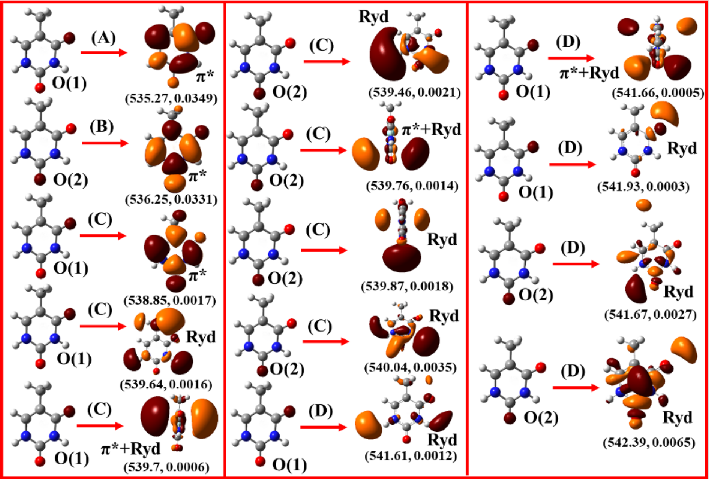

<a id="sec:spectroscopyproperties.eomcore"></a>
# 用耦合簇方法进行芯能级光谱计算（Core-Level Spectroscopy with Coupled Cluster Methods）

运动方程耦合簇方法及其相似变换版本提供了一种简便的途径，
可直接计算芯电离能和芯激发能。用 EOM-CCSD 进行芯能级光谱计算
目前仅适用于闭壳层体系。

<a id="sec:spectroscopyproperties.eomcore.eomcoreionization"></a>
## 芯电离（Core-Ionization）

如果计算大量的根，就可以获得芯电离态。然而，ORCA 的 IP-EOM-CCSD
实现允许直接以芯轨道的电离为目标。乙酸的典型 IP-EOM-CCSD
输入文件如下所示

```mol
title: structure 1
theme: chem311
height: 320px
representation: ball-stick
--- xyz ---
8
structure (0 1)
C  -6.7624010562 0.1328615492 0.0389382700
C  -5.3564667033 0.2819965475 -0.5188248498
H  -6.9983743824 1.0019615710 0.6510029634
H  -7.4924880320 0.0542210905 -0.7741766747
H  -6.8380664832 -0.7720291637 0.6519904379
O  -4.9303467983 -0.7518088469 -1.3223158759
H  -5.6257914271 -1.4265892921 -1.4015111180
O  -4.6208051175 1.2132365445 -0.3081931529
--- input ---
!IP-EOM-CCSD ExtremeSCF cc-pvdz 
!NoFrozencore
%maxcore 5000

%mdci
nroots 4        # no of roots
FollowCIS true  # Follow  the initial guess orbital
DoCVS true      # Core valence separation
                # (currently both the option needs to be true)
DoCore true     # Directly target the core
CoreOrb[0]=0    # The MO from which it will start counting
maxiter 500     # no of iteration, generally requires larger no of roots
end

*xyz 0 1
 C             -6.7624010562   0.1328615492   0.0389382700
 C             -5.3564667033   0.2819965475  -0.5188248498
 H             -6.9983743824   1.0019615710   0.6510029634
 H             -7.4924880320   0.0542210905  -0.7741766747
 H             -6.8380664832  -0.7720291637   0.6519904379
 O             -4.9303467983  -0.7518088469  -1.3223158759
 H             -5.6257914271  -1.4265892921  -1.4015111180
 O             -4.6208051175   1.2132365445  -0.3081931529
*
```

其输出为

```orca
----------------------
EOM-CCSD RESULTS (RHS)
----------------------

IROOT=  1: 19.999934 au   544.226 eV 4389478.1 cm**-1
  Amplitude    Excitation
   0.672786     0 -> x
Percentage singles character=     82.70

IROOT=  2: 19.944006 au   542.704 eV 4377203.3 cm**-1
  Amplitude    Excitation
   0.672143     1 -> x
Percentage singles character=     82.41

IROOT=  3: 10.962172 au   298.296 eV 2405918.7 cm**-1
  Amplitude    Excitation
   0.669804     2 -> x
Percentage singles character=     81.37

IROOT=  4: 10.826519 au   294.605 eV 2376146.3 cm**-1
  Amplitude    Excitation
   0.670634     3 -> x
Percentage singles character=     81.74

```

选项 'DoCore true' 连同 'DoCVS true' 和 'CoreOrb[0]=0' 足以在
IP-EOM-CCSD 中启用芯电离计算。选项 'CoreOrb[0]=0' 表示我们将
寻找从轨道 0 到 HOMO 产生的芯激发，对应于氧 K 壳层。
我们也可以通过改为从轨道 2 开始来直接访问碳 K 边。
为此，我们使用 'CoreOrb[0]=2'

```mol
title: structure 2
theme: chem311
height: 320px
representation: ball-stick
--- xyz ---
8
structure (0 1)
C  -6.7624010562 0.1328615492 0.0389382700
C  -5.3564667033 0.2819965475 -0.5188248498
H  -6.9983743824 1.0019615710 0.6510029634
H  -7.4924880320 0.0542210905 -0.7741766747
H  -6.8380664832 -0.7720291637 0.6519904379
O  -4.9303467983 -0.7518088469 -1.3223158759
H  -5.6257914271 -1.4265892921 -1.4015111180
O  -4.6208051175 1.2132365445 -0.3081931529
--- input ---
!IP-EOM-CCSD ExtremeSCF cc-pvdz 
!NoFrozencore
%maxcore 5000

%mdci
nroots 2        # no of roots
FollowCIS true  # Follow  the initial guess orbital
DoCVS true      # Core valence separation
                # (currently both the option needs to be true)
DoCore true     # Directly target the core
CoreOrb[0]=2    # The MO from which it will start counting
maxiter 500     # no of iteration, generally requires larger no of roots
end

*xyz 0 1
 C             -6.7624010562   0.1328615492   0.0389382700
 C             -5.3564667033   0.2819965475  -0.5188248498
 H             -6.9983743824   1.0019615710   0.6510029634
 H             -7.4924880320   0.0542210905  -0.7741766747
 H             -6.8380664832  -0.7720291637   0.6519904379
 O             -4.9303467983  -0.7518088469  -1.3223158759
 H             -5.6257914271  -1.4265892921  -1.4015111180
 O             -4.6208051175   1.2132365445  -0.3081931529
*
```

其输出为

```orca
----------------------
EOM-CCSD RESULTS (RHS)
----------------------

IROOT=  1: 10.962172 au   298.296 eV 2405918.7 cm**-1
  Amplitude    Excitation
   0.669804     2 -> x
Percentage singles character=     81.37

IROOT=  2: 10.826519 au   294.605 eV 2376146.3 cm**-1
  Amplitude    Excitation
   0.670634     3 -> x
Percentage singles character=     81.74

```

现在，芯电离态嵌入在形成连续谱的高密度双电离价态之中。
这导致严重的收敛问题。一个简单的克服方法是使用芯-价分离近似，
它通过对可能的芯激发设定上限来开启。在芯-价分离中不被忽略
贡献的轨道由 'CoreOrb[0]= initial,final' 设定。
如果对某个特定元素的任何芯轨道的电离感兴趣，
通常最好包含对应于该元素的所有芯轨道。在第二个例子中，
两个碳芯轨道也被包含在内，这等价于设置 'CoreOrb[0] = 0,3'。
同一示例的 'bt-PNO-IP-EOM-CCSD' 输入文件如下所示

```mol
title: structure 3
theme: chem311
height: 320px
representation: ball-stick
--- xyz ---
8
structure (0 1)
C  -6.7624010562 0.1328615492 0.0389382700
C  -5.3564667033 0.2819965475 -0.5188248498
H  -6.9983743824 1.0019615710 0.6510029634
H  -7.4924880320 0.0542210905 -0.7741766747
H  -6.8380664832 -0.7720291637 0.6519904379
O  -4.9303467983 -0.7518088469 -1.3223158759
H  -5.6257914271 -1.4265892921 -1.4015111180
O  -4.6208051175 1.2132365445 -0.3081931529
--- input ---
!bt-PNO-IP-EOM-CCSD ExtremeSCF cc-pvdz cc-pvdz/c
!NoFrozencore
%maxcore 5000

%mdci
nroots 4        # no of roots
FollowCIS true  # Follow  the initial guess orbital
DoCVS true      # Core valence separation
                # (currently both the option needs to be true)
DoCore true     # Directly target the core
CoreOrb[0]=0,3  # The MO from which it will start counting
maxiter 500     # no of iteration, generally requires larger no of roots
end

*xyz 0 1
 C             -6.7624010562   0.1328615492   0.0389382700
 C             -5.3564667033   0.2819965475  -0.5188248498
 H             -6.9983743824   1.0019615710   0.6510029634
 H             -7.4924880320   0.0542210905  -0.7741766747
 H             -6.8380664832  -0.7720291637   0.6519904379
 O             -4.9303467983  -0.7518088469  -1.3223158759
 H             -5.6257914271  -1.4265892921  -1.4015111180
 O             -4.6208051175   1.2132365445  -0.3081931529
*
```

其输出为

```orca
----------------------
EOM-CCSD RESULTS (RHS)
----------------------

IROOT=  1: 19.999730 au   544.220 eV 4389433.3 cm**-1
  Amplitude    Excitation
   0.672774     0 -> x
Percentage singles character=     82.69

IROOT=  2: 19.943800 au   542.698 eV 4377158.2 cm**-1
  Amplitude    Excitation
   0.672139     1 -> x
Percentage singles character=     82.41

IROOT=  3: 10.962316 au   298.300 eV 2405950.3 cm**-1
  Amplitude    Excitation
   0.669787     2 -> x
Percentage singles character=     81.36

IROOT=  4: 10.826562 au   294.606 eV 2376155.7 cm**-1
  Amplitude    Excitation
   0.670612     3 -> x
Percentage singles character=     81.73

```

结果与正则计算非常吻合。同一示例的 DLPNO 变体如下所示

```mol
title: structure 4
theme: chem311
height: 320px
representation: ball-stick
--- xyz ---
8
structure (0 1)
C  -6.7624010562 0.1328615492 0.0389382700
C  -5.3564667033 0.2819965475 -0.5188248498
H  -6.9983743824 1.0019615710 0.6510029634
H  -7.4924880320 0.0542210905 -0.7741766747
H  -6.8380664832 -0.7720291637 0.6519904379
O  -4.9303467983 -0.7518088469 -1.3223158759
H  -5.6257914271 -1.4265892921 -1.4015111180
O  -4.6208051175 1.2132365445 -0.3081931529
--- input ---
!IP-EOM-DLPNO-CCSD ExtremeSCF cc-pvdz cc-pvdz/c 
!NoFrozencore
%maxcore 5000

%mdci
nroots 4        # no of roots
FollowCIS true  # Follow  the initial guess orbital
DoCVS true      # Core valence separation
                # (currently both the option needs to be true)
DoCore true     # Directly target the core
CoreOrb[0]=0,3  # The MO from which it will start counting
maxiter 500     # no of iteration, generally requires larger no of roots
end

*xyz 0 1
 C             -6.7624010562   0.1328615492   0.0389382700
 C             -5.3564667033   0.2819965475  -0.5188248498
 H             -6.9983743824   1.0019615710   0.6510029634
 H             -7.4924880320   0.0542210905  -0.7741766747
 H             -6.8380664832  -0.7720291637   0.6519904379
 O             -4.9303467983  -0.7518088469  -1.3223158759
 H             -5.6257914271  -1.4265892921  -1.4015111180
 O             -4.6208051175   1.2132365445  -0.3081931529
*
```

其输出为

```orca
----------------------
EOM-CCSD RESULTS (RHS)
----------------------

IROOT=  1: 20.051396 au   545.626 eV 4400772.7 cm**-1
  Amplitude    Excitation
  -0.678316     0 -> x
Percentage singles character=    101.08

IROOT=  2: 19.986869 au   543.870 eV 4386610.6 cm**-1
  Amplitude    Excitation
  -0.677491     1 -> x
Percentage singles character=    101.14

IROOT=  3: 11.034622 au   300.267 eV 2421819.6 cm**-1
  Amplitude    Excitation
  -0.674692     2 -> x
  -0.108213     1 -> x    13 ->  16
  -0.108195     1 -> x    15 ->  16
Percentage singles character=    101.21

IROOT=  4: 10.890773 au   296.353 eV 2390248.3 cm**-1
  Amplitude    Excitation
   0.679269     3 -> x
Percentage singles character=    101.04

```

尽管绝对 IP 值的误差高达 1 eV，但所谓的"化学位移"——
即同一元素两个不同原子 IP 值之间的差值——是相当准确的。

<a id="sec:spectroscopyproperties.eomcore.eomcoreionization.uhf"></a>
## 芯电离（UHF）（Core-Ionization (UHF)）

从 ORCA 6.0.1 开始，也可以在开壳层体系上进行芯电离态计算。[casanova_neese_2025](../../bibliography.md)
这是闭壳层实现的直接扩展，语法与闭壳层几乎相同。
现在，我们需要为每个自旋通道分别定义 'CoreOrb'，
自旋向上电子使用 'CoreOrb[0]= min,max'，自旋向下电子使用
'CoreOrb[1]=min,max'。

```orcainput
   CoreOrb[0]= min,max	#The MO from which it will start counting (spin up)
   CoreOrb[1]= min,max	#The MO from which it will start counting (spin down)
```

在下面的例子中，我们使用 ORCA 的复合脚本对三重态基态的双氧分子
进行 'DoAlpha' 和 'DoBeta' 的芯电离计算。

```mol
title: structure 5
theme: chem311
height: 320px
representation: ball-stick
--- xyz ---
4
structure (0 3)
O           0.0          0.0          0.0
O           0.0          0.0        1.207
O           0.0          0.0          0.0
O           0.0          0.0        1.207
--- input ---
%compound

new_step

  !UHF IP-EOM-CCSD cc-pVDZ ExtremeSCF KDIIS nofrozencore

  %mdci
  DoAlpha true
  NRoots 4
  DTol 1e-6
  DoCore true
  DoCVS  true
  CoreOrb[0]=0,1
  CoreOrb[1]=0,1
  end

  *xyz 0 3
    O      0.0 0.0 0.0
    O      0.0 0.0 1.207
  *
step_end

new_step
  !UHF IP-EOM-CCSD cc-pVDZ ExtremeSCF KDIIS nofrozencore

  %mdci
  DoBeta true
  NRoots 4
  DTol 1e-6
  DoCore true
  DoCVS  true
  CoreOrb[0]=0,1
  CoreOrb[1]=0,1
  end

  *xyz 0 3
    O      0.0 0.0 0.0
    O      0.0 0.0 1.207
  *
step_end

end
```

'DoAlpha' 的输出如下

```orca
-------------------------------
UHF IP-EOM-CCSD RESULTS (RHS)
-------------------------------

IROOT=  1: 20.137719 au   547.975 eV 4419718.6 cm**-1
  Amplitude    Excitation
   0.894649     0a -> x
   0.115737     0a -> x     5b ->  12b
   0.115737     0a -> x     6b ->  13b
  -0.123325     1a -> x     5b ->   7b
  -0.120347     1a -> x     5b ->   8b
  -0.120347     1a -> x     6b ->   7b
   0.123325     1a -> x     6b ->   8b
Percentage singles character=     80.04

IROOT=  2: 20.137008 au   547.956 eV 4419562.4 cm**-1
  Amplitude    Excitation
   0.894673     1a -> x
  -0.123144     0a -> x     5b ->   7b
  -0.120171     0a -> x     5b ->   8b
  -0.120171     0a -> x     6b ->   7b
   0.123144     0a -> x     6b ->   8b
   0.115678     1a -> x     5b ->  12b
   0.115678     1a -> x     6b ->  13b
Percentage singles character=     80.04

IROOT=  3:  1.418592 au    38.602 eV  311344.9 cm**-1
  Amplitude    Excitation
   0.531451     2a -> x
   0.266889     4a -> x     3b ->   7b
   0.431978     4a -> x     3b ->   8b
   0.116970     4a -> x     3b ->  14b
  -0.431978     5a -> x     3b ->   7b
   0.266889     5a -> x     3b ->   8b
  -0.116970     5a -> x     3b ->  15b
  -0.112676     7a -> x     2b ->   8b
   0.105473     7a -> x     4b ->   8b
  -0.112676     8a -> x     2b ->   7b
   0.105473     8a -> x     4b ->   7b
Percentage singles character=     29.23

IROOT=  4:  0.964260 au    26.239 eV  211630.5 cm**-1
  Amplitude    Excitation
   0.825207     3a -> x
   0.147947     6a -> x     5b ->   7b
   0.144375     6a -> x     5b ->   8b
   0.144375     6a -> x     6b ->   7b
  -0.147947     6a -> x     6b ->   8b
  -0.267515     7a -> x     3b ->   8b
  -0.267515     8a -> x     3b ->   7b
Percentage singles character=     68.10
```

'DoBeta' 的输出为

```orca
-------------------------------
UHF IP-EOM-CCSD RESULTS (RHS)
-------------------------------

IROOT=  1: 20.102122 au   547.007 eV 4411905.8 cm**-1
  Amplitude    Excitation
   0.904712     0b -> x
Percentage singles character=     81.85

IROOT=  2: 20.100495 au   546.962 eV 4411548.8 cm**-1
  Amplitude    Excitation
   0.904679     1b -> x
Percentage singles character=     81.84

IROOT=  3:  1.482975 au    40.354 eV  325475.4 cm**-1
  Amplitude    Excitation
   0.911468     2b -> x
  -0.437544     2b -> x     3b ->  10b
   0.117502     2b -> x     3b ->  17b
  -0.181512     2b -> x     3b ->  27b
  -0.150802     2b -> x     4b ->  16b
   0.155724     3b -> x     4b ->   9b
  -0.362017     3b -> x     4b ->  10b
   0.170790     3b -> x     4b ->  27b
   0.414703     2b -> x     5b ->  18b
  -0.477670     3b -> x     5b ->  15b
   0.121834     4b -> x     5b ->  13b
  -0.266578     4b -> x     5b ->  19b
  -0.414703     2b -> x     6b ->  19b
   0.477670     3b -> x     6b ->  14b
   0.121834     4b -> x     6b ->  12b
  -0.266578     4b -> x     6b ->  18b
  -0.132721     5b -> x     6b ->  20b
   0.918380     5b -> x     6b ->  21b
   0.170340     3b -> x     6a ->   9a
  -0.124771     5b -> x     7a ->   9a
  -0.124771     6b -> x     8a ->   9a
Percentage singles character=     83.16

IROOT=  4:  0.889071 au    24.193 eV  195128.5 cm**-1
  Amplitude    Excitation
   0.946265     3b -> x
   0.272057     4b -> x     5b ->   7b
  -0.223370     4b -> x     5b ->   8b
   0.223370     4b -> x     6b ->   7b
   0.272057     4b -> x     6b ->   8b
Percentage singles character=     89.54
```

<a id="sec:spectroscopyproperties.eomcore.core-excitation"></a>
## 芯激发（Core-Excitation）

STEOM-CCSD 方法为 K 边芯激发光谱提供了一种高效而精确的途径。
STEOM-CCSD 的典型输入文件如下所示

```mol
title: structure 6
theme: chem311
height: 320px
representation: ball-stick
--- xyz ---
2
structure (0 1)
O             0            0     0.913973
C             0            0    -1.218243
--- input ---
!STEOM-CCSD ExtremeSCF cc-pCVTZ Bohrs NoFrozencore

%mdci
nroots 5
FollowCIS true
DoSimpleDens False # use exact STEOM transition moment
maxiter 500
DoCVS true
DoCore true
CoreOrb[0]=0,0
end

*xyz 0 1
O 0 0 0.913973
C 0 0 -1.218243
*
```

输出将为

```orca
-------------------------------
STEOM-CCSD RESULTS (SINGLETS)
-------------------------------

IROOT=  1: 19.685582 au   535.672 eV 4320485.8 cm**-1
  Amplitude    Excitation
  -0.932683     6 ->   8
   0.281517     6 ->  12
  -0.211943     6 ->  14
  Ground state amplitude:  0.000000

Percentage Active Character     99.41

  Amplitude    Excitation in Canonical Basis
  -0.846006     0 ->   7
  -0.428151     0 ->   8
   0.252869     0 ->  12
   0.151677     0 ->  15

IROOT=  2: 19.685582 au   535.672 eV 4320485.9 cm**-1
  Amplitude    Excitation
  -0.932691     6 ->   7
   0.281484     6 ->  11
   0.211959     6 ->  15
  Ground state amplitude:  0.000000

Percentage Active Character     99.41

  Amplitude    Excitation in Canonical Basis
  -0.428151     0 ->   7
   0.846006     0 ->   8
  -0.252868     0 ->  11
  -0.151677     0 ->  14

IROOT=  3: 19.964529 au   543.262 eV 4381707.6 cm**-1
  Amplitude    Excitation
   0.978863     6 ->   9
   0.157708     6 ->  10
  -0.101384     6 ->  16
  Ground state amplitude: -0.001155

Percentage Active Character     99.39

  Amplitude    Excitation in Canonical Basis
  -0.978751     0 ->   9
   0.125406     0 ->  10
  -0.112036     0 ->  18
   0.102538     0 ->  21

IROOT=  4: 20.091389 au   546.714 eV 4409550.1 cm**-1
  Amplitude    Excitation
   0.269952     6 ->   8
   0.958312     6 ->  12
  Ground state amplitude: -0.000000

Percentage Active Character     99.78

  Amplitude    Excitation in Canonical Basis
   0.218969     0 ->   7
   0.110818     0 ->   8
  -0.210211     0 ->  11
   0.940678     0 ->  12

IROOT=  5: 20.091389 au   546.714 eV 4409550.1 cm**-1
  Amplitude    Excitation
   0.269914     6 ->   7
   0.958327     6 ->  11
  Ground state amplitude: -0.000000

Percentage Active Character     99.78

  Amplitude    Excitation in Canonical Basis
   0.110818     0 ->   7
  -0.218969     0 ->   8
  -0.940678     0 ->  11
  -0.210211     0 ->  12

```

通过设置 'CoreOrb[0]=0,1' 也可以进行多芯激发。
在下面的例子中，我们直接访问氧 1S 和碳 1S 芯激发

```mol
title: structure 7
theme: chem311
height: 320px
representation: ball-stick
--- xyz ---
2
structure (0 1)
O             0            0     0.913973
C             0            0    -1.218243
--- input ---
!STEOM-CCSD ExtremeSCF cc-pCVTZ Bohrs NoFrozencore

%mdci
nroots 5
FollowCIS true
DoSimpleDens False # use exact STEOM transition moment
maxiter 500
DoCVS true
DoCore true
CoreOrb[0]=0,1
end

*xyz 0 1
O 0 0 0.913973
C 0 0 -1.218243
*
```

它将给出如下的氧和碳 K 边谱

```orca
-------------------------------
STEOM-CCSD RESULTS (SINGLETS)
-------------------------------

IROOT=  1: 10.577651 au   287.833 eV 2321526.1 cm**-1
  Amplitude    Excitation
  -0.508570     6 ->   7
   0.849534     6 ->   8
   0.127575     6 ->  10
  Ground state amplitude: -0.000000

Percentage Active Character     99.67

  Amplitude    Excitation in Canonical Basis
   0.803788     1 ->   7
   0.418299     1 ->   8
  -0.381488     1 ->  12
  -0.116973     1 ->  15

IROOT=  2: 10.577651 au   287.833 eV 2321526.1 cm**-1
  Amplitude    Excitation
   0.849534     6 ->   7
   0.508570     6 ->   8
   0.127575     6 ->  11
  Ground state amplitude:  0.000000

Percentage Active Character     99.67

  Amplitude    Excitation in Canonical Basis
   0.418299     1 ->   7
  -0.803788     1 ->   8
   0.381488     1 ->  11
   0.116973     1 ->  14

IROOT=  3: 10.900722 au   296.624 eV 2392431.9 cm**-1
  Amplitude    Excitation
  -0.893589     6 ->   9
   0.426665     6 ->  12
  Ground state amplitude:  0.000202

Percentage Active Character     79.85

Warning:: the state may have not converged with respect to active space
-------------------- Handle with Care --------------------

  Amplitude    Excitation in Canonical Basis
  -0.972609     1 ->   9
   0.135434     1 ->  10
  -0.157896     1 ->  18

IROOT=  4: 19.690061 au   535.794 eV 4321468.9 cm**-1
  Amplitude    Excitation
   0.677274     5 ->   7
  -0.726090     5 ->   8
  Ground state amplitude: -0.000000

Percentage Active Character     98.89

  Amplitude    Excitation in Canonical Basis
  -0.733267     0 ->   7
  -0.606483     0 ->   8
   0.247689     0 ->  12
   0.137742     0 ->  15

IROOT=  5: 19.690061 au   535.794 eV 4321468.9 cm**-1
  Amplitude    Excitation
  -0.726090     5 ->   7
  -0.677274     5 ->   8
  Ground state amplitude:  0.000000

Percentage Active Character     98.89

  Amplitude    Excitation in Canonical Basis
  -0.606483     0 ->   7
   0.733267     0 ->   8
  -0.247689     0 ->  11
  -0.137742     0 ->  14

```

芯-价分离的使用方式与芯电离中类似。唯一的区别是 STEOM-CCSD 中
基于自然轨道的活性空间选择方案总是将特定的芯轨道旋转到 HOMO。
现在 ORCA 在 STEOM-CCSD 中会自动将芯轨道设为 HOMO，无论芯空穴如何。
应使用 DoSimpleDens False 来获得精确的 STEOM-CCSD 跃迁矩。
[fig:steom_core_NTO](#fig:steom_core_NTO) 给出了胸腺嘧啶的 STEOM-CCSD
氧 K 边谱。

<a id="fig:steom_core"></a>
*胸腺嘧啶氧 K 边理论与实验 X 射线吸收谱的比较。
模拟光谱移动了 -3.7 eV 以与实验光谱对齐。*

可以用从 STEOM-CC 本征向量计算的 NTO 来解释结果

<a id="fig:steom_core_NTO"></a>


*胸腺嘧啶氧 K 边谱的自然跃迁轨道（NTO）。提到的所有芯 EE 值
均以 eV 为单位，格式为（EE, 振子强度）。*

<a id="sec:spectroscopyproperties.eomcore.core-excitation.uhf"></a>
## 芯激发（UHF）（Core-Excitation (UHF)）
ORCA 现在也能够以与闭壳层类似的方式使用开壳层 STEOM-CCSD 方法
进行芯激发计算。[casanova_neese_2025](../../bibliography.md)
通过为每个自旋通道设置 'CoreOrb'，我们可以进行单芯或多芯计算。
在下面的例子中，我们确定 NO 自由基中氮和氧的 K 壳层激发。

```mol
title: structure 8
theme: chem311
height: 320px
representation: ball-stick
--- xyz ---
2
structure (0 2)
N  0.00000000000000 0.00000000000000 0.00490803701002
O  0.00000000000000 0.00000000000000 1.14109196298998
--- input ---
!UHF STEOM-CCSD ExtremeSCF nofrozencore usesym
!cc-pCVDZ

%mdci
nroots 10
DoCVS true
DoCore true
CoreOrb[0]=0,1	#N and O core orbitals (spin up)
CoreOrb[1]=0,1  #N and O core orbitals (spin down)
end

*xyz 0 2
  N           0.00000000000000      0.00000000000000      0.00490803701002
  O           0.00000000000000      0.00000000000000      1.14109196298998
*
```

及其对应的输出

```orca
----------------------
UHF STEOM-CCSD RESULTS
----------------------

IROOT=  1: 14.743862 au   401.201 eV 3235903.7 cm**-1 <S**2>= 0.877361  Sym: A2
  Amplitude    Excitation
   0.637991     7a ->   8a
   0.750732     6b ->   7b
   0.136839     6b ->  10b

Percentage Active Character     99.93

  Amplitude    Excitation in Canonical Basis
  -0.613647     1a ->   8a
  -0.186064     1a ->  11a
  -0.722892     1b ->   7b
  -0.225768     1b ->  10b

IROOT=  2: 14.786433 au   402.359 eV 3245247.0 cm**-1 <S**2>= 0.849392  Sym: A1
  Amplitude    Excitation
   0.985414     6b ->   8b
   0.154505     6b ->  11b

Percentage Active Character     99.49

  Amplitude    Excitation in Canonical Basis
  -0.954188     1b ->   8b
   0.267334     1b ->  12b
  -0.121297     1b ->  16b

IROOT=  3: 14.794166 au   402.570 eV 3246944.1 cm**-1 <S**2>= 2.669487  Sym: A2
  Amplitude    Excitation
  -0.772273     7a ->   8a
   0.623458     6b ->   7b

Percentage Active Character     99.47

  Amplitude    Excitation in Canonical Basis
   0.754282     1a ->   8a
   0.166288     1a ->  11a
  -0.611046     1b ->   7b
  -0.132336     1b ->  10b

IROOT=  4: 15.243078 au   414.785 eV 3345469.0 cm**-1 <S**2>= 1.387083  Sym: B1
  Amplitude    Excitation
  -0.682643     7a ->   9a
  -0.101529     7a ->  11a
  -0.697873     6b ->   9b
  -0.133350     6b ->  12b

Percentage Active Character     98.11

  Amplitude    Excitation in Canonical Basis
   0.573243     1a ->   9a
   0.237647     1a ->  12a
  -0.265168     1a ->  13a
  -0.165128     1a ->  14a
   0.583678     1b ->   9b
   0.348965     1b ->  11b
   0.201568     1b ->  14b

IROOT=  5: 15.285144 au   415.930 eV 3354701.4 cm**-1 <S**2>= 2.434830  Sym: B1
  Amplitude    Excitation
  -0.690438     7a ->   9a
  -0.146046     7a ->  13a
   0.676597     6b ->   9b
   0.173127     6b ->  13b

Percentage Active Character     93.48

------------------------- Handle with Care ----------------------------

Warning:: State   5 may have not converged with respect to active space
-----------------------------------------------------------------------
  Amplitude    Excitation in Canonical Basis
   0.645706     1a ->   9a
   0.148300     1a ->  12a
  -0.211256     1a ->  13a
  -0.147915     1a ->  14a
  -0.643471     1b ->   9b
  -0.207585     1b ->  11b
  -0.158649     1b ->  14b

IROOT=  6: 19.682450 au   535.587 eV 4319798.5 cm**-1 <S**2>= 2.233840  Sym: A2
  Amplitude    Excitation
  -0.952369     6a ->   8a
  -0.128170     6a ->  10a
  -0.262026     5b ->   7b

Percentage Active Character     99.52

  Amplitude    Excitation in Canonical Basis
  -0.940546     0a ->   8a
   0.202713     0a ->  16a
  -0.254077     0b ->   7b

IROOT=  7: 19.714860 au   536.469 eV 4326911.7 cm**-1 <S**2>= 1.012274  Sym: A2
  Amplitude    Excitation
  -0.427285     6a ->   8a
   0.895703     5b ->   7b

Percentage Active Character     99.27

  Amplitude    Excitation in Canonical Basis
  -0.425513     0a ->   8a
   0.883394     0b ->   7b
  -0.176873     0b ->  15b

IROOT=  8: 19.746849 au   537.339 eV 4333932.5 cm**-1 <S**2>= 0.787890  Sym: A1
  Amplitude    Excitation
   0.992767     5b ->   8b

Percentage Active Character     99.45

  Amplitude    Excitation in Canonical Basis
   0.973851     0b ->   8b
   0.215849     0b ->  16b

IROOT=  9: 20.119392 au   547.476 eV 4415696.1 cm**-1 <S**2>= 2.441183  Sym: B1
  Amplitude    Excitation
   0.771305     6a ->   9a
  -0.127276     6a ->  11a
   0.122051     6a ->  13a
   0.592132     5b ->   9b

Percentage Active Character     96.84
```
