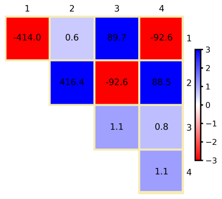
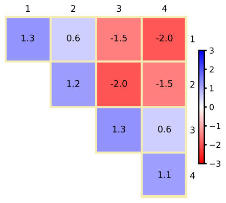

<a id="sec:spectroscopyproperties.led"></a>
# 定域能分解（Local Energy Decomposition）

DLPNO-CCSD(T) 方法提供非常准确的相对能量，
并能成功预测许多化学现象。
为便于解释耦合簇结果，我们发展了定域能分解
（Local Energy Decomposition，LED）分析
[wolfgang2016led,altun2018open,10.1002/wcms.1442](../../bibliography.md)，
它可将总 DLPNO-CCSD(T) 能量（包括参考能量）
划分为具有物理意义的贡献。
LED 方案的实用指南见 [led.cs](#sec:spectroscopyproperties.led.cs)
和 [led.example](#sec:spectroscopyproperties.led.example) 两节。

该方案的应用实例见
文献 [led2017, lu2018formation, lu2019london, ghafarian2019physical, doi:10.1021/jacs.9b13725, Beck2021](../../bibliography.md)。

作为一点告诫，我们强调只有总能量是可观测量，
其分解在某种程度上是任意的。
尽管如此，LED 分析在我们看来物理基础良好且合乎逻辑，
易于应用，且与 DLPNO-CCSD(T) 计算相比通常只有可忽略的计算开销。
从 ORCA 4.1 开始，LED 方案对闭壳层和开壳层计算均可用。
代码也已并行化并提高了效率。

LED 方案不对分子间相互作用的强度作任何假设，
因此它在整个势能面上都保持有效和自洽。
替代方案（如流行的对称性适配微扰理论）本质上是微扰性的，
因此最适合应用于弱相互作用体系。

LED 分析的思想相当简单。
在局域相关方法中，占据轨道是定域的，
可以方便地指派给分子中预定义的片段。
对于相关能也可以做同样的事：用参照一对占据轨道的对相关能来表述。
这样，相关能和参考能量都可以分解为片体内和片体间贡献。
分片由用户定义。可以定义任意数量的片段。
若定义了多于 2 个片段，则对每一对片段打印片体间相互作用。

LED 方案一个非常重要的特性是能够区分
DLPNO-CCSD(T) 相关能的色散部分和非色散部分。
简言之，我们利用这样一个事实：
每个 CCSD 对相关能贡献都可表示为
从一对占据轨道到虚空间的双激发之和。
由于在 DLPNO-CCSD(T) 方案中虚空间由本质上局域的
对自然轨道（Pair Natural Orbitals，PNO）张成，
整个相关能可按双激发类型分解，
取决于占据轨道和虚轨道定域在何处。
对每一对片段，对应于位于不同片段上的瞬时局域偶极之间
相互作用的所有激发之和，
在 LED 框架中定义了两个片段之间所谓的"伦敦色散"吸引。

对于两个片段的体系，
可以以构成相互作用超分子的、几何和电子均弛豫的片段为参考点。
相对于该参考态，片段之间的结合能可写为：

<a id="eqn:spectroscopyproperties.led.led1"></a>

$$
\begin{aligned}
\Delta E = &  \Delta E_{geo - prep}^{} \\
           &+ \Delta E_{el-prep}^{ref.} + E_{elstat}^{ref.} + E_{exch}^{ref.}\\
           &+ \Delta E^{C-CCSD}_{non-dispersion} + E^{C-CCSD}_{dispersion}\\
           &+ \Delta E^{C-(T) }_{int} \end{aligned}\qquad \text{(eqn:spectroscopyproperties.led.led1)}
$$

其中 $\Delta E_{geo-prep}$ 是将片段从其平衡构型
扭曲到相互作用几何结构所需的能量
（在其他能量分解方案中也称为"应变"，strain）。
$\Delta E_{el-prep}^{ref.}$ 项表示电子准备能，
描述将片段带到对相互作用最优的电子结构需要多少能量。
$E_{exch}^{ref.}$ 是片体间交换相互作用
（在我们的形式中它总是给出成键贡献），
$E_{elstat}^{ref.}$ 是片段变形电子云之间的静电相互作用能。
这些项之和在闭壳层情形下给出 Hartree-Fock 能量，
在开壳层情形下给出 QRO 行列式的能量。
最后，相关能被分解为色散的 $E^{C-CCSD}_{dispersion}$
和非色散的 $\Delta E^{C-CCSD}_{non-dispersion}$ 贡献，
再加上相互作用能的三激发校正项 $\Delta E^{C-(T) }_{int}$。

$E^{C-CCSD}_{dispersion}$ 项包含上述强对的伦敦色散贡献
加上弱对的片体间分量，后者本质上是色散性的。
$\Delta E^{C-CCSD}_{non-dispersion}$ 相关项
用于修正参考能中近似包含的对结合能的贡献，
例如它抵消 HF 方法典型的过极化。
它包含来自强对的所谓电荷转移激发
$E_{C-SP}^{CT(X\rightarrow Y) } + E_{C-SP}^{CT(X\leftarrow Y) }$，
即所有不保持每个片段内电荷的双激发贡献之和。
此外，非色散项还包括来自强对（$\Delta E_{el-prep}^{C-SP}$）
和弱对（$\Delta E_{el-prep}^{C-WP}$）的电子准备。
最后，$\Delta E^{C-(T) }_{int}$ 表示
三激发校正对片段间相互作用能的贡献。
在 LED 方案中，该项可进一步分解为片体内和片体间分量。
例如，这可用于估算三激发校正项的伦敦色散贡献，
如文献 [lu2018formation](../../bibliography.md) 所建议。

"定域能分解"（Local Energy Decomposition，LED）
分析 [wolfgang2016led,altun2018open,10.1002/wcms.1442](../../bibliography.md)
是一种通过将 DLPNO-CCSD(T) 能量分解为具有物理意义的贡献
来洞察分子间相互作用本质的工具。
例如，该途径可用于分解一对相互作用片段之间的
DLPNO-CCSD(T) 相互作用能，详见
[spectroscopyproperties.led](#sec:spectroscopyproperties.led) 一节。
该方案与分解相互作用能的替代方式的有用比较见
文献 [10.1002/qua.26339, altun2018local, altun2018therole](../../bibliography.md)。

<a id="sec:spectroscopyproperties.led.cs"></a>
## 闭壳层 LED（Closed shell LED）

LED 分别分解 DLPNO-CCSD(T) 能量的参考（Hartree-Fock）部分和相关部分。
默认情况下，参考能量的分解使用 RI-JK 近似。
**RIJCOSX 变体效率高得多，对大体系的标度也更有利，同样可用，
详见 [led.features](#sec:spectroscopyproperties.led.features) 一节
及 [10.1002/qua.26339](../../bibliography.md)**。

!!! note
    对于弱相互作用体系，通常推荐 `!TightPNO` 设置。

<a id="sec:spectroscopyproperties.led.cs.basicusage"></a>
### 基本用法（Basic Usage）

在 ORCA 中获得该分解只需定义[片段](#sec:essentialelements.fragmentation)
并在简单输入行中指定 `!LED` 关键词。

```orca
dlpno-ccsd(t) cc-pvdz cc-pvdz/c cc-pvtz/jk LED
```

<a id="sec:spectroscopyproperties.led.cs.example"></a>
### 示例（Example）

作为一个例子，可用如下输入文件在 LED 框架内
分析 H$_2$O 与卡宾 CH$_2$ 在 PBE0-D3/def2-TZVP 优化几何下的相互作用：

```orca
dlpno-ccsd(t) cc-pvdz cc-pvdz/c cc-pvtz/jk LED
```

相应的输出文件如下所示。DLPNO-CCSD(T) 能量分量
在输出的不同部分打印如下：

```orca
E(0)                                       ...   -114.913309038
E(CORR)(corrected)                         ...     -0.350582526 
Triples Correction (T)                     ...     -0.006098691
E(CCSD(T))                                 ...   -115.269990255
``` 

在输出的 LED 部分开头，给出片段信息
以及定域 MO 向片段的指派。

```orca
 ===========================================================
         LOCAL ENERGY DECOMPOSITION FOR DLPNO-CC METHODS
 ===========================================================

Maximum Iterations for the Localization .. 600
Tolerance for the Localization          ..  1.00e-06
Number of fragments = 2
Fragment  1:  0 1 2
Fragment  2:  3 4 5

Populations of internal orbitals onto Fragments:
   0:      1.000    0.000  assigned to fragment   1
   1:      0.000    1.000  assigned to fragment   2
   2:      1.022    0.008  assigned to fragment   1
   3:      0.001    0.999  assigned to fragment   2
   4:      0.001    0.999  assigned to fragment   2
   5:      1.018    0.000  assigned to fragment   1
   6:      1.019    0.000  assigned to fragment   1
   7:      0.006    1.013  assigned to fragment   2
   8:      0.000    1.016  assigned to fragment   2
```

随后是 Hartree-Fock 能量向片体内和片体间贡献的分解。
它基于占据轨道的定域化。

```orca
----------------------------------------
REFERENCE ENERGY E(0) DECOMPOSITION (Eh)
----------------------------------------

Nuclear repulsion     =      28.952049689006
One electron energy   =    -214.430545074583 (T=  114.825132245389, V= -329.255677319972)
Two electron energy   =      70.565186347093 (J=   71.658914661909, K=   -1.093728314816)
                        --------------------
Total energy          =    -114.913309038483
Consistency check     =    -114.913309038483 (sum of intra- and inter-fragment energies)

Kinetic energy        =     114.825132245389
Potential energy      =    -229.738441283873
                        --------------------
Virial ratio          =       2.000767922417

-------------------------------------------
INTRA-FRAGMENT REF. ENERGY FOR FRAGMENT   1
-------------------------------------------

Nuclear repulsion     =      6.037208782874
One electron energy   =    -63.553431032444 (T=   38.870491681225, V= -102.423922713669)
Two electron energy   =     18.675214766985 (J=   18.935443192480, K=   -0.260228425495)
                        -------------------
Total energy          =    -38.841007482585

Kinetic energy        =     38.870491681225
Potential energy      =    -77.711499163811
                        -------------------
Virial ratio          =      1.999241476056

-------------------------------------------
INTRA-FRAGMENT REF. ENERGY FOR FRAGMENT   2
-------------------------------------------

Nuclear repulsion     =      9.103529882464
One electron energy   =   -123.025684625357 (T=   75.954640564164, V= -198.980325189521)
Two electron energy   =     37.916781954190 (J=   38.739989208810, K=   -0.823207254620)
                        -------------------
Total energy          =    -76.005372788703

Kinetic energy        =     75.954640564164
Potential energy      =   -151.960013352867
                        -------------------
Virial ratio          =      2.000667927913

----------------------------------------------------
INTER-FRAGMENT REF. ENERGY FOR FRAGMENTs   2 AND   1
----------------------------------------------------

Nuclear repulsion     =    13.811311023669
Nuclear attraction    =   -27.851429416782
Coulomb repulsion     =    13.983482260618
                        ------------------
Sum of electrostatics =    -0.056636132494 (  -35.540 kcal/mol)

Two electron exchange =    -0.010292634701 (   -6.459 kcal/mol)
                        ------------------
Total REF. interaction =   -0.066928767195 (  -41.998 kcal/mol)

Sum of INTRA-fragment REF. energies  =      -114.846380271288
Sum of INTER-fragment REF. energies  =        -0.066928767195
                                      ---------------------
Total REF. energy                    =      -114.913309038483
```

之后，对相关能进行第一次分解。
相关能的不同能量贡献（强对、弱对和三激发校正）
被分解为片体内和片体间贡献。
该分解基于占据轨道的定域化进行。

```orca
--------------------------------
CORRELATION ENERGY DECOMPOSITION
--------------------------------

--------------------------------------------------
INTER- vs INTRA-FRAGMENT CORRELATION ENERGIES (Eh)
--------------------------------------------------

                              Fragment   1         Fragment   2
                         -----------------  -------------------
Intra strong pairs         -0.136594658271     -0.209970193798  sum=   -0.346564852069
Intra triples              -0.002692277706     -0.002842791265  sum=   -0.005535068971
Intra weak pairs           -0.000001573694     -0.000002311734  sum=   -0.000003885429
Singles contribution        0.000000000611      0.000000001058  sum=    0.000000001669
                         -----------------  -------------------
                           -0.139288509061     -0.212815295738  sum=   -0.352103804799

Interaction correlation for Fragments   2 and   1:
--------------------------------------------------
Inter strong pairs               -0.003998018810 (   -2.509 kcal/mol)
Inter triples                    -0.000563621667 (   -0.354 kcal/mol)
Inter weak pairs                 -0.000015771468 (   -0.010 kcal/mol)
                          ----------------------
Total interaction                -0.004577411945 (   -2.872 kcal/mol)

Sum of INTRA-fragment correlation energies  =        -0.352103804799
Sum of INTER-fragment correlation energies  =        -0.004577411945
                                              ---------------------
Total correlation energy                    =        -0.356681216744
```

之后，打印总能量（参考能量 + 相关能）
向片体内和片体间贡献分解的总结。

```orca
--------------------------------------------
INTER- vs INTRA-FRAGMENT TOTAL ENERGIES (Eh)
--------------------------------------------

                                Fragment   1         Fragment   2
                         -------------------  -------------------
Intra REF. energy           -38.841007482585    -76.005372788703  sum=  -114.846380271288
Intra Correlation energy     -0.139288509061     -0.212815295738  sum=    -0.352103804799
                         -------------------  -------------------
                            -38.980295991646    -76.218188084441  sum=  -115.198484076087

Interaction of Fragments   2 and   1:
-------------------------------------
Interfragment reference          -0.066928767195 (  -41.998 kcal/mol)
Interfragment correlation        -0.004577411945 (   -2.872 kcal/mol)
                          ----------------------
Total interaction                -0.071506179140 (  -44.871 kcal/mol)

Sum of INTRA-fragment total energies        =      -115.198484076087
Sum of INTER-fragment total energies        =        -0.071506179140
                                              ---------------------
Total energy                                =      -115.269990255228
```

因此，上面报告的分解允许人们仅基于占据轨道的定域化，
就将 DLPNO-CCSD(T) 能量的所有分量分解为片体内和片体间贡献。
为将片体内能量分量转换为对结合能的贡献，
必须对冻结在加合物中所取几何构型下的孤立单体
执行单点能计算，并减去相应的项。
请注意，也可以通过简单地计算几何弛豫片段的能量
来包含几何变形能（也称为"应变"）
（更多信息见 [spectroscopyproperties.led](#sec:spectroscopyproperties.led) 一节）。

对于通常主导相关能的 DLPNO-CCSD 强对，
还执行并打印了基于占据轨道和 PNO 双重定域化的更精细分解。
相应地，来自强对的相关能被划分为
片体内、色散和电荷转移分量。
请注意，由于电荷转移激发，所得的片体内贡献（如下所示）
与上面得到的不同。

```orca
---------------------------------------------
DECOMPOSITION OF CCSD STRONG PAIRS INTO
    DOUBLE EXCITATION TYPES (Eh)
---------------------------------------------

Foster-Boys localization is used for localizing PNOs

Intra fragment contributions:
INTRA Fragment 1                       -0.132849855
INTRA Fragment 2                       -0.209493798

Charge transfer contributions:
Charge Transfer 1 to 2                 -0.005725404
Charge Transfer 2 to 1                 -0.000899609

Dispersion contributions:
Dispersion  2,1                        -0.001594204

Singles contributions:
Singles energy                          0.000000002
```

关于上面报告的各项的更详细信息见
[spectroscopyproperties.led](#sec:spectroscopyproperties.led) 一节
和文献 [wolfgang2016led](../../bibliography.md)。
通过在 `%mdci` 块中指定 "printlevel 3"，
可打印构成上述各项的所有单个双激发贡献。
最后，打印 DLPNO-CCSD 能量最重要各项的总结，
这些通常是标准应用中讨论的内容。

```orca
-------------------------------------------------
FINAL SUMMARY DLPNO-CCSD ENERGY DECOMPOSITION (Eh)
-------------------------------------------------

Intrafragment REF. energy:
Intra fragment   1 (REF.)              -38.841007483
Intra fragment   2 (REF.)              -76.005372789

Interaction of fragments  2 and  1:
Electrostatics (REF.)                  -0.056636132
Exchange (REF.)                        -0.010292635
Dispersion (strong pairs)              -0.001594204
Dispersion (weak pairs)                -0.000015771

Sum of non dispersive correlation terms:
Non dispersion (strong pairs)          -0.348968665
Non dispersion (weak pairs)            -0.000003885
```

请注意，"Non dispersion" 项包含除伦敦色散外相关能的所有分量 [led2017,altun2018local](../../bibliography.md)。
对于强对，"Non dispersion" 包含电荷转移、
片体内双激发和单激发贡献。
对于弱对，它对应于片体内相关贡献。
为将非色散相关分量转换为对结合能的贡献，
必须对孤立单体执行单点能计算。

<a id="sec:spectroscopyproperties.led.example"></a>
## 示例：分子间相互作用的 LED 分析

上一节的水-卡宾例子将用于演示
如何用 LED 分解分析两个片段之间的分子间相互作用
（请注意，除另有说明外所有能量以 a.u. 给出）。
如实际应用中常做的那样，
我们将使用在 DFT（PBE0-D3/def2-TZVP）理论水平优化的几何结构，
在其上计算 DLPNO-CCSD(T)（cc-pVDZ,TightPNO）单点能。
请注意，实践中推荐使用三-zeta 质量或更大的基组。
第一步，优化二聚体、H$_2$O 和 CH$_2$ 的几何结构，
并计算 DLPNO-CCSD(T) 能量得到
$E^{opt}_{dimer}$ 和 $E^{opt}_{monomers}$。
单体在其优化几何下的单点 DLPNO-CCSD(T) 能量的输入示例
以及这些运行输出文件中所需的能量如下：

```mol
title: structure 1
theme: chem311
height: 320px
representation: ball-stick
--- xyz ---
3
structure (0 1)
O  -1.47291471015599 -1.29006364761118 2.29452038079177
H  -0.88264582939506 -0.99404999457575 1.59835337186103
H  -1.22136730983407 -2.20010680974562 2.46533021449572
--- input ---
! dlpno-ccsd(t) cc-pvdz cc-pvdz/c cc-pvtz/jk rijk verytightscf TightPNO

# H2O optimized at the PBE0-D3/def2-TZVP level

*xyz 0 1
  O     -1.47291471015599     -1.29006364761118      2.29452038079177
  H     -0.88264582939506     -0.99404999457575      1.59835337186103
  H     -1.22136730983407     -2.20010680974562      2.46533021449572
*
```

```orca
E(0)                                       ...    -76.026656692
E(CORR)(corrected)                         ...     -0.211428886
Triples Correction (T)                     ...     -0.002932804
E(CCSD(T))                                 ...    -76.241018382
```

```mol
title: structure 2
theme: chem311
height: 320px
representation: ball-stick
--- xyz ---
3
structure (0 1)
C  0.16044643459993 0.10093183177121 0.22603351276210
H  1.04516129053973 -0.06834886965353 -0.41865951747519
H  -0.12579332868173 1.14737893892114 0.00305818518771
--- input ---
! dlpno-ccsd(t) cc-pvdz cc-pvdz/c cc-pvtz/jk rijk verytightscf TightPNO

# CH2 optimized at the PBE0-D3/def2-TZVP level 

*xyz 0 1
  C      0.16044643459993      0.10093183177121      0.22603351276210
  H      1.04516129053973     -0.06834886965353     -0.41865951747519
  H     -0.12579332868173      1.14737893892114      0.00305818518771
*
```

```orca
E(0)                                       ...    -38.881042677
E(CORR)(corrected)                         ...     -0.138447953
Triples Correction (T)                     ...     -0.002873032
E(CCSD(T))                                 ...    -39.022363662
```

单体在其加合物几何下的单点 DLPNO-CCSD(T) 能量也是必需的。
这些计算的相应输入和所需输出部分如下：

```mol
title: structure 3
theme: chem311
height: 320px
representation: ball-stick
--- xyz ---
3
structure (0 1)
O  -1.48285705560792 -1.31933824653169 2.29891474420047
H  -0.91417368674145 -0.93085192992263 1.60917234463506
H  -1.15648922489703 -2.21246650333085 2.42094328175662
--- input ---
! dlpno-ccsd(t) cc-pvdz cc-pvdz/c cc-pvtz/jk rijk verytightscf TightPNO

# H2O at the CH2-H2O geometry optimized at the PBE0-D3/def2-TZVP level 

*xyz 0 1
  O     -1.48285705560792     -1.31933824653169      2.29891474420047
  H     -0.91417368674145     -0.93085192992263      1.60917234463506
  H     -1.15648922489703     -2.21246650333085      2.42094328175662
*
```

```orca
E(0)                                       ...    -76.026011663
E(CORR)(corrected)                         ...     -0.211931843
Triples Correction (T)                     ...     -0.002963338
E(CCSD(T))                                 ...    -76.240906844
```

```mol
title: structure 4
theme: chem311
height: 320px
representation: ball-stick
--- xyz ---
3
structure (0 1)
C  0.16044643459993 0.10093183177121 0.22603351276210
H  1.04516129053973 -0.06834886965353 -0.41865951747519
H  -0.12579332868173 1.14737893892114 0.00305818518771
--- input ---
! dlpno-ccsd(t) cc-pvdz cc-pvdz/c cc-pvtz/jk rijk verytightscf TightPNO

# CH2 at the CH2-H2O geometry optimized at the PBE0-D3/def2-TZVP level 

*xyz 0 1
  C      0.16044643459993      0.10093183177121      0.22603351276210
  H      1.04516129053973     -0.06834886965353     -0.41865951747519
  H     -0.12579332868173      1.14737893892114      0.00305818518771
*
```

```orca
E(0)                                       ...    -38.881085139
E(CORR)(corrected)                         ...     -0.138097323
Triples Correction (T)                     ...     -0.002869022
E(CCSD(T))                                 ...    -39.022051484
```

这些能量总结在 [tab:spectroscopyproperties.led.example.energies](#tab:spectroscopyproperties.led.example.energies) 中。

<a id="tab:spectroscopyproperties.led.example.energies"></a>
!!! note "用于说明不同 LED 贡献如何评估的 H$_2$O-CH$_2$ 例子的能量。上标 $^{opt}$ 表示优化结构的能量，$^{fixed}$ 表示二聚体结构中孤立片段的能量。最后一列报告二聚体的能量。"
    | Energy [a.u.]  |  H$_2O^{opt}$   | H$_2O^{fixed}$  | CH$_2^{opt}$   | CH$_2^{fixed}$ | H$_2$O - CH$_2$ |
    |:---------------|----------------:|----------------:|---------------:|---------------:|----------------:|
    | E$_{HF}$       |  -76.026656692  | -76.026011663   | -38.881042677  | -38.881085139  | -114.913309038  |
    | E$_c$ CCSD     |   -0.211428886  |  -0.211931843   |  -0.138447953  |  -0.138097323  |   -0.350582526  |
    | E$_c$ (T)      |   -0.002932804  |  -0.002963338   |  -0.002873032  |  -0.002869022  |   -0.006098691  |
    | E$_{tot}$      |  -76.241018382  | -76.240906844   | -39.022363662  | -39.022051484  | -115.269990255  |

请注意，在本例中我们不包含任何 BSSE 校正。
对这个体系我们得到结合能

$$
E_{int} = E^{opt}_{dimer} - E^{opt}_{monomers} = -115.269990255~ -~ (-76.241018382 -39.022363662) = -0.006608211
$$

即 -4.147 kcal/mol。
LED 的基本原理和细节在
[spectroscopyproperties.led](#sec:spectroscopyproperties.led) 一节讨论。
对结合能的第一个贡献是单体扭曲到二聚体几何结构的能量代价
（见式 [Eq](#eqn:spectroscopyproperties.led.led1)）。

$$
\Delta E_{geo - prep}^{} = E^{fixed}_{monomers}-E^{opt}_{monomers}
$$

该贡献计算为二聚体结构中单体的 DLPNO-CCSD(T) 能量
（$E^{fixed}_{monomers}$）与弛豫单体（$E^{opt}_{monomers}$）之差。
得到如下能量：

$$
\Delta E_{geo - prep}^{} =  (-76.240906844+76.241018382) ~ + ~ (-39.022051484+39.022363662) = 0.000423716
$$

即 0.266 kcal/mol。通常三激发校正单独评估：

$$
\Delta E^{C-(T) }_{int} = -0.006098691 - (-0.002963338  -0.002869022) = -0.000266331
$$

这贡献 -0.167 kcal/mol。
式 [Eq](#eqn:spectroscopyproperties.led.led1) 中接下来的项
涉及参考能量贡献。
第一个是参考态中的电子准备，
评估为片段的 `Intra REF. energy`（见上一节）
与二聚体几何下分离分子的参考能量之差：

$$
\Delta E_{el-prep}^{ref.}(H_2O) =   -76.005372788703+76.026011663  = 0.020638874297
$$

$$
\Delta E_{el-prep}^{ref.}(CH_2) =   -38.841007482585+38.881085139  = 0.040077656415
$$

合计 0.060716530712 a.u. 或 38.100 kcal/mol。
接下来的两个贡献来自参考片体间贡献的分解
$E_{elstat}^{ref.} = -0.056636132$（-35.540 kcal/mol）
和 $E_{exch}^{ref.} = -0.010292635$（-6.459 kcal/mol），
可直接在 LED 输出中找到（`Electrostatics (REF.)` 和 `Exchange (REF.)`）。
相关能也包含电子准备贡献，
但它通常包含在相关贡献 $\Delta E^{C-CCSD}_{non-dispersion}$ 中。
将 LED 输出中的非色散强对和弱对贡献
（`Non dispersion (strong pairs)` 和 `Non dispersion (weak pairs)`）相加，得到：

$$
-0.348968665-0.000003885 = -0.34897255
$$

从中必须减去二聚体几何下单体相关贡献之和

$$
\Delta E^{C-CCSD}_{non-dispersion} = -0.34897255 - (-0.211931843-0.138097323) = 0.001056616
$$

即 0.663 kcal/mol。
色散贡献可直接在 LED 输出中找到
（`Dispersion (strong pairs)` 和 `Dispersion (weak pairs)`），
为 $E^{C-CCSD}_{dispersion} =  -0.001609975$，即 -1.010 kcal/mol。
因此我们迄今评估的所有项为：

$$
\Delta E =   \Delta E_{geo - prep}^{} 
           + \Delta E_{el-prep}^{ref.} + E_{elstat}^{ref.} + E_{exch}^{ref.}
           + \Delta E^{C-CCSD}_{non-dispersion} + E^{C-CCSD}_{dispersion}
           + \Delta E^{C-(T) }_{int}
$$

<a id="tab:ledenergydecompositioncomponents"></a>
!!! note

    | $\Delta E$ | $\Delta E_{geo-prep}$ | $\Delta E_{el-prep}^{ref.}$ | $E_{elstat}^{ref.}$ | $E_{exch}^{ref.}$ | $\Delta E^{C-CCSD}_{non-disp.}$ | $E^{C-CCSD}_{disp.}$ | $\Delta E^{C-(T)}_{int}$ |
    | --- | --- | --- | --- | --- | --- | --- | --- |
    | a.u. | 0.000423716 | 0.060716530712 | -0.056636132 | -0.010292635 | 0.001056616 | -0.001609975 | -0.000266331 |
    | kcal/mol | 0.266 | 38.100 | -35.540 | -6.459 | 0.663 | -1.010 | -0.167 |

它们之和为总结合能 -0.006608211 a.u. 或 -4.147 kcal/mol，
即我们在本节开头评估的值。
关于底层物理和化学的详细讨论见文献 [altun2018open](../../bibliography.md)。
<a id="sec:spectroscopyproperties.led.os"></a>
## 开壳层 LED（Open shell LED）
开壳层情形下 DLPNO-CCSD(T) 能量的分解
与闭壳层情形类似地进行 [altun2018open](../../bibliography.md)。
然而，LED 方案的开壳层变体依赖于与闭壳层不同的实现。
两种实现之间存在若干重要差异，列举如下。
-   在闭壳层 LED 中参考能量通常是 HF 能量。
    因此总能量等于 HF 能量与相关能之和。
    在开壳层变体中，参考能量是 QRO 行列式的能量。
    因此在这种情形下总能量等于 QRO 行列式能量与相关能之和。
-   由于布里渊定理，单激发贡献在闭壳层情形下通常可忽略。
    在开壳层变体中则不一定如此。
    在两种情形下，单激发贡献都包含在强对的 "Non dispersion" 部分中。
-   在 UHF DLPNO-CCSD(T) 框架中我们有 $\alpha\alpha$、
    $\beta\beta$ 和 $\alpha\beta$ 对。
    因此在开壳层 LED 中，
    所有相关项（如伦敦色散）都有 $\alpha\alpha$、
    $\beta\beta$ 和 $\alpha\beta$ 贡献。
    通过在 `%mdci` 块中加入 "printlevel 3"，
    可获得不同自旋项相对重要性的信息。
-   开壳层 DLPNO-CCSD(T) 算法也可通过
    在 DLPNO-CCSD(T) 计算的简单输入行中加入 `UHF` 关键词
    来计算闭壳层体系的能量。
<a id="sec:spectroscopyproperties.led.os.basicusage"></a>
### 基本用法（Basic Usage）
与闭壳层情形类似，定义片段并在简单输入行中加入 `!LED` 关键词。

```orca
! dlpno-ccsd(t) cc-pvdz cc-pvdz/c cc-pvtz/jk LED
```

<a id="sec:spectroscopyproperties.led.os.example"></a>
### 示例（Example）
输入文件示例如下。

```mol
title: structure 5
theme: chem311
height: 320px
representation: ball-stick
--- xyz ---
6
structure (0 1)
C  0.16044643459993 0.10093183177121 0.22603351276210
H  1.04516129053973 -0.06834886965353 -0.41865951747519
H  -0.12579332868173 1.14737893892114 0.00305818518771
O  -1.48285705560792 -1.31933824653169 2.29891474420047
H  -0.91417368674145 -0.93085192992263 1.60917234463506
H  -1.15648922489703 -2.21246650333085 2.42094328175662
--- input ---
! dlpno-ccsd(t) cc-pvdz cc-pvdz/c cc-pvtz/jk rijk verytightscf TightPNO LED
*xyz 0 1
  C(1)      0.16044643459993      0.10093183177121      0.22603351276210
  H(1)      1.04516129053973     -0.06834886965353     -0.41865951747519
  H(1)     -0.12579332868173      1.14737893892114      0.00305818518771
  O(2)     -1.48285705560792     -1.31933824653169      2.29891474420047
  H(2)     -0.91417368674145     -0.93085192992263      1.60917234463506
  H(2)     -1.15648922489703     -2.21246650333085      2.42094328175662
*
```

相应的输出与刚才讨论的闭壳层情形完全等价。
<a id="sec:spectroscopyproperties.led.multifrag_led"></a>
## 片段对分解的定域能（Fragment-Pairwise Local Energy Decomposition）
LED 方案在大型多片段体系（如分子簇 [ghosh2021led_coop](../../bibliography.md)、
生物分子组装体 [altun2021unveiling](../../bibliography.md)、
蛋白质-配体配合物 [Beck2021](../../bibliography.md) 和分子晶体 [schueman_intra_disp,altun2024crys](../../bibliography.md)）中的应用，
展示了其多功能性和广泛适用性。
这些研究凸显了 LED 在推动化学研究多个领域
（包括材料科学、催化和药物发现）方面的潜力
[bistoni_disp_account,altun2025fp_led](../../bibliography.md)。
为简单起见，前面各节聚焦于两片段体系中
DLPNO-CCSD(T) 相互作用能的 LED 分析。
实践中，多片段体系的 ORCA 输入/输出结构与之类似。
然而，多片段 LED 分析通常涉及数量多得多的片体内和片体间 LED 项。
因此，这些分析需要额外的工具和技术来收集和处理
ORCA 输出中的大量数据。
其中最有效的工具是外部 LED 分析向导
（[LEDAW](https://github.com/ahmetaltunfatih/LEDAW)）程序包 [altun2025ledaw](../../bibliography.md)，
它能自动从 ORCA 输出中提取并可视化 LED 相互作用能矩阵和热图。
这些矩阵/热图将所有相互作用项制成表格并呈现，便于直观解读。
作为一个例子，让我们考虑由每条链三个核碱基组成的
DNA 双螺旋的链间（K–L）相互作用，
水环境以隐式方式处理。
该分子体系的 DNA 阶梯图和 LED 相互作用能热图
（包含文献 [altun2025fp_led](../../bibliography.md) 所述的分布式 CPCM 介电项）
见 [fig:LED_HeatMap](#fig:LED_HeatMap)a。
<a id="fig:LED_HeatMap"></a>
*(a) 标准 LED 和 (b) fp-LED 热图，用于三核碱基长 DNA 双螺旋（骨架省略）
经 BSSE 校正的总链间（K-L）相互作用能，
在 DLPNO-CCSD(T1)/NormalPNO*/def2-TZVP(-f) 水平计算，
用 CPCM 模型隐式处理水环境。
每个非对角元包含静电、交换、色散、非色散相关和 CPCM 介电项，
为简洁起见这里未给出。
在热图中，红色代表吸引相互作用，蓝色代表排斥相互作用。
图取自 [LEDAW](https://github.com/ahmetaltunfatih/LEDAW) 手册 [altun2025ledaw](../../bibliography.md)。*
在该图中，非对角元代表片体间相互作用，
而对角元反映双螺旋形成时片段能量的变化（电子准备能）。
黑框包围的子矩阵突出显示了链 K 和链 L 之间的真实相互作用。
绿框标出的非对角元本质上是诱导性的，
来自双螺旋形成时同一条链上片段的
片段对相互作用能的微扰。
每个对角元反映所有其他片段对某个片段能量的累积微扰。
文献 [altun2025fp_led](../../bibliography.md) 引入的片段对 LED（fp-LED）方案
将该累积贡献分解为各个片段-对项，从而消除了对角项。
所得的每个成对电子准备项代表
各片段能量上相互微扰之和，
具体源于另一片段的存在。
通过比较 [fig:LED_HeatMap](#fig:LED_HeatMap) 的 (a) 和 (b) 两图可见，
标准 LED 热图包含非常大的正值和非常大的负值。
相比之下，当对角元被重新分配到成对项时，
所得 fp-LED 项直接反映片段对之间的相互作用强度。
不过，标准 LED 和 fp-LED 在趋势分析中都给出一致的结论。
在 [fig:LED_HeatMap](#fig:LED_HeatMap) 中，黑框包围子矩阵的对角元
代表该 DNA 例子中最强的相互作用，
突出显示碱基配对（核碱基之间的氢键）
是双螺旋形成的主要贡献者。
特别是 G-C 对强于 A-T 对。
虽然量级小得多，堆积相互作用
（由该对角线上方和下方的元素所示）也很明显。
fp-LED 项更直观，也更可与孤立二聚体的相比较，
但它们内在地包含多体效应，也称为协同性（cooperativity）。
为分析这类效应，可对不同链上所有孤立片段对执行 LED（二体分析）。
由于二体项排除了多体效应，
从整个体系的 LED 项（N 体分析）中减去二体 LED 项，
即可揭示每个相互作用项的协同贡献。
外部 [LEDAW](https://github.com/ahmetaltunfatih/LEDAW) 软件 [altun2025ledaw](../../bibliography.md) 同时支持
自动准备 LED 计算的 ORCA 输入文件和 ORCA/LED 输出文件的后处理。
它在标准 LED 和 fp-LED 方案框架内，
自动化所有类型的 LED 分析，
包括 N 体、二体和协同性分析，
带或不带 CPS 和 CBS 外推。
LEDAW 为每个 LED 分量计算相互作用能矩阵并生成相应的热图，
类似于 [fig:LED_HeatMap](#fig:LED_HeatMap) 所示。
此外，LEDAW 包含一个将隐式溶剂化模型的
溶质-溶剂相互作用项（即介电贡献的参考和相关分量
以及非静电 CDS 贡献）
分配到片段-对项的方案。
它还包含一个单独的方案来估算三激发的色散分量。
LEDAW 用户友好的 GUI 配有内置信息按钮和帮助消息，
在每一步都提供清晰的指导。
现在让我们以 DNA 双螺旋形成为例
（见 [fig:LED_HeatMap](#fig:LED_HeatMap)），
演示如何在 DLPNO-CCSD(T) 水平设置多片段 LED 输入文件。
该例子的输出以及更多多片段相互作用问题，
可在 [LEDAW](https://github.com/ahmetaltunfatih/LEDAW) 仓库中获得。
### 示例（Example）
下面是 [fig:LED_HeatMap](#fig:LED_HeatMap) 所示六片段 DNA 体系（超体系）的
DLPNO-CCSD(T)/LED 输入示例，使用 `NormalPNO*` 设置，
即采用来自 `TightPNO` 设置的 `TCutPairs` 阈值的 `NormalPNO` 设置：

```mol
title: structure 6
theme: chem311
height: 320px
representation: ball-stick
--- xyz ---
88
structure (0 1)
H  10.634700344584 13.691281144512 -11.875553166247
N  9.980106156592 13.839587738160 -11.071433575066
C  10.442864004832 13.875896090101 -9.798268811879
H  11.504832150180 13.715386729876 -9.677066287960
C  9.606316071622 14.082566153675 -8.757444583846
H  9.969796490105 14.122858111485 -7.746934660848
C  8.213760646535 14.241454159912 -9.044751776248
N  7.327081712146 14.401901044136 -8.074002131001
H  7.652431838508 14.636728247003 -7.150492447526
H  6.356598650077 14.618122743997 -8.319845047378
N  7.770953959427 14.126729133636 -10.296510374266
C  8.599854136225 13.955873478910 -11.327889587706
O  8.191469311313 13.869760857544 -12.487179766903
H  7.908971458264 16.330584347190 -14.914226197121
N  7.881940637725 16.532665928810 -13.880511672013
C  9.012048768510 16.770206523525 -13.152689461214
H  9.940538578336 16.685266706211 -13.698351026605
C  9.004919716563 17.074088156969 -11.839690594854
C  10.229508549268 17.422595087270 -11.055129656290
H  11.104663398618 17.455282888334 -11.696506986450
H  10.077971944522 18.396373650562 -10.593668745583
H  10.390332193916 16.701336107263 -10.255896978574
C  7.728677472520 17.111302212168 -11.152199754353
O  7.591576070140 17.345499551464 -9.956268414904
N  6.645820288608 16.805693851400 -11.932197008459
H  5.695108359505 16.933012057655 -11.497671886556
C  6.643971848457 16.537517940386 -13.265921081701
O  5.608659448998 16.284373997746 -13.862115698184
H  4.167079527237 19.199246063134 -16.022543736994
N  4.720709708947 19.310013304079 -15.150325886002
C  6.064240770076 19.215142752868 -14.931704323361
H  6.747843821168 18.967933282822 -15.718663332453
N  6.412548423676 19.456483831030 -13.703531446170
C  5.232781972225 19.735449439261 -13.049658288826
C  4.949492015809 20.145779207010 -11.720076857315
O  5.745437995832 20.316096696627 -10.796304698950
N  3.593297648465 20.377473357167 -11.520990626887
H  3.323052692831 20.746411963262 -10.587381622814
C  2.622889432685 20.208130250514 -12.467641661931
N  1.351243114016 20.384866184300 -12.095051028829
H  1.138815575017 20.797025787658 -11.187898890469
H  0.665646529482 20.443543657416 -12.828192563467
N  2.872666242150 19.837350187609 -13.703978842593
C  4.173814909084 19.635730662889 -13.950649270381
H  0.607492786974 13.693167256443 -12.498905296936
N  1.156233913621 13.976335931793 -11.654346631242
C  0.719515992071 14.493104455789 -10.463418891368
H  -0.320190226981 14.652465882135 -10.253396768309
N  1.675522233408 14.756439112108 -9.624659463980
C  2.833919441760 14.430973751698 -10.293445908760
C  4.205441626210 14.518429914241 -9.917743216750
O  4.678969477231 14.902137378802 -8.847036060363
N  5.046351902043 14.044212601799 -10.915024253057
H  6.072714102757 14.111198911849 -10.723202969726
C  4.637211663222 13.564345980913 -12.125004367406
N  5.571436643365 13.009014240888 -12.919396141151
H  6.536208806688 13.328415372914 -12.798515557053
H  5.278456082314 12.891881947995 -13.876688905133
N  3.372577813131 13.480706123713 -12.484778526663
C  2.516506103177 13.957107881401 -11.567141462038
H  -0.427318750124 17.859731737670 -10.029201555848
N  0.505872319628 18.084321359603 -9.624732567559
C  0.836583758659 18.604519628671 -8.407322768699
H  0.092411961428 18.948262192878 -7.715100794658
N  2.115426925402 18.643562050428 -8.177257646546
C  2.692395320505 18.137378704062 -9.318466049416
C  4.023866632235 17.839636438080 -9.678850958220
N  5.069903086692 17.996703370707 -8.878260648241
H  4.919055989330 18.448434690564 -7.993811348555
H  6.012493323398 17.797866055580 -9.225623461520
N  4.208096816167 17.308977601422 -10.903952927055
C  3.171511385838 17.075799836042 -11.696070915968
H  3.416948001374 16.659607513112 -12.669038097596
N  1.893387444935 17.271543482840 -11.450623229708
C  1.692338416848 17.804060912579 -10.238211580065
H  0.347959720865 22.070953898527 -7.231147376111
N  1.367130517057 22.050245111897 -7.460759445434
C  2.293054934819 22.474694200979 -6.575605167157
H  1.905330062598 22.892493241868 -5.657222755113
C  3.613987194667 22.359676299416 -6.836971827951
H  4.357477801351 22.686127035235 -6.131652395756
C  3.986574767236 21.774827021668 -8.089632503708
N  5.248199676647 21.489136249217 -8.363368075578
H  5.974584821090 21.754378375091 -7.719014977155
H  5.487376252505 21.069865859566 -9.271452130257
N  3.057799105691 21.473978059250 -8.997786542956
C  1.758387335929 21.635696482051 -8.749410306360
O  0.886565761830 21.396547045533 -9.589416228698
--- input ---
! DLPNO-CCSD(T) def2-TZVP(-f) RIJCOSX DefGrid3 def2/J def2-TZVP/C 
! VeryTightSCF CPCM(water) NormalPNO LED
%mdci TCutPairs 1e-5 end
*xyz 0 1
 H(1)      10.634700344584      13.691281144512     -11.875553166247
 N(1)       9.980106156592      13.839587738160     -11.071433575066
 C(1)      10.442864004832      13.875896090101      -9.798268811879
 H(1)      11.504832150180      13.715386729876      -9.677066287960
 C(1)       9.606316071622      14.082566153675      -8.757444583846
 H(1)       9.969796490105      14.122858111485      -7.746934660848
 C(1)       8.213760646535      14.241454159912      -9.044751776248
 N(1)       7.327081712146      14.401901044136      -8.074002131001
 H(1)       7.652431838508      14.636728247003      -7.150492447526
 H(1)       6.356598650077      14.618122743997      -8.319845047378
 N(1)       7.770953959427      14.126729133636     -10.296510374266
 C(1)       8.599854136225      13.955873478910     -11.327889587706
 O(1)       8.191469311313      13.869760857544     -12.487179766903
 H(2)       7.908971458264      16.330584347190     -14.914226197121
 N(2)       7.881940637725      16.532665928810     -13.880511672013
 C(2)       9.012048768510      16.770206523525     -13.152689461214
 H(2)       9.940538578336      16.685266706211     -13.698351026605
 C(2)       9.004919716563      17.074088156969     -11.839690594854
 C(2)      10.229508549268      17.422595087270     -11.055129656290
 H(2)      11.104663398618      17.455282888334     -11.696506986450
 H(2)      10.077971944522      18.396373650562     -10.593668745583
 H(2)      10.390332193916      16.701336107263     -10.255896978574
 C(2)       7.728677472520      17.111302212168     -11.152199754353
 O(2)       7.591576070140      17.345499551464      -9.956268414904
 N(2)       6.645820288608      16.805693851400     -11.932197008459
 H(2)       5.695108359505      16.933012057655     -11.497671886556
 C(2)       6.643971848457      16.537517940386     -13.265921081701
 O(2)       5.608659448998      16.284373997746     -13.862115698184
 H(3)       4.167079527237      19.199246063134     -16.022543736994
 N(3)       4.720709708947      19.310013304079     -15.150325886002
 C(3)       6.064240770076      19.215142752868     -14.931704323361
 H(3)       6.747843821168      18.967933282822     -15.718663332453
 N(3)       6.412548423676      19.456483831030     -13.703531446170
 C(3)       5.232781972225      19.735449439261     -13.049658288826
 C(3)       4.949492015809      20.145779207010     -11.720076857315
 O(3)       5.745437995832      20.316096696627     -10.796304698950
 N(3)       3.593297648465      20.377473357167     -11.520990626887
 H(3)       3.323052692831      20.746411963262     -10.587381622814
 C(3)       2.622889432685      20.208130250514     -12.467641661931
 N(3)       1.351243114016      20.384866184300     -12.095051028829
 H(3)       1.138815575017      20.797025787658     -11.187898890469
 H(3)       0.665646529482      20.443543657416     -12.828192563467
 N(3)       2.872666242150      19.837350187609     -13.703978842593
 C(3)       4.173814909084      19.635730662889     -13.950649270381
 H(4)       0.607492786974      13.693167256443     -12.498905296936
 N(4)       1.156233913621      13.976335931793     -11.654346631242
 C(4)       0.719515992071      14.493104455789     -10.463418891368
 H(4)      -0.320190226981      14.652465882135     -10.253396768309
 N(4)       1.675522233408      14.756439112108      -9.624659463980
 C(4)       2.833919441760      14.430973751698     -10.293445908760
 C(4)       4.205441626210      14.518429914241      -9.917743216750
 O(4)       4.678969477231      14.902137378802      -8.847036060363
 N(4)       5.046351902043      14.044212601799     -10.915024253057
 H(4)       6.072714102757      14.111198911849     -10.723202969726
 C(4)       4.637211663222      13.564345980913     -12.125004367406
 N(4)       5.571436643365      13.009014240888     -12.919396141151
 H(4)       6.536208806688      13.328415372914     -12.798515557053
 H(4)       5.278456082314      12.891881947995     -13.876688905133
 N(4)       3.372577813131      13.480706123713     -12.484778526663
 C(4)       2.516506103177      13.957107881401     -11.567141462038
 H(5)      -0.427318750124      17.859731737670     -10.029201555848
 N(5)       0.505872319628      18.084321359603      -9.624732567559
 C(5)       0.836583758659      18.604519628671      -8.407322768699
 H(5)       0.092411961428      18.948262192878      -7.715100794658
 N(5)       2.115426925402      18.643562050428      -8.177257646546
 C(5)       2.692395320505      18.137378704062      -9.318466049416
 C(5)       4.023866632235      17.839636438080      -9.678850958220
 N(5)       5.069903086692      17.996703370707      -8.878260648241
 H(5)       4.919055989330      18.448434690564      -7.993811348555
 H(5)       6.012493323398      17.797866055580      -9.225623461520
 N(5)       4.208096816167      17.308977601422     -10.903952927055
 C(5)       3.171511385838      17.075799836042     -11.696070915968
 H(5)       3.416948001374      16.659607513112     -12.669038097596
 N(5)       1.893387444935      17.271543482840     -11.450623229708
 C(5)       1.692338416848      17.804060912579     -10.238211580065
 H(6)       0.347959720865      22.070953898527      -7.231147376111
 N(6)       1.367130517057      22.050245111897      -7.460759445434
 C(6)       2.293054934819      22.474694200979      -6.575605167157
 H(6)       1.905330062598      22.892493241868      -5.657222755113
 C(6)       3.613987194667      22.359676299416      -6.836971827951
 H(6)       4.357477801351      22.686127035235      -6.131652395756
 C(6)       3.986574767236      21.774827021668      -8.089632503708
 N(6)       5.248199676647      21.489136249217      -8.363368075578
 H(6)       5.974584821090      21.754378375091      -7.719014977155
 H(6)       5.487376252505      21.069865859566      -9.271452130257
 N(6)       3.057799105691      21.473978059250      -8.997786542956
 C(6)       1.758387335929      21.635696482051      -8.749410306360
 O(6)       0.886565761830      21.396547045533      -9.589416228698
*
```

为计算链间相互作用能，还必须为每个子体系准备输入文件。
在本例中，片段 1-3 属于链 K 并构成子体系 1，
而片段 4-6 属于链 L 并构成子体系 2。
若请求 BSSE 校正，子体系输入文件可通过如下修改超体系输入得到：
-	子体系 1 输入：在片段标签 (4)、(5) 和 (6) 前加 ":" 号，将其指定为虚原子（ghost atom）。
-	子体系 2 输入：在片段标签 (1)、(2) 和 (3) 前加 ":" 号，将其指定为虚原子。
若不需要 BSSE 校正，则必须从相应的子体系输入文件中删除虚片段。
此时，子体系 1 输入只包含链 K 片段，而子体系 2 输入只包含链 L 片段。
子体系 2 中的片段标签也可重新编号为 1–3，而不保留原来的 4–6 标签。
这样可防止 ORCA 为片段 1–3 保留占位条目，从而得到更干净、更易读的输出。
请注意，若某子体系只由一个片段组成，
则必须从相应的子体系输入中删除 `LED` 关键词。
关于用 HFLD 方法准备多片段 LED 分析输入文件的细节，
见 [hfld.led](#sec:spectroscopyproperties.hfld.led) 一节。
<a id="sec:spectroscopyproperties.led.covaled"></a>
## COVALED
[spectroscopyproperties.led](#sec:spectroscopyproperties.led) 是在用局域相关方法
（通常是 DLPNO-CCSD(T)）计算的相互作用能上进行的。
当两个片段之间存在共价键时，
其固有的离域性质使其向片段的指派变得困难。
为克服这一局限，发展了 COVALED 方法。
它是 DLPNO-CCSD(T) 框架内标准 LED 途径的扩展，
能够分解共价和非共价相互作用能。
<a id="sec:spectroscopyproperties.led.covaled.basicusage"></a>
### 基本用法（Basic Usage）
共价键的定域能分解通过在简单输入行中使用关键词 `!LED` 调用，
方法是在输入文件的 `%mdci` 块中指定 `Covalent` 关键词，
以及由共价键连接的原子。

```orca
! LED
%mdci
  Covalent {0 4} 
end
```

!!! warning
    若你使用[自动分片](#sec:essentialelements.fragmentation.inputfile)，
    可通过设置如下内容自动指派共价键
    `%frag DoInterFragBonds true end`

<a id="sec:spectroscopyproperties.led.covaled.example"></a>
### 示例（Example）
乙烷二聚体的 DLPNO-CCSD(T)/COVALED 输入文件如下：

```mol
title: structure 7
theme: chem311
height: 320px
representation: ball-stick
--- xyz ---
16
structure (0 1)
C  -7.95601053588590 3.15195494946836 0.27839423386884
H  -8.05179200418556 2.32105035333223 0.97643318840757
H  -8.76671687926839 3.06907938063429 -0.44469508271450
H  -8.10439460873783 4.07476211185951 0.83796813304307
C  -6.59679579710356 3.13992001745864 -0.41129316526153
H  -6.44433232188420 2.21634557454439 -0.96856734466103
H  -5.78737090643299 3.22474156709677 0.31305681682191
H  -6.50317719735328 3.96948543870281 -1.11109265496380
C  -7.98491788051681 -0.47692316195123 -0.27920144845602
H  -8.79547255792874 -0.40025515615629 0.44475840345098
H  -8.14024532507479 -1.38893575993245 -0.85442072275227
H  -8.07387099754762 0.36622931992467 -0.96327738147245
C  -6.62637230870360 -0.48881716933962 0.41184856873533
H  -6.54173070676907 -1.33138502402438 1.09714355762301
H  -6.46548339397797 0.42323949114744 0.98551040416686
H  -5.81650657862927 -0.56907193276525 -0.31256550583595
--- input ---
! DLPNO-CCSD(T) def2-TZVP def2/J def2-TZVP/C def2/J LED
%mdci Covalent {0 4} {8 12} end
# C4H12 optimized at RI-MP2/aug-cc-pVTZ level of theory
*xyz 0 1
   C(1)   -7.95601053588590      3.15195494946836      0.27839423386884
   H(1)   -8.05179200418556      2.32105035333223      0.97643318840757
   H(1)   -8.76671687926839      3.06907938063429     -0.44469508271450
   H(1)   -8.10439460873783      4.07476211185951      0.83796813304307
   C(2)   -6.59679579710356      3.13992001745864     -0.41129316526153
   H(2)   -6.44433232188420      2.21634557454439     -0.96856734466103
   H(2)   -5.78737090643299      3.22474156709677      0.31305681682191
   H(2)   -6.50317719735328      3.96948543870281     -1.11109265496380
   C(3)   -7.98491788051681     -0.47692316195123     -0.27920144845602
   H(3)   -8.79547255792874     -0.40025515615629      0.44475840345098
   H(3)   -8.14024532507479     -1.38893575993245     -0.85442072275227
   H(3)   -8.07387099754762      0.36622931992467     -0.96327738147245
   C(4)   -6.62637230870360     -0.48881716933962      0.41184856873533
   H(4)   -6.54173070676907     -1.33138502402438      1.09714355762301
   H(4)   -6.46548339397797      0.42323949114744      0.98551040416686
   H(4)   -5.81650657862927     -0.56907193276525     -0.31256550583595
*
```

[fig:ethane-dimer](#fig:ethane-dimer) 展示了该体系所用的分片方案。
这里手工定义了四个片段，方法是切断每个乙烷分子中 C 原子之间的共价键。
也可按 [essentialelements.fragmentation](#sec:essentialelements.fragmentation) 一节所述将原子指派给片段。
<a id="fig:ethane-dimer"></a>
!!! note "../../images/ethane-dimer-frag.png"
    DLPNO-CCSD(T)/COVALED 计算中所用乙烷二聚体的分片方案。

在输出文件中，共享轨道布居的信息打印如下：

```orcainput
SUMMARY ORBITALS TREATED AS COVALENT:
ORBITAL:   7; POP ATOM   4:  0.500; POP ATOM   0:  0.500
ORBITAL:  14; POP ATOM  12:  0.500; POP ATOM   8:  0.500
```

然后，打印总能量向片体内和片体间项的分解。
输出结构与标准 LED 途径相同（见 [led.example](#sec:spectroscopyproperties.led.example) 一节），
主要区别在于片体内和片体间项的数值。
与将所有共享电子密度指派给单个片段的标准 LED 方法不同，
COVALED 途径基于共享轨道的布居分析来指派电子密度，
从而提供总能量在化学上有意义的分解。
与标准 LED 一样，COVALED 可用于将分子间相互作用能分解为基于片段的贡献。
对于上面考虑的乙烷二聚体，
相互作用能计算为二聚体能量与两个孤立乙烷分子能量之差，
几何固定为二聚体中的几何。
标准 LED 和 COVALED 所得的相互作用能分解
以热图形式显示在 [fig:LED-COVALED-maps](#fig:LED-COVALED-maps) 中，
其中对角元代表片体内（电子准备）能量项，
非对角元对应于片段对之间的相互作用能。
<a id="fig:LED-COVALED-maps"></a>
!!! note "AB"
    
    
    标准 LED (a) 和 COVALED (b) 方案中两个乙烷分子之间分解相互作用能的热图表示，
    用 [LEDAW](https://github.com/ahmetaltunfatih/LEDAW) 软件 [altun2025ledaw](../../bibliography.md) 绘制。

请注意，总相互作用能保持不变，
但它在片段之间分配的方式在标准 LED 和 COVALED 途径之间不同。
!!! warning
    为对相互作用能项作更符合化学直觉的分析，
    [fp-LED](#sec:spectroscopyproperties.led.multifrag_led) 方案
    也可应用于标准 LED 和 COVALED 的结果。

<a id="sec:spectroscopyproperties.led.covaled.keywords"></a>
### 关键词（Keywords）
<a id="tab:spectroscopyproperties.led.covaled.keywords.simple"></a>
!!! note "COVALED 的简单输入关键词。"
    | 关键词                          | 说明                                       |
    |:--------------------------------|:-------------------------------------------------|
    | `LED`                           | 启用 LED 方案                             |

<a id="tab:spectroscopyproperties.led.covaled.keywords.block"></a>
!!! note "COVALED 的 `%mdci` 块输入关键词。"
    | 关键词                          | 选项                 | 说明                                         |
    |:--------------------------------|:------------------------|:----------------------------------------------------|
    | `Covalent`                      | `{<integer>  <integer>}`| 定义通过共价键连接的原子索引。若使用[自动分片](#sec:essentialelements.fragmentation.inputfile)时设置了 `%frag DoInterFragBonds true end`，则自动定义。 |
    | `CovalPOL`                      | `true/false`            | 若为 true，共享电子密度在两个片段之间均分（默认设为 true）。

<a id="sec:spectroscopyproperties.led.didp"></a>
## 色散相互作用密度图（Dispersion Interaction Density plot）
色散相互作用密度（Dispersion Interaction Density，DID）图提供了一种简单而强大的工具，
用于对从 DLPNO-CCSD(T) 框架 LED 分析中提取的一对片段之间的
伦敦色散相互作用进行空间分析 [altun2018therole](../../bibliography.md)。
一个类似的方案已为闭壳层局域 MP2 方法发展出来 [wuttke2017visualizing](../../bibliography.md)。
生成 DID 图所需的"色散能密度"
可通过在 `%mdci` 块中加入 `DoDIDplot true`
从简单的 LED 计算获得。

```orca
!DLPNO-CCSD(T) ... LED
%mdci DoDIDplot true end
```

这些可通过 `orca_plot` 转换为标准可视化程序可读的格式，
例如 cube 文件。为此，用如下命令调用 `orca_plot`：

```orca
orca_plot gbwfilename -i
```

并按照屏幕上出现的说明操作，即：

```orca
1 - Enter type of plot
2 - Enter no of orbital to plot
3 - Enter operator of orbital (0=alpha,1=beta)
4 - Enter number of grid intervals
5 - Select output file format
6 - Plot CIS/TD-DFT difference densities
7 - Plot CIS/TD-DFT transition densities
8 - Set AO(=1) vs MO(=0) to plot
9 - List all available densities
10 - Generate the plot
11 - exit this program
```

输入 "1" 选择绘图类型。有若干可选项：

```orca
1 -   molecular orbitals                          
2 -   (scf) electron density      ......  (scfp  )  - available
3 -   (scf) spin density          ......  (scfr  )  - available
4 -   natural orbitals                            
5 -   corresponding orbitals                      
6 -   atomic orbitals                             
7 -   mdci electron density       ......  (mdcip )  - NOT available
8 -   mdci spin density           ......  (mdcir )  - NOT available
9 -   OO-RI-MP2 density           ......  (pmp2re)  - NOT available
10 -   OO-RI-MP2 spin density      ......  (pmp2ur)  - NOT available
11 -   MP2 relaxed density         ......  (pmp2re)  - NOT available
12 -   MP2 unrelaxed density       ......  (pmp2ur)  - NOT available
13 -   MP2 relaxed spin density    ......  (rmp2re)  - NOT available
14 -   MP2 unrelaxed spin density  ......  (rmp2ur)  - NOT available
15 -   LED dispersion interaction density  (ded21 )  - available
16 -   Atom pair density                           
17 -   Shielding Tensors                           
18 -   Polarisability Tensor
```

从列表中输入 "15" 选择 "LED dispersion interaction density"。
之后，选择你喜欢的格式并生成文件。
<a id="sec:spectroscopyproperties.led.autofrag"></a>
## 自动分片（Automatic Fragmentation）
ORCA 可以自动为 LED 分析定义[片段](#sec:essentialelements.fragmentation)。
默认情况下，程序会尝试识别体系中所有不通过共价键连接的单体，
并为每个指派一个片段。
不过，用户也可以定义替代的分片程序，如
[自动分片](#sec:essentialelements.fragmentation.inputfile) 一节所述。
片段的 XYZ 坐标报告在输出文件的开头。
例如，给定如下输入：

```orca
E(0)                                       ...   -114.913309038
E(CORR)(corrected)                         ...     -0.350582526 
Triples Correction (T)                     ...     -0.006098691
E(CCSD(T))                                 ...   -115.269990255
```

程序将自动识别 H$_2$O 和 CH$_2$ 片段。

```mol
title: structure 8
theme: chem311
height: 320px
representation: ball-stick
--- xyz ---
6
structure
C      0.187264     0.082105     0.198120
H      1.071205    -0.002291    -0.460029
H     -0.155246     1.121712     0.043168
O     -1.475096    -1.293586     2.298189
H     -0.877839    -0.985402     1.589870
H     -1.223992    -2.205233     2.470145
```

请注意，该程序对任意数量的相互作用分子都有效。
也可以只将某些原子指派给一个片段，
而让程序定义其余片段：

```orca
 ===========================================================
         LOCAL ENERGY DECOMPOSITION FOR DLPNO-CC METHODS
 ===========================================================
Maximum Iterations for the Localization .. 600
Tolerance for the Localization          ..  1.00e-06
Number of fragments = 2
Fragment  1:  0 1 2
Fragment  2:  3 4 5
Populations of internal orbitals onto Fragments:
   0:      1.000    0.000  assigned to fragment   1
   1:      0.000    1.000  assigned to fragment   2
   2:      1.022    0.008  assigned to fragment   1
   3:      0.001    0.999  assigned to fragment   2
   4:      0.001    0.999  assigned to fragment   2
   5:      1.018    0.000  assigned to fragment   1
   6:      1.019    0.000  assigned to fragment   1
   7:      0.006    1.013  assigned to fragment   2
   8:      0.000    1.016  assigned to fragment   2
```

!!! warning
    若任何原子未被指派（或显式指派给片段 0），
    它将通过[自动分片](#sec:essentialelements.fragmentation.inputfile)自动指派给一个片段。
    在这种情形下，手工指派的最高片段编号必须小于
    手工与自动程序组合生成的片段总数。
    若不满足此条件，ORCA 将自动按升序从 1 开始重新排列所有片段编号。

<a id="sec:spectroscopyproperties.led.features"></a>
## 附加特性、默认值和关键词列表
!!! note
    从 ORCA 4.2 开始，PNO 的默认定域化方案已从 PM（Pipek Mezey）
    改为 FB（Foster Boys）。
    这可能导致 LED 项与先前 ORCA 版本所得结果有轻微数值差异。
    要获得与先前 ORCA 版本完全一致的结果，必须指定 PM（见下文）。

以下选项可与 LED 配合使用。

```orca
! DLPNO-CCSD(T) cc-pVDZ cc-pVDZ/C cc-pVTZ/JK RIJK TightPNO LED TightSCF
%mdci
  LED 1               # localization method for the PNOs. Choices:
                      # 1 = PipekMezey 
                      # 2 = FosterBoys (default starting from ORCA 4.2)
  PrintLevel 3        # Selects large output for LED and prints the
                      # detailed contribution
                      # of each DLPNO-CCSD strong pair
  LocMaxIterLed 600   # Maximum number of localization iterations for PNOs
  LocTolLed     1e-6  # Absolute threshold for the localization procedure for PNOs
  Maxiter 0           # Skips the CCSD iterations and 
                      # the decomposition of the correlation energy
  DoLEDHF true        # Decomposes the reference energy in the LED part. 
                      # By default, it is set to true.
end
```

!!! note
    从 ORCA 4.2 开始，用于分解参考能量的 LED 方案
    也有 RIJCOSX 实现。
    这对大体系极其高效。
    为保持一致性，只有当底层 SCF 处理使用 RIJCOSX 近似时
    （即在简单输入行中指定了 RIJCOSX），
    才使用 LED 的 RIJCOSX 变体。输入示例如下。

```orca
----------------------------------------
REFERENCE ENERGY E(0) DECOMPOSITION (Eh)
----------------------------------------
Nuclear repulsion     =      28.952049689006
One electron energy   =    -214.430545074583 (T=  114.825132245389, V= -329.255677319972)
Two electron energy   =      70.565186347093 (J=   71.658914661909, K=   -1.093728314816)
                        --------------------
Total energy          =    -114.913309038483
Consistency check     =    -114.913309038483 (sum of intra- and inter-fragment energies)
Kinetic energy        =     114.825132245389
Potential energy      =    -229.738441283873
                        --------------------
Virial ratio          =       2.000767922417
-------------------------------------------
INTRA-FRAGMENT REF. ENERGY FOR FRAGMENT   1
-------------------------------------------
Nuclear repulsion     =      6.037208782874
One electron energy   =    -63.553431032444 (T=   38.870491681225, V= -102.423922713669)
Two electron energy   =     18.675214766985 (J=   18.935443192480, K=   -0.260228425495)
                        -------------------
Total energy          =    -38.841007482585
Kinetic energy        =     38.870491681225
Potential energy      =    -77.711499163811
                        -------------------
Virial ratio          =      1.999241476056
-------------------------------------------
INTRA-FRAGMENT REF. ENERGY FOR FRAGMENT   2
-------------------------------------------
Nuclear repulsion     =      9.103529882464
One electron energy   =   -123.025684625357 (T=   75.954640564164, V= -198.980325189521)
Two electron energy   =     37.916781954190 (J=   38.739989208810, K=   -0.823207254620)
                        -------------------
Total energy          =    -76.005372788703
Kinetic energy        =     75.954640564164
Potential energy      =   -151.960013352867
                        -------------------
Virial ratio          =      2.000667927913
----------------------------------------------------
INTER-FRAGMENT REF. ENERGY FOR FRAGMENTs   2 AND   1
----------------------------------------------------
Nuclear repulsion     =    13.811311023669
Nuclear attraction    =   -27.851429416782
Coulomb repulsion     =    13.983482260618
                        ------------------
Sum of electrostatics =    -0.056636132494 (  -35.540 kcal/mol)
Two electron exchange =    -0.010292634701 (   -6.459 kcal/mol)
                        ------------------
Total REF. interaction =   -0.066928767195 (  -41.998 kcal/mol)
Sum of INTRA-fragment REF. energies  =      -114.846380271288
Sum of INTER-fragment REF. energies  =        -0.066928767195
                                      ---------------------
Total REF. energy                    =      -114.913309038483
```

最后，这里给高级用户一些提示。
-   LED 方案可与任意数量的片段配合使用。
-   LED 方案可用于分解 DLPNO-CCSD 和 DLPNO-CCSD(T) 能量。
    目前还不能用该方案直接分解 DLPNO-MP2 能量。
    不过，对于闭壳层体系，
    可通过在 `%mdci` 块中加入一系列关键词
    从 DLPNO-CCSD 计算获得 DLPNO-MP2 能量：
    (i) `TScalePairsMP2PreScr 0`；(ii) `UseFullLMP2Guess true`；
    (iii) `TCutPairs 10`（或任意大的值）。
    LED 可照常用于分解所得能量。
-   对于两个片段（设为 A 和 B）的闭壳层体系，
    LED 方案可用于进一步将参考 HF 能量的 LED 分量
    （片体内、静电和交换）
    分解为冻结态和轨道弛豫校正贡献之和。
    更多信息见文献 [altun2018therole](../../bibliography.md)。
-   要获得冻结态项，必须：
    (i) 用 `orca_mergefrag A.gbw B.gbw AB.gbw` 生成含两个片段轨道的 `.gbw` 文件（`AB.gbw`），
    其中 `A.gbw` 和 `B.gbw` 是加合物几何下孤立片段的轨道文件；
    (ii) 照常运行 LED，用 `MORead` 读取 `AB.gbw` 文件中的轨道，
    并在 `%scf` 块（跳过 SCF 迭代）和 `%mdci` 块（跳过不必要的 CCSD 迭代）中都使用 `Maxiter 0`。
<a id="tab:spectroscopyproperties.led.features.keywords.simple"></a>
!!! note "定域能分解的简单输入关键词。"
    | 关键词                          | 说明                                       |
    |:--------------------------------|:-------------------------------------------------|
    | `LED`                           | 启用定域能分解（Local Energy Decomposition）         |

<a id="tab:spectroscopyproperties.led.features.keywords.block"></a>
!!! note "定域能分解的 `%mdci` 块输入关键词。"
    | 关键词                          | 选项           | 说明                                          |
    |:--------------------------------|:------------------|:-----------------------------------------------------|
    | `LED`                           | `1`               | 使用 PipekMezey 作为 PNO 的定域化方法  |
    |                                 | `2`               | 使用 FosterBoys 作为 PNO 的定域化方法（自 ORCA 4.2 起为默认）  |
    | `PrintLevel`                    | `3`               | 选择 LED 的详细输出，打印每个 DLPNO-CCSD 强对的详细贡献 |
    | `LocMaxIterLed`                 | `<integer>`       | PNO 定域化迭代的最大次数（默认设为 600） |
    | `LocTocLed`                     | `<real>`          | PNO 定域化过程的绝对阈值（默认设为 1e-6） |
    | `MaxIter`                       | `0`               | 跳过 CCSD 迭代和相关能的分解 |
    | `DoLEDHF`                       | `true/false`      | 在 LED 部分分解参考能量（默认设为 true） |

<a id="sec:spectroscopyproperties.led.ad"></a>
## 原子分解方法（Atomic Decomposition Methods）
从 ORCA 6.1 开始，在 LED 框架内，可以定量片体间原子对
伦敦色散 [regni2025ADLD](../../bibliography.md)（[ADLD](#sec:spectroscopyproperties.led.ad.ld)）
和交换能（[ADEX](#sec:spectroscopyproperties.led.ad.ex)）的贡献。
[DFT-D](#sec:modelchemistries.dispersioncorrections) 伦敦色散能的分解见 [spectroscopyproperties.adldd](#sec:spectroscopyproperties.adldd)）：

$$
E_{\text{disp}}^{\text{LED}} = \sum_A \epsilon_A^{\text{disp}}\qquad \text{(eqn:spectroscopyproperties.led.ad.disp)}
$$

$$
E_{\text{exch}}^{\text{ref.}} = \sum_{A} \epsilon_A^{\text{exch}}\qquad \text{(eqn:spectroscopyproperties.led.ad.exch)}
$$

这些原子分解方法对闭壳层和开壳层的基于 DLPNO 的方法
（如 HFLD、DLPNO-CCSD、DLPNO-CCSD(T)）均可用。
分解分析可选用不同的电荷分割方案（Mulliken 和 Löwdin），
默认为 Löwdin。
对每种方案，分析报告体系中每个原子和片段的相应能量，
数值以原子单位表示。

不同的电荷分割方案可通过在 `%mdci` 块中将相应关键词设为 `true`/`false` 来启用或禁用：
- `AD_Mulliken` 用于基于 Mulliken 的分解
- `AD_Loewdin` 用于基于 Löwdin 的分解

!!! note
    结果本质上依赖于所选的分子片段定义。

若 LED 基方法的计算中包含了三激发的贡献，ADLD 将相应地打印积分贡献。

通过在 `%mdci` 块中启用 `AD_SpinResolved` 标志，
计算将包含开壳层体系的自旋分辨原子贡献。
这意味着能量贡献将对每种自旋-自旋相互作用分别显式计算：
alpha-alpha (↑↑)、beta-beta (↓↓) 和 alpha-beta (↑↓)。

!!! note
    请注意，三激发的贡献在自旋分辨分解中**尚未**实现。

<a id="sec:spectroscopyproperties.led.ad.ld"></a>
### 伦敦色散能的原子分解（ADLD(LED)）

在由非共价相互作用维系的体系中，
对相互作用能的主要相关贡献是 LD [altun2019hfld](../../bibliography.md)。
因此，对相互作用能原子贡献的第一步估计
（用 post-HF 方案计算），
可通过将结合能的相关贡献分解为原子分量获得 [baldinelli2024unraveling](../../bibliography.md)：

$$
E_{\text{C}} = \sum_A \epsilon_A\qquad \text{(eqn:spectroscopyproperties.adld.led.theory.corr)}
$$

由于 $\epsilon_A$ 同时包含长程和短程动态相关能，
原子层面的"纯"色散能可在 [spectroscopyproperties.led](#sec:spectroscopyproperties.led) 水平上分离出来：

$$
E_{\text{disp}}^{\text{LED}} = \sum_A \epsilon_A^{\text{disp}}\qquad \text{(eqn:spectroscopyproperties.adld.led.theory.disp)}
$$

<a id="sec:spectroscopyproperties.led.ad.ld.basicusage"></a>
#### 基本用法（Basic Usage）

色散能的原子分解用 `!ADLD` 关键词调用。

```orca
! DLPNO-CCSD def2-TZVP def2-TZVP/C def2/JK LED ADLD
```

!!! warning
    请务必在简单输入行中也包含 `!LED` 关键词

<a id="sec:spectroscopyproperties.led.ad.ld.example"></a>
#### 示例（Example）

作为一个例子，下面报告了在 DLPNO-CCSD(T)/LED 水平
用 def2-TZVP 基组以及配套的 /JK 和 /C 辅助基组
计算两个水分子之间色散相互作用的输入文件。

```mol
title: structure 9
theme: chem311
height: 320px
representation: ball-stick
--- xyz ---
6
structure (0 1)
O  0.00736774224494 0.01160693915772 0.01654049355157
H  0.96923953706804 0.01163512314627 -0.00786387302697
H  -0.23645852051665 0.94172445362186 -0.01797690491825
O  -0.98965374142797 -1.29474095640989 2.41552530001642
H  -0.69837507632022 -0.90508483715064 1.57804074703869
H  -1.52582551183659 -2.04783550111168 2.15519678840530
--- input ---
! DLPNO-CCSD(T) def2-TZVP def2-TZVP/C def2/JK LED ADLD

%mdci
	AD_Mulliken  true
	AD_Loewdin   true
end

# H2O dimer geometry optimized at B3LYP-D4/def2-TZVP level.

* xyz 0 1
  O(1)       0.00736774224494      0.01160693915772      0.01654049355157
  H(1)       0.96923953706804      0.01163512314627     -0.00786387302697
  H(1)      -0.23645852051665      0.94172445362186     -0.01797690491825
  O(2)      -0.98965374142797     -1.29474095640989      2.41552530001642
  H(2)      -0.69837507632022     -0.90508483715064      1.57804074703869
  H(2)      -1.52582551183659     -2.04783550111168      2.15519678840530
*
```

相应的输出文件如下所示。

```orca
-------------------------------------------------------------------------
              ADLD - Atomic Decomposition of London Dispersion           
-------------------------------------------------------------------------

MULLIKEN-BASED 
---------------------------------------

            ---------------------------       ---------------------------
                        CCSD                             CCSD(T)
            ---------------------------       ---------------------------

            Correlation      Dispersion       Correlation      Dispersion

1    O       -0.2187971      -0.0006293        -0.2245728      -0.0006459
2    H       -0.0215016      -0.0000253        -0.0220589      -0.0000260
3    H       -0.0214954      -0.0000249        -0.0220526      -0.0000256
4    O       -0.2183144      -0.0005019        -0.2240292      -0.0005151
5    H       -0.0205997      -0.0001578        -0.0211439      -0.0001619
6    H       -0.0225718      -0.0000199        -0.0231578      -0.0000204

Sum  =       -0.5232800      -0.0013591        -0.5370151      -0.0013949

FRAG 1       -0.2617941      -0.0006796        -0.2686843      -0.0006975
FRAG 2       -0.2614859      -0.0006796        -0.2683308      -0.0006974

LOEWDIN-BASED 
---------------------------------------

            ---------------------------       ---------------------------
                        CCSD                             CCSD(T)
            ---------------------------       ---------------------------

            Correlation      Dispersion       Correlation      Dispersion

1    O       -0.2145399      -0.0006243        -0.2202052      -0.0006408
2    H       -0.0236273      -0.0000279        -0.0242397      -0.0000286
3    H       -0.0236269      -0.0000274        -0.0242394      -0.0000281
4    O       -0.2146356      -0.0004835        -0.2202539      -0.0004961
5    H       -0.0228437      -0.0001750        -0.0234472      -0.0001796
6    H       -0.0240065      -0.0000211        -0.0246297      -0.0000217

Sum  =       -0.5232800      -0.0013591        -0.5370151      -0.0013949

FRAG 1       -0.2617941      -0.0006796        -0.2686843      -0.0006975
FRAG 2       -0.2614859      -0.0006796        -0.2683308      -0.0006974
```

<a id="sec:spectroscopyproperties.led.ad.ex"></a>
### 交换的原子分解（ADEX(LED)）

原子间交换贡献的作用可通过 LED 框架内的交换原子分解（ADEX）来研究。

<a id="sec:spectroscopyproperties.led.ad.ex.basicusage"></a>
#### 基本用法（Basic Usage）

交换能的原子分解用简单输入行中的 `!ADEX` 关键词调用。

```orca
! DLPNO-CCSD def2-TZVP def2-TZVP/C def2/JK LED ADEX
```

!!! note
    ADEX 目前**不**能与 RIJCOSX 近似一起使用。

!!! warning
    请务必在简单输入行中也包含 `!LED` 关键词

<a id="sec:spectroscopyproperties.led.ad.ex.example"></a>
#### 示例（Example）

作为一个例子，下面报告了在 DLPNO-CCSD/LED 水平
用 def2-TZVP 基组以及配套的 /JK 和 /C 辅助基组
计算两个水分子之间交换能的输入文件。

```mol
title: structure 10
theme: chem311
height: 320px
representation: ball-stick
--- xyz ---
6
structure (0 1)
O  0.00736774224494 0.01160693915772 0.01654049355157
H  0.96923953706804 0.01163512314627 -0.00786387302697
H  -0.23645852051665 0.94172445362186 -0.01797690491825
O  -0.98965374142797 -1.29474095640989 2.41552530001642
H  -0.69837507632022 -0.90508483715064 1.57804074703869
H  -1.52582551183659 -2.04783550111168 2.15519678840530
--- input ---
! DLPNO-CCSD def2-TZVP def2-TZVP/C def2/JK LED ADEX

%mdci
	AD_Mulliken  true
	AD_Loewdin   true
end

# H2O dimer geometry optimized at B3LYP-D4/def2-TZVP level.

* xyz 0 1
  O(1)       0.00736774224494      0.01160693915772      0.01654049355157
  H(1)       0.96923953706804      0.01163512314627     -0.00786387302697
  H(1)      -0.23645852051665      0.94172445362186     -0.01797690491825
  O(2)      -0.98965374142797     -1.29474095640989      2.41552530001642
  H(2)      -0.69837507632022     -0.90508483715064      1.57804074703869
  H(2)      -1.52582551183659     -2.04783550111168      2.15519678840530
*
```

相应的输出文件如下所示。

```orca
-------------------------------------------------------------------------
                 ADEX - Atomic Decomposition of Exchange                 
-------------------------------------------------------------------------

MULLIKEN-BASED 
---------------------------------------

              Exchange

1    O       -0.0028909
2    H       -0.0000526
3    H       -0.0000536
4    O       -0.0022290
5    H       -0.0007038
6    H       -0.0000643

Sum  =       -0.0059942

FRAG 1       -0.0029971
FRAG 2       -0.0029971

LOEWDIN-BASED 
---------------------------------------

              Exchange

1    O       -0.0028804
2    H       -0.0000578
3    H       -0.0000589
4    O       -0.0021483
5    H       -0.0007804
6    H       -0.0000684

Sum  =       -0.0059942

FRAG 1       -0.0029971
FRAG 2       -0.0029971
```

<a id="sec:spectroscopyproperties.led.ad.keywords"></a>
### 关键词（Keywords）

<a id="tab:spectroscopyproperties.led.ad.keywords.simple"></a>
!!! note "原子分解方法的简单输入关键词。"
    | 关键词                          | 说明                                         |
    |:--------------------------------|:----------------------------------------------------|
    | `ADEX`                          | 启用交换能的原子分解   |
    | `ADLD`                          | 启用色散能的原子分解 |

<a id="tab:spectroscopyproperties.led.ad.keywords.block"></a>
!!! note "原子分解方法的 `%mdci` 块输入关键词。"
    | 关键词                          | 选项           | 说明                                            |
    |:--------------------------------|:------------------|:-------------------------------------------------------|
    | `AD_Mulliken`                   | `true/false`      | 启用基于 Mulliken 的分解                  |
    | `AD_Loewdin`                    | `true/false`      | 启用基于 Löwdin 的分解（默认）         |
    | `AD_SpinResolved`               | `true/false`      | 启用自旋分辨分解（用于开壳层）  |

