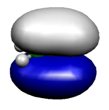
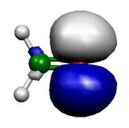
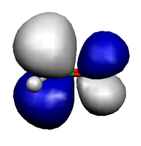
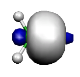
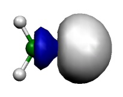
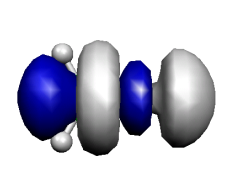

<a id="sec:spectroscopyproperties.nbo"></a>
# 自然键轨道（NBO）分析（Natural Bond Orbital Analysis）

一种流行且实用的布居分析方法是
Weinhold 及其同事提出的自然键轨道（natural bond orbital，NBO）分析。
它在 **NBO** 程序中实现，
该程序早期版本通过 CCL 邮件列表发布，
较新版本则通过威斯康星大学麦迪逊分校发布。
关于 NBO 程序的信息见
<http://www.chem.wisc.edu/~nbo7>。
要将其与 ORCA 配合使用，你需要一个独立的可执行文件版本。
从 3.1.x 版本开始，ORCA 只能与 NBO6 或 NBO7 配合使用。
要指定 NBO 可执行文件，必须设置环境变量
NBOEXE=/full/name/of/nbo7-executable。
由于接口的 NBO 部分与整数数据类型宽度（i4 或 i8）有关，
与 ORCA 配合使用的 NBO 可执行文件必须用 i8 编译！

ORCA 提供两种与 **NBO** 程序接口的方式：`! NBO` 关键词和 `%nbo` 块。
下面以甲醛为例说明其用法：

```mol
title: structure 1
theme: chem311
height: 320px
representation: ball-stick
--- xyz ---
4
structure (0 1)
C      0.000000     0.000000     0.000000
O      1.200000     0.000000     0.000000
H     -0.550000     0.952628     0.000000
H     -0.550000    -0.952628    -0.000000
--- input ---
#
# Test the interface to the NBO program
#
! RHF SVP NBO 

* xyz 0 1
  C     0.000000    0.000000    0.000000
  O     1.200000    0.000000    0.000000
  H    -0.550000    0.952628    0.000000
  H    -0.550000   -0.952628   -0.000000
*
```

这会产生如下输出：

```orca
Now starting NBO....

 *********************************** NBO 7.0 ***********************************
             N A T U R A L   A T O M I C   O R B I T A L   A N D
          N A T U R A L   B O N D   O R B I T A L   A N A L Y S I S
 ************************ development version (D000000) ************************
  (c) Copyright 1996-2018 Board of Regents of the University of Wisconsin System
      on behalf of the Theoretical Chemistry Institute.  All rights reserved.

          Cite this program [NBO 7.0.0 (15-Nov-2018)] as:

          NBO 7.0.  E. D. Glendening, J. K. Badenhoop, A. E. Reed,
          J. E. Carpenter, J. A. Bohmann, C. M. Morales, P. Karafiloglou,
          C. R. Landis, and F. Weinhold, Theoretical Chemistry Institute,
          University of Wisconsin, Madison, WI (2018)

       /NPA    / : Natural Population Analysis
       /NBO    / : Natural Bond Orbital Analysis
       /AONBO  / : Checkpoint the AO to NBO transformation
       /ARCHIVE/ : Write the archive file to lfn47

 Job title:  ORCA Job: NBO_1

 NATURAL POPULATIONS:  Natural atomic orbital occupancies

  NAO Atom No lang   Type(AO)    Occupancy      Energy
 -------------------------------------------------------
   1    C  1  s      Cor( 1s)     1.99997     -11.34329
   2    C  1  s      Val( 2s)     1.01533      -0.17540
   3    C  1  s      Ryd( 3s)     0.00701       0.61376
   4    C  1  px     Val( 2p)     0.81697       0.08822
   5    C  1  px     Ryd( 3p)     0.01268       0.63900
   6    C  1  py     Val( 2p)     1.09795      -0.01243
   7    C  1  py     Ryd( 3p)     0.00055       0.80803
   8    C  1  pz     Val( 2p)     0.66003      -0.03464
   9    C  1  pz     Ryd( 3p)     0.00283       0.62824
  10    C  1  dxy    Ryd( 3d)     0.00576       2.75039
  11    C  1  dxz    Ryd( 3d)     0.00375       2.25746
  12    C  1  dyz    Ryd( 3d)     0.00000       2.08566
  13    C  1  dx2y2  Ryd( 3d)     0.00337       2.74845
  14    C  1  dz2    Ryd( 3d)     0.00114       2.40647

  15    O  2  s      Cor( 1s)     1.99998     -20.56485
  16    O  2  s      Val( 2s)     1.70725      -0.92198
  17    O  2  s      Ryd( 3s)     0.00171       1.55322
  18    O  2  px     Val( 2p)     1.62177      -0.42255
  19    O  2  px     Ryd( 3p)     0.00079       1.29654
  20    O  2  py     Val( 2p)     1.91529      -0.46844
  21    O  2  py     Ryd( 3p)     0.00383       1.41052
  22    O  2  pz     Val( 2p)     1.32984      -0.28626
  23    O  2  pz     Ryd( 3p)     0.00011       1.30080
  24    O  2  dxy    Ryd( 3d)     0.00213       3.26414
  25    O  2  dxz    Ryd( 3d)     0.00340       3.20490
  26    O  2  dyz    Ryd( 3d)     0.00000       2.98918
  27    O  2  dx2y2  Ryd( 3d)     0.00406       3.55008
  28    O  2  dz2    Ryd( 3d)     0.00119       3.17511

  29    H  3  s      Val( 1s)     0.88576       0.07107
  30    H  3  s      Ryd( 2s)     0.00298       0.41181
  31    H  3  px     Ryd( 2p)     0.00030       2.18260
  32    H  3  py     Ryd( 2p)     0.00159       2.49146
  33    H  3  pz     Ryd( 2p)     0.00002       1.85643

  34    H  4  s      Val( 1s)     0.88576       0.07107
  35    H  4  s      Ryd( 2s)     0.00298       0.41181
  36    H  4  px     Ryd( 2p)     0.00030       2.18260
  37    H  4  py     Ryd( 2p)     0.00159       2.49146
  38    H  4  pz     Ryd( 2p)     0.00002       1.85643

 Summary of Natural Population Analysis:

                                     Natural Population
             Natural    ---------------------------------------------
  Atom No    Charge        Core      Valence    Rydberg      Total
 --------------------------------------------------------------------
    C  1    0.37265      1.99997     3.59028    0.03709     5.62735
    O  2   -0.59134      1.99998     6.57415    0.01720     8.59134
    H  3    0.10934      0.00000     0.88576    0.00489     0.89066
    H  4    0.10934      0.00000     0.88576    0.00489     0.89066
 ====================================================================
 * Total * -0.00000      3.99995    11.93596    0.06408    16.00000

                                 Natural Population
 ---------------------------------------------------------
   Core                       3.99995 ( 99.9988% of    4)
   Valence                   11.93596 ( 99.4664% of   12)
   Natural Minimal Basis     15.93592 ( 99.5995% of   16)
   Natural Rydberg Basis      0.06408 (  0.4005% of   16)
 ---------------------------------------------------------

    Atom No         Natural Electron Configuration
 ----------------------------------------------------------------------------
      C  1      [core]2s( 1.02)2p( 2.57)3s( 0.01)3p( 0.02)3d( 0.01)
      O  2      [core]2s( 1.71)2p( 4.87)3d( 0.01)
      H  3            1s( 0.89)
      H  4            1s( 0.89)

 NATURAL BOND ORBITAL ANALYSIS:

                            Occupancies       Lewis Structure    Low   High
         Max    Occ     -------------------  -----------------   occ   occ
  Cycle  Ctr   Thresh    Lewis   non-Lewis     CR  BD  nC  LP    (L)   (NL)
 ============================================================================
    1     2     1.90    15.89671   0.10329      2   4   0   2     0      0
 ----------------------------------------------------------------------------

 Structure accepted: No low occupancy Lewis orbitals

 -------------------------------------------------------
   Core                      3.99995 ( 99.999% of   4)
   Valence Lewis            11.89676 ( 99.140% of  12)
  ==================      =============================
   Total Lewis              15.89671 ( 99.354% of  16)
  -----------------------------------------------------
   Valence non-Lewis         0.07835 (  0.490% of  16)
   Rydberg non-Lewis         0.02493 (  0.156% of  16)
  ==================      =============================
   Total non-Lewis           0.10329 (  0.646% of  16)
 -------------------------------------------------------

     (Occupancy)   Bond orbital / Coefficients / Hybrids
 ------------------ Lewis ------------------------------------------------------
   1. (1.99997) CR ( 1) C  1            s(100.00%)
                                         1.0000  0.0000  0.0000  0.0000  0.0000
                                         0.0000  0.0000  0.0000  0.0000  0.0000
                                         0.0000  0.0000  0.0000  0.0000
   2. (1.99998) CR ( 1) O  2            s(100.00%)
                                         1.0000  0.0000  0.0000  0.0000  0.0000
                                         0.0000  0.0000  0.0000  0.0000  0.0000
                                         0.0000  0.0000  0.0000  0.0000
   3. (1.98853) LP ( 1) O  2            s( 56.22%)p 0.78( 43.73%)d 0.00(  0.05%)
                                         0.0000  0.7496 -0.0170  0.6612  0.0069
                                         0.0000  0.0000  0.0000  0.0000  0.0000
                                         0.0000  0.0000 -0.0201  0.0100
   4. (1.91757) LP ( 2) O  2            s(  0.00%)p 1.00( 99.89%)d 0.00(  0.11%)
                                         0.0000  0.0000  0.0000 -0.0000 -0.0000
                                         0.9994 -0.0098  0.0000 -0.0000 -0.0330
                                        -0.0000  0.0000  0.0000 -0.0000
   5. (1.99996) BD ( 1) C  1- O  2
               ( 33.33%)   0.5773* C  1 s(  0.00%)p 1.00( 99.44%)d 0.01(  0.56%)
                                         0.0000 -0.0000 -0.0000  0.0000 -0.0000
                                        -0.0000  0.0000  0.9951 -0.0652 -0.0000
                                         0.0750  0.0000 -0.0000  0.0000
               ( 66.67%)   0.8165* O  2 s(  0.00%)p 1.00( 99.75%)d 0.00(  0.25%)
                                         0.0000 -0.0000  0.0000  0.0000 -0.0000
                                        -0.0000  0.0000  0.9987 -0.0090  0.0000
                                        -0.0505  0.0000  0.0000 -0.0000
   6. (1.99975) BD ( 2) C  1- O  2
               ( 32.59%)   0.5709* C  1 s( 32.18%)p 2.09( 67.35%)d 0.01(  0.46%)
                                         0.0000  0.5628  0.0714  0.8149  0.0973
                                        -0.0000 -0.0000 -0.0000 -0.0000 -0.0000
                                        -0.0000  0.0000  0.0618 -0.0286
               ( 67.41%)   0.8211* O  2 s( 43.84%)p 1.27( 55.85%)d 0.01(  0.31%)
                                         0.0000  0.6615  0.0284 -0.7470 -0.0215
                                        -0.0000  0.0000 -0.0000 -0.0000  0.0000
                                         0.0000  0.0000  0.0490 -0.0270
   7. (1.99548) BD ( 1) C  1- H  3
               ( 56.63%)   0.7526* C  1 s( 33.98%)p 1.94( 65.86%)d 0.00(  0.16%)
                                         0.0000  0.5826 -0.0192 -0.3995 -0.0029
                                         0.7063 -0.0087  0.0000 -0.0000 -0.0318
                                        -0.0000  0.0000 -0.0180 -0.0153
               ( 43.37%)   0.6585* H  3 s( 99.79%)p 0.00(  0.21%)
                                         0.9989 -0.0095  0.0184 -0.0416  0.0000
   8. (1.99548) BD ( 1) C  1- H  4
               ( 56.63%)   0.7526* C  1 s( 33.98%)p 1.94( 65.86%)d 0.00(  0.16%)
                                         0.0000  0.5826 -0.0192 -0.3995 -0.0029
                                        -0.7063  0.0087 -0.0000  0.0000  0.0318
                                         0.0000  0.0000 -0.0180 -0.0153
               ( 43.37%)   0.6585* H  4 s( 99.79%)p 0.00(  0.21%)
                                         0.9989 -0.0095  0.0184  0.0416 -0.0000
 ---------------- non-Lewis ----------------------------------------------------
   9. (0.00000) BD*( 1) C  1- O  2
               ( 66.67%)   0.8165* C  1 s(  0.00%)p 1.00( 99.44%)d 0.01(  0.56%)
               ( 33.33%)  -0.5773* O  2 s(  0.00%)p 1.00( 99.75%)d 0.00(  0.25%)
  10. (0.00000) BD*( 2) C  1- O  2
               ( 67.41%)   0.8211* C  1 s( 32.18%)p 2.09( 67.35%)d 0.01(  0.46%)
               ( 32.59%)  -0.5709* O  2 s( 43.84%)p 1.27( 55.85%)d 0.01(  0.31%)
  11. (0.03918) BD*( 1) C  1- H  3
               ( 43.37%)   0.6585* C  1 s( 33.98%)p 1.94( 65.86%)d 0.00(  0.16%)
                                         0.0000 -0.5826  0.0192  0.3995  0.0029
                                        -0.7063  0.0087 -0.0000  0.0000  0.0318
                                         0.0000  0.0000  0.0180  0.0153
               ( 56.63%)  -0.7526* H  3 s( 99.79%)p 0.00(  0.21%)
                                        -0.9989  0.0095 -0.0184  0.0416 -0.0000
  12. (0.03918) BD*( 1) C  1- H  4
               ( 43.37%)   0.6585* C  1 s( 33.98%)p 1.94( 65.86%)d 0.00(  0.16%)
                                         0.0000 -0.5826  0.0192  0.3995  0.0029
                                         0.7063 -0.0087  0.0000 -0.0000 -0.0318
                                        -0.0000  0.0000  0.0180  0.0153
               ( 56.63%)  -0.7526* H  4 s( 99.79%)p 0.00(  0.21%)
                                        -0.9989  0.0095 -0.0184 -0.0416  0.0000
  13. (0.00969) RY ( 1) C  1            s( 29.83%)p 2.30( 68.57%)d 0.05(  1.60%)
                                         0.0000 -0.0565  0.5432 -0.1169  0.8198
                                         0.0000 -0.0000  0.0000 -0.0000 -0.0000
                                         0.0000  0.0000  0.1087 -0.0648
  14. (0.00517) RY ( 2) C  1            s(  0.00%)p 1.00(  9.56%)d 9.46( 90.44%)
                                         0.0000  0.0000 -0.0000  0.0000 -0.0000
                                         0.0465  0.3057  0.0000 -0.0000  0.9510
                                         0.0000  0.0000 -0.0000 -0.0000
  15. (0.00001) RY ( 3) C  1            s( 20.02%)p 0.82( 16.47%)d 3.17( 63.52%)
  16. (0.00000) RY ( 4) C  1            s(  0.00%)p 1.00( 90.64%)d 0.10(  9.36%)
  17. (0.00000) RY ( 5) C  1            s(  0.00%)p 1.00(100.00%)d 0.00(  0.00%)
  18. (0.00000) RY ( 6) C  1            s( 42.72%)p 0.35( 15.02%)d 0.99( 42.26%)
  19. (0.00000) RY ( 7) C  1            s(  0.00%)p 1.00(  0.56%)d99.99( 99.44%)
  20. (0.00000) RY ( 8) C  1            s(  0.00%)p 0.00(  0.00%)d 1.00(100.00%)
  21. (0.00000) RY ( 9) C  1            s(  7.29%)p 0.09(  0.66%)d12.63( 92.05%)
  22. (0.00368) RY ( 1) O  2            s(  0.00%)p 1.00( 98.96%)d 0.01(  1.04%)
                                         0.0000 -0.0000 -0.0000  0.0000  0.0000
                                         0.0064  0.9948 -0.0000  0.0000 -0.1018
                                         0.0000  0.0000 -0.0000  0.0000
  23. (0.00014) RY ( 2) O  2            s( 35.10%)p 1.44( 50.60%)d 0.41( 14.30%)
                                         0.0000 -0.0178  0.5922  0.0556 -0.7091
                                         0.0000 -0.0000 -0.0000  0.0000 -0.0000
                                         0.0000  0.0000  0.3336 -0.1780
  24. (0.00000) RY ( 3) O  2            s( 56.05%)p 0.25( 13.79%)d 0.54( 30.17%)
  25. (0.00000) RY ( 4) O  2            s(  0.00%)p 1.00(100.00%)d 0.00(  0.00%)
  26. (0.00000) RY ( 5) O  2            s(  0.00%)p 1.00(  1.14%)d86.35( 98.86%)
  27. (0.00000) RY ( 6) O  2            s(  0.00%)p 1.00(  0.25%)d99.99( 99.75%)
  28. (0.00000) RY ( 7) O  2            s(  0.00%)p 0.00(  0.00%)d 1.00(100.00%)
  29. (0.00000) RY ( 8) O  2            s(  6.72%)p 5.27( 35.42%)d 8.61( 57.85%)
  30. (0.00000) RY ( 9) O  2            s(  2.07%)p 0.30(  0.61%)d47.00( 97.32%)
  31. (0.00308) RY ( 1) H  3            s( 99.42%)p 0.01(  0.58%)
                                         0.0096  0.9970 -0.0710 -0.0281  0.0000
  32. (0.00002) RY ( 2) H  3            s(  0.22%)p99.99( 99.78%)
  33. (0.00002) RY ( 3) H  3            s(  0.00%)p 1.00(100.00%)
  34. (0.00001) RY ( 4) H  3            s(  0.57%)p99.99( 99.43%)
  35. (0.00308) RY ( 1) H  4            s( 99.42%)p 0.01(  0.58%)
                                         0.0096  0.9970 -0.0710  0.0281  0.0000
  36. (0.00002) RY ( 2) H  4            s(  0.22%)p99.99( 99.78%)
  37. (0.00002) RY ( 3) H  4            s(  0.00%)p 1.00(100.00%)
  38. (0.00001) RY ( 4) H  4            s(  0.57%)p99.99( 99.43%)

 NHO DIRECTIONALITY AND BOND BENDING (deviation from line of nuclear centers at
                                      the position of maximum hybrid amplitude)

         [Thresholds for printing:  angular deviation  >  1.0 degree]
                                    p- or d-character  > 25.0%
                                    orbital occupancy  >  0.10e

                        Line of Centers        Hybrid 1             Hybrid 2
                        ---------------  -------------------  ------------------
           NBO            Theta   Phi    Theta   Phi    Dev   Theta   Phi    Dev
 ===============================================================================
   3. LP ( 1) O  2          --     --     90.0    0.0   --      --     --    --
   4. LP ( 2) O  2          --     --     90.0   90.7   --      --     --    --
   5. BD ( 1) C  1- O  2   90.0    0.0     3.0    0.0  87.0   178.7  180.0  88.7

 SECOND ORDER PERTURBATION THEORY ANALYSIS OF FOCK MATRIX IN NBO BASIS

     Threshold for printing:   0.50 kcal/mol
                                                          E(2) E(NL)-E(L) F(L,NL)
      Donor (L) NBO              Acceptor (NL) NBO      kcal/mol   a.u.    a.u.
 ===============================================================================

 within unit  1
    3. LP ( 1) O  2            13. RY ( 1) C  1            8.58    1.40   0.098
    4. LP ( 2) O  2            11. BD*( 1) C  1- H  3     26.11    1.16   0.156
    4. LP ( 2) O  2            12. BD*( 1) C  1- H  4     26.11    1.16   0.156
    4. LP ( 2) O  2            14. RY ( 2) C  1            5.72    3.06   0.118
    4. LP ( 2) O  2            26. RY ( 5) O  2            0.73    3.75   0.047
    7. BD ( 1) C  1- H  3      12. BD*( 1) C  1- H  4      0.74    1.42   0.029
    7. BD ( 1) C  1- H  3      22. RY ( 1) O  2            2.25    2.12   0.062
    8. BD ( 1) C  1- H  4      11. BD*( 1) C  1- H  3      0.74    1.42   0.029
    8. BD ( 1) C  1- H  4      22. RY ( 1) O  2            2.25    2.12   0.062

 NATURAL BOND ORBITALS (Summary):

                                                     Principal Delocalizations
           NBO                 Occupancy    Energy   (geminal,vicinal,remote)
 ===============================================================================
 Molecular unit  1  (CH2O)
 ------ Lewis --------------------------------------
    1. CR ( 1) C  1             1.99997   -11.34329
    2. CR ( 1) O  2             1.99998   -20.56485
    3. LP ( 1) O  2             1.98853    -0.81352  13(v)
    4. LP ( 2) O  2             1.91757    -0.46975  11(v),12(v),14(v),26(g)
    5. BD ( 1) C  1- O  2       1.99996    -0.53505
    6. BD ( 2) C  1- O  2       1.99975    -1.23345
    7. BD ( 1) C  1- H  3       1.99548    -0.72703  22(v),12(g)
    8. BD ( 1) C  1- H  4       1.99548    -0.72703  22(v),11(g)
 ------ non-Lewis ----------------------------------
    9. BD*( 1) C  1- O  2       0.00000     0.20704
   10. BD*( 2) C  1- O  2       0.00000     0.95146
   11. BD*( 1) C  1- H  3       0.03918     0.69317
   12. BD*( 1) C  1- H  4       0.03918     0.69317
   13. RY ( 1) C  1             0.00969     0.58169
   14. RY ( 2) C  1             0.00517     2.58837
   15. RY ( 3) C  1             0.00001     1.75652
   16. RY ( 4) C  1             0.00000     0.96046
   17. RY ( 5) C  1             0.00000     0.64510
   18. RY ( 6) C  1             0.00000     1.49223
   19. RY ( 7) C  1             0.00000     2.24615
   20. RY ( 8) C  1             0.00000     2.08566
   21. RY ( 9) C  1             0.00000     2.49414
   22. RY ( 1) O  2             0.00368     1.39676
   23. RY ( 2) O  2             0.00014     1.56107
   24. RY ( 3) O  2             0.00000     2.18160
   25. RY ( 4) O  2             0.00000     1.30222
   26. RY ( 5) O  2             0.00000     3.27920
   27. RY ( 6) O  2             0.00000     3.20505
   28. RY ( 7) O  2             0.00000     2.98918
   29. RY ( 8) O  2             0.00000     2.69359
   30. RY ( 9) O  2             0.00000     3.12898
   31. RY ( 1) H  3             0.00308     0.41874
   32. RY ( 2) H  3             0.00002     2.57996
   33. RY ( 3) H  3             0.00002     1.85643
   34. RY ( 4) H  3             0.00001     2.06898
   35. RY ( 1) H  4             0.00308     0.41874
   36. RY ( 2) H  4             0.00002     2.57996
   37. RY ( 3) H  4             0.00002     1.85643
   38. RY ( 4) H  4             0.00001     2.06898
          -------------------------------
                 Total Lewis   15.89671  ( 99.3545%)
           Valence non-Lewis    0.07835  (  0.4897%)
           Rydberg non-Lewis    0.02493  (  0.1558%)
          -------------------------------
               Total unit  1   16.00000  (100.0000%)
              Charge unit  1    0.00000

 $CHOOSE
   LONE 2 2 END
   BOND D 1 2 S 1 3 S 1 4 END
 $END

 NBO analysis completed in 0.05 CPU seconds (0 wall seconds)
 Maximum scratch memory used by NBO was 297106 words (2.27 MB)
Stopping NBO...Storing NBOs: NBO_1.nbo

                                *** returned from  NBO  program ***
```

因此，在本例中，甲醛的 NBO 分析表明：
单一的 Lewis 结构占主导地位，
C 与 H 之间是单键，C 与 O 之间是双键，
氧上有两个孤对——这与普通化学论证的结论完全一致。
此外，该程序还给出与之对应的四个价层反键。
基组的其余成分张成"里德堡"（Rydberg）空间，
产生归属于单个原子的半定域正交轨道
（注意术语：BD $=$ 成键，BD\* $=$ 反键，LP $=$ 孤对，
CR $=$ 芯层轨道，RY$=$ 里德堡轨道）。
NPA 分析显示氧带部分负电荷，碳和氢带部分正电荷。

此外，NBO 轨道以 ORCA .gbw 文件格式存储为 `jobname.nbo`。
该文件可用于进一步分析以及与 ORCA 配合使用，
例如通过 `orca_plot` 绘制轨道。

**NBO** 程序还有许多其他特性和分析工具。
在 ORCA 中已实现的特性可通过 `%nbo` 块控制

```orca
%nbo
NBOKEYLIST    = "$NBO     ... $END"
DELKEYLIST    = "$DEL     ... $END"
COREKEYLIST   = "$CORE    ... $END"
NRTSTRKEYLIST = "$NRTSTR  ... $END"
NPEPAKEYLIST  = "$NPEPA   ... $END"
end
```

相应 keylist 的语法由 NBO6.x/NBO7.x 手册给出。

指定单个 `! NBO` 关键词等价于如下 `%nbo` 块

```orca
%nbo
NBOKEYLIST    = "$NBO NBO NPA AONBO=C ARCHIVE $END"
end
```

超出 `%nbo` 块所能给出的那套完整特性，
可通过 NBO 程序生成的 `FILE.47` 文件访问。
这是一个 ASCII 文件，可用文本编辑器编辑。
根据需要在相应块中添加或删除关键词，
然后调用 gennbo 程序，如

```orca
gennbo < FILE.47 >jobname.nboout
```

<a id="fig:732"></a>
!!! note "ABC|DEF"
    
    
    
    
    
    

    H$_{2}$CO 分子的六个 NBO。左图为 C 和 O 的占据成键 $\pi$ 和
    $\sigma$ 轨道，中图为氧的两个孤对，右图为
    两个 $\pi^*$ 和 $\sigma^*$ 反键轨道。

`FILE.47` 文件如下所示：

```orca
$GENNBO  NATOMS=4  NBAS=38  UPPER  BODM  FORMAT  $END
 $NBO  $END
 $COORD
 ORCA Job: check
     6    6       0.000000       0.000000       0.000000
     8    8       2.267671       0.000000       0.000000
     1    1      -1.039349       1.800206       0.000000
     1    1      -1.039349      -1.800206       0.000000
 $END
 $BASIS
```

如果你不需要这个（相当大的）文件，必须手动删除它！

<a id="sec:spectroscopyproperties.nbo.deletions"></a>
## NBO 删除（NBO Deletions）

通过 ORCA-NBO 接口实现的一个高级特性是使用删除（deletions）的功能。

```orca
Now starting NBO....

 *********************************** NBO 7.0 ***********************************
             N A T U R A L   A T O M I C   O R B I T A L   A N D
          N A T U R A L   B O N D   O R B I T A L   A N A L Y S I S
 ************************ development version (D000000) ************************
  (c) Copyright 1996-2018 Board of Regents of the University of Wisconsin System
      on behalf of the Theoretical Chemistry Institute.  All rights reserved.

          Cite this program [NBO 7.0.0 (15-Nov-2018)] as:

          NBO 7.0.  E. D. Glendening, J. K. Badenhoop, A. E. Reed,
          J. E. Carpenter, J. A. Bohmann, C. M. Morales, P. Karafiloglou,
          C. R. Landis, and F. Weinhold, Theoretical Chemistry Institute,
          University of Wisconsin, Madison, WI (2018)

       /NPA    / : Natural Population Analysis
       /NBO    / : Natural Bond Orbital Analysis
       /AONBO  / : Checkpoint the AO to NBO transformation
       /ARCHIVE/ : Write the archive file to lfn47

 Job title:  ORCA Job: NBO_1

 NATURAL POPULATIONS:  Natural atomic orbital occupancies

  NAO Atom No lang   Type(AO)    Occupancy      Energy
 -------------------------------------------------------
   1    C  1  s      Cor( 1s)     1.99997     -11.34329
   2    C  1  s      Val( 2s)     1.01533      -0.17540
   3    C  1  s      Ryd( 3s)     0.00701       0.61376
   4    C  1  px     Val( 2p)     0.81697       0.08822
   5    C  1  px     Ryd( 3p)     0.01268       0.63900
   6    C  1  py     Val( 2p)     1.09795      -0.01243
   7    C  1  py     Ryd( 3p)     0.00055       0.80803
   8    C  1  pz     Val( 2p)     0.66003      -0.03464
   9    C  1  pz     Ryd( 3p)     0.00283       0.62824
  10    C  1  dxy    Ryd( 3d)     0.00576       2.75039
  11    C  1  dxz    Ryd( 3d)     0.00375       2.25746
  12    C  1  dyz    Ryd( 3d)     0.00000       2.08566
  13    C  1  dx2y2  Ryd( 3d)     0.00337       2.74845
  14    C  1  dz2    Ryd( 3d)     0.00114       2.40647

  15    O  2  s      Cor( 1s)     1.99998     -20.56485
  16    O  2  s      Val( 2s)     1.70725      -0.92198
  17    O  2  s      Ryd( 3s)     0.00171       1.55322
  18    O  2  px     Val( 2p)     1.62177      -0.42255
  19    O  2  px     Ryd( 3p)     0.00079       1.29654
  20    O  2  py     Val( 2p)     1.91529      -0.46844
  21    O  2  py     Ryd( 3p)     0.00383       1.41052
  22    O  2  pz     Val( 2p)     1.32984      -0.28626
  23    O  2  pz     Ryd( 3p)     0.00011       1.30080
  24    O  2  dxy    Ryd( 3d)     0.00213       3.26414
  25    O  2  dxz    Ryd( 3d)     0.00340       3.20490
  26    O  2  dyz    Ryd( 3d)     0.00000       2.98918
  27    O  2  dx2y2  Ryd( 3d)     0.00406       3.55008
  28    O  2  dz2    Ryd( 3d)     0.00119       3.17511

  29    H  3  s      Val( 1s)     0.88576       0.07107
  30    H  3  s      Ryd( 2s)     0.00298       0.41181
  31    H  3  px     Ryd( 2p)     0.00030       2.18260
  32    H  3  py     Ryd( 2p)     0.00159       2.49146
  33    H  3  pz     Ryd( 2p)     0.00002       1.85643

  34    H  4  s      Val( 1s)     0.88576       0.07107
  35    H  4  s      Ryd( 2s)     0.00298       0.41181
  36    H  4  px     Ryd( 2p)     0.00030       2.18260
  37    H  4  py     Ryd( 2p)     0.00159       2.49146
  38    H  4  pz     Ryd( 2p)     0.00002       1.85643

 Summary of Natural Population Analysis:

                                     Natural Population
             Natural    ---------------------------------------------
  Atom No    Charge        Core      Valence    Rydberg      Total
 --------------------------------------------------------------------
    C  1    0.37265      1.99997     3.59028    0.03709     5.62735
    O  2   -0.59134      1.99998     6.57415    0.01720     8.59134
    H  3    0.10934      0.00000     0.88576    0.00489     0.89066
    H  4    0.10934      0.00000     0.88576    0.00489     0.89066
 ====================================================================
 * Total * -0.00000      3.99995    11.93596    0.06408    16.00000

                                 Natural Population
 ---------------------------------------------------------
   Core                       3.99995 ( 99.9988% of    4)
   Valence                   11.93596 ( 99.4664% of   12)
   Natural Minimal Basis     15.93592 ( 99.5995% of   16)
   Natural Rydberg Basis      0.06408 (  0.4005% of   16)
 ---------------------------------------------------------

    Atom No         Natural Electron Configuration
 ----------------------------------------------------------------------------
      C  1      [core]2s( 1.02)2p( 2.57)3s( 0.01)3p( 0.02)3d( 0.01)
      O  2      [core]2s( 1.71)2p( 4.87)3d( 0.01)
      H  3            1s( 0.89)
      H  4            1s( 0.89)

 NATURAL BOND ORBITAL ANALYSIS:

                            Occupancies       Lewis Structure    Low   High
         Max    Occ     -------------------  -----------------   occ   occ
  Cycle  Ctr   Thresh    Lewis   non-Lewis     CR  BD  nC  LP    (L)   (NL)
 ============================================================================
    1     2     1.90    15.89671   0.10329      2   4   0   2     0      0
 ----------------------------------------------------------------------------

 Structure accepted: No low occupancy Lewis orbitals

 -------------------------------------------------------
   Core                      3.99995 ( 99.999% of   4)
   Valence Lewis            11.89676 ( 99.140% of  12)
  ==================      =============================
   Total Lewis              15.89671 ( 99.354% of  16)
  -----------------------------------------------------
   Valence non-Lewis         0.07835 (  0.490% of  16)
   Rydberg non-Lewis         0.02493 (  0.156% of  16)
  ==================      =============================
   Total non-Lewis           0.10329 (  0.646% of  16)
 -------------------------------------------------------

     (Occupancy)   Bond orbital / Coefficients / Hybrids
 ------------------ Lewis ------------------------------------------------------
   1. (1.99997) CR ( 1) C  1            s(100.00%)
                                         1.0000  0.0000  0.0000  0.0000  0.0000
                                         0.0000  0.0000  0.0000  0.0000  0.0000
                                         0.0000  0.0000  0.0000  0.0000
   2. (1.99998) CR ( 1) O  2            s(100.00%)
                                         1.0000  0.0000  0.0000  0.0000  0.0000
                                         0.0000  0.0000  0.0000  0.0000  0.0000
                                         0.0000  0.0000  0.0000  0.0000
   3. (1.98853) LP ( 1) O  2            s( 56.22%)p 0.78( 43.73%)d 0.00(  0.05%)
                                         0.0000  0.7496 -0.0170  0.6612  0.0069
                                         0.0000  0.0000  0.0000  0.0000  0.0000
                                         0.0000  0.0000 -0.0201  0.0100
   4. (1.91757) LP ( 2) O  2            s(  0.00%)p 1.00( 99.89%)d 0.00(  0.11%)
                                         0.0000  0.0000  0.0000 -0.0000 -0.0000
                                         0.9994 -0.0098  0.0000 -0.0000 -0.0330
                                        -0.0000  0.0000  0.0000 -0.0000
   5. (1.99996) BD ( 1) C  1- O  2
               ( 33.33%)   0.5773* C  1 s(  0.00%)p 1.00( 99.44%)d 0.01(  0.56%)
                                         0.0000 -0.0000 -0.0000  0.0000 -0.0000
                                        -0.0000  0.0000  0.9951 -0.0652 -0.0000
                                         0.0750  0.0000 -0.0000  0.0000
               ( 66.67%)   0.8165* O  2 s(  0.00%)p 1.00( 99.75%)d 0.00(  0.25%)
                                         0.0000 -0.0000  0.0000  0.0000 -0.0000
                                        -0.0000  0.0000  0.9987 -0.0090  0.0000
                                        -0.0505  0.0000  0.0000 -0.0000
   6. (1.99975) BD ( 2) C  1- O  2
               ( 32.59%)   0.5709* C  1 s( 32.18%)p 2.09( 67.35%)d 0.01(  0.46%)
                                         0.0000  0.5628  0.0714  0.8149  0.0973
                                        -0.0000 -0.0000 -0.0000 -0.0000 -0.0000
                                        -0.0000  0.0000  0.0618 -0.0286
               ( 67.41%)   0.8211* O  2 s( 43.84%)p 1.27( 55.85%)d 0.01(  0.31%)
                                         0.0000  0.6615  0.0284 -0.7470 -0.0215
                                        -0.0000  0.0000 -0.0000 -0.0000  0.0000
                                         0.0000  0.0000  0.0490 -0.0270
   7. (1.99548) BD ( 1) C  1- H  3
               ( 56.63%)   0.7526* C  1 s( 33.98%)p 1.94( 65.86%)d 0.00(  0.16%)
                                         0.0000  0.5826 -0.0192 -0.3995 -0.0029
                                         0.7063 -0.0087  0.0000 -0.0000 -0.0318
                                        -0.0000  0.0000 -0.0180 -0.0153
               ( 43.37%)   0.6585* H  3 s( 99.79%)p 0.00(  0.21%)
                                         0.9989 -0.0095  0.0184 -0.0416  0.0000
   8. (1.99548) BD ( 1) C  1- H  4
               ( 56.63%)   0.7526* C  1 s( 33.98%)p 1.94( 65.86%)d 0.00(  0.16%)
                                         0.0000  0.5826 -0.0192 -0.3995 -0.0029
                                        -0.7063  0.0087 -0.0000  0.0000  0.0318
                                         0.0000  0.0000 -0.0180 -0.0153
               ( 43.37%)   0.6585* H  4 s( 99.79%)p 0.00(  0.21%)
                                         0.9989 -0.0095  0.0184  0.0416 -0.0000
 ---------------- non-Lewis ----------------------------------------------------
   9. (0.00000) BD*( 1) C  1- O  2
               ( 66.67%)   0.8165* C  1 s(  0.00%)p 1.00( 99.44%)d 0.01(  0.56%)
               ( 33.33%)  -0.5773* O  2 s(  0.00%)p 1.00( 99.75%)d 0.00(  0.25%)
  10. (0.00000) BD*( 2) C  1- O  2
               ( 67.41%)   0.8211* C  1 s( 32.18%)p 2.09( 67.35%)d 0.01(  0.46%)
               ( 32.59%)  -0.5709* O  2 s( 43.84%)p 1.27( 55.85%)d 0.01(  0.31%)
  11. (0.03918) BD*( 1) C  1- H  3
               ( 43.37%)   0.6585* C  1 s( 33.98%)p 1.94( 65.86%)d 0.00(  0.16%)
                                         0.0000 -0.5826  0.0192  0.3995  0.0029
                                        -0.7063  0.0087 -0.0000  0.0000  0.0318
                                         0.0000  0.0000  0.0180  0.0153
               ( 56.63%)  -0.7526* H  3 s( 99.79%)p 0.00(  0.21%)
                                        -0.9989  0.0095 -0.0184  0.0416 -0.0000
  12. (0.03918) BD*( 1) C  1- H  4
               ( 43.37%)   0.6585* C  1 s( 33.98%)p 1.94( 65.86%)d 0.00(  0.16%)
                                         0.0000 -0.5826  0.0192  0.3995  0.0029
                                         0.7063 -0.0087  0.0000 -0.0000 -0.0318
                                        -0.0000  0.0000  0.0180  0.0153
               ( 56.63%)  -0.7526* H  4 s( 99.79%)p 0.00(  0.21%)
                                        -0.9989  0.0095 -0.0184 -0.0416  0.0000
  13. (0.00969) RY ( 1) C  1            s( 29.83%)p 2.30( 68.57%)d 0.05(  1.60%)
                                         0.0000 -0.0565  0.5432 -0.1169  0.8198
                                         0.0000 -0.0000  0.0000 -0.0000 -0.0000
                                         0.0000  0.0000  0.1087 -0.0648
  14. (0.00517) RY ( 2) C  1            s(  0.00%)p 1.00(  9.56%)d 9.46( 90.44%)
                                         0.0000  0.0000 -0.0000  0.0000 -0.0000
                                         0.0465  0.3057  0.0000 -0.0000  0.9510
                                         0.0000  0.0000 -0.0000 -0.0000
  15. (0.00001) RY ( 3) C  1            s( 20.02%)p 0.82( 16.47%)d 3.17( 63.52%)
  16. (0.00000) RY ( 4) C  1            s(  0.00%)p 1.00( 90.64%)d 0.10(  9.36%)
  17. (0.00000) RY ( 5) C  1            s(  0.00%)p 1.00(100.00%)d 0.00(  0.00%)
  18. (0.00000) RY ( 6) C  1            s( 42.72%)p 0.35( 15.02%)d 0.99( 42.26%)
  19. (0.00000) RY ( 7) C  1            s(  0.00%)p 1.00(  0.56%)d99.99( 99.44%)
  20. (0.00000) RY ( 8) C  1            s(  0.00%)p 0.00(  0.00%)d 1.00(100.00%)
  21. (0.00000) RY ( 9) C  1            s(  7.29%)p 0.09(  0.66%)d12.63( 92.05%)
  22. (0.00368) RY ( 1) O  2            s(  0.00%)p 1.00( 98.96%)d 0.01(  1.04%)
                                         0.0000 -0.0000 -0.0000  0.0000  0.0000
                                         0.0064  0.9948 -0.0000  0.0000 -0.1018
                                         0.0000  0.0000 -0.0000  0.0000
  23. (0.00014) RY ( 2) O  2            s( 35.10%)p 1.44( 50.60%)d 0.41( 14.30%)
                                         0.0000 -0.0178  0.5922  0.0556 -0.7091
                                         0.0000 -0.0000 -0.0000  0.0000 -0.0000
                                         0.0000  0.0000  0.3336 -0.1780
  24. (0.00000) RY ( 3) O  2            s( 56.05%)p 0.25( 13.79%)d 0.54( 30.17%)
  25. (0.00000) RY ( 4) O  2            s(  0.00%)p 1.00(100.00%)d 0.00(  0.00%)
  26. (0.00000) RY ( 5) O  2            s(  0.00%)p 1.00(  1.14%)d86.35( 98.86%)
  27. (0.00000) RY ( 6) O  2            s(  0.00%)p 1.00(  0.25%)d99.99( 99.75%)
  28. (0.00000) RY ( 7) O  2            s(  0.00%)p 0.00(  0.00%)d 1.00(100.00%)
  29. (0.00000) RY ( 8) O  2            s(  6.72%)p 5.27( 35.42%)d 8.61( 57.85%)
  30. (0.00000) RY ( 9) O  2            s(  2.07%)p 0.30(  0.61%)d47.00( 97.32%)
  31. (0.00308) RY ( 1) H  3            s( 99.42%)p 0.01(  0.58%)
                                         0.0096  0.9970 -0.0710 -0.0281  0.0000
  32. (0.00002) RY ( 2) H  3            s(  0.22%)p99.99( 99.78%)
  33. (0.00002) RY ( 3) H  3            s(  0.00%)p 1.00(100.00%)
  34. (0.00001) RY ( 4) H  3            s(  0.57%)p99.99( 99.43%)
  35. (0.00308) RY ( 1) H  4            s( 99.42%)p 0.01(  0.58%)
                                         0.0096  0.9970 -0.0710  0.0281  0.0000
  36. (0.00002) RY ( 2) H  4            s(  0.22%)p99.99( 99.78%)
  37. (0.00002) RY ( 3) H  4            s(  0.00%)p 1.00(100.00%)
  38. (0.00001) RY ( 4) H  4            s(  0.57%)p99.99( 99.43%)

 NHO DIRECTIONALITY AND BOND BENDING (deviation from line of nuclear centers at
                                      the position of maximum hybrid amplitude)

         [Thresholds for printing:  angular deviation  >  1.0 degree]
                                    p- or d-character  > 25.0%
                                    orbital occupancy  >  0.10e

                        Line of Centers        Hybrid 1             Hybrid 2
                        ---------------  -------------------  ------------------
           NBO            Theta   Phi    Theta   Phi    Dev   Theta   Phi    Dev
 ===============================================================================
   3. LP ( 1) O  2          --     --     90.0    0.0   --      --     --    --
   4. LP ( 2) O  2          --     --     90.0   90.7   --      --     --    --
   5. BD ( 1) C  1- O  2   90.0    0.0     3.0    0.0  87.0   178.7  180.0  88.7

 SECOND ORDER PERTURBATION THEORY ANALYSIS OF FOCK MATRIX IN NBO BASIS

     Threshold for printing:   0.50 kcal/mol
                                                          E(2) E(NL)-E(L) F(L,NL)
      Donor (L) NBO              Acceptor (NL) NBO      kcal/mol   a.u.    a.u.
 ===============================================================================

 within unit  1
    3. LP ( 1) O  2            13. RY ( 1) C  1            8.58    1.40   0.098
    4. LP ( 2) O  2            11. BD*( 1) C  1- H  3     26.11    1.16   0.156
    4. LP ( 2) O  2            12. BD*( 1) C  1- H  4     26.11    1.16   0.156
    4. LP ( 2) O  2            14. RY ( 2) C  1            5.72    3.06   0.118
    4. LP ( 2) O  2            26. RY ( 5) O  2            0.73    3.75   0.047
    7. BD ( 1) C  1- H  3      12. BD*( 1) C  1- H  4      0.74    1.42   0.029
    7. BD ( 1) C  1- H  3      22. RY ( 1) O  2            2.25    2.12   0.062
    8. BD ( 1) C  1- H  4      11. BD*( 1) C  1- H  3      0.74    1.42   0.029
    8. BD ( 1) C  1- H  4      22. RY ( 1) O  2            2.25    2.12   0.062

 NATURAL BOND ORBITALS (Summary):

                                                     Principal Delocalizations
           NBO                 Occupancy    Energy   (geminal,vicinal,remote)
 ===============================================================================
 Molecular unit  1  (CH2O)
 ------ Lewis --------------------------------------
    1. CR ( 1) C  1             1.99997   -11.34329
    2. CR ( 1) O  2             1.99998   -20.56485
    3. LP ( 1) O  2             1.98853    -0.81352  13(v)
    4. LP ( 2) O  2             1.91757    -0.46975  11(v),12(v),14(v),26(g)
    5. BD ( 1) C  1- O  2       1.99996    -0.53505
    6. BD ( 2) C  1- O  2       1.99975    -1.23345
    7. BD ( 1) C  1- H  3       1.99548    -0.72703  22(v),12(g)
    8. BD ( 1) C  1- H  4       1.99548    -0.72703  22(v),11(g)
 ------ non-Lewis ----------------------------------
    9. BD*( 1) C  1- O  2       0.00000     0.20704
   10. BD*( 2) C  1- O  2       0.00000     0.95146
   11. BD*( 1) C  1- H  3       0.03918     0.69317
   12. BD*( 1) C  1- H  4       0.03918     0.69317
   13. RY ( 1) C  1             0.00969     0.58169
   14. RY ( 2) C  1             0.00517     2.58837
   15. RY ( 3) C  1             0.00001     1.75652
   16. RY ( 4) C  1             0.00000     0.96046
   17. RY ( 5) C  1             0.00000     0.64510
   18. RY ( 6) C  1             0.00000     1.49223
   19. RY ( 7) C  1             0.00000     2.24615
   20. RY ( 8) C  1             0.00000     2.08566
   21. RY ( 9) C  1             0.00000     2.49414
   22. RY ( 1) O  2             0.00368     1.39676
   23. RY ( 2) O  2             0.00014     1.56107
   24. RY ( 3) O  2             0.00000     2.18160
   25. RY ( 4) O  2             0.00000     1.30222
   26. RY ( 5) O  2             0.00000     3.27920
   27. RY ( 6) O  2             0.00000     3.20505
   28. RY ( 7) O  2             0.00000     2.98918
   29. RY ( 8) O  2             0.00000     2.69359
   30. RY ( 9) O  2             0.00000     3.12898
   31. RY ( 1) H  3             0.00308     0.41874
   32. RY ( 2) H  3             0.00002     2.57996
   33. RY ( 3) H  3             0.00002     1.85643
   34. RY ( 4) H  3             0.00001     2.06898
   35. RY ( 1) H  4             0.00308     0.41874
   36. RY ( 2) H  4             0.00002     2.57996
   37. RY ( 3) H  4             0.00002     1.85643
   38. RY ( 4) H  4             0.00001     2.06898
          -------------------------------
                 Total Lewis   15.89671  ( 99.3545%)
           Valence non-Lewis    0.07835  (  0.4897%)
           Rydberg non-Lewis    0.02493  (  0.1558%)
          -------------------------------
               Total unit  1   16.00000  (100.0000%)
              Charge unit  1    0.00000

 $CHOOSE
   LONE 2 2 END
   BOND D 1 2 S 1 3 S 1 4 END
 $END

 NBO analysis completed in 0.05 CPU seconds (0 wall seconds)
 Maximum scratch memory used by NBO was 297106 words (2.27 MB)
Stopping NBO...Storing NBOs: NBO_1.nbo

                                *** returned from  NBO  program ***
```

`DELKEYLIST` 向 NBO 提供执行某些轨道/相互作用删除的任务。
每次删除，ORCA 都基于对应于该删除的 NBO 密度计算一个新的 Fock 矩阵：

```orca
Stopping NBO...Starting NBO again for $del instructions...

 LEWIS: Delete all non-Lewis NBOs
 Deletion of the following orbitals from the NBO Fock matrix:
   10  11  12  13  14  15  16  17  18  19  20  21  22  23  24  25  26  27  28

 Orbital occupancies:

       Orbital                         No deletions  This deletion    Change
 ------------------------------------------------------------------------------
    1. CR ( 1) C  1                      1.99978        2.00000       0.00022
    2. CR ( 1) N  2                      1.99983        2.00000       0.00017
    3. LP ( 1) N  2                      1.97796        2.00000       0.02204
    4. BD ( 1) C  1- N  2                1.99846        2.00000       0.00154
    5. BD ( 1) C  1- H  3                1.99858        2.00000       0.00142
    6. BD ( 1) C  1- H  4                1.99406        2.00000       0.00594
    7. BD ( 1) C  1- H  5                1.99406        2.00000       0.00594
    8. BD ( 1) N  2- H  6                1.99440        2.00000       0.00560
    9. BD ( 1) N  2- H  7                1.99440        2.00000       0.00560
   10. BD*( 1) C  1- N  2                0.00009        0.00000      -0.00009
   11. BD*( 1) C  1- H  3                0.01567        0.00000      -0.01567
   12. BD*( 1) C  1- H  4                0.00763        0.00000      -0.00763
   13. BD*( 1) C  1- H  5                0.00763        0.00000      -0.00763
   14. BD*( 1) N  2- H  6                0.00424        0.00000      -0.00424
   15. BD*( 1) N  2- H  7                0.00424        0.00000      -0.00424
   16. RY ( 1) C  1                      0.00094        0.00000      -0.00094
   17. RY ( 2) C  1                      0.00034        0.00000      -0.00034
   18. RY ( 3) C  1                      0.00020        0.00000      -0.00020
   19. RY ( 4) C  1                      0.00001        0.00000      -0.00001
   20. RY ( 1) N  2                      0.00114        0.00000      -0.00114
   21. RY ( 2) N  2                      0.00044        0.00000      -0.00044
   22. RY ( 3) N  2                      0.00034        0.00000      -0.00034
   23. RY ( 4) N  2                      0.00001        0.00000      -0.00001
   24. RY ( 1) H  3                      0.00163        0.00000      -0.00163
   25. RY ( 1) H  4                      0.00079        0.00000      -0.00079
   26. RY ( 1) H  5                      0.00079        0.00000      -0.00079
   27. RY ( 1) H  6                      0.00117        0.00000      -0.00117
   28. RY ( 1) H  7                      0.00117        0.00000      -0.00117

 NEXT STEP:  Perform one SCF cycle to evaluate the energy of the new density
             matrix constructed from the deleted NBO Fock matrix.

 ------------------------------------------------------------------------------
Copying NBO density...
Calculating new Fock-Matrix...
Calculating Fock-Matrix...done!

New NBO energy via Fock-Matrix: -94.629937

Starting NBO again for $del/return energy instructions...

 ------------------------------------------------------------------------------
   Energy of deletion :        -94.629936711
     Total SCF energy :        -94.679444929
                          -------------------
        Energy change :          0.049508 a.u.,          31.067 kcal/mol
 ------------------------------------------------------------------------------
```

也可以指定多次删除，如下例所示。
输出中也会包含额外的能量值：

```orca
Starting NBO again for $del instructions...

 Deletion of the following NBO Fock matrix elements:
     3, 11;

 Orbital occupancies:

       Orbital                         No deletions  This deletion    Change
 ------------------------------------------------------------------------------
    1. CR ( 1) C  1                      1.99978        1.99978      -0.00000
    2. CR ( 1) N  2                      1.99983        1.99983      -0.00000
    3. LP ( 1) N  2                      1.97796        1.99348       0.01552
    4. BD ( 1) C  1- N  2                1.99846        1.99860       0.00015
    5. BD ( 1) C  1- H  3                1.99858        1.99845      -0.00014
    6. BD ( 1) C  1- H  4                1.99406        1.99404      -0.00002
    7. BD ( 1) C  1- H  5                1.99406        1.99404      -0.00002
    8. BD ( 1) N  2- H  6                1.99440        1.99450       0.00011
    9. BD ( 1) N  2- H  7                1.99440        1.99450       0.00011
   10. BD*( 1) C  1- N  2                0.00009        0.00008      -0.00000
   11. BD*( 1) C  1- H  3                0.01567        0.00042      -0.01525
   12. BD*( 1) C  1- H  4                0.00763        0.00780       0.00017
   13. BD*( 1) C  1- H  5                0.00763        0.00780       0.00017
   14. BD*( 1) N  2- H  6                0.00424        0.00424       0.00000
   15. BD*( 1) N  2- H  7                0.00424        0.00424       0.00000
   16. RY ( 1) C  1                      0.00094        0.00063      -0.00031
   17. RY ( 2) C  1                      0.00034        0.00034       0.00000
   18. RY ( 3) C  1                      0.00020        0.00032       0.00012
   19. RY ( 4) C  1                      0.00001        0.00002       0.00001
   20. RY ( 1) N  2                      0.00114        0.00115       0.00001
   21. RY ( 2) N  2                      0.00044        0.00044       0.00000
   22. RY ( 3) N  2                      0.00034        0.00034       0.00000
   23. RY ( 4) N  2                      0.00001        0.00001       0.00000
   24. RY ( 1) H  3                      0.00163        0.00092      -0.00072
   25. RY ( 1) H  4                      0.00079        0.00083       0.00005
   26. RY ( 1) H  5                      0.00079        0.00083       0.00005
   27. RY ( 1) H  6                      0.00117        0.00118       0.00000
   28. RY ( 1) H  7                      0.00117        0.00118       0.00000

 NEXT STEP:  Perform one SCF cycle to evaluate the energy of the new density
             matrix constructed from the deleted NBO Fock matrix.

 ------------------------------------------------------------------------------
Copying NBO density...
Calculating new Fock-Matrix...
Calculating Fock-Matrix...done!

New NBO energy via Fock-Matrix: -94.668383

Starting NBO again for $del/return energy instructions...

 ------------------------------------------------------------------------------
   Energy of deletion :        -94.668383268
     Total SCF energy :        -94.679444929
                          -------------------
        Energy change :          0.011062 a.u.,           6.941 kcal/mol
 ------------------------------------------------------------------------------
```

!!! note
    请注意，删除仅对 SCF 方法实现！

<a id="sec:spectroscopyproperties.nbo.posthfdensities"></a>
## Post-HF 密度的 NBO

NBO 分析可用于所有能产生密度的方法。
在某些方法中，必须明确指定密度的生成，
例如对 MP2 计算而言应为：

```orca
%nbo
NBOKEYLIST    = "$NBO     ... $END"
DELKEYLIST    = "$DEL     ... $END"
COREKEYLIST   = "$CORE    ... $END"
NRTSTRKEYLIST = "$NRTSTR  ... $END"
NPEPAKEYLIST  = "$NPEPA   ... $END"
end
```

输出将同时包含 SCF 密度和 MP2 弛豫密度的 NBO 分析。
MDCI 模块生成的密度的 NBO 分析可按如下方式指定：

```orca
%nbo
NBOKEYLIST    = "$NBO NBO NPA AONBO=C ARCHIVE $END"
end
```

同样，输出将同时包含 SCF 密度和 CISD 线性化密度的 NBO 分析。

<a id="sec:spectroscopyproperties.nbo.ncsanalysis"></a>
## 自然化学位移屏蔽分析（NCS）（Natural Chemical Shielding Analysis）

对于 SCF 水平的闭壳层 NMR 化学位移屏蔽计算
（参见 [nmr.shifts](#sec:spectroscopyproperties.nmr.shifts) 和
[properties.eprnmr](#sec:spectroscopyproperties.properties.eprnmr) 两节），
可通过在 `NBOKEYLIST` 中加入 `NCS` 来请求 NCS 分析。
`NCS` 关键词接受参数 `U`、`I`、`CSA`、`XYZ` 和 `MO`，
分别用于分析屏蔽张量的"无微扰"（unperturbed）、"诱导"（induced）、
各向异性（anisotropic）、笛卡尔（Cartesian）和正则 MO 贡献，
还可接受一个十进制数作为打印阈值（单位为 ppm）。
更多信息请参阅 NBO 手册和原始出版物 [Bohmann1997-NCS](../../bibliography.md)。

```orca
gennbo < FILE.47 >jobname.nboout
```
 
 
```mol
title: structure 2
theme: chem311
height: 320px
representation: ball-stick
--- xyz ---
7
structure
NL        -0.02         0.02         0.00
NL         0.00         0.01         0.02
NL        -1.04         1.81        12.18
NL        -1.24         6.10         2.26
NL         0.02         0.00        -0.00
NL         0.02         0.00        -0.00
NL         0.05        -4.41         0.95
```
