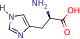
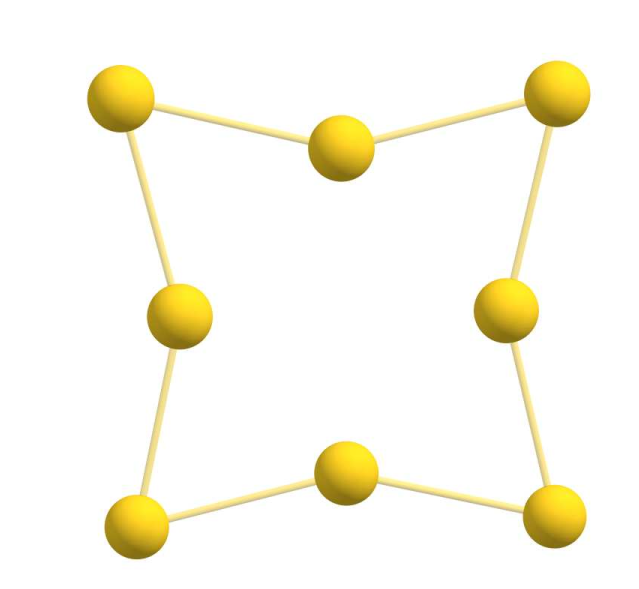
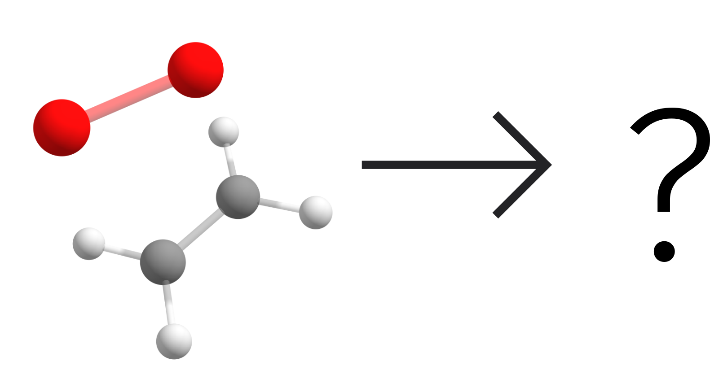
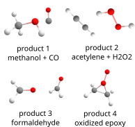

<a id="sec:structurereactivity.GOAT"></a>
# GOAT：全局几何优化与系综生成器（global geometry optimization and ensemble generator）

如果不想只是从给定的猜测几何结构出发优化单个结构，而是想找到**全局**极小值或其周围的系综，ORCA 提供了全局优化器算法（Global Optimizer Algorithm，GOAT）[desouza2025goat](../../bibliography.md)，它受 Wales 和 Doye 的盆地跳跃（basin-hopping）[walesglobal1997](../../bibliography.md)、Goedecker 的极小值跳跃（minima hopping）[goedeckerminima2004](../../bibliography.md)、模拟退火（Simulated Annealing）和禁忌搜索（Taboo Search）的启发。

其思路是从势能面（PES；[fig:GOAT_PES](#fig:GOAT_PES) 中的红球）上的某处出发，先到达最近的局域极小值（蓝球），然后从那里开始沿随机方向"向上爬"，直到越过一个势垒。接着找到一个新的极小值，过程重新开始，再来一次上坡推动，然后是优化。经过多次这样的 GOAT 迭代（上坡 + 下坡），如果在最后两次全局迭代之间没有找到新的全局极小值，

<a id="fig:GOAT_PES"></a>


*常规几何优化（上）与 GOAT 全局优化器（下）之间差异的简单示意图。使用后者，人们不仅找到一个局域极小值，而是找到全局极小值及其周围的构象系综。*

由于在通往全局极小值的沿途收集结构，我们最终得到的不仅是全局极小值，还有该分子的构象系综，即它**可能**具有的所有构象及其相对能量。这对之后计算玻尔兹曼平均的光谱和性质也很有用。

这一思路与 Grimme 教授课题组的 CREST 所做的工作 [prachtautomated2020](../../bibliography.md) 类似，只是这里不需要元动力学（metadynamics），因此所需的梯度计算少得多。所以它不仅适用于 XTB 和力场这类超快方法，也可以直接与 DFT 或 ORCA 中可用的任何方法一起使用。

请注意，对于任意未知函数不存在寻找全局极小值的*从头算*方法，而随机方法是寻找它们时最高效的。其缺点是它基于随机选择，因此需要大量几何优化——这里约为原子数的 $100\times$。好消息是：这些可以高效地并行化（甚至多节点），从而把这个数字降到少于原子数的 $3\times$（见下文）！

<a id="sec:structurereactivity.GOAT.histidine"></a>
## GOAT 简单用法示例——组氨酸（Histidine）

让我们从一个简单的例子开始，氨基酸组氨酸：

<a id="fig:GOAT_his"></a>


*一个组氨酸分子。*

仅从其路易斯结构看，完全看不出在 XTB PES 上全局极小值的 3 kcal/mol 范围内实际上至少有 20 个构象！要找到它们，可以运行：

```mol
title: structure 1
theme: chem311
height: 320px
representation: ball-stick
--- xyz ---
20
structure (0 1)
N      -0.13033     -0.28496     -0.67901
C       1.30551     -0.36383     -0.41824
C       1.51611     -1.04435      0.94169
O       0.58926     -1.43597      1.64771
C       1.97932      1.02323     -0.44331
H       2.41593      1.27074      0.53237
H       1.24598      1.81337     -0.65132
C       3.04894      1.09545     -1.48009
N       2.77779      1.01389     -2.82650
C       3.97051      1.07618     -3.48654
H       4.04071      1.01588     -4.56429
N       4.97724      1.21154     -2.65295
C       4.41545      1.24248     -1.40412
H       5.02774      1.35929     -0.51882
H       1.85722      0.88822     -3.24287
H      -0.75420     -0.54264      0.08211
H       1.72153     -1.03742     -1.17913
H      -0.47113      0.20468     -1.50142
O       2.79298     -1.20515      1.35271
H       3.59528     -0.86615      0.74156
--- input ---
!XTB GOAT #XTB version 6.4.0

* xyz 0 1
N         -0.13033       -0.28496       -0.67901
C          1.30551       -0.36383       -0.41824
C          1.51611       -1.04435        0.94169
O          0.58926       -1.43597        1.64771
C          1.97932        1.02323       -0.44331
H          2.41593        1.27074        0.53237
H          1.24598        1.81337       -0.65132
C          3.04894        1.09545       -1.48009
N          2.77779        1.01389       -2.82650
C          3.97051        1.07618       -3.48654
H          4.04071        1.01588       -4.56429
N          4.97724        1.21154       -2.65295
C          4.41545        1.24248       -1.40412
H          5.02774        1.35929       -0.51882
H          1.85722        0.88822       -3.24287
H         -0.75420       -0.54264        0.08211
H          1.72153       -1.03742       -1.17913
H         -0.47113        0.20468       -1.50142
O          2.79298       -1.20515        1.35271
H          3.59528       -0.86615        0.74156
*
```

调用全局优化器的命令很简单，就是 `!GOAT`，就像你用 `!OPT` 一样，其选项可照常在 `%GOAT` 块下给出。你可以把它与 ORCA 中可用的任何其他方法一起给出，但它需要是快速的方法，因为需要做大量几何优化。这里我们只用 `GFN2`（或 `!XTB`）。接下来会发生：

1.  首先做一次常规几何优化，找到离输入结构最近的极小值。

2.  有了这些信息，将计算所需的 GOAT 迭代次数，并分配给 `NWorkers`（默认 8 个）。

3.  每个 `Worker`（工作进程）有自己的参数，将运行一定数量的几何优化。

4.  一个全局循环中的所有 worker 完成后，将收集数据并开始新的循环。至少会有"最小全局步数（Minimum global steps）"这么多的全局循环。

5.  一旦两步全局迭代之间的差异可以忽略，就停止，收集所有内容并打印系综能量和一个含所有结构的文件。

<a id="sec:structurereactivity.GOAT.output"></a>
## 理解输出（Understanding the output）

在常规几何优化之后，输出如下：

```orca
Global parameters
-----------------
GOAT version                               ... default
Minimum global steps                       ... 3
Number of base workers                     ... 4
Split workers by                           ... 2
Final number of workers                    ... 8
Number of available CPUs                   ... 16
Parameter list (worker : temperature)      ...  0 : 2903.97,  1 : 1451.98,
                                                2 :  725.99,  3 :  363.00,
                                                4 : 2903.97,  5 : 1451.98,
                                                6 :  725.99,  7 :  363.00
GradComp (mean : sigma)                    ... 1.00 : 0.50
Number of atoms                            ... 20
Number of fragments                        ... 1
Flexibility parameter                      ... 0.45
Optimizations per global step              ... 160
Optimizations per worker                   ... 20

Filtering criteria
------------------
RMSD                                       ... 0.125 Angs (atom. pos.)
EnDiff                                     ... 0.100 kcal/mol
RotConst                                   ... 1.00-2.50 %
Maximum Conf. Energy                       ... 6.000 kcal/mol

Thermodynamics
--------------
Ensemble temperature                       ... 298.15 K
Degeneracy of conformers                   ... 1
*No rotamers will be included in Gconf
```

顶部是一些一般信息。这里最重要的是我们有 8 个 worker 而只有 1 个 CPU，意味着每个 worker 只有在另一个完成后才会运行。如果想加速，只需通过例如 `!PAL8` 添加更多 CPU，worker 就会并行运行，使其快 8 倍。GOAT 也可以多节点运行，所以请随意通过 `%PAL` 使用任意数量的处理器。最后打印用于区分构象和旋转异构体（rotamer）的过滤判据。

默认过滤与 CREST 的完全相同：原子位置的 RMSD 加上转动常数，并考虑其各向异性。对于 [`GOAT-EXPLORE`](#sec:structurereactivity.GOAT.explore)，默认的 RMSD 度量则基于距离矩阵的本征值，因为它对平移、转动和原子编号顺序不变，而在这些情形中原子顺序变化相当频繁。

之后，算法开始：

```orca
------------------------------------------------------------------------------
Iter  MinTemp     MaxEn       GradComp    NOpt   NProcs    Output
------------------------------------------------------------------------------
0     2903.97     60.00    1.00 : 0.50      20        2    HIS.goat.0.0.out
1     1451.98     60.00    1.00 : 0.50      20        2    HIS.goat.0.1.out
2      725.99     60.00    1.00 : 0.50      20        2    HIS.goat.0.2.out
3      363.00     60.00    1.00 : 0.50      20        2    HIS.goat.0.3.out
4     2903.97     60.00    1.00 : 0.50      20        2    HIS.goat.0.4.out
5     1451.98     60.00    1.00 : 0.50      20        2    HIS.goat.0.5.out
6      725.99     60.00    1.00 : 0.50      20        2    HIS.goat.0.6.out
7      363.00     60.00    1.00 : 0.50      20        2    HIS.goat.0.7.out

                              GOAT Global Iter 1
                 Iter    Min En       Sconf       Gconf
                         Hartree      cal/(molK)  kcal/mol
                 =========================================

                    1    -34.346656   4.432       -0.551
	
0     2903.97     60.00    1.00 : 0.50      20        2    HIS.goat.0.0.out
1     1451.98     60.00    1.00 : 0.50      20        2    HIS.goat.0.1.out
2      725.99     60.00    1.00 : 0.50      20        2    HIS.goat.0.2.out
3      363.00     60.00    1.00 : 0.50      20        2    HIS.goat.0.3.out
4     2903.97     60.00    1.00 : 0.50      20        2    HIS.goat.0.4.out
5     1451.98     60.00    1.00 : 0.50      20        2    HIS.goat.0.5.out
6      725.99     60.00    1.00 : 0.50      20        2    HIS.goat.0.6.out
7      363.00     60.00    1.00 : 0.50      20        2    HIS.goat.0.7.out
                     
                             GOAT Global Iter 2
                 Iter    Min En       Sconf       Gconf
                         Hartree      cal/(molK)  kcal/mol
                 =========================================
                 
                    1    -34.346656   4.432       -0.551
                    2    -34.346656   4.528       -0.559
	
0     2903.97     60.00    1.00 : 0.50      20        2    HIS.goat.0.0.out
1     1451.98     60.00    1.00 : 0.50      20        2    HIS.goat.0.1.out
2      725.99     60.00    1.00 : 0.50      20        2    HIS.goat.0.2.out
3      363.00     60.00    1.00 : 0.50      20        2    HIS.goat.0.3.out
4     2903.97     60.00    1.00 : 0.50      20        2    HIS.goat.0.4.out
5     1451.98     60.00    1.00 : 0.50      20        2    HIS.goat.0.5.out
6      725.99     60.00    1.00 : 0.50      20        2    HIS.goat.0.6.out
7      363.00     60.00    1.00 : 0.50      20        2    HIS.goat.0.7.out
	
                             GOAT Global Iter 3
                 Iter    Min En       Sconf       Gconf
                         Hartree      cal/(molK)  kcal/mol
                 =========================================
                    
                    1    -34.346656   4.432       -0.551
                    2    -34.346656   4.528       -0.559
                    3    -34.346656   4.541       -0.560
                 
	                              Global minimum found!
	                  Writing structure to HIS.globalminimum.xyz
```

在顶部的表头中可以看到所用的温度、上坡步期间允许的最大能量、梯度反射的最大系数、每个 worker 所做的优化数、各自所用的处理器数以及局域输出文件名。

输出文件的命名方式为 `BaseName.goat.globaliteration.workernumber.out`。默认情况下这些文件在运行后会被删除，但可通过在 `%GOAT` 下设置 `KEEPWORKERDATA TRUE` 来保留。

在每次全局迭代期间，打印迄今的最低能量、构象熵 $S_{\rm conf}$ 和构象吉布斯自由能 $G_{\rm conf}$。由于**这里没有旋转异构体**，熵仅基于构象能量计算，其收敛提示所创建系综的完备性。

<a id="sec:structurereactivity.GOAT.finalensemble"></a>
## 最终系综（The final ensemble）

在这种情况下，如你所见，它在第一个全局循环后就已经找到了全局极小值（E = -34.346656 Hartree），但按照默认设置它会继续运行至少 3 个循环。这是因为这是一个小分子，但并非必然如此，如有需要会进行更多循环。

随后打印系综的最终相对能量，以及一个 `BaseName.finalensemble.xyz` 文件：

```orca
                # Final ensemble info #
                Conformer     Energy     Degen.   % total   % cumul.
                              (kcal/mol)
                ------------------------------------------------------
                        0     0.000          1      37.96      37.96
                        1     0.503          1      16.25      54.20
                        2     0.914          1       8.11      62.32
                        3     1.159          1       5.37      67.68
                        4     1.297          1       4.25      71.94
                        5     1.320          1       4.09      76.03
                                           (...)
                       41     5.180          1       0.01      99.98
                       42     5.199          1       0.01      99.99
                       43     5.491          1       0.00      99.99
                       44     5.547          1       0.00      99.99
                       45     5.861          1       0.00     100.00

Conformers below 3 kcal/mol: 22
Lowest energy conformer    : -34.346656 Eh
Sconf at 298.15 K          :  4.54 cal/(molK)
Gconf at 298.15 K          : -0.56 kcal/mol

Writing final ensemble to HIS.finalensemble.xyz
```

仅作记录，四个最低构象的样子如下：

<a id="fig:GOAT_his_ensemble"></a>


*在 XTB PES 上为组氨酸找到的四个最低构象。*

无论何时使用 `GOAT`，ORCA 优化器的 `EnforceStrictConvergence` 策略都会被设为 `TRUE`。这里推荐这样做，以确保系综中不同分子的判据一致。可通过设置 `%GEOM EnforceStrictConvergence FALSE END` 关闭。

常规优化阈值已经很好，但使用 `!TIGHTOPT` 确保系综中所有分子都收敛良好也是个好主意，尤其是对 `GOAT-EXPLORE`！

<a id="sec:structurereactivity.GOAT.entropy"></a>
## GOAT-ENTROPY：通过最大化熵来扩展系综完备性（expanding ensemble completeness by maximizing entropy）

如果你想在系综方面尽可能完备，可以改用 `!GOAT-ENTROPY` 关键词。这不仅会一直寻找全局极小值直到能量收敛，而且实际上只有当 $\Delta S_{\rm conf}$ 也收敛到小于 0.1 cal/(molK) 时才会停止，这等价于最大化构象熵（该阈值可更改——见下面的关键词列表）。

这将推动算法，使得全局极小值周围的所有构象都应与它一起被找到。温度和 $\Delta S_{\rm conf}$ 都可通过下面列表中所示的特定关键词更改。更高的温度会使 $\Delta S_{\rm conf}$ 对高能构象区域的变化更敏感，应能使搜索更加完备。

更明确地说，构象熵、焓和吉布斯自由能按下式计算：

$$
S_{\rm conf} = R\left[\ln \sum g'_ie^{-E_i\beta} + \frac{\sum g'_i(E_i\beta)e^{-E_i\beta} }{\sum g'_i e^{-E_i\beta} }\right]
$$

$$
\bigl[H(T) - H(0)\bigr]_{\rm conf} = RT\frac{\sum g_i(E_i\beta)e^{-E_i\beta} }{\sum g_i e^{-E_i\beta} }
$$

其中 $\beta = \frac{1}{k_BT}$，$g_i$ 是构象 $i$ 的"简并度（degeneracy）"，即其旋转异构体的数目。这是处理简并态的正确方法 [pracht_entropy_2021](../../bibliography.md)。与上述参考文献的唯一差别是 $g'_i$ 总是 1，我们不为"几何对映体"区分任何因子。

<a id="sec:structurereactivity.GOAT.sconf"></a>
## 关于 $\Delta S_{\rm conf}$ 的更多说明（More on the $\Delta S_{\rm conf}$）

需要说明的是，默认情况下 $\Delta S_{\rm conf}$ **与默认 CREST 运行所得的不同**。在那里它在熵的计算中还包含旋转异构体的简并度，而这里是 1。其原因如下：

1.  有形式上的论据支持只用 1，假定旋转异构体不可区分。详情请查阅 Grimme 的参考文献
    [pracht_entropy_2021](../../bibliography.md)。

2.  对于有许多旋转异构体的体系，例如带有 3 个叔丁基（*tert*-butyl）的分子，每个构象至少产生 ($27^3$) 19683 个旋转异构体，算法反正也永远找不全。

3.  当调用 `GOAT-ENTROPY` 时，被最大化的是**构象**的熵，而不是系综的。这保证了这些搜索期间不同构象的最大分布。

一旦找到最终系综，并且如果你知道每个构象有多少个旋转异构体（假定数目恒定，如叔丁基的情形），可以使用 `READENSEMBLE "ensemble.xyz"` 读取它，并用 `CONFDEGEN` 设置简并度来重置该数目。在前面的例子中应为 `CONFDEGEN 19683`，它会给出该给定系综所期望的 $\Delta G_{\rm conf}$。

<a id="sec:structurereactivity.GOAT.entropy.rot"></a>
### 自动寻找旋转异构体（Finding rotamers automatically）

如果那就是你想要的，总可以通过设置 `CONFDEGEN AUTO` 来开启对旋转异构体及其简并度的自动搜索。它们将被加入系综而不是被过滤掉，完整的系综将保存在名为 `.confrot.xyz` 的文件中。

另一种方法是假定，由于算法可能对某些构象找全了所有旋转异构体但并非对全部都如此，可以把所有构象的简并度都设为迄今找到的最大值（`CONFDEGEN AUTOMAX`）。以一个带一个叔丁基 + 一个甲基、每个构象有 81 个旋转异构体的体系为例。GOAT 很难为每个构象都找到 81 个旋转异构体，但如果它为某一个构象找到了，所有其他构象也将具有相同的数目。

请注意，有些情形下不同构象的旋转异构体数目可能不同（例如癸烷或长烷基链），这些情形应谨慎处理。

<a id="sec:structurereactivity.GOAT.explore"></a>
## GOAT-EXPLORE：原子团簇的全局极小值或无拓扑限制的 PES 搜索（global minima of atomic clusters or topology-free PES searches）

如果你想找到一个团簇的最低能量构象，或者根本不想保持初始拓扑，可以改用 `!GOAT-EXPLORE` 选项。这可能会打断所有键，找到该给定原子集合的最低能量结构，无论是纳米颗粒还是有机分子。

例如，让我们在 GFN1 PES 上寻找 Au$_8$ 纳米颗粒的极小值，只从金原子的随机聚集体出发：

```mol
title: structure 2
theme: chem311
height: 320px
representation: ball-stick
--- xyz ---
8
structure (0 1)
Au     -1.39858      2.62611     -0.79278
Au     -2.50552     -0.07122      0.67538
Au     -0.52174     -2.57892     -0.02415
Au      0.78881      0.39733      0.21816
Au      1.21116      1.90621     -2.64617
Au     -1.19205     -0.30099     -2.30429
Au     -0.33808     -1.07129      2.90822
Au     -0.85565      2.15342      2.41956
--- input ---
!XTB1 GOAT-EXPLORE PAL16 #XTB version 6.4.0

%GOAT NWORKERS 16 END

* xyz 0 1
Au        -1.39858        2.62611       -0.79278
Au        -2.50552       -0.07122        0.67538
Au        -0.52174       -2.57892       -0.02415
Au         0.78881        0.39733        0.21816
Au         1.21116        1.90621       -2.64617
Au        -1.19205       -0.30099       -2.30429
Au        -0.33808       -1.07129        2.90822
Au        -0.85565        2.15342        2.41956
*
```

请注意，每个 worker 有一个必须遵守的最少优化数，算法才有意义。否则，极端情况下每个 worker 一次优化就意味着几乎什么也不会发生。该最小数目对常规 GOAT 是 `max(N, 15)`，对 [`GOAT-EXPLORE`](#sec:structurereactivity.GOAT.explore) 和
[`GOAT-REACT`](#sec:structurereactivity.GOAT.react)（见下文）是 `max(3N, 45)`，其中 N 是原子数。
使用自由拓扑的搜索要求更高，因为自由度多得多。

当达到每个 worker 的最少优化数时，该信息会打印在表头底部：

```orca
GOAT version                               ... explore
Minimum global steps                       ... 3
Number of base workers                     ... 4
Split workers by                           ... 4
Final number of workers                    ... 16
Number of available CPUs                   ... 1
Parameter list (worker : temperature)      ...  0 : 2903.97,  1 : 1451.98, 
                                                2 :  725.99,  3 :  363.00, 
                                                4 : 2903.97,  5 : 1451.98, 
                                                6 :  725.99,  7 :  363.00, 
                                                8 : 2903.97,  9 : 1451.98, 
                                                10 :  725.99, 11 :  363.00, 
                                                12 : 2903.97, 13 : 1451.98, 
                                                14 :  725.99, 15 :  363.00 
GradComp (mean : sigma)                    ... 1.00 : 0.50
Number of atoms                            ... 8
Number of fragments                        ... 1
Flexibility parameter                      ... 1.00
Optimizations per global step              ... 528
Optimizations per worker                   ... 66
*Reached the minimum optimizations per worker [fmax(3 * NAtoms, 45)]!
```

找到的全局极小值是一个 $D_{4h}$ 平面结构，与文献中用其他 DFT 方法为 Au$_8$ 团簇找到的相同
[assadollahzadehsystematic2009](../../bibliography.md)：

<a id="fig:GOAT_au8"></a>


*Au$_8$ 团簇在 GFN1-xTB PES 上的最低能量构象。*

<a id="sec:structurereactivity.GOAT.react"></a>
## GOAT-REACT：自动反应路径探索算法（an algorithm for automatic reaction pathway exploration）

GOAT 算法的另一个变体是为了允许自动反应探索而创建的，它归根结底不过是在反应物和产物的集体 PES 上的探索。

这里用户可以非常有创造力，有许多不同的方式来探索这一算法，但让我们从一个简单的反应开始：乙烯与单重态氧的气相反应。

<a id="fig:GOAT_react_o2"></a>


*乙烯与单重态氧反应的产物可能是什么？*

运行以下输入后：

```mol
title: structure 3
theme: chem311
height: 320px
representation: ball-stick
--- xyz ---
8
structure (0 1)
C      -3.26482     -0.47497      0.33191
C      -2.16518      0.24269      0.35382
H      -4.23539     -0.01923      0.27823
H      -3.23979     -1.54754      0.37118
H      -2.19035      1.31540      0.31866
H      -1.19481     -0.21295      0.41157
O      -3.42426     -0.30941      2.30779
O      -2.17088      0.05188      2.32517
--- input ---
!XTB GOAT-REACT

* XYZ 0 1
C         -3.26482       -0.47497        0.33191
C         -2.16518        0.24269        0.35382
H         -4.23539       -0.01923        0.27823
H         -3.23979       -1.54754        0.37118
H         -2.19035        1.31540        0.31866
H         -1.19481       -0.21295        0.41157
O         -3.42426       -0.30941        2.30779
O         -2.17088        0.05188        2.32517
*
```

输出与常规 `GOAT-EXPLORE` 大致相似，只是有几点不同：

1. GOAT 被允许越过的最大势垒更高。
2. 默认跳过最开始的几何优化。
3. `AUTOWALL` 被设为 `TRUE`，意味着会用分子的最大 x,y,z 尺寸 + 5 Å 作为半径添加一个椭球势。
   
另一个重要因素是最大拓扑差异（`MAXTOPODIFF`），默认设为 8，如输出所示：

```orca
Global parameters
-----------------
  GOAT version                               ... react
  Max. topological diff.                     ... 8
  Minimum global steps                       ... 3
  Number of base workers                     ... 4 
```

`MAXTOPODIFF` 是这里的一个关键概念。如果简单地寻找反应物和产物之间所有可能的拓扑排列，即使像这样简单的体系也可能导致数量庞大的组合。

我们把拓扑差异简单地定义为相对于某个参考结构的断裂键数 + 形成键数之和，该参考结构取自 GOAT 迭代内部第一次几何优化（任何上坡步之前）后得到的结构。

会打印比平常更多的文件，其中最重要的是：

1. `Basename.products.xyz`            -- 包含该反应的所有*反应异构体（reactomers）*及其所有构象。通常这是一个非常大的文件。
2. `Basename.products.topodiff2.xyz`  -- 只包含与参考结构拓扑差异为 2 的那些，依此类推。
3. `Basename.products.unique.xyz`     -- 包含所有拓扑上**唯一**产物的列表，不含其构象或旋转异构体，只打印最低能量构象。这里参考结构排在最前，其他的以 kcal/mol 为单位显示其相对能量差。

作为该反应的示例，找到的部分产物如下：

<a id="fig:GOAT_react_o2_products"></a>


*GOAT-REACT 使用上面给出的输入自动找到的一些产物。*

!!! note
    请注意，单重态氧反应活性太高，以至于即使是第一次优化也会导致环化反应，反应产物随后被作为参考结构。

!!! note
    这里不推荐使用 GFN-FF 这类力场，因为它不应打断化学键。

<a id="sec:structurereactivity.GOAT.diversity"></a>
## 探索几何多样性：GOAT-DIVERSITY 选项（Exploring geometrical diversity: the GOAT-DIVERSITY option）

除了寻找全局能量极小值周围的精确系综之外，在某些情况下人们可能只寻求**结构**多样性。例如，如果你知道对某个体系而言 PES 无论如何都太差，先探索几何多样性、之后才在更高水平的 PES 优化上精修这些结构或许是合理的。

我们为此有一个专门的关键词 `!GOAT-DIVERSITY`，它将：

1. 过滤不同构象时忽略能量差；

2. 将过滤的 RMSD 差值从 0.125 设为 0.5 Å；

3. 将几何收敛判据设为 `SLOPPYOPT`——我们不是在寻找非常精确的能量；

4. 允许包含高达 60 kcal/mol 的构象。

综上，实际发生的是：彼此在约 0.5 RMSD 半径内的一组结构被取入最终系综，而不管能量差。该距离可照常通过以下方式控制：

```orca
%GOAT RMSD 1.5 END # RMSD here in angstroem
```

此外，如果设置了某些常规优化标志如 `!NORMALOPT` 或 `!TIGHTOPT`，它们将自动覆盖这里设置的 `SLOPPYOPT`。

<a id="sec:structurereactivity.GOAT.coarse"></a>
## 用 GOAT-COARSE 自动粗粒化（Automated coarse-grained with GOAT-COARSE）

对于大体系，我们现在也可以把 GOAT 与 `RIGIDBODYOPT`（[optimization.rigidbody](optimizations.md#sec:structurereactivity.optimization.rigidbody)）和[自动分片](../essentialelements/fragmentation.md#sec:essentialelements.fragmentation.inputfile)选项结合起来，以降低大体系的维数。控制这一点的单一输入称为 `!GOAT-COARSE`。重要的是它**不会**自行定义片段，那是你必须做的。

例如，你可以用自己的库给出苯基、异丙基、环己烷、叔丁基等作为片段，`GOAT-COARSE` 将确保这些只作为刚体旋转和平移。或者你可以把肽分成单个氨基酸。这里有很大的发挥空间！

从 GOAT 这类算法的角度看，这意味着把苯基的 11 个原子基本上减少到 1 个。由于构象搜索是指数标度的问题，有效的时间节省可以非常大，实际上超过 10 倍。

!!! note
    目前，对大体系而言，使用快速哈密顿量（如 xTB）或力场时的速控步仍然是内坐标变换所必需的变换。更多内容将在未来的 ORCA 版本中提供。

请随意在分片上发挥创造力，只要 `GOAT-COARSE` 标志在，GOAT 就会适应以实现显著加速。这本质上是它的自动粗粒化版本。

<a id="sec:structurereactivity.GOAT.generalobs"></a>
## 一些一般性观察（Some general observations）

<a id="sec:structurereactivity.GOAT.freezes"></a>
### 上坡步期间默认冻结的坐标（Default frozen coordinates during uphill step）

仅在上坡阶段，默认情况下 GOAT 将冻结：

1.  所有键，

2.  同一环内涉及两个 sp2 原子的所有键角，

3.  强键周围的所有二面角（d(B,C) \< [0.9 x (共价半径之和)]）。

这里的"sp2 原子"只是宽泛地定义为键数分别少于 4、3 和 2 的 C、N 和 O。

第一次冻结是为了避免断键导致拓扑改变。第二和第三次是为了避免在改变这些键角时越过非常高的能垒，实际上，除非在非常特殊的情况下，它们反正也永远不会翻转！

这些约束对 `GOAT-EXPLORE` 会自动解除，也可用其特定关键词设为 `FALSE`。

### GOAT 的并行化（Parallelization of GOAT）

GOAT 将以与大多数 ORCA 作业不同的方式从大量内核获益，因为它把所需的工作分配到不同的 worker。它也可以多节点工作，并把 worker 分布到不同节点上。

由于在开始 GOAT 之前通常有一次常规的第一步优化，它**不会**从大量内核获益，所以这些被标志 `MAXCORESOPT` 限制并设为最多 32。之后，GOAT 将切换回使用所提供的全部内核。我们不建议更改该最大数目，因为它可能只会让事情更慢，但它可以在 `%GOAT` 块内控制。

### 提示与额外细节（Tips and extra details）

!!! note

    - GOAT 可与 ORCA 中的任何方法一起工作，你所需要的只是梯度。这包括使用 DFT、QM/MM、ONIOM、破缺对称态、激发态等。

    - 请注意，DFT 比 XTB **贵得多**。用 R2SCAN-3C 运行 GOAT 完全可能，但请准备好使用很多内核或等上几天 :D。我们建议至少 `%PAL NPROCS 32 END`，以有 8 个 worker、每个 4 个内核。杂化 DFT 甚至更重，所以如果想用 B3LYP，请至少用 `NPROCS 64`——而且不要着急。这里的目标是做全局搜索，它不是免费的！

    - 在许多情况下，使用 `GFNUPHILL GFNFF` 在上坡步期间用 GFN-FF 力场 PES 可能很有用。在那里并不真正需要精确的势，因为主要目标是把结构带出其当前的极小值，GOAT 会运行得快得多，只对实际优化使用所选的方法。GFN2XTB、GFN1XTB 或 GFN0XTB 也是有效的选项。

    - 对于需要断键的方法，如 `GOAT-EXPLORE` 或 `GOAT-REACT`，不能使用 `GFNUPHILL gfnff`，因为 GFN-FF 不允许断键。请选择 GFN2-xTB（`gfn2xtb`）、GFN1-xTB（`gfn1xtb`）或 GFN0-xTB（`gfn0xtb`）。

    - 你总可以通过查看 `Basename.goat.x.x.out` 文件来检查 worker 在做什么。第一个数字指全局迭代，第二个指特定的 worker。这是一个 ORCA 输出（为节省空间抑制了部分打印），可以在大多数 GUI 中打开。

    - GOAT 在过程的最开始、甚至在第一次几何优化之前就自动启用片段检测。它也遵守通过 `%frag` 块定义的片段。关于片段选择的详细解释，见[片段指定](../essentialelements/fragmentation.md#sec:essentialelements.fragmentation)一节。

    - 酰胺键的手性默认**不**冻结，这意味着你为酰胺给出的输入拓扑（顺式或反式）可能会改变。如果你想冻结它，把 `FREEZEAMIDES` 设为 `TRUE`。

    - 类似地，环外的双键也可以改变其拓扑。选择 `FREEZECISTRANS TRUE` 以冻结那些二面角。

    - 对某些分子，限制某些原子的配位数可能很有趣，那种情况下使用 `MAXCOORDNUMBER`。

    - GOAT 将遵守 `%GEOM` 块中关于几何结构的选择，所以你可以使用其他类型坐标冻结所需的各种约束。它也可以与所有可用的任意偏置和势结合使用（见 [optimization.biaspot](optimizations.md#sec:structurereactivity.optimization.biaspot)）。

    - 如果你想只把某些原子推上坡，可以给 `UPHILLATOMS` 一个列表。那种情况下，[fig:GOAT_PES](#fig:GOAT_PES) 中所示的上坡力将只施加到涉及那些原子的坐标上，分子的其余部分只对其作出反应。这对较大体系中某部分的构象搜索很有用。

    - 默认情况下，包含距全局极小值 12.0 kcal/mol 以内的构象，可通过设置 `MAXEN` 更改。

<a id="sec:structurereactivity.GOAT.options"></a>
## 关键词（Keywords）

GOAT 相关简单输入关键词的汇总见 [tab:structurereactivity.goat.keywords.simple](#tab:structurereactivity.goat.keywords.simple)。所有
`%goat` 块选项总结见 [tab:structurereactivity.goat.keywords.block](#tab:structurereactivity.goat.keywords.block)。

<a id="tab:structurereactivity.goat.keywords.simple"></a>
!!! note "GOAT 算法的简单输入关键词。"
    | 关键词                         | 说明                                                             |
    |:--------------------------------|:------------------------------------------------------------------------|
    | `GOAT`                          | 请求默认的 [GOAT](#sec:structurereactivity.GOAT) 运行              |
    | `GOAT-ENTROPY`                  | 请求 [GOAT-ENTROPY](#sec:structurereactivity.GOAT.entropy) 运行      |
    | `GOAT-EXPLORE`                  | 请求 [GOAT-EXPLORE](#sec:structurereactivity.GOAT.explore) 运行      |
    | `GOAT-REACT`                    | 请求 [GOAT-REACT](#sec:structurereactivity.GOAT.react) 运行          |
    | `GOAT-DIVERSITY`                | 请求 [GOAT-DIVERSITY](#sec:structurereactivity.GOAT.diversity) 运行  |
    | `GOAT-COARSE`                   | 请求 [GOAT-COARSE](#sec:structurereactivity.GOAT.coarse) 运行        |

<a id="tab:structurereactivity.goat.keywords.block"></a>
!!! note "GOAT 算法的 `%goat` 块输入关键词。"


| ****关键词**** | 选项 | 说明 |
| --- | --- | --- |
| **`MAXITER`** | `128` | 定义每个 worker 任意的最大 GOAT 几何优化迭代数。 |
| **`MAXOPTITER`** | `256` | 每次 GOAT 迭代的最大几何优化数。 |
| **`SKIPINITIALOPT`** | `true` | 是否跳过初始优化（默认 FALSE）。 |
| **`RANDOMSEED`** | `true` | 设为 false 以获得确定性的 GOAT 运行。由于几何优化可能因数值差异而改变，某些情况下可能并非完全确定。 |
| **`READENSEMBLE`** | `"name.xyz"` | 要读取的系综文件。注释行应具有格式 "Energy (float)"，如 GOAT 生成的那样。除了重新应用过滤器外不会做任何事。 |
| **`AUTOWALL`** | `true` | 自动在结构周围（+5 Å）创建椭球势。（默认为 false）。 |
| **`TEMPLIST`** | `3000, 2000, 750, 500` | 一个温度列表，定义基本 worker 的数目，单位为开尔文。除非你知道自己在做什么，否则不要更改。 |
| **`MAXCORESOPT`** | `32` | 最第一次优化期间使用的最大内核数 |
| **`PRINTINTERNALS`** | `true` | 在 worker 输出上打印所有内坐标？默认 false，可显著减小输出体积！ |
| ***Worker 选项（Worker options）：*** |  |  |

| **`NWORKERS`** | 无 |

      - `auto`
      - 定义 worker 的数目（默认 auto）。auto 表示自动的理想分配，或给出 4（温度数）的任意倍数。


| | **`3`** | 一个简单关键词，将每个 worker 的几何优化数相乘。将快速增加 MAXITER。 |
| --- | --- | --- |
| **`MAXITERMULT`** | `3` | 一个简单关键词，将每个 worker 的几何优化数相乘。将快速增加 MAXITER。 |
| **`MINGLOBALITER`** | `3` | 运行所需的最少全局迭代数 |
| **`MAXGLOBALITER`** | `12` | 最大全局迭代数。默认为 100。 |
| **`KEEPWORKERDATA`** | `false` | 设为 true 以保留 worker 输出（可能数据量很大！）。 |
| **`WORKERRANDOMSTART`** | `true` | 第一个循环之后，每个 worker 从前一组中 3 kcal/mol 以内的随机结构出发，而不是只从最低能量出发。至少有一个从最低的出发（默认 true）。 |
| ***上坡步（Uphill step）：*** |  |  |

| **`UPHILLATOMS`** | 无 |

      - `{0:2 5 14:29} end`
      - 如果给出，只有列出的那些原子会被推动，其余的只是对其作出反应。


| | **`gfnff`** | 仅在上坡步期间使用 GFN-FF（`gfnff`）？GFN2-xTB（`gfn2xtb`）、GFN1-xTB（`gfn1xtb`）或 GFN0-xTB（`gfn0xtb`）对相应方法也是有效选项。 |
| --- | --- | --- |
| **`GFNUPHILL`** | `gfnff` | 仅在上坡步期间使用 GFN-FF（`gfnff`）？GFN2-xTB（`gfn2xtb`）、GFN1-xTB（`gfn1xtb`）或 GFN0-xTB（`gfn0xtb`）对相应方法也是有效选项。 |
| **`MAXENPERATOM`** | `4` | 分子在上坡步期间被允许越过的最大势垒高度，以每原子 kcal/mol 给出。默认为每原子 `3` kcal/mol。 |
| ***过滤与筛选（Filtering and screening）：*** |  |  |

| **`ALIGN`** | 无 |

      - `false`
      - 将所有最终构象相对最低能量的对齐。


| | **`0.1`** | 区分构象所需的最小能量差，单位为 kcal/mol。 |
| --- | --- | --- |
| **`ENDIFF`** | `0.1` | 区分构象所需的最小能量差，单位为 kcal/mol。 |
| **`MAXEN`** | `6.0` | 要取的构象的最大相对能量，单位为 kcal/mol。默认 6 kcal/mol。 |
| **`RMSD`** | `0.125` | 区分构象的最小 RMSD，单位为 Å。 |
| **`ROTCONSTDIFF`** | `0.01` | 转动常数的最大差异，单位为 %。 |
| **`RMSDMETRIC`** | `eigenvalue` | 用距离矩阵的本征值计算 RMSD？一般默认为 RMSD，GOAT-EXPLORE 为 eigenvalue。 |
| **`BONDFACTOR`** | `1.2` | 定义基本化学键的共价半径之和的乘数。 |
| ***GOAT-ENTROPY：*** |  |  |

| **`MAXENTROPY`** | 无 |

      - `false`
      - 添加 delta Gconf 作为收敛判据（默认 false）


| | **`298.15`** | 计算自由能所用的温度，单位为开尔文。 |
| --- | --- | --- |
| **`CONFTEMP`** | `298.15` | 计算自由能所用的温度，单位为开尔文。 |
| **`MINDELS`** | `0.1` | 两次迭代之间标志收敛的最小熵差，单位为 cal/(molK)。 |
| **`CONFDEGEN`** | `2`, `auto`, `automax` | 为每个构象设置任意简并度？auto 基于 RMSD 自动找到该值。automax 同 auto，但取最大值作为所有构象的参考。 |
| ***自由拓扑（Free topology）：*** |  |  |

| **`FREEHETEROATOMS`** | 无 |

      - `false`
      - 释放除 H 和 C 之外的所有原子。


| | **`false`** | 释放所有非 H 原子 |
| --- | --- | --- |
| **`FREENONHATOMS`** | `false` | 释放所有非 H 原子 |
| **`FREEFRAGMENTS`** | `false` | 释放片段间拓扑，即片段之间的键在搜索期间可能形成或断裂，但同一片段内的键将被保留。 |
| **`TOPOBREAK`** | `{1 5 6 13} end` | 一个原子列表，其拓扑*可能*断裂 |
| ***冻结选项（Freeze options）（除非确实需要，否则我们不建议更改这些！）：*** |  |  |

| **`FREEZEBONDS`** | 无 |

      - `false`
      - 上坡时冻结键（默认 true）


| | **`false`** | 上坡时冻结 sp2 键角和二面角（默认 true） |
| --- | --- | --- |
| **`FREEZEANGLES`** | `false` | 上坡时冻结 sp2 键角和二面角（默认 true） |
| **`FREEZECISTRANS`** | `false` | 冻结环外的顺-反异构（默认 false） |
| **`FREEZEAMIDES`** | `false` | 冻结酰胺顺/反手性（默认 false） |
| **`MAXCOORDNUMBER`** | `10, 4, 11, 6` | 一个"原子编号, 配位数"列表，将为所列原子定义最大配位数，基于距离判据取定。在这种情况下原子 10 的最大值为 4，原子 11 的最大值为 6。其余遵循默认值。 |
| ***GOAT-REACT：*** |  |  |

| **`MAXTOPODIFF`** | 无 |

      - `8`
      - 允许的最大拓扑差异。Topodiff 基于使用 ORCA 常规基于距离的判据 [1.3 * (共价半径之和)] 的断裂键数 + 形成键数简单定义。

