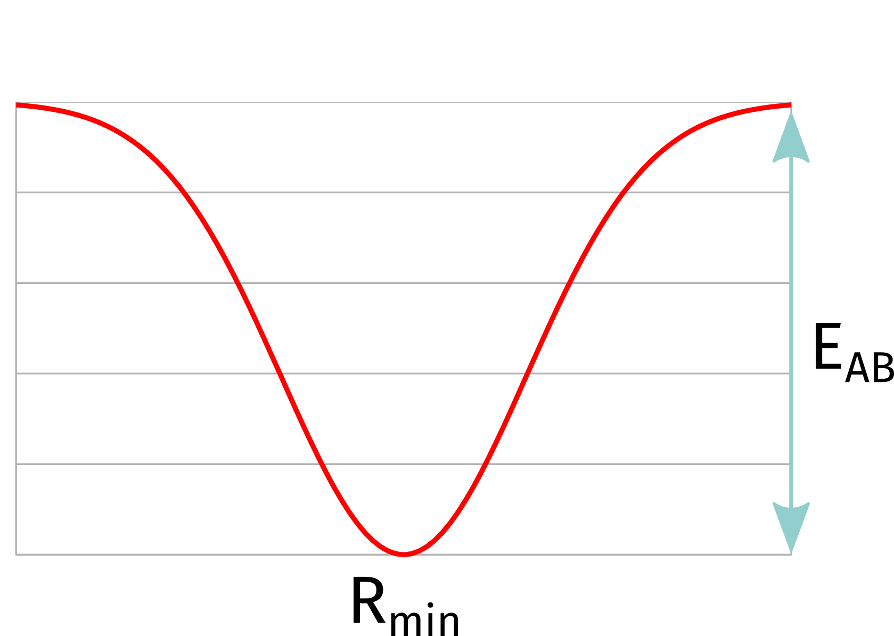

<a id="sec:structurereactivity.optimization"></a>
# 几何优化（Geometry Optimizations）

ORCA 能够使用拟 Newton 更新过程结合著名的 BFGS 更新
[schlegel1987ab,schlegel1995modern,schlegel1998encyclopedia,eckert1997comp,horn1991comp,baker1986comp](../../bibliography.md)、
Powell 更新或 Bofill 更新来计算平衡结构（极小值点和过渡态）。优化可以在冗余内坐标（多数情况下推荐）或笛卡尔位移坐标中进行。作为初始 Hessian，用户可以在对角初始 Hessian、若干模型 Hessian（Swart、Lindh、Almloef、Schlegel）、精确 Hessian 和部分精确 Hessian（两者都推荐用于过渡态优化）之间选择，对两种坐标类型均可。在冗余内坐标中，存在若干种可采取的步型选项。用户可通过两种不同途径定义约束。他既可以（以键长、键角、二面角或笛卡尔约束的形式）直接定义它们，也可以定义若干片段，并对片段内部以及相对其他片段施加约束。ORCA 优化器可用作外部优化器，即能量和梯度计算由 ORCA 完成。

高效几何优化需要使用解析梯度。在 ORCA 5.0 中，以下方法提供解析一阶导数

-   Hartree–Fock（HF）和 DFT（包括 RI、RIJK 和 RIJCOSX 近似）

-   MP2、RI-MP2 和 DLPNO-MP2

-   激发态的 TD-DFT

-   CAS-SCF

当解析梯度不可用时，可以通过有限位移数值计算一阶导数。这对所有方法都可用。

<!-- The coordinate system chosen for geometry optimization affects the
convergence rate, with redundant internal coordinates being usually the
best choice. -->

某些定位过渡态（TS）的方法需要二阶导数矩阵（Hessian），对 HF、DFT 和 MP2 已有解析实现。此外，还提供了若干为 TS 优化构造初始近似 Hessian 的方法。定位复杂过渡态的一个非常有用的功能是微动弹性带（Nudged-Elastic Band）方法与 TS 查找算法相结合（NEB-TS、ZOOM-NEB-TS）。涉及激发态的化学过程的一个重要特性是锥形交叉优化器。另一个有趣的功能是 MECP（Minimum Energy Crossing Point，最小能量交叉点）优化。

对于非常大的体系，ORCA 提供了非常高效的 L-BFGS 优化器，它利用 orca_md 模块。也可通过本节末尾描述的简单关键词调用它。

<a id="sec:structurereactivity.optimization.geometry"></a>
## 基本用法（Basic Usage）

几何优化模块的使用相对直接。[^1] 这里是一些典型例子：

```
! BLYP SVP Opt
* int 0 1
    C  0 0 0 0.0000   0.000    0.00
    O  1 0 0 1.2029   0.000    0.00
    H  1 2 0 1.1075 122.016    0.00
    H  1 2 3 1.1075 122.016  180.00
*
```
ORCA 默认采用 [RIJ](../essentialelements/RI.md)。若不希望如此，可用 `!NORI`
关键词全局关闭 RI。

乙烯第一激发态的优化：

```mol
title: structure 1
theme: chem311
height: 320px
representation: ball-stick
--- xyz ---
6
structure (0 1)
C      0.000000     0.000000     0.666723
C      0.000000     0.000000    -0.666723
H      0.000000    -0.928802     1.141480
H     -0.804366    -0.464401    -1.341480
H      0.000000     0.928802     1.241480
H      0.804366     0.464401    -1.241480
--- input ---
! BLYP SVP OPT

%tddft
   IRoot 1  
end
  
* xyz 0 1
 C     0.000000     0.000000     0.666723
 C     0.000000     0.000000    -0.666723
 H     0.000000    -0.928802     1.141480
 H    -0.804366    -0.464401    -1.341480
 H     0.000000     0.928802     1.241480
 H     0.804366     0.464401    -1.241480
*
```

### 几何优化阈值（Geometry Optimization Thresholds）

几何优化的收敛阈值一般可通过 `%geom` 块控制（见 [optimization.keywords](#sec:structurereactivity.optimization.keywords)）。为方便起见，ORCA 提供了一些简单输入关键词来选择合理的阈值集合。相应的关键词是 `!LooseOpt`、`!OPT`（默认）、`!TightOpt` 和 `!VeryTightOpt`。这些关键词所切换的容差设置总结于 [tab:structurereactivity.optimization.thresholds](#tab:structurereactivity.optimization.thresholds)。个别关键词及更多控制优化阈值的选项见 [tab:structurereactivity.optimization.keywords.geom](#tab:structurereactivity.optimization.keywords.geom)。

<a id="tab:structurereactivity.optimization.thresholds"></a>
!!! note "几何优化收敛关键词的阈值。"


| ****变量**** | 值 | 说明 |
| --- | --- | --- |
| ***宽松（Loose）*（`!LooseOpt`/`Convergence loose`）** |  |  |
| **`TolE`** | 3e-5 | 允许的最大能量变化（a.u.） |
| **`TolMaxG`** | 2e-3 | 允许的最大梯度分量（a.u.） |
| **`TolRMSG`** | 5e-4 | 允许的最大 RMS 梯度（a.u.） |
| **`TolMaxD`** | 1e-2 | 允许的最大位移（a.u.） |
| **`TolRMSD`** | 7e-3 | 允许的最大 RMS 位移（a.u.） |
| ***正常（Normal）*（`!Opt`/`Convergence normal`）** |  |  |
| **`TolE`** | 5e-6 | 允许的最大能量变化（a.u.） |
| **`TolMaxG`** | 3e-4 | 允许的最大梯度分量（a.u.） |
| **`TolRMSG`** | 1e-4 | 允许的最大 RMS 梯度（a.u.） |
| **`TolMaxD`** | 4e-3 | 允许的最大位移（a.u.） |
| **`TolRMSD`** | 2e-3 | 允许的最大 RMS 位移（a.u.） |
| ***紧（Tight）*（`!TightOpt`/`Convergence tight`）** |  |  |
| **`TolE`** | 1e-6 | 允许的最大能量变化（a.u.） |
| **`TolMaxG`** | 1e-4 | 允许的最大梯度分量（a.u.） |
| **`TolRMSG`** | 3e-5 | 允许的最大 RMS 梯度（a.u.） |
| **`TolMaxD`** | 1e-3 | 允许的最大位移（a.u.） |
| **`TolRMSD`** | 6e-4 | 允许的最大 RMS 位移（a.u.） |
| ***非常紧（VeryTight）*（`!VeryTightOpt`/`Convergence verytight`）** |  |  |
| **`TolE`** | 2e-7 | 允许的最大能量变化（a.u.） |
| **`TolMaxG`** | 3e-5 | 允许的最大梯度分量（a.u.） |
| **`TolRMSG`** | 8e-6 | 允许的最大 RMS 梯度（a.u.） |
| **`TolMaxD`** | 2e-4 | 允许的最大位移（a.u.） |
| **`TolRMSD`** | 1e-4 | 允许的最大 RMS 位移（a.u.） |

<a id="sec:structurereactivity.optimization.hessian"></a>
## 极小化用的初始 Hessian（Initial Hessian for Minimization）

几何优化的收敛性关键取决于初始 Hessian 的质量。在最简单的情况下，它取为单位矩阵（在冗余内坐标中，键用 0.5、键角用 0.2、二面角和非正常扭转用 0.1）。不过，Schlegel、Lindh、Swart 或 Almlöf 提出的简单模型力场也可用，且能带来好得多的收敛。不同的猜测 Hessian 可通过 `InHess` 选项设置，在冗余内坐标中它可以是 `unit`、`Almloef`、`Lindh`、`Swart` 或 `Schlegel`，进一步见 [optimization.keywords](#sec:structurereactivity.optimization.keywords) 一节内的关键词列表。自 2.5.30 版起，这些模型力场（在内坐标中构建）也可用于笛卡尔坐标中的优化。

对于极小化，我们推荐 `Almloef` Hessian，它是极小化的默认选项。`Lindh` 和 `Schlegel` Hessian 给出类似的收敛行为。还有 `Swart` 模型 Hessian 的选项，它参数化程度较低，对弱相互作用和/或不寻常的结构应有所改善。当然最好的 Hessian 是精确的。`Read` 可用来输入一个精确 Hessian 或在较低理论水平（或"更快"理论水平）计算得到的 Hessian。从 2.5.30 版起该选项也可用于冗余内坐标。但我们必须指出，把精确 Hessian 用作初始 Hessian 帮助不大，因为这种情况下收敛通常只是稍快，而同时要花多得多的时间计算初始 Hessian。

总结：我们建议对极小化使用某一种简单的模型力场。

<a id="sec:structurereactivity.optimization.coords"></a>
## 优化用的坐标系（Coordinate Systems for Optimizations）

优化所用的坐标系可通过 `coordsys` 变量选择，可在 `%geom` 块内设为 `cartesian` 或 `redundant`。默认是冗余内坐标系。如果用 `redundant` 优化失败，你仍可尝试 `cartesian`。如果随后在笛卡尔位移坐标中用简单的模型力场 Hessian 进行优化，收敛只会稍慢。若用单位矩阵初始 Hessian，则会导致非常慢的收敛。

下面给出了一个先计算半经验 Hessian 作为起点的复合作业 `two_step_opt.inp`：

```orca
! BLYP SVP Opt
* int 0 1
    C  0 0 0 0.0000   0.000    0.00
    O  1 0 0 1.2029   0.000    0.00
    H  1 2 0 1.1075 122.016    0.00
    H  1 2 3 1.1075 122.016  180.00
*
```

!!! note

    -   对过渡金属配合物，MNDO、AM1 或 PM3 Hessian 不可用。你可以改用 ZINDO/1 或 NDDO/1 Hessian。对有机分子它们的质量低于 MNDO、AM1 或 PM3，但仍远好于标准的单位矩阵选择。

    -   如果初始半经验 Hessian 的质量不够，你可以使用一个"快速"的 RI-DFT 作业（例如
        `BP def2-sv(p) defgrid1`）。

    -   在较大分子的半经验几何优化中，或一般当分子变大时，冗余内坐标空间可能变得很大，弛豫步可能占总计算时间的显著部分。

对于凝聚态分子体系和折叠分子（例如 U 形碳链），原子在空间中可能非常接近，而按连接它们的键数计则相距很远。由于内坐标中优化步的阻尼对这些情况可能效果不佳，收敛可能变慢。ORCA 的自动内坐标生成通过为在实际空间中接近、但按连接键数计相距很远的原子对分配键来处理该问题。见 [optimization.keywords](#sec:structurereactivity.optimization.keywords) 一节关键词列表中的 `AddExtraBonds`、`AddExtraBonds_MaxLength` 和 `AddExtraBonds_MaxDist` 关键词。

对于建模为嵌入固体的固体体系，自动生成的内坐标集合可能非常大，致使花在优化例程上的计算时间不必要地大。通常在这类计算中，外层原子、无芯 ECP 和点电荷的笛卡尔位置在优化期间是被约束的——因此它们的大部分内坐标并不需要。通过在 `%geom` 块内请求 `ReduceRedInts true`，只生成所需的（受约束原子的）内坐标。

注意（OBS）：如果 `redundant` 中的步严重失败且只设置了笛卡尔约束（或没有约束），ORCA 将自动回退到 `cartesian` 步。可通过将 CARTFALLBACK 设为 FALSE 关闭此行为。

<a id="sec:structurereactivity.geomopt.redundantinternal"></a>
### 冗余内坐标（Redundant Internal Coordinates）

有三种类型的内坐标：冗余内坐标、旧冗余内坐标（redundant_old）和一套新的冗余内坐标（redundant_new，对非键体系改进了内坐标）。三套都作用于相同的"原始"内坐标空间（伸缩、弯曲、二面角和非正常扭转）。只有冗余内坐标在正常弯曲角接近 180$^{\circ}$ 的情况下会多用一种弯曲类型。在冗余内坐标中保留完整的原始集合，Hessian 和梯度被变换到这个——可能很大的——空间中。一步几何优化取决于用于几何更新的方法，可能需要对维数等于优化中变量数的 Hessian 进行对角化或求逆。在冗余内坐标中，该空间可能比维数为 $3N_{\mathrm{atoms} }-6(5)$ 的非冗余子空间大 2–4 倍。由于对角化或求逆是三次标度的，相对非冗余空间的计算开销很容易达到 8–64 倍。因此，在冗余内坐标中有许多不必要的步骤，若原始内坐标数大于 2000 左右（这并不少见），可能耗费可观的时间。在能量和梯度求值很便宜的半经验计算中，计时问题可能变得尖锐。

我们简要概述并不难理解的理论背景：

假设我们有一组由某种规则构造的 $n_{I}$ 个（冗余）原始内坐标 $\mathrm{q }$ 和一组 $n_{C}=3N_{\mathrm{atoms} }$ 个笛卡尔坐标 $\mathrm{x }$。B 矩阵定义为：

<a id="eqn:183"></a>

$$
B_{ij} =\frac{\partial q_{i} }{\partial x_{j} }\qquad \text{(eqn:183)}
$$

该矩阵是长方形的。为计算内坐标梯度，需要计算 $\mathrm{B }$ 的"广义逆"。然而，由于原始内坐标集合是冗余的，矩阵是秩亏的，必须小心。实际上先计算 $n_{I} \times n_{I}$ 矩阵
$\mathrm{G }$：

<a id="eqn:184"></a>

$$
\mathrm{G } = \mathrm{BB }^{T}\qquad \text{(eqn:184)}
$$

$\mathrm{G }$ 的广义逆记作 $\mathrm{G }^{-}$，用 $\mathrm{G }$ 的本征值和本征矢量定义：

<a id="eqn:185"></a>

$$
\mathrm{G }^{-}=
\begin{pmatrix}
U \\
R
\end{pmatrix}^{T}
\begin{pmatrix}
\Lambda^{-1} & 0 \\
0 & 0
\end{pmatrix}
\begin{pmatrix}
    U\\
    R
\end{pmatrix}\qquad \text{(eqn:185)}
$$

这里 $\mathrm{U }$ 是属于非零本征值 $\mathrm{\Lambda}$ 的本征矢量，它们张成非冗余空间，$\mathrm{R }$ 是原始内坐标空间冗余子空间的本征矢量。若原始内坐标集合选择得当，则 $\mathrm{G }$ 恰好有 $3N_{\mathrm{atoms} }-6(5)$ 个非零本征值。用这个矩阵，内坐标梯度可方便地从（已知的）笛卡尔梯度算出：

<a id="eqn:186"></a>

$$
\mathrm{g }_{q} =\mathrm{G }^{-} \mathrm{Bg }_{x}\qquad \text{(eqn:186)}
$$

初始 Hessian 直接在冗余内坐标空间中形成，然后在几何优化期间更新它自身或其逆。

在生成 Newton 步之前，必须确保位移只发生在内坐标空间的非冗余部分。为此目的，一个投影算符 ${P}'$：

<a id="eqn:187"></a>

$$
{P}'=GG^{-}=G^{-}G\qquad \text{(eqn:187)}
$$

被同时施加到梯度和 Hessian 上：

<a id="eqn:188"></a>

$$
\tilde{g}_{q} = { P}'g_{q} \qquad \text{(eqn:188)}
$$

<a id="eqn:189"></a>

$$
\tilde{H}_{q} = { P}'H_{q} { P}'+\alpha \left({ 1-{P}' } \right)\qquad \text{(eqn:189)}
$$

$\tilde{{H} }$ 的第二项把内坐标空间冗余部分的矩阵元设为非常大的值
（$\alpha =1000)$。

### 坐标步（Coordinate Steps）

拟 Newton（QN）步是更新坐标最简单的选择，由下式给出：

<a id="eqn:190"></a>

$$
\Delta q = -\tilde{H}_{q}^{-1}\tilde{g}_{q} \qquad \text{(eqn:190)}
$$

更精细的步是有理函数优化（rational function optimization）步，它通过对增广 Hessian 对角化进行：

<a id="eqn:191"></a>

$$
\begin{pmatrix}
H_{q} & g_{q}\\
g_{q} & 0
\end{pmatrix}
\begin{pmatrix}
\Delta q \\
 1
\end{pmatrix}
= v
\begin{pmatrix}
\Delta q \\
 1
\end{pmatrix}\qquad \text{(eqn:191)}
$$

最低本征值 $\nu_{0}$ 随着接近平衡几何而趋近于零，优化的一个良好副作用是步长控制。趋近收敛时，RFO 步趋近于拟 Newton 步，而在那之前会采取一个阻尼步。无论如何，$\Delta \mathrm{q }$ 的每个单独元素都被限制在量值 `MaxStep` 以内，步的总长度被限制在 `Trust` 以内。在 RFO 情形下，这是通过在半径为 `Trust` 的超球面上最小化预测能量实现的，这也改变了步的方向；而在拟 Newton 步中，步矢量只是被缩小。

于是，新几何由下式给出：

<a id="eqn:192"></a>

$$
\mathrm{q }_{\text{new} } =\mathrm{q }_{\text{old} } +\Delta \mathrm{q }\qquad \text{(eqn:192)}
$$

然而，哪些笛卡尔坐标属于新的冗余内坐标集合？这是个有点复杂的问题，因为内坐标与笛卡尔坐标之间的关系非常非线性，且内坐标中的步并非无穷小。因此，采用迭代过程来更新笛卡尔坐标。首先考虑第一个（线性）步：

<a id="eqn:193"></a>

$$
\Delta \mathrm{x }=\mathrm{A }\Delta \mathrm{q }\qquad \text{(eqn:193)}
$$

其中
$\mathrm{A }=\mathrm{B }^{T}\mathrm{G }^{-}$。
由新笛卡尔坐标 $\mathrm{x }_{k+1} =\mathrm{x }_{k} +\Delta \mathrm{x }$
可以计算一组试探内坐标 $\mathrm{q }_{k+1}$。
这组新坐标理想上应与 $\mathrm{q }_{\text{new} }$ 重合，但实际上通常不会。
因此，可以通过构造

<a id="eqn:194"></a>

$$
\Delta \Delta \mathrm{q }=\mathrm{q }_{\text{new} } -\mathrm{q }_{k+1}\qquad \text{(eqn:194)}
$$

来精修笛卡尔步，它应趋近于零。这导致一组新的笛卡尔坐标 $\Delta\mathrm{x'}=\mathrm{A }\Delta \Delta \mathrm{q }$，
它又导致一组新的内坐标，过程迭代进行，直到笛卡尔坐标不再变化且输出内坐标在给定容差内等于 $\mathrm{q }_{new}$（ORCA 中施加两者均为 10$^{-7}$ 的 RMS 偏差）。

<a id="sec:structurereactivity.geomopt.constrained"></a>
### 约束优化（Constrained Optimization）

对冗余内坐标的约束可通过用约束的投影算符 $C$ 修改上述投影算符 ${P}'$ 来施加：

<a id="eqn:197"></a>

$$
P={P}'-{P}'C\left({ CPC }
\right)^{-1 }C{P}'\qquad \text{(eqn:197)}
$$

$C$ 是一个对角矩阵，约束处为 1，其余为 0。梯度和 Hessian 用修改后的投影算符投影：

<a id="eqn:198"></a>

$$
\tilde{{g} }_{q} =Pg_{q}\qquad \text{(eqn:198)}
$$

<a id="eqn:199"></a>

$$
\tilde{{H} }_{q} =PH_{q} P+\alpha \left({ 1-P} \right)\qquad \text{(eqn:199)}
$$

<a id="sec:structurereactivity.optimization.constrained"></a>
#### 运行约束优化——示例（Running Constrained Optimizations - Examples）

你可以执行约束优化，有时它会极其有用。其用法如下例所示：

```mol
title: structure 2
theme: chem311
height: 320px
representation: ball-stick
--- xyz ---
6
structure (0 1)
C      0.000000     0.000000     0.666723
C      0.000000     0.000000    -0.666723
H      0.000000    -0.928802     1.141480
H     -0.804366    -0.464401    -1.341480
H      0.000000     0.928802     1.241480
H      0.804366     0.464401    -1.241480
--- input ---
! BLYP SVP OPT

%tddft
   IRoot 1  
end
  
* xyz 0 1
 C     0.000000     0.000000     0.666723
 C     0.000000     0.000000    -0.666723
 H     0.000000    -0.928802     1.141480
 H    -0.804366    -0.464401    -1.341480
 H     0.000000     0.928802     1.241480
 H     0.804366     0.464401    -1.241480
*
```

```orca
Constraining bond distances        :   { B N1 N2 value C }
Constraining bond angles           :   { A N1 N2 N1 value C }
Constraining dihedral angles       :   { D N1 N2 N3 N4 value C }
Constraining cartesian coordinates :   { C N1 C }
Constraining only X-coordinates    :   { X N1 C }
Constraining only Y-coordinates    :   { Y N1 C }
Constraining only Z-coordinates    :   { Z N1 C }
```

!!! note
    -   与正常优化一样，你可以对约束优化使用数值梯度（见
        [essentialelements.numericalgradients](../essentialelements/numericalgradients.md#sec:essentialelements.numericalgradients)）。在这种情况下，数值梯度只对非约束坐标求值，若结构的很大部分被约束，可节省大量计算。

    -   约束输入中的"value"是可选的。如果不给出值，则约束结构中的当前值。对于笛卡尔约束不能给值，总是约束初始位置。

    -   建议使用的值不要离初始结构太远。

    -   可以约束整组坐标：

```orca
all bond lengths where N1 is involved       : { B N1 * C}
all bond lengths                            : { B * * C}
all bond angles where N2 is the central atom: { A * N2 * C }
all bond angles                             : { A * * * C }
all dihedral angles with central bond N2-N3 : { D * N2 N3 * C }
all dihedral angles                         : { D * * * * C }
```

-   对于笛卡尔约束（完整或仅 X/Y/Z）可定义原子列表：

```orca
a list of atoms (10 to 17) with Cartesian constraints  : { C 10:17 C}
a list of atoms (0 to 5) with Cartesian Y constraints  : { Y 0:5 C}
```

-   如果只有少数坐标需要优化，可以使用 `invertConstraints` 选项：

```orca
%geom Constraints
        { B 0 1 C }
        end
      invertConstraints true # only the C-O distance is optimized
                             # does not affect Cartesian coordinates
      end
```

-   在某些情况下，只优化氢原子的位置而让其余分子骨架固定是有利的：

```orca
%geom optimizehydrogens true
      end
```

!!! note
    -   在片段优化（见下一点）的特殊情形下，`optimizehydrogens` 关键词并不固定杂原子，而是确保所有氢的位置都被弛豫。

    -   在笛卡尔优化中，只允许笛卡尔约束。

<a id="sec:structurereactivity.geomopt.constrainedfragment"></a>
### 约束片段与分子团簇优化（Constrained Fragments and Molecular Cluster Optimization）

约束片段选项的实现是为了给由多个分子组成的体系提供一种处理约束的便捷方式。与常规优化的差别在于坐标设置。在常规坐标设置中，内坐标按如下方式构建：

第一步，在满足特定（原子类型相关的）距离判据的原子对之间构造键。若体系中有彼此不相连的片段（当有两个或多个分离的分子时就是这种情况），则在非键合片段之间最近的原子对上再分配一个键。所有其他内坐标都在这组键的基础上构造。这里，在第二步，在直接相邻键的原子之间构造键角。若这样的键角超过 175$^{\circ}$，则构造一种特殊的线性角类型。第三步，在直接相邻键角的原子之间构造二面角（和非正常扭转）。

如果开启约束片段选项，键的集合以不同的方式构造。用户定义若干片段（片段定义的细节见[片段指定](../essentialelements/fragmentation.md#sec:essentialelements.fragmentation)一节）。

为每个片段构造一套完整的键（看不到其他片段的原子），如上所述。使用该选项时，用户还必须定义哪些片段要相互连接。这些片段之间的连接既可以由用户定义，也可以自动选择。如果用户定义了连接原子 N1 和 N2，则片段间键就是 N1 和 N2 之间的那个。如果用户未定义片段间键，则它在两个片段间距离最近的原子对上构造。然后以已描述的方式在这一（不同的）键集合之上构造键角和二面角。

现在让我们看片段约束的定义：一个片段通过约束只含该片段原子的所有内坐标来实现内部约束。两个片段 A 和 B 之间的连接通过约束同时含两个片段原子的特定内坐标来约束。对于键，一个原子必须属于片段 A，另一个原子必须属于片段 B。关于键角，两个原子必须属于片段 A、一个属于片段 B，反之亦然。对于二面角，只约束那些两个原子属于片段 A、另两个原子属于片段 B 的。

这里是一个例子：如果你想研究由多个分子组成的体系（例如蛋白质的活性位点）并施加约束，那么你可以使用笛卡尔约束（见上文）或使用 ORCA 的片段约束选项。ORCA 允许用户在体系中定义片段。然后可以分别为每个片段选择是优化还是约束。此外，还可以选择片段对，约束它们之间的距离和取向。这里，用户既可以定义构成片段之间连接的原子，也可以由程序通过最近距离判据自动选择原子对。ORCA 随后自动选择相应的受约束坐标。该过程的一个示例如下所示。

<a id="fig:12"></a>

坐标取自晶体结构 [PDB 编号 2FRJ]。在我们的气相模型中，只选取了蛋白质的一小部分，即对其光谱性质重要的部分。我们的选择由一个血红素基团（片段 1）、反应位点周围的重要残基（赖氨酸（片段 2）和组氨酸（片段 3））、一个重要的水分子（片段 4）、NO 配体（片段 5）以及与血红素铁配位的部分组氨酸（片段 6）组成。在此约束优化中，我们希望保持血红素基团杂原子的位置。由于蛋白质骨架缺失，我们必须约束赖氨酸和组氨酸（片段 2 和 3）侧链相对血红素基团的取向。所有其他片段（直接与血红素铁结合的那些以及水分子）则内部和相对其他片段都完全优化。由于晶体结构未能可靠地解析氢的位置，我们也弛豫血红素基团的氢的位置。

```orca
* int 0 1
C 0 0 0 0 0 0
O 1 0 0 1.3 0 0
H 1 2 0 1.1 110 0
H 1 2 3 1.1 110 180
*

%compound
# Step 1: semiempirical calculation of the Hessian
New_Step
! AM1 NumFreq
Step_End

# Step 2: optimization starting from previous Hessian
New_Step
!B3LYP def2-svp def2/J Opt
%geom
InHess
 Read
InHessName "two_step_opt_Compound_1.hess"
# this file must be either a .hess file from a
# frequency run or, a .opt/.carthess file left over from a
# previous geometry optimization
end
Step_End

End
```

!!! note

    -   你必须以整个体系都连通的方式连接这些片段。

    -   你可以把一个分子分成几个片段。

    -   由于优化的初始 Hessian 基于内坐标：以反映其真实相互作用的方式连接片段。

    -   该选项可与约束定义、扫描坐标（见[势能面扫描](./optimizations_scans.md)）和 `optimizeHydrogens` 选项结合使用（但：它在此上下文中的含义与在正常优化运行中的含义不同，相对直接，见
        [structurereactivity.optimization](#sec:structurereactivity.optimization) 一节）。

    -   对定位复杂过渡态（用弛豫势能面扫描）可能有帮助，见[势能面扫描](./optimizations_scans.md)。

    -   由于约束必须手动定义，若有未分配到片段的原子，[自动分片](../essentialelements/fragmentation.md#sec:essentialelements.fragmentation.inputfile)将不会自动启用。不过，可通过包含 `%frag` 块来激活它。

<a id="sec:structurereactivity.optimization.rigidbody"></a>
## 假定刚体的优化（Optimization Assuming a Rigid Body）

如果你想把一个或多个片段假定为"刚体"来优化，即只允许每个片段的质心运动和纯转动，可使用关键词 `!RIGIDBODYOPT`。

它需要与某个优化标志结合使用，如 `!OPT RIGIDBODYOPT` 或 `!L-OPT RIGIDBODYOPT`，所有以任何方式定义的片段都将如此处理。

为进行更精细的控制，当体系定义了片段时，每个片段可以不同地优化（类似于上述的片段优化）。可用选项有 `FixFrags`、`RelaxHFrags`、`RelaxFrags` 和 `RigidFrags`，见 [optimization.keywords](#sec:structurereactivity.optimization.keywords) 一节。

一个更复杂的例子如下所示：

```orcainput
! L-Opt # or !COPT or !OPT

*xyzfile 0 1 geometry.xyz

%frag
 Definition
  1 {0:12} end
  2 {13:17} end
  3 {18:38} end
  4 {39:53} end
 end
end

%geom
 RelaxFrags {1} end     # Fragment 1 is fully relaxed
 RigidFrags {2 3 4} end # Fragments 2, 3 and 4 are treated as rigid bodies each.
end
```

!!! note
    片段的手动定义必须在坐标输入之后进行。

!!! warning
    -   若有原子未分配到任何片段，默认将启用[自动分片](../essentialelements/fragmentation.md#sec:essentialelements.fragmentation.inputfile)。用户可显式控制该行为，如[片段指定](../essentialelements/fragmentation.md#sec:essentialelements.fragmentation)中所述。
    -   若手动分配超出片段总数且启用了[自动分片](../essentialelements/fragmentation.md#sec:essentialelements.fragmentation.inputfile)，片段编号将被重新排序。但 `RelaxFrags` 和 `RigidFrags` 的值不会相应更新。

<a id="sec:structurereactivity.optimization.biaspot"></a>
## 添加任意偏置与势（Adding Arbitrary Bias and Wall Potentials）

对某些应用，在几何优化期间添加任意偏置势可能很有趣。例如，如果你想优化一个分子间复合物并需要两个结构粘在一起，不致在优化过程中一个飞走，你可能想添加一个势。或者你可能需要一个键偏置来引导 DOCKET 把结构对接到其他结构的某些特定区域。

!!! note
      所有这些势和偏置都与 ORCA 中其他电子结构方法集成，包括其 Hessian。

<a id="sec:structurereactivity.optimization.bondbias"></a>
### 键偏置势（Bond Bias Potentials）

从 ORCA 6.1 起，我们引入了可以在任意两个原子之间添加的键偏置势。它将用对称的 Morse 型势在原子 A 和 B 之间有效地创建一个人为的键：

$$
\begin{aligned}
    V = E_{AB}(1-e^{-\alpha(R_{AB}-R_{min})})^2\end{aligned}
$$

其中 $E_{AB}$ 是从势阱底部到顶部的能量差，$R_{min}$
是平衡距离。$\alpha$ 是一个衰减参数，若未给出将自动确定，以确保在 $2 \times R_{min}$ 处强度为 50%。实际上，
它看起来是这样：

<a id="fig:bias"></a>


在原子 0 和 1 之间创建简单偏置的输入是：

```orca
%GEOM 
  BIAS { B 0 1 } END 
END
```

最多可给出另外三个参数：$R_{min}$（单位为 Å）、$E_{AB}$（单位为 kcal/mol）和 alpha。若三者均未给出，默认值为：范德华半径之和、25 kcal/mol，$\alpha$ 则按上述方式选取。
 
例如，要定义 $R_{min}=1.5 \mathring{A}$ 且 $E_{AB}=100kcal/mol$ 的键：

```orca
%GEOM 
  BIAS { B 0 1 1.5 100 } END 
END
```

若这三者中任何一个使用星号（*），该量将取默认值。例如，只想设置能量深度而不设距离，只需：

```orca
%GEOM 
  BIAS { B 0 1 * 100 } END 
END
```

!!! note
      $E_{AB}$ 为负数将创建反向的排斥势！

!!! warning
      ORCA DOCKER 有自己的 `BIAS` 块，要在那里工作需要与此不同的输入，请查阅 [DOCKER.bondbias](docker.md#sec:DOCKER.bondbias) 一节了解更多细节。

<a id="sec:structurereactivity.optimization.wallbias"></a>
### 势偏置（Wall Bias Potentials）

你也可以添加三种任意的"势"：椭球形或球形，形式为

$$
\begin{aligned}
    V = \left(\frac{|R - O|}{ radius}\right)^{30}\end{aligned}
$$

或带 6 个势壁的长方形势，形式为

$$
\begin{aligned}
    V = e^{5(R-wall) }\end{aligned}
$$

这些可以用两种方式给出：显式定义势的原点及其边界，例如：

```orca
%GEOM 
    ELLIPSEPOT 0,0,0,5,3,4 # the last are the a,b and c radii
END
```

或：

```orca
%GEOM 
    SPHEREPOT 0,0,0,5 # the last is the radius
END
```

或：

```orca
%GEOM 
    BOXPOT 0,0,0,4,-4,3,-3,6,-6 # maxx, minx, maxy, miny, maxz and minz last
END
```

其中前三个数是中心，最后是球的半径（或椭球的 a、b 和 c）以及盒子的最大和最小 x,y 和 z 尺寸。所有数应以 Å 为单位给出。

若改为给出单个数，则势壁将自动围绕分子的质心居中，且该数将加到容纳分子所需的最小球或盒子上。例如：

```orca
%GEOM 
    SPHEREPOT 2
END
```

或：

```orca
%GEOM 
    BOXPOT 2
END
```

将构建一个以质心为中心、包围分子的最小势壁，并在其上再加 2 Å。仍在球的情形下，像

```orca
%GEOM 
    SPHEREPOT -2
END
```

这样的负数将使球的总半径为该数的绝对值（Å）。

!!! note "这将适用于常规几何优化，以及全局优化器（GOAT）、NEB、DOCKER、SOLVATOR 等。"

<a id="sec:structurereactivity.optimization.mechanochemistry"></a>
## 恒定外力——机械化学（Constant External Force - Mechanochemistry）

可在 EFEI 形式体系 [marx:ChemRev2012](../../bibliography.md) 内通过对两个定义的原子施加拉力，将恒定外力施加到分子上。要施加外力，请在 geom 块中使用 POTENTIALS。势类型 C 表示恒定力，两个原子的编号（从零开始）以及力的值（单位为 nN）。

```orca
! RKS B3LYP/G SV(P) Opt
%geom Constraints
        { B 0 1 1.25 C }
        { A 2 0 3 120.0 C }
        end
      end

* int 0 1
    C  0 0 0 0.0000   0.000    0.00
    O  1 0 0 1.2500   0.000    0.00
    H  1 2 0 1.1075 122.016    0.00
    H  1 2 3 1.1075 122.016  180.00
*
```

结果见 SCF 过程的输出，其中总能量已含力项。

```orca
----------------
TOTAL SCF ENERGY
----------------

Total Energy       :         -150.89704913 Eh           -4106.11746 eV

Components:
Nuclear Repulsion  :           36.90074715 Eh            1004.12038 eV
External potential :           -0.25613618 Eh              -6.96982 eV
Electronic Energy  :         -187.54166010 Eh           -5103.26802 eV
```

<a id="sec:structurereactivity.optimization.internalcoords"></a>
## 以内坐标打印 Hessian（Printing Hessian in Internal Coordinates）

当有 Hessian 时，可以如下例所示以冗余内坐标打印出来：

```orca
Constraining bond distances        :   { B N1 N2 value C }
Constraining bond angles           :   { A N1 N2 N1 value C }
Constraining dihedral angles       :   { D N1 N2 N3 N4 value C }
Constraining cartesian coordinates :   { C N1 C }
Constraining only X-coordinates    :   { X N1 C }
Constraining only Y-coordinates    :   { Y N1 C }
Constraining only Z-coordinates    :   { Z N1 C }
```

!!! note
    -   内坐标中的 Hessian（对输入 `printHess.inp`）存储在文件 `printHess_internal.hess` 中。

    -   相应的冗余内坐标列表存储在 `printHess.opt` 中。

    -   虽然 `!Opt` 关键词是必需的，但不会执行优化。ORCA 在把 Hessian 存储为内坐标后即退出。

<a id="sec:structurereactivity.optimization.modelHess"></a>
## 使用先前计算的模型 Hessian（Using Model Hessian from Previous Calculations）

如果你的几何优化被中断，或因某种原因想使用从先前计算更新的模型 Hessian，可以通过在新计算中传入 `basename.opt` 文件、`basename.carthess` 文件或初始 Hessian 来实现。

```orca
%GEOM 
    InHess     READ
    InHessName "basename.carthess"
END
```

<a id="sec:structurereactivity.optimization.lbfgs"></a>
## 使用 L-BFGS 优化器的几何优化（Geometry Optimizations using the L-BFGS Optimizer）

使用 L-BFGS 优化器的优化在笛卡尔坐标中进行。可以如下例所示相当简单地调用：

```orca
! L-Opt
! MM
%MM
  ORCAFFFILENAME "CHMH.ORCAFF.prms"
END
*pdbfile 0 1 CHMH.pdb
```

使用该优化器可以优化数十万原子的体系。当然，对这类计算能量和梯度计算不应成为瓶颈，因此对这样的大体系应使用 MM 或 QM/MM 方法。

默认的最大迭代数为 200，可如下增加：

```orca
! L-Opt
%GEOM
  maxIter 500 # default 200
END
*pdbfile 0 1 CHMH.pdb
```

只优化氢原子的位置可用如下命令：

```orca
! L-OptH
```

但其他元素也可以用如下命令专门优化：

```orca
! L-OptH
%GEOM
 OptElement F  # optimize fluorine only when L-OptH is invoked.
               # Does not work with optimization in internal coordinates.
END
```

!!! note
    如果你想使用先前（ORCA5 和 ORCA6.0）可用的 `L-Opt` 选项，需要指定 `MD-L-Opt` 或 `MD-L-OptH`。

[^1]: 但这并不意味着几何优化本身是直截了当的！有时，即使出乎意料，收敛也可能相当差，可能需要更好的起始结构才能到达驻点。尤其是有许多单键旋转可能和柔软二面角模式的柔性结构很棘手。有时在一个"廉价"理论水平上计算 Hessian 矩阵，然后从计算出的 Hessian 出发在笛卡尔坐标中做优化可能是有利的。

<a id="sec:structurereactivity.optimization.externaloptimizer"></a>
## 用外部方法优化（Optimizing with External Methods）

尽管 ORCA 具备许多电子结构模型，它无法涵盖所有可用方法。因此，ORCA 提供了到外部程序的接口，允许你将 ORCA 的功能与外部程序提供的电子结构方法和模型势一起使用。这样，你就能在 ORCA 基础设施中利用最新的基于 MNDO 的半经验方法（如 PM7）或神经网络势（如 AIMNet2 和 UMA），例如[优化结构](optimizations.md)、用 [NEB-TS](neb.md) 搜索过渡态，或用 [GOAT](goat.md) 采样构象。其他只依赖能量和梯度的计算也受支持。

外部程序基础设施通过 ORCA 简单输入关键词 `!ExtOpt` 激活，它本质上替换单点能/梯度计算期间使用的电子结构方法。这必须与 `!Opt` 或 `!GOAT` 等其他关键词结合以选择具体的运行类型。与运行类型相关的其他关键词（如约束）可照常使用。

由于每个程序通常提供格式不同的输出，
需要单独的封装脚本（wrapper script）来连接 ORCA 及其外部优化器基础设施。
封装脚本的完整路径可通过 ORCA 输入文件中的 `%method` 块提供：

```text
! ExtOpt

%method
  ProgExt "/full/path/to/wrapperscript"
  Ext_Params "optional command line arguments"
end
```

或者，你也可以把脚本作为名为 `otool_external` 的文件或链接放在 ORCA 可执行文件所在目录，或把 `EXTOPTEXE` 环境变量设为外部程序的*完整路径*。

无论使用哪种选项，关键词 `Ext_Params` 都可用于将附加命令行参数指定为单个字符串。

!!! note
    你给出的关于电子结构的所有信息都将被丢弃。

执行 ORCA 后，它会在每一步自动写一个名为 `basename_EXT.extinp.tmp` 的输入文件，包含以下信息：

```orca
basename_EXT.xyz # xyz filename: string, ending in '.xyz'
0 # charge: integer
1 # multiplicity: positive integer
1 # NCores: positive integer
0 # do gradient: 0 or 1
pointcharges.pc # point charge filename: string (optional)
```

从 `#` 到行尾的注释应被忽略。
文件 `basename_EXT.xyz` 也会写到工作目录。
能量总是被请求，而梯度只在需要时计算。

ORCA 随后调用：

```orca
scriptname basename_EXT.extinp.tmp [args]
```

这里 `args` 是在 ORCA 输入中用 `Ext_Params` 定义的可选命令行参数。它们不经任何更改传给外部程序。

外部脚本启动能量（和梯度）计算，最后在名为 `basename_EXT.engrad` 的文件中提供结果，使用与 XYZ 文件相同的 `basename`。该文件必须具有以下格式：

```orca
#
# Number of atoms: must match the XYZ
#
3
#
# The current total energy in Eh
#
-5.504066223730
#
# The current gradient in Eh/bohr: Atom1X, Atom1Y, Atom1Z, Atom2X, etc.
#
-0.000123241583
0.000000000160
-0.000000000160
0.000215247283
-0.000000001861
0.000000001861
-0.000092005700
0.000000001701
-0.000000001701
```
从 `#` 到行尾的注释被忽略，纯注释行也是如此。

脚本也可以把相关输出打印到 `STDOUT` 和/或 `STDERR`。
`STDOUT` 要么打印在 ORCA 标准输出中，要么重定向到临时文件并在事后删除，取决于作业类型（例如对 `NumFreq`，位移几何的输出总是被重定向）以及 ORCA 的输出设置：

```orca
%output
  Print[P_EXT_OUT]  1 # (default) print the external program output
  Print[P_EXT_GRAD] 1 # (default) print the gradient from the ext. program
end
```

!!! warning
    一些封装脚本及其用法可在[官方 GitHub 仓库](https://github.com/faccts/orca-external-tools/)中找到。
    虽然 MOPAC、AIMNet2 和 UMA 等一些方法和程序已受支持，
    你可以自由编写自己的封装脚本来扩展 ORCA 可用的方法。
    如果你这样做，请通过 pull request 向仓库贡献，与社区共享。

!!! note
    注意，取决于你的操作系统和基础设施，你可能需要对封装脚本做一些修改。

<a id="sec:structurereactivity.optimization.faq"></a>
## 优化常见问题（Optimization FAQs）

### 我无法定位预期具有低/极低能垒的反应的过渡态（TS），该怎么办？

对于这种定位过渡态的关键情形，推荐对关键反应坐标运行非常精细（例如键长增量 0.01 Å）的弛豫扫描，见[势能面扫描](./optimizations_scans.md)。这样可以识别非常平缓势能面上的最高能量点，并用于最终的过渡态优化。

### 在几何优化过程中一些原子相互合并、优化失败。如何解决该问题？

这通常是由于涉及某些原子的初始分子轨道构造错误或不佳所致。检查问题原子上的基组定义，然后检查相应的 MO！

<a id="sec:structurereactivity.optimization.notes"></a>
## 关于几何优化的一些一般说明（Some General Notes on Geometry Optimization）

!!! note

    -   SCF 部分默认设置 `TightSCF`，以避免梯度中积累过多数值噪声。

    -   即使优化未收敛，ORCA 输出仍可能以"\*\*\*\*ORCA TERMINATED NORMALLY\*\*\*\*"结束。因此不要依赖这一行的存在作为几何优化是否收敛的指标！相反，应依赖如下事实：因达到最大迭代数而终止的优化作业会产生如下输出消息：

!!! note
           优化未收敛但达到了最大优化循环数。请非常仔细地检查你的结果。

而成功收敛的作业则会产生如下消息：

```
***********************HURRAY********************
***        THE OPTIMIZATION HAS CONVERGED     ***
*************************************************
```

!!! tip

    -   在极少数情况下冗余内坐标优化会失败。这种情况下，你可以尝试使用 `COPT`（笛卡尔坐标中的优化）。这可能需要多得多的步才能收敛，但应该是稳定的。

    -   对于笛卡尔坐标中的优化，初始猜测 Hessian 在内坐标中构造，因此这些优化应只比内坐标中的稍慢收敛。不过，如果你观察到收敛缓慢，先计算一个 Hessian（也许在较低理论水平）并使用 `InHess read` 以改善收敛可能是个好主意。

    -   在 TS 优化开始时，需要比模型 Hessian 所能给出的更多关于 PES 曲率的信息。最佳选择是解析 Hessian，对 HF、DFT 和 MP2 可用。在其他情况下（例如 CAS-SCF），数值求值是必要的。不过开始这样的计算时不需要计算完整的 Hessian。用 ORCA 我们在精确 Hessian 的近似方面有良好经验。这里建议要么直接把 TS 优化与弛豫势能面扫描的结果结合起来，要么根据 TS 模式的性质使用 Hybrid Hessian 作为初始 Hessian。注意这些近似 Hessian 绝不取代优化结束时的精确 Hessian，后者总是需要用来验证所得结构的极小值点或一阶鞍点性质。

<a id="sec:structurereactivity.optimization.keywords"></a>
## 几何优化关键词（Geometry Optimization Keywords）

 Starting from the the simple input form, here is a list of keywords
for optimization options in ORCA: 

```orca
%method RunTyp Opt # use geometry optimization.
                   #(equivalent is RunTyp=Geom)
        end

# or simply "! Opt" in the keyword line

# details of the optimization are controlled here
%geom 
      MaxIter 50  # max. number of geometry iterations
                  #  (default is 3N (N = number of atoms), at least 50 )
      # coordinate type control
      coordsys redundant     # redundant internal coords (2022)
               cartesian     # Cartesian coordinates
      # fallback option to Cartesian step if internals fail
      cartfallback true
      # transition state (TS) optimization
      TS_search EF      # Switch on TS search, EF means
                        #  "eigenvector following"
                        #  alternatively use "! OptTS"
      TS_Mode {M 0} end # Choose the mode to follow uphill in the
                        #  TS optimization. {M X}: eigenvector of
                        #  the Hessian with X. lowest eigenvalue
                        #  (start counting at zero) (default: X=0)
      # Instead of a mode choose an internal coordinate strongly
      #  involved in the eigenmode followed uphill
      TS_Mode {B 0 1} end      # bond between atoms 0 and 1  or
      TS_Mode {A 2 1 0} end    # angle between atoms 2, 1 and 0  or
      TS_Mode {D 3 2 1 0} end  # dihedral of atoms 3, 2, 1 and 0
      # add or remove internal coordinates from the automatically
      #  generated set of redundant internal coords
      modify_internal
          { B 10 0 A }      # add a bond between atoms 0 and 10
          { A 8 9 10 R }    # remove the angle defined
                            #  by atoms 8, 9 and 10
          { D 7 8 9 10 R }  # remove the dihedral angle defined
          end               #  by atoms 7, 8, 9 and 10
      # constrain internal coordinates:
      Constraints
          { B N1 N2 value C }       # the bond between N1 and N2
          { A N1 N2 N1 value C }    # the angle defined by N1, N2
                                    #  and N3
          { D N1 N2 N3 N4 value C } # the dihedral defined by N1,
                                    #  N2, N3 and N4
          { C N1 C }                # the cartesian position of N1
          { X N1 C }                # the cartesian X-position of N1
          { Y N1 C }                # the cartesian Y-position of N1
          { Z N1 C }                # the cartesian Z-position of N1
          { C N1:N2 C }             # the cartesian positions of N1 through N2
          { X N1:N2 C }             # the cartesian X-positions of N1 through N2
          { Y N1:N2 C }             # the cartesian Y-positions of N1 through N2
          { Z N1:N2 C }             # the cartesian Z-positions of N1 through N2
          { B N1 * C}       # all bonds involving N1
          { B * * C}        # all bonds
          { A * N2 * C }    # all angles with N2 as central atom
          { A * * * C }     # all angles
          { D * N2 N3 * C } # all dihedrals with N2 and N3 as
                            #  central atoms
          { D * * * * C }   # all dihedrals
      end
      # scan an internal coordinate:
      Scan B N1 N2 = value1, value2, N end
        # perform constrained optimizations with varying N1-N2-
        #  distance from value1 up to value2 in N steps;
        #  works as well for angles (use A N1 N2 N3) and for
        #  dihedrals (use D N1 N2 N3 N4)
      Scan B N1 N2 [value1 value2 value3 ... valueN] end
        # perform constrained optimizations with N1-N2-distances
        #  as given in the list;
        #  works as well for angles (use A N1 N2 N3) and for
        #  dihedrals (use D N1 N2 N3 N4)
      # perform a simultaneous multidimensional scan
      # possible for up to 3 different scan parameters. They each must 
      # have an identical number of scan steps
      simul_Scan true # default false
      fullScan true   # if !ScanTS is requested, fullScan assures
                      #  that the relaxed surface scan is fully
                      #  carried out before the TS optimization is
                      #  started (Default is false)
      # fragment optimization:
      #  1. all atoms have to belong to a fragment
      #  2. you have to connect the fragments
      ConnectFragments
          {1 2 C}      # constrain the internal coordinates
                       #  connecting fragments 1 and 2
          {1 2 C N1 N2}# constrain the internal coordinates
                       #  connecting fragments 1 and 2, the
                       #  fragments are connected via atoms
                       #  N1 and N2
          {1 3 O}      # optimize the internal coordinates
                       #  connecting fragments 1 and 3
          {1 3 O N1 N2}# optimize the internal coordinates
                       #  connecting fragments 1 and 3, the
                       #  fragments are connected via atoms
                       #  N1 and N2
      end
      #  3. you can constrain the fragment internally
      ConstrainFragments  # constrain all internal coordinates
          { 1 }           #  containing only atoms of fragment 1
      end
      # optimize hydrogens
      optimizeHydrogens true
        # in the context of a normal optimization all internal
        #  coordinates not involving any hydrogens are constrained
        # in the context of a fragment optimization all internal
        #  coordinates involving hydrogens are optimized (also in a
        #  constrained fragment)
      # freeze the hydrogen positions with respect to the
      #  heteroatoms
      freezeHydrogens true
      # invert the defined constraints, i.e. optimize the
      #  constraints and constrain the remaining coordinates
      # this only works for the redundant internal coordinates
      # Cartesian coordinates are not affected by invertConstraints
      invertConstraints true      # step type control
      Step     qn       # quasi-Newton step
               rfo      # Rational function step (Default for !Opt)
               prfo     # partitioned RFO step (Default for !OptTS)
      # Step size control
      MaxStep 0.3 # maximum step length in internal coordi-
                  #  nates. Default is 0.3 au
      Trust -0.3 # Initial trust radius. Default is -0.3 au
                 # Trust <0 - use fixed trust radius
                 #  of size -trust. I.e. -0.3 means fix
                 #  the trust radius at 0.3
                 # Trust >0 - use trust radius update. I.e. 0.3
                 #  means start with trust radius 0.3 and update
                 #  the trust radius after each optimization step
      # Convergence tolerances. Note that the calculation is
      # only converged if all criteria are fullfilled. All
      # values given are default values.
      TolE 5e-6      # Energy change (a.u.)
      TolRMSG  1e-4  # RMS gradient (a.u.)
      TolMaxG  3e-4  # Max. element of gradient (a.u.)
      TolRMSD  2e-3  # RMS displacement (a.u.)
      TolMaxD  4e-3  # Max. displacement (a.u.)
      # keyword for frequently used sets of convergence thresholds
      Convergence normal    # Default
                  loose
                  tight
      ProjectTR false # project translation and rotation
                      # default is false. MUST be false for
                      # redundant internals
  end
```

Keywords for the control of the Hessian (especially important for the TS
optimization):

```orca
# initial Hessian control
      inhess   unit      # unit matrix
               Read      # Hessian in a .hess file (e.g. from
                         #  a previous NumFreq run), this command
                         #  comes with the following:
               InHessName "filename.hess" # filename of
                                          # Hessian input file
                                          # a previous .opt file
                                          # or a previous .carthess file
               # these only for redundants
               Lindh     # Lindh's model Hessian
               Almloef   # Almloef's model Hessian
               Schlegel  # Schlegel's model Hessian
               Swart     # Swart and Bickelhaupt`s model Hessian
               XTB0      # GFN0-xTB Hessian
               XTB1      # GFN1-xTB Hessian
               XTB2      # GFN2-xTB Hessian
               GFNFF     # GFN-FF Hessian
      # additional Hessian control for TS optimization
      Calc_Hess true  # calculate the Hessian numerically at the beginning
      Recalc_Hess  5  # calculate the Hessian at the beginning
                      #  and recalculate it after 5,10,.. cycles
      Hybrid_Hess {0 1 5 6} end # calculates a Hybrid Hessian
                                # exact calculation for
                                # atoms 0, 1, 5 and 6; works also
                                # with Calc_Hess and Recalc_Hess
      NumHess true      # requests use of numerical Hessian
      # modification of the internal Hessian
      Hess_Internal
        {A 3 2 1 D 2.0} # define a diagonal Hessian value of
                        #  2 Eh/Bohr2 for the angle between
                        #  atoms 3 2 1. This can also be done for
                        #  bonds, dihedrals and Cartesian
                        #  coordinates.) The Hessian values of
                        #  multiple coordinates can be modified
        reset 5    # reset the modified internal Hessian values
                   #  after 5 cycles
        # The following is only recommended
        #  after a relaxed surface scan
        #  in this example of the scan coordinate B 1 0;
        #  "basename.004.xyz" contains the optimized structure
        #  of the scan step with highest energy
        {B 1 0 C}
        XYZ1 "scanName.003.xyz" # the xyz-files of the structures
        XYZ2 "ScanName.005.xyz" #  next to the highest energy point
        GBW1 "ScanName.003.gbw" # the gbw-files of the structures
        GBW2 "ScanName.005.xyz" #  next to the highest energy
                                # the gbw-files are optional
       end
      # Hessian update procedure
      Update   Powell
               Bofill  # default for TS optimization
               BFGS    # default for geometry optimization
      # Hessian modification (only for P-RFO step)
      HESS_Modification Shift_Diag # shift the diagonal elements
                                   #  (default)
                        EV_Reverse # reverse the
                                   #  diagonal elements
      # Minimal value of Hessian eigenvalues (only P-RFO step)
      HESS_MinEV 0.0001  # if an absolute Hessian eigenvalue
                         #  is smaller than this value, it is
                         #  set to HESS_MinEV
      # Rebuilding the model Hessian after a number of cycles can
      #  accelerate the convergene of the optimization
      NResetHess 20 # Set the number of geometry steps after which
                    #  a new model Hessian is built (only with BFGS
                    #  update)
      NStepsInResetHess 5  # since previous steps and gradients are
                           #  available, it is possible to include
                           #  information about the PES in the
                           #  newly built Hessian (via a BFGS
                           #  update). This number should be
                           #  smaller than NResetHess
  end
```

As for parameter scan runs ORCA has some special options that may help
to speed up the optimization:

```orca
%geom UseSOSCF false # switches the converger to SOSCF
                     # after the first point. SOSCF may
                     # converge better than DIIS if the
                     # starting orbitals are good.
                     # default = false
      ReducePrint true # reduce printout after the first
                       # point default=true
 # the initial guess can be changed after the first
 # point. The default is MORead. The MOs of the pre-
 # vious point will in many cases be a very good guess
 # for the next point. In some cases however, you may
 # want to be more conservative and use a general guess.
 OptGuess   = OneElec  # the one electron matrix
            = Hueckel  # the extended Hueckel guess
            = PAtom;   # the PAtom guess
            = Pmodel   # the PModel guess
            = MORead   # MOs of the prev. point (default)
 end
```

<a id="tab:structurereactivity.optimization.keywords.simple"></a>
!!! note "几何优化的简单输入关键词。"


| ****关键词**** | 说明 |
| --- | --- |
| **`Opt`** | 以默认收敛容差优化（别名：`NormalOpt`，参见 [tab:structurereactivity.optimization.thresholds](#tab:structurereactivity.optimization.thresholds)） |
| **`LooseOpt`** | 以较宽松的收敛容差优化（参见 [tab:structurereactivity.optimization.thresholds](#tab:structurereactivity.optimization.thresholds)） |
| **`TightOpt`** | 以较紧的收敛容差优化（参见 [tab:structurereactivity.optimization.thresholds](#tab:structurereactivity.optimization.thresholds)） |
| **`VeryTightOpt`** | 以非常紧的收敛容差优化（参见 [tab:structurereactivity.optimization.thresholds](#tab:structurereactivity.optimization.thresholds)） |
| **`COpt`** | 笛卡尔坐标中的优化（可与 `TightOpt` 等结合） |

<a id="tab:structurereactivity.optimization.keywords.method"></a>
!!! note "几何优化的 `%method` 块输入关键词和选项。"
    | 关键词                  | 选项 / 取值            | 说明                                                                 |
    |:---------------------------------|:--------------------------|:----------------------------------------------------------------------------|
    | `%method`                        | `RunTyp Opt`              | 将几何优化设为运行类型。                                 |
    |                                  | `RunTyp=Geom`             | 几何优化的替代语法。                               |

<a id="tab:structurereactivity.optimization.keywords.geom"></a>
!!! note "几何优化的 `%geom` 块输入关键词和选项。"
    | **关键词** | 选项 / 取值 | 说明 |
    |---|---|---|
    | **`MaxIter`** | `50` | 最大几何迭代数（默认 max(3N, 50)）。 |
    | **`coordsys`** | `redundant` | 使用冗余内坐标。 |
    |  | `cartesian` | 使用笛卡尔坐标。 |
    | **`cartfallback`** | `true` | 内坐标步失败时使用笛卡尔步。 |
    | **`modify_internal`** | `{B 10 0 A}` | 添加原子 0 和 10 之间的键。 |
    |  | `{A 8 9 10 R}` | 删除原子 8、9、10 之间的键角。 |
    |  | `{D 7 8 9 10 R}` | 删除原子 7、8、9、10 之间的二面角。 |
    | **`Constraints`** | `{B 1 2 value C}` | 约束原子 1 和 N 之间的键。 |
    |  | `{A 1 2 3 value C}` | 约束由原子 1、2、3 定义的键角。 |
    |  | `{D 1 2 3 4 value C}` | 约束由原子 1–4 定义的二面角。 |
    |  | `{C 1 C}` | 约束原子 1 的笛卡尔位置。 |
    |  | `{B 1 * C}` | 约束所有涉及原子 1 的键。 |
    |  | `{B * * C}` | 约束所有键。 |
    |  | `{A * 2 * C}` | 约束所有以原子 2 为中心的键角。 |
    |  | `{A * * * C}` | 约束所有键角。 |
    |  | `{D * 2 3 * C}` | 约束所有以 2 和 3 为中心原子的二面角。 |
    |  | `{D * * * * C}` | 约束所有二面角。 |
    | **`ReduceRedInts`** | `true` | 生成受约束原子的内坐标。 |
    | **`ConnectFragments`** | `{1 3 O}` | 优化连接片段 1 和 3 的内坐标。 |
    |  | `{1 3 O N1 N2}` | 通过原子 N1 和 N2 连接片段 1 和 3。 |
    | **`ConstrainFragments`** | `{1}` | 约束片段 1 内的所有内坐标。 |
    | **`Frags`** | `X {0:12}` | 定义片段 X，含原子 0-12。其余原子默认属于片段 1。 |
    | **`AUTOFRAG`** | `true` | 基于拓扑自动选择片段。 |
    | **`FixFrags`** | `{1}` | 冻结指定片段中所有原子的坐标。 |
    | **`RelaxHFrags`** | `{1}` | 弛豫指定片段的氢原子。若定义了 !L-OptH 则为默认。 |
    | **`RelaxFrags`** | `{1}` | 弛豫指定片段的所有原子。若定义了 !L-Opt 则为默认。 |
    | **`RigidFrags`** | `{1}` | 将片段视为刚体，但弛豫其位置/取向。 |
    | **`optimizeHydrogens`** | `true` | 优化涉及 H 原子的坐标，同时约束其他。 |
    | **`freezeHydrogens`** | `true` | 相对杂原子冻结 H 的位置。 |
    | **`invertConstraints`** | `true` | 反转定义的约束（仅用于冗余内坐标）。 |
    | **`Step`** | `qn` | 使用拟 Newton 步。 |
    |  | `rfo` | 使用有理函数优化（RFO）步（`!Opt` 的默认）。 |
    |  | `prfo` | 使用分区 RFO 步（`!OptTS` 的默认）。 |
    | **`MaxStep`** | `0.3` | 内坐标中的最大步长（默认：0.3 au）。 |
    | **`Trust`** | `-0.3` | 0.3 au 的固定信赖半径（负号表示固定）。 |
    | **`TolE`** | `5e-6` | 能量变化的收敛阈值（a.u.）。 |
    | **`TolRMSG`** | `1e-4` | RMS 梯度的收敛阈值（a.u.）。 |
    | **`TolMaxG`** | `3e-4` | 最大梯度分量的收敛阈值（a.u.）。 |
    | **`TolRMSD`** | `2e-3` | RMS 位移的收敛阈值（a.u.）。 |
    | **`TolMaxD`** | `4e-3` | 最大位移的收敛阈值（a.u.）。 |
    | **`Convergence`** | `normal` | 默认收敛阈值。 |
    |  | `loose` | 较宽松的收敛阈值。 |
    |  | `tight` | 较紧的收敛阈值。 |
    | **`ProjectTR`** | `false` | 关闭平动和转动投影（对内坐标必须为 false）。 |
    | **`inhess`** | `unit` | 以单位矩阵 Hessian 开始优化。 |
    |  | `Read` | 从外部文件读取 Hessian。需要 `InHessName`。 |
    | **`InHessName`** | `"filename.hess"` | 含 Hessian 的文件（`.hess`、`.opt`、`.carthess`）。 |
    |  | `Lindh` | 使用 Lindh 模型 Hessian（仅用于冗余坐标）。 |
    |  | `Almloef` | 使用 Almloef 模型 Hessian。 |
    |  | `Schlegel` | 使用 Schlegel 模型 Hessian。 |
    |  | `Swart` | 使用 Swart 和 Bickelhaupt 的模型 Hessian。 |
    |  | `XTB0` | 使用 GFN0-xTB Hessian。 |
    |  | `XTB1` | 使用 GFN1-xTB Hessian。 |
    |  | `XTB2` | 使用 GFN2-xTB Hessian。 |
    |  | `GFNFF` | 使用 GFN-FF Hessian。 |
    | **`Calc_Hess`** | `true` | 在优化开始时计算数值 Hessian。 |
    | **`Recalc_Hess`** | `5` | 每 5 个循环重新计算一次 Hessian。 |
    | **`Hybrid_Hess`** | `{0 1 5 6} end` | 对指定原子计算精确 Hessian，对其余使用模型。 |
    | **`NumHess`** | `true` | 请求数值 Hessian。 |
    | **`Hess_Internal`** | `{A 3 2 1 D 2.0}` | 设置原子 3-2-1 之间键角的 Hessian 值（Eh/Bohr²）。 |
    |  | `reset 5` | 5 个循环后重置被修改的 Hessian 值。 |
    |  | `{B 1 0 C}` | 弛豫势能面扫描后用于 Hessian 精修的坐标。 |
    |  | `XYZ1` `"scanName.003.xyz"` | 扫描中极大值之前的结构文件。 |
    |  | `XYZ2` `"ScanName.005.xyz"` | 扫描中极大值之后的结构文件。 |
    |  | `GBW1` `"ScanName.003.gbw"` | 可选，扫描中极大值之前的 GBW 文件。 |
    |  | `GBW2` `"ScanName.005.xyz"` | 可选，扫描中极大值之后的 GBW 文件。 |
    | **`Update`** | `Powell` | 对 Hessian 使用 Powell 更新。 |
    |  | `Bofill` | 使用 Bofill 更新（TS 优化的默认）。 |
    |  | `BFGS` | 使用 BFGS 更新（几何优化的默认）。 |
    | **`HESS_Modification`** | `Shift_Diag` | 移动 Hessian 的对角元素（默认）。 |
    |  | `EV_Reverse` | 反转对角元素的符号。 |
    | **`HESS_MinEV`** | `0.0001` | 允许的最小 Hessian 本征值。 |
    | **`NResetHess`** | `20` | 20 步后重建模型 Hessian（仅限 BFGS）。 |
    | **`NStepsInResetHess`** | `5` | 用于构建新模型 Hessian 的先前步数。 |
    | **`UseSOSCF`** | `false` | 第一点之后使用 SOSCF。可能比 DIIS 收敛更好。 |
    | **`ReducePrint`** | `true` | 第一点之后减少打印输出。 |
    | **`OptGuess`** |  | 初始猜测控制。默认为 `MORead`。 |
    |  | `OneElec` | 使用单电子矩阵猜测。 |
    |  | `Hueckel` | 使用扩展 Hückel 猜测。 |
    |  | `PAtom` | 使用 PAtom 猜测。 |
    |  | `PModel` | 使用 PModel 猜测。 |
    |  | `MORead` | 使用前一点的 MO。默认。 |
    | **`AddExtraBonds`** | `true` | 在接近的原子对之间启用额外的键。 |
    | **`AddExtraBonds_MaxLength`** | `10` | 为额外成键连接两个原子的最大键数。 |
    | **`AddExtraBonds_MaxDist`** | `5` | 考虑额外成键的最大距离（Å）。 |
    | **`BIAS`** | `{B 0 1}` | 原子 1 和 2 之间的 Morse 型势人为键。 |
    | **`ELLIPSEPOT`** | `0,0,0,5,3,4` | 以 (0,0,0) 为中心的椭球势，半轴 a=5, b=3, c=4。 |
    | **`SPHEREPOT`** | `0,0,0,5` | 以 (0,0,0) 为中心的球形势，半径 5。 |
    | **`BOXPOT`** | `0,0,0,4,-4,3,-3,6,-6` | 盒形势：maxx=4, minx=–4, maxy=3, miny=–3, maxz=6, minz=–6。 |
    | **`OptElement`** | `N` | 只优化元素"N"的原子（需要 L-OptH；不适用于内坐标）。 |

