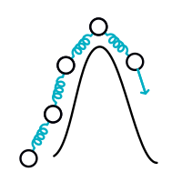
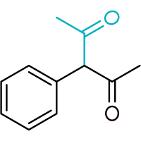

# 推荐主题

!!! note "DFT"

    

!!! note "DLPNO-CC"

    

!!! note "NEB-TS"

    

!!! note "构象（GOAT）"

    

# ORCA 6.1 手册

{ width="80%" align="center" }

**- 一个从头算（*ab initio*）、密度泛函（DFT）与半经验 SCF-MO 程序包 -**

**版本 6.1**

*设计与科学指导：*
**Frank Neese**\
*技术指导：* **Frank Wennmohs**

Max-Planck-Institut für Kohlenforschung\
Kaiser-Wilhelm-Platz 1, 45470 Mülheim a. d. Ruhr, Germany\
`department-mts@kofo.mpg.de`

*撰稿人：*

*MPI für Kohlenforschung：*\
Ahmet Altun, Daniel Aravena, Michael Atanasov, Alexander A. Auer, Ute Becker,
Giovanni Bistoni, Markus Bursch, Dmytro Bykov, Marcos Casanova-Páez, Vijay G. Chilkuri, Pauline Colinet, Dipayan Datta,
Achintya Kumar Dutta, Nicolas Foglia, Dmitry Ganyushin,
Miquel Garcia-Rates, Tiago L. C. Gouveia, Yang Guo, Andreas Hansen, Ingolf Harden, Benjamin Helmich-Paris,
Lee Huntington, Róbert Izsák, Riya Kayal, Emily Kempfer, Christian Kollmar, Axel Koslowski,
Simone Kossmann, Lucas Lang, Marvin Lechner, Spencer Leger,
Dagmar Lenk, Dimitrios G. Liakos, Dimitrios Manganas,
Dimitrios A. Pantazis, Anastasios Papadopoulos, Taras Petrenko, Petra Pikulová,
Peter Pinski, Shashank V. Rao, Christoph Reimann, Marius Retegan,
Christoph Riplinger, Michael Roemelt, Masaaki Saitow,
Barbara Sandhöfer, Yorick L. A. Schmerwitz, Kantharuban Sivalingam,
Bernardo de Souza, Georgi L. Stoychev, Van Anh Tran, Willem Van den Heuvel, Zikuan Wang, Hang Xu

*FACCTs GmbH：*\
Markus Bursch, Nicolas Foglia, Miquel Garcia-Rates, Ingolf Harden, Hagen Neugebauer, Mustafa C. Ozdemir, Anastasios Papadopoulos, Christoph Plett, Christoph Riplinger, Bernardo de Souza, Georgi L. Stoychev

*其他机构：*\
Vilhjálmur Åsgeirsson, Christoph Bannwarth, Giovanni Bistoni, Martin Brehm, Ronald Cardenas, Garnet Chan, Martina Colucci, Sebastian Ehlert, Marvin Friede, Lars Goerigk, Stefan Grimme, Waldemar Hujo, Mihály Kállay, Holger Kruse, Marcel Müller, Jiri Pittner, Philipp Pracht, Gianluca Regni, Liviu Ungur, Edward Valeev, Lukas Wittmann

*本手册的其他贡献者：*\
Wolfgang Schneider, Gregor Giesen, Johannes Grün

<!--- APPENDIX --->

