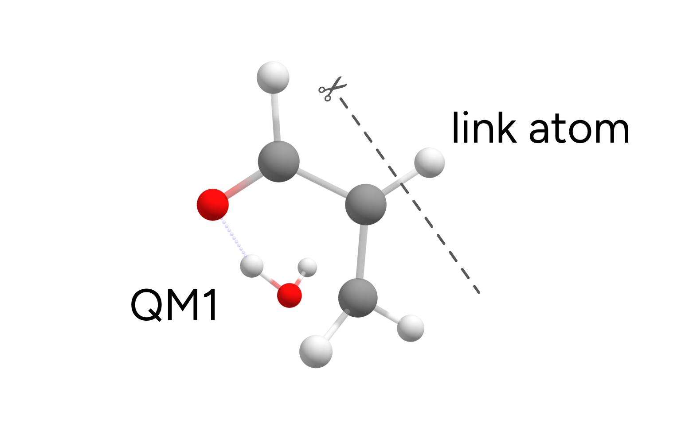

# QM/XTB 之外的 ONIOM 方法

在 ONIOM 计算中，没有必要局限于将 XTB 作为低水平方法。ORCA 中可用的任意两种方法都可以组合使用！让我们通过研究以下脱水反应的过渡态能量来探索其中的一些可能性：

[](../images/reaction.png)

反应物和过渡态取自 BHDIV10 集合，它是 GMTKN55 基准集的一个子集 [[Grimme2017b]](../bib.md#grimme2017b)。反应物（ed1）和过渡态（ts1）的几何结构来自[这里](http://www.thch.uni-bonn.de/tc.old/downloads/GMTKN/GMTKN55/BHDIV10.html)。

## 例 1：杂化与非杂化 DFT 的混合

我们先试试两种 DFT 方法的组合：高水平的杂化泛函 wB97X-D3/DEF2-TZVP 和较低水平的 PBE/DEF2-SVP。我们对 QM 区域的划分依然要考虑反应发生在哪里，以及哪些部分需要用更高的精度来建模。

在这个具体例子中，脱水反应相当局域化，我们将体系划分如下：

[](../images/ts.png)

写成 ORCA 输入文件就是：

```text
!QM/QM2 WB97X-D3 DEF2-TZVP
%QMMM QM2CUSTOMMETHOD "PBE D3BJ DEF2-SVP"
      QMATOMS {2:3} {6:13} END
END
* XYZ 0 1
(...)
```

*QM/QM2* 标志表示我们将再次使用两种不同的 QM 方法。第一种高水平方法照常在同一输入行中定义，这里是 *wB97X-D3 DEF2-TZVP*。第二种在 *%QMMM* 中的 *QM2CUSTOMMETHOD* 之后以字符串形式给出，这里选择的是 `PBE D3BJ DEF2-SVP`。

然后用 *QMATOMS* 列表定义高水平区域，所有其他原子则被分配到低水平区域。由此得到的结果为 $E^{ONIOM}_{barrier} = 24.29$ $kcal/mol$，与完整的 wB97X-D3/DEF2-TZVP 结果 $E^{wB97X-D3}_{barrier} = 24.34$ $kcal/mol$ 非常接近。

## 计算 QM2 区域电荷的方法

仔细查看最开始打印的 ONIOM 头信息，你可能已经注意到了对 Hirshfeld 电荷的引用：

```text
QM2 method                             ... Custom-QM2
        QM2 method                     ... PBE D3BJ DEF2-SVP
        QM2 basis                      ...
Coupling Scheme                        ... subtractive
Embedding Scheme                       ... electrostatic
PrintLevel                             ... 1
Method for determining QM2 charges     ... Hirshfeld
Charge of total system                 ... 0
```

这与在低水平（QM2）下如何计算电荷有关，这些电荷稍后将按静电嵌入的需要用于高水平方法（QM1）的计算（参见[什么是"静电嵌入"？](../multi/basics.md#elecembedding)）。

如有需要，可以通过在 `%QMMM` 中设置 *Charge_Method* 来更改，可选项有：

```text
%QMMM Charge_Method     Hirshfeld # (default)
                        # CHELPG
                        # Mulliken
                        # Loewdin (default for QM2 = AM1 or PM3)
END
```

对于 XTB，使用的是直接通过 XTB 方法计算得到的电荷。我们不建议更改这些选项，但为了完整起见，仍在此列出这些可选项。
一如既往，更多细节可以在 [ORCA 手册](https://www.faccts.de/docs/orca/6.0/manual)中找到。

## 例 2：CCSD(T) 与 DFT 的混合

混合 DFT 方法得到的结果（$E^{ONIOM}_{barrier} = 24.29$ $kcal/mol$）与参考值——采用大基组外推的耦合簇结果 $E^{Ref}_{barrier} = 25.65$ $kcal/mol$ ——相比并不差。

然而，能垒上 $1.4$ $kcal/mol$ 的误差会导致速率常数出现一个数量级的误差，而这也许还能改进。

实际上，我们可以通过在一次运行中组合 CCSD(T) 和 DFT 来实现这一点！具体来说，我们可以这样组合 DLPNO-CCSD(T) 和 DFT：

```text
!QM/QM2 DLPNO-CCSD(T) DEF2-TZVP DEF2-TZVP/C RIJCOSX
%QMMM QM2CUSTOMMETHOD "PBE D3BJ DEF2-SVP"
      QMATOMS {2:3} {6:13} END
END
* XYZ 0 1
(...)
```

与耦合簇相关的更多细节可以在[相关能](../prop/corren.md#corren)一节中找到，但需要特别指出的是，使用 *!PAL16* 调用 16 个核心时，这些计算只花了 30 秒！

从 CCSD(T)/DFT ONIOM 得到的能量为 $E^{ONIOM}_{barrier} = 25.48$ $kcal/mol$，非常接近参考值，仅相差 $0.17$ $kcal/mol$。下表列出了几种组合的数值：

| 方法 | $E_{binding}$ kcal/mol |
| --- | --- |
| 完整 wB97X-D3 | 24.34 |
| 完整 XTB | 32.73 |
| wB97X-D3/XTB | 24.06 |
| wB97X-D3/PBE | 24.49 |
| wB97X-D3/wB97X-D3 | 24.34 |
| DLPNO-CCSD(T)/PBE | 25.48 |
| DLPNO-CCSD(T)/wB97X-D3 | 25.34 |
| 参考值 [[Grimme2017b]](../bib.md#grimme2017b) | 25.65 |

## 连接原子（link atoms）

你可能想知道 ORCA 在进行多尺度计算时如何处理断开的键。毕竟，我们在这里把分子拆成了两部分，并在不同水平上处理了每一部分。

在 QM/MM 或 ONIOM 方法中，这通过"连接原子（link atoms）"的概念来解决 [[Hobza2011]](../bib.md#hobza2011)。其做法是用原子–氢键取代任意两个原子之间的单键，在两侧均如此。这里有一些预定义的规则来规定具体做法，连接原子的数目会在输出开头的 ONIOM 头信息中打印出来：

```text
Size of different subsystems (in atoms):
Size of QMMM System                    ... 16
Size of QM2 Subsystem                  ... 6
Size of QM1 Subsystem                  ... 10
Number of link atoms                   ... 1
Size of QM1 Subsystem plus link atoms  ... 11
Size of region for optimizer           ... 16
        optimized atoms = activeRegion ... 16
```

这里我们只有 1 个连接原子。仔细查看高水平 QM 计算的输出，实际上在该水平上计算的分子是：

[](../images/link.png)

这完全不用担心，ORCA 会在内部完成所有必要的修正。但如果你需要更多细节或想更改某些内容，请查阅 [ORCA 手册](https://www.faccts.de/docs/orca/6.0/manual)。

> **重要**
> **在定义 QM1 和 QM2 区域时，你不能：**
> : 1. 切断与氢相连的键，因为它反正会被一个 H 连接原子所取代。
> 2. 切断双键/三键/多重键，因为连接原子方法无法修正这种情况。

### 结构

### 反应物

```mol
title: basics-otheroniom #6
theme: chem311
height: 360px
representation: ball-stick
--- xyz ---
16
structure
C       -2.118863000      0.733915100     -0.120354900
C       -0.831065600      1.027745800     -0.298682000
C        0.346267900      0.196662000     -0.060529900
C        1.517385500      0.831557800      0.040795600
H       -2.872626600      1.481366900     -0.350860500
H       -0.646969800      2.040075700     -0.642602600
H        1.583772600      1.909747800     -0.084134500
O        2.682971400      0.193400100      0.324250900
H        3.417369900      0.805818600      0.318366600
C        0.227135500     -1.310846700      0.062980100
H       -0.666494300     -1.638084100     -0.465969200
H        0.066950500     -1.569178200      1.120977100
O        1.281736200     -2.037363300     -0.502500400
H        2.113152500     -1.771922400     -0.108879900
O       -2.573710900     -0.451182700      0.348621600
H       -3.527011700     -0.441712500      0.418522000
```

### 过渡态

```mol
title: basics-otheroniom #7
theme: chem311
height: 360px
representation: ball-stick
--- xyz ---
16
structure
C       -1.989594700      0.968799900      0.378632800
C       -0.704362000      1.213317200      0.126101400
C        0.333797200      0.312882800     -0.347547900
C        1.628514700      0.793545600     -0.597906200
H       -2.642025400      1.765159500      0.723432700
H       -0.397850600      2.241771700      0.287952900
H        1.791013100      1.881154900     -0.658145900
O        2.626330800      0.037013800     -0.675321300
H        2.218546300     -1.160637800      0.101755700
C        0.226280200     -1.101394500     -0.443491500
H        0.642003100     -1.582300600     -1.324430400
H       -0.660602500     -1.596253300     -0.069544500
O        1.550722700     -1.816403300      0.568157400
H        1.427509000     -1.489854300      1.467453400
O       -2.549787700     -0.269328800      0.267408200
H       -3.500494100     -0.197472700      0.195493200
```
