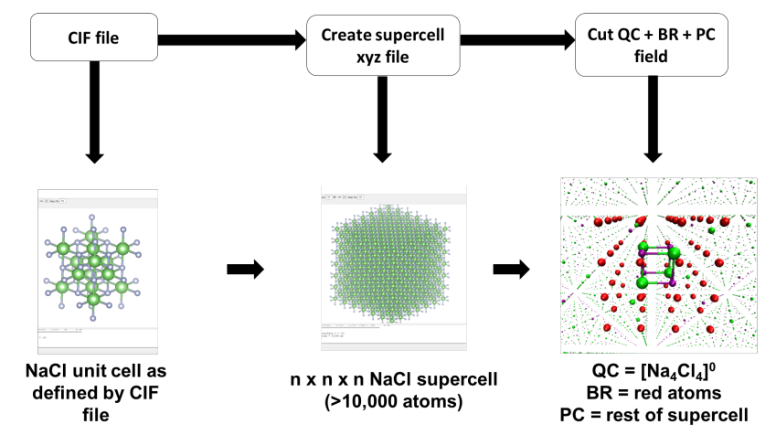
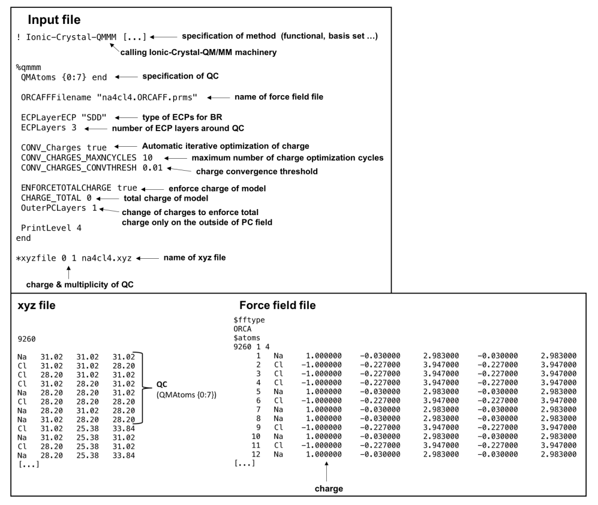
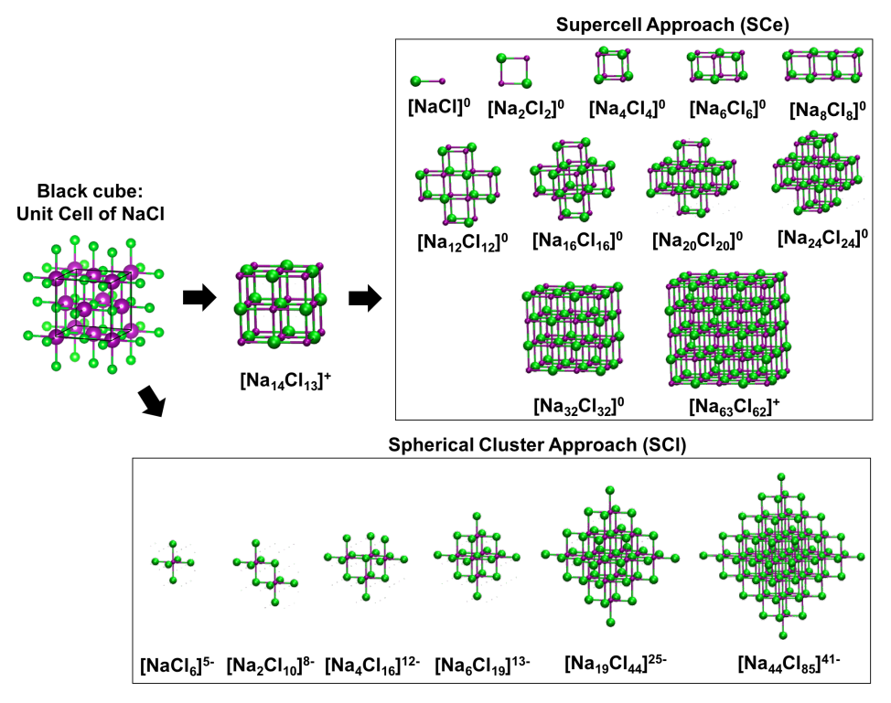
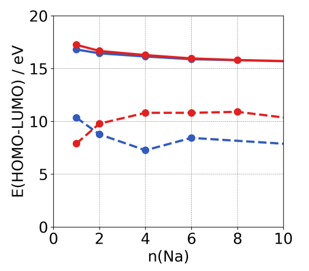

# 离子晶体-QM/MM（Ionic-Crystal-QM/MM）

对离子型无机晶体（ionic inorganic crystals）进行建模颇具挑战性，尤其是在需要高精度的时候。周期性计算通常依赖基于密度的方法，而这些方法可能缺乏某些性质所要求的精度。静电嵌入（electrostatic embedding）方法——例如 Ionic-Crystal-QM/MM——通过将先进的量子力学（QM）方法整合到固态建模中，克服了这一问题。

Ionic-Crystal-QM/MM 模型将一个量子区域嵌入到经典的点电荷环境中，从而能够对固态体系进行准确而高效的建模。它把 ORCA 中所有分子水平 QM 方法的能力扩展到晶体材料的研究中，为基态和激发态提供细致的洞察。

在本教程中，我们将探索 Ionic-Crystal-QM/MM 模型，并引导你了解如何在 ORCA 中使用它。

## Ionic-Crystal-QM/MM 模型的总体结构

Ionic-Crystal-QM/MM 模型由一个代表晶体的大超胞（supercell）构成。下图以氯化钠为例进行了说明。

[](../images/ionic_crystal_nacl.png)

*图：NaCl 的静电嵌入团簇模型，包含 QC（quantum cluster：量子簇，中心的原子结构，绿色为 Cl、紫色为 Na）、BR（boundary region：边界区域，红色）和 PC（point charge field：点电荷场，小圆点）。*

超胞的中心是用量子力学处理的中心原子团簇，称为**量子簇（quantum cluster, QC）**。QC 是计算的焦点，因此它必须足够大，以捕捉所需的性质并保持晶体结构的重要特征。关于如何选择其大小的更多细节将在下文介绍。

然而，仅靠 QC 无法解释长程静电效应，而这些效应对模拟固态体相性质至关重要。为此，该模型在 QC 周围引入了**点电荷（point charge, PC）场**。这些点电荷模拟周围的晶格，并确保 QC 的行为如同处于晶体体相中一样。

为了准确反映晶体的静电性质，PC 场必须满足三个关键条件：

1. 保持马德隆常数（Madelung constant）：PC 必须数量足够且位置合理，以确保 QC 原子感受到正确的静电环境。
2. 保证均匀的电荷分布：PC 的电荷必须与其在晶格中所代表的离子相匹配，在整个模型中保持均匀的电荷分布。
3. 守恒电荷中性：QC 与 PC 的总电荷必须为零，这可能需要调整 PC 的电荷（尤其是在 PC 场的边缘），以避免对 QC 产生不希望的影响。

此外，在 QC 和 PC 之间还引入了一个由**静电核势（electrostatic core potentials, ECPs）**构成的**边界区域（boundary region, BR）**。这个 BR 有助于减少 QC 表面不饱和键引起的表面或界面效应，保持可能被破坏的局域轨道对称性，并防止 QC 与 PC 之间的人为电荷转移，避免 QC 电荷过度离域。

在接下来的各节中，本教程将引导你在 ORCA 中设置这样的模型——无论是手动设置还是使用 ORCA_CrystalPrep 工具——并说明在 ORCA 中运行 Ionic-Crystal-QM/MM 计算所必需的计算流程。

## 手动以及用 ORCA_CrystalPrep 创建静电嵌入团簇模型

晶体的静电嵌入团簇模型是由其超胞构建的，超胞是 QC、BR 和 PC 场的基础。第一步是创建合适的超胞，它可以从通常存储在晶体学信息文件（Crystallographic Information File, CIF）中的晶胞实验结构导出。你可以使用 VESTA、MERCURY 或 CRYSTAL 等晶体学或化学软件将该 CIF 转换为超胞。

有了超胞之后，通过从其中心截取一部分来定义 QC 和 BR。这一步可以使用 AVOGADRO、Jmol 或 CHIMERA 等分子建模软件完成。不属于 QC 或 BR 的其余原子被分配到 PC 场。最终模型可以保存为 .xyz 文件中的笛卡尔坐标，并可整合到 ORCA 输入文件中进行后续计算。该过程如下图所示。

[](../images/supercell_to_model.png)

*图：利用 CIF 数据创建超胞并得到 QC、BR 和 PC 场，从而构建静电嵌入团簇模型的流程示意。*

另外，ORCA_CrystalPrep 工具可以自动化这一过程。ORCA_CrystalPrep 构建超胞、创建 QC、BR 和 PC 场，并生成相应的 ORCA 输入文件。要了解其基本功能，可以使用命令：

```text
ORCA_crystalprep
```

要生成模板输入文件，请使用：

```text
ORCA_crystalprep nacl.inp -geninput
```

该命令会创建一个输入模板，这里我们示例性地将其命名为 "nacl.inp"（因为我们以氯化钠建模为例），其中给出了可按需自定义的基本关键词选项。用于生成模型的输入文件可以用 ORCA_CrystalPrep 运行，如下所示：

```text
ORCA_crystalprep nacl.inp
```

模板输入文件包含生成超胞和指定静电嵌入模型的说明。例如，你可以指定晶体数据从 CIF 中读取，并用 DoCIF true 和 SCDimension "15x15x15" 等关键词定义超胞大小。模板的重要部分如随后的图所示。

[](../images/input_crystalprep.png)

*ORCA_CrystalPrep 输入文件示例节选，通过 ORCA_CrystalPrep 的 "geninput" 生成并相应修改。*

要从超胞创建静电嵌入团簇模型，你需要在 ORCA_CrystalPrep 输入文件中定义原子类型（例如 Na 和 Cl）、它们的电荷和自旋，并启用 DoEmbedding true 关键词（见上面的模板）。QC 和 BR 是基于围绕超胞中心的原子层来定义的。第一层原子定义 QC，第二层形成 BR。这是 ORCA_CrystalPrep 中的默认设置，但你也可以按体积或特定原子选择来选取 QC 和 BR。

任何未分配给 QC 或 BR 的原子都会自动分配到 PC 场。ORCA_CrystalPrep 会为每个区域生成单独的 .xyz 文件，这些文件随后可用于创建 ORCA 输入文件，采用"简单"嵌入方法或 Ionic-Crystal-QM/MM 计算。关键词 DoSimpleInput true 和 DoICQMMInput true 分别激活这些选项。简单输入使用默认的 ORCA 输入文件结构，而 Ionic-Crystal-QM/MM 则利用 ORCA 的 QM/MM 模块。在本教程中，我们将引导你手动创建后一种类型的输入文件，因为它代表了最先进的方法。

## 创建 Ionic-Crystal-QM/MM 输入文件

Ionic-Crystal-QM/MM 输入结构使用 ORCA 的 QM/MM 环境来计算静电嵌入团簇。我们需要三个不同的输入文件：ORCA 输入文件、超胞结构文件和力场（force field）文件。稍后将对此进行说明。

[](../images/input_ionic_crystal.png)

*图：在 ORCA 中使用 Ionic-Crystal-QM/MM 对 [$\mathrm{Cl}_{4}$]^0 团簇进行静电嵌入团簇计算的示例输入文件（上）、相应的 xyz 文件（左下）和力场文件（右下）。*

我们从超胞的 xyz 文件开始。它要么来自你之前的 ORCA_CrystalPrep 运行，要么如上所述手动创建。当使用 ORCA_CrystalPrep 创建 Ionic-Crystal-QM/MM 输入文件时，不需要显式选择和定义 QC 与 BR 的坐标，因此你可以直接使用它。不过，通常建议预先定义 QC，理想情况下把相应的坐标放在超胞 xyz 文件的开头，以便于查看。

由于我们使用 QM/MM 环境，需要一个定义每个格点电荷的力场文件。因此，要为超胞结构的 xyz 文件创建一个定义每个格点电荷的力场。使用 ORCA_MM 工具通过以下命令创建该力场文件：

```text
ORCA_mm -makeff na4cl4.xyz -CEL Na 1.0 -CEL Cl -1.0
```

该命令会创建一个力场文件（例如 "na4cl4.ORCAFF.prms"），其中包含后续步骤所需的所有信息。

在 ORCA 输入文件中，关键词 Ionic-Crystal-QMMM 用于指定要进行晶体计算，调用 QM/MM 引擎。力场文件和 xyz 文件的位置必须在输入文件中明确指定。QC 由关键词 QMAtoms {...} 定义，其中以原子在力场和 xyz 文件中的位置来指定要进行量子力学处理的原子（即 QC）。另外，也可以用关键词 QMLayers 加上一个指定层数的整数，按层来定义 QC。这种基于层的自动定义对于大团簇或初步计算尤其有用。

BR 同样可以用关键词 ECPLayerAtoms {...} 按特定原子定义，或用关键词 ECPLayers 加一个整数按层定义。通常 BR 按层而不是按单个原子定义，除非 QC 高度不对称，或 QC 内的特定原子需要用 ECP 替换。默认的 ECP 类型是 SDD，可以用 ECPLayerECP 关键词更改。

使用 Ionic-Crystal-QM/MM 时，ECP 和 PC 的电荷可以通过基于 CHELPG 电荷的迭代过程自动优化。这种自动电荷优化简化了工作流程，并减少了潜在的误差来源。关键词 Conv_Charges、Conv_Charges_Maxncycles 和 Conv_Charges_Convtresh 分别用于指定要优化的电荷、最大优化循环数和收敛阈值。

EnforceTotalCharge 关键词对模型施加一个总电荷，其中 Charge_Total 指定电荷的数值。通常将总电荷设为零以保持整体中性，尽管对于离子势或电子亲和能等特定计算，其他取值也可能是合适的。关键词 OuterPCLayers 与一个整数一起定义 PC 场的外层，可以对其加以调整以中和总电荷，尤其是在电荷分布不平衡的情况下。

总体而言，Ionic-Crystal-QM/MM 通过自动化电荷优化与中和，简化了静电嵌入的流程，使其成为计算嵌入团簇的一种稳健而高效的方法。

## 如何选择量子簇（QC）

要确定什么样的量子簇（QC）才适合计算，首先需要理解 QC 的目的。QC 是模型中计算量子力学性质的部分，因此它必须准确地代表晶体结构，更重要的是代表所关注的特定性质。根据所关注的性质，QC 可能需要包含所有相关类型的原子、键和对称元素。对于局域性质，较小的 QC 可能就足够了；而更广延的、长程的或离域的性质通常需要更大的 QC。如果性质依赖于晶体中特定原子位点的局域点群（point group），则 QC 必须保持该原子的对称环境，这在共价体系中尤为关键。

[](../images/nacl_SCe_SCl.png)

*图：NaCl（岩盐结构）在超胞方法（SCe）和球形团簇方法（SCl）下的不同 QC 尺寸。*

以 NaCl 体系为例，可以识别出两种构建 QC 的主要方法：超胞或晶胞方法（SCe）与球形团簇或配体场方法（SCl）。在 SCe 方法中，QC 由数量递增的 NaCl 构建单元搭成，形成一个完整的晶胞或超胞。该方法确保模型呈电荷中性或接近中性，这可能是一个优势。然而，SCe 方法的一个潜在缺点是，它可能破坏具有局域对称元素的结构中不可或缺的键。

SCl 方法保持特定中心周围的配位环境，从而维持 QC 内的关键对称元素。例如，在 NaCl 体系中，Na^+ 离子周围的八面体环境得以保留。当中心的点群对光谱等性质至关重要，或在研究局域对称性的影响时，这种方法尤其有用。不过，SCl 团簇往往带有很高的电荷，这可能带来困难。也可以构建 SCl 模型的反向形式，例如 [Na_6Cl]^5+ 代替 [NaCl_6]^5-。

对于大多数性质而言，只要建模得当，SCe 和 SCl 方法通常给出相似的结果，但其中一种方法可能比另一种收敛得更快。例如，在计算 NaCl 的 HOMO-LUMO 能隙时，SCe 和 SCl 两种方法都收敛到相同的值，但 SCe 方法可能用更小的 QC 就能做到。

[](../images/nacl_HL.png)

*随着 SCe（红色）和 SCl（蓝色）NaCl 团簇增大，HOMO-LUMO 能量的收敛情况，含（实线）与不含（虚线）静电嵌入环境。*

在某些情况下，"杂化"QC 模型可能更有利。这种方法允许将 QC 内选定的原子以较高的理论水平计算，而团簇的其余部分则用更经济的方法计算，例如使用小基组和核势的 Hartree-Fock（HF）。当 QC 需要很大，或只有少数原子需要高精度时，这种杂化模型尤其有用。此外，"QC + HF"模型可以平滑从 QC 到静电环境的过渡，减少界面效应，并考虑 QC 表面的键，这对于偏共价的体系尤为重要。

[](../images/nacl_HF_layer.jpg)

*构建 "QC + HF" 团簇模型：以 [$\mathrm{Cl}_{19}$]^13– 作为 QC，用 HF 层扩展到 [$\mathrm{Cl}_{62}$]^+，以及相应的 Ionic-Crystal-QM/MM ORCA 输入文件。色标：用 HF 处理的 QC 部分（蓝色）。*

HF 团簇的结构可以根据计算目的而变化，并且可以像 Ionic-Crystal QM/MM 那样通过选择特定原子或按层来定义。ORCA_CrystalPrep 可以预定义 HF 结构，将 QC 整合到更宽的模型中。NaCl 体系中的一个例子展示了 QC 采用 SCl 几何结构，而经 HF 计算的原子将其扩展为 SCe 结构，从而兼得两种方法的优点。这种杂化方法确保整个 QC 近似电荷中性，同时保持用于准确性质计算所必需的点群。
