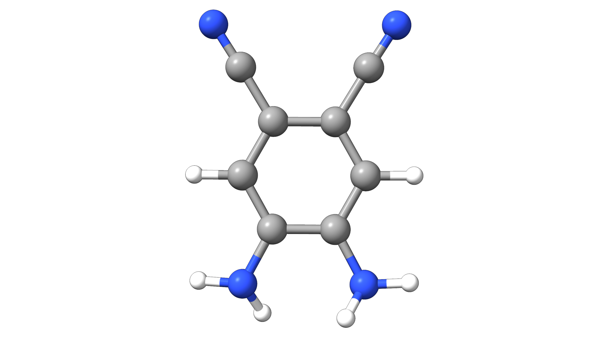

# 电荷模型

## 最小基迭代股票持有人方法（MBIS）

最小基迭代股票持有人方法（Minimal Basis Iterative Stockholder, MBIS）[[Ayers2016]](../bib.md#ayers2016) 是 Hirshfeld 方法的一种变体。
该方法的核心思想是将自由原子密度（pro-atomic density）在一组最小的原子中心 s 型 Slater 函数上展开。
MBIS 可用于多种应用，例如力场（force-field）参数化或原子极化率（atomic polarizabilities）的重标定。

只需简单的输入关键词 `MBIS` 即可轻松请求 MBIS 电荷：

```text
!wB97X-V DEF2-TZVP MBIS
```

在 ORCA 中，还可以在 MBIS 方案下计算原子偶极矩（dipole）、四极矩（quadrupole）和八极矩（octupole）。
这些可以通过扩展输出选项打印：

```text
%method
MBIS_LARGEPRINT TRUE  # default = FALSE 
end
```

MBIS 还有各种其他可用选项，详见 [ORCA 手册](https://www.faccts.de/docs/orca/6.0/manual)。

### 示例：5,6-二氨基苯-2,3-二甲腈

在本例中，我们将计算 5,6-二氨基苯-2,3-二甲腈（5,6-diaminobenzene-2,3-dicarbonitrile）的 MBIS 性质。对于一个中性化合物，该分子具有很高的实验偶极矩
10.5±0.2 Debye [[Müllen2016]](../bib.md#mullen2016)。

[](../images/mbis-example-2.png)

*图：5,6-二氨基苯-2,3-二甲腈的分子结构。*

```mol
title: 5,6-二氨基苯-2,3-二甲腈
theme: chem311
height: 360px
representation: ball-stick
--- xyz ---
18
structure
  N       1.34721241437119     -0.19875204578868      2.39728170838216
  C       0.70867203692614     -0.08409568583235      1.17165794089898
  C      -0.69557523765992     -0.03503410755084      1.15547373801566
  N      -1.36695245837416     -0.05357620226644      2.36862799274125
  C      -1.35463448913564      0.08033827321651     -0.05146262039998
  H       2.34810629260485     -0.10903909384438      2.36022439042418
  C      -0.65492341506459      0.11650354440257     -1.24923904175946
  C      -1.38024608777480      0.22912849642218     -2.47568708881038
  C       0.73267914111713      0.02684352514116     -1.23535246715296
  C       1.49072510922012      0.04700848828691     -2.44697511349353
  C       1.40013842906872     -0.06847776855218     -0.02246437719730
  H      -2.36630779122682     -0.13781135092574      2.29511415417341
  H       0.95194597461754      0.38337577789381      3.11975943676764
  N      -1.98904585311221      0.31503849289177     -3.44573900381660
  N       2.12487320894712      0.06661771348260     -3.40431289691542
  H      -0.98996937874613     -0.71100834890760      3.03401439822709
  H      -2.43381979990049      0.12883159310508     -0.07188432898727
  H       2.47966190412196     -0.11602130117439     -0.01964682109748
```

要获得 MBIS 电荷和原子多极矩，我们可以使用以下输入：

```text
!wB97X-V DEF2-TZVP MBIS

%method
MBIS_LARGEPRINT TRUE  # default = FALSE
end
```

现在可以在输出文件 `basename.out` 中找到 MBIS 电荷：

```text
------------------
MBIS ANALYSIS
------------------

Convergence threshold (charges)      ...        1.000e-06
Number of iterations                 ...        75

Total integrated alpha density       ...     40.999976141
Total integrated beta density        ...     40.999976141   

  ATOM     CHARGE    POPULATION     SPIN    
   0 N   -0.843167    7.843167    0.000000
   1 C    0.263784    5.736216    0.000000
   2 C    0.263771    5.736229    0.000000
   3 N   -0.843075    7.843075    0.000000
   4 C   -0.257113    6.257113    0.000000
   5 H    0.386416    0.613584    0.000000
   6 C   -0.027776    6.027776    0.000000
   7 C    0.356361    5.643639    0.000000
   8 C   -0.027781    6.027781    0.000000
   9 C    0.356301    5.643699    0.000000
  10 C   -0.257197    6.257197    0.000000
  11 H    0.386399    0.613601    0.000000
  12 H    0.384289    0.615711    0.000000
  13 N   -0.433371    7.433371    0.000000
  14 N   -0.433382    7.433382    0.000000
  15 H    0.384313    0.615687    0.000000
  16 H    0.170610    0.829390    0.000000
  17 H    0.170665    0.829335    0.000000

  TOTAL   0.000048   81.999952    0.000000
```

映射到相应原子上的电荷为：

[](../images/mbis-example-2-charges.png)

*图：映射到 5,6-二氨基苯-2,3-二甲腈各原子上的 MBIS 电荷。*

由于我们请求了详细输出，我们还可以看到原子偶极矩——

```text
 MBIS ATOMIC DIPOLE MOMENT (A.U.):
  ATOM           X             Y             Z
   0 N      -0.038063     -0.015085     -0.103028
[...]
```

四极矩，以及

```text
 MBIS ATOMIC QUADRUPOLE MOMENT (A.U.):
  ATOM          XX            YY            ZZ            XY            XZ            YZ
   0 N      -5.193045     -5.361150     -5.246319     -0.051568      0.008765      0.095347
[...]
```

八极矩

```text
 MBIS ATOMIC OCTUPOLE MOMENT (A.U.):
  ATOM          XXX           YYY           ZZZ           XXY           XXZ           XYY           XYZ           XZZ           YYZ           YZZ
   0 N      -0.327968      0.057298     -0.069317     -0.055180     -0.039158     -0.006877      0.012999      0.314176     -0.394271     -0.035321
[...]
```

> **注意**
> 请注意，ORCA 中还提供了多种其他电荷模型，包括 Mulliken、Hirshfeld 等。
